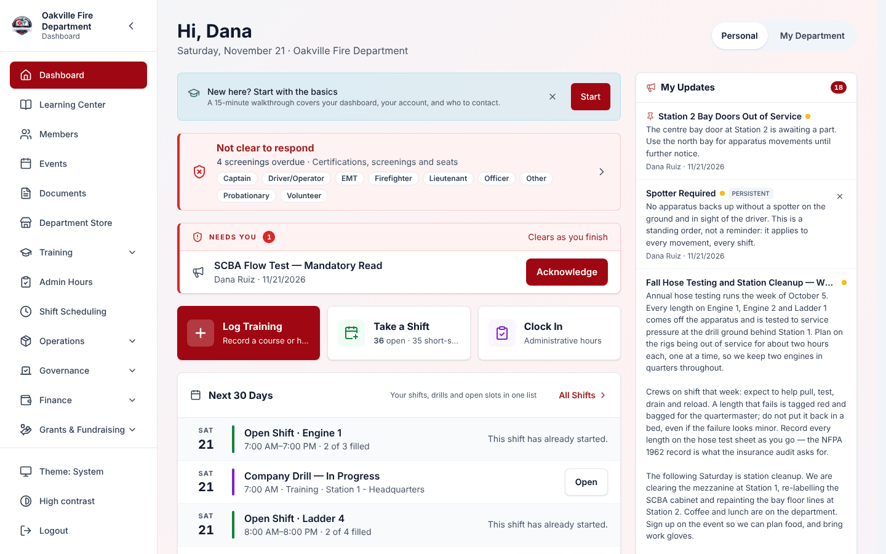
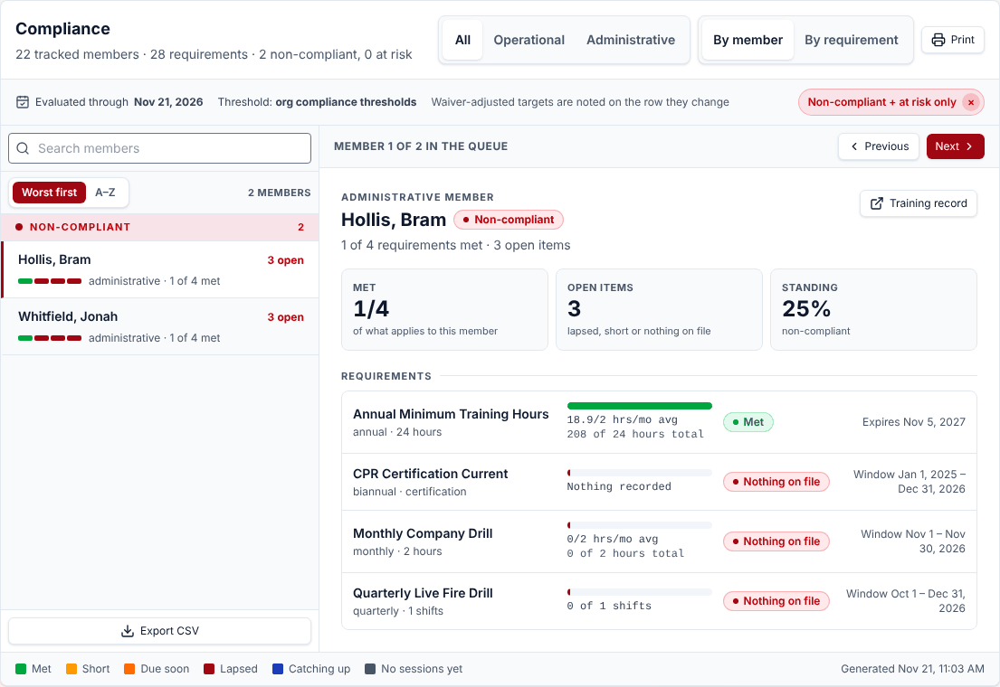
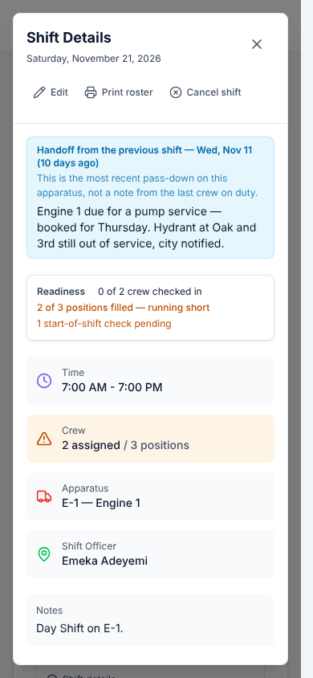
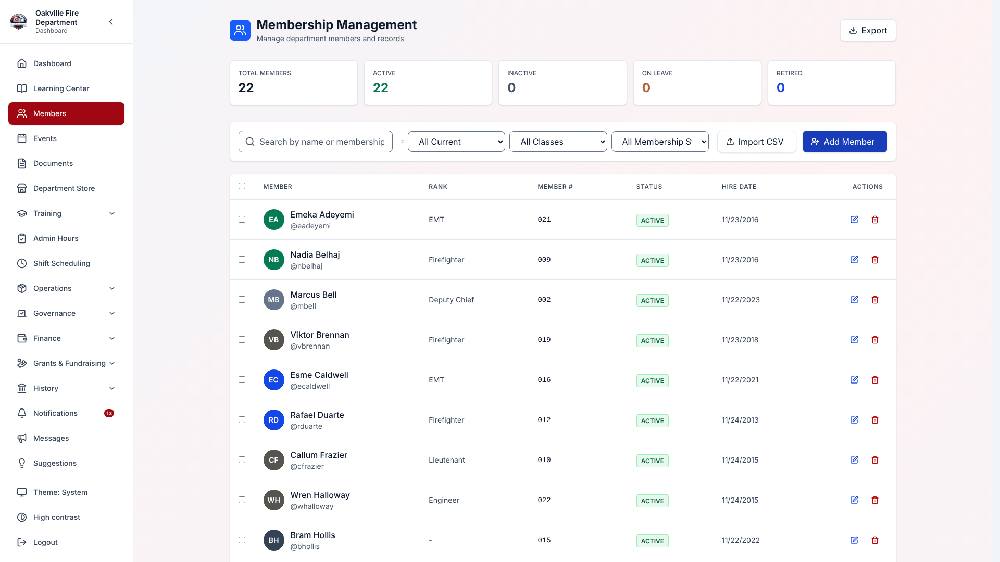
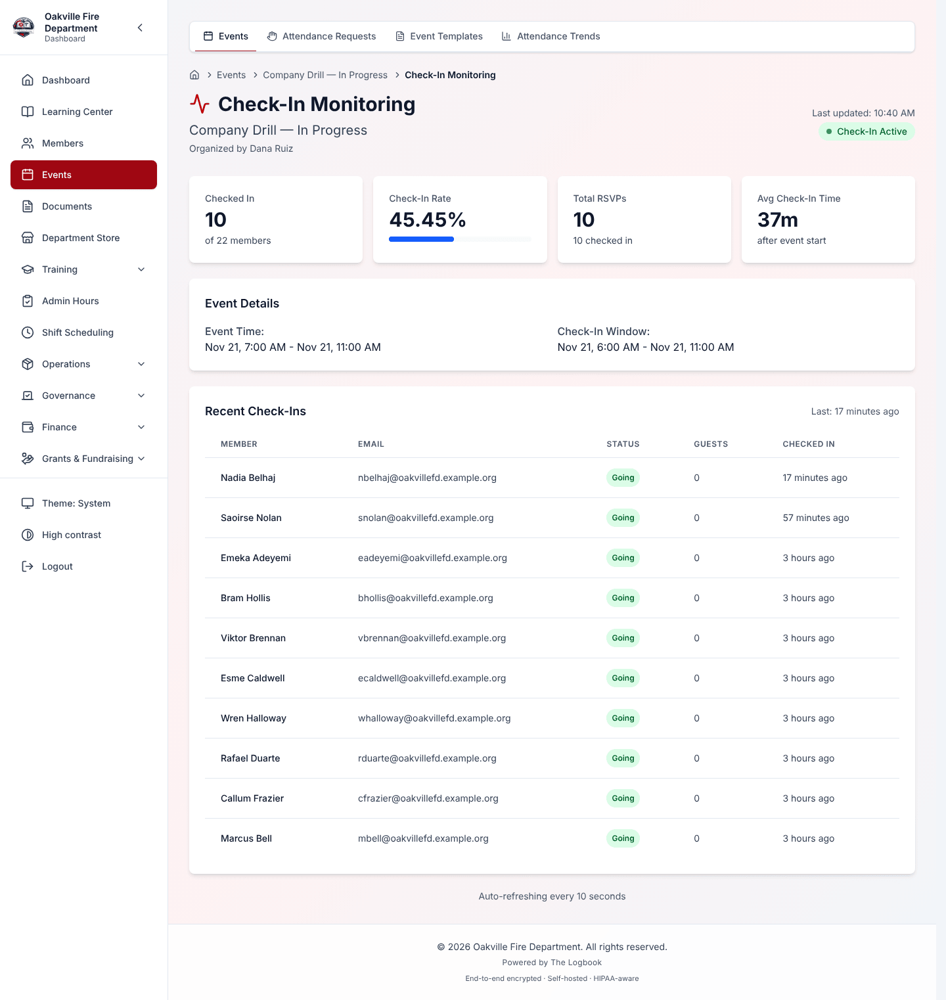
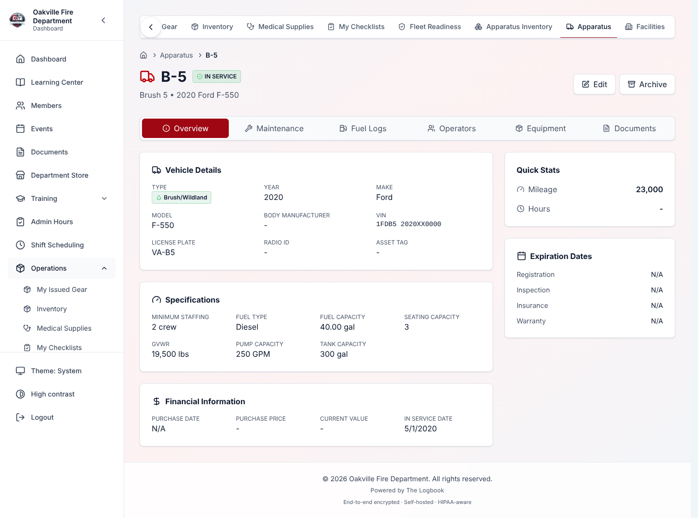

---
hide:
  - navigation
---

# Features

The Logbook brings a fire or EMS department's records into one place:
members, training, shifts, events, equipment and the paperwork that holds them
together. Each department turns on only the modules it uses.

[See why departments choose it](why.md){ .md-button .md-button--primary }
[Install it](../../wiki/Installation.md){ .md-button }

## A dashboard that tells each member what is next

{ .screenshot loading=lazy }

Every member signs in to their own next steps: shifts they are on, training
that is coming due, items waiting for their sign-off and the department's
latest updates. Officers see the same screen with their review queues added.
[Getting Started](../../docs/training/00-getting-started.md)

## Training and compliance

{ .screenshot loading=lazy }

- Requirements counted in hours, shifts, calls, skills or checklists, with
  phased programs and prerequisites.
- Members submit training they took elsewhere; officers review and approve it.
- A compliance matrix shows who is current, who is short and what is due,
  measured against the thresholds your department sets.
- Skills tests and psychomotor evaluations recorded against templates.

[Training & Certification](../../docs/training/02-training.md) ·
[Skills Testing](../../docs/training/09-skills-testing.md)

## Shifts and scheduling

{ .screenshot .screenshot--phone loading=lazy }

- Shift templates and repeating patterns, including A/B/C platoon rotations.
- Open shifts members can pick up, trades another member can accept, and
  time-off requests, each reviewed by an officer.
- Seat limits and qualifications, so a shift is staffed by people who may
  ride where they sit.
- Shift reports, call logging and attendance that count toward each member's
  hours.

[Shifts & Scheduling](../../docs/training/03-scheduling.md)

## Members

{ .screenshot loading=lazy }

Profiles, ranks and positions, membership tiers that advance with years of
service, a spreadsheet import for an existing roster, and an applicant
pipeline for people who want to join.
[Membership Management](../../docs/training/01-membership.md) ·
[Prospective Members](../../docs/training/15-prospective-members.md)

## Events and meetings

{ .screenshot loading=lazy }

Drills, meetings and public events with RSVPs and QR code check-in, including
a tablet display for each room that shows the current event's code. Meeting
minutes go from draft to approval, and elections run with eligibility rules
and secret ballots.
[Events & Meetings](../../docs/training/04-events-meetings.md) ·
[Elections & Voting](../../docs/training/14-elections.md)

## Apparatus, equipment and facilities

{ .screenshot loading=lazy }

Each apparatus keeps its maintenance, fuel logs, operators, equipment and
documents. Inventory tracks issued gear and stock with barcode or QR labels,
equipment checks run from a phone, and facilities hold their rooms,
inspections and maintenance.
[Apparatus & Facilities](../../docs/training/06-apparatus-facilities.md) ·
[Inventory](../../docs/training/05-inventory.md)

## Everything else a department runs on

- **Documents and forms**: shared folders for SOPs and policies, and a form
  builder for internal and public forms.
  [Guide](../../docs/training/07-documents-forms.md)
- **Finance**: budgets by fiscal year, purchase and expense requests and
  approval chains. [Guide](../../docs/training/11-finance.md)
- **Grants and fundraising**: grant applications, donations and pledges.
  [Guide](../../docs/training/12-grants-fundraising.md)
- **Medical screening**: screening records and their due dates, kept apart
  as health information. [Guide](../../docs/training/13-medical-screening.md)
- **Department store**: member merchandise orders, sizes and payment
  tracking. [Guide](../../docs/training/18-storefront.md)
- **Reports**: member, training, event and compliance reports to print or
  export. [Guide](../../docs/training/08-admin-reports.md)

