# Membership Management

The Membership part of The Logbook holds your department's member list and
each member's profile. It also covers applicants, member status, leave,
waivers, membership tiers and ID cards — everything from the day someone
applies to the day they retire.

## Lesson at a Glance

|                     |                                                                                                                 |
| ------------------- | --------------------------------------------------------------------------------------------------------------- |
| **Who this is for** | Every member, for the first two sections. Membership coordinators and officers who manage members, for the rest |
| **What you need**   | A Logbook account. Officer tasks need a position that lets you manage members                                   |
| **Essential path**  | Members: about 10 minutes. Officers: about 45 minutes                                                           |
| **Full guide**      | About 2 hours                                                                                                   |
| **Last verified**   | 2026-10-11                                                                                                      |
| **Owner**           | Your department's membership coordinator                                                                        |

**Members:** read [Member Directory](#member-directory) and
[Member Profiles](#member-profiles). That's all you need.

**Officers who manage members:** read the whole guide. Start with
[Adding Members](#adding-members), [Member Status Management](#member-status-management)
and [Leave of Absence](#leave-of-absence).

**New to these words?** The [Glossary](./GLOSSARY.md) explains terms such as
_member class_, _membership status_, _position_, _rank_ and _waiver_.

---

## Table of Contents

1. [Member Directory](#member-directory)
2. [Member Profiles](#member-profiles)
3. [Adding Members](#adding-members)
4. [Importing Members from CSV](#importing-members-from-csv)
5. [Member Admin Edit](#member-admin-edit)
6. [Member Audit History](#member-audit-history)
7. [Deleting Members](#deleting-members)
8. [Prospective Members Pipeline](#prospective-members-pipeline)
9. [Member Class and Member Status](#member-class-and-member-status)
10. [Rank and Qualification Are Different Things](#rank-and-qualification-are-different-things)
11. [Member Status Management](#member-status-management)
12. [Leave of Absence](#leave-of-absence)
13. [Waiver Management](#waiver-management)
14. [Rank Validation](#rank-validation)
15. [Membership Tiers](#membership-tiers)
16. [Member Lifecycle Management](#member-lifecycle-management)
17. [EVOC Certification](#evoc-certification)
18. [Member ID Cards and the Check-In Station](#member-id-cards-and-the-check-in-station)
19. [Troubleshooting](#troubleshooting)
20. [Realistic Example: New Member Onboarding](#realistic-example-new-member-onboarding-end-to-end)
21. [If You Learned an Older Version](#if-you-learned-an-older-version)

---

## Member Directory

Select **Members** in the menu to see your department's roster. Every member
can open it.

What you see depends on who you are:

| You are…                          | The page is called        | You see                                                                                                     |
| --------------------------------- | ------------------------- | ----------------------------------------------------------------------------------------------------------- |
| A member                          | **Member Directory**      | Name, rank, membership number, status, and the contact details your department and each member allow        |
| An officer who can manage members | **Membership Management** | All of the above, plus each member's username, a **Hire Date** column, an **Actions** column and **Export** |

Everyone gets the status counters at the top, search, the status filter and
page controls.

**Rank.** Each member's rank shows in your department's own wording. On a
phone it sits under the name. On a wider screen it has its own **Rank** column.

**Member #.** Officers who manage members always see this column. Other
members see it only once at least one member in the department has a number.
Before that, it would be a column of dashes, so it is left out.

You can:

- **Search** by name or membership number. The box also searches email, but
  only when you can see at least one email address. Officers can also search
  by username. You can search by a member's preferred name or their legal
  first name.
- **Filter** by status: **All Statuses**, **Active**, **Inactive**,
  **On Leave** or **Retired**. Officers who manage members also get
  **Archived**.
- **Open a member's profile** by selecting their row, their card on a phone,
  or their name. The name is a real link, so you can open it in a new tab.

**Which list opens first.** A member's directory opens on **Active**. Choose
**All Statuses** to include inactive, on-leave and retired members. Former
members who have been archived never appear in a member's directory.

An officer who can manage members opens on **All Statuses**. That list
includes archived members, because those are the records officers look after.

> **Good to know.** What the directory hides from a member is not sent to
> their browser either. A member's directory carries only what it shows: no
> usernames, hire dates, stations or platoons.

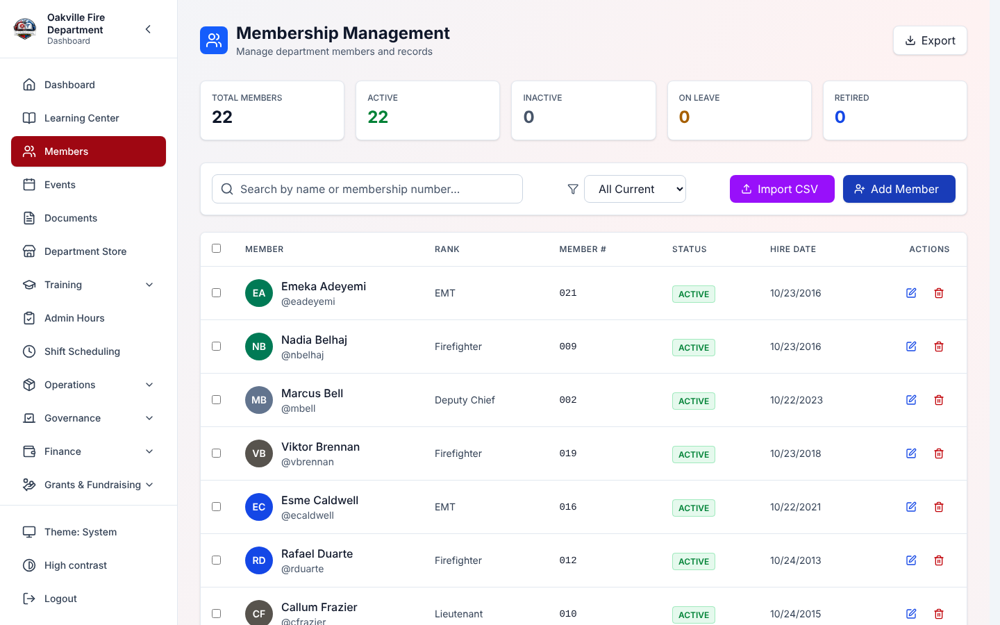

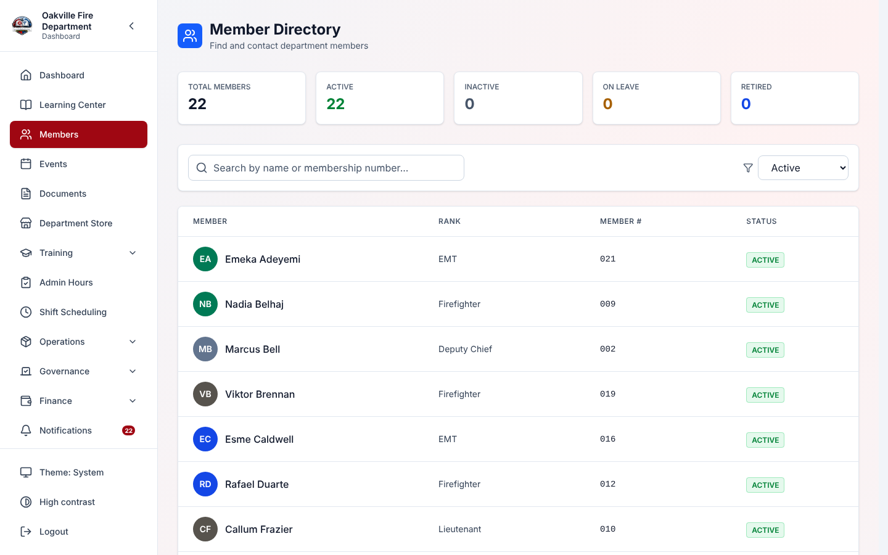

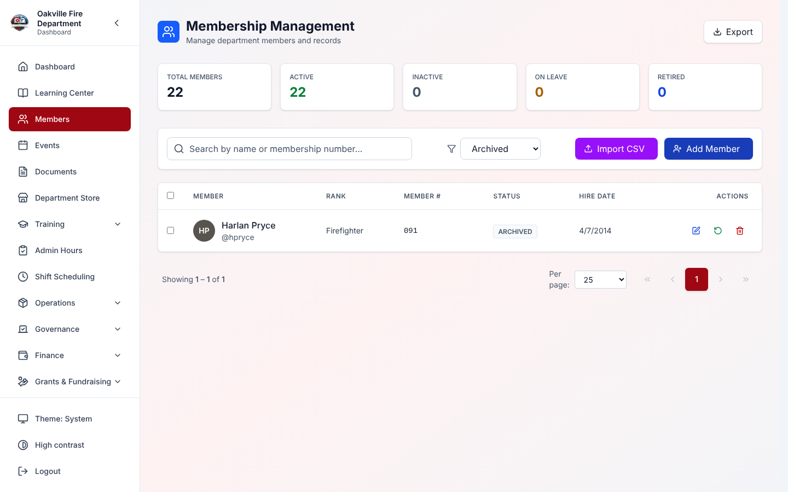

**Member statuses:**

| Status                    | Meaning                                    |
| ------------------------- | ------------------------------------------ |
| **Active**                | Currently serving                          |
| **Inactive**              | Not taking part for now                    |
| **Suspended**             | Account suspended by the department        |
| **Probationary**          | New member in their probation period       |
| **On Leave**              | On an approved leave of absence            |
| **Retired**               | Retired from active service                |
| **Dropped (Voluntary)**   | Left the department by choice              |
| **Dropped (Involuntary)** | Removed from the department                |
| **Archived**              | A former member whose departure is settled |

**Platoons.** The Platoon Roster panel in Scheduling shows each member's
current platoon, taken from their member record.

### Who Sees What on Profiles and Contact Details

A member's profile works like a directory card. Colleagues see the contact
details they are meant to look up, and not much else.

**Your department decides first.** An organization-wide setting can show or
hide email, phone and mobile for everyone. See
[contact info visibility](./08-admin-reports.md#contact-info-visibility).

**Each member then decides for themselves.** Under **My Account → Privacy**,
you can choose, field by field, whether colleagues see your:

- email;
- personal email;
- phone;
- mobile; and
- address.

If you never open this screen, nothing changes for you. Your work contact
details follow the department setting. Your home address and personal email
stay hidden from other members. Officers who manage members can always see
every field.

### Scan Member ID

**Scan Member ID** looks a member up from their badge. It lives under
**Members** in the **Administration** section of the menu. It is not part of
the ordinary **Members** link, which is the directory.

You need one of these permissions to scan. On the Role Management screen they
read:

- **View user list**, or
- **Manage member profiles**.

The permission every member has for the directory (**View member list**) is
not enough. A scan is a closer look-up than browsing the roster.

- If you hold either permission, the link shows in your menu and the page
  opens.
- If you hold neither, the link is missing and the page refuses to open.
- You can always open your own record, with or without these permissions.

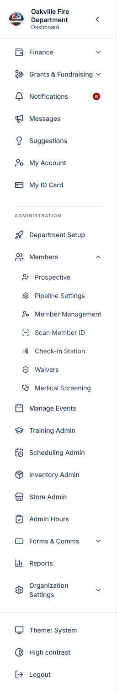

The picture above shows the officer's menu, with **Scan Member ID**. For an
ordinary member's menu, see the sidebar in the
[Getting Started guide](./00-getting-started.md): **Members** is there, but
there is no Administration section, so there is no scanner link.

### Printing Member Badges

Officers who can manage members, or who can issue ID cards, can print badges.

1. On **Members**, use a computer or tablet-sized screen. The table view has
   a checkbox on each row.
2. Tick the members you want.
3. On the selection bar, select **Print Badges**.
4. Choose a label size. Any sticker or thermal label printer works, such as
   Dymo or Rollo, or enter a custom size.
5. Download a PDF, or print.

The Logbook remembers the printer you chose for your position. This is kept
separately from the printers used for inventory and apparatus labels.

The badge barcode holds the member's **badge code** (see
[Badge Codes](#badge-codes)). **Scan Member ID** and the member-badge scanner
in member pickers and on Inventory's members page both read it.

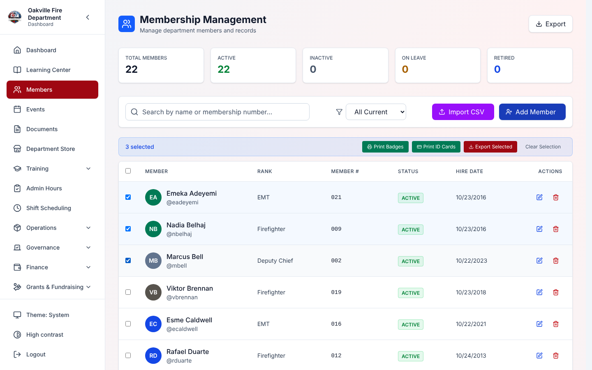

The selection bar also has **Print ID Cards** and **Clear Selection**.
**Export Selected** appears only for officers who can manage members.

### Printing Plastic ID Cards

On **Members**, select members, then select **Print ID Cards**. You need the
same permissions as for badges.

The page makes a PDF with one card side per page. Each page is exactly the
standard ID card size, called CR80 (3.375 × 2.125 inches). Any ID card printer
accepts it through its normal driver, with nothing extra to install. Examples
are Zebra ZC/ZXP, HID Fargo, Evolis, Magicard and Entrust Datacard.

| Option      | Choices                     | When to pick it                                                    |
| ----------- | --------------------------- | ------------------------------------------------------------------ |
| Orientation | Landscape, Portrait         | Portrait suits vertical clip and lanyard holders                   |
| Sides       | Front only, Front and back  | Front and back puts the code and a return address on the back      |
| Code        | Barcode (Code 128), QR code | Barcode for USB/handheld scanners, QR for phone and tablet cameras |

The page opens on your **department layout**. Changing an option affects only
the print you are doing now. **Save as department layout** makes your choices
the starting point for whoever prints next.

The back of the card says "If found, please return to:", followed by the
department's mailing address (or physical address) and phone number from
Organization settings.

**To print:**

1. Open the PDF and choose the card printer.
2. If the driver asks for a card size, pick CR80 or ID-1.
3. Print at **100%** or **Actual size**. "Fit to page" shrinks the barcode.
4. For two-sided cards, turn on duplex in the printer options, or print and
   flip by hand. Pages go front, back, front, back.

Print one **Test card** first to check the alignment. Cards print in black
only, so they look the same on a black-only ribbon as on a colour one.

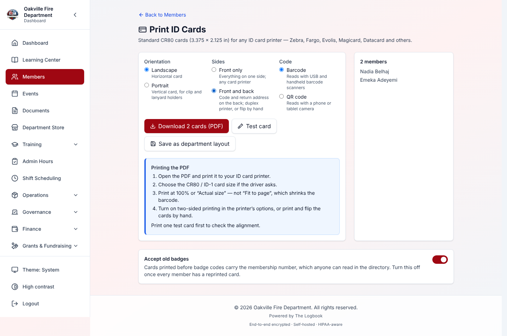

### Managing NFC ID Cards for the Department _(2026-10-25)_

If your department issues NFC ID cards, **Members → Member ID Cards**
(`/members/admin/id-cards`) is the one page for all of them. It needs the
**Manage ID cards** permission alone, so a card clerk who cannot edit the
roster can still use it. When NFC ID cards are off, the page says so at the
top and tells you where to turn them on.

| Tab          | What it is for                                                                                                                                                                                   |
| ------------ | ------------------------------------------------------------------------------------------------------------------------------------------------------------------------------------------------ |
| **Cards**    | Every card, with a search box. Tick several and **Suspend**, **Reactivate**, **Report lost** or **Revoke** them together. Each card is judged on its own, so one refusal does not stop the rest. |
| **Coverage** | Three lists: current members with no working card (issue one from the row), active cards not used for a number of days, and cards still held by former members.                                  |
| **Tap log**  | Every tap at a station or room kiosk, including refusals. Filter it, page through it, or download it as a CSV. A card the system does not know is kept only as an unreadable hash.               |
| **Settings** | How long taps are kept. The default is 24 months; you can choose 3 to 84. Older taps are deleted each night.                                                                                     |

When a member moves to a status whose taps are already refused (for example
retired or dropped), their active cards are suspended automatically and marked
as suspended by the system. If the member returns, only those cards come back;
a card an officer suspended or reported lost stays that way.

> **Screenshot to create:** Member ID Cards with the four tabs, and the Coverage
> tab. See [SCREENSHOT_CURRENCY.md](./SCREENSHOT_CURRENCY.md).

### Badge Codes

Every badge carries a **badge code**, such as `MB-7KQ2W9HXRT`. That includes
the printed card, the sticker label and the digital ID card on a member's
phone.

- The Logbook makes up the code at random.
- It is not shown in the directory.
- Only the member, and officers who can manage members or issue ID cards, can
  see it.
- The membership number is still printed on the card as text, but it does not
  scan.

**Every scanner checks with The Logbook.** The badge scanner and the inventory
member scanner send what they read to The Logbook. It answers only for members
of your own department. A home-made QR code cannot open a member's record or
check gear out to them.

**Lost a badge?** Open the member's ID card and select **Reissue badge**. The
Logbook asks "Reissue this badge?". When you confirm, every badge printed for
that member stops scanning at once. Their phone card stops too, until it
reloads. Then print them a new card.

**Older badges.** Cards printed before badge codes existed still scan while
**Accept old badges** is on. The switch is at the bottom of the Print ID Cards
page. Once every member has a new card, turn it off. From then on only badge
codes scan.

Inventory checkout always refuses a member whose account is not active,
whichever badge they show.

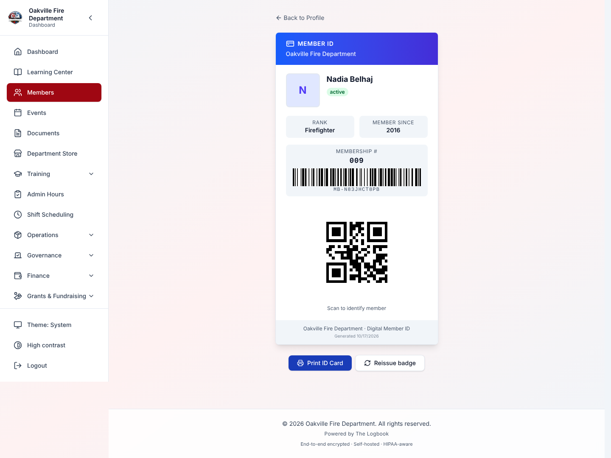

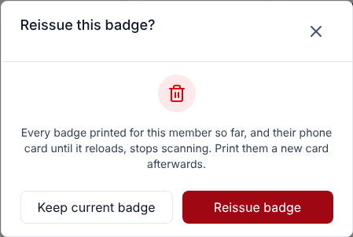

---

## Member Profiles

Select any member in the directory to open their profile.

**At the top:** the photo, name, rank and member type, username, membership
number (shown like `#021`) and position badges. The badges show position
names only, not the permissions they carry. Officers who can manage members
also get a status button here.

**The ID Card link** shows on your own profile. On a colleague's profile, it
shows only if you can manage members or issue ID cards. If someone without
either opens a colleague's card anyway, the page says "You can only view your
own ID card." and points them to the badge scanner. The scanner checks a
member in without showing their card.

**Left column:**

| Section                       | What it shows                                                                                                    | Who sees it                                                  |
| ----------------------------- | ---------------------------------------------------------------------------------------------------------------- | ------------------------------------------------------------ |
| **Training & Certifications** | A green, yellow or red compliance summary, requirements met, hours this year, certifications and recent training | The member, and officers who can manage training records     |
| **Administrative Hours**      | The member's administrative hours                                                                                | The member, and officers who can manage administrative hours |
| **Assigned Inventory**        | Equipment currently signed out to the member                                                                     | The member, and officers who can manage gear and equipment   |

**Right column:**

| Section                 | What it shows                                                                            | Who sees it                                                                               |
| ----------------------- | ---------------------------------------------------------------------------------------- | ----------------------------------------------------------------------------------------- |
| **Contact Information** | Email, personal email, phone, mobile                                                     | Depends on the department setting and the member's own choices (see below)                |
| **Address**             | Home address                                                                             | Where visible                                                                             |
| **Emergency Contacts**  | The member's emergency contacts                                                          | **Only the member and officers who can manage members.** No setting can show it to others |
| **Membership**          | Rank, member type, station, platoon and "Member since"                                   | Everyone; officers also see the status here                                               |
| **Service History**     | Credited and earlier length of service, stint by stint                                   | The member, and officers who can manage members                                           |
| **Qualifications**      | What the member is certified to do (EMT, Paramedic, Driver / Operator, Firefighter I/II) | Officers who can manage members only                                                      |
| **Quick Stats**         | Training, hours and equipment counts                                                     | Only the counts you are allowed to see                                                    |
| **Leave of Absence**    | Any active leave periods                                                                 | The member, and officers who can manage members                                           |

Date of birth is restricted the same way as emergency contacts.

**Contact Information.** If nothing is visible to you on a colleague's
profile, the panel says: "No contact details shared. This member has not
added any, or your department keeps them private."

**Service History** is explained in
[Former Members Who Rejoin](#former-members-who-rejoin).

**Qualifications** marks each entry **In force** or **Not in force**, the way
shift sign-up reads it today. It also says whether the entry is
**From a training record** or **Entered directly**. Officers can add, edit
and remove entries here. See
[Entering Qualifications Directly](#entering-qualifications-directly).

**Assigned Inventory is kept to the quartermaster.** Which coat, radio or
breathing-apparatus mask a colleague signed for is not part of their
directory card. Every member can browse the inventory catalog and their own
kit, so that permission alone does not show a colleague's gear. You need the
permission to manage gear and equipment. When you do not have it, The Logbook
does not even ask for the information. The Quick Stats equipment count
follows the same rule.

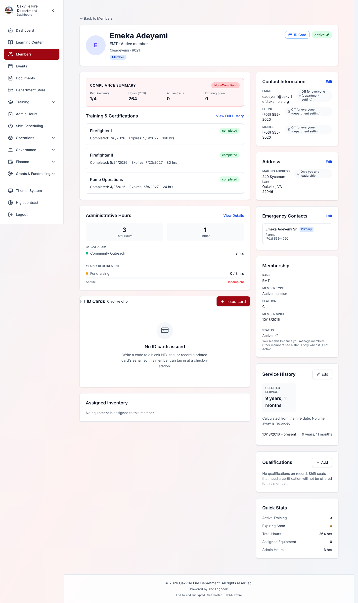

### Profile Photo Upload

You can change your own photo. Officers who can manage members can change
anyone's.

1. Point at the **photo** on the profile. **Upload** appears over it, or
   **Change** if there is already a photo. On a phone or touch screen the
   button is always showing.
2. Choose an image file: **JPEG, PNG or WebP, under 5 MB**.

If the file is the wrong type, The Logbook says "Choose a JPEG, PNG, or WebP
image." If it is too big, it says "Image must be under 5MB." Nothing is sent
in either case.

**The photo uploads as soon as you choose it.** There is no preview, no crop
tool and no Save button. Crop the picture first if it needs cropping. The
Logbook shrinks large photos to fit 512 × 512 pixels.

To take a photo away, select the small **×** (**Remove photo**) on the corner
of the picture.

### Member Self-Edit

You can edit some of your own details from your profile page:

- email, phone and mobile;
- personal email and home address;
- emergency contacts; and
- notification preferences (email notifications, and urgent text messages).

Select **Edit** in the heading of the section you want to change.

Officers who can manage members can change every field for any member. They
use the full [Admin Edit](#member-admin-edit) page.

**Urgent text messages** can only be turned on if the member has given consent
for texts. Without it, the box is greyed out with "No text-message consent on
record." Staff cannot give consent for a member.

**Who gets Edit buttons on a colleague's profile.** Only officers who can
manage members. Some departments build a custom position that can edit user
information but cannot manage members. A holder of that position sees a
cut-down profile, so The Logbook shows them no Edit buttons on it. Saving a
form built from a cut-down view would wipe out the fields they could not see.

After any save, The Logbook sends back only what you are allowed to see. A
save never reveals a date of birth, address or emergency contact that was
hidden from you.

**Clearing a field works.** Empty the phone, the mobile or an address line,
save, and the old value is gone.

**Emergency contacts:**

- Extra spaces are trimmed.
- A contact can be saved without an email.
- If a contact is missing a name, relationship or phone, The Logbook points
  this out before you save.

### Preferred Names

A member can go by a name other than their legal first name. John Terry
Heather goes by his middle name. He sets **Preferred Name** to "Terry".
Everyone then sees "Terry Heather" on the shift board, not a "John Heather"
they would not recognise.

**Where to set it.**

- Members set their own under **My Account → Account**.
- Officers can set or clear it for anyone on the **Admin Edit** page, or when
  **adding a member**.
- Clearing the box goes back to the first name.
- Every change is written to the audit log with the old and new value.

**Where the preferred name shows.** It replaces the first name wherever The
Logbook is simply referring to someone:

- shifts and scheduling;
- events and check-in;
- the member directory and profiles;
- dashboards and greetings;
- notifications and emails;
- inventory assignments and messages;
- pickers and search;
- the member ID card;
- the attendance list in meeting minutes;
- the photo-use consent roster; and
- medical screening records.

Searching for either name finds the member.

Minutes record the name at the time they are drafted. Changing a preferred
name later does not rewrite minutes already on file.

**Where the legal name stays.** Anything that may go to a government body, or
has to match an ID, keeps the legal first name:

- reports, and every CSV or PDF export;
- training records, certificates and compliance reports;
- skills testing records;
- elections and ballots;
- legal documents and signed forms;
- property custody and return records; and
- the audit log.

The member's profile shows "Legal name:" under the preferred name, so officers
can always see both.

---

## Adding Members

**Who can do this:** officers who can create new users (**Create new users**
on the Role Management screen). They also need **Manage member profiles** to
open the Members administration area.

Go to **Administration > Members > Member Management**, then open the
**Add Member** tab. Officers who can create users also see an **Add Member**
button on the **Members** page, which goes to the same place.

1. Fill in the required fields:
   - first and last name;
   - home address (street, city, state, ZIP);
   - primary phone and email;
   - **Member class** (Operational, Administrative or Social) and
     **Membership status** (Probationary, Regular, Life, or one of your
     department's own tiers; it starts on Probationary); and
   - a primary emergency contact (name, relationship, phone).

   There is no username box. The Logbook makes the username from the part of
   the email before the `@`.

2. **Membership Number**: see
   [The Membership Number on Add Member](#the-membership-number-on-add-member).
3. Optionally add: middle name, [preferred name](#preferred-names), date of
   birth, secondary phone, join date, status, rank, position, station, platoon
   and a second emergency contact. If you start a second emergency contact,
   give its name, relationship and phone.
4. Choose how the member gets a password (see below).
5. Select **Save Member**.

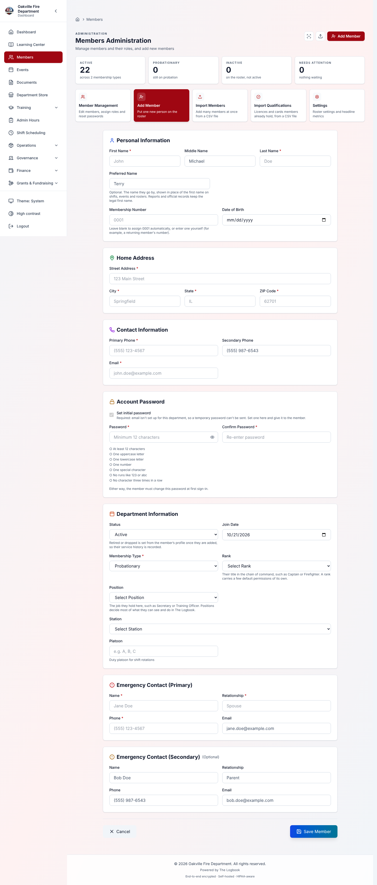

**Status.** Under Department Information, **Status** offers **Active** (the
default), **Inactive** and **On Leave**. The member is created with the one
you pick. Retired and dropped are not offered. Set those from the member's
profile once they are added, so their service history is recorded.

**Rank or Position?** They share names, such as Chief or Captain, and both
give access. The form explains each one:

- **Rank** is "Their title in the chain of command, such as Captain or
  Firefighter. A rank carries a few default permissions of its own."
- **Position** is "The job they hold here, such as Secretary or Training
  Officer. Positions decide most of what they can see and do in The Logbook.
  A rank such as Captain or Firefighter is set in the Rank field, not here."

The position list does not offer Chief, Captain, Firefighter or the other
ranks. Those are set in the Rank field, and a member holding the rank already
has the access the matching position would give. The same names still appear
under **Organization Settings > Role Management**, marked **Mirrors a rank**,
because that is where the access a rank carries is edited.

**Rank** is greyed out for an Administrative member, with the note
"Administrative members do not hold an operational rank."

Every new member also gets the base **Member** position automatically. It
gives the basic access every member needs from day one.

### The Password on a New Account

| What you do                          | What happens                                                                       |
| ------------------------------------ | ---------------------------------------------------------------------------------- |
| Leave **Set initial password** empty | The Logbook makes a temporary password and emails it to the member                 |
| Tick **Set initial password**        | You type a password. No email is sent, so give the password to the member yourself |

Either way, the member must change the password the first time they sign in.

When you type a password, the rules appear as a checklist under the box as you
type. They are the same rules as on the sign-in screens, starting with at
least 12 characters.

**When your department cannot send email.** The temporary password exists
only in the welcome email. The Logbook never shows it to you. So if email is
not set up, **Set initial password** is ticked for you and cannot be
unticked. The note under it says: "Required: email isn't set up for this
department, so a temporary password can't be sent. Set one here and give it
to the member." The Logbook also refuses any new account that asks for a
welcome email while email cannot be sent.

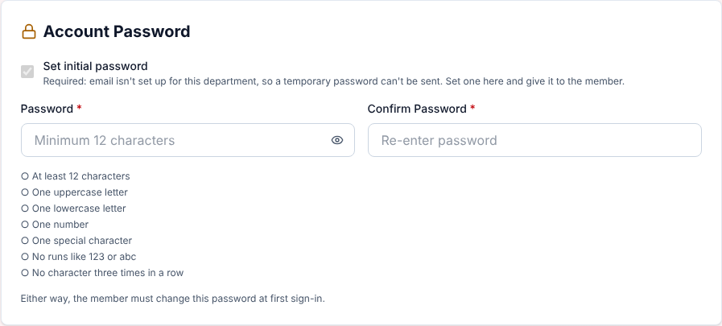

### The Membership Number on Add Member

There is one **Membership Number** field.

- **Left blank,** the department's next number is given when you save. The
  hint under the field names it, for example: "Leave blank to assign FD-0042
  automatically, or enter one yourself (for example, a returning member's
  number)."
- **Typed in,** your number is used instead.
- It is **required** (marked `*`) only when nothing would be given
  automatically. That is when membership numbers or automatic numbering are
  turned off (see
  [Membership ID Auto-Generation](#membership-id-auto-generation)).

### What If Something Is Already Taken?

| What happened                                                            | What it means / what to do                                                                                                                                                                                                         |
| ------------------------------------------------------------------------ | ---------------------------------------------------------------------------------------------------------------------------------------------------------------------------------------------------------------------------------- |
| The email is already in use                                              | Each member needs their own email within the department. Use a different one                                                                                                                                                       |
| The email belongs to an **archived** member                              | You are told to reactivate that member instead of making a duplicate                                                                                                                                                               |
| The email belongs to a **deactivated** member                            | The Logbook says: "This email address belongs to a deactivated member record, so it cannot be used for a new account. Use a different email address." A deactivated member cannot be restored from the app, so use another address |
| Two members' emails share the part before `@` (casey@a.org, casey@b.org) | The second one does not fail. The Logbook tries the next free username: `casey_2`, then `casey_3`, and so on                                                                                                                       |
| The username belongs to a deactivated member                             | The Logbook says: "This username belongs to a deactivated member record. Choose another." Use a different email address, since the username comes from the email                                                                   |
| The membership number is taken, or belonged to a former member           | It is refused. See [Numbers Are Never Reissued](#numbers-are-never-reissued)                                                                                                                                                       |

### Username Rules on Other Paths

- **Members converted from the applicant pipeline** get a username made from
  their first initial and last name, such as `jsmith`. If that is taken, The
  Logbook tries `jsmith1`, `jsmith2` and so on. A username held by a
  deactivated member counts as taken.
- **People who register themselves** choose their own username. A taken one
  is refused.

### Passwords on Every New Account

- Members added by an officer, or converted from the applicant pipeline, get
  a temporary password. They must change it the first time they sign in.
- People who register themselves chose their own password, so they are not
  asked to change it.
- On every path, the password's age counts from the day the account is made.
  Password-expiry rules work correctly from day one.

### Department Email Generation

When an applicant is elected and becomes a full member, The Logbook can make
them a department email address, such as `john.smith@firedept.org`.

There are four formats:

| Format                       | Example                 |
| ---------------------------- | ----------------------- |
| first.last                   | john.smith@firedept.org |
| flast (first initial + last) | jsmith@firedept.org     |
| firstlast                    | johnsmith@firedept.org  |
| last.first                   | smith.john@firedept.org |

**To switch it on:** open **Settings → Organization → Department Email**.
Switch on **Create department email addresses**, enter your domain
(`firedept.org` — no `@`, no `https://`), pick a format, and select **Save**.
The screen shows the address Jane Doe would get. It will not save the switch
on without a domain. It is off by default. The setting applies to the next
conversion; existing members' email addresses are not changed.

When it is on:

- The member's **personal email** is kept on their profile, so you can still
  reach them outside the department system.
- If the address is already taken (two members named John Smith, say), The
  Logbook adds a number: `john.smith1@firedept.org`,
  `john.smith2@firedept.org`, and so on. An address held by a deactivated
  member counts as taken.

When it is off, the applicant's personal email becomes their account email.

### Membership ID Auto-Generation

Your department can have The Logbook number members automatically. Both
membership numbers and automatic numbering are off until someone turns them
on.

When both are on, a number is given when a member is:

- added on **Add Member** with the number left blank;
- imported with no membership number; or
- converted from the applicant pipeline.

**Where it is set:** **Members Admin → Settings → Membership IDs**. Changing
the settings needs permission to edit settings (**Edit settings** or
**Update organization settings** on the Role Management screen).

1. Turn on **Enable Membership ID Numbers**.
2. Turn on **Auto-Generate IDs**.

The panel's header shows the next number, for example "Next: FD-0042". So
does the line under the pattern: "The next member will be numbered FD-0042."
Both always match the number the next member actually gets.

#### How Your Department Builds Numbers

| Control                                                        | What it does                                                                                                                                                                                                  |
| -------------------------------------------------------------- | ------------------------------------------------------------------------------------------------------------------------------------------------------------------------------------------------------------- |
| **Prefix and number** / **Year and number** / **Plain number** | One-click starting points: `FD-0001`, `2026-001`, `142`                                                                                                                                                       |
| **Number pattern**                                             | Your own text plus `{SEQ}` (the running number; required, once), `{PREFIX}`, and `{YYYY}` or `{YY}` for the year. Letters, digits, spaces and `- _ . / #` are kept as typed                                   |
| **Prefix**                                                     | Shown only when the pattern uses `{PREFIX}`                                                                                                                                                                   |
| **Minimum digits**                                             | Zeros fill the running number to this width. 1 means no zeros are added                                                                                                                                       |
| **Starting number**                                            | No number is given below this one                                                                                                                                                                             |
| **Next ID Number**                                             | Where the count stands now (shown while auto-generation is on). Numbers any member holds or once held are always skipped                                                                                      |
| **Restart the count each year**                                | Shown only when the pattern has a year in it. The first member of each year gets the starting number again                                                                                                    |
| **The year follows**                                           | **The calendar year** or **Our fiscal year**. For a fiscal year, choose the month in **Fiscal year starts in**. Unless it starts in January, also choose **The year it ends in** or **The year it starts in** |

The Logbook checks the pattern when you save. A pattern whose numbers would
be longer than 50 characters is refused straight away. If you take the year
out of a pattern, the yearly restart turns off in the same save. If nobody
changes these settings, numbers look like `FD-0001`.

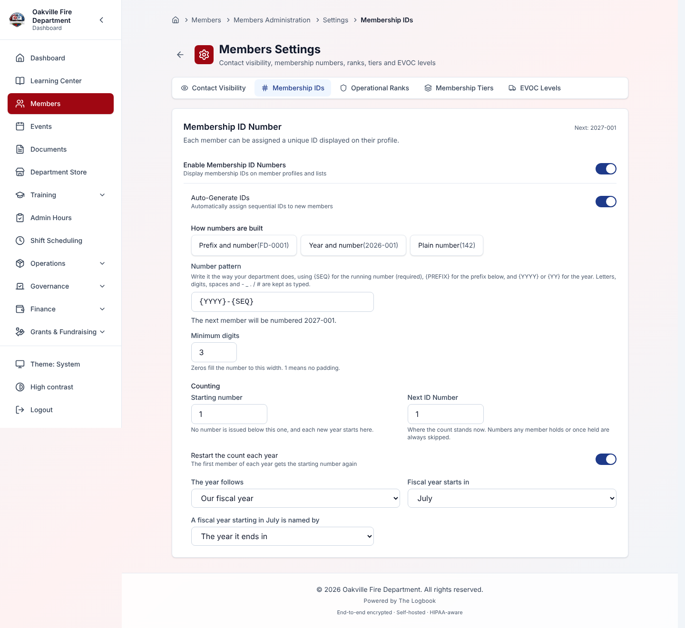

#### Numbers Are Never Reissued

A member may come back years later. The department's rule is that their
number stays theirs.

- **Automatic numbering skips** every number a member holds or once held.
  That includes current members, archived and anonymized members (both keep
  their numbers) and a deactivated member's old number.
- **A typed number is refused** if another member holds it: "A member with
  this membership number already exists". It is also refused if it
  **belonged to a former member**: "This membership number belonged to a
  former member and is kept for them in case they return. Reactivate that
  member to give it back, or choose another number". This applies on Add
  Member, on a profile change and on pipeline conversion.
- You can give a member **their own** old number back.
- When a member is **deactivated**, their number is kept on their record as
  their previous number, reserved for them. **Reactivating** them gives it
  back, as long as nobody else holds it.
- **Permanent deletion** removes the member completely, and the reserved
  number with them. For anyone who might return, archive or deactivate
  instead.

> **What if a returning member's old number belongs to someone else?** This
> can only happen with numbers given out before The Logbook started
> reserving them. The current holder keeps it. Reactivating the returning
> member leaves them with no number; their old one stays on record as their
> previous number. Give them a new number on the Admin Edit page.

#### Changing a Member's Number

The number appears on the member's **Admin Edit** page, under Department
Information, next to Rank and Station. It also shows on their profile, as
`#021` under their name.

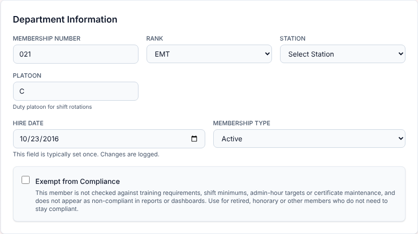

The number is an ordinary box that officers can change. Two rules protect it:

- It must be unique in your department, and it cannot be a former member's
  reserved number (see above).
- Only officers who can manage members can change it.

Some fields are restricted like this: hire date, rank, station, platoon,
membership number, and membership class and status. Hire date is on the list
because it drives automatic advancement between membership tiers. Saving any
of them without permission to manage members is refused with:

> Only leadership, the secretary, or the membership coordinator can update
> hire date, rank, station, platoon, membership number, or membership class
> and status

None of the positions The Logbook ships with will see this. Every one that
can edit user information can also manage members. You only meet it if your
department builds a custom position that splits the two. An example is a
records clerk who keeps contact details up to date but does not set rank or
hire date.

### Troubleshooting New Members

| Problem                                                       | What to do                                                                                                                                                                             |
| ------------------------------------------------------------- | -------------------------------------------------------------------------------------------------------------------------------------------------------------------------------------- |
| A department email clashes with an existing one               | The Logbook adds a number by itself. If it still fails, check for deactivated members with the same email                                                                              |
| "Username already exists" or a username refusal on Add Member | Add Member moves to the next free username (`casey_2`) by itself. If you still see a refusal, the email or username belongs to a **deactivated** member. Use a different email address |
| A new member has no access                                    | Every member gets the **Member** position automatically. If they still have no access, check the Member position exists under **Organization Settings > Role Management**              |
| A reactivated member did not get their old number back        | The number comes back only if nobody else holds it. This only happens with numbers given out before The Logbook reserved them                                                          |

---

## Importing Members from CSV

**Who can do this:** officers who can create new users.

To add many members at once, import them from a spreadsheet saved as a CSV
file.

1. Go to **Administration > Members > Member Management** and open the
   **Import Members** tab.
2. Select **Download CSV Template** to see the columns.
3. Fill in your member data. **Delete the example row** (see below).
4. Upload the finished file. Every row is checked straight away.
5. Read the review: how many rows will import, which will not, and why.
6. Decide whether to **send welcome emails**. This is off unless you turn it
   on.
7. Start the import and watch the counter. You can select **Stop importing**
   part-way.
8. If any rows were rejected, select **Download Error Report**, fix the rows
   and upload the file again.

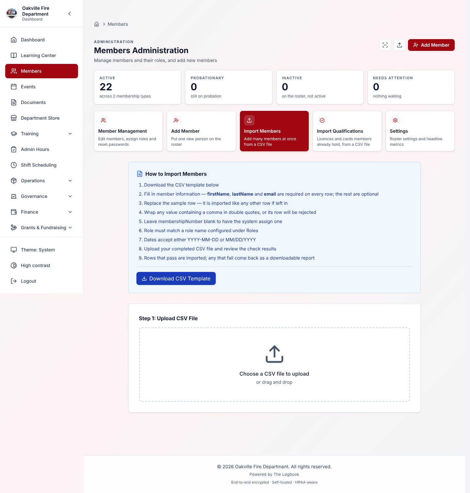

**CSV columns.** The template has all of them. The order does not matter.

| Column                                                                           | Notes                                                                           |
| -------------------------------------------------------------------------------- | ------------------------------------------------------------------------------- |
| `firstName`, `lastName`                                                          | **Required**                                                                    |
| `email`                                                                          | **Required.** Must be unique in the department                                  |
| `middleName`                                                                     |                                                                                 |
| `membershipNumber`                                                               | Must be unique. Leave blank to have one given when automatic numbering is on    |
| `username`                                                                       | Sign-in name. If blank, it is the part of the email before `@`                  |
| `dateOfBirth`, `joinDate`                                                        | Write dates as `YYYY-MM-DD` or `MM/DD/YYYY`                                     |
| `street`, `city`, `state`, `zipCode`                                             | Put double quotes around any value that has a comma in it                       |
| `primaryPhone`, `secondaryPhone`                                                 |                                                                                 |
| `membershipType`                                                                 | `probationary`, `regular`, `life` or `administrative`. Blank imports as regular |
| `rank`, `station`, `platoon`                                                     |                                                                                 |
| `role`                                                                           | Must match a role name set up under **Roles**                                   |
| `emergencyName1`, `emergencyRelationship1`, `emergencyPhone1`                    | Fill in all three, or leave all three blank                                     |
| `emergencyEmail1`                                                                |                                                                                 |
| `emergencyName2`, `emergencyRelationship2`, `emergencyPhone2`, `emergencyEmail2` | Optional second contact, same rule                                              |

Only `firstName`, `lastName` and `email` are required. A file with just those
three columns imports. Older templates called the membership number column
`departmentId`; that name still works.

**Status.** Imported members are always created as **Active**. There is no
status column. If your file has one, The Logbook tells you when you choose the
file: "The status column is ignored — every member is created Active." To
change a status afterwards, open the member's profile and select their status
to open **Change Member Status**.

### Every Row Is Checked Before Anyone Is Created

The Logbook checks the whole file first. Rows that pass are imported. Rows
that fail are listed and skipped. **Each row lists all of its problems at
once**, and each reason names the column and the value that is wrong.

What is checked before anything is created:

| Check                                      | Example message                                                                       |
| ------------------------------------------ | ------------------------------------------------------------------------------------- |
| Required fields present                    | `Missing required field: lastName`                                                    |
| Email looks like an email                  | `email "5715551212" is not an email address — that looks like a phone number, …`      |
| Date format                                | `dateOfBirth "31/12/1990" is not a recognized date — use YYYY-MM-DD or MM/DD/YYYY`    |
| Field lengths                              | `rank is 104 characters long; the limit is 100`                                       |
| Username at least 3 characters             | Includes a username made from a short email, even if your file has no username column |
| Emergency contacts complete                | Names both columns by number                                                          |
| `role` matches a role that is set up       | `role "Engine Operator" does not match any role configured under Roles — …`           |
| Duplicates **inside the file**             | `email "…" is already used on line 14 of this file`                                   |
| Duplicates **against your current roster** | `membershipNumber "214" already belongs to J. Alvarez in this organization — …`       |
| Row longer than the header                 | `Row has 21 values but the header has 19 columns, …`                                  |

The review tells you the count before anything happens, for example
**"2 of 6 rows are ready; 4 will be skipped"**. It previews the rows that will
import. It lists the ones that will not **by their line number in your file**,
each with its reason. The import button says how many members it will create.

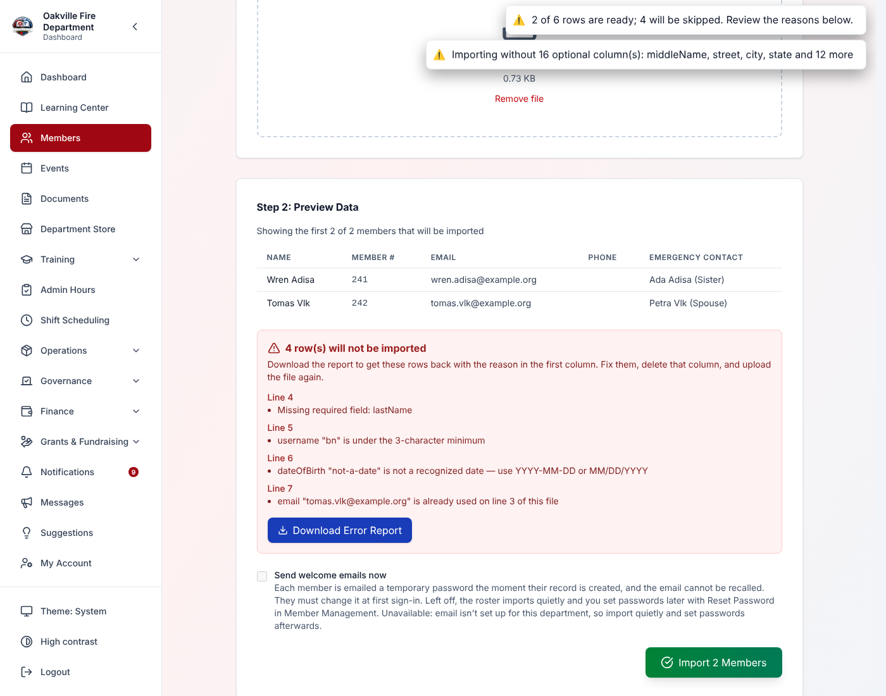

A second notice names any optional columns your file left out, for example
"Importing without 15 optional column(s)". This is information, not a
problem. Those members import with those fields empty.

### The Rejected-Rows Report

The error report is a CSV of the failed rows. Each one is **your original row,
unchanged**, with the reasons in a new first column called `errorReason`.

- The reasons go first, so they cannot clash with a row that has too many
  values.
- The report holds **only** the failed rows. Fix them, upload the report, and
  you will not create duplicates of the members who already imported.
- If you **stopped** an import part-way, the rows it never reached are listed
  as stopped. The file is exactly the work that is left.

### Welcome Emails Are Off by Default for Imports

Creating a member emails them a temporary password and a sign-in link
**straight away**. An import creates members by the dozen, and those emails
cannot be called back.

So the review has a **Send welcome emails now** checkbox, and it starts
unticked. If you leave it off, the roster loads quietly. You then give each
member a password with **Reset Password** in Member Management.

> **Tip.** **Add Member**, which creates one member on purpose, does send the
> welcome email unless you tick **Set initial password**.

**When email is not set up,** the checkbox is greyed out with "Unavailable:
email isn't set up for this department, so import quietly and set passwords
afterwards."

**When nothing imports,** the result says **Nothing Was Imported**.

### Edge Cases Worth Knowing

- **Delete the template's example row.** The template comes with a filled-in
  John Doe so the columns explain themselves. The Logbook recognises this
  example and rejects that row. First name, last name **and** email must all
  match, so a real John Doe on your roster is not affected.
- **A shifted row is rejected, never guessed at.** A comma in an address
  without quotes pushes every later value one column along. A phone number
  can end up in the email column. The Logbook rejects any row with more
  values than the header has columns, and names both counts.
- **A missing comma shifts the other way.** The row's last cells are read as
  blank. This is one reason email columns are checked for shape too.
- **Line numbers allow for line breaks inside quotes.** If a value has a line
  break in it, later records start further down the file. Error messages name
  the line where each record actually starts, so you can find it.
- **Roles are matched when you choose the file.** If your `role` column holds
  jobs ("Engine Operator", "EMT") instead of role names that are set up, **no
  roles** are imported. Check this first. If no roles are set up at all, the
  column is skipped without a message.
- **The roster check is best effort.** If The Logbook cannot load your
  current roster, it skips the duplicate check instead of blocking you. The
  import itself still refuses a real duplicate. The check covers emails even
  when your department hides contact details.
- **Columns that are not in the template are dropped.** You are told which
  ones when you choose the file.

> **Troubleshooting.** If rows fail, the review lists each failed row number
> and every reason for it, naming the column and value. Download the error
> report, fix those rows and upload again. Common problems are duplicate
> emails, a `role` that does not match a role name, a half-filled emergency
> contact, wrongly formatted dates, and a comma inside an address without
> quotes.

---

## Member Admin Edit

**Who can do this:** officers who can manage members.

Open **Administration > Members > Member Management** and select **Edit** on
the member's row.

The Admin Edit page has these sections:

- **Personal Information:** name, preferred name, date of birth, personal
  email.
- **Department Information:** membership number, rank and station (both chosen
  from your department's lists), platoon, hire date, membership type, and
  **Exempt from Compliance**.
- **Contact Information:** phone and mobile. The department email is shown but
  cannot be changed here.
- **Address.**
- **Emergency Contacts:** add, change or remove contacts.

You cannot change status here. Use the status button on the member's profile.
Positions are given with **Manage Positions** on the member's row in Member
Management. That list leaves out the positions named after a rank; a member
who was given one before this version still sees it there, marked **Rank**,
so it can be taken off.

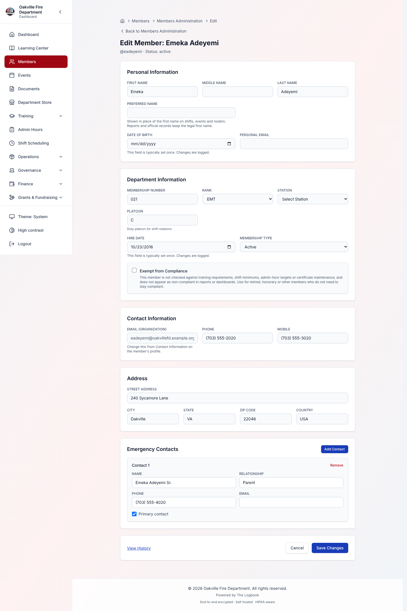

> **Tip.** Rank and station are dropdowns filled from your department's own
> lists, so every member record uses the same names.

**What if a hire date change is refused?** A member's first stint in
[Service History](#former-members-who-rejoin) can start on their
hire date. Moving the hire date onto or past that stint's end date would wipe
out that service. So would clearing the hire date. The Logbook refuses the
save and tells you what to fix. Either give the stint its own start date in
Service History, or correct the stint's end date if that is what is wrong.

**Emergency contacts** can be saved without an email. A contact missing its
name or relationship is pointed out on the page before you save.

### Member Management Row Actions

- **Reset Password** lists the password rules as you type. If the password
  breaks a rule, it says "Password does not meet every rule listed below". On
  success it confirms, for example "Password reset for Casey Newhire".
- **Manage Members** (a position's member list) saves one member at a time,
  then reloads. If one change is refused, the dialog stays open and names it,
  for example "1 of 2 changes saved. Not saved — Ian Two: …", with the reason.
- The **×** on a member's position asks you to confirm, naming the position
  and the member, for example "Remove Secretary from Ian Two?". If it is
  refused, you see the reason, such as the last-administrator rule.
- **Re-saving a member's positions** only checks the positions you are
  **adding** against your own access. Keeping a higher position the member
  already holds is fine.

> **What if I try to remove the last administrator?** The Logbook refuses.
> This holds even when two officers try to remove two different
> administrators at the same moment.

> **What if I try to remove the base Member position?** The Logbook refuses
> unless the member is archived: "The Member position carries the baseline
> access every member needs, so it can only be removed from an archived
> member."

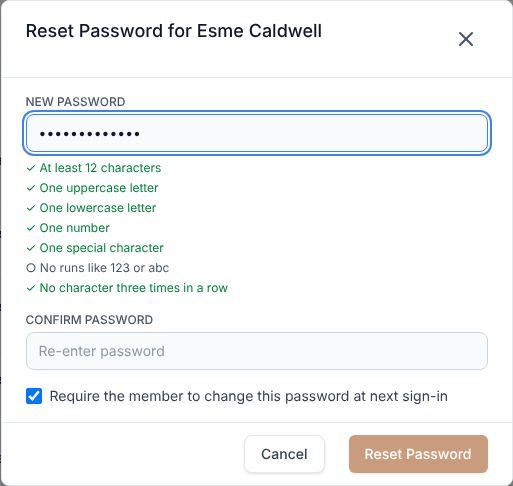

---

## Member Audit History

**Who can do this:** officers who can manage members.

Open the member's [Admin Edit](#member-admin-edit) page and select
**View History** at the bottom. You see every recorded change to the member's
record, newest first.

Each entry shows:

- **What changed:** for example rank, status or station.
- **Who changed it.**
- **When:** the date and time.
- **Details:** expands the entry to show the rest of what was recorded.

**Old and new values.** A status change shows both, for example "Status
changed: probationary → active". A membership-type change also records both.
An ordinary profile edit records only _which_ fields changed, not their old
values. So a rank change reads "Member profile updated: rank". Details names
the field, but the previous rank is not kept.

**Use Filter by.** Viewing a member's profile is itself recorded. An
unfiltered history is mostly "Member profile viewed" entries, with the edits
buried among them. Opening this page does not add to that: it reads the
profile once per visit.

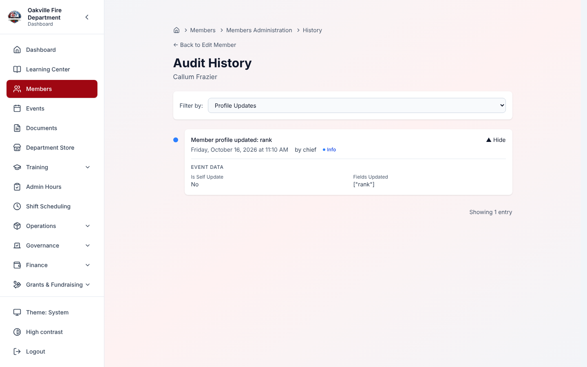

> **Note.** The history only holds changes recorded since the audit history
> feature was installed. Earlier changes do not appear.

---

## Deleting Members

> **Roster tips.** On **Members** (table and card views) each name links to the
> member's profile. Row actions carry the member's name ("Delete Jordan Avery",
> "Reset password for Jordan Avery"), so a screen reader announces whose row
> each button belongs to.

**Who can do this:** officers who can manage members.

To permanently delete a member:

1. Open **Members** and find the member's row. (The Member Management tab
   opens the same dialog.)
2. Select the **trash icon** in the row's Actions column. On the Member
   Management tab it is a **Delete** button. You cannot delete yourself, so
   your own row has no delete control.
3. The **Remove Member** dialog opens on its **Deactivate** tab, which keeps
   the member's records. Switch to **Permanently Delete**.
4. Read the **Records affected** list: training records, inventory items
   still signed out to the member, and documents whose uploader will be
   cleared.
5. Type the member's name in the box as shown. Capital letters do not matter.
6. Select **Permanently Delete**. The button stays greyed out until the name
   matches.

There is no delete button on the profile or the Admin Edit page.

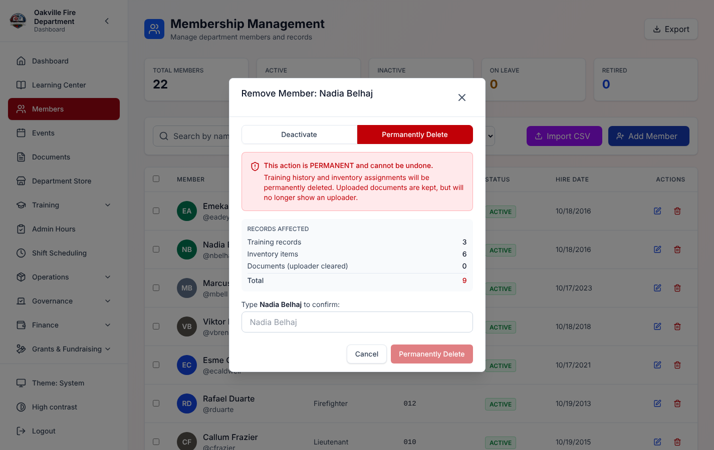

**What gets deleted:**

- the member's profile and all personal information;
- training records and certifications;
- inventory assignments (the items are unassigned, not deleted);
- event attendance records; and
- shift assignments.

**What is kept, with the member's name removed:** records the member
**created, approved, issued or uploaded**, such as documents and approvals.
The record stays; only the link to the member is cleared. Uploaded documents
are kept. This includes other members' records the deleted member signed:
the examiner on a skills test and the officer on a shift report now show
**Former member** instead of a name.

**Gear and shifts.** Any gear the member still holds is returned to stock in
the same step, so item status and pool counts stay right. The **Records
affected** list counts every record the delete removes.

**Leaving the active statuses also frees their shifts.** Deactivating,
archiving, or changing a member to a status outside the active ones takes them
off shifts that have not started and ends their standing claims, and records an
audit event. Past and in-progress shifts are untouched.

> **Important.** Deletion is permanent and cannot be undone. If you may need
> the member's records later, change their status to **Dropped** or
> **Retired** instead. A dropped member can be reactivated.

### Deactivate, Archive or Delete?

| Action                          | What happens                                                                                                                                       | Can you undo it?     |
| ------------------------------- | -------------------------------------------------------------------------------------------------------------------------------------------------- | -------------------- |
| **Drop** (status change)        | The member stays on record. They are archived automatically once their departure is settled                                                        | Yes, reactivate them |
| **Archive** (automatic)         | Happens by itself once a dropped member has returned all department property and their departure clearance is complete. There is no Archive button | Yes, reactivate them |
| **Deactivate** (dialog default) | The member is removed from the list. Their records are kept                                                                                        | No, not from the app |
| **Anonymize**                   | Personal information is removed; activity history is kept                                                                                          | No                   |
| **Permanently Delete**          | The member and most of their records are removed                                                                                                   | No                   |

**To reactivate an archived member:** on **Members**, choose **Archived** in
the status filter and select **Reactivate** on the row. Or open the member's
profile and select their status.

> **What if a dropped member never becomes archived?** If they held
> department property, a departure clearance is opened for them. At present
> no screen can complete that clearance, so the member can stay dropped. See
> [KNOWN_LIMITATIONS.md](../KNOWN_LIMITATIONS.md).

### When Deletion Is Refused

Some records must keep their owner. Clearing the owner would hide who asked
for or filed them. Examples are **budgets, purchase requests, expense reports
and IP exceptions**. If the member owns any of these, permanent deletion is
**refused** with a message explaining why. The message does not list the
records.

This is not a fault to work around. For a member with financial history, the
right route is to **archive, then anonymize** them. That removes their
personal information but keeps those records owned, so the department's
financial trail still makes sense. See
[Anonymizing a Former Member](#anonymizing-a-former-member).

Deletion is also refused if it would remove the department's last
administrator.

**You cannot act on a member who holds permissions you do not.** Deleting,
changing the status of, or archiving a member is refused (403) when that member
holds a permission you lack, so a member manager cannot deactivate or delete the
System Owner or a more senior officer. The attempt is reported to the security
log as a privilege-escalation attempt, the same as a password or MFA reset
refused for the same reason. Administrators with every permission are not
affected.

### Anonymizing a Former Member

Anonymizing permanently removes a departed member's personal information. The
department keeps its record of what they did.

1. Open the member's profile. They must be **Dropped** (voluntary or
   involuntary) or **Archived**. If not, change their status first.
2. In the **Membership** card, under **Status**, select
   **Anonymize member**. Only officers who can manage members see it. It
   never shows on your own profile, or for a Retired, Inactive or Active
   member.
3. Read what is removed and what is kept. Type the member's name to confirm,
   and select **Anonymize**. To back out, select **Keep their details**.

| Removed                                                                 | Kept                                      |
| ----------------------------------------------------------------------- | ----------------------------------------- |
| Name, email, phone numbers and address                                  | Training, attendance and hours            |
| Date of birth, photo and emergency contacts                             | Equipment custody and dues history        |
| Sign-in credentials                                                     | Audit log and election records, unchanged |
| Medical screening details, and the reasons given for leaves and waivers |                                           |
| Their original application                                              |                                           |

What is kept stays linked to a placeholder named "Former Member".

> **Warning.** Anonymizing cannot be undone. The member also leaves the
> roster. Like a deactivated member, they no longer appear anywhere in the app
> and cannot be reactivated.

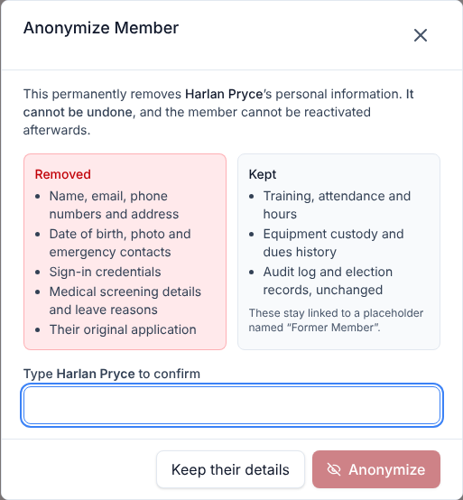

## Prospective Members Pipeline

**Who can use this:** officers who can manage prospective members. In Role
Management this permission reads "Manage prospective members and pipeline".

- To print applicant badges, you need either that permission or "View
  prospective member pipeline".
- Officers named on a **Multi-Signer Approval** stage sign from **Sign-offs**
  and need neither. See
  [Prospective Members → Sign-offs](./15-prospective-members.md#sign-offs-multi-signer-approval).

The pipeline tracks people who want to join but are not yet members. We call
them _applicants_ or _prospects_. To open it, go to **Administration >
Members > Prospective**.

This section is an overview for membership officers. For every detail, see the
full [Prospective Members Pipeline](./15-prospective-members.md) guide.

### Pipeline Views

Switch between two views at the top of the list:

- **Kanban** — one column per stage, with a card for each applicant. Drag a
  card to the next column to advance it, or to the previous column to move it
  back.
- **Table** — a list you can sort and filter, page by page.

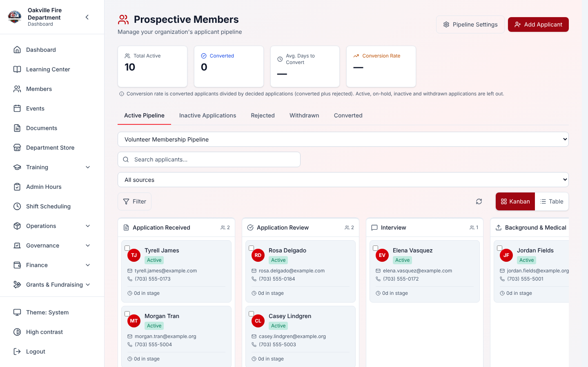

Things to know about the board:

- It shows up to 200 applicants. If there are more, it says
  "Showing _X_ of _Y_ applicants". Narrow the list with search or filters, or
  use the Table view to page through everyone.
- Cards move **one stage at a time**. Dropping a card two columns away is
  refused.
- Only **active** applicants can be dragged. Applicants on hold, withdrawn or
  rejected stay put.
- An applicant who is on no stage sits in an **Unassigned** column. You cannot
  drag them out. Open them instead and place them on a stage.

More detail is in
[Prospective Members → The Kanban Board](./15-prospective-members.md#the-kanban-board).

### Working with Prospects

1. **Add an applicant.** Select **Add Applicant** and fill in:
   - **First Name**, **Last Name** and **Email** (all required);
   - **Phone** (optional);
   - **Membership Type**: Regular Member or Administrative;
   - **Target Role** (optional): the role they get when they become a member.

   Then select **Add to Pipeline**. The applicant joins the pipeline currently
   selected on the page. The Logbook also checks whether this person is already
   a member or applicant.

2. **Complete steps.** Each stage has its own work, such as a form, documents,
   a checklist or an interview. Record each item as it is done.
3. **Advance.** When a stage is done, select **Advance** to move the applicant
   to the next stage. If that next stage sends an automatic email, the email
   goes out straight away.
4. **Back.** If an applicant must return to the stage before (for example, a
   missing document turns up), select **Back** in their drawer. The earlier
   stage reopens, so it can be completed again. The stage they left goes back
   to "not started".
5. **Upload documents.** Attach application papers, ID copies and other
   documents to the applicant's record. See [Documents](#documents) below.
6. **Convert to member.** On the last stage, the **Advance** button reads
   **Convert**. Select it to open the **Convert to Member** dialog:
   - the **member class** and **starting status** are filled in from the
     pipeline's settings for the applicant's membership type;
   - the **Target Role** is filled in from the application;
   - you choose how the new member gets their password.

   The Logbook refuses to convert anyone while a **Required** stage is
   unfinished. The full dialog is in
   [Prospective Members → Converting to a Full Member](./15-prospective-members.md#converting-to-a-full-member).

> **What if Add Applicant is greyed out?** Your department has no pipeline
> yet. Pointing at the button shows "Set up a pipeline first". Create a
> pipeline in **Pipeline Settings** (see
> [Pipeline Configuration](#pipeline-configuration)).

> **What if Back is missing?** The applicant is on the first stage, so there
> is nowhere to go back to.

> **What if I try to advance someone already on the final stage?** For
> example, in a bulk advance. Nothing moves, and The Logbook tells you they
> are already at the final stage. Use **Convert** instead.

#### Documents

The **Documents** area is in the applicant's drawer, below Linked Events.

- **Upload** opens the file picker.
- Each file can be up to **50 MB**. Allowed types are PDF, Word (DOC or DOCX),
  JPEG, PNG and GIF.
- If the current stage needs certain documents, there is one button for each
  one. A green tick shows that document is filed.
- Each file is listed with its type, its size and the date it arrived. Select
  its name to download it.
- The bin icon removes a file filed by mistake. The Logbook asks you to confirm
  first.

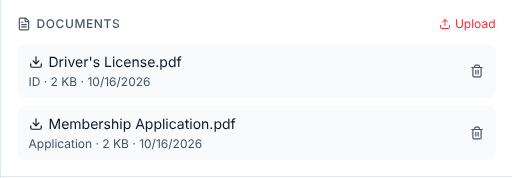

You can upload and remove documents only for **active** applicants. For a
withdrawn or rejected applicant, the papers stay readable, because they are
part of the record of the decision. But you can no longer change them.

#### The Action Bar

The buttons at the foot of the drawer are, from left to right:

**Interview**, **Back**, **Withdraw**, **Hold**, **Skip**, **Reject** and
**Advance**.

- The bar appears for **active** applicants only.
- **Back** is missing on the first stage.
- On the last stage, **Skip** is missing and **Advance** reads **Convert**.
- **Withdraw**, **Skip** and **Reject** each ask you to confirm first. A
  skipped stage is recorded as skipped, not completed.

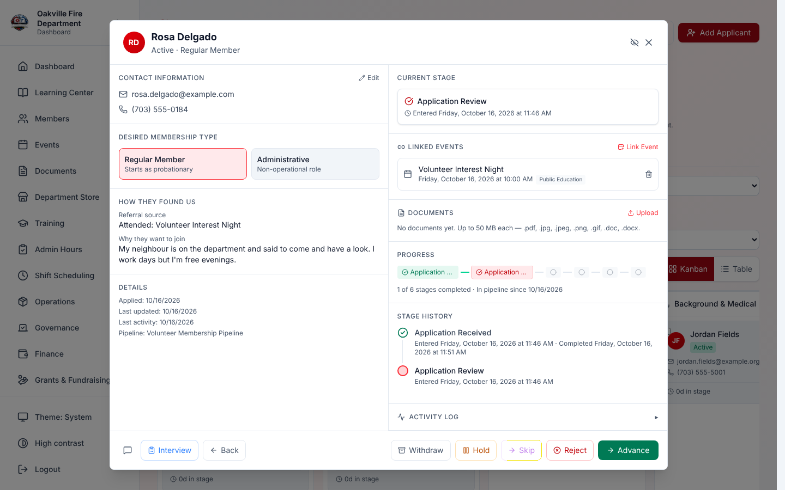

### Desired Membership Type

Each applicant has the membership type they want:

| Type               | What it means                                      |
| ------------------ | -------------------------------------------------- |
| **Regular**        | Standard active membership. Starts as probationary |
| **Administrative** | A non-operational, administrative role             |

- The type can come from the **Membership Interest Form** template, if your
  department uses it as the application form.
- You can change it at any stage, from the applicant's drawer. Under
  **Desired Membership Type** there are two cards: **Regular Member** and
  **Administrative**. Select the other card to switch.
- The Kanban card does not show the type, and you cannot change it there.
- When you convert the applicant, the dialog fills in a member class and a
  starting status from the pipeline's **When an Applicant Becomes a Member**
  setting. By default:
  - Regular applicants become **operational** members with **probationary**
    status;
  - Administrative applicants become **administrative** members with
    **regular** status.

  A department can change either default for each pipeline.

- Either way, the new member's account starts as active.

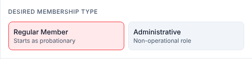

The selected card is outlined and cannot be selected. There is nothing to
confirm and nothing to undo: selecting the other card is both the change and
the way back.

> **What if the type changes after the vote?** Say an applicant switches from
> Regular to Administrative after passing an election or vote stage. The
> Logbook does not cancel the vote. Check yourself that the voting rules for
> administrative members were met.

### The applicant's drawer, end to end

Select an applicant to open their drawer. Everything about them is there, in
this order:

1. who they are and how to reach them;
2. the membership type they asked for;
3. their application answers, if they applied through a form;
4. the stage they are on, when they reached it, and their target role;
5. their election package, while they are on a vote stage;
6. the events they are booked into;
7. their documents;
8. any section for the current stage type (checklist, sign-offs, references,
   interviews or medical screening);
9. their progress and stage history;
10. notes and the activity log;
11. record details, then the action bar.

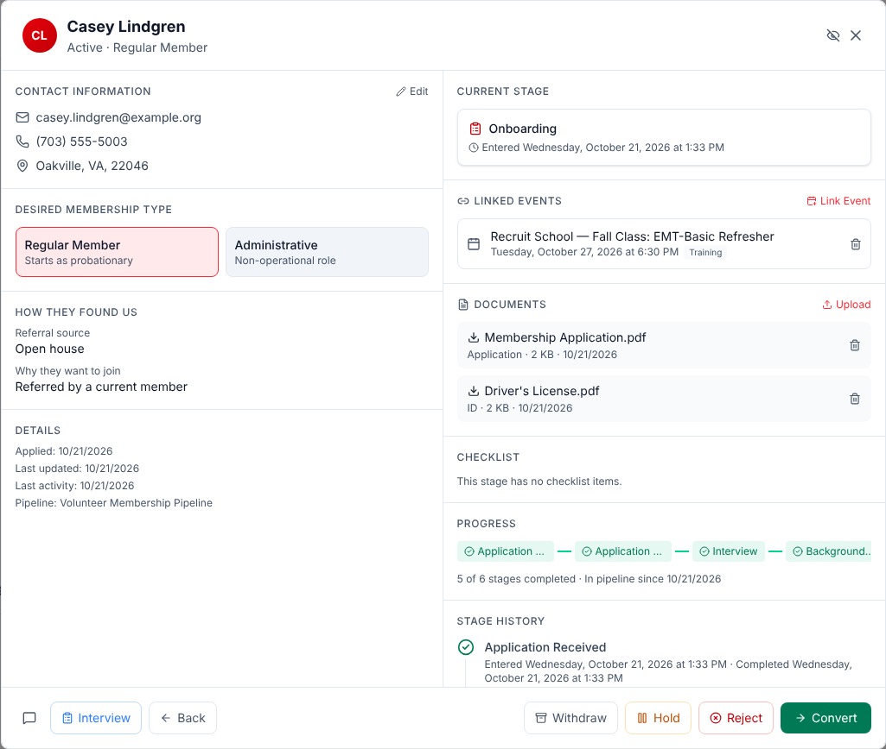

**On a checklist stage**, the drawer lists the stage's items as checkboxes.

1. Tick each item as it is done.
2. Select **Advance**. Your ticks are saved with the advance.

If the stage needs every item, **Advance** is refused until all are ticked.
Dragging the card on the board sends no ticks. So advance a checklist stage
from the drawer. **Skip** still moves an applicant past it without ticks.

### Printing Applicant Badges

Badges help with sign-in at a recruitment or outreach event.

1. Tick the applicants you want, on the board or in the table.
2. Select **Print Badges** on the bar that appears.
3. The label print page opens. Pick a label size, then download a PDF or print.

- Each badge shows the applicant's name and a **short ID**, like labels in
  other parts of The Logbook.
- Badges do **not** show the applicant's private status-page link code.
- The printer you pick is remembered for your position, separately from other
  modules.

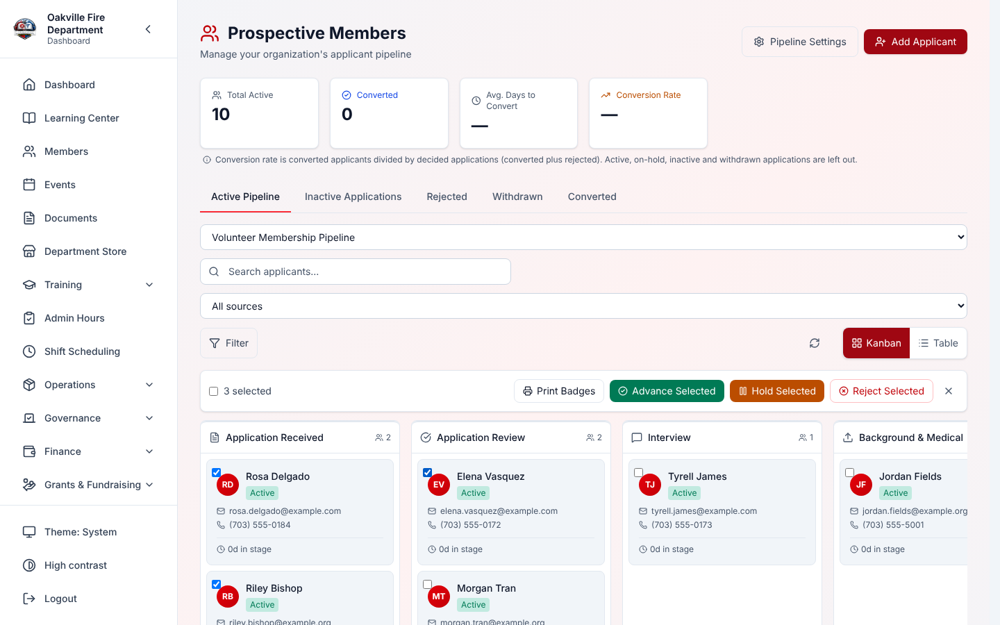

The same bar also has **Advance Selected**, **Hold Selected** and **Reject
Selected**. They act only on the applicants you ticked. **Reject Selected**
asks for an optional reason, then **Confirm Rejection**. See
[Prospective Members → Bulk Actions](./15-prospective-members.md#bulk-actions).

### Pipeline Stage Types

There are **thirteen** stage types. You pick one from a grid of tiles in the
**Add Pipeline Stage** (or **Edit Stage**) dialog. Picking a tile changes the
settings shown below it.

| Stage type                        | Purpose                            | What happens                                                                                                                                                                                                                                             |
| --------------------------------- | ---------------------------------- | -------------------------------------------------------------------------------------------------------------------------------------------------------------------------------------------------------------------------------------------------------- |
| **Form Submission**               | Collect the applicant's details    | Links to a form from the Forms module. Can auto-advance when the form is submitted                                                                                                                                                                       |
| **Document Upload**               | Collect required documents         | Documents such as ID or a background check are uploaded. Can auto-advance when they are all in                                                                                                                                                           |
| **Meeting**                       | Interview or orientation           | Needs the applicant at a meeting. Links to upcoming events                                                                                                                                                                                               |
| **Election / Vote**               | Membership vote                    | Reaching the stage in any way creates the applicant's election package, once. They cannot advance past the vote without a package, or until the vote is decided                                                                                          |
| **Manual Approval**               | Coordinator sign-off               | An officer marks the stage complete                                                                                                                                                                                                                      |
| **Enable Status Page**            | Turn online tracking on or off     | Turns this applicant's public status page on or off, then completes itself. See [Enable Status Page Stages](#enable-status-page-stages)                                                                                                                  |
| **Automated Email**               | Send an email                      | Sends a set email when the applicant arrives, then completes itself once it is sent. See [Automated Email Stages](#automated-email-stages)                                                                                                               |
| **Reference Check**               | Collect references                 | Collect and check personal or work references                                                                                                                                                                                                            |
| **Checklist**                     | Several items to sign off          | A list of items, such as orientation or gear issue, instead of one approval                                                                                                                                                                              |
| **Interview Requirement**         | A set number of interviews         | The applicant needs that many interviews before advancing                                                                                                                                                                                                |
| **Multi-Signer Approval**         | Several roles must agree           | Every named role must sign off                                                                                                                                                                                                                           |
| **Medical Screening**             | Medical clearance                  | Needs a physical exam or medical clearance before advancing                                                                                                                                                                                              |
| **Follow-up Form** _(2026-10-29)_ | Confirm and add to the application | Emails the applicant a personal link to a form pre-filled with what is on file; changed answers update the record. Advances when they submit, unless that is switched off. See [Follow-up Forms](./15-prospective-members.md#follow-up-forms-2026-10-29) |

> **What if the vote did not pass?** An applicant who is on a ballot cannot
> advance until the vote is decided. An applicant who was not elected cannot
> advance at all. Reject or withdraw the application, or hold a new vote.

Above the grid is a row of **Quick Presets**. One click fills in the name,
description, type and starting settings. The presets are:

- Application Form, Background Check Docs, Chief Interview, President
  Interview, Membership Vote, Welcome Email;
- Coordinator Approval, Reference Check, New Member Orientation, Interview
  Panel, Officer Sign-Off, Physical Exam.

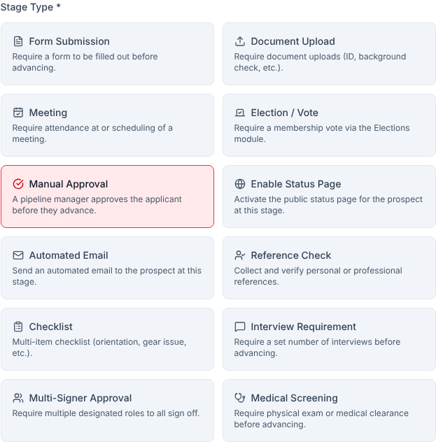

For each stage type's settings, see
[Prospective Members → Stage Types](./15-prospective-members.md#stage-types).

### Auto-Advance

Some stages can move the applicant on by themselves when the stage's condition
is met. This is called _auto-advance_. It works on these stage types:

| Stage type            | Advances when                       | On when you add it? |
| --------------------- | ----------------------------------- | ------------------- |
| Form Submission       | the form is submitted               | Yes                 |
| Document Upload       | the documents are uploaded          | No                  |
| Meeting               | the event's attendance is finalized | No                  |
| Checklist             | the checklist is completed          | No                  |
| Interview Requirement | the interview requirement is met    | No                  |
| Medical Screening     | all screenings pass                 | No                  |
| Reference Check       | all references are verified         | No                  |

To turn it on or off:

1. In **Pipeline Settings**, select the pencil icon on the stage.
2. Tick or untick the stage's **Auto-advance when…** box.
3. Select **Update Stage**. The change is saved straight away.

> **What if a Meeting stage will not save?** A Meeting stage with auto-advance
> on must name which events count. Choose an **Auto-Link Event Type**, or turn
> auto-advance off. (Stages that book through an online scheduling service do
> not need one.)

> **What if the applicant is on hold?** Auto-advance does not move applicants
> who are on hold, rejected or withdrawn.

> **What about the final stage?** Auto-advance on the final stage makes the
> applicant a member only if **Automatic Transfer to Membership** is on. It is
> off unless someone turns it on (see
> [Pipeline Configuration](#pipeline-configuration)). With it off, an officer
> selects **Convert**.

### Automated Email Stages

When an applicant reaches an automated email stage, The Logbook sends the
stage's email straight away. This happens however they arrive: **Advance**, a
drag, a bulk advance, **Skip** or auto-advance.

Set up the email in the stage's settings:

- **Email Subject** — required, and set for each stage.
- **Welcome Message** — an optional opening section.
- **Membership FAQ Link** — a link to your department's questions page.
- **Next Meeting Details** — the event type, plus your own text for date, time
  and place.
- **Application Tracker Link** — a link to the applicant's public status page.
  It is included only while that applicant's page is on. That means the
  pipeline setting is on, or they have passed an Enable Status Page stage that
  turns it on. The screen explains this under the box.
- **Add custom section** — your own titled blocks, such as "What to Bring" or
  "Parking Information".

Every section except the subject has a checkbox. Tick it to include the
section, and its fields appear underneath. Drag the handles to reorder the
sections. **Show Preview** at the bottom shows the finished email. The email
greets the applicant by name automatically; there is no field for this.

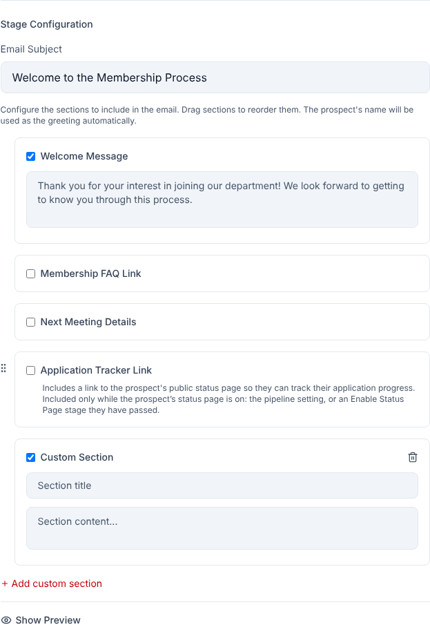

**The stage completes itself once its email is sent.** The applicant then
moves to the next stage, with the same checks and activity entry as completing
it by hand. Two email stages in a row run one after the other.

A stage marked as the pipeline's **final** stage never completes itself.
Sending an email is not the approval that stage stands for.

> **What if the email does not go out?** If email is not set up (Settings >
> Email) or the send fails, the applicant **stays on the email stage**. An
> applicant stuck on an email stage is the sign to check your email settings.

#### Enable Status Page Stages

The pipeline's **Public Application Status Page** setting decides whether
applicants can follow their application online. An **Enable Status Page**
stage lets you decide this for each applicant, at a set point. For example,
you might show the tracker only after someone passes their interview.

- **Enabling stage** (the default). When the applicant reaches it, their
  status page turns on, even if the pipeline setting is off. They are emailed
  the link, with the stage's optional message. Then the stage completes itself
  and they move on.
- **Disabling stage** (untick **Enable public status page at this stage**).
  Their page turns off and the link stops working, even if the pipeline
  setting is on. Nothing is sent, and the stage completes itself.
- The **latest** of these stages an applicant has reached decides for them.
  If they have reached none, the pipeline setting decides.
- Moving an applicant back before the stage undoes it.

| What happened                                                                 | What it means / what to do                                                                                                                                             |
| ----------------------------------------------------------------------------- | ---------------------------------------------------------------------------------------------------------------------------------------------------------------------- |
| The link email could not be sent (email not set up, or no email address)      | The applicant **stays on the stage**, but their page is on. Fix the problem, then complete the stage yourself                                                          |
| The stage is marked as the final stage                                        | It never completes itself, because completing the final stage is the department's approval                                                                             |
| The applicant started on the stage, was placed on it, or was moved back to it | The on/off setting still applies, but no link email is sent and the stage waits for you to complete it. Only arriving by finishing the stage before it sends the email |

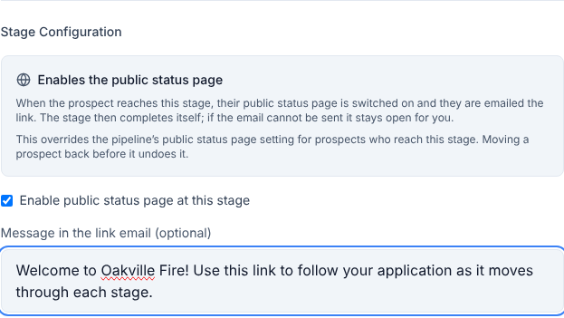

### Pipeline Configuration

To open the settings, go to **Prospective Members** and select **Pipeline
Settings** at the top of the page. It is also in the menu under
**Administration > Members > Pipeline Settings**.

The page first shows "Select a pipeline". Choose a pipeline from the list on
the left to see its settings. (If you have none yet, it shows "Create your
first pipeline".) From there you can:

- create and customize pipelines;
- add, remove or reorder stages (thirteen stage types);
- set auto-advance, emails, form links and event links for each stage;
- choose the default pipeline for new applicants;
- turn **Public Application Status Page** on or off, and with it **Show
  upcoming stages**;
- choose **When an Applicant Becomes a Member**: a member class and starting
  status for operational applicants, and another for administrative
  applicants;
- turn **Automatic Transfer to Membership** on or off.

**Show upcoming stages.** When this is off, an applicant's status page lists
only the visible stages they have completed. It does not show the stage they
are on now, or how many stages are left.

**When an Applicant Becomes a Member.** Automatic conversion uses these
choices, and the **Convert to Member** dialog fills them in.

**Automatic Transfer to Membership** decides what finishing the final stage
does:

- **On:** the applicant becomes a full member the moment the final stage is
  completed. It is the same as **Convert to Member**, with nobody selecting
  it. So if the final stage is a vote or a sign-off, recording it is what
  makes them a member.
- **Off** (the default): an applicant who finishes waits in the pipeline until
  an officer selects **Convert**.

Either way:

- skipping the final stage never converts anyone; and
- every required stage must be complete first.

> **Tip.** You can create several pipelines for different cases, such as
> "Standard Application", "Lateral Transfer" or "Junior Firefighter".

---

## Member Class and Member Status

Every member record answers two separate questions:

| Question                                 | Called            | Choices                                                             |
| ---------------------------------------- | ----------------- | ------------------------------------------------------------------- |
| What kind of member is this?             | **Member class**  | Operational, administrative, social                                 |
| Where are they on the membership ladder? | **Member status** | Prospective, probationary, regular, life, retired, honorary, junior |

Because they are separate, you can record a **probationary treasurer** (an
administrative member who is still on probation). You can also record a
**life member who still rides** (an operational member with life status).

Every member screen asks the two questions separately _(2026-10-29)_: Add
Member, the member's edit page, the CSV import and the roster filters each have
a **Member class** control and a **Membership status** control. Pick
Administrative and Life for a treasurer who has served twenty years; pick
Operational and Probationary for a new firefighter. Any class can hold any
status.

The **Membership status** list offers the seven built-in statuses **and your
department's own membership tiers** by name. The shipped ladder's "Active
Member" rung is the regular status under that name, so it appears once; a rung
such as "Senior Member" is a standing of its own. A tier a member reaches by
years of service shows here exactly as one an officer set by hand.

The older single **Membership Type** value is still stored for reports and
imports written against it, and The Logbook works it out from the pair. A
spreadsheet import may still give `membershipType`; the `memberClass` and
`memberStatus` columns state the pair directly and win when both are given.

When you convert an applicant into a member, the conversion dialog asks for
**Member class** and **Starting status** directly. An administrative member's
ID card shows **Member Class** where other cards show **Rank**.

> **A member with no class.** A member who was moved onto a department tier
> before the class existed may show **Not set** for their class. They are
> left alone on purpose rather than guessed onto the riding body; until an
> officer sets the class from the edit page, they are treated as neither
> operational nor administrative, so they cannot sign up for shifts or match
> a class-restricted ballot. The roster's **Class not set** filter finds them.

> **Two different "statuses".** The member status above is the membership
> ladder. It is not the same as the account status in
> [Member Status Management](#member-status-management) (Active, Inactive,
> Leave and so on), which decides whether someone can sign in. A probationary
> member on the ladder normally has an Active account. A member on Leave is
> still a regular member on the ladder.

### How class and status affect elections

The built-in voter groups for ballots read both class and status:

| Voter group    | Who gets a ballot                                   |
| -------------- | --------------------------------------------------- |
| Operational    | Operational members with regular status             |
| Regular        | Operational members with regular **or** life status |
| Life           | Operational members with life status                |
| Probationary   | Operational members with probationary status        |
| Administrative | Administrative members                              |
| Social         | Social members                                      |

Two things follow from this:

- **A life member gets a "Regular" ballot.**
- **Administrative members do not get ballots limited to Operational,
  Regular, Life or Probationary members,** even if their status is regular.

> **What if your bylaws let administrative members vote on those items?**
> Add them with an override or an explicit voter list. The voter group alone
> will not include them.

> **What if a member has a custom membership tier, such as Senior?** A custom
> tier matches none of the built-in voter groups until you say what it counts
> as. Open **Members Admin → Settings → Membership Tiers** and set the tier's
> **Counts as** to the built-in status it stands in for — Senior counts as
> Regular, say — and its members get every ballot that status gets. Left
> unset, the tier matches nothing, which is how it has always behaved; add the
> member to the ballot another way, such as by position or an explicit voter
> list.

### Honorary members are the "social" class

An honorary member is recorded as social class with honorary status. This
matches how The Logbook already treated them: like administrative and retired
members, honorary members cannot sign themselves up for shifts unless your
department changes that in Scheduling settings.

### Administrative members do not hold an operational rank

A rank, such as Captain or Fire Chief, is a place in the chain of command. It
comes with permissions. An administrative member sits outside the chain of
command, so they cannot hold a rank.

- When a member's class is **Administrative**, the **Rank** field is greyed
  out. It says: _"Administrative members do not hold an operational rank."_
- If you move a member who has a rank into the administrative class, The
  Logbook clears their rank when you save.
- If you try to give an administrative member a rank, the save is refused:
  _"Administrative members do not hold an operational rank. Move the member to
  an operational class first, or leave the rank blank."_

> **What if an administrative member really does hold a rank?** Change their
> class first. Set their class to Operational, save, and then set the rank.

### Probationary is a standing, not a class

A probationary member can be operational, administrative or social. Setting a
member's status to Probationary puts their account on **Probationary** status
too, and moving them off it puts the account back to **Active**; a member on
Leave or Suspended is left where they are. This now applies to administrative
and social probationers as well, who used to stay Active whatever the ladder
said.

---

## Offices and Committees

A **position** is one of two things _(2026-10-29)_:

| Kind          | What it is                                                                                             | Examples                                                                     |
| ------------- | ------------------------------------------------------------------------------------------------------ | ---------------------------------------------------------------------------- |
| **Office**    | A job with permissions. Holding it is what lets the member do that job in The Logbook.                 | Treasurer, Quartermaster, Training Officer, Public Information Officer       |
| **Committee** | A group a member serves on. It is recorded and shown, and grants nothing beyond what every member has. | History Committee, Membership Committee, Community Education / Outreach Team |

Every department starts with four committees: **Community Education /
Outreach Team**, **History Committee**, **Fundraising Committee** and
**Membership Committee**. The matching offices — Public Outreach, Historian,
Fundraising Chair and Membership Coordinator — are the chairs, and carry the
permissions the chair's work needs. Add your own committees under **Settings →
Roles** by choosing **Committee** when you create the position.

A member's profile lists their **Offices** and their **Committees** apart, and
the members admin hub marks a committee on its chips and in **Manage
Positions**, which is where both kinds are assigned. The baseline Member
position every member holds is neither, and is not listed as one.

**Rank, class, status, office, committee, qualification.** Five examples:

- **Jim** is operational and a regular member, and holds the EMT and Driver /
  Operator qualifications, so he can staff the ambulance as the EMT or the
  driver.
- **Jane** is an administrative member with life status, and holds the
  Treasurer office.
- **Krishna** is a probationary member, holds the EMT qualification, and is
  on the Community Education / Outreach Team.
- **David** is operational with no rank, holds the Officer in Charge
  qualification so he can be the officer on a shift, and holds the
  Quartermaster office.
- **Gene** is a life member on the History Committee.

---

## Rank and Qualification Are Different Things

A **rank** says where someone sits in the chain of command. A
**qualification** says what they are trained to do. A Captain who is also a
Paramedic has a rank (Captain) and a qualification (Paramedic).

The national standards draw the same line. The National Fire Protection
Association (NFPA) covers Firefighter I/II in NFPA 1001, apparatus operator in
NFPA 1002 and the officer ladder in NFPA 1021. Emergency Medical Technician
(EMT) and Paramedic are medical credentials on a separate track.

**Qualifications expire. Ranks do not.** When The Logbook decides who can fill
a seat on a shift, it checks whether the qualification is current **on the
day of the shift**, not today. Driver Emergency Vehicle Operations Course
(EVOC) certifications work the same way. A card that is current when the
roster is built but expired on the day of the shift does not qualify the
member for that seat.

> **Important.** Because shift eligibility reads these expiry dates, a missing
> or out-of-date qualification changes who can be put on a shift. Keep them
> accurate.

**EMT can be both a rank and a qualification.** They mean different things.
If your department uses EMT as a rank, keep using it. If you want to record
who holds a current EMT card, add the EMT qualification. Neither one implies
the other.

**Ranks are not turned into qualifications.** A member with the EMT rank does
not automatically get an EMT qualification, because the rank does not say
which card they hold or when it expires.

**Officer in Charge is a qualification** _(2026-10-29)_. A member your
department has cleared to lead a crew without holding an officer rank — an
acting officer, or whatever your bylaws call it — gets the **Officer in
Charge** qualification from their profile, with an expiry if your clearance
has one. It clears the officer, captain and lieutenant seats on a shift, the
same seats a Lieutenant's rank clears. Until it existed, the only way to clear
the officer seat without a rank was a completed training program that targets
it; that still works.

A member gets a qualification in one of two ways:

- **From a course.** In the Course Library, set **Certifies** on a course.
  When you record that a member completed the course, The Logbook adds or
  renews the qualification. Setting **Certifies** does not go back over
  completions already recorded; enter those directly.
- **Directly.** Enter it on the member's profile, or import it from a
  spreadsheet file (see below).

### Entering Qualifications Directly

**Who can do this:** officers who can manage member profiles (the **Manage
member profiles** permission in Role Management).

Use this for a licence a member held before your department used The Logbook,
such as an old Paramedic card or a county Driver / Operator certificate. You do
not need to invent a training record to match it.

**On the member's profile.** The **Qualifications** card lists what the member
holds.

1. Select **Add**.
2. Pick the qualification.
3. Optionally enter a granted date, an expiry date and notes. Leave the expiry
   date blank if the qualification does not expire.
4. Save.

To fix the dates, select the pencil. To remove a qualification, select the bin
and confirm. Each entry shows whether the scheduler counts it today: **In
force** or **Not in force**. An expired card, or one with a granted date in
the future, shows **Not in force**.

**From a spreadsheet (CSV) file.** Go to **Members > Administration > Import
Qualifications**. **Download template** gives you a starting file. The file
needs these columns:

| Column                         | What to put in it                                                  |
| ------------------------------ | ------------------------------------------------------------------ |
| `membership_number` or `email` | Finds the member                                                   |
| `qualification`                | The code (such as `emt`) or the name (such as `Driver / Operator`) |
| `granted_on` (optional)        | The date it was granted: YYYY-MM-DD or MM/DD/YYYY                  |
| `expires_on` (optional)        | The date it expires: YYYY-MM-DD or MM/DD/YYYY                      |
| `notes` (optional)             | Any notes                                                          |

1. Select **Choose CSV file**. The Logbook checks the file first and saves
   nothing yet. It lists the rows that are ready, and every rejected row by
   its line number with the reason.
2. Select **Import N rows** to save the rows that passed.
3. Fix the rejected rows in your file and import it again. Rows already
   imported are simply updated.

A row is rejected when:

- the member number or email matches nobody in your department;
- the qualification is not one The Logbook knows;
- a date is not a real date;
- the expiry date is before the granted date; or
- the file has a second row for the same member and qualification.

If the member already holds the qualification, the file's dates replace the
old ones.

> **What happens when a training record is voided?** A qualification that came
> from a training record is removed if every record supporting it is voided. A
> qualification you entered directly stays. If you edit a qualification that
> came from a training record, it becomes a direct entry; the panel warns you
> before you save. A later completion of a certifying course still renews the
> dates.

---

## Member Status Management

**Who can do this:** officers who can manage member profiles (the **Manage
member profiles** permission in Role Management). By default this includes
the **Membership Coordinator** position.

You change a member's account status from their profile page.

### Changing a Member's Status

1. Open the member's profile.
2. Select the **status chip** next to the member's name (it reads, for
   example, "Status: Active · Change"), or the pencil next to **Status** in the
   Membership panel. Both open the **Change Member Status** dialog. It is a
   true dialog: **Esc** closes it (not while it is saving), and keyboard focus
   stays inside it.
3. Choose the new status under **New Status**: Active, Inactive, Suspended,
   Probationary, Leave, Retired, Dropped Voluntary or Dropped Involuntary.
4. Optionally enter a **Reason**.
5. Select **Update Status**. The button stays greyed out until you pick a
   status different from the current one.

**Membership type and status move together for two statuses.** Setting a
member's **Membership Type** to **Probationary** puts an Active account on
**Probationary**, and any other type (including a custom tier and the monthly
tier advance) moves a Probationary account back to **Active**. Inactive,
Suspended, Leave, Retired, Dropped and Archived are never touched. The status
history records the move with the reason "Follows membership type". A status
you set by hand in this dialog holds until the membership type is next
changed.

**Archived is not in the list.** A dropped member is archived automatically
once their property is returned and their departure clearance is completed.
For an archived member, the status badge opens a **Reactivate Member** dialog
instead.

**Not every change is allowed.** If you pick one that isn't, the dialog shows
an error that lists the statuses you can choose.

| Current status        | Can change to                                                     |
| --------------------- | ----------------------------------------------------------------- |
| Active                | Probationary, Inactive, Suspended, Leave, Retired, either Dropped |
| Inactive              | Probationary, Active, Suspended, Leave, Retired, either Dropped   |
| Probationary          | Active, Inactive, Suspended, Leave, either Dropped                |
| Leave                 | Active, Inactive, Suspended, Retired, either Dropped              |
| Suspended             | Probationary, Active, Inactive, either Dropped                    |
| Retired               | Active, Inactive                                                  |
| Dropped (either kind) | Probationary, Active                                              |
| Archived              | Use **Reactivate Member**                                         |

**Dropping a member.** When you choose either Dropped status, the dialog
says: _"Dropping a member creates a property return report and may send an
email notification."_ Both happen automatically. The dialog has no other
options for them.

**Bringing a former member back.** When a dropped or retired member returns,
the dialog also asks:

- **Earlier service**: **Continue prior service** (earlier service keeps
  counting; only the time away is left out) or **Restart at zero** (service
  counts from the return date). Your department's default is marked
  "(department default)".
- **Return date**.

See [Former Members Who Rejoin](#former-members-who-rejoin).

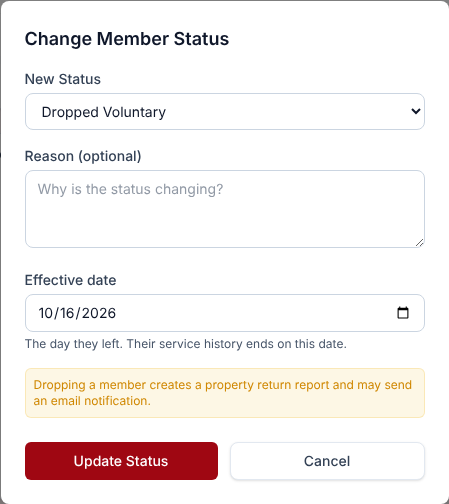

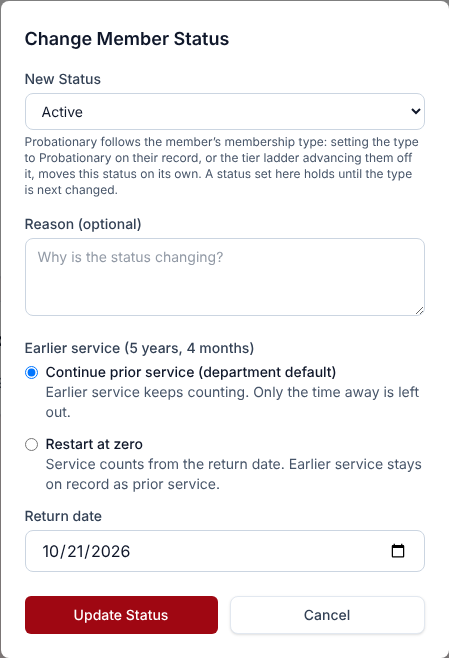

### Undoing a Drop Made by Mistake

For 7 days after a member is dropped, their profile shows _"Dropped by
mistake? You can undo this drop until …"_ under Status. The 7 days count from
the drop's **Effective date** — the day the member left — not the day you
recorded it. A drop entered with an effective date more than 7 days back
cannot be undone.

1. Under **Restore as**, choose Active, Probationary, Inactive or On Leave.
2. Optionally enter a reason.
3. Select **Undo drop**, then confirm.

The member goes back as if the drop never happened. Their length of service
carries on with no gap. This works even on the day of the drop.

The property return report and any departure clearance the drop created stay
open. The quartermaster closes them.

> **What if the member really left and has now come back?** Don't undo the
> drop. Change their status instead, so The Logbook records that they
> rejoined. After the 7 days, changing the status is the only way.

### The Last Administrator Cannot Be Removed

The Logbook refuses any change that would leave your department with nobody
who can manage members. This covers status changes, archiving, deleting, and
taking away the position that gives the permission. The message reads:
_"Cannot … the only remaining administrator. Grant 'members.manage' to another
active member first, otherwise no one would be able to manage members or
restore access."_

This matters because only Active and Probationary members can sign in. If the
only administrator were set to Inactive, nobody could get back into the member
tools without help from whoever runs the department's server.

> **Note.** Only members with **Active** status count as administrators for
> this check. A probationary member who can manage members does not count.

### Which Statuses Can Sign In

| Status                                                               | Can sign in? | What it means                                                                     |
| -------------------------------------------------------------------- | ------------ | --------------------------------------------------------------------------------- |
| Active, Probationary                                                 | Yes          | Can sign in, be put on shifts, get messages and complete checklists               |
| Inactive, Suspended, Leave, Retired, Dropped (either kind), Archived | No           | Sign-in is refused with _"Account is inactive. Please contact an administrator."_ |

An officer can still check in a retired or on-leave member at a check-in
station. See
[Member ID Cards](#member-id-cards-and-the-check-in-station).

> **What if you don't want probationary members signing themselves up for
> shifts?** In Scheduling settings, add Probationary under **Excluded from
> Self-Signup**. Officers can still assign them to shifts.

### Property Return Process

When you drop a member, The Logbook automatically:

1. **Creates a property return report** listing everything issued to them.
   It is saved in **Documents**, in the leadership-only **Member
   Separations** folder. It is kept out of Reports because it names the
   member, the reason they left and their home address. The report gives the
   drop's **Effective date** and a return deadline counted from it, so a drop
   entered late can show a deadline that has already passed.
2. **Emails the report** to the member, and to anyone your drop-notification
   settings copy in.
3. **Opens a departure clearance** to track what is still out.
4. **Archives the member** once every item is returned **and** the departure
   clearance is completed.

**Reminders.** Every day, The Logbook checks for former members who still
have property:

- At **30 days** after the drop, it emails the member a reminder.
- At **90 days**, it emails them again.
- Each time, it also emails a summary to the department's administrative
  officers.

A member gets at most one reminder per check: the latest one they are due. A
member first found at day 100 gets only the 90-day reminder, never a late
30-day one. No reminder is ever sent twice.

The 30 and 90 days count from the drop's **Effective date** — the day the
member left — not the day you recorded it. A drop entered with an effective
date 35 days back gets its 30-day reminder at the next daily check.

**Who still has property.** The **Former members still holding property**
panel lists every dropped member with items still out. It shows when they
were dropped (the effective date), how many items, their value and which reminders have gone. You
find it on the Inventory **Member Equipment** page and on **Members Admin →
Member Management**. Select a name to open the member's profile.

**Send due reminders** runs the same check as the daily one, after asking you
to confirm. It never repeats a reminder, so running it early does no harm.

> **Don't mix up the numbers.** **Overdue Returns** at the top of Member
> Equipment is a different count: items checked out from inventory that are
> past their due date.

---

## Leave of Absence

**Who can do this:**

- To see, edit or end a leave: officers who can manage member profiles (the
  **Manage member profiles** permission).
- To create a leave: you also need **Assign members to shifts**, because a
  leave removes the member from their shifts during the leave.

> **What if a Membership Coordinator can't create a leave?** The Membership
> Coordinator position does not include **Assign members to shifts** by
> default. Ask an administrator to add it, or ask someone in scheduling to
> create the leave.

Record a leave of absence when a member takes time away. The Logbook then
reduces their training, meeting and shift requirements for that time, and
removes them from any shifts they were assigned during the leave. Those seats
then show as open.

### Managing Leaves

You create and list leaves on the **Waiver Management** page: **Members >
Admin > Waivers** (see [Waiver Management](#waiver-management)). A leave of
absence is one kind of waiver.

1. Open the **Create Waiver** tab.
2. Choose the **member**.
3. Choose the **waiver type**: Leave of Absence, Medical, Military, Personal,
   Administrative, New Member or Other.
4. Under **Applies To**, tick **Training Requirements**, **Meeting Attendance
   & Shift Requirements**, or both. A leave always excuses both meetings and
   shifts; they are one choice.
5. Set the **start date** and **end date**, or tick **Permanent (no end
   date)**.
6. Optionally enter a **reason**.
7. Select **Create Waiver**.

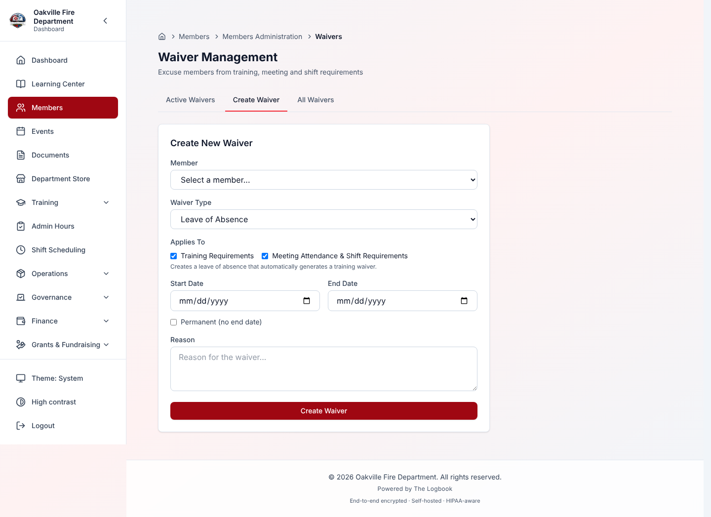

### How Leave Affects Requirements

The Logbook reduces requirements counted in hours, shifts or calls in
proportion to the time the member was away.

**Example.** A requirement asks for 12 hours of training over 12 months. A
member is on leave for 3 months. They now need 9 hours (12 × 9 ÷ 12).

- A month counts as "away" when the leave covers **15 days or more** of that
  calendar month.
- A month with fewer than 15 days of leave still counts in full.
- Overlapping leaves and waivers are not counted twice.

### Viewing Leaves

- **Active Waivers** tab on Waiver Management: every leave in effect now.
  The **Training Waivers** view in Training Admin lists them too.
- **Member profile**: shows the member's active leaves in the right-hand
  column. You can't edit them there.
- **Past leaves**: open the **All Waivers** tab and choose the
  **Past/Inactive** filter.

> **Tip.** Ending a leave with **Deactivate** does not delete it. It stays in
> the history under **All Waivers → Past/Inactive**.

> **Correcting a leave.** On the **Active Waivers** tab, a leave has **Edit**
> next to **Deactivate**. You can change the start date, end date (or
> **Permanent**) and reason. Select **Save leave**. The linked training
> waiver's dates change to match. Check the dates carefully: a changed date
> changes the member's compliance from the next check.

### Leaves and Training Waivers Are Linked

When you create a leave with **Training Requirements** ticked, The Logbook
**also creates a matching training waiver** with the same dates. This means:

- You do not need to create a separate training waiver.
- If you change the leave's dates, the training waiver's dates change too.
- If you deactivate the leave, the training waiver is deactivated too.

> **What if the member should stay on their training requirements during the
> leave?** Tick only **Meeting Attendance & Shift Requirements**. The Logbook
> creates the leave without a training waiver. The form says: _"Creates a
> leave of absence but keeps training requirements active."_

---

## Waiver Management

**Who can do this:** officers who can manage member profiles (the **Manage
member profiles** permission).

Go to **Members > Admin > Waivers**. This one page handles every kind of
waiver.

### Tabs

| Tab                | What it's for                                               |
| ------------------ | ----------------------------------------------------------- |
| **Active Waivers** | Every waiver in effect now, across the department           |
| **Create Waiver**  | Create a new waiver for a member                            |
| **All Waivers**    | The full history, including expired and deactivated waivers |

### Creating a Waiver

1. Open the **Create Waiver** tab.
2. Choose the **member**. The list shows each member's rank by name.
3. Choose the **waiver type**.
4. Under **Applies To**, tick one or both boxes. What you tick decides what
   is created, and the line under the boxes tells you:

   | You tick                                         | What is created                                                    | The form says                                                                  |
   | ------------------------------------------------ | ------------------------------------------------------------------ | ------------------------------------------------------------------------------ |
   | Both (most common)                               | A leave of absence, plus a linked training waiver                  | _"Creates a leave of absence that automatically generates a training waiver."_ |
   | **Training Requirements** only                   | A training waiver on its own. Meetings and shifts are not affected | _"Creates a standalone training waiver without a leave of absence."_           |
   | **Meeting Attendance & Shift Requirements** only | A leave of absence with no training waiver                         | _"Creates a leave of absence but keeps training requirements active."_         |

5. Set the **start date** and **end date**, or tick **Permanent (no end
   date)**.
6. Optionally enter a **reason**.
7. Select **Create Waiver**.

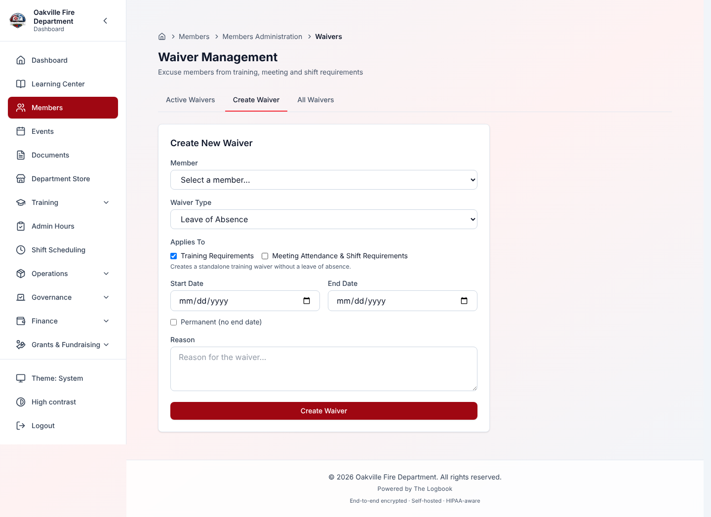

> **What if I only want to excuse meetings, not shifts?** You can't yet. A
> leave always excuses both meetings and shifts.

> **What if Deactivate is refused?** The message says why.

### Training Waivers View for Training Officers

Training officers can also see training waivers in **Training Admin →
Overview → Training Waivers**. This view has:

- summary cards: **Active**, **Future**, **Expired** and **Total**;
- a table you can filter, with a status for each waiver: Active, Future,
  Expired or Deactivated;
- a **Source** column: **Auto (LOA)** for a waiver created by a leave of
  absence, **Manual** for one created on its own; and
- a link to the full Waiver Management page, which also covers meetings and
  shifts.

---

## Rank Validation

**Who can do this:** officers who can manage member profiles (the **Manage
member profiles** permission).

Rank validation finds members whose rank doesn't match any rank your
department recognizes.

### How It Works

The Logbook compares each current member's rank with your department's
operational ranks and the built-in default ranks. A rank that doesn't match
exactly is flagged, even if it differs only in capital letters or spaces.
Archived, retired and dropped members are not checked.

### Viewing Rank Mismatches

Go to **Members Admin → Settings → Operational Ranks**. If any member has an
unrecognized rank, a warning says, for example, _"2 active members with
unrecognized ranks"_. It lists each member's name and the rank they hold.

### Fixing a Mismatch

1. Open the member's profile or their Admin Edit page.
2. Choose the correct rank from the **rank** list.
3. Save.

> **Tip.** If the member's rank is real but missing from your list, add it
> under **Members Admin → Settings → Operational Ranks** first. Then correct
> the member records.

## Membership Tiers

**Who can do this:** officers who can **Manage member profiles**.

Membership tiers group members by years of service. Each tier decides what its
members get: whether they can vote, whether they can hold office, and whether
they are graded for training.

### Configuring Tiers

Open **Members Admin → Settings → Membership Tiers**. The same editor also
appears as a step in first-time setup.

A yellow box at the top reads **This ladder decides who votes**. Set the tiers
to match your bylaws. The tiers The Logbook starts with are a common
arrangement, not a recommendation.

On this screen you can:

- add a tier (type a name under **Add a tier**), rename one, move it up or
  down, or remove it;
- set each tier's **Years of service** — this is where your department sets
  how many credited years make a **Life** member, or any other tier; the
  shipped twenty for Life is a common arrangement, not a rule;
- set what a tier of your own **Counts as** (see below);
- open **Show rights** to set what the tier gives its members (see below);
- turn **Advance members automatically by years of service** on or off; and
- choose what happens **When a former member rejoins**.

Select **Save tiers** to apply your changes. Until you do, the screen says
_"These tiers have not been saved yet — nothing reads them until you do."_
**Discard changes** throws your edits away.

**What each tier gives its members (Show rights):**

| Setting                                              | What it does                                                                                           |
| ---------------------------------------------------- | ------------------------------------------------------------------------------------------------------ |
| **Can vote in elections**                            | Members at this tier can vote                                                                          |
| **Can hold elected office**                          | When cleared, members at this tier cannot be nominated, accept a nomination or be added as a candidate |
| **Must meet a meeting-attendance threshold to vote** | Members must have attended a set share of meetings over a set number of months before they can vote    |
| **Exempt from training requirements**                | Members at this tier are not graded for training compliance at all                                     |

**Counts as** _(2026-10-29)_ sits on the row of any tier whose id is not one
of the built-in statuses. A member's tier is their membership status, and some
rules — the voter groups above, the probationary account status — are keyed on
the built-in statuses. **Counts as** names the built-in status the tier stands
in for: set Senior to count as Regular and its members get every ballot a
regular member gets. Left unset, the tier counts as nothing, which is how a
custom tier has always behaved; the shipped Senior tier is left unset when you
upgrade, so no ballot widens without a decision. The Probationary, Active and
Life rungs are the built-in statuses themselves and need nothing here.

**Rules the screen enforces:**

- **A tier that members hold cannot be removed.** Each row shows how many
  members hold that tier. The remove button stays greyed out while that number
  is above zero. Move those members to another tier first. The check is made
  again when you save, against the roster at that moment — so if automatic
  advancement has just moved someone onto the tier you removed, the save is
  refused and names it. _(2026-10-11)_ While an advancement run is in progress,
  **Save tiers** waits for it to finish (normally under a second) rather than
  saving alongside it.
- **Renaming is safe.** Changing a tier's name does not move anyone off it.
- **Higher tiers need at least as many years as lower ones.** If a tier sits
  above another but needs fewer years, the save is refused. The message
  explains that this order would move a long-serving member down. Reorder the
  tiers or change their years.

> **What if a tier says some training types are "still counted as met"?** A
> tier can be set to treat certain kinds of training as met, without being
> fully exempt. The screen shows that list in a yellow note, but cannot change
> it yet. Ask your administrator if it needs changing.

**Changing one member's tier.** Open **Members Admin → Member Management**,
select **Edit** beside the member, and change the **Membership Type** field.
This is separate from the member's status on their profile.

> **What if no tiers are saved?** Then The Logbook does not check membership
> types at all, and any value is accepted. Once tiers are saved, a member can
> only be moved to one of them.

### Auto-Advancement

When **Advance members automatically by years of service** is on, The Logbook
moves members up on the **first of each month**. Each Active or Probationary
member moves to the highest tier their **credited years of service** qualify
them for. Someone who reaches a threshold mid-month moves at the start of the
next month.

Turn it off if your department promotes by vote, by application, or on a date
of its own choosing.

Auto-advancement follows three rules:

- **Only up, never down.** Nobody is moved to a lower tier.
- **Only along the ladder.** A member whose current membership type is not one
  of your tiers is skipped. Set a starting tier for them by hand.
- **Only Active or Probationary members.** Members with any other status are
  not moved.

There is no button to run it on demand. It runs only on the first of the
month.

**What counts as credited service.** Credited service is the time a member was
actually in the department:

- A member who has never left is counted from their **hire date**.
- A member who was dropped or retired and later came back is not credited for
  the time away. Each unbroken stretch of membership (a _stint_) is listed in
  the **Service History** card on their profile.
- Leave of absence, suspension and inactive status still count as membership,
  so that time keeps counting.

### Former Members Who Rejoin

Bringing a former member back starts a new stint. This happens when you
select **Reactivate** for an archived member, or change a dropped or retired
member's status back to Active, Probationary or Inactive.

The dialog asks how their **Earlier service** counts:

| Choice                     | Credited service                                     | Earlier stints                                |
| -------------------------- | ---------------------------------------------------- | --------------------------------------------- |
| **Continue prior service** | Earlier stints plus the new one, minus the time away | Keep counting                                 |
| **Restart at zero**        | The new stint only, from the return date             | Kept on record and shown as **prior service** |

Your department's default is set under **Members Admin → Settings → Membership
Tiers → When a former member rejoins**. The dialog marks it
**(department default)**. The officer can choose the other option for any one
member.

The dialog also asks for:

- the **Return date** (it cannot be in the future); and
- for a member whose earlier service was never recorded, the **Last day of
  previous service**. This is estimated from their last status change. Correct
  it if you know the real date.

**The Service History card.** The member can see their own card. Officers who
can manage member profiles can see it for anyone, because it records how a
member left. Those officers can select **Edit** to:

- add stints from before The Logbook tracked them;
- correct dates; or
- mark a stint as not counted.

The whole list is saved at once, and it must make sense:

- stints may not overlap;
- no date may be in the future;
- a member who is serving now must have exactly one current stint with no end
  date; and
- a member who is not serving must have an end date on every stint.

> **What if a member came back some time ago, but their time away still
> counts?** Members reinstated before The Logbook recorded stints have no gap
> on file. Their service still counts from their hire date, including the time
> away. Fix it by editing their Service History.

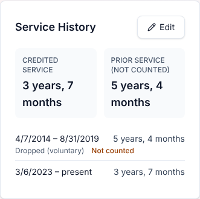

---

## Member Lifecycle Management

There is no single "lifecycle" page. Each task in a member's life — leave,
leaving, coming back, returning gear — has its own screen, in the place people
already look. The table below shows where each one lives.

**Members Administration** is laid out like Training, Events, Scheduling and
Inventory Administration: three area cards, and under them a strip of the
chosen area's pages with a line naming the open one.

| Area             | Pages                                                         |
| ---------------- | ------------------------------------------------------------- |
| **Roster**       | **Member Management**                                         |
| **Add & Import** | **Add Member**, **Import Members**, **Import Qualifications** |
| **Settings**     | **Settings**                                                  |

Adding and importing members need their own permission; without it, **Add &
Import** holds only **Import Qualifications**.

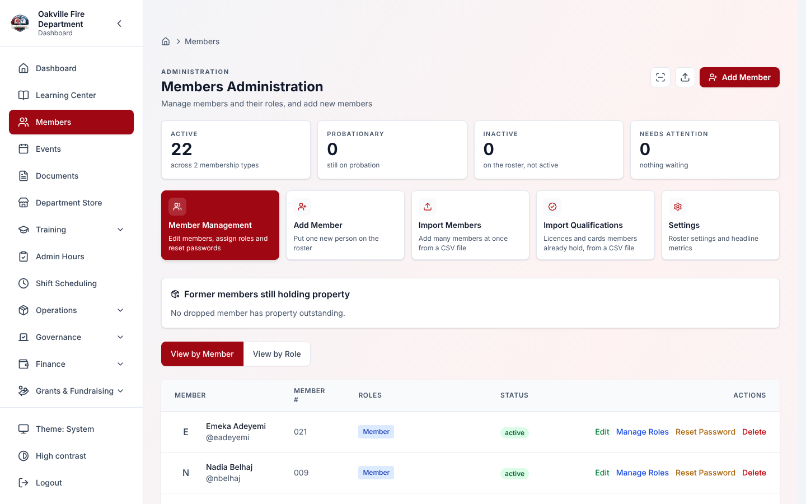

**What sits above the tabs.** Members Administration opens like the Training,
Inventory and Events administration pages. It has a header, **four headline
numbers**, a **Needs attention** list, then the area cards. Your department chooses
three of the numbers on the hub's **Settings** tab. The fourth is always the
count the **Needs attention** list is about. See
[Choosing the metrics](./08-admin-reports.md#choosing-the-metrics).

### Where Each Lifecycle Task Lives

| Task                                         | Where to do it                                                                                                              |
| -------------------------------------------- | --------------------------------------------------------------------------------------------------------------------------- |
| **Change a member's status**                 | Member profile → status control. Archiving happens automatically; it is not a choice                                        |
| **Create a leave of absence**                | [Waiver Management](#waiver-management)                                                                                     |
| **See a leave of absence**                   | Member profile (read-only card), and on Waiver Management and Training Waivers                                              |
| **Change a leave's dates or reason**         | Waiver Management → Active Waivers → **Edit**                                                                               |
| **End a leave of absence**                   | Waiver Management → Active Waivers → **Deactivate**                                                                         |
| **Find and reactivate an archived member**   | Members list → status filter **Archived** → **Reactivate**, or the member's profile                                         |
| **Chase property a former member still has** | Inventory → Member Equipment, or Members Admin → Member Management. Use **Send due reminders** to email everyone who is due |
| **Set up membership tiers**                  | Members Admin → Settings → Membership Tiers (see [Membership Tiers](#membership-tiers))                                     |

> **Tip.** A leave of absence lives on Waiver Management, not on the member's
> profile. The profile only shows it.

---

## EVOC Certification

A member's Emergency Vehicle Operations Course (EVOC) level is recorded **per
apparatus**. It sits on their operator record for each rig, not as one field on
their profile. There is no EVOC field on the profile or the Admin Edit page.

### Setting a member's level on a rig

1. Open **Operations > Apparatus** and choose the apparatus.
2. Go to its **Operators** tab.
3. Select **Add Operator** and pick the member. To change an existing record,
   select the pencil on that row.

The operator form holds:

- **EVOC Certification Level** — a list of your department's levels, plus
  "No EVOC level";
- **Certified to operate**, with certification and expiration dates;
- **License Type Required** (for example, CDL Class B) and **License
  verified**, with a verification date;
- **Has operating restrictions**, with notes; and
- **Active operator**, and free-text notes.

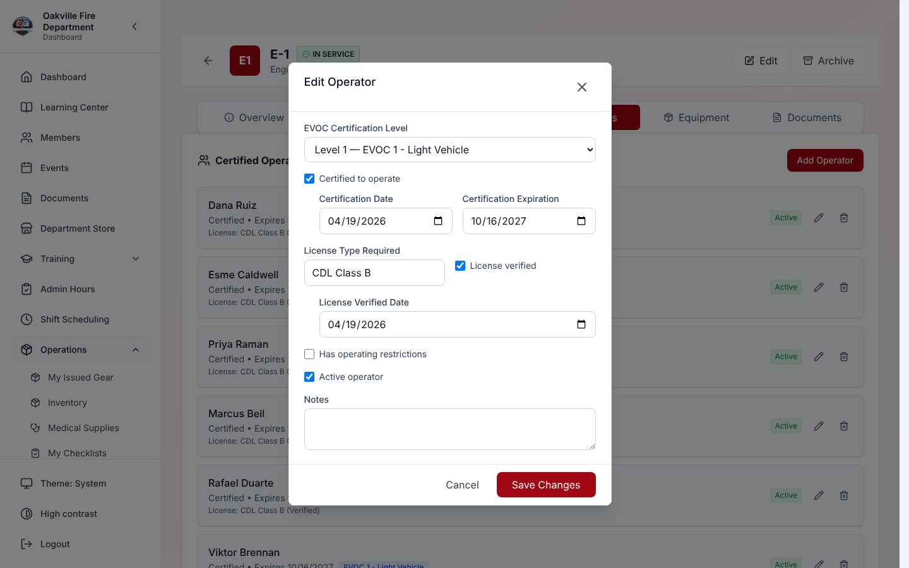

### Your department defines the levels

EVOC levels are set up at **Members Admin → Settings → EVOC Levels**. This
needs the **Full apparatus and fleet management** permission. Without any
levels, an apparatus cannot have a driving requirement.

Each level has a number, a name and a code. Numbers follow the national 1–4
convention. A level can be marked **Cumulative — grants all lower levels**:
holding a cumulative level 3 also covers level 2. Leave it unticked for local
exceptions.

The demo data defines three levels:

| Level | Name         | Code   | Covers                                     |
| ----: | ------------ | ------ | ------------------------------------------ |
|     1 | Basic        | EVOC-1 | Emergency vehicle operation, non-transport |
|     2 | Intermediate | EVOC-2 | Engine and rescue apparatus                |
|     3 | Advanced     | EVOC-3 | Aerial and tiller-equipped apparatus       |

### What the level is used for

An apparatus can name a **Required EVOC Level**. When someone is put in, or
signs up for, the driver seat on that apparatus's shift, The Logbook checks the
member's operator records. A record only counts if it is:

- marked **Active operator** and **Certified to operate**; and
- not past its expiration date **on the day of the shift** (not today).

A record covers the requirement if its level matches exactly, or if it is a
higher **cumulative** level.

**By default, a member who does not qualify is blocked from the driver seat.**
The message names the level the apparatus needs and the level the member holds
(or says they have no EVOC certification).

- A chief can approve a time-limited **driving exception** for one member, one
  apparatus and a set of dates — for example, for a parade. Exceptions are
  requested and approved on the scheduling **Who Can Fill What** page. A chief
  other than the person who asked must approve. With an approved exception the
  assignment goes through, with a warning showing the exception and any
  restrictions.
- Your department can turn off **Enforce EVOC for drivers** in the scheduling
  settings. Then the check only shows a warning and does not block.
- An apparatus with no required level never warns or blocks.

---

## Member ID Cards and the Check-In Station

Members can carry an ID card with an NFC chip (a chip a phone or reader can
read by touch). An officer sets up a check-in station, and members tap their
card to check in to a shift, an event or admin hours.

> **Turn it on first.** An administrator turns it on under **Settings →
> Integrations → NFC ID Cards**. It starts off. While it is off, nothing on
> this page works, and the screens say so.

### Issuing a card

**Who can do this:** officers with the **Issue and revoke member ID card (NFC)
credentials** permission.

Open the member's profile and find the **ID Cards** panel. Select **Issue
card**. There are two ways to link a card to the member:

| Option                           | Use it when                               | What the card carries              |
| -------------------------------- | ----------------------------------------- | ---------------------------------- |
| **Write a code to a blank card** | The tag can be written — a sticker, a fob | A new random code, written onto it |
| **Read a printed card's serial** | The card is already made and locked       | The chip's own serial number       |

Writing a code is the better choice:

- the code cannot be guessed, and is not printed anywhere on the card; and
- the tag can be rewritten later and given to someone else. A card known only
  by its chip serial stays that member's for good.

A card with a written code shows **Written** beside its status. Writing a code
needs Chrome on an Android phone. On a computer with no NFC, hold the card
against a USB reader with the cursor in the serial box, or type the serial
printed on the card. Then select **Register card**.

**Card numbers cannot be read back.** The Logbook keeps a scrambled form of
the number, not the number itself. Nobody — officer, administrator, or someone
who gets hold of a backup — can read a member's card number out of The Logbook.
Only the last four characters are kept, so you can tell two cards apart.

### Suspending, reporting lost, and removing a card

Each active card has these buttons:

| Button       | What it does                                                                                 | Can it be undone?                     |
| ------------ | -------------------------------------------------------------------------------------------- | ------------------------------------- |
| **Suspend**  | Stops the card working, for a card the member has mislaid and may still find                 | Yes — select **Reactivate**           |
| **Lost**     | Stops the card working at once. The Logbook asks **Report this card lost?** first            | No — issue a new registration instead |
| Remove (bin) | Deletes the card **and its history** from the member. Use Suspend or Lost to keep the record | No                                    |

A card marked lost (or revoked) never works again under that registration.

> **What if a lost card turns up, or a card is passed to someone else?** You
> can register the same physical card again with **Issue card**. The old
> registration stays lost or revoked on the previous holder's record, and a new
> active one is created. If the card's old registration is still **active or
> suspended**, The Logbook refuses: _"This card is already registered to another
> member and is still in use. Mark that registration lost or revoked, then
> register the card again."_

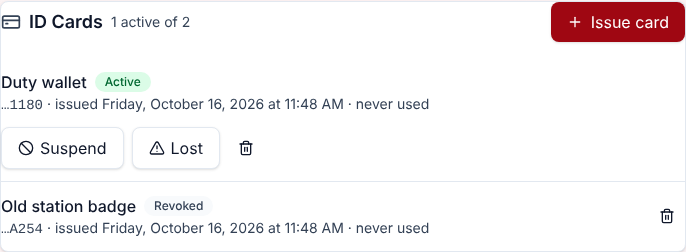

**Who can open a colleague's ID card page.** The **ID Card** page is the
printable badge with its QR code and barcode. You can always open your own.
You can open someone else's only if you can manage member profiles or issue ID
cards. Scanning is not affected: **Scan Member ID** and the check-in station
find a member without showing their badge.

### The station

**Who can do this:** officers with the **Check members in at an ID card
check-in station** permission. They do not need permission to edit the shift
or event.

Open the check-in station, then:

1. Under **Check members into**, choose **Shift**, **Event or meeting** or
   **Admin hours**.
2. Pick the shift, event or category from the list.
3. Under **Each tap**, choose **In, then out** (the first tap checks in, the
   next checks out), **Checks in** or **Checks out**.
4. Select **Start the reader**. The screen reads **Ready — tap a card for …**.

From then on, **nobody touches the screen between taps**.

The station works with two kinds of reader:

- **The phone or tablet's own NFC** — Chrome on Android.
- **A USB desk reader** that types the serial and presses Enter. The station
  listens to the whole page, not one box, so a stray tap on the screen does not
  stop it reading.

**Which members can check in:**

| Member status                                   | Tap accepted | Why                                                        |
| ----------------------------------------------- | ------------ | ---------------------------------------------------------- |
| Active, Probationary                            | Yes          | —                                                          |
| **Retired, On leave**                           | **Yes**      | They attend meetings and banquets, which a station records |
| Inactive, Suspended, Dropped, Archived, deleted | No           | —                                                          |

**What the lists offer:**

- **Shifts** from today and yesterday stay on the list **until an officer
  finalizes them**, not until they end. Checking out has no deadline, so a crew
  coming off a 24-hour tour can still tap out.
- **Events** stay on the list while their check-in window is open.
- The station only offers things a check-in would actually accept.

**When a tap does not check someone in,** the station shows why and **stays
ready** for the next card. Examples:

- _"This card is not registered. Ask an officer to add it to your member
  record."_
- _"This card has been marked lost and no longer works. Ask an officer to
  issue a replacement."_
- _"This card belongs to a member who is not currently active."_
- **Already checked in**, or a check-in window that has closed.

> **What if someone taps twice by accident?** A card held too long reads twice.
> The station ignores the second read. With **In, then out**, a second tap
> within a minute shows **Already checked in just now** instead of checking the
> member out.

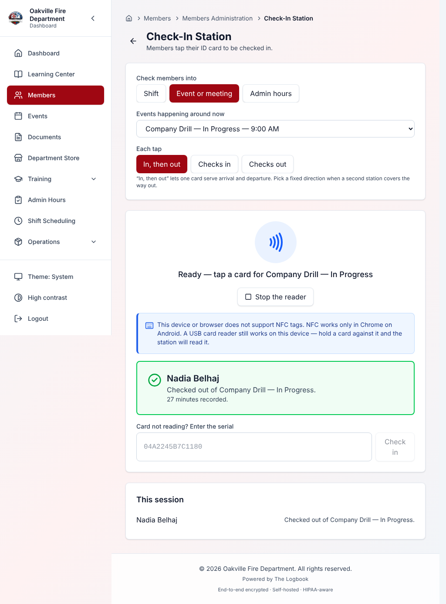

### In the record

When a card is tapped at a station for admin hours, the entry's method reads
**ID Card Station**. A member scanning a category's QR code with their own
phone reads **QR Scan**. These are different acts by different people, so an
admin-hours check can tell a station tap from a member's own scan.

### The Member ID Cards page

**Who can do this:** officers with the **Issue and revoke member ID card (NFC)
credentials** permission. They do not need permission to edit the roster.

Open **Members Admin** and select **Member ID cards**. The page covers every
card in the department, in four tabs:

| Tab          | What it is for                                                                                                                                                                                                                        |
| ------------ | ------------------------------------------------------------------------------------------------------------------------------------------------------------------------------------------------------------------------------------- |
| **Cards**    | Every card, searchable by member, label or last four characters, and filterable by status and card type. Tick cards to **Suspend**, **Reactivate**, **Report lost** or **Revoke** them together. Revoking asks for an optional reason |
| **Coverage** | **Current members without a working card** (with **Issue card** on each row), **Cards held by former members** (**Revoke all shown**), and **Active cards not used in** a number of days you choose                                   |
| **Tap log**  | Every tap at a check-in station or room kiosk, **including refused ones**, filterable by outcome and reader. **Export CSV** downloads it                                                                                              |
| **Settings** | **Keep the tap log for (months)**: between 3 and 84, 24 by default. Older taps are deleted overnight                                                                                                                                  |

Deleting old taps does not touch attendance. The check-in itself stays on the
shift, event or admin-hours record.

<!-- Screenshot needed: The Member ID Cards page on the Cards tab with two cards ticked and the Suspend, Reactivate, Report lost and Revoke bar above the list -->

<!-- Screenshot needed: The Coverage tab of Member ID Cards: current members without a working card, cards held by former members, and active cards not used lately -->

<!-- Screenshot needed: The Tap log tab of Member ID Cards with the drill's taps, including an unknown card and a card that is not active -->

A tap from a card nobody has registered is logged as **Unknown card**, without
the card's number.

**When a member leaves, their cards stop by themselves.** Changing a member to
Inactive, Suspended, Dropped or Archived suspends their active cards, because
those members' taps are refused anyway. If the member comes back, only the
cards suspended this way are reactivated. A card an officer suspended, reported
lost or revoked stays as it is.

## Troubleshooting

| What happened                                                  | What it means / what to do                                                                                                                                                                                                                                                                                                                       |
| -------------------------------------------------------------- | ------------------------------------------------------------------------------------------------------------------------------------------------------------------------------------------------------------------------------------------------------------------------------------------------------------------------------------------------ |
| **"Email already exists"** when adding a member                | Each member needs a different email. The address belongs to an existing member. If that member is archived, the message names them — reactivate them instead of adding a duplicate. If it belongs to a deactivated record, use a different email.                                                                                                |
| A new member cannot sign in                                    | Check the welcome email was sent. If not, set a password with **Reset Password** in Member Management. (When email is off, **Add Member** makes you set one.) Also check the member's status is Active or Probationary — other statuses cannot sign in.                                                                                          |
| Some rows in a spreadsheet import fail                         | Every row is checked as soon as you choose the file, before anything is created. Each problem names the column and the value. Select **Download Error Report** to get the failed rows back, with the reason in a first column called `errorReason`. Fix the rows, delete that column, and upload that file.                                      |
| A phone number was imported as someone's email                 | A comma inside a value without quotes shifts every later column. Rows with the wrong number of values are refused, and an email column holding a phone number is pointed out. Wrap any value containing a comma in double quotes.                                                                                                                |
| A row that looks complete fails as missing required fields     | Same cause: a comma inside a value, often an address. Wrap it in double quotes.                                                                                                                                                                                                                                                                  |
| "Email already exists" for someone not in The Logbook          | The address appears twice in your file. Repeated emails, usernames and membership numbers are caught before importing, naming the line where each was first used.                                                                                                                                                                                |
| "Username already exists" but you gave no username             | A username defaults to the part of the email before the `@`. So `j.doe@a.com` and `j.doe@b.org` clash. Add a `username` column with different values.                                                                                                                                                                                            |
| Importing sent welcome emails you did not want                 | **Send welcome emails now** is on the review step and is **off by default** for imports. Leave it off to load the roster quietly, then give people passwords later with **Reset Password**. Tick it to email everyone a temporary password as they are created; they must change it at first sign-in.                                            |
| A row matches someone already on the roster                    | The current roster is checked when you choose the file. A row whose email, username or membership number is already taken is reported straight away, naming who has it. Useful when re-uploading a corrected file.                                                                                                                               |
| The import created a member called John Doe                    | The template's example row was left in the file. The importer recognises it and refuses that row. Delete it from your file.                                                                                                                                                                                                                      |
| A large import seems stuck, or you started it by mistake       | The review step shows progress, such as "Importing 23 of 47", and a **Stop importing** button. Members already created stay created. Rows not reached appear in the error report as "Not imported — the import was stopped before this row". Upload that report to finish.                                                                       |
| "Missing required columns" when uploading                      | Download a fresh template and copy your data into it.                                                                                                                                                                                                                                                                                            |
| Every row fails because the role does not match                | The `role` column must match a name under **Roles**, not a rank or an assignment ("Engine Operator" and "EMT" are usually assignments). Unmatched names are reported when you choose the file. Create the roles, or clear the column and use the `rank` column instead.                                                                          |
| Imported members have no position                              | Use the exact role name from **Roles** in the `role` column. A name that does not match fails that row.                                                                                                                                                                                                                                          |
| Imported members are all Active, whatever the spreadsheet says | Expected. Every imported member is created Active. If your file has a `status` column, the uploader tells you it is ignored. Set each status afterwards on the member's record.                                                                                                                                                                  |
| A column in your spreadsheet was not imported                  | The uploader lists every column it does not recognise when you choose the file. Anything outside the template's columns is ignored. Move that data into a template column, or add it to the member afterwards.                                                                                                                                   |
| A prospect is missing from the pipeline                        | Check the pipeline filter. The prospect may be in a different pipeline, or marked Withdrawn or Transferred.                                                                                                                                                                                                                                      |
| A prospect does not move on by itself                          | Check that auto-advance is ticked in that stage's settings. It is on by default for form stages, and off by default for document, checklist and other stages.                                                                                                                                                                                    |
| An automatic email was not sent                                | Check email is set up under **Settings > Email**. Check the prospect has a valid email address. Check the scheduled email log for errors.                                                                                                                                                                                                        |
| **Move Back a Stage** is missing                               | It only appears for an active prospect who is past the first stage.                                                                                                                                                                                                                                                                              |
| Emails show the wrong times                                    | Check your department's time zone under **Settings > Organization**. Scheduled emails use that time zone.                                                                                                                                                                                                                                        |
| Pipeline email sections are in the wrong order                 | Drag and drop them into order in the pipeline's email settings.                                                                                                                                                                                                                                                                                  |
| You want to see an email before it goes out                    | Use the preview in the pipeline's email settings.                                                                                                                                                                                                                                                                                                |
| The pipeline overview report is missing                        | Turn on the **Pipeline Overview** report in **Reports**. Group its stages under **Pipeline Settings > Report Stage Groups**.                                                                                                                                                                                                                     |
| An email fails with a connection error                         | Ask your administrator to check the email settings. Gmail and Office 365 use port 587; some self-hosted mail servers use port 465.                                                                                                                                                                                                               |
| A dropped member still shows as active                         | The status change may not have saved. Check it on the member's profile.                                                                                                                                                                                                                                                                          |
| No property return report is produced                          | The member must have equipment assigned. With none assigned, there is nothing to report.                                                                                                                                                                                                                                                         |
| A member's tier did not go up                                  | Check that **Advance members automatically by years of service** is on; that the member is Active or Probationary; that their current membership type is one of your tiers; and that their hire date or Service History gives enough credited years. Advancement happens on the 1st of each month.                                               |
| A leave of absence did not adjust training                     | On Waiver Management, look at the leave's **Applies to** column. **Meetings & Shifts** means training was left out. Create a separate training waiver on the same page.                                                                                                                                                                          |
| A rank shows as not recognised                                 | The member's rank must exactly match a rank your department has set up, including capitals and spaces. Edit the member's rank, or add it under **Members Admin → Settings → Operational Ranks**.                                                                                                                                                 |
| A member's audit history is empty                              | The history only holds changes made since the feature was turned on. Older changes do not appear.                                                                                                                                                                                                                                                |
| You cannot find the Admin Edit page                            | Open **Members Admin → Member Management** and select **Edit** beside the member.                                                                                                                                                                                                                                                                |
| A photo upload fails                                           | Use a JPEG, PNG or WebP image no larger than 5 MB. If it still fails, ask your administrator.                                                                                                                                                                                                                                                    |
| The compliance card shows an unexpected colour                 | Refresh the page. **Red (Non-Compliant):** an expired certification, or fewer than half the requirements met. **Yellow (At Risk):** a certification expiring soon, or some requirements unmet. **Green (Compliant):** everything met. **Not Applicable:** no requirements apply to this member. **Exempt:** the member is excused from training. |

---

## Realistic Example: New Member Onboarding (End-to-End)

This story follows one applicant, **Alex Rivera**, from first contact to the
end of their third month at **Oakville Fire Department (OFD)**. It touches six
parts of The Logbook: Membership, Elections, Inventory, Medical Screening,
Training and Scheduling.

**The people:**

| Person                  | Role                                          |
| ----------------------- | --------------------------------------------- |
| **Alex Rivera**         | New applicant, later Probationary Firefighter |
| **Lt. Morrison**        | Membership Coordinator                        |
| **Capt. Davis**         | Training Officer                              |
| **Lt. Walsh**           | Quartermaster (Inventory)                     |
| **Secretary Sarah Kim** | Election administrator                        |
| **Capt. Alvarez**       | Health & Safety Officer                       |

---

### Part 1: Application (January 5)

Alex finds OFD's recruitment page and sends in an interest form.

1. Lt. Morrison opens **Administration > Members > Prospective** and selects
   **Add Applicant**. She enters Alex's name, email and phone, and sets
   Membership Type to **Regular Member**.
2. Alex's card appears on the board at **Stage 1: Interest Form**. This stage
   is linked to the Membership Interest Form.
3. Alex fills in the form online and submits it.
4. Form stages move on by themselves by default, so Alex's card moves to
   **Stage 2: Application Review**.

Each stage does one thing. To send a welcome email with a link to track the
application, add a separate **Automated Email** stage where it should go out.

> **What if Alex is already in The Logbook?** The check happens **before** the
> applicant is saved. When Lt. Morrison selects **Add to Pipeline**, the email
> and name are compared with your members. If there is a match, a box titled
> **This may be a duplicate** says how many members match.
>
> - **Go back** returns her to the form, with everything she typed still there.
> - **Create anyway** saves the applicant. This is right when the match is a
>   different person with the same name.

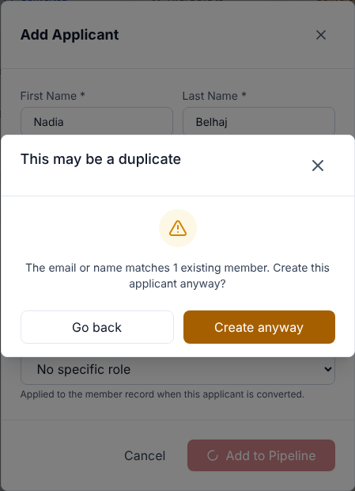

The question is asked once, while it is still easy to answer. Nothing appears
on the applicant afterwards and there is nothing to dismiss later. The board
itself is pictured in
[Prospective Members Pipeline](./15-prospective-members.md#the-kanban-board).

---

### Part 2: Background Check and Interview (January 10 – February 15)

1. Lt. Morrison moves Alex to **Stage 3: Background Check**, a document stage.
2. The check takes three weeks. On January 31, the results are uploaded as a
   PDF to Alex's record. Files can be up to 50 MB, as PDF, DOC, DOCX, JPEG, PNG
   or GIF.
3. Auto-advance is on for that stage, so once the document is uploaded Alex
   moves to **Stage 4: Interview**.

**Three officers interview Alex:**

| Interviewer   | Recommendation              | Notes                                                      |
| ------------- | --------------------------- | ---------------------------------------------------------- |
| Capt. Davis   | Recommend                   | "Strong mechanical aptitude, team-oriented"                |
| Lt. Hernandez | Recommend                   | "Excellent communication skills"                           |
| FF Brooks     | Recommend with reservations | "Limited weekday availability — works full-time until May" |

Each interviewer records their interview and recommendation on Alex's record.
The stage needs the set number of interviews. If the stage asks for it, at
least one must carry a particular recommendation. There is no majority or
"everyone must agree" rule, so FF Brooks's reservation does not hold Alex back.

4. Lt. Morrison reads all three and moves Alex to **Stage 5: Membership
   Vote**.

> **What happens to a reservation?** FF Brooks's "Recommend with
> reservations" stays in Alex's history. A future coordinator can read it and
> its reason. It is for information only; it does not add an extra approval
> step.

---

### Part 3: Membership Vote (March Business Meeting)

When Alex reaches the **Election/Vote** stage, The Logbook creates an
**election package** for the Elections module. This happens however Alex
reaches the stage. The package holds:

- Alex's name, the membership type they want, why they are interested, and
  notes;
- the stages they completed, with dates;
- the names of the documents uploaded; and
- email, phone, address and date of birth, if the stage is set to include them.

1. The package starts as **Draft**. Lt. Morrison selects **Mark Ready for
   Ballot** on Alex's record. Secretary Sarah Kim then sees it under **Pending
   Member Applications** on the election's page.
2. She adds Alex to the **March Business Meeting** ballot. (A package can also
   be added to a draft election from the applicant's record.)
3. At the meeting, 38 members are present. The vote is:
   - **Yes:** 35
   - **No:** 3
   - **Result:** Approved (simple majority)
4. When the election closes, the package status is set from the counted
   Approve and Deny votes. It reads **Elected**, because Approve outnumbered
   Deny.
5. Alex's card in the pipeline shows the result automatically.

> **What if the vote fails?** With a 15–23 vote, the package would read **Not
> Elected**, and Alex could not be made a member. There is no built-in waiting
> period before applying again. The coordinator decides whether to reject the
> application or hold it.

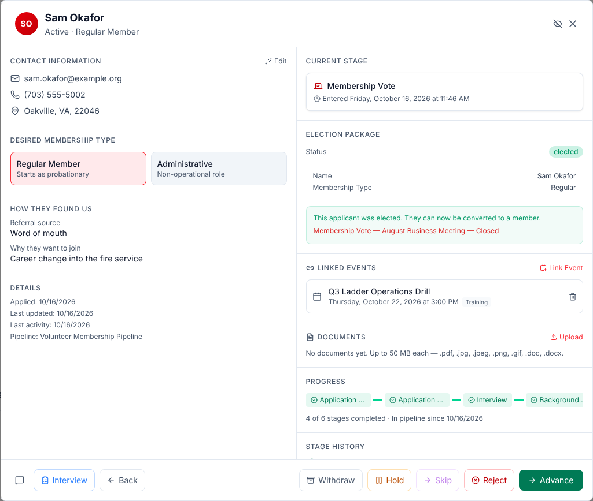

The vote counts are not shown on the applicant's record. They are on the
election's results screen — see the [Elections guide](./14-elections.md). The
applicant's record shows the outcome: the package status.

---

### Part 4: Becoming a Member and Getting Gear (March 16)

#### Converting Alex to a member

1. Lt. Morrison selects **Convert** on Alex's record. On the second step,
   **Member class** reads Operational and **Starting status** reads
   Probationary. These come from the pipeline's settings for a Regular
   applicant. Changing them here affects only this applicant. He chooses
   **Email them a temporary password** and selects **Convert to Member**.
2. The Logbook creates Alex's account:
   - **Rank:** Probationary Firefighter
   - **Station:** Station 1
   - **Account:** active, on probation
   - **Membership number:** OFD-0047 (only if your department numbers members
     automatically)
   - **Department email:** alex.rivera@oakvillefd.org (only if your department
     creates first.last addresses)
   - **Personal email:** carried over from the application
   - **Role:** "member", given automatically, plus the application's **Target
     Role** if one was chosen
   - **Training:** enrolled in the **Probationary Firefighter Program**. This is
     the department's chosen auto-enroll program or, if none is chosen, the
     first active program with "probationary" in its name.
3. Because he chose **Email them a temporary password**, Alex gets a welcome
   email with a temporary password. It goes to Alex's new sign-in email — the
   department address, if one was created. Alex must change the password at
   first sign-in.

> **What if email is not set up?** Then **Email them a temporary password** is
> greyed out. The officer sets a password, or leaves it for **Reset Password**
> later. The result screen says which, and shows the membership number Alex
> was given.

#### Gear through the Impact Planner

4. Lt. Walsh opens **Inventory** and goes to the **Impact Planner**.
5. He filters by **Station 1** and the probationary membership type. He runs
   one analysis per kind of item: turnout coat, turnout pants, helmet, gloves
   and boots.
6. Alex shows as **"Needs item"** in each.
7. Alex's sizes are not on file. The results say so: **"_N_ members need the
   item but have no size on file"**. The **Request sizes** button beside that
   line asks **all of them at once**. There is no way to ask one member alone.
   The button reports how many people were asked.
8. Alex signs in for the first time, changes the password, goes to **My Issued
   Gear** and opens **My Sizes**. Alex enters:
   - Coat: L Regular
   - Pants: 34x32
   - Helmet: 7 1/4
   - Gloves: XL
   - Boots: 11 Wide
9. Lt. Walsh runs the analysis again and sees the sizes. He selects **Issue
   on-hand stock**. It asks him to confirm first — "one matching-size item to
   each member who needs it and has stock available". Then it reports what it
   did, for example **"Issued to 6 members, 2 skipped"**, naming each person
   skipped and why.

> **What if something is out of stock?** The planner issues what it can and
> skips the rest, **per member and per item**. Each skip shows a reason, such
> as "no matching stock" or "no size on file". There is no "partial kit" or
> "backordered" label. A member who could not get gloves simply has no gloves
> assigned, and shows as needing them in the next analysis.

To cover the shortfall, use the purchase list and the draft purchase orders
made from the same results — see [Inventory](./05-inventory.md).

The planner's screens — the "Needs item" rows, the sizes to buy and the
shortfall — are pictured in
[Inventory](./05-inventory.md#impact-planner).
This part only shows what a new member's first kit looks like through them.

---

### Part 5: Medical Screening (March 20)

Capt. Alvarez opens **Medical Screening** and creates two screenings for Alex:

| Screening                  | Status    | Scheduled Date |
| -------------------------- | --------- | -------------- |
| Annual Physical Exam       | Scheduled | March 25       |
| Pre-Employment Drug Screen | Scheduled | March 22       |

**March 22 — drug screen.** Alex takes the test at the chosen clinic. Capt.
Alvarez changes the status from **Scheduled** to **Passed**.

**March 25 — physical.** Alex has the physical. Capt. Alvarez sets the status
to **Passed** and the expiration to **March 25, 2027**.

**Alex's compliance summary** now shows:

- Requirements met: **2 / 2**
- Overall status: **Fully Compliant** (green badge)
- Next expiration: March 25, 2027 (Annual Physical)

> **What if the drug screen fails?** If it is recorded as **Failed**, the
> record shows Failed and the requirement counts as not met. Nothing is
> flagged or sent automatically. Follow your department's substance abuse
> policy by hand.

---

### Part 6: Training (March 25)

Converting Alex enrolled them in the **Probationary Firefighter Program**
automatically (see Part 4). Capt. Davis opens the enrollment in **Training**.
The program has four phases:

**Phase 1: Orientation (4 requirements)**

- Department history presentation
- SOPs review and acknowledgment
- Facility tour (all stations)
- Radio procedures and protocol

**Phase 2: Basic Skills (6 requirements)**

- Hose operations (3 observed evolutions)
- Ladder operations (3 observed evolutions)
- SCBA donning and use
- Forcible entry techniques
- Search and rescue procedures
- Ventilation operations

**Phase 3: EMS (3 requirements)**

- CPR/AED certification
- First Responder certification
- Patient assessment competency

**Phase 4: Live Fire (2 requirements)**

- 40 hours supervised fireground operations
- Officer sign-off on fireground competency

Alex finishes all four Phase 1 requirements in the first week (March 25–31).
Capt. Davis marks each one complete. Phase 1 changes to **Complete**, and
Phase 2 opens. A phase opens the next one when all its requirements are done,
unless that phase is set to move on only by hand.

> **What if Alex already holds a certification?** Alex has a current CPR/AED
> card from a previous job. Alex uploads it to a training record. Capt. Davis
> checks it is current and from an accredited provider, and approves it. The
> Phase 3 CPR/AED requirement is then credited automatically. When Phase 3
> opens, Alex only needs the other two EMS requirements.

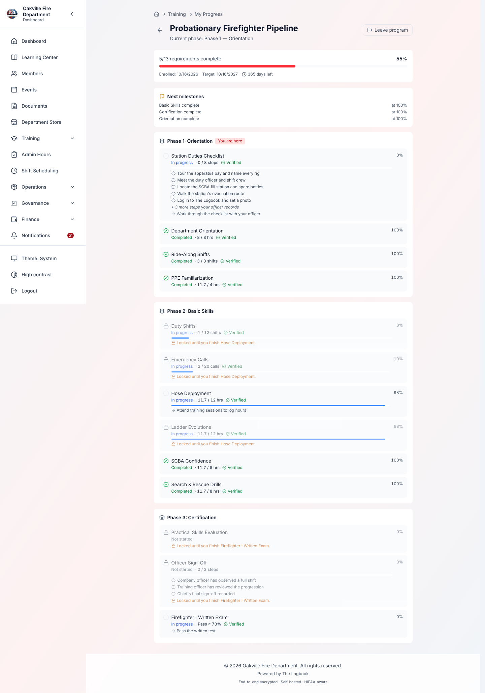

The numbers in this story are examples. On screen, each phase lists its
requirements with their own status and progress. A finished phase has a tick.
The total at the top counts completed requirements across the whole program,
including any credited in a later phase. That is how Alex's CPR/AED credit
shows before Phase 3 opens. Members see this on their own **My Program
Progress** page. Coordinators see the same view from the program's
**Enrollments** tab.

---

### Part 7: First Shift and After (April 1)

Alex joins **A Platoon** and works a first 24-hour shift on **Engine 1** on
April 1.

**The shift officer's shift report:**

| Field           | Value                                                                        |
| --------------- | ---------------------------------------------------------------------------- |
| Hours worked    | 24                                                                           |
| Calls responded | 3 (1 medical, 1 fire alarm, 1 MVA)                                           |
| Skills observed | Hose deployment (Score: 3 — Competent), SCBA donning (Score: 2 — Developing) |
| Tasks completed | Hydrant connection, Equipment inventory                                      |

The shift officer sends the report for review. Once it is approved, Alex's
training updates automatically:

- **Phase 2 "Hose operations"** — 1 of 3 required observations done.
- **Phase 4 "40 hours supervised"** — 24 of 40 hours logged.
- The shift hours count toward Alex's monthly attendance in Scheduling.

> **What if the reviewer wants more detail?** The reviewer sends the report
> back with a note: "Please add more detail to the SCBA observation — what
> drills were performed?" The shift officer adds the details ("Donned SCBA in
> 90 seconds during morning drill; used SCBA during fire alarm response at
> 1420"). The reviewer checks again and approves.

**Alex's dashboard after one month shows:**

- **Name:** Alex Rivera
- **Rank:** Probationary Firefighter
- **Station:** Station 1, A Platoon
- **Training:** 25% through the Probationary Firefighter Program (Phase 2 in
  progress)
- **Medical:** 2/2 compliant (physical expires March 2027)
- **Equipment:** coat, pants, helmet and boots issued; gloves not yet issued
  (still listed as needed)
- **Shifts:** 4 shifts done, 96 hours logged

---

### Summary: Alex After 3 Months

| Area       | Status                                                    |
| ---------- | --------------------------------------------------------- |
| Membership | Probationary Firefighter, Station 1, A Platoon            |
| Inventory  | Coat, pants, helmet and boots issued; gloves still needed |
| Medical    | Fully compliant (physical expires March 2027)             |
| Training   | 25% through Probationary Program (Phase 2)                |
| Scheduling | A Platoon, 4 shifts done, 96 hours logged                 |
| Finance    | Dues appear once the treasurer creates them               |

---

### How the Parts Connect

One action in one place often fills in another:

- **Convert** makes the member, gives a membership number and department email
  (where turned on), gives the "member" role, enrolls them in the probationary
  program and sends the welcome email — all in one step.
- **Reaching an Election/Vote stage** creates the election package.
- **The Impact Planner** finds new members who need gear, using the sizes they
  enter themselves.
- **Medical Screening** results feed the member's compliance status.
- **Approved shift reports** credit training requirements and count toward
  attendance.
- **Dues** are created by the treasurer from a dues schedule in Finance. A new
  member is included the next time dues are created for that schedule.

---

### Cross-Module Edge Cases

| What happened                                           | What it means / what to do                                                                                                                                              |
| ------------------------------------------------------- | ----------------------------------------------------------------------------------------------------------------------------------------------------------------------- |
| The membership vote fails                               | The package reads Not Elected and the applicant cannot be made a member. There is no built-in waiting period before applying again.                                     |
| Gear is out of stock during onboarding                  | Items in stock are issued; the rest are skipped with a reason. The quartermaster raises purchase requests or draft purchase orders from the planner results.            |
| The drug screen fails                                   | The record shows Failed and the requirement counts as not met. Nothing is flagged or sent automatically.                                                                |
| A training phase needs a certification Alex already has | Alex uploads the certificate; an officer approves it; the requirement is credited automatically.                                                                        |
| Alex goes on leave during probation                     | Record the leave on Waiver Management. While it lasts, the training, meeting and shift requirements it covers are adjusted, so Alex is not marked behind for time away. |
| Dues are not paid by the due date                       | Unpaid dues are marked Overdue after the due date passes. Part-paid dues stay Partial. Late fees are not added automatically.                                           |

---

## If You Learned an Older Version

If you are following older notes, an older recording or an SOP, these things
have moved, been renamed or work differently.

### Renamed or moved

- **Membership Committee Chair** is now the **Membership Coordinator**
  position. A position your department created for itself kept its name.
- For ordinary members, the roster page is now called **Member Directory**. It
  shows a **Rank** column, opens on **Active** members, and does not list
  former (archived) members. Officers who manage members still see
  **Membership Management** with usernames, hire dates, row actions and
  **Export**.
- To open a profile, select the member's row or name. There is no pencil
  button for most members.
- There is no **Member Lifecycle Management** page, no **Leave of Absence**
  tab and no **Add Leave of Absence** button. Leaves are created on **Members
  → Admin → Waivers → Create Waiver**. Each other task has its own screen; see
  [Where Each Lifecycle Task Lives](#where-each-lifecycle-task-lives).
- **Membership tiers** have their own screen: **Members Admin → Settings →
  Membership Tiers**. Tiers advance automatically on the 1st of each month.
- An **EVOC level** is set per apparatus, on its **Operators** tab — not on
  the member's profile. The levels are your department's own.
- The **Applies To** choices on a waiver are now two boxes: **Training
  Requirements** and **Meeting Attendance & Shift Requirements**.
- The pipeline's bulk buttons are **Advance Selected**, **Hold Selected** and
  **Reject Selected**. They act only on the applicants you ticked.
- There is no **Delete Member** button on the profile page. Deleting is a row
  action on **Members** or in **Member Management**.

### Works differently now

- **EVOC is enforced for drivers.** A member without the required level is
  blocked from a driver seat, not just warned, unless a chief approves an
  exception or the department turns off **Enforce EVOC for drivers**.
- **Probationary and junior members can sign in** and can be put on shifts.
- **Badges scan by badge code, not membership number.** Old cards keep working
  only while **Accept old badges** is switched on.
- **Printing a colleague's badge or ID card** needs permission to manage
  members or issue ID cards.
- **Assigned gear** on a profile shows only to the member and to officers who
  manage equipment. The **ID Card** link shows only on your own profile, or to
  officers who manage members or ID cards.
- **Each member chooses who sees their contact details** under **My Account →
  Privacy**. A member who never makes a choice keeps the department's
  setting.
- **Administrative members do not hold an operational rank.** A single
  "membership type" is now two things: [member class and member
  status](#member-class-and-member-status).
- **A card reported lost can be registered again** with **Issue card**.

### Things to check if your department has used The Logbook for a while

- **Collect and destroy applicant badges printed before 28 September 2026.**
  They carry the code that opens the applicant's status page, which lets
  anyone read and withdraw that application. Newer badges don't carry it.
- **Applicants left sitting on an automated email stage** from before that
  stage completed itself need to be moved on by hand.
- **Applicants added before 29 September 2026** may have no **Target Role**
  saved. Check it before converting them to members.
- **If you set probationary members to Active** only so they could sign in,
  you can set them back to Probationary.
- **Administrative members lost any operational rank** when class and status
  were split. If someone truly holds a rank, change their class first, then set
  the rank.
- **Members who rejoined before service history was recorded** may still have
  their time away counted toward years of service. Fix it by editing their
  **Service History**.
- **If a member's positions disappeared after an officer saved their roles**
  in an older version, add the positions again.

---

**Previous:** [Getting Started](./00-getting-started.md) | **Next:** [Training & Certification](./02-training.md)
