# Training & Certification

The Training module keeps your department's training records. It tracks
courses, certifications, required training, program enrollments, outside
training systems and compliance reports. Members use it to log and check their
own training. Training officers use it to review records and manage the
department's requirements.

## Lesson at a Glance

|                   |                                                                                |
| ----------------- | ------------------------------------------------------------------------------ |
| **Audience**      | Members completing training; training officers managing records and compliance |
| **Permissions**   | Members use their own records; officer tasks need **Manage training records**  |
| **Prerequisites** | Training module turned on; at least one course set up for submission practice  |
| **Member path**   | About 15 minutes                                                               |
| **Officer path**  | About 30 minutes; the full reference is longer                                 |
| **Last verified** | 2026-10-14                                                                     |
| **Owner**         | Department training officer                                                    |

In this guide, a **training officer** means anyone whose role includes the
**Manage training records** permission.

By the end of the essential path, members can submit training and check its
status. Officers can review the submission, make a decision they can defend,
and confirm that approved credit appears in history and compliance.

> **Practice safely.** Use a practice course or a demo department. Do not
> approve invented training in your live department. If the live department is
> your only option, read the steps and look at an existing pending record
> without changing it.

### 15-Minute Member Path

1. Review [My Training](#my-training-dashboard) and note one active
   requirement.
2. Follow [Submitting Training Records](#submitting-training-records) using a
   real completed activity or a practice course.
3. Return to My Training and confirm the record is waiting for review.
4. After an officer acts, check the decision and the credited hours in your
   history.

### Officer Review Path

1. Open the [Officer Dashboard](#officer-dashboard) and find the pending
   submission.
2. Use [Reviewing Submissions](#reviewing-submissions) to check the course,
   date, hours, notes and evidence.
3. Approve only when the evidence supports the record. Otherwise send it back
   or reject it with a useful reason.
4. Confirm that an approval updates the member's history and their
   [compliance](#compliance-matrix).

### Try It: Submission to Credit

- **Starting state:** A practice member has submitted a two-hour practice
  drill.
- **Task:** The member finds the submission's status. An officer reviews the
  evidence and decides. The member then checks the result.
- **Success:** Both people can point to the record's saved status and credited
  hours — not only a pop-up success message.
- **Variation:** The certificate shows a different date than the submission.
  What should the reviewer check before deciding?

---

## Table of Contents

1. [My Training Dashboard](#my-training-dashboard)
2. [Submitting Training Records](#submitting-training-records)
3. [Course Library](#course-library)
4. [Multi-Class Courses & Cohorts](#multi-class-courses--cohorts)
5. [Training Programs](#training-programs)
6. [Training Pipelines](#training-pipelines)
7. [Training Requirements](#training-requirements)
8. [Officer Dashboard](#officer-dashboard)
9. [Reviewing Submissions](#reviewing-submissions)
10. [Finalizing a Training Session](#finalizing-a-training-session)
11. [Compliance Matrix](#compliance-matrix)
12. [Evaluation Period (Current vs. Prior Month)](#evaluation-period-current-vs-prior-month)
13. [Expiring Certifications](#expiring-certifications)
14. [Waiver Management](#waiver-management)
15. [Compliance Summary](#compliance-summary)
16. [Shift Completion Reports](#shift-completion-reports)
17. [Manual Shift Report Entry](#manual-shift-report-entry)
18. [Officer Training Record Exports](#officer-training-record-exports)
19. [External Training Integrations](#external-training-integrations)
20. [Historical Import](#historical-import)
21. [Competency Matrix](#competency-matrix)
22. [Recertification Tracking](#recertification-tracking)
23. [Instructor Management](#instructor-management)
24. [Training Effectiveness Scoring](#training-effectiveness-scoring)
25. [Multi-Agency Training](#multi-agency-training)
26. [xAPI (Tin Can) Integration](#xapi-tin-can-integration)
27. [Compliance Officer Dashboard](#compliance-officer-dashboard)
28. [Training Record Attachments](#training-record-attachments)
29. [Troubleshooting](#troubleshooting)
30. [Recurring Training Sessions](#recurring-training-sessions)
31. [Skills Testing](#skills-testing)
32. [Training Record Categories & Virginia NCCR Standards](#training-record-categories--virginia-nccr-standards)
33. [Printing Training Records, Programs & Compliance](#printing-training-records-programs--compliance)
34. [If You Learned an Older Version](#if-you-learned-an-older-version)

---

## My Training Dashboard

Select **Training > My Training** to see your own training page.

The page has tabs under its title:

- **My Training** — what you need to do now.
- **History** — everything on your record. It appears when your department
  shows training history to members.
- **Member Visibility Settings** — only for officers who may change what
  members see.

The **My Training** tab shows:

- **Summary tiles.** **Completed Courses** and **Completed Hours** count the
  calendar year so far; each tile is labelled with the year. **Required
  Training** is your average progress across your requirements (one that is half done counts as 50%). Your lifetime
  totals are on the History tab. The tiles use the calendar year because there
  is no department-wide "training year". Each requirement keeps its own
  counting window.
- **Upcoming Expirations & Due Dates** — the next six months, soonest first,
  with anything overdue at the top. See below.
- **Training Requirements** — your progress toward each requirement. An hours
  requirement has a **Show monthly hours** control.
- **Recent Training** — your five newest records, with a **View full
  history** link to the History tab.
- **Certifications** — collapsed, because its expiring entries already appear
  in the upcoming list.
- **Skills Tests** — your own official and practice skills-test results. Each
  opens a read-only scorecard. Your department decides which results appear
  and how much of each you see; see
  [Who Sees a Result](./09-skills-testing.md#who-sees-a-result--disclosure-settings).
- **Pipeline Progress**, **Shift Statistics**, **Shift Completion Reports**
  and **Self-Reported Training**.

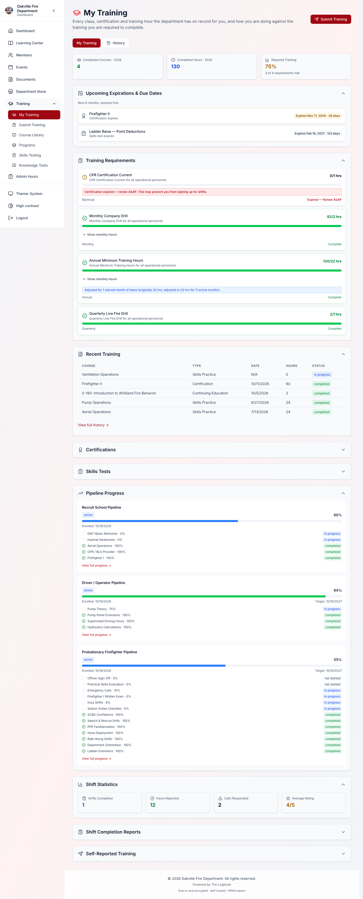

**Required Training** shows your average progress across your requirements (one
that is half done counts as 50%), with "X of Y requirements met" beneath it for
the ones you have fully met. When no requirement
applies to you, it reads **None assigned** — "Your department has not assigned
you any required training yet." This means nothing is asked of you yet. It is
not a fault.

**A record with nothing on it yet** explains itself. Under "Nothing is on your
training record yet" it lists the three ways training reaches the page:

1. **Attend a department training.** The hours arrive once an officer approves
   the attendance.
2. **Submit training you did elsewhere.**
3. **Take a skills test.**

It also offers **Submit External Training** and a link to the Learning Center's
training walkthrough.

> **What if a requirement says "Due by" a date instead of overdue?** Your
> department added the requirement after you joined and gave existing members
> until a deadline (see
> [Existing members](#existing-members--exempting-or-giving-a-catch-up-deadline)).
> The card says "You joined before this requirement took effect. You have until
> _date_ to complete it, and it won't count against your compliance before
> then." A requirement your department exempted you from does not appear on the
> page at all.

> **Hint:** Your department's training settings control which sections of this
> page members see. Your officers may show or hide some of them.

### Upcoming Expirations & Due Dates

This is one list for everything with a date on it, so you do not have to read
three sections to find what is next. It looks six months ahead, soonest first.
Amber means due within 90 days. Red means overdue or expired.

| Row                                       | What it means                                                                                                                                                  |
| ----------------------------------------- | -------------------------------------------------------------------------------------------------------------------------------------------------------------- |
| **Due _date_ · N days**                   | A requirement you have not met yet, with its deadline.                                                                                                         |
| **Expires _date_ · N days**               | A certification, or any training record with an expiry date. A renewed certification is listed once, from its newest record.                                   |
| **Expires _date_ · N days** (skills test) | A passing official skills test whose skill has a validity period. An officer sets it in the skill sheet's **Valid for (months)** field.                        |
| **Opens _date_ · N days**                 | A requirement you have already met whose next completion window is about to open (see [When a Yearly Class Isn't Counted](#when-a-yearly-class-isnt-counted)). |
| **_N_ hrs to go**, with no date           | An hours requirement counted over a rolling window. It has no deadline: it is met or short on any given day. It is listed last, with its window beneath.       |

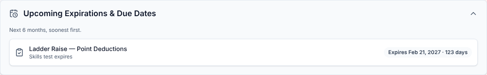

Once a date passes, the row reads **Overdue N days ago** or **Expired N days
ago**. When nothing is due, the list says so.

### Your Skills Tests

A skills test is not a training record, so it does not appear in the History
tab. Your own results are in the **Skills Tests** section instead, which is
closed until you select it. Each row shows the skill, the examiner and the
date, with **Passed** or **Failed** on the right. A practice run carries a
**Practice** badge. A test still waiting on an officer reads **Under review**
until it is validated. Select a row to open the scorecard.

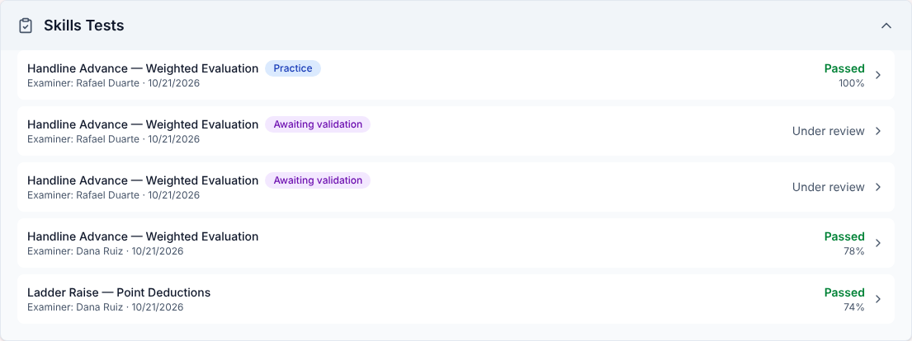

If an officer gave the skill a validity period, a passing test also appears in
the upcoming list above, with the date it expires. What you can see of each
result is set by your department; see
[Who Sees a Result](./09-skills-testing.md#who-sees-a-result--disclosure-settings).

### The History Tab

Select **History** under the page title to see everything the department has on
record for you.

1. Records are **grouped by year, newest first**. The newest year is open and
   older years are closed. Select a year to open it. Each year's header shows
   how many records it holds and their hours.
2. A year with more than 25 records loads 25 at a time. Select **Show more**
   for the rest.
3. **Search courses** filters by course name. **Type** filters by training
   type. Both narrow the years and the lists together.
4. A record **with no completion date** is grouped under **No completion date**,
   above the years, whatever you filter by. This includes a record still waiting
   for approval and a completed record imported without a date; each row shows
   its own status. (The group was headed "Awaiting approval" before 2026-10-21.)

The top of the tab shows your **all-time** courses and hours and how many years
are on record. The History tab reads your whole record, however long it is.

If your department allows member exports, **Export CSV** and **Export PDF** sit
beside the search. An export always covers your **entire** history, whatever is
filtered on screen. That is what an outside audit or a new employer wants.

> **Hint:** The export buttons appear only when an officer has turned on
> **Allow Report Export** ("Members can download their own training data") in
> **Member Visibility Settings**. If you do not see them, ask an officer to
> export your records for you.

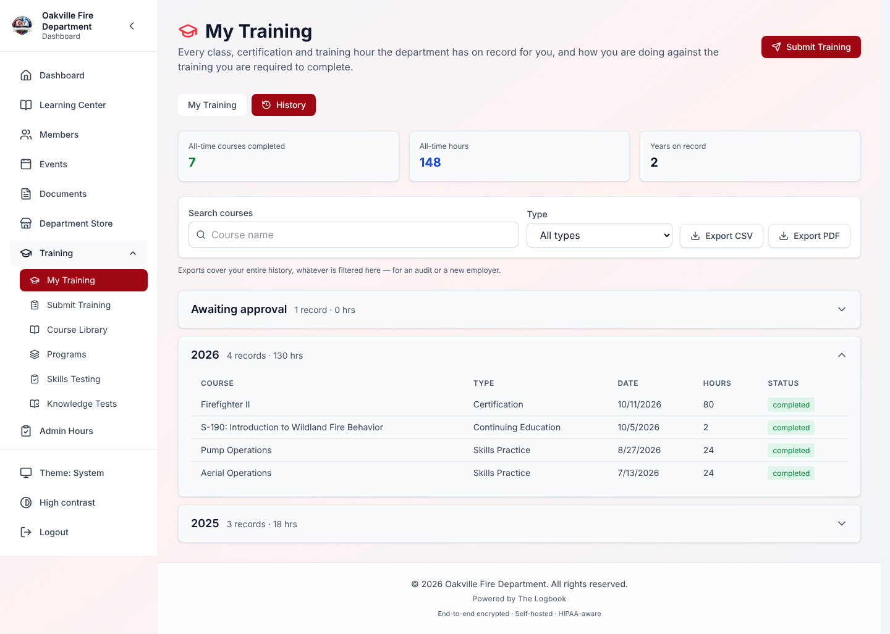

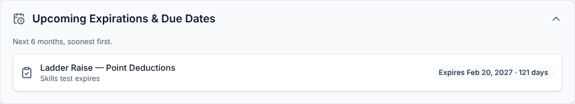

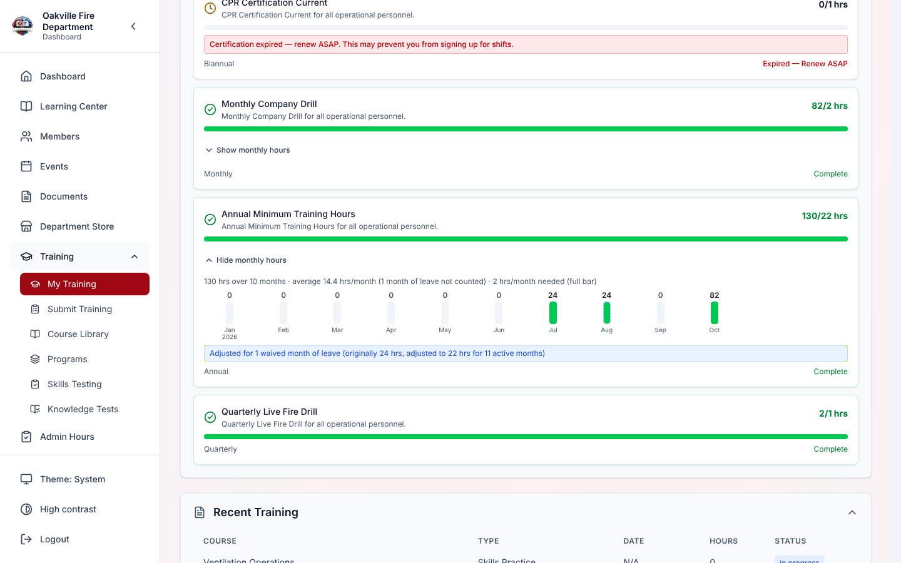

### Checking an Hours Requirement Month by Month

On an hours requirement, select **Show monthly hours**. You see:

- every month of the requirement's window, including empty months, with the
  hours counted in each;
- your total, your average per month, and the pace the requirement needs.

Each bar is scaled to that pace. The pace is the requirement's yearly hours
divided by the months in its window: 72 hours over 12 months is 6 a month. A
**full bar is a month that kept pace**.

The months use the same records as the total on the card, so they add up to
it. If a month looks short, it is short: the class is missing, not yet
approved, or counted somewhere else.

A month covered by **leave of absence** is marked **Leave** and left out of the
average. The pace still uses the department's full yearly hours. These are the
same months the card's "adjusted for waived months" note uses to reduce your
target.

---

## Submitting Training Records

Select **Training > Submit Training** to log training you completed somewhere
else. The page is titled **Submit External Training**.

1. Type the **Course or class name**. Suggestions appear as you type.
2. Choose the **Training type** and, if asked, the **Category**.
3. Enter the **Date** and **Start time**.
4. Set **How long did it run?** with the duration stepper. One entry has a
   maximum length; log a longer course one day at a time.
5. Under **Details**, add the instructor, location and a short description
   where asked.
6. If the training earned a certification, tick **This training earned a
   certification** and fill in its details.
7. Attach the certificate on the same form. It can be a PDF, JPG or PNG, up to
   10 MB.
8. Select **Submit Training**.

Your department decides which fields are required. Required fields are marked
with a red asterisk.

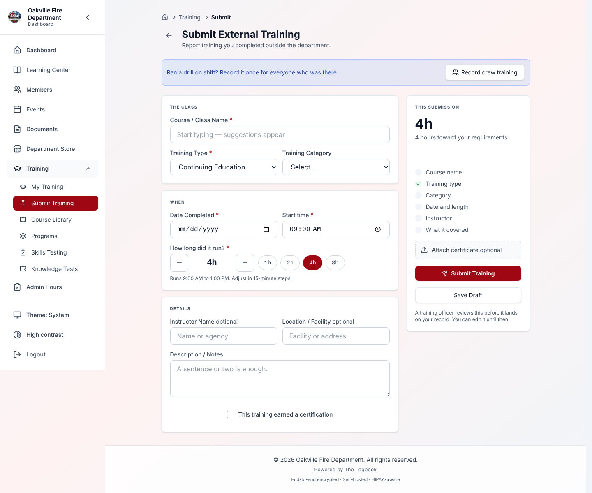

**After you submit:**

- Your record waits for an officer's review.
- A training officer approves it, rejects it, or sends it back to you.
- You are told in the app if the officer rejects it, sends it back, or approves
  it with changes. A plain approval sends no notice: the hours appear on My
  Training.
- Approved records join your training history and count toward requirements.

> **What if an officer sends it back?** A notice appears at the top of Submit
> Training with the officer's note. It says "Your hours are not counted yet".
> Select **Fix and Resubmit** to correct it, or **Withdraw** to remove it.

> **Ran a drill on shift?** If you can serve as a shift officer, Submit
> Training shows "Ran a drill on shift? Record it once for everyone who was
> there." Select **Record crew training** to log the drill once for the whole
> crew. Each member present gets an entry waiting for a training officer's
> approval; nobody is credited until it is approved.

> **Hint:** If you are submitting for a certification, attach the certificate.
> It helps officers check and approve your record faster.

**The start time is kept** with the record, so an officer can tell a morning
class from an evening one. An entry submitted before the form asked for a start
time shows the start time as blank.

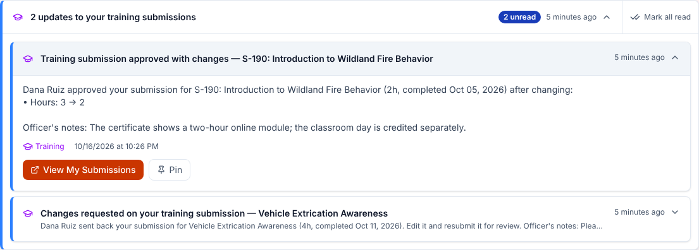

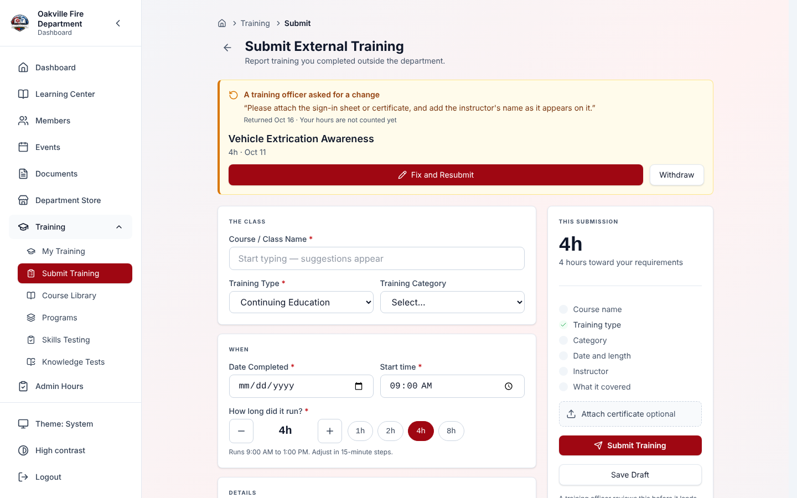

### What Records Officers Should Know About Certificate Files

- **Certificates are kept forever unless your department sets a retention
  period.** In **Review Submissions → Settings → Certificate Files**, enter how
  many days after an approval or rejection the uploaded files are kept. The
  minimum is 90 days. A daily task then deletes older files from the
  submission and the member's training record. The record itself, its hours and
  its dates stay. Leave the box empty to keep files forever. Every change to
  the period, and every file the task deletes, is in the audit log.
- **Files can be scanned for viruses.** Every file is checked to be the type it
  claims, and is stored under a name The Logbook chooses. If your
  administrator has turned on ClamAV scanning, each certificate is also scanned
  before it is saved:
  - A file the scanner flags is refused with _"This file was flagged as
    malicious…"_ and never stored. The refusal is in the audit log.
  - If the scanner is briefly unavailable, the member sees _"Files cannot be
    checked for malware right now…"_ and can try again in a few minutes. The
    file is not saved unscanned.
  - Without scanning turned on, a certificate an officer opens is exactly what
    the member uploaded.
- **Voiding a record keeps its file.** Deleting a record marks it cancelled
  instead of removing it. The correction stays traceable, and its evidence
  stays with it.

---

## Course Library

Select **Training > Course Library** to browse your department's courses.
For training officers this opens the same list inside **Training Admin →
Curriculum → Course Library**, with the management controls.

The library shows every active course your department has created, as a grid of
cards you can narrow with the search box and **Filters** (type and category).
Each course shows:

- its name and description;
- its category;
- its required hours;
- whether it is a certification course;
- **Certifies:** and the qualification, when completing the course grants one.

The **Certifies** field on the course form names the qualification that
completing the course grants. The qualification is dated from the training
record's completion and expiry dates. It decides which shift positions the
member may fill. This is the only way qualifications are recorded; see
[Rank and Qualification Are Different Things](./01-membership.md#rank-and-qualification-are-different-things).

**Only training officers see the management controls.** **Add Course**, and
the **Edit**, **Deactivate** and **Manage classes** controls on each card,
appear only for officers. Other members can read every course card.

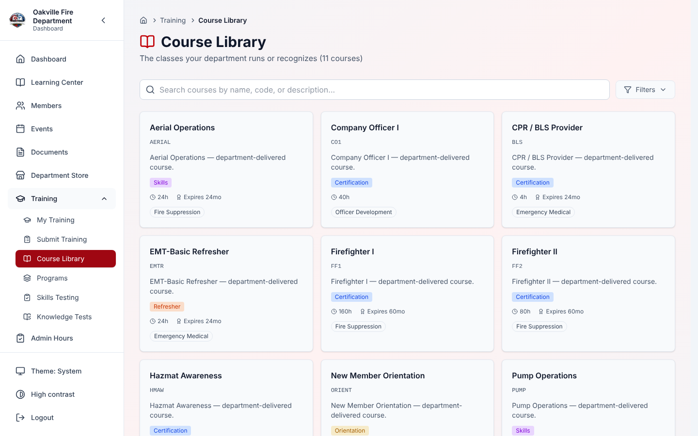

A member who opens an empty library sees "Your department has not added any
courses yet" and what the page will show once an officer adds courses. An
officer sees "No courses in your library yet" with a prompt to create one.

**Clearing a field on a course saves the empty value.** Empty an optional field
— instructor, expiry, code, description, hours — and select **Update Course**.
The field stays empty. An emptied category or materials list is also saved
empty.

**Deactivating a course** hides it from new training records. To bring it back,
open **Filters**, tick **Show inactive courses**, and select **Reactivate** on
the course.

Courses made up of several classes — a recruit school, a five-night EMT
refresher — show a class count and a **Manage classes** action. See
[Multi-Class Courses & Cohorts](#multi-class-courses--cohorts).

---

## Multi-Class Courses & Cohorts

A recruit school is one _course_ made up of many _classes_. Instead of creating
fifteen training sessions by hand for every new intake, you describe the course
once and generate each intake from it.

There are two pieces:

- A **syllabus** — the ordered list of classes, written once. It has no dates,
  only "how long after the course starts".
- A **cohort** — one run of the course, such as "Recruit School — Fall 2026".
  Generating a cohort turns the syllabus into real, dated training events.

### Building a Course Syllabus

**Who can do this:** training officers.

1. Open **Training Admin → Curriculum → Course Library**.
2. Find the course. Create it first if needed. This is the _container_ course,
   such as "Recruit School".
3. Select **Manage classes**.
4. Select **Add class** and fill in:
   - **Course taught** — the library course this class covers, such as "SCBA
     Operations". This is required. It supplies the class's credit hours,
     certification settings and categories. If the course does not exist yet,
     select **+** to create it without leaving the builder.
   - **Title** _(optional)_ — defaults to the course name. Use it when the same
     course appears twice ("SCBA — night evolution").
   - **Section** _(optional)_ — groups classes, such as "Orientation &
     Safety". Sections become phases if you generate a pipeline.
   - **Day** — how many days after the course start this class happens. Day 1
     is the first day.
   - **Start time** and **Duration**.
   - **Credit hours** _(optional)_ — defaults to the library course's hours.
   - **Room** _(optional)_ — only for a class that always meets somewhere
     else, such as live fire at the burn tower. Every cohort books this room
     for this class instead of the cohort's own room. Otherwise leave it on
     the cohort's room.
   - **Counts toward certification requirements** — leave this on for classes
     taught the way a certifying body accepts. Turn it off for an informal
     in-house drill. Attendance still earns hours, but the class will not
     advance a certificate.
5. Repeat for each class. Use the up and down arrows to reorder.

Each class shows the gap since the one before it — **"Next day"**, **"2 days
later"** — the way most officers describe a schedule out loud.

> **Hint:** If your course meets on a regular pattern, do not count days by
> hand. Select **Fill from pattern**, pick the meeting days (for example,
> Tuesday and Thursday), and say which weekday the course starts on. Every
> class is spaced out for you. You can still adjust single days afterwards.

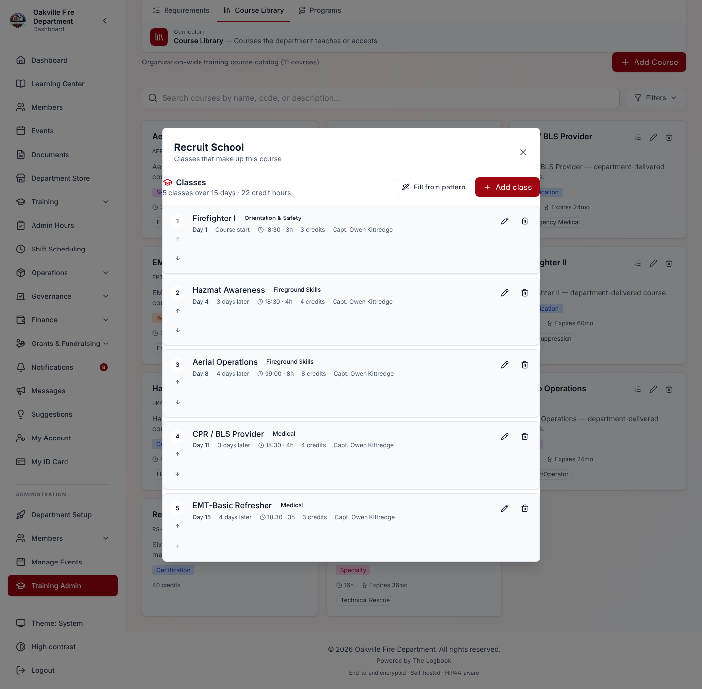

### Generating a Cohort

**Who can do this:** training officers.

1. Open **Training Admin → Records → Course Cohorts**.
2. Select **New cohort**. The wizard has five steps.
3. **Course** — pick the course and name the cohort, such as "Recruit School —
   Fall 2026".
4. **Schedule** — set the start date. You may also choose the meeting days, a
   default start time, and what happens when a class lands on a day you do
   not train:
   - _Keep the computed date_ — leave it where it falls.
   - _Move weekends to the next weekday_.
   - _Move to the next meeting day_ — uses the meeting days you chose.

   **Room** _(optional)_ — the room the cohort meets in. It is booked for
   every class that has no room of its own on the syllabus.

5. **Preview** — the important step. Every class is listed with the date it
   will actually get. Anything that had to move (a weekend, a holiday) is
   flagged, along with archived courses and rooms already booked. You can:
   - change any single date and time;
   - pick a different **room** for one class. The preview checks again
     straight away, so you see at once whether the room is free. Each class
     shows the room it will book and why: _chosen for this class_, _from the
     syllabus_, or _the cohort's room_, in that order of priority;
   - tick **Skip this class** to leave one out of this intake;
   - tick any suggested holidays to skip them, then select **Recalculate**.
6. **Roster** — select the members taking the course. They are enrolled in
   the pipeline and added to every class on their calendar.
7. **Generate** — review the summary. If the course has no pipeline yet,
   **Build a matching pipeline** is ticked for you (untick it if you do not want
   one); if it already has one, members are enrolled in that pipeline instead.
   Then select **Generate N classes**.

Generating creates **one training event per class**, each with a linked
training session. Students see the classes on their calendar, sign in and out
with the QR code as usual, and the hours flow into their program.

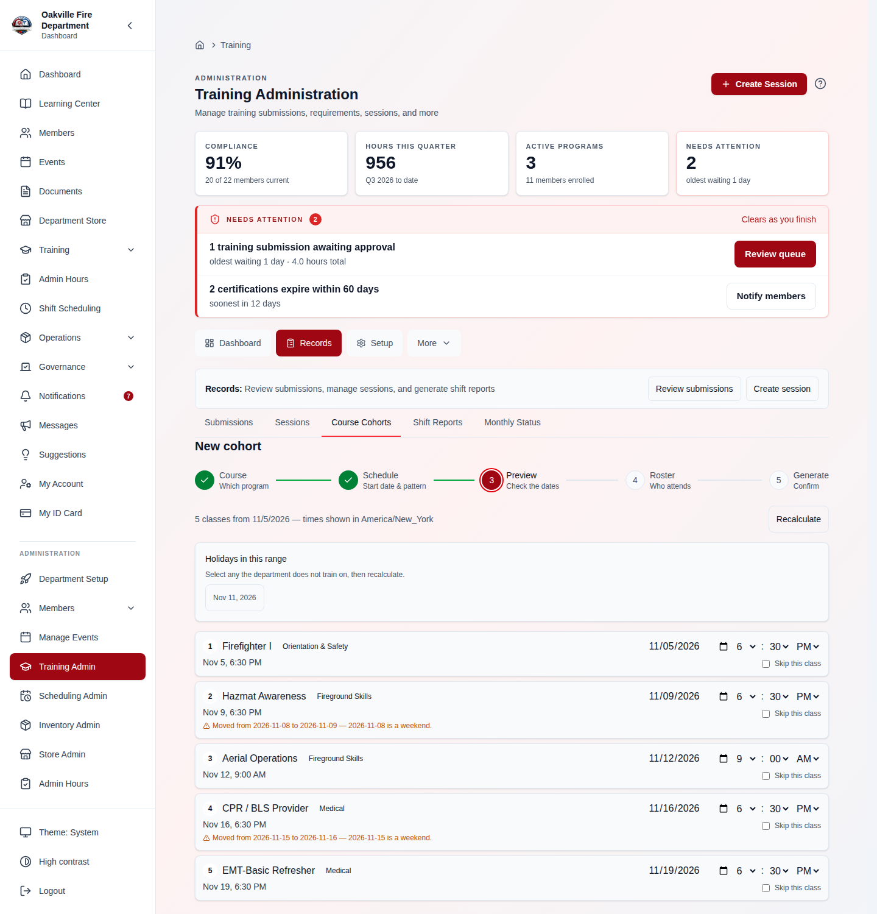

### Running a Cohort

Open a cohort to see its **Classes** timeline and its **Roster**.

The class timeline numbers each class. It shows the class's date and start
time, status, credit hours, instructor, how many members signed up, and an
**Event** link to the calendar entry. From here you can:

| Action                        | What it does                                                                                                                                                                                                                              |
| ----------------------------- | ----------------------------------------------------------------------------------------------------------------------------------------------------------------------------------------------------------------------------------------- |
| **Reschedule**                | Moves the class and its calendar event together. Everyone who signed up stays signed up.                                                                                                                                                  |
| **Cancel class**              | Cancels the event instead of deleting it, so anyone signed up sees the cancellation. The class stays listed for the record.                                                                                                               |
| **Shift remaining**           | Moves every class that has not happened yet later (or earlier) by a number of days, up to 14 either way _(2026-10-29)_. Classes that already ran keep their dates. A longer move is a rescheduled course: reschedule the classes instead. |
| **Create _N_ missing events** | Appears only when a class has no event — because scheduling it failed, or someone deleted the event. It only fills gaps.                                                                                                                  |

**Reschedule** and **Cancel class** are the two icon buttons at the right of
each row. On a healthy cohort the missing-events button is absent, as in the
picture below.

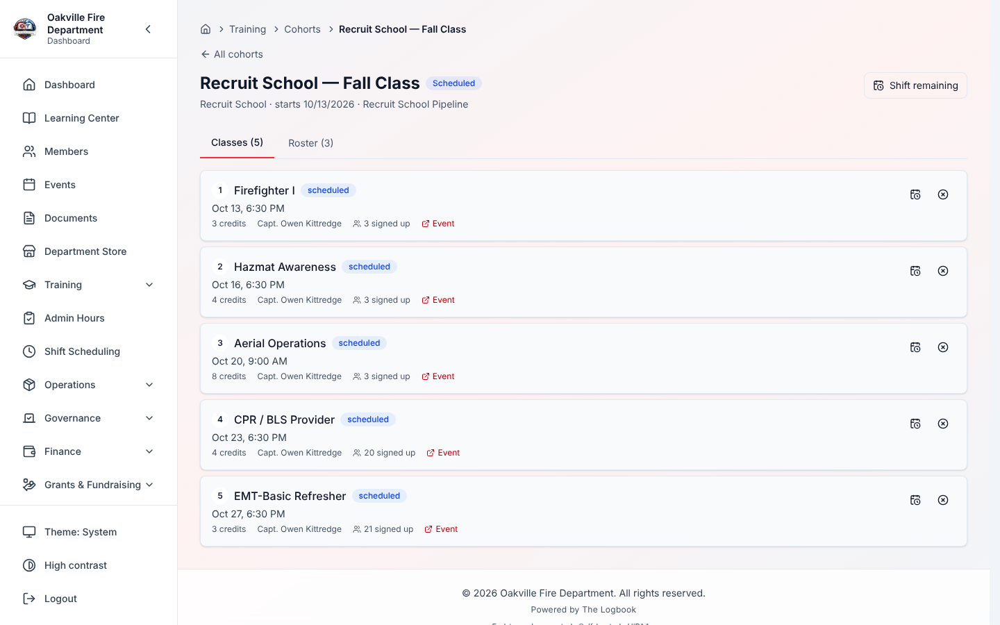

The **Roster** tab lists each member with their progress through the pipeline,
a link to their full progress, and a **Remove** action. **Add member** puts
someone on a cohort that is already running.

**A member who joins late** is signed up for every class still to come, but not
for classes already held. Each missed class needs a decision from you. The
roster shows how many are waiting ("2 classes held before they joined —
decide"). The panel opens by itself when you add someone who missed classes.
For each class, choose:

- **Credit as completed** — they covered the material elsewhere. They get a
  completed training record for the class, dated the day it was held and worth
  its credit hours. The hours count toward their pipeline requirement. The
  class's own attendance does not change.
- **Schedule make-up** — pick when it runs. A copy of the class ("Make-up: …")
  is added to the cohort, with the same course, hours and pipeline link, and
  put on that member's calendar only. They are credited the usual way, when
  the make-up's attendance is finalized. If you cancel the make-up, the class
  asks for a decision again.

Once a class is credited, you cannot undo the decision from this panel.

> **Students cannot open a cohort page.** Cohort pages are for officers only.
> A member who follows a cohort link sees **Access Denied**. Members do not see
> their classmates' names, progress or attendance. Tell recruits their schedule
> through the class events on their calendar, which they can already see.

### Cohorts vs. Recurring Sessions

These solve different problems, and it is easy to reach for the wrong one:

- A **recurring training session** repeats **the same class** on a fixed
  pattern — a monthly CPR refresher. See
  [Recurring Training Sessions](#recurring-training-sessions).
- A **cohort** runs **an ordered series of different classes**, once — a
  recruit school covering orientation, then SCBA, then ladders.

If each meeting covers a different subject, you want a cohort.

### Edge Cases

| What happened                                             | What it means / what to do                                                                                                                                                                                                    |
| --------------------------------------------------------- | ----------------------------------------------------------------------------------------------------------------------------------------------------------------------------------------------------------------------------- |
| You reorder classes but the dates do not change           | Order and timing are separate. Moving a class up the list does not move it earlier on the calendar; the builder shows "2 days earlier" to make that visible. Use **Fill from pattern**, or edit the day numbers, to re-space. |
| You fix the syllabus while a cohort is running            | The running cohort does not change, so a class in progress is never rescheduled under the students. Your fix applies to the next cohort. Edit the current one from its own page.                                              |
| You delete a class from the syllabus                      | Cohorts already generated keep their copy of the class. Nothing is unscheduled and nobody loses credit.                                                                                                                       |
| You skip a class during preview                           | The cohort numbers its classes 1, 2, 3… with no gaps, so cohort class 4 may be syllabus class 5.                                                                                                                              |
| One class cannot be scheduled (room double-booked)        | Only that class fails. The rest are created, the cohort lists the class with a **No event** badge, and you see the reason. Free up the room, then use the missing-events button.                                              |
| Someone deletes a generated event                         | The cohort lists the class as **No event**. The missing-events button rebuilds it.                                                                                                                                            |
| The course runs across a daylight-saving change           | A 19:00 class stays at 19:00 all the way through.                                                                                                                                                                             |
| Two classes land on the same day                          | Weekend and holiday moves shift each class on its own, so two can end up on one date. The preview shows it; adjust a day number before generating.                                                                            |
| A blackout date is skipped with weekend-moving off        | Correct. "Keep the computed date" only covers weekends. A blackout date always applies.                                                                                                                                       |
| You run a second cohort of the same course                | It reuses the pipeline the first one built. A member already enrolled keeps their existing progress. That suits someone repeating the course. For a fresh start, use **Start new cycle** on their enrollment.                 |
| A member cannot be enrolled (missing a prerequisite)      | They are still added to the roster and you see the reason. They are not enrolled in the pipeline until they finish the prerequisite.                                                                                          |
| You add a member half-way through                         | They are added to the classes still to come. Each missed class waits for you to credit it or schedule a make-up — see **A member who joins late** above.                                                                      |
| You remove a member                                       | Their records and any class they attended are kept. Upcoming classes come off their calendar.                                                                                                                                 |
| **Shift remaining** refuses a number past 14 or below -14 | The shift form says why. For a larger move, shift in steps or **Reschedule** the class.                                                                                                                                       |
| **Shift remaining** does not move everything              | It only moves classes that have not started, and never moves cancelled ones.                                                                                                                                                  |
| **Shift remaining** across a daylight-saving change       | The class keeps its local time. A 19:00 class moved a week across the November change is still at 19:00, and so are its event, RSVPs and check-in window.                                                                     |
| **Shift remaining** is refused as "attendance finalized"  | One class it would move has attendance already finalized and credited. Nothing moves. Reopen that event's attendance first, or leave the class out.                                                                           |
| A shift or a cancel is refused partway                    | Nothing changes. If any class refuses (a room taken on the new date, a finalized class in a cancel), every class stays as it was. A class whose event was already cancelled from the calendar stays cancelled.                |
| A class should not count toward a certificate             | Turn off **Counts toward certification requirements** on that class. Members still get the hours.                                                                                                                             |
| The course has no classes yet                             | Generating is refused with a clear message. Build the syllabus first.                                                                                                                                                         |
| A course has more than 200 classes                        | It is refused. Past 200, it is a data-entry mistake, not a course.                                                                                                                                                            |

---

## Training Programs

Select **Training > Programs** to see your department's training programs.
In **Training Administration**, the **Curriculum → Programs** tab shows the
same list, so an officer sees the programs that already exist first. **New
Pipeline** (or **Create Your First Pipeline**) opens the wizard in the same
tab, and choosing **Programs** in the hub returns to the list. _(2026-10-25)_
**Import from Registry** (NFPA, Pro Board, NREMT) now lives on **Curriculum →
Requirements**; the standalone Training Programs page keeps it too.
For training officers, the page's breadcrumb starts at **Training
Administration**, one tap back to the admin page. Other members do not see that
link.

Training programs are structured courses of study in stages, such as
"Probationary Firefighter Program" or "Officer Development". Each program has:

- **Phases** — stages of the program, in order;
- **Requirements** — training requirements linked to each phase;
- **Milestones** — key checkpoints in the program.

**Members see the programs list only.** The **Requirements** and **Templates**
tabs, and the **Import**, **New Pipeline** and **New Requirement** buttons,
appear only for training officers. So does the export icon on each program and
**Add to my department** on the sample templates. The lists themselves stay
readable for everyone.

When your department has published no programs, a member sees "Your department
has not published any training programs yet" and a short explanation of what a
program is. Members are not offered a create prompt. A search that matches
nothing shows "No programs found" to everyone.

### Viewing Your Enrollment

If you are enrolled in a program, select it to see:

- your overall progress percentage;
- your progress phase by phase;
- whether each requirement is complete;
- skill evaluations and check-offs;
- hours logged against hours required.

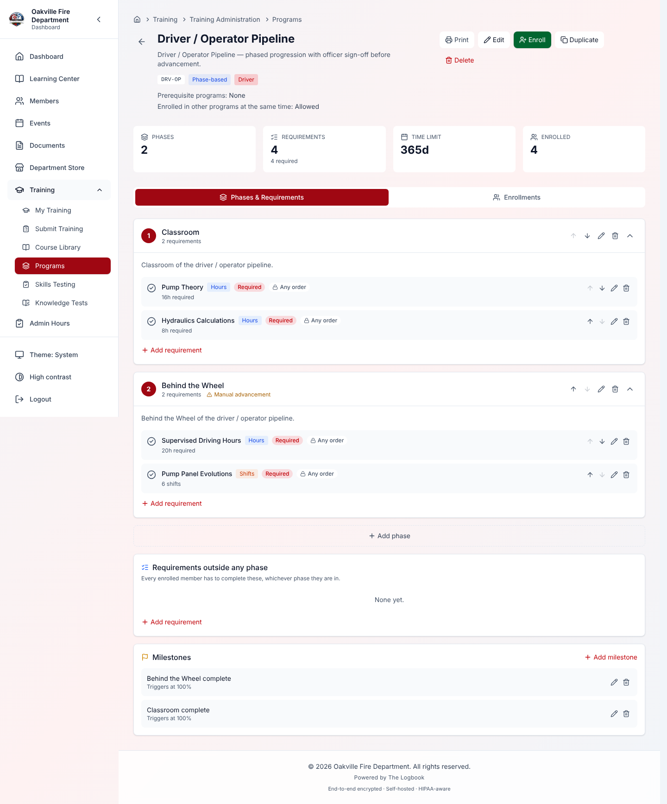

> **Hint:** Some requirements are credited automatically from shift completion
> reports. If you work a qualifying shift, your hours or shift count may be
> credited toward program requirements without you doing anything.

---

## Training Pipelines

A **training pipeline** is a program built as **program → phases in order →
requirements → milestones**. Members enroll, work through each phase in order,
and The Logbook tracks their progress. This section covers building a pipeline,
enrolling members and tracking their progress. The
[Training Programs](#training-programs) section above covers what members see.

Every requirement in a pipeline has a **type** that decides how it is
completed: **hours, courses, shifts, calls, skills evaluation, certification,
checklist** or **knowledge test**. See [Requirement Types](#requirement-types)
for what each type tracks.

### Building a Training Pipeline

**Who can do this:** training officers.

Select **Training > Programs** and then **New Pipeline** to open the pipeline
wizard. The wizard builds the whole program and **saves everything in one
step**. Its steps are:

1. **Program Info** — enter the **Program Name** (the only required field),
   description, program type and **Program Code**. The code is a short name
   such as `PROB-FF` used in reports and imports. You can also:
   - tick **Prerequisite programs** — programs a member must finish before
     enrolling;
   - untick **Allow members to be enrolled in other programs at the same
     time** if this should be someone's only program.

   See [Enrolling Members](#enrolling-members) for what each does.

2. **Phases** — select **Add Phase** for each phase, in the order members
   complete them. Give each a name. Tick **Require officer approval to
   advance** if an officer must sign off before a member moves on (see
   [Phases & Advancing](#phases--advancing)).
3. **Requirements** — inside a phase, add requirements and choose each one's
   type. Enter the type's target, such as required hours, the course list, or
   a knowledge test's passing score and maximum attempts.
4. **Milestones** — select **Add Milestone** for checkpoints that mark key
   achievements.
5. **Review** — check everything, then select **Create Pipeline**. The
   program, its phases, requirements and milestones are created together.

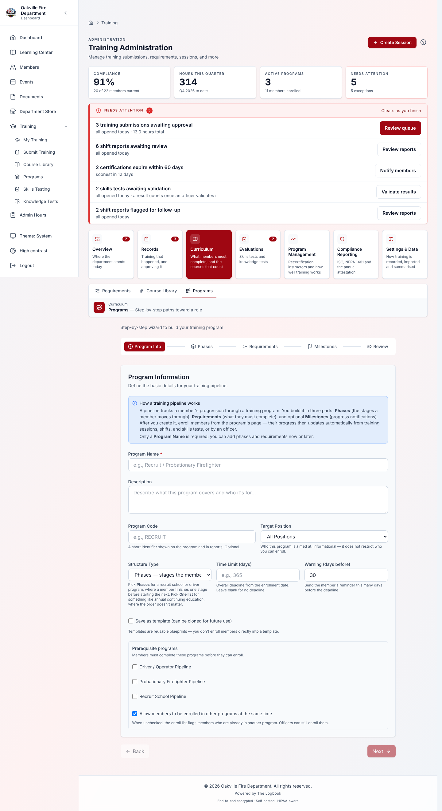

> **Hint:** The **Program Code** is optional, and nothing stops two programs
> sharing one, so pick a code that is distinct. It is shown in upper case, up to
> 50 characters. It appears on printed program pages and travels with
> the program when it is exported and shared with other departments.

**Deleting a pipeline** — **Delete pipeline** on its page — depends on whether
anyone has graduated. A pipeline with graduates is **deactivated**: completed
enrollments are kept, in-progress enrollments are withdrawn, and recertification
resets skip it so graduates' records stay. A pipeline nobody has graduated from
is deleted, with its phases, milestones, enrollments and every enrolled
member's progress, and that cannot be undone. The confirmation and the toast say
which happened. To bring a deactivated pipeline back, turn on **Show inactive**
on the Programs list (training managers only) and select **Reactivate**, or use
**Reactivate** on the pipeline's own page. Reactivating changes only the flag:
withdrawn enrollments stay withdrawn. Requirements created inside the pipeline go with it, unless
another program uses them. A requirement the pipeline only linked from the
library is not deleted. It stays in Training Requirements.

#### Adding a requirement to a program members are already in

When you select **Add requirement** on a program's page, The Logbook asks a
question under **Members already enrolled**:

- **Hold them to it too — it is added to their progress now.** This is the
  default.
- **Only members who enroll from now on — it is recorded as waived for
  everyone already enrolled.** Every active or on-hold enrollment gets the
  requirement marked **waived**. It does not lower their progress or stop them
  advancing a phase. Members who enroll later must complete it.

The question is asked only when adding, not when editing an existing link. The
waiver is recorded in the audit log.

> **A requirement linked from the library shows the member's real standing.**
> If you link "Annual Hazmat Hours" into a program and enroll a member who
> already has 4 of its 6 hours, both their Training Requirements card and their
> pipeline show 4 of 6. The program reads the same result as the compliance
> pages. Because of that, an officer cannot type a value for it or mark it
> complete inside the program; credit the member's training record instead.
> You can still waive it for the program. Completed, withdrawn, failed and
> expired enrollments keep the progress they finished with.

### Enrolling Members

**Who can do this:** training officers.

1. Open the program and select **Enroll**, in the header beside **Edit** and
   **Duplicate**.
2. Search by name or membership number, and select each member. Each one
   appears as a removable chip above the search box. The button at the bottom
   counts them — **Enroll 3 Members**.
3. Optionally set a **Target Completion Date**. It applies to everyone you
   selected.
4. Select the button to enroll them.

**The eligibility check happens before you enroll.** The picker counts what it
found — "18 of 22 eligible". **Show eligible only** is on at first and hides
the rest. Turn it off to see members who cannot be enrolled, with the reason on
the row. They cannot be selected. A member cannot be enrolled when they:

- have **not completed every prerequisite program**; or
- are already on this program (marked **Enrolled**).

If a program's **Allow members to be enrolled in other programs at the same
time** box is unticked, nobody becomes ineligible. A member already active in
another program is marked **In another program**, and you can still enroll
them.

Both settings are shown under the program's name on its page. Change them with
**Edit**. A program cannot require itself. A circular choice — Driver Operator
requiring Recruit School while Recruit School requires Driver Operator — is
refused with a message naming the program that already requires this one.

You can see who would be skipped, and why, before you commit. Once the member
finishes the missing prerequisite program, they can be selected.

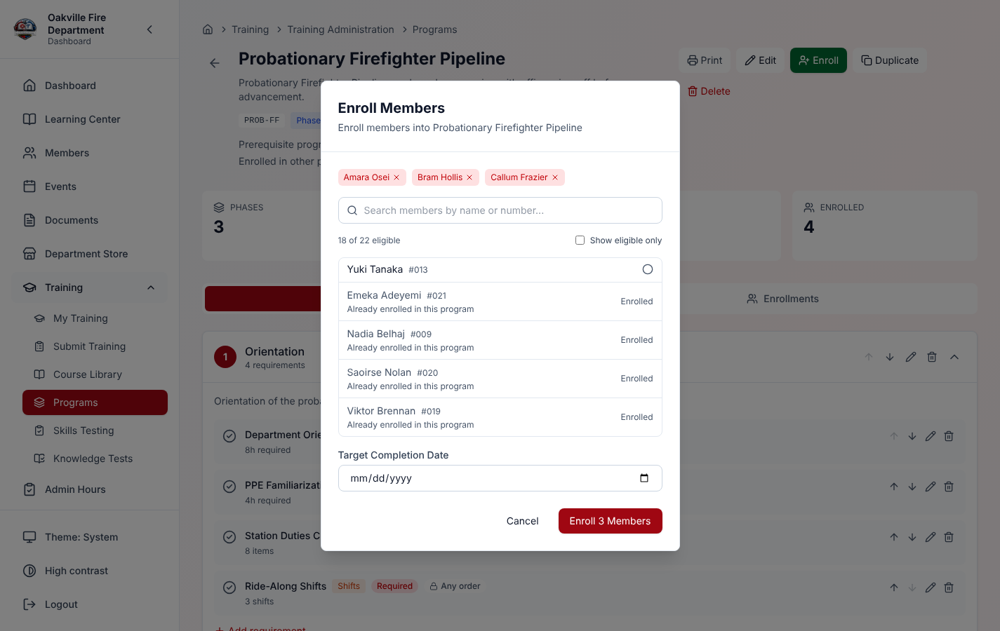

### Tracking a Member's Progress

**Who can do this:** training officers.

On the program's **Enrollments** tab, select an enrolled member to open their
progress. From here you can:

- **Log completed activity** — record hours, shifts, calls or courses
  completed toward a requirement.
- **Change a requirement's status** — mark it complete, set it back to in
  progress, or reopen one that was completed.

Completing any requirement, of **any** type, counts toward the member's
**overall progress percentage**.

The controls on each requirement are **In progress**, **Mark complete**,
**Reopen** and **Reset**. **Reopen** appears once the requirement is complete.
**Reset** appears on anything that has been started. There is no separate
Verify button: when an officer marks a requirement complete, it is verified in
the same step and shows a **Verified** badge. A requirement counted in hours,
shifts, calls or courses also has its own number box and **Save**, so you can
credit part of it without completing it.

> **Only officers can complete or credit a requirement.** Entering a number,
> recording a test score, or marking a requirement complete, verified or waived
> needs **Manage training records**. A member viewing their own progress can
> mark a requirement **in progress**. To get credit, they submit their training
> for review. They cannot set their own requirement to 100%.

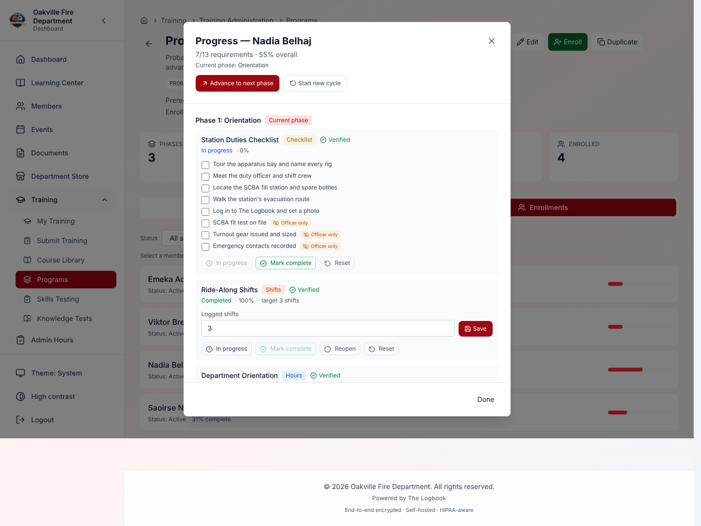

### Completing a Pipeline by Hand

**Who can do this:** members with **Manage training records**
(`training.manage`).

A pipeline normally completes a member by itself when every required item is
done. Sometimes it cannot: the pipeline has no active requirements, or the member
earned the credential elsewhere. For those cases an officer can finish the
enrollment by hand.

1. On the program's **Enrollments** tab, choose **Mark pipeline complete** beside
   an **Active** or **On hold** enrollment, or use the same button in the member's
   progress dialog.
2. Type the **reason**. It is required.
3. Confirm. The member gets the usual completion notice, and the action is
   recorded in the audit log with the reason and how many required items were
   still unmet.

Officers then see **Completed by hand: <reason>** on the enrollment and in the
progress dialog. Members do not see the reason, because it is an officer's note.
A completed, withdrawn, failed or expired enrollment cannot be completed this way;
reopen or start a new cycle first. A later recalculation does not undo a hand
completion, even if the member is below 100%. Starting a new cycle, reopening or
withdrawing the member clears the note.

**Advance to next phase**, **Start new cycle** and **Reopen enrollment** in the
progress dialog also need **Manage training records**. Without it the dialog is
read-only, and an expired enrollment still shows its deadline-passed note.

> _Screenshot to be captured: the progress dialog with **Mark pipeline complete** and its reason prompt (queued in SCREENSHOT_CURRENCY.md)._

### Inactive Requirements and Pipelines

- **A pipeline, or a phase, with no active requirements completes nobody.** An
  empty set of requirements is not a passing set. Progress shows **No active
  requirements** instead of a percentage. Add a requirement, reactivate one, or
  use **Mark pipeline complete**. To move a member out of such a phase, use the
  audited **Force** option when advancing. A phase with nothing required at all
  is still complete.
- **A deactivated requirement is no longer required** for the pipeline or phase,
  as in the compliance grade. Deactivating or reactivating one recalculates the
  affected enrollments, so members who had finished everything else now complete.
  It shows **Inactive — not currently required** and carries no due date.
- **A deactivated pipeline used as a prerequisite no longer blocks anyone.**
  Reactivating it restores the requirement.
- **Deactivating a pipeline from its edit form withdraws members who are still in
  it,** the same as deleting it. The confirmation says how many members are
  affected.
- **Automatic enrollment with a missing prerequisite.** When a member becomes
  Probationary and a pipeline's prerequisite is unmet, they are not enrolled in
  that pipeline, but the conversion goes ahead. Training officers get an email
  naming the member, the pipeline and what is missing. Manual enrollment from
  the old enrollment screen refuses the same way.

### Working Through a Checklist Requirement

A **checklist** requirement holds the list of things a member has to do — "tour
the apparatus bay", "meet the duty officer", "SCBA fit test on file". Both the
member and the officer can read the steps, and the steps are **signed off one
at a time**.

- The officer's progress row shows a **checkbox per step**.
- The member's page **lists the steps and whether each is done**.
- Completion is **steps ticked ÷ total steps**, so the requirement fills up as
  the work happens.

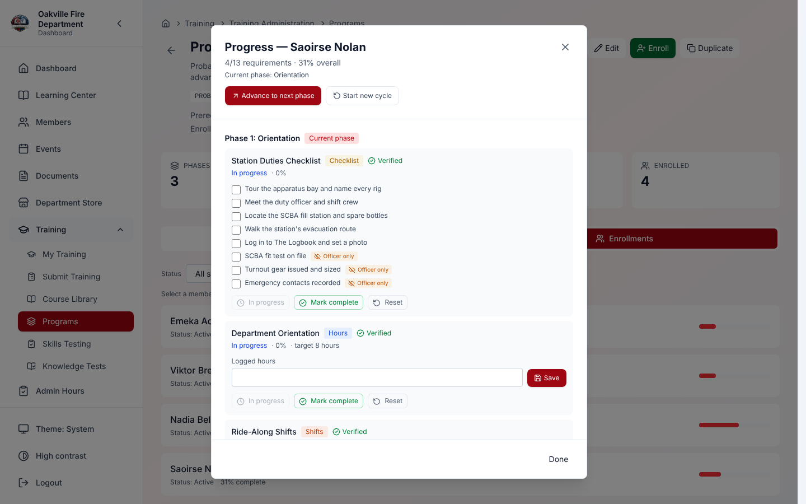

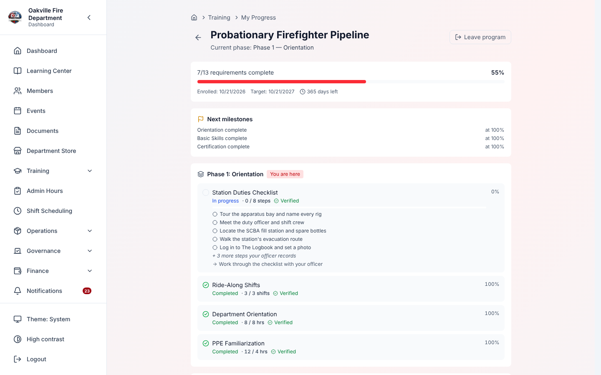

#### Steps only the officer sees

Some steps are not the member's business — **references called**,
**background check returned**. In the requirement editor, the **eye button** on
a step hides it from the member.

**Hidden steps still count toward the total.** Otherwise a requirement could
read 100% while the background check was still outstanding. So the member sees
**"+ 3 more steps your officer records"**, and the total still matches.

In the editor, an officer-only step is **marked in amber, with the eye crossed
out**. It stays where it was in the list. You can still edit, rename and
reorder it; the eye button only changes who can read it.

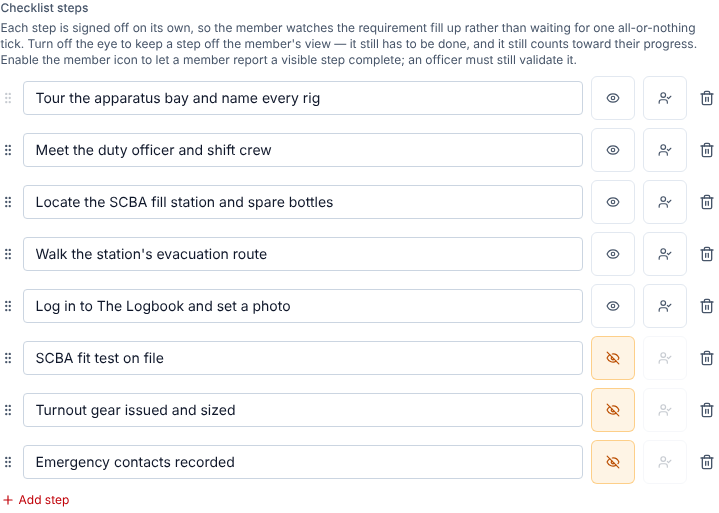

#### Edge cases

| What happened                                        | What it means                                                                                                                                    |
| ---------------------------------------------------- | ------------------------------------------------------------------------------------------------------------------------------------------------ |
| You rename a step, or drag it to a new place         | The ticks already recorded stay with it. Moving or rewording a step does not reset it.                                                           |
| A checklist written long ago, as plain lines of text | It still works. Each line becomes a step. Nothing needs re-entering.                                                                             |
| Every step is hidden                                 | The member sees 0 visible steps and a "your officer records" line. It works, but the requirement probably should not be shown to members at all. |

### Recording a Knowledge Test

For a **knowledge test** requirement, the officer records the result:

1. Open the member's progress and find the knowledge-test requirement.
2. Type the **score percentage** and select **Record**. There is no Pass/Fail
   button. Pass or fail comes from the score. The field's label shows the
   threshold — "Test score (%) · pass ≥ 70%".
3. The score is compared to the requirement's **passing score** (70% unless
   set otherwise). A score at or above it is a **pass**, and a pass
   **completes the requirement**.
4. Each entry counts against the requirement's **maximum attempts**. The count
   shows as **"Attempts: X / N"**, and the latest result as **"Last score: 86%
   (pass)"**. Once the maximum is reached, the field and **Record** are greyed
   out and the count says "no attempts remaining".

Members can also take the test online. When an officer links an online
knowledge test to the requirement, a member's submitted attempt is marked by
The Logbook and recorded here exactly like a typed-in score, with the same
passing score and attempt count. See
[Online Knowledge Tests](#online-knowledge-tests).

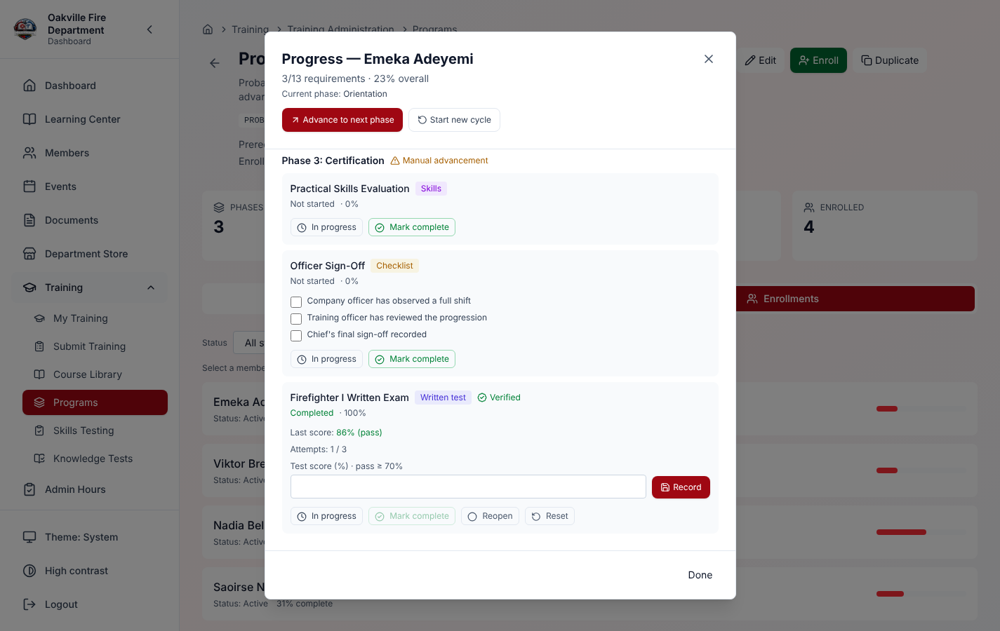

### Online Knowledge Tests

**Who can do this:** training officers write and publish tests. Any member may
take a published test.

**Writing a test.** Open **Training Admin → Evaluations → Knowledge Tests** and
select **New test**:

| Setting                                                | What it does                                                                                                      |
| ------------------------------------------------------ | ----------------------------------------------------------------------------------------------------------------- |
| **Counts toward requirement**                          | A knowledge-test requirement. A submitted attempt is recorded on it for every active enrollment that has it.      |
| **Passing score %**                                    | Blank uses the requirement's passing score, or 70%.                                                               |
| **Time limit (minutes)**                               | Blank for none. When time runs out, the answers saved so far are marked.                                          |
| **Questions per attempt**                              | Blank asks every active question. A number draws that many at random from the question bank for each attempt.     |
| **Shuffle questions and options for each attempt**     | Shuffles the question order and each question's options. True/false keeps True before False.                      |
| **Show members the correct answers after they submit** | Off at first. When on, a member sees which answers were right, and each question's explanation, after submitting. |

Then **Questions & results** opens the question bank. Each question has one
correct answer, several correct answers, or true/false. Each has points (1
unless changed) and an optional explanation. A several-answers question scores
only when the member picks **exactly** the right set; ticking every box earns
nothing.

**Publish** makes the test available. It needs at least one active question,
and at least as many as it asks per attempt. The same screen lists every
attempt with its score and whether it was recorded on the requirement.

**Taking a test.** Members open **Training > Knowledge Tests**, select
**Start**, and answer. Answers save as they go. **Submit answers** marks the
attempt at once and shows the score. Starting a test you already have open
continues it instead of drawing a new set of questions.

> **The answers stay hidden.** A member's screen never receives the correct
> answers before they submit. The Logbook works out the score from the saved
> answers.

> **Editing a published test does not change attempts already started.** Each
> attempt keeps the questions, options and passing score it was given. A
> correction to a question cannot re-score a member who already answered it.

> **One allowance of attempts.** The requirement's **maximum attempts** counts
> online attempts and officer-entered scores together. A member who has used
> them all cannot start another. Once the requirement is met, the limit no
> longer applies, so a member can retake a test to refresh.

> **What if an attempt is not recorded?** The result page says why: the member
> is not enrolled in a program with the requirement, the requirement was
> already met, or the attempt limit was reached. The score still stands and is
> listed in the officer's results.

> **Deleting a test.** A test nobody has taken can be deleted. A test with
> attempts can only be archived, which keeps the members' results.

### Phases & Advancing

A **phase completes** when all its required items are done. What happens next
depends on the phase's approval setting:

- **No approval required** — the member **moves on automatically** to the
  next phase.
- **Require officer approval to advance** — the phase stays complete until an
  officer opens the member's progress and selects **Advance to next phase**.

When a member advances, the **member** gets an in-app notification.

**Advance to next phase** sits at the top of every phased member's progress,
beside **Start new cycle**, for any training officer. It is there whatever the
approval setting. The setting only decides whether advancing _also_ happens on
its own. The button is greyed out on the last phase, where it reads **Final
phase reached**.

The button appears in the "reopen" picture further down — the same header, on
an enrollment that has also expired.

#### Phase prerequisites

A phase can name **other phases in the same program that must be finished
first**. This is not the same as the phase order:

|                         | What it answers                                   |
| ----------------------- | ------------------------------------------------- |
| **Phase number**        | The order phases are worked through               |
| **Phase prerequisites** | What must be **finished** before this phase opens |

They mean the same thing until a program has an optional or parallel track, or
someone was force-advanced past a phase. Then the order says "next" and the
prerequisite says "not yet".

Prerequisites apply whether an officer advances the member or the member
advances automatically. An officer using **Advance to next phase** with
**force** can still override them — that is what force is for.

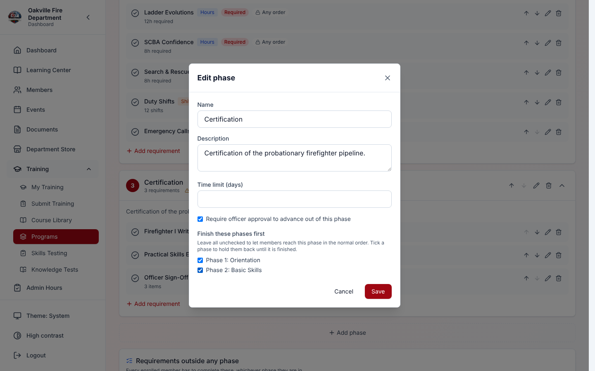

**Edge cases**

| What happened                                                                               | What it means                                                                   |
| ------------------------------------------------------------------------------------------- | ------------------------------------------------------------------------------- |
| A phase requires itself, a phase in another program, or phases require each other in a loop | Refused when you save, with the reason.                                         |
| You delete a phase that others list as a prerequisite                                       | It is removed from their prerequisites, so nobody behind it is blocked forever. |
| A prerequisite points at a phase that no longer exists                                      | It is ignored. A member is never stranded by it.                                |
| The program is exported and imported into another department                                | Prerequisites carry over correctly, matched by phase number.                    |

#### Requirement prerequisites

Inside a phase — or in the program's own list, for a program with no phases — a
requirement can be marked as the one to **do first**. The other requirements in
that same phase are then **locked** until it is done.

Each requirement row on the pipeline page has a chip that works as a switch. It
reads **Any order** until you select it, and **Do this first** afterwards. You
can see at a glance which item gates the phase. There is no separate
prerequisites screen.

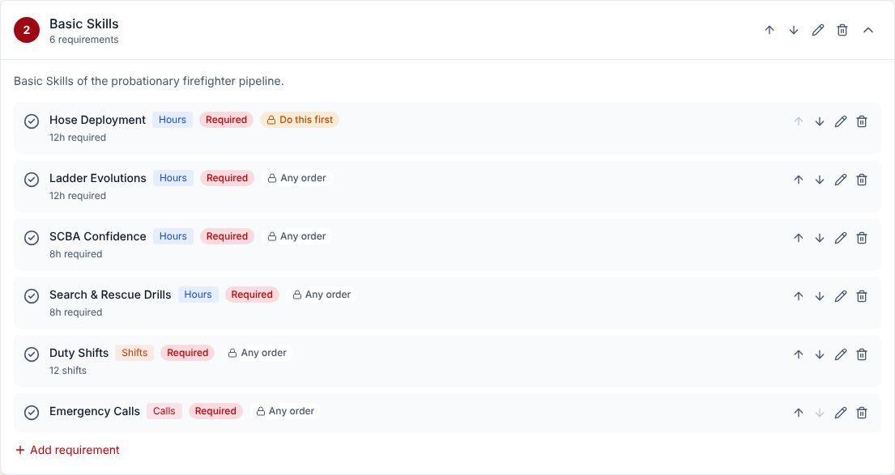

- An officer trying to sign off a locked requirement is **refused, and told
  which requirement is blocking it**.
- The member sees the step **greyed out**, reading "Locked until you finish
  …". It is not hidden, because a hidden step looks like a step that does not
  exist. This greying is on the member's own progress page. On the pipeline
  page, the officer sees the chip.

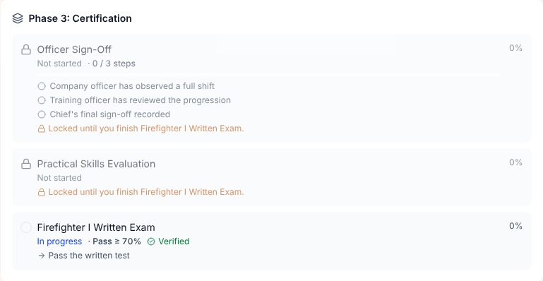

A requirement the member has **already finished** is never greyed out. The lock
holds back work not yet done; it does not take back credit already given.

**Edge cases**

| What happened                                     | What it means                                                                                                  |
| ------------------------------------------------- | -------------------------------------------------------------------------------------------------------------- |
| A requirement is used in several phases           | It is locked only when it is locked in every one of them. A shared requirement does not block unrelated work.  |
| Credit arrives automatically from logged training | It is **not** blocked. The hours really happened. Throwing them away would be worse than crediting them early. |

### When an Enrollment Runs Out of Time

A program can have a **target completion date**. Members are warned as it gets
close. Once the date passes, the enrollment becomes **Expired**.

- This happens **as soon as anyone opens the enrollment**, and also in a
  **daily check** for enrollments nobody opens.
- Both the **member** and the **training officers** are told.
- Officers can **filter the Enrollments tab by status**, including expired.
  If no enrollment has the chosen status, the tab says so and offers **Show
  all statuses**.

#### Reopening an expired enrollment

Expired is not a dead end. An officer can **reopen** an enrollment, with a new
deadline if wanted. This is how you give an extension to a member who ran out
of time.

- **Nothing the member finished is lost.** Their completed requirements stay.
- Overall progress is **worked out again on reopen**. A member who finished the
  work while expired comes back marked complete.

There is no separate reopen window. Opening the member's progress from the
Enrollments tab shows it all at the top: how far they got before the deadline,
the optional new deadline, and the button.

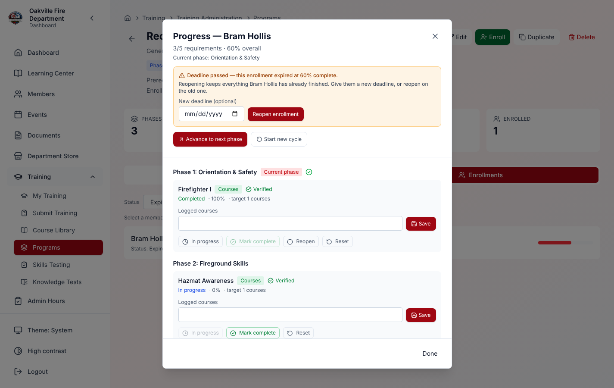

#### Deadline reminders, per program

Each program sets its **own** reminder schedule. Select **Edit** on the program:

| Setting                                                        | Effect                                                                                                     |
| -------------------------------------------------------------- | ---------------------------------------------------------------------------------------------------------- |
| **First warning (days before the due date)**                   | The first reminder.                                                                                        |
| **All reminder days (optional)**                               | Several days, such as "30, 14, 7". Left blank, it uses the first warning plus reminders 14 and 7 days out. |
| **Only remind members below this percent complete (optional)** | Skips members already on track, so a reminder means something when it arrives.                             |

The schedule you set is the schedule that is used.

#### A due date per requirement

When you add or edit a requirement in a pipeline — in the wizard, or with
**Edit requirement** on the program page — the **In this program** section has
three settings that apply only to this program:

| Setting                         | Effect                                                                                                                                              |
| ------------------------------- | --------------------------------------------------------------------------------------------------------------------------------------------------- |
| **Due after enrollment (days)** | The requirement is due this many days after each member enrolls. Changing it moves the date for everyone already enrolled. Blank means no due date. |
| **Description members see**     | Shown to members on their progress page instead of the requirement's own description. Use it to say how _this_ program wants it done.               |
| **Message when completed**      | Emailed to the member, once, when they complete the requirement. Members do not see it before then.                                                 |

A member with a due date is reminded by email on the program's reminder
schedule above, then told **once** if the date passes. The member's progress
page and your **Manage progress** view show each requirement's due date, and
**Overdue** once it has passed. A requirement that is completed, verified or
waived is never overdue and gets no reminders.

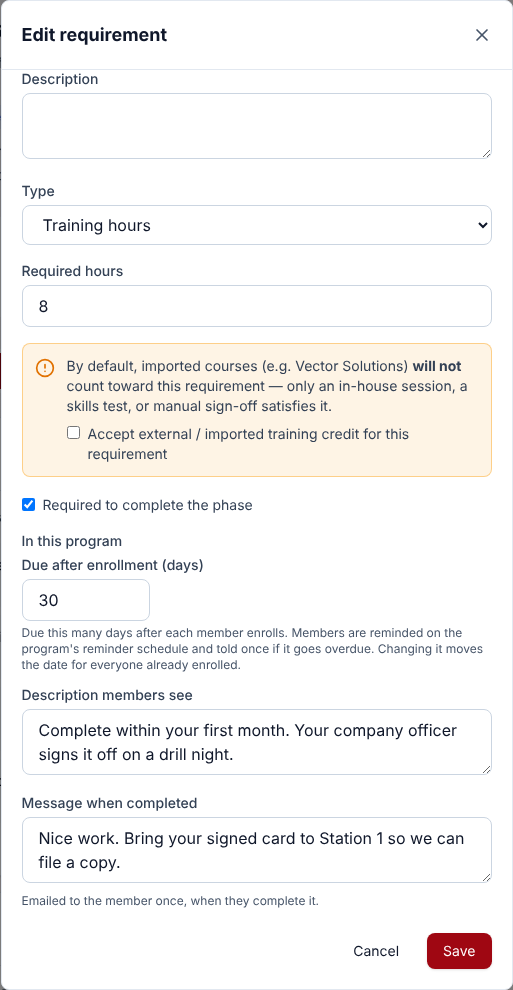

### What Automatically Updates Progress

These actions credit pipeline progress without anyone editing the enrollment:

- **Completing a shift report.** A filed and approved shift completion report
  credits matching hours, shifts, calls and skills (see
  [Shift Completion Reports](#shift-completion-reports)).
- **Approving a linked training session.** Approving a session that is
  **linked to the program** credits progress, matched by a specific
  **requirement** or by training **category**.
- **Passing a linked skills test.** Passing a skills test **linked to a
  requirement** completes it (see the
  [Skills Testing](./09-skills-testing.md) guide). Any member may run an
  official skills test, so the credit lands when a **training officer
  approves the result**, not when the examiner submits it. An unapproved pass
  waits in the officer's review queue and credits nothing yet. When a training
  officer runs the test themselves, it is approved in the same step and
  credits straight away.
- **An approved outside course.** A course brought in from an outside system,
  such as Vector Solutions, credits any requirement it matches by category, if
  the requirement accepts outside credit.

> **No double counting.** Each credit is tied to where it came from — the shift
> report, the session, the imported record, the submission. If the same source
> is processed again — a course synced twice, a report filed again, a
> submission approved again — it is recognized and **not** credited twice.

### Viewing Your Own Progress (Members)

On **Training > My Training**, find your program in **Pipeline Progress** and
select **View full progress**. The full progress page shows:

- your **current phase**, marked **"You are here"**;
- your **overall percentage** complete;
- **time remaining** in the program;
- your **next milestones**;
- **every requirement grouped by phase**, with whether each is complete;
- each requirement's **due date**, where your program sets one, and
  **Overdue** once it has passed;
- the program's own description of a requirement, where it has one.

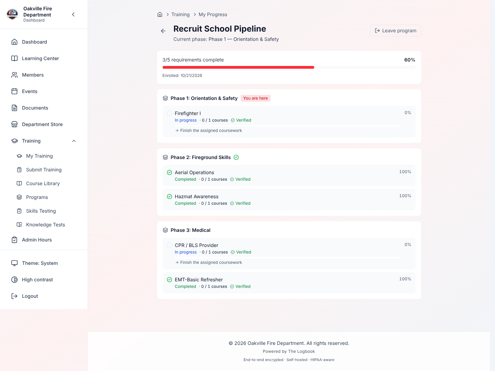

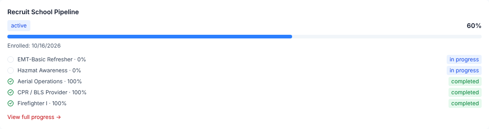

### Attending a session for a phase you have not reached

A training session can be **tied to a phase** of a program. That tie is what
credits your attendance to the right requirement.

**Nothing warns you, and nothing stops you, if the session belongs to a later
phase than yours.** You can RSVP and attend, and the hours are recorded.
Attending early is rarely wrong — a recruit sitting in on a later drill loses
nothing. But the session list is not filtered to what you are ready for. An
officer planning a session for one phase should say so in its description.

---

## Training Requirements

**Who can do this:** training officers.

Open **Training Admin → Curriculum → Requirements** to manage the department's
training requirements.

**Deleting a requirement.** A requirement that anything references (a
pipeline, member progress, tests, sessions, waivers or compliance profiles) is
**deactivated** instead of deleted, so members' progress is not erased. An
unused requirement is deleted. The confirmation and the toast say which
happened.

### Requirement Types

| Type                  | What the member must do                 | What you enter                                                              |
| --------------------- | --------------------------------------- | --------------------------------------------------------------------------- |
| **Hours**             | Build up a number of training hours     | Required hours                                                              |
| **Courses**           | Complete a specific list of courses     | Courses picked from the course library                                      |
| **Certification**     | Get or keep a specific certification    | Courses that earn it, from the course library (**Certification earned by**) |
| **Shifts**            | Complete a number of qualifying shifts  | Required shifts                                                             |
| **Calls**             | Respond to a number of qualifying calls | Required calls                                                              |
| **Skills Evaluation** | Pass a hands-on skills evaluation       | —                                                                           |
| **Checklist**         | Complete a set of check-off items       | Checklist items                                                             |
| **Knowledge Test**    | Pass a written test                     | Passing score (%), optional max attempts                                    |

The form shows the right value box for the type you choose, and checks it
before saving.

> **A requirement must apply to someone.** If **Applies to all members** is
> unticked, choose at least one member category. The form will not save a
> requirement that applies to nobody, because it would quietly vanish from
> every member's compliance view.

**Applying a requirement to every operational member** _(2026-10-27)_. Under
**Member Categories**, the **Operational members** button ticks **Active**,
**Probationary**, **Life** and **Retired** in one go. Those four are every
operational member, whatever their status (see
[Member Class and Member Status](./01-membership.md#member-class-and-member-status)).
When all four are ticked, the button shows a check mark; selecting it again
unticks those four. **Administrative** and **Honorary** are left as you set
them either way, so tick them yourself if the requirement covers them too.

### Never Use an Hours Requirement for a Required Topic

> **Warning — read this before creating any yearly refresher.** An **Hours**
> requirement counts **every** completed hour that matches its filters. If the
> only filter is a training type such as _Continuing Education_ or
> _Refresher_, then **any** course of that type satisfies it, whatever the
> course was about. The member shows as compliant. The requirement is not met.

**This has happened.** A department set up its yearly _HIPAA Privacy &
Security Awareness_ refresher as "1 hour of Continuing Education". It then
imported its members' Target Solutions completions. One member had taken two
medical courses, _Hematology_ and _Sepsis_, and **no HIPAA training at all**.
The HIPAA refresher showed as complete: **2 of 1 hours**. Nothing on the screen
looked wrong. Every member with an hour of medical continuing education read the
same. The department believed its HIPAA training duty under 45 CFR 164.530(b)
was met when it was not. The mistake shows only when someone opens a member's
record and asks _which_ courses met the requirement — or when an auditor does.

**The rule:** when a law, a standard or your own policy names a **subject** —
HIPAA, bloodborne pathogens, hazmat, harassment prevention, a code of conduct,
whistleblower protections — the requirement must name the **course**, not an
amount of time.

| The rule says…                                         | Use                                                                                                                                |
| ------------------------------------------------------ | ---------------------------------------------------------------------------------------------------------------------------------- |
| "Complete HIPAA training each year"                    | **Courses**, linked to your HIPAA course in the library                                                                            |
| "Read and acknowledge the code of conduct each year"   | **Courses**, linked to that policy's library course                                                                                |
| "36 hours of continuing education a year, any subject" | **Hours**, filtered by training type — here "any course counts" really is the rule                                                 |
| "8 hours of hazmat refresher training"                 | **Courses** linked to a course of that length, or **Hours** limited to a Hazmat **category** that holds nothing but hazmat courses |

An Hours requirement is only safe for a topic when it is limited to a
**training category** (or course) that holds nothing but that topic. A category
such as _EMS_ or _Medical_ is not narrow enough.

**Check your department now:**

1. Open **Training Admin → Curriculum → Requirements**. Look for any
   requirement named for a subject (HIPAA, Bloodborne Pathogens, Hazmat,
   Harassment, Code of Conduct…) whose type badge reads **Hours**.
2. A requirement made from the older HIPAA, Bloodborne Pathogens or Hazmat
   templates shows a **yellow warning** on its card. Treat that warning as a
   compliance finding, not a suggestion.
3. Edit each one: change the type to **Courses** and pick the library course.
   If the course is not in the library yet, add it first.
4. If the course comes from a training provider, match the provider's course
   to that library course on the integration's **Courses** tab (see
   [Training Integrations](./16-integrations.md#course-mappings)).
   Otherwise completions of it will not count.
5. Open the compliance view for a few members. Confirm the requirement is met
   by the right course — and unmet for anyone who never took it.

Expect some members to drop out of compliance when you make this change. That
is the point: they were never compliant, and the screen was hiding it.

### Picking Courses from the Library

**Courses** and **Certification** requirements pick from the department's
course library. You do not type course names. The same picker appears in all
three places a requirement is set up: the pipeline wizard, the pipeline's
requirement window, and the department Requirements page.

So one completion can satisfy two rules. A recruit-school phase can point its
"CPR" requirement at the same CPR library course the department-wide
requirement uses. A member who takes CPR once is credited against both.

> **The NIMS/ICS Initial Certification template** lists its four courses
> (ICS-100, ICS-200, IS-700, IS-800) in its description for you to link. A
> shared template cannot know your department's own library courses.

> **Changing a requirement's type away from Courses or Certification clears
> its course links.** A leftover link would quietly limit the hours count to
> that one course.

> **Changing the due-date type away from Fixed Date clears the old due date.**
> The deadline then comes entirely from the period you chose.

### Freshness Window — "taken within the last N days"

Beside the course picker is an optional freshness setting, **Require a recent
completion**. It makes a requirement demand that the completion itself be
recent — _"CPR taken within the last 180 days"_. It is off unless you turn it
on.

A **One Time** requirement cannot express this on its own. A one-time
requirement has no time limit, so a member who took CPR three years ago counts
as satisfied forever. A recruit school needs to reject that.

> **This is not the same as a rolling period.** It is easy to mix them up:
>
> |                      | Asks                             | Applies to                               |
> | -------------------- | -------------------------------- | ---------------------------------------- |
> | **Rolling period**   | "How often must this be redone?" | A repeating duty on the **member**       |
> | **Freshness window** | "How old may the completion be?" | How long a **single record** stays valid |
>
> Because they are separate, your department's one-time CPR requirement and a
> recruit pipeline's 180-day one can point at the **same course** and disagree
> about the **same record**. That is intended.

**Edge cases:**

- The freshness window only ever _removes_ records. The narrower of the
  freshness window and the requirement's period always wins.
- **An officer signing off a record cannot get around it.** Applying a record
  or approving a submission checks the completion date first. Crediting a
  three-year-old record to a 180-day requirement is refused before anything is
  saved.
- **A record with no completion date fails the check**, because its age cannot
  be checked. At the approve step you see: "That training has no completion
  date, so it can't be credited toward this requirement's N-day window."
  Nothing is saved. Ask the member to resubmit with the date, or enter the date
  yourself before applying.
- **You can turn the window off again** by clearing the field.

### Requirement Templates

Select **Use Template** on the Requirements page to start from a ready-made
requirement based on a common standard. Choosing a template opens the form
already filled in. Check the hours, the due-date settings and who it applies to
(narrow it to member categories if needed) before saving.

Built-in templates:

| Template                               | Standard              | Starting settings                                    |
| -------------------------------------- | --------------------- | ---------------------------------------------------- |
| NFPA 1001 Firefighter Annual Training  | NFPA 1001             | 36 hours, yearly, calendar period                    |
| NFPA 1500 Occupational Safety Training | NFPA 1500             | 8 hours, yearly, calendar period                     |
| NREMT EMT Recertification              | NREMT                 | 40 hours, 24-month rolling period                    |
| CPR/BLS Certification                  | —                     | Certification, 24-month rolling period               |
| Hazmat Operations Refresher            | OSHA 29 CFR 1910.120  | Courses (link your hazmat course), yearly            |
| Bloodborne Pathogens Annual Refresher  | OSHA 29 CFR 1910.1030 | Courses (link your BBP course), yearly               |
| HIPAA Privacy & Security Awareness     | 45 CFR 164.530(b)     | Courses (link your HIPAA course), yearly             |
| SCBA Fit Test & Respiratory Protection | OSHA 29 CFR 1910.134  | Checklist (4 items), yearly                          |
| NIMS/ICS Initial Certification         | FEMA NIMS             | Courses (ICS-100, ICS-200, IS-700, IS-800), one time |
| New Member Orientation Checklist       | —                     | Checklist (5 items), one time, probationary members  |

Templates based on a national standard show where they came from (NFPA,
NREMT, OSHA, HIPAA, FEMA) with the standard or legal citation. Requirements
made from them carry a source badge, so they do not look like rules your
department invented.

**Single-topic templates are Courses requirements.** HIPAA, Bloodborne
Pathogens and Hazmat each require training on one subject. Their templates ask
you to pick that course from the library, and the form will not save until you
do. Requirements made from older versions of these templates were Hours
requirements and are **not** changed for you. Their cards show a warning until
you edit them into a Courses requirement linked to the right course. Fix them;
do not ignore the warning. When the provider releases a new version of the
course, match it on the integration's **Courses** tab so it keeps counting.

### Frequency and Due Dates

| Frequency         | What it means                                                                   |
| ----------------- | ------------------------------------------------------------------------------- |
| **Annual**        | Starts again each year                                                          |
| **Every 2 Years** | Counted over the requirement's year and the year before (or this year and last) |
| **Quarterly**     | Starts again every quarter                                                      |
| **Monthly**       | Starts again each month                                                         |
| **One Time**      | Must be completed once                                                          |

| Due-date type       | What it means                                          |
| ------------------- | ------------------------------------------------------ |
| **Calendar Period** | Based on the calendar year, quarter or month           |
| **Rolling**         | The last N whole calendar months, ending with this one |
| **Cert Period**     | Based on certification expiry dates                    |
| **Fixed Date**      | A specific due date                                    |

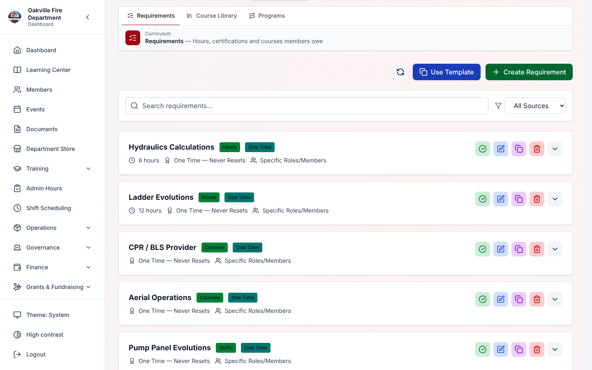

### When a Yearly Class Isn't Counted

A member took the yearly class — HIPAA in December, say — and the requirement
still reads unmet. Work down this list in order. Each cause is a setting on the
requirement (**Training Admin → Curriculum → Requirements**, then edit) or on
the record.

**1. Which window is the requirement counted over?** The window decides which
completion dates can count at all.

| Requirement settings                                   | Window on 2026-10-13                  | A class taken 2025-12-02 counts for                                                    |
| ------------------------------------------------------ | ------------------------------------- | -------------------------------------------------------------------------------------- |
| **Calendar Period**, start month January, no end month | Jan 1 – Dec 31, 2026                  | 2025 only. It does not count today.                                                    |
| **Calendar Period**, start November, end **December**  | Nov 1 – Dec 31, 2026 (or the end day) | Nothing yet. Only a Nov–Dec 2026 class counts, and the requirement resets every Jan 1. |
| **Calendar Period**, start November, end **January**   | Nov 1, 2025 – Oct 31, 2026            | The whole year, until Oct 31, 2026. The next window opens Nov 1.                       |

If your practice is "everyone takes it in November or December and is covered
until the next one", you want the last row, a **cross-year window**:

1. Set **Period Start Month** to November and **Period Start Day** to 1.
2. Set **Period End Month** to a month **before** the start month. January
   works, and the form notes "Cross-year window". An end month in the same
   year, such as December, gives the middle row instead.
3. Leave **Period End Day** blank, which means the last day of the month. A
   leftover **1** there ends the window on the first.

From November 1 the new window is open, and the requirement reads unmet until
the member takes the class again. Before then, the member's upcoming list shows
the requirement as **Opens Nov 1**, so they know when to do it.

**2. Is the record linked to the requirement's course?** A **Courses**
requirement credits only records linked to the library course it names. It does
not match by name, on purpose: a "CPR Refresher" must not credit a "CPR"
requirement. A record imported from an outside provider (TargetSolutions,
CAPCE) is linked only once the provider's course has been **matched** to a
library course.

- Open **Training Admin → Settings & Data → Integrations**. Check that the
  provider's course is matched to the **same** library course the requirement
  lists under **Courses to complete**. The provider's Course ID is in the
  name, for example "CAPCE HIPAA Awareness (3088740)". Similar names are easy to
  mix up, and the list cuts off long ones.
- Matching a course also links the records already imported from it. It leaves
  alone a record an officer linked to a different course by hand.
- A provider that issues a **new version** under a new Course ID needs the new
  ID matched too. Members who took it are credited as soon as it is.

**3. Is a freshness window turned on?** **Require a recent completion** (see
[Freshness Window](#freshness-window--taken-within-the-last-n-days)) can make a
record too old to count even inside the window. It only matters when it is
shorter than the window. With 180 days, a class from December 2, 2025 stops
counting on May 31, 2026, even though a November–January window runs to
October 31. A setting of 365 days or more never outlasts a yearly window.

**4. Does the requirement accept imported credit?** Under **External /
Imported Training Credit**, the box **Accept external / imported training
credit for this requirement** is **off** unless you tick it. While it is off, a
record imported from an outside provider is not credited to the requirement by
category. The requirement must be met in-house or by an officer's sign-off.
Turn it on for a requirement that online or outside training may satisfy —
HIPAA is the usual example.

**5. Is the record completed?** Only **completed** records count. A record
waiting for approval has no completion date, so it is listed under **No completion
date** on the member's History tab until an officer approves it.

The member can see most of this themselves. **My Training** shows the
requirement's progress and, for a window about to open, an **Opens** row. The
**History** tab shows each record's status.

### Existing Members — Exempting or Giving a Catch-Up Deadline

When a department raises its training standard, it does not have to turn its
whole roster non-compliant overnight. The requirement form has an **Existing
Members** section. It separates members already on the roster from new ones by
**join date**. A member's join date is their hire date, or the date their
account was created when no hire date is recorded.

| Choice                       | What it does                                                                                                                                                                                                   |
| ---------------------------- | -------------------------------------------------------------------------------------------------------------------------------------------------------------------------------------------------------------- |
| **Apply to everyone**        | The default. Every member it applies to is held to it now.                                                                                                                                                     |
| **Exempt existing members**  | Members who joined before the date in **Existing members joined before** are not graded on it at all. It is left off their My Training page, profile card and the Compliance Matrix, and reads N/A on exports. |
| **Give a catch-up deadline** | Existing members are held to it, but have until **Existing members must meet it by**. Until then, an unmet requirement reads as due by that date and counts **neither for nor against** their standing.        |

On the requirement card, a requirement with a catch-up deadline carries a line
such as "Members who joined before Jan 1, 2027 have until Jun 30, 2027".

In the Compliance Matrix, an existing member inside the catch-up period shows a
blue **Catching up** mark ("Existing member · not yet met", "Due by _date_").
On the printed matrix the cell reads **Due**, and the legend reads _"Due —
existing member, before their catch-up deadline"_. On the scheduling module's
report, a member in this state shows as **blue** on the requirement bars.

The same rule decides which requirements count for a member everywhere: the
dashboard, the Compliance Matrix and its print view, the member profile's
training card, My Training, the compliance officer report, the scheduling
shift and hours report, the competency matrix, the forecast, and the CSV and
PDF exports. Where a requirement does not apply to someone, the exports and
forecast print **N/A**. Requirements limited to certain roles are respected on
all of these screens too.

> **Check hire dates before you rely on a cutoff.** A member with no hire date
> is dated from the day their account was created. If your roster was imported
> without hire dates, every imported member seems to have joined on the import
> day. If that day is on or after your cutoff, long-serving members are graded
> as new members. Record hire dates first, or choose a cutoff earlier than the
> import. See [KNOWN_LIMITATIONS.md](../KNOWN_LIMITATIONS.md).

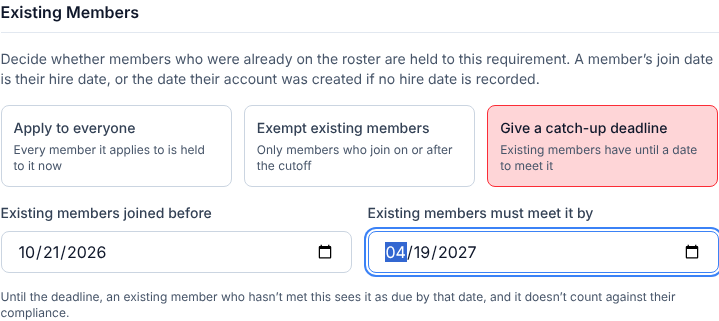

#### "Who does this change apply to?" — saving a change for new members only

Every time you save an **existing** requirement, The Logbook asks **Who does
this change apply to?**

- **Everyone** — "Update this requirement for every member it applies to,
  starting now." The button reads **Save for everyone**.
- **New members only** — members who joined before the date you give stay on
  the requirement as it was. The date is **New standard applies to members who
  joined on or after**, and starts at today in your department's time zone. A
  **copy** with your change applies to everyone who joins on or after that
  date. The button reads **Save for new members**, and the message confirms
  "Saved for new members. The current standard stays in place for existing
  members."

Both requirements then appear on the list and are edited separately. The
original is marked "This is the earlier standard. It only applies to members
who joined before _date_; a newer copy covers everyone after." Program links
stay on the original.

**New members only** is not offered when:

- the requirement already **is** the earlier standard from a previous split.
  Edit the newer copy instead;
- the same save also changes the **Existing Members** choice. Save that for
  everyone first, then change the standard for new members separately.

The window explains why in place of the option. **Keep editing** closes it
without saving. Setting or changing the existing-member dates, and every split,
is recorded in the audit log.

When you add a requirement to a **training program**, a similar question asks
about **Members already enrolled** — see
[Adding a requirement to a program members are already in](#adding-a-requirement-to-a-program-members-are-already-in).

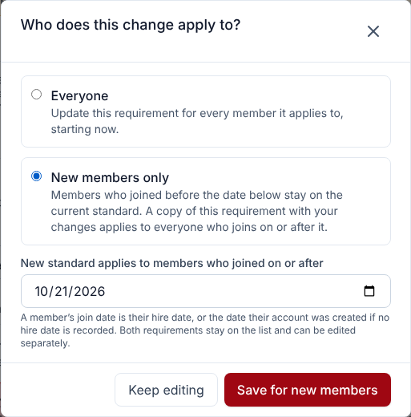

### Shift Credit

An **Hours** or **Shifts** requirement has a **Shift attendance satisfies this
requirement** box, under **Shift Credit** on the requirement form. It decides
whether the scheduling module's **Shift Compliance** report counts shift
attendance toward the requirement.

- **Shifts** requirements are ticked unless you untick them.
- **Hours** requirements are unticked unless you tick them. Training hours,
  such as yearly hazmat hours, are counted from training records, and ordinary
  duty shifts should not count toward them. Tick it on an Hours requirement
  that should appear on Shift Compliance.

See [Shifts & Scheduling](./03-scheduling.md#compliance-report).

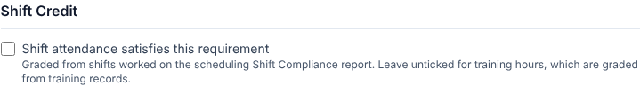

### Rolling Period Requirements and Leave of Absence

A **Rolling** requirement counts the last N **whole calendar months**, ending
with the current one. On October 13, 2026, a 12-month rolling window starts on
**November 1, 2025**, not October 13. A month is either in the window or not.
Hours leave the count when the month they were earned in leaves the window.
The grading, the compliance screens and the member's monthly hours all use
this one window.

**An hours requirement that rolls has no due date.** "72 hours in any 12
months" is a running count, met or short on any day. The member's card shows
"Counting Nov 2025 – Oct 2026" instead of a deadline. An unmet one is listed in
[Upcoming Expirations & Due Dates](#upcoming-expirations--due-dates) by the
hours still to go. A rolling requirement of **any other type** — a
certification, a course, a checklist — keeps its due date: the member's last
completion plus the interval.

If a member has an active **Leave of Absence** during part of the window, the
months on leave are left out and the requirement is reduced to match. Those
months are marked **Leave** in the member's monthly hours.

**Example:** A requirement of 12 hours over 12 rolling months, for a member
with 3 months of leave, becomes 9 hours (12 × 9/12).

See [Membership > Leave of Absence](./01-membership.md#leave-of-absence) for
managing leave.

---

## Officer Dashboard

**Who can do this:** training officers.

Open **Training Admin** from the Administration menu. The page is titled
**Training Administration** and opens on **Overview → Dashboard**, the
**Training Officer Dashboard**. It gives a department-wide overview:

- training completion rates;
- members behind schedule;
- upcoming deadlines;
- recent submissions waiting for review.

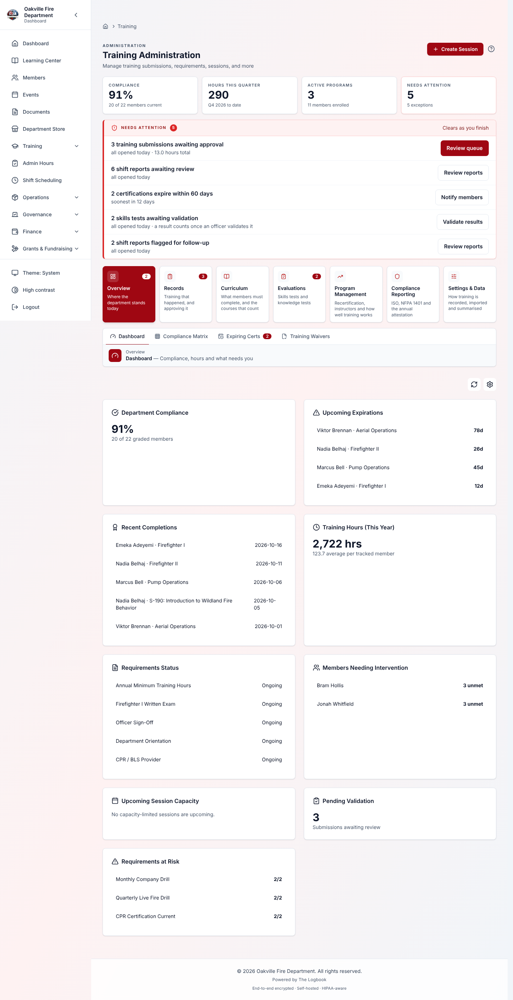

### The top of the Training Administration page

Training Administration opens the same way as the other administration pages:
a header, **four headline figures**, a **Needs attention** list, then the
areas and their tabs. The header also has a **Create Session** button, which
opens **Records → Sessions**.

The areas are:

| Area                     | What is in it                                                                              |
| ------------------------ | ------------------------------------------------------------------------------------------ |
| **Overview**             | Dashboard, Compliance Matrix, Expiring Certs, Training Waivers                             |
| **Records**              | Submissions to Review, Sessions, Course Cohorts, Shift Reports, Monthly Status             |
| **Curriculum**           | Requirements, Course Library, Programs                                                     |
| **Evaluations**          | Practical-skills tools, Knowledge Tests                                                    |
| **Program Management**   | Recertification, Competency, Instructors, Effectiveness, Multi-Agency, Reports             |
| **Compliance Reporting** | Annual Report, ISO Readiness, Record Quality, Attestations, Forecast, and **Configure**    |
| **Settings & Data**      | Manual Entry Rules, Practical Skills, Integrations, Import Past Training, Headline Metrics |

**Evaluations** shows **Skill Evaluations** or **Skills Test Templates** and
**Skills Test Records**, depending on which practical-skills system your
department runs (see [Skills Testing](#skills-testing)).

Three of the four headline figures are your department's choice. The fourth is
always the count the **Needs attention** list is about, so the page cannot hide
the number its own list measures. Training's built-in three are
**Compliance**, **Hours this quarter** and **Active programs**. A department
that changes nothing keeps them. Change them under **Settings & Data →
Headline Metrics**.

Only training officers can open the page, and only while the Training module
is turned on. See
[Administration Hubs](./08-admin-reports.md#administration-hubs)
in the administration guide, which covers choosing the figures and who can see
the list.

Every tab works on a phone as narrow as 320 pixels, without scrolling
sideways.

#### Setting up a new department

On a department that has not set up training, the dashboard opens with **Set up
training for your department**. It is a numbered checklist, in the order the
pieces depend on each other. Each step links straight to the screen that does
it:

1. **Add the courses your department teaches or accepts** → _Open the Course
   Library_
2. **Create your training requirements** → _Open Requirements_
3. **Put a first training session on the calendar** → _Create a session_
4. **Build a training program** → _Open Pipelines_ (optional)

Each step ticks itself off once the dashboard counts at least one of that
thing. The guide reports "N of 3 steps done". It disappears by itself once the
three required steps are done — the optional program step never keeps it open —
or when an officer selects the **×** (**Hide the setup guide**). Hiding is
remembered in that browser only.

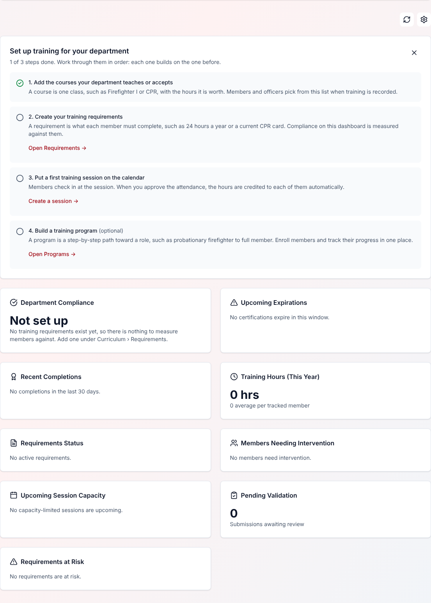

**No requirements means "Not set up", not 100%.** With no requirements, the
**Department Compliance** card reads **Not set up** ("No training requirements
exist yet, so there is nothing to measure members against. Add one under Setup
→ Requirements.") and links to **Curriculum → Requirements**. The
administration hub's compliance figure reads "no requirements set up yet".

> **What if the dashboard says "Failed to load the dashboard"?** The full
> message is "Failed to load the dashboard. Check your connection and refresh
> the page." It often happens on station Wi-Fi that asks you to sign in to the
> network first. The dashboard does not show zeros instead, because "0%
> compliant" is a figure an officer would act on. Sign in to the network and
> refresh.

> **Automatic "falling behind" alerts.** A weekly check flags members who are
> behind pace or close to a deadline. It notifies **both the member and the
> training officers**, so someone can step in. A member is not alerted again
> every week while they stay behind. A member who just started a new
> recertification cycle is not flagged as overdue on day one: pace is measured
> from the current cycle, not their original enrollment date.

---

## Reviewing Submissions

**Who can do this:** training officers.

Open **Training Admin → Records → Submissions to Review** to see training that
members submitted and that is waiting for review.

1. Open a submission to see its details.
2. Check the training information, hours and any uploaded certificate.
3. Select **Approve** to accept, **Request Revision** to send it back, or
   **Reject** to refuse it.
4. If you send it back or reject it, explain why in the notes box ("Explain
   why (required for rejection or revision request)..."). The member receives
   your note in an in-app notification. On an approval the note is optional.

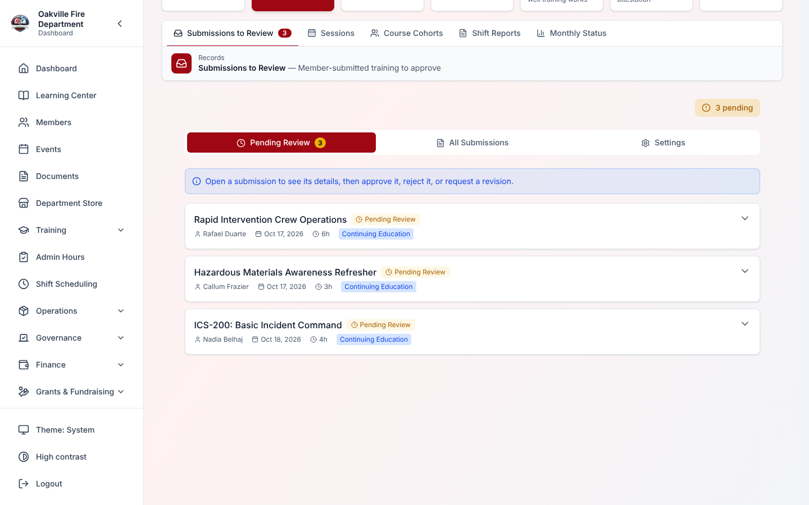

> **You cannot approve your own submission.** If you submit your own training,
> a **different** officer must approve it. You can still reject your own
> submission or send it back.

### Who Is Told, In-App

Both officers and members get in-app notifications (the bell and the dashboard
inbox) about submissions. Submissions do not send email.

**Officers.** Every active member holding the **Training Officer** position
gets one notification per submission: "Training submission awaiting approval
— _name_", with a **Review Submission** button that opens this list. These are
the same people who receive the session-approval email. Several notifications
stack in the inbox as "training submissions awaiting approval".

It is sent when a submission goes into review: when it is submitted, when a
draft is handed in, and when it is resubmitted after a revision request. It is
**not** sent for a submission approved automatically, or to the member who
submitted it. As soon as anyone approves, rejects or sends it back — or the
member withdraws it — the notification is archived for every officer. The
inbox does not keep asking for work already done.

**The member** is told only when the outcome differs from what they sent. The
notification has a **View My Submissions** button:

| Decision              | The member's notification                                                                                                                 |
| --------------------- | ----------------------------------------------------------------------------------------------------------------------------------------- |
| Rejected              | "Training submission not approved — _course_", with the officer's reason                                                                  |
| Approved with changes | "Training submission approved with changes — _course_", listing each changed value as before → after (hours, credit hours, training type) |
| Revision requested    | "Changes requested on your training submission — _course_", with the officer's notes. It is archived once they resubmit                   |

A plain approval sends nothing — the hours appearing on My Training is the
answer. Nothing is sent when an officer decides their own submission.
Withdrawing a submission archives its notifications.

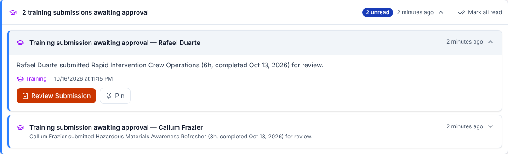

> **Hint:** Submissions reviewed here are separate from finalizing a training
> session. Whether a session needs a second officer to confirm depends on its
> **Require instructor confirmation** setting (see
> [Finalizing a Training Session](#finalizing-a-training-session)).

### Fixing a Mistaken Approval or Record

You can correct a training record without hand-editing anyone's progress. Open
the member's **Training History** page (from their profile):

- **Void a record.** A record entered in error, or one the member should never
  have been credited for (a course they cheated on, say), can be removed from
  credit with **Void**. It is marked cancelled, not deleted, so the audit trail
  stays. Any pipeline credit it gave is taken back automatically. Because
  compliance only counts completed records, a voided record stops counting
  straight away.
- **Edit a record.** **Edit** corrects the course name, training type,
  completion date, hours, credit hours, expiry date or certification number of
  any record, including one imported from a training provider.

Both need **Manage training records** and are recorded in the audit log.

**Voiding and editing tell the member:**

- **A void needs a reason.** The member gets a bell notice and an email with
  the reason. The record stays in their history (My Training and Training
  History) marked **voided**, with the reason under it. This email is a
  required kind — _Changes to your training record_ — so a member who has
  turned email off still receives it.
- **A voided record is final.** It cannot be edited back into credit. It has no
  Edit button.
- **A void survives later imports.** A record from a training provider keeps
  its provider number (Target Solutions' Transcript ID) when voided. If the
  same completion is synced or uploaded again, it links to the voided record
  instead of crediting it again. A genuinely new completion — a retake — has a
  new number and is credited normally.
- **A void takes away a qualification the record gave.** If the record's
  course grants a qualification (EMT, for example) and no other record
  supports it, the qualification is removed.
- **An edit lists what changed.** When a value the member can see changes,
  they get a bell notice and an email listing each change, before and after,
  with your note if you add one. An edit to something they cannot see sends
  nothing.

> **What if you approved a submission by mistake?** There is no button on
> screen to reverse an approval. Void the training record the approval created
> on the member's **Training History** page, with a reason. Then ask the member
> to submit again if part of it should count.

---

## Finalizing a Training Session

**Who can do this:** officers who can manage all events, and _(2026-10-27)_
anyone with **training.manage** (a training manager), finalize; training
officers approve. On a training session a training manager also gets **Edit**,
**End Event**, **Record Times**, **Check In**, **Edit Times** and **Reopen
Attendance**, without needing to manage all events. The session's organizer
and alternate can check members in but not correct their times. See
[Who runs an event's attendance](./04-events-meetings.md#who-runs-an-events-attendance-2026-10-27).

A training session is finalized from its **event page**, with **Finalize
Attendance** (or **End Event**, or by recording the event's actual end time).
This is the same step that closes any event's attendance. Every checked-in
member is credited the time they attended:

1. the times set with **Edit Times**; otherwise
2. their real check-out; otherwise
3. from check-in to the event's end.

A member with no time to credit gets no record, and is named in the finalize
message.

What happens next depends on the **Require instructor confirmation** box set
when the session was created. It is on the third step of the create form,
headed **Settings**, under _Attendance & Completion Settings_. The form is
under **Training Admin → Records → Sessions**, or the **Create Session** button
at the top of Training Administration.

- **Unticked (the default)** — finalizing **immediately completes** every
  attendee's training record. There is no separate approval step and no
  confirmation email.
- **Ticked** — the attendance goes to the department's training officers for
  approval. Members see the class as **In Progress** until an officer approves
  it on the **approval page**. Officers reach that page from the emailed link,
  or from **Review and approve** on the event's **Requirements & Programs**
  card. The page lists each member's credited time. The officer can change the
  approved minutes (0 gives that member no credit) before selecting **Approve
  and record**.

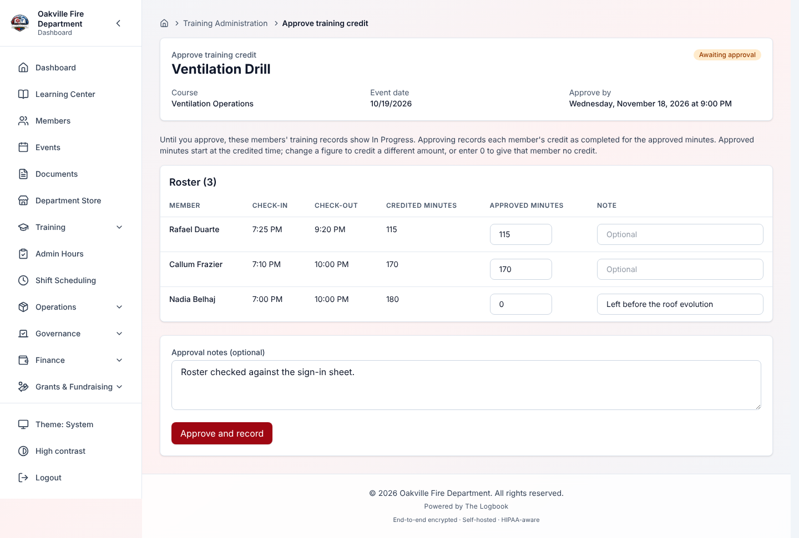

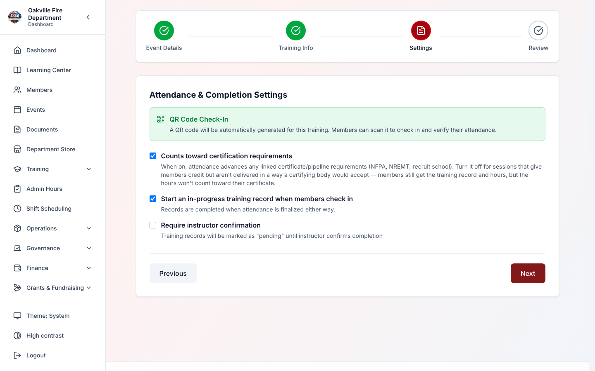

> **Hint:** Leave **Require instructor confirmation** off for routine drills
> you want completed as soon as you finalize them. Turn it on only when a
> second officer must sign off before records count.

**Correcting a finalized session.** Someone who can reopen finalized event
attendance (usually the chief ranks), or any training manager, reopens the
event's attendance with **Reopen Attendance**. Correct the times or the
links, then finalize again. Each member's record is updated in place. A member taken off the roster has their record marked **Cancelled**,
with the hours it had noted. Reopening cancels an approval link that was still
waiting; finalizing again sends a new one.

**A session built on a library course** _(2026-10-21)_. Choose **Use a course
from the Course Library** on the first step. The **Credit Hours** field shows
in both modes and can be edited. Left alone, it takes the course's credit
hours, or the course's duration when the course has no credit hours, so a
course saved with only a duration no longer gives a session worth 0 hours. A
library session with no course chosen is refused. The review step shows times
in your department's time zone and names the course.

### Linking a Session to What It Counts Toward

What finalizing credits depends on the session's links. Set them on the create
form's second step, **Training Info**, under **Connect to Requirements &
Programs**. All are optional:

- the **course** it teaches;
- the **Training Category** its hours count under;
- the **Requirement** attendance credits directly;
- the **Training Program** whose enrolled members it advances, with an
  optional **Program Phase**.

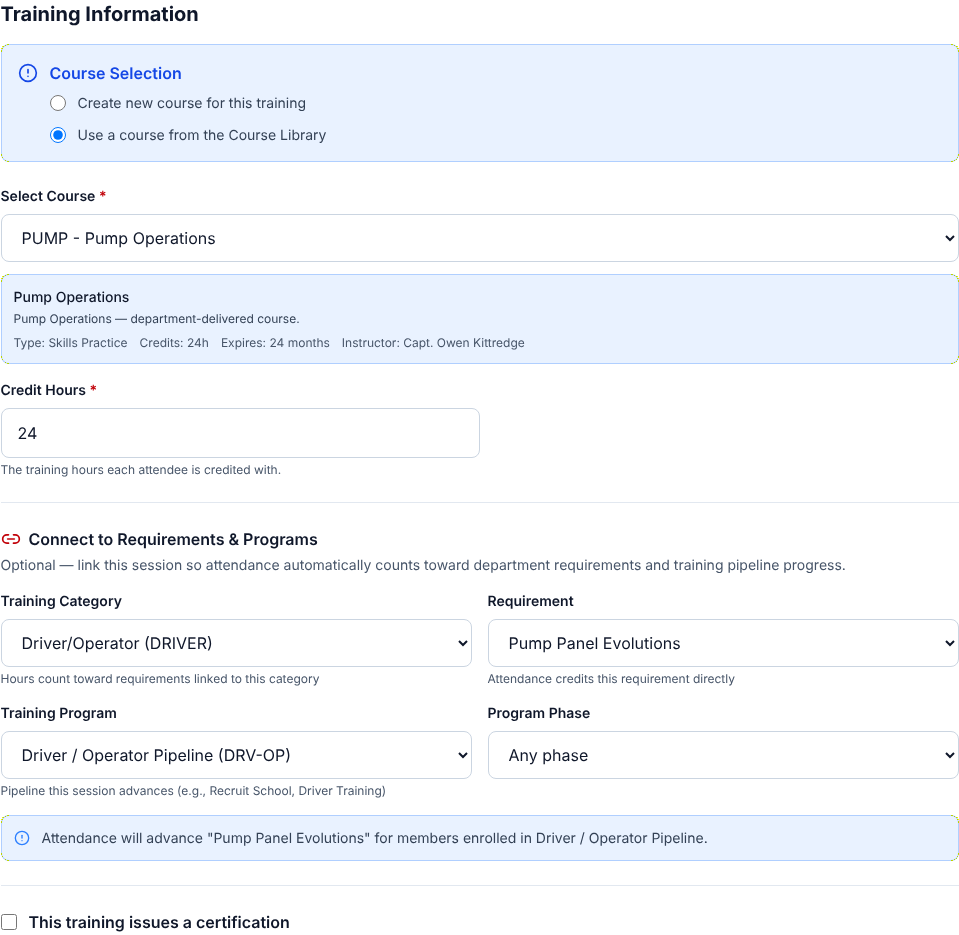

- **A summary line** under the pickers says what the links will do, in plain
  words. For a program and a requirement it reads: _Attendance will advance
  "requirement" for members enrolled in program_. It changes as you change the
  links.
- **Choosing a course fills in** the category and program that course names,
  without overriding a choice you already made. Requirements the course counts
  toward are offered as one-tap suggestions.
- **Everything offered is your department's own.** The pickers list only your
  department's categories, requirements and programs. Anything else is
  refused with a plain "Invalid training program" (or category, requirement,
  phase) message.
- **A phase does not have to match the program above it.** Sessions created
  from a course cohort can carry a phase from a different program, so this is
  allowed.

The same pickers appear on the event page as **Requirements & Programs**. That
is where you fix a session created before a requirement existed, or linked to
the wrong pipeline. The card also lets you **add training details** to a
Training event made from **Events → Create Event**. Changes apply the next
time the event's attendance is finalized, which rewrites the members' records
under the new links. While attendance is finalized, the links are locked;
reopen attendance to change them.

---

## Compliance Matrix

**Who can do this:** training officers.

Open **Training Admin → Overview → Compliance Matrix** to work through who is
short. It is a list you work down, not a grid. Members are grouped by standing
— Non-compliant, At risk, Compliant — worst first, and you step through them one
at a time. Each row shows the numbers behind the status: _"6 of 24 hours"_,
_"Lapsed 41 days ago"_, _"Expires in 26 days"_.

- Each member's row shows how many of their requirements they meet, with a
  strip of colored marks: green met, amber short, orange due soon, red
  lapsed. Blue **Catching up** marks an existing member still inside a
  requirement's catch-up deadline (see
  [Existing Members](#existing-members--exempting-or-giving-a-catch-up-deadline)).
- Opening a member shows each requirement's figure — _"44 of 24 hours"_,
  _"Nothing on file"_, _"1 of 1 shifts"_ — with its status and the date or
  window it was judged against.
- **By requirement** turns it around: requirements grouped by how many members
  are behind on them.
- Arriving from the dashboard's non-compliant link filters the list and shows a
  **Non-compliant + at risk only** chip. Clear the chip to see everyone. A
  refresh after clearing it does not bring the filter back.
- **Reviewing one member class** _(2026-10-27)_. When your roster holds more
  than one member class, a switch above the list offers **All**,
  **Operational**, **Administrative** and **Social** (only the classes you
  have). Choosing a class lists only its members, and only the requirements
  that grade at least one of them, so administrative members are not read
  against a column of operational requirements. The summary line names the
  class ("12 tracked operational members"), and the rollups narrow to the same
  class. The choice stays in the page address (`?class=`), so a refresh or a
  shared link opens on the same class. A member whose class is not recorded is
  listed only under **All**.

The actions available are **Print**, a CSV export, and links to each member's
training records. Both **Print** and the CSV follow the class switch, and the
CSV has a **Member class** column. With a class chosen, the printout carries
that class alone and says so in its subtitle. With **All**, a roster that
spans more than one class prints one heading per class (Operational,
Administrative, Social, then Unclassified), each table carrying only the
requirements that apply to its members; a roster of one class prints a single
table with every requirement.

> **Hint:** Use this view for yearly reporting, and to find members who need
> attention before compliance deadlines.

### One definition of "compliant" everywhere

The dashboard, the matrix, the compliance reports and the annual report all use
the same rules, so their figures agree:

- **A member's percentage counts only the requirements asked of them.** A
  member a requirement's **Member Categories** leave out can still reach
  100%. The figure is shown alongside as met / total.
- **A certification that is valid today is met today.** A card expiring in 26
  days counts as met; the orange **Due soon** mark is a renewal warning.
- **A member nothing grades is _Not applicable_, not compliant.** If no
  requirement applies to someone — none matches their rank or member category,
  a compliance profile selects none, or every requirement is still inside their
  catch-up period — they sit in their own **Not applicable** group on the
  matrix. Reports and CSVs show **N/A**. They are left out of the percentage
  altogether: "X of Y members current" counts only members who are graded.
  When nobody is graded, the percentage reads N/A rather than 100%.
- **The dashboard's Department Compliance card is graded like the matrix it
  opens.** It uses compliance profiles (a profile's own list of requirements
  and thresholds) and your department's compliant and at-risk thresholds.
- **The annual and monthly compliance reports also use compliance profiles**,
  with the same thresholds. The figure you file for the year matches the
  dashboard. A report already generated keeps the figures it was generated
  with.
- **A requirement limited to certain ranks applies to those ranks.** The
  **Required roles** on a requirement are **ranks**. Members of those ranks
  are graded on it on My Training, the matrix, the dashboard, the member
  profile card, the competency matrix and the annual report. The Shift
  Compliance report also respects the requirement's member categories.
- **A Certification requirement is credited through the course picked on it,
  the training type or the registry code.** It does not match a course just
  because the course's name _contains_ the requirement's name (a "CPR
  Refresher" event counting for "CPR"). That name match still applies to older
  requirements, but only for records completed before the requirement was
  upgraded. Link the course on any requirement you rely on.

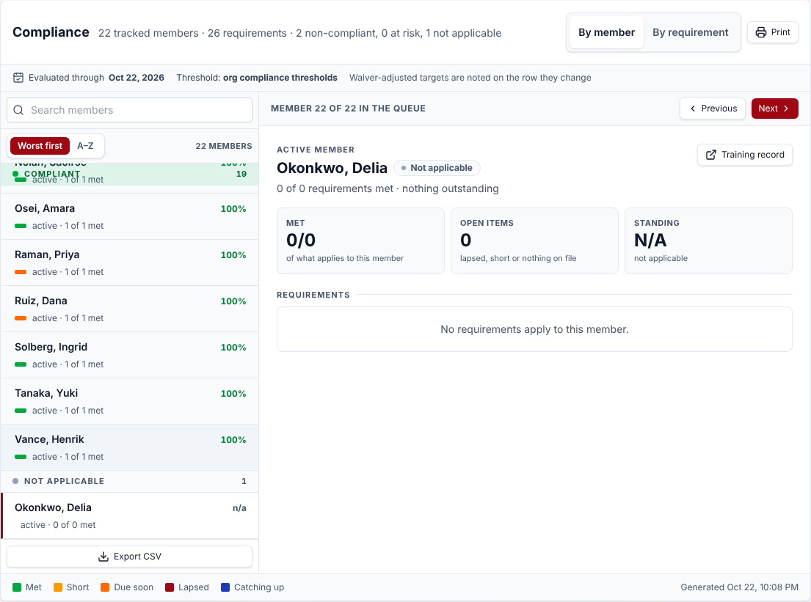

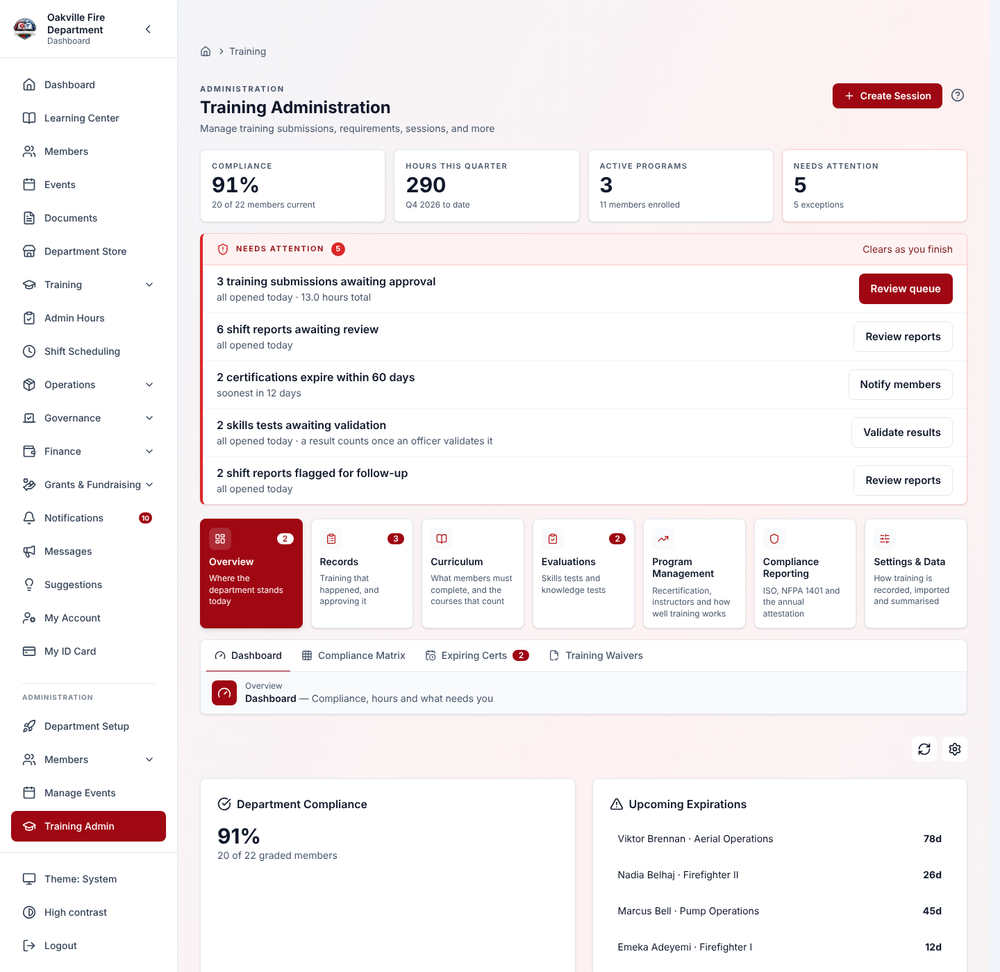

> **Compliance is judged on your department's date.** "Is it expired? Is it
> this month?" is answered using the date in your department's time zone. A
> certificate is valid **through** its expiry date, and the first of the month
> arrives at midnight local time. The same applies to every compliance screen,
> report and export, and to program deadlines, recertification windows,
> instructor and member qualification expiry and EVOC operator certificates.
> Each requirement can also move its own cut-off (see
> [Evaluation Period](#evaluation-period-current-vs-prior-month)), and the
> matrix shows the date each figure was judged on.

### Scoping a Compliance Profile by Position _(2026-10-29)_

**Who can do this:** officers who can change the department's settings, or who
hold "Manage compliance records".

A compliance profile can be limited to the members who hold a particular
position, not only to membership types. Use it when two groups share a class
and status but owe different training — for example, life members who still
ride and life members who have stopped.

1. Open **Training Admin → Compliance Reporting** and select **Configure**.
2. Open the **Profiles** tab and select **Add Profile** (or **Edit** on an
   existing profile).
3. Under **Applies to Members Holding a Position**, tick one or more positions.
   Leave them all unticked to apply the profile regardless of position.
4. Select **Create Profile** or **Update Profile**.

The profile's card then lists **Positions:** beside **Types:**. The rest of
the form is described in
[Creating Compliance Profiles](./08-admin-reports.md#creating-compliance-profiles).

**How a member matches a profile:**

| The profile names           | A member matches when                                               |
| --------------------------- | ------------------------------------------------------------------- |
| Neither types nor positions | Always — the profile applies to everyone                            |
| Membership types only       | Their membership type is one of those ticked                        |
| Positions only              | They hold **any one** of the ticked positions                       |
| Both types and positions    | Their type is ticked **and** they hold at least one ticked position |

The membership types on a profile are worked out from the member's **Member
class** and **Membership status**: **life** means an operational member with
life status, while **administrative** covers every administrative member and
**honorary** every social member, whatever their status.

**When a member matches more than one profile**, only the one with the highest
**Priority** grades them; the others are ignored, not combined. Give each
overlapping profile a different priority. A member who matches no active
profile is graded against every requirement that applies to them, at the
department's thresholds.

**Example: life members who no longer ride.** Their member class stays
Operational and their status stays Life, so nothing else about them changes
(ballots, for instance, still read their class).

1. Create a position with no permissions, such as "Life Member –
   Non-Operational", and assign it to those members.
2. Add a profile with **life** ticked under **Applies to Membership Types** and
   that position ticked under **Applies to Members Holding a Position**.
3. Tick only the requirements they still owe under **Required Training
   Requirements**, or none. With none ticked, they read **Not applicable**.
4. Set its **Priority** higher than any other profile a riding life member
   matches.

Taking the position off a member returns them to the profile every other life
member is graded by.

> **The list shows every position the department has.** A compliance officer
> does not need permission to view positions to pick from it. A position
> deleted after it was ticked shows as **Deleted position** until you untick it
> and save.

### Leave of Absence Adjustments

When a member has an active **Leave of Absence** (created in **Members > Admin

> Waivers**), every compliance view adjusts the requirements counted in
> amounts — hours, shifts and calls. The member is not penalized for time they
> were inactive. This includes the Compliance Matrix, the Competency Matrix and
> training reports.

The adjustment is:

> required amount × (active months ÷ total months)

For example, a member who takes 3 months of leave during a 12-month yearly
requirement of 24 hours needs 24 × (9 ÷ 12) = 18 hours.

A calendar month is only waived if the leave covers **15 or more days** of it.
Courses and certifications are not adjusted, because they are either done or
not.

Members see a blue information banner on My Training showing the adjustment.
Officers see the adjusted values in the compliance and competency matrices,
training reports and requirement progress.

For creating and managing leaves of absence, see
[Membership > Leave of Absence](./01-membership.md#leave-of-absence).

---

## Evaluation Period (Current vs. Prior Month)

**Who can do this:** training officers.

Departments that hold drills late in the month can see members flagged
non-compliant mid-month, before they had a chance to train. The **Evaluation
Period** setting decides whether compliance counts the current, unfinished
month or stops at the end of last month.

### Setting the Department Default

1. Open **Training Admin → Compliance Reporting** and select **Configure**.
   This opens **Compliance Requirements Configuration**.
2. On the **Thresholds** tab, find **Evaluation Period**.
3. Leave **Count the current (in-progress) month in compliance calculations**
   ticked to measure members against this month's training (the default). Or
   untick it so the count stops at the end of last month.
4. Select **Save Configuration**.

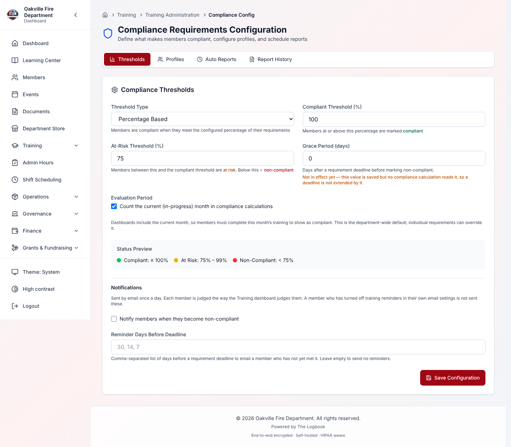

If the configuration cannot load (for example, on station Wi-Fi that asks you
to sign in first), the page shows a load error instead of a half-filled form.

### Compliance Emails to Members

The **Notifications** panel on the same **Thresholds** tab sends these by
email, once a day:

- **Reminder Days Before Deadline** — for each requirement a member has not
  met, a reminder when its deadline is that many days away. With `30, 14, 7`, a
  member behind on a yearly requirement hears at 30, 14 and 7 days before the
  end of the year. If The Logbook was down on a reminder day, the reminder goes
  out on the next run. A member never gets two reminders for the same deadline
  on one day. **Leave the box empty to send no reminders.**
- **Notify members when they become non-compliant** — a notice listing every
  requirement they have not met, sent when their standing turns
  **non-compliant**. An at-risk member is not sent it. They are not told again
  every day. They are told again when they fall short of another requirement,
  or of the same one in a new period.

The deadline is the end of the requirement's current period, or the member's
catch-up deadline while one protects them. Members are judged exactly as the
Training dashboard and the Compliance Matrix judge them — profiles, thresholds,
waivers and catch-up deadlines included. A member who turned off **Training and
certification reminders** in their own email settings is not sent these,
unless the department has made that email required.

> **Important.** If your department saved its compliance configuration with
> `30, 14, 7` in the reminder box, reminders go out daily from then on. Clear
> the box if you do not want them.

### Requirements with several categories

A requirement can be linked to more than one training category. A finalized
session or an imported outside course in **any** of those categories counts
toward it.

> **What if a member says a class never counted toward a requirement with
> several categories?** Credit for older classes may have been missed. A system
> administrator can run a one-time correction; see
> [Upgrading](../UPGRADING.md). Expect some members' percentages, and their
> pipeline phase, to move up when it runs.

### Per-Requirement Override

Each requirement can override the department default. When adding or editing a
requirement (**Training Admin → Curriculum → Requirements**), use the
**Evaluation Period** choice:

- **Use department default** — follows the department setting above.
- **Count the current (in-progress) month** — always includes this month for
  this requirement.
- **Stop at the end of the previous month** — leaves out the unfinished month.
  Useful for drills held late in the month, so members are not flagged early.

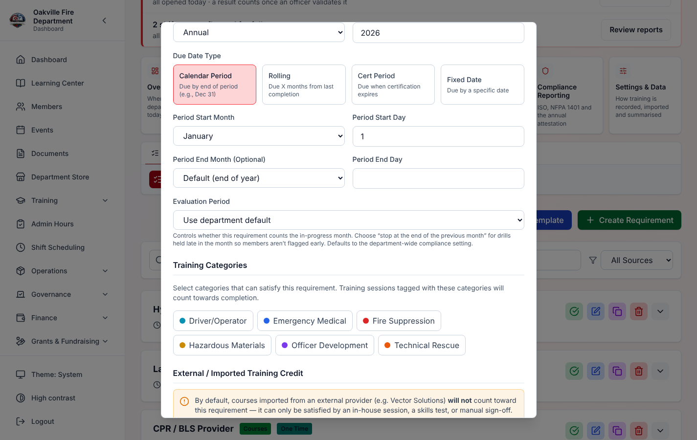

> **Hint:** This setting only affects requirement windows, leave adjustments
> and overdue checks. Certifications that are **expiring soon** are always
> flagged using your department's actual date, whatever the Evaluation Period
> says.

---

## Expiring Certifications

**Who can do this:** training officers.

Open **Training Admin → Overview → Expiring Certs** to see certifications
expiring soon. Choose the window: 30, 60, 90 (the default), 180 days or 1
year. Summary cards count **Expired**, **Critical (≤30d)** and **Warning
(31-90d)**.

The list shows:

- member name;
- certification name;
- expiry date;
- days until expiry.

A certificate is valid **through** its expiry date. It is expired only once
your department's date has moved past it. The member's training history,
profile and printed record all follow this rule.

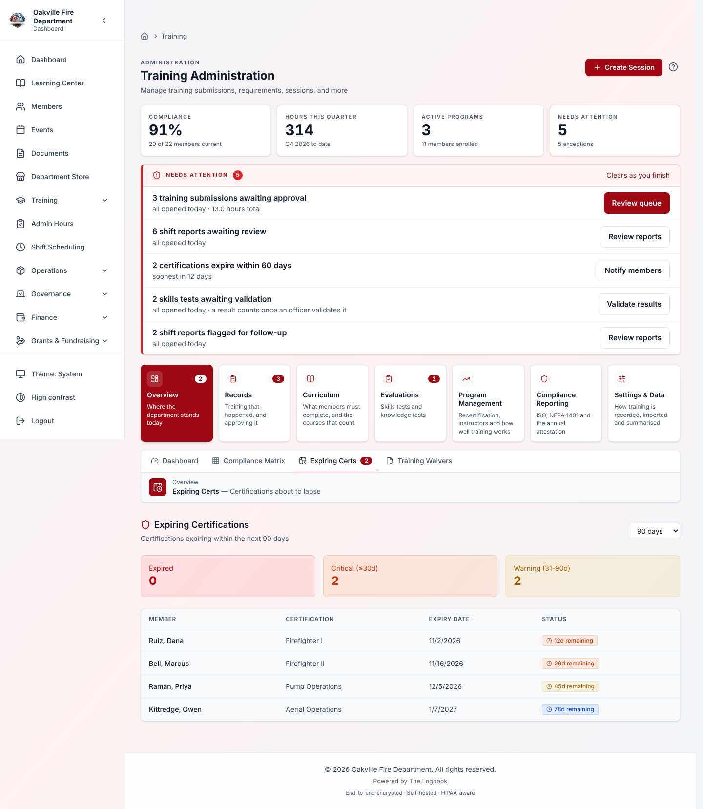

### Automated Certification Alerts

**Who can do this:** training managers (`training.manage`).

The Logbook emails members automatically as their certifications get close to
expiry, and gives them a notice in the app each time. There is no button to send
them by hand.

**They are off until you turn them on.** Open **Training Admin → Overview →
Expiring Certs**. At the top, **Expiry alert emails** has a switch,
**Email members when a certification is close to expiring**. Tick it and select
**Save**; nothing is sent for a department that has not. Two more choices apply
to the notice sent once a certification has expired, and they are available
only while the switch is on:

- **Copy the chief officers on the expired notice**
- **Also send the expired notice to the member's personal email address**

All three start off. A member who has turned off training reminder emails in
their own preferences is not emailed unless your department requires those
emails; they still get the notice in the app.

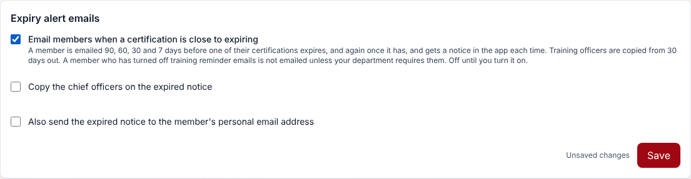

| Days before expiry | Who is told                               | How                              |
| ------------------ | ----------------------------------------- | -------------------------------- |
| 90 days            | Member only                               | In-app + email                   |
| 60 days            | Member only                               | In-app + email                   |
| 30 days            | Member + training officer                 | In-app + email (officer copied)  |
| 7 days             | Member + training and compliance officers | In-app + email (officers copied) |
| Expired            | Member + all escalation officers          | In-app + email (officers copied) |

Each stage is sent only once per certification. An expired certification is
escalated to the training and compliance officers. The chief officers are
copied, and the member's personal email address is added, only if you ticked
those two choices above.

---

## Waiver Management

**Who can do this:** officers who can manage member profiles.

Open **Members > Admin > Waivers** to manage every waiver in the department.
This one page covers:

- **Training waivers** — adjust training requirements for members on leave;
- **Meeting and shift waivers** — leave meetings out of attendance figures,
  and keep members off the schedule, during leave.

### Creating a Waiver

1. Select the **Create Waiver** tab.
2. Choose the member and the leave type: **Leave of Absence**, **Medical**,
   **Military**, **Personal**, **Administrative**, **New Member** or
   **Other**.
3. Set the date range, or tick **Permanent (no end date)** for a waiver that
   never ends. Permanent waivers show a purple **Permanent** badge.
4. Under **Applies To**, tick one or both:
   - **Training Requirements** — adjusts the member's training requirements.
   - **Meeting Attendance & Shift Requirements** — creates a leave of absence.
     It covers both meetings and shifts; they cannot be separated.

   | You tick                                     | What is created                                                  |
   | -------------------------------------------- | ---------------------------------------------------------------- |
   | Both                                         | A leave of absence and a linked training waiver                  |
   | Training Requirements only                   | A training waiver only; meetings and scheduling are not affected |
   | Meeting Attendance & Shift Requirements only | A leave of absence that does not waive training                  |

5. Select **Create Waiver**.

### Training Waivers Tab (Officer View)

Training officers also have a **Training Waivers** tab under **Training Admin →
Overview**. It shows:

- summary cards (Active / Future / Expired / Total);
- a table you can filter, with status badges;
- where each waiver came from: **Auto (LOA)** for waivers created from a leave,
  **Manual** for waivers created on their own;
- links to the full Waiver Management page.

---

## Compliance Summary

Each member's profile page has a **compliance summary card** showing their
training status at a glance:

| Indicator               | Meaning                                                           |
| ----------------------- | ----------------------------------------------------------------- |
| **Green (Compliant)**   | All requirements met, no certification problems                   |
| **Yellow (At Risk)**    | Some requirements not met, or certifications expiring soon        |
| **Red (Non-Compliant)** | An expired certification, or fewer than half the requirements met |
| **Not Applicable**      | No requirement applies to the member, and nothing is expiring     |
| **Exempt**              | The member is marked exempt from compliance tracking              |

The card also shows:

- requirements met / total;
- training hours completed this year;
- the number of active certifications;
- certifications expiring soon.

For the full details of how compliance is worked out, see
[Training Compliance Calculations](../../docs/training-compliance-calculations.md).

---

## Shift Completion Reports

**Who can do this:** training officers see and manage all reports. A shift's
assigned Shift Officer can file reports for that shift. Every member can read
reports about themselves.

Shift reports are filed and managed on the **Shift Reports** tab of Shift
Scheduling. **Training Admin → Records → Shift Reports** has three tabs:

- **New Report** — a card with **Go to Shift Reports**, which opens the form in
  Shift Scheduling. Without the Scheduling module, the card offers **Log Shift
  Report** instead (see [Manual Shift Report Entry](#manual-shift-report-entry)).
- **Filed** — reports you filed.
- **My Reports** — reports about you, with your totals above them.

Shift officers file shift completion reports after each shift. A report
records:

- the **trainee** and the shift;
- **hours on shift**, filled in from the shift's attendance;
- **calls responded**, filled in for each member — from the call log, or from
  the call count at close-out for departments that record a count;
- **call types**, taken from the calls on the shift;
- a **performance rating** (1–5; your department sets its label and style);
- **areas of strength** and **areas for improvement**;
- an **officer narrative** — a free-form assessment;
- **skills observed** — only when your department records skills on shift
  reports (see the note below). Each skill can be scored 1 to 5: 1 = Needs
  work, 2 = Developing, 3 = Competent, 4 = Proficient, 5 = Excellent. Scores
  feed the member's sign-offs and competency history;
- **tasks performed**, each with a description and comment.

The strengths, improvement areas, narrative and reviewer notes are stored
encrypted.

> **Important — skills on shift reports.** Your department runs one
> practical-skills system (see
> [A department runs one practical-skills system](#a-department-runs-one-practical-skills-system)).
> Under **Skills Testing**, the default, the shift report form shows **no
> skills list**, and skills on a report record nothing. The skills list, its
> scores and the sign-offs they create exist only when the department has
> chosen **Shift report sign-offs**.

Reports **update training program progress automatically** for enrolled
members. When a report is filed (or a draft is completed), The Logbook credits
hours, shift count and call count toward matching requirements.

A calls requirement can name **Call types that count**. It then counts only
calls of those types. Calls are matched by **type, not spelling**: a report's
calls match whether they were recorded under the type's short code, its name,
or the same words typed long ago. A requirement naming "Motor Vehicle Accident"
counts every MVA the trainee is credited with.

The screens do not show which requirements a report advanced. Check the
member's program progress to see the credit arrive.

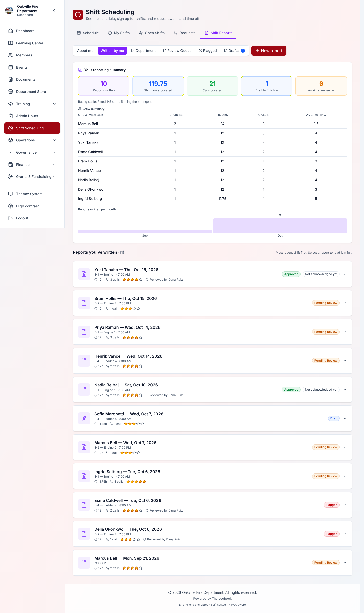

### One call-type list

A department has **one** list of call types, edited in **Scheduling → Settings
→ General → Call types**. There you can add a specialized type, rename one,
turn off one that does not apply (it stops being offered, but history keeps
it), or delete one that has never been used. Everything else uses that list:

- the call count at close-out (for departments that record a count);
- the call log's **Incident type** (for departments that log each call);
- the shift report's **Call Types** chips, including manual reports;
- a calls requirement's **Call types that count**.

Requirements match by type, so it does not matter where a report's calls came
from. Pick, say, **Motor Vehicle Accident** on a pipeline requirement for 5
calls, and every MVA a trainee is credited with on a shift report counts toward
it.

You cannot delete a type that a training requirement counts. Turn it off
instead, or take it off the requirement first.

### Closing Out the Shift First

Before filing reports, an officer **closes out the shift** with **Close out
shift** on the shift's detail panel. Closing out fixes the shift's hours and
calls, credits each member's calls, locks the shift, and **creates a draft
shift report for each trainee** on it. The officer is notified how many drafts
were made. After close-out, a green badge reads **Shift finalized on** and the
date.

For the full steps — the checklist, the end-of-shift equipment-check rule,
reopening a shift and the three-step wizard some departments use — see
[Closing Out a Shift](./03-scheduling.md#closing-out-a-shift) in the
scheduling guide.

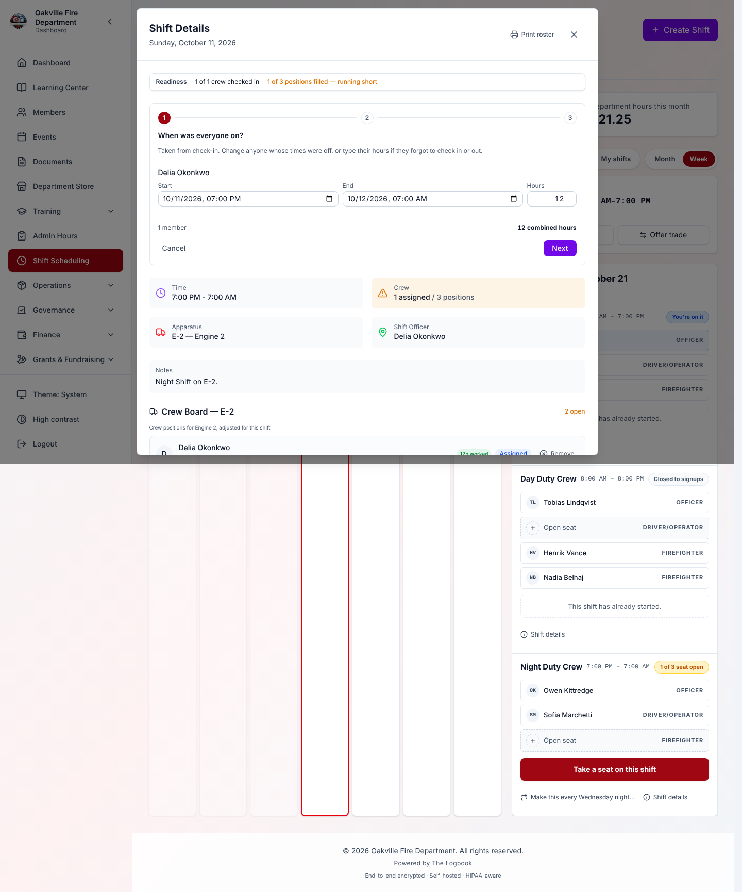

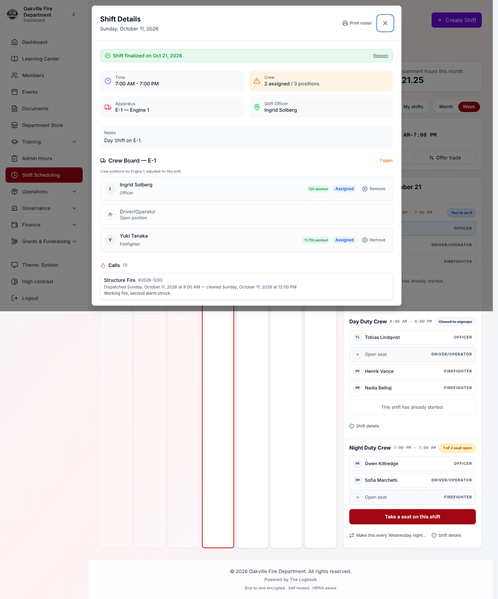

### Auto-Population from Shift Data

The form starts from the shift. You pick the shift, and the form fills itself
in from what the shift already knows.

1. Go to **Shift Scheduling → Shift Reports → New report**. Pick a shift from
   the last two weeks. Each row names the apparatus, the date, and how many
   members and calls it had.
2. **Hours on Shift** is filled in from the shift, and **the crew comes with
   it**. Each member is tagged with the position they rode and, if they are in
   a pipeline, the pipeline they are a trainee on.
3. Each crew member's row has their own **Calls** figure, marked _from
   close-out_ or _from call log_. That number is saved unless you change it.
   Change it for anyone whose number is wrong; only that member's report takes
   your figure. A changed count is saved without call types, because nothing
   records which calls were added or dropped. Before close-out, a member the
   close-out never adjusted is credited the apparatus's full count — the same
   default closing out uses.
4. Everything can be edited before you file. The tick box beside each member
   decides who gets a report. **Evaluate** opens the rating and narrative
   fields for a trainee.

There is no "(auto)" badge: the filled-in values are ordinary fields. The
Logbook does record which values were carried over and which the officer typed.

**Hours are the shift's length, not the crew's total.** A three-person,
12-hour shift credits each rider 12 hours, not the crew's 36.

> **Reports filed by the officer on the rig.** The setting **Scheduling →
> Settings → Shift Reports → Filing & Validation → Reports are filed by the
> officer on the rig** limits a shift's reports to its assigned **Shift
> Officer**:
>
> - the form lists only shifts you were officer on;
> - anyone else is refused, with the reason (a whole batch is refused, not
>   skipped member by member);
> - drafts made at close-out are assigned to the Shift Officer, not to whoever
>   closed out the shift;
> - a shift with no Shift Officer cannot have reports until one is set.
>
> It is off unless turned on. Reports not linked to a shift are not affected.

> **Only the Shift Officer sees File Shift Report.** The button on a finished
> shift's detail panel appears only for that shift's assigned Shift Officer.
> Scheduling managers file from **Shift Reports → New report** instead. The
> Shift Officer can file their own shift's reports and finish the drafts
> assigned to them **without** being a training officer, so an acting officer
> is not stuck. A **Drafts** switch appears beside "Shift reports about you"
> when they have drafts to finish. This only covers their own shift — no other
> shift, and none of the review, analytics or list screens.

> **You are never on your own crew list.** A report is an officer's account of
> someone else's shift. One about yourself would credit your own hours, calls
> and ratings with nobody else checking. So the form leaves you off the crew, a
> report whose trainee is its author is refused (a batch skips that member and
> files the rest), and close-out does not draft one for a trainee who closed
> out that shift themselves and has no evaluator named on their training seat.

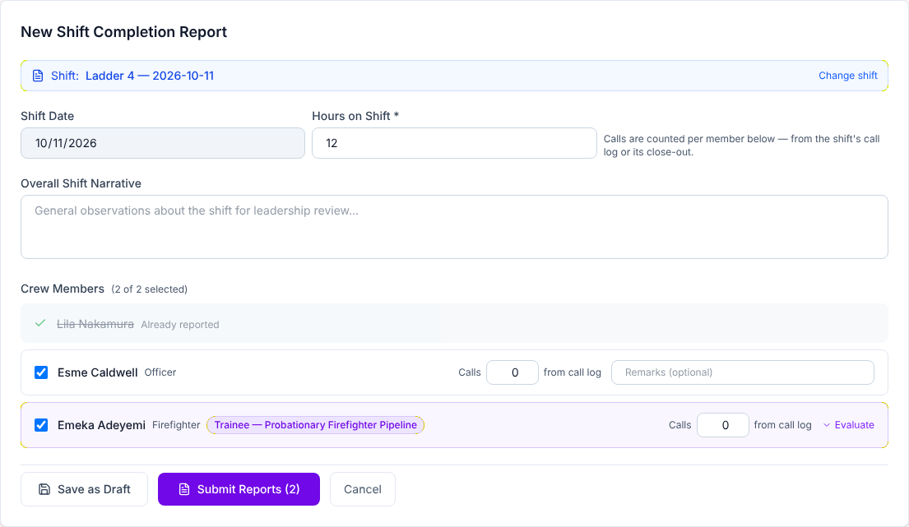

### The crew comes from the shift

The form has no trainee dropdown. Picking the shift loads **its crew** — the
members who were on it — each with their position. You tick the ones a report
is for.

A report **not** tied to a shift is filed with
[Manual Shift Report Entry](#manual-shift-report-entry), which searches the
whole member list because there is no shift to take a crew from.

### Draft Reports and Review Workflow

A shift report moves through these stages:

1. **Draft** — created at close-out, or saved by an officer. The officer fills
   in the evaluation (rating, narrative, skills, tasks).
2. **Pending Review** — sent to a training officer for review, when your
   department requires review.
3. **Approved** — final, and visible to the trainee (subject to the visibility
   settings below).
4. **Flagged** — marked by a reviewer for correction or concern.

**For officers:**

- Open the **Drafts** view to see drafts waiting to be finished. **Submit All
  Drafts** files the whole batch — **your own** drafts only.
- Open a draft — the arrow on its right expands it in place — and select
  **Complete Draft** to fill in the evaluation.
- Submitting moves the draft to approved, or to pending review.
- A draft credits no program progress. Progress is credited when it is
  submitted.
- **Status moves only through review** _(2026-10-24)_. Submitting a draft is
  the only way its filing officer changes its status. **Require report review
  before trainee visibility** decides whether it goes to pending review
  or straight to approved. A filing officer cannot approve their own report,
  clear a reviewer's flag, or send an approved report round again. Content
  edits still work as before.
- **A report signs its skills off once.** Approving the same report again does
  not add another sign-off or move the trainee up another competency level.
  Competency moves only with a new sign-off from a new report.
- If the officer who filed a draft has been permanently deleted, someone who
  can **Manage training records** can complete it. **Complete Draft** appears
  only on drafts you are allowed to complete.

**For reviewers:**

- Who reviews: anyone who can manage training, and, since 2026-10-31,
  members holding the **Reviewer role** chosen in Shift Report settings. A
  reviewer by role does not see or review reports about themselves.
- Open the **Review Queue** view. It appears only while **Require report
  review before trainee visibility** is on in Shift Report settings.
  **Flagged** appears whenever review is on. It also appears with review off
  while any report is still flagged, so a flag set earlier is never lost.
- Review reports and approve or flag them. The review window shows the whole
  report — hours, calls, rating, strengths, improvements, narrative, skills
  with scores, and tasks.
- **Review several at once:** tick reports (or tick select-all), then select
  **Approve Selected** or **Flag Selected**. Up to 100 reports at a time.
- The **Flagged** view lists reports flagged earlier, for follow-up. Select
  **Re-Review** to look again and approve.
- Optionally **hide fields** — clear sensitive content from chosen fields
  before the trainee sees the report.
- Add **reviewer notes**. Trainees never see them.

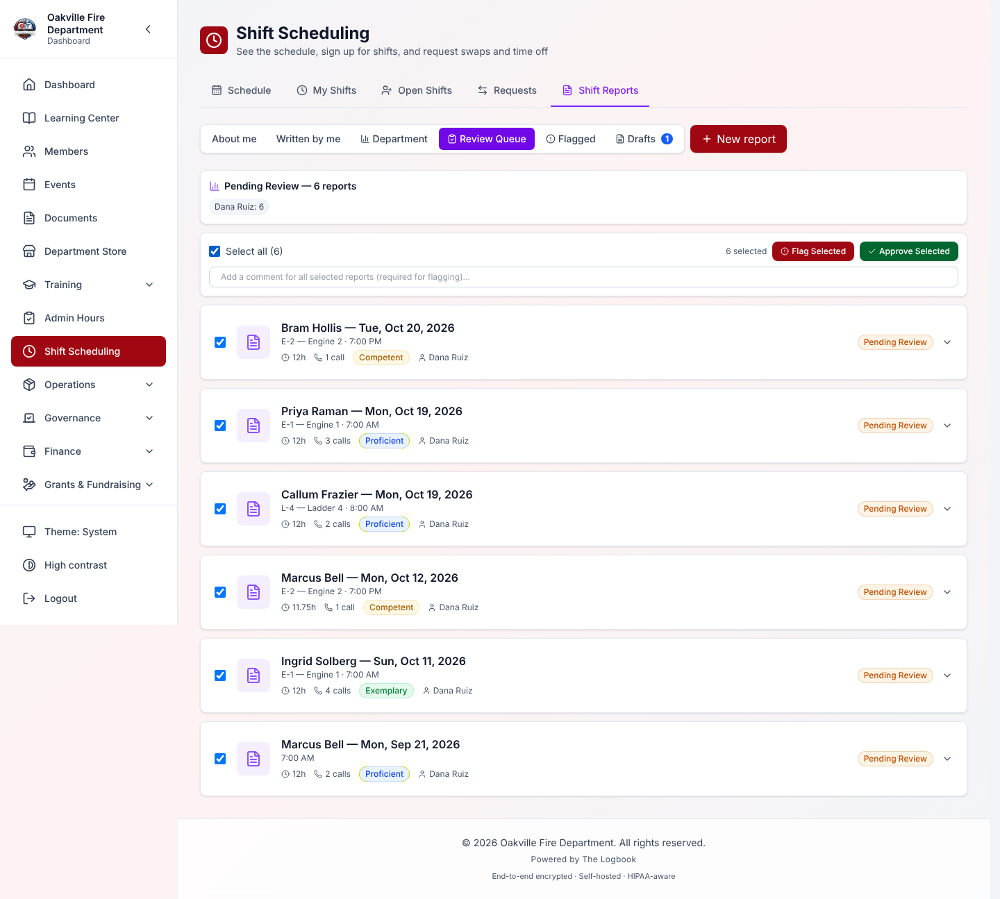

**For trainees:**

- Open **About me** to see approved reports about you.
- Select **Acknowledge** to confirm you have read a report, with an optional
  comment.
- See your own totals: hours, calls, average rating and a monthly breakdown.

### Save as Draft

Officers can save an unfinished report as a draft:

1. Start filling in the report form. The two buttons sit together at the
   bottom: **Save as Draft** (outlined) and **Submit Report** (filled). With
   more than one crew member ticked, it counts them: **Submit Reports (3)**.
2. Select **Save as Draft**. A draft can be saved with fields missing; the
   required fields are checked when you submit. No program progress is
   credited yet.
3. Find it later in the **Drafts** view of the Shift Reports tab.
4. Open the draft to finish and file it, or use **Submit All Drafts**.
5. On submission, the report is approved or sent for review, and program
   progress is credited.

Drafts are also **made for you**: closing out a shift creates one per trainee
on it. That is why the view can have rows before you have saved anything.

### Officer Analytics Dashboard

The analytics sit at the top of the **Written by me** view and cover only the
reports you filed. Officers who may see department-wide figures also get a
**Department** view beside it, which sums every officer's reports. The cards
are:

- **Summary cards** — total reports, total hours, total calls, average rating;
- **Per-trainee table** — each trainee's report count, hours, calls and
  average rating;
- **Status counts** — how many reports are draft, pending review, approved and
  flagged;
- **Monthly trend** — reports, hours and calls per month.

### Trainee Statistics Dashboard

Trainees see a personal totals card at the top of **About me**:

- **total reports** received;
- **total hours** across all reports;
- **total calls** responded to;
- **average rating** across rated reports;
- a **monthly breakdown** — a small bar per month, under the four totals. It
  appears only once the trainee has reports in **more than one** month.

### Visibility Configuration

Training officers control what trainees see in **Member Visibility Settings**
on the My Training page. The panel is laid out as one card per group. While any
change is unsaved, a bar at the bottom of the window shows "N unsaved changes"
and **Save**.

The shift-report settings control:

| What it controls      | Effect                                                                            |
| --------------------- | --------------------------------------------------------------------------------- |
| Performance rating    | Whether rating stars appear on reports the trainee sees                           |
| Officer narrative     | Whether the officer's free-form assessment is visible to the trainee              |
| Areas of strength     | Whether strengths are visible to the trainee                                      |
| Areas for improvement | Whether improvement areas are visible to the trainee                              |
| Skills observed       | Whether skills observations appear                                                |
| Shift statistics      | Whether the trainee totals card appears                                           |
| Shift reports         | Whether the shift reports section appears at all                                  |
| Review required       | Whether reports need a reviewer's approval before the trainee sees them           |
| Rating label          | A custom name for the rating, such as "Performance" or "Readiness"                |
| Rating style          | Star icons, or labelled buttons                                                   |
| Rating level labels   | Your own words for each level, such as 1 = "Needs Improvement", 5 = "Exceptional" |

If labelled buttons are chosen but no labels are entered, the levels show as
numbers 1–5.

The review, rating label and rating style settings can also be changed under
**Scheduling > Settings > Shift Reports**. Both places change the same
setting.

### Report Form Section Toggles

Separately from what trainees see, officers choose which **optional sections
appear on the report form** itself. These are tick boxes under **Scheduling >
Settings > Shift Reports > Form Sections**. All seven start ticked:

- performance rating;
- areas of strength;
- areas for improvement;
- officer narrative;
- skills observed;
- tasks performed;
- call types.

An unticked section is removed from the form completely; officers cannot enter
anything for it. With every section unticked, only the core fields remain
(trainee, shift date, hours, calls), and the form can still be submitted. The
trainee visibility settings above are separate. They control what trainees see
after a report is filed.

The **skills observed** section appears only under **Shift report sign-offs**,
whatever this tick box says.

### Per-Apparatus-Type Skills and Tasks

**Applies only under Shift report sign-offs.** The report form can fill in
skills and tasks for the type of apparatus on the shift. On an engine, for
example, it might offer "Pump operations", "Hose deployment" and "Hydrant
connection".

1. Open **Scheduling > Settings > Shift Reports** and then **Apparatus
   Skills**.
2. Pick an apparatus type from the row of chips across the top. Each shows how
   many skills it already has (Ambulance, Boat, Brush, Chief, Engine, Hazmat,
   Ladder, Rescue, Tanker).
3. Skills and tasks appear as chips below. The pencil renames one, the ×
   removes it, and the box underneath adds another.
4. Select **Save Apparatus Skills & Tasks**.
5. When an officer files a report for a shift with that apparatus type, the
   form fills in those skills and tasks.

If the apparatus type has no list, the form uses the department-wide default
lists (**Observable Skills** under **Feedback Defaults**). If neither exists,
the skills and tasks sections are empty but still shown, unless turned off in
Form Sections.

Under **Skills Testing**, both lists can still be edited, but they do nothing.
Each carries a note saying so, with a link to the Practical Skills setting. The
lists are kept and apply again if the department switches to sign-offs.

Each apparatus skill shows green when its name matches a skill under **Skill
Evaluations** (ignoring capitals), and amber when it does not. An amber skill is
still recorded on reports but does not count toward competency.

### Skill Evaluations

**Who can do this:** training officers add, edit, deactivate and delete
skills. Anyone with **Manage training records** or **Configure training module
settings** can view them. This area appears only under **Shift report
sign-offs**.

A skill score on a shift report counts toward a trainee's competency history
and program progress only when the skill is defined here. Open **Training Admin
→ Evaluations → Skill Evaluations** and select **Add skill**:

| Field                           | What it does                                                                                                         |
| ------------------------------- | -------------------------------------------------------------------------------------------------------------------- |
| **Name**                        | How a shift report's skill is matched to this one. Capitals are ignored: "Pump Operations" matches "pump operations" |
| **Category**                    | Optional grouping (Driver, EMS, Firefighting…)                                                                       |
| **Description**                 | Optional                                                                                                             |
| **Criteria**                    | Optional, one per line — what the evaluator looks for                                                                |
| **What counts as passing**      | Optional free text                                                                                                   |
| **Who can sign this skill off** | Training officers (the default), members holding chosen positions, or named members                                  |

Each skill card shows who can sign it off, how many criteria it has, and how
many sign-offs have been recorded.

> **Renaming a skill unlinks it.** The match is by name. Renaming "Pump
> Operations" turns every apparatus skill still spelled the old way amber until
> you rename it too. The editor warns you when you change a name.

> **Two active skills cannot share a name.** A shift report's skill would match
> both, so the second is refused. Deactivating a skill frees its name.

> **Deactivate rather than delete.** A skill with sign-offs, competency history
> or instructor qualifications cannot be deleted, because that would erase the
> history. **Deactivate** stops new shift-report scores from creating sign-offs
> and keeps everything already recorded. **Reactivate** brings it back.
> **Delete** is offered only for a skill nothing has used.

> **Program requirements.** A _Skills Evaluation_ requirement moves forward by
> one for each matching skill signed off on a shift report. A requirement that
> names specific skills counts only those.

### Edge Cases

| What happened                                                   | What it means / what to do                                                                                                |
| --------------------------------------------------------------- | ------------------------------------------------------------------------------------------------------------------------- |
| You file a second report for the same trainee on the same shift | Refused, with a message. Each trainee gets one report per shift.                                                          |
| End-of-shift equipment checks are outstanding                   | They block close-out only if your department requires them. Start-of-shift checks never block it.                         |
| You try to edit or delete a closed-out shift                    | Not allowed. A shift with reports also cannot be deleted.                                                                 |
| A reviewer hides fields on a report                             | The hidden values are erased before the trainee sees the report. They cannot be recovered.                                |
| The trainee is not in the shift's attendance                    | Hours and calls start at zero. Enter the hours by hand. The same happens when a member was assigned but never checked in. |
| The shift has no calls logged                                   | Calls start at 0 and no call types are filled in.                                                                         |
| The report's date does not match its shift's date               | Refused. A report linked to a shift must carry that shift's date.                                                         |
| A report is filed without a shift                               | It is saved as an "ad hoc" report. Nothing is filled in for you.                                                          |
| One trainee's draft fails at close-out                          | The others still get theirs.                                                                                              |
| A skill score outside 1–5                                       | Not possible on screen; the form offers buttons 1 to 5.                                                                   |
| You select more than 100 reports to review                      | Refused. Select fewer and try again.                                                                                      |
| Some selected reports were already reviewed                     | The rest are reviewed. You are told how many could not be.                                                                |
| A flagged report is approved                                    | It leaves the Flagged view. If it is linked to a program enrollment, progress is credited then.                           |
| The trainee's enrollment ended before the draft was submitted   | The report is submitted, but no program progress is credited.                                                             |
| A shift already has submitted or reviewed reports               | No new drafts are made for it, so nobody is credited twice.                                                               |
| Someone else tries to open a report                             | Only the trainee, the officer who filed it and training officers can open it.                                             |
| A trainee opens their own report                                | They see only what the visibility settings allow. Reviewer notes are never shown to them.                                 |
| No skills are defined under Skill Evaluations                   | Every apparatus skill shows amber. Add skills under [Skill Evaluations](#skill-evaluations).                              |

---

## Shift Evaluations _(2026-10-31 / 11-01)_

A shift evaluation is the department's own form, filled out for a member after
a shift. It is not the same as a skills evaluation or a member's yearly
performance evaluation (that is still being built; only its storage exists).

**Building the forms.** **Training Admin → Settings & Data → Shift
Evaluations** lists the department's forms (needs `training.configure` or
`training.manage`). A form holds the rating scale and labels, an N/A option, the
rating below which a comment is required, header fields, statistics, and
sections of items. **Start from the example** gives a ready template. Set the
**general form**, whether it is optional or required, and whether one combined
evaluation may cover several programs.

**Linking a form to a program.** The create-pipeline wizard and the
edit-program dialog have a **Shift evaluation form** picker. Leaving it blank
means no form. A form from another department is refused.

**After a shift.** In the **Shift Completion Report**, each member who needs an
evaluation has a status line (not started, in progress, submitted, optional)
linking to their evaluation page. A member enrolled in a program with a form is
evaluated on it, once per program (or once for all, if combined). A member in
no such program, in a seat the general form covers, gets the general form.

- The shift officer or a `training.manage` holder fills it out; **never your own**.
- Rating buttons are full-size touch targets; required comments open by themselves.
- Drafts autosave. **Submit** locks the evaluation.
- A **print** view gives the paper layout.
- Ratings and comments are encrypted at rest.

> **Screenshots to create:** the Shift Evaluations settings screen; the form
> editor; the program picker; the report's status lines; the evaluation page;
> the print view.

## Manual Shift Report Entry

**Who can do this:** training officers.

Departments that do not use the Scheduling module can file shift reports on a
separate **Log Shift Report** page. Officers type in the shift's details
instead of picking a scheduled shift.

### Filing a Manual Shift Report

1. Go to **Training Admin → Records → Shift Reports**, open the **New Report**
   tab and select **Log Shift Report**. (With the Scheduling module turned on,
   that tab points to Shift Scheduling instead — the form described above.)
2. Choose the **apparatus**. It is **required unless an administrator turns
   that off** (see the settings below). The list is your department's own
   units, each labelled with its unit number and type.
3. Enter the **start date and time** and the **end date and time**. Enter an
   overnight shift as it happened: set the end date to the next day. The page
   does not guess a crossover from the times.
4. The **shift duration** is worked out from those four fields and shown
   beneath them.
5. Enter **calls responded** and pick **call types** from the row of tags.
6. Add an **overall shift narrative**.
7. **Search for each crew member and select them to add them.** A member you
   add arrives ticked. The tick box decides who gets a report, and the **✕**
   removes the member from the list.
8. For each crew member who needs one, select **Evaluate** to open their
   section:
   - performance rating (1–5 stars);
   - strengths;
   - areas for improvement;
   - remarks.
9. Select **Save as Draft** or **Submit Report**. With more than one member
   ticked, the button counts them, for example **Submit Reports (2)**.

> **The apparatus does not bring skills or tasks with it.** This page files
> hours, calls and a written evaluation. The skills and tasks lists belong to
> the shift-linked form above. The manual form records your apparatus choice at
> the top of the shift narrative — "Apparatus: Brush 5 (B-5)" — so the report
> says which unit the crew was on.

### Admin Configuration

Administrators set up manual shift entry under **Training Admin → Settings &
Data → Manual Entry Rules**:

| Setting                 | What it does                                                                             |
| ----------------------- | ---------------------------------------------------------------------------------------- |
| **Enable Manual Entry** | Turns the feature on or off for the department                                           |
| **Require Apparatus**   | Makes choosing an apparatus required on the manual form                                  |
| **Allowed Apparatus**   | Tick the individual units the form offers — not types. Leave all unticked for every unit |
| **Default Start Time**  | Fills in the start time, for example "07:00"                                             |
| **Default Duration**    | Fills in the shift length, and works out the end time from it                            |

**Everything except the on/off box is hidden while the feature is off**, which
is how it starts. The apparatus rules and shift defaults appear only once
**Enable Manual Shift Entry** is ticked. A panel showing one unticked box is
the feature turned off, not a broken page.

### Edge Cases

| What happened                                             | What it means / what to do                                                                                                                   |
| --------------------------------------------------------- | -------------------------------------------------------------------------------------------------------------------------------------------- |
| You file a manual report for a day with a scheduled shift | Nothing stops or warns you. The manual form does not check the schedule, so a shift reported both ways is credited twice.                    |
| The shift ends before it starts                           | The duration reads zero and submitting is refused with "End time must be after start time". Shifts can be at most 48 hours.                  |
| An overnight shift                                        | Set the **end date** to the next day: 19:00 on the 11th to 07:00 on the 12th is 12 hours. Leaving the end date on the start date gives zero. |
| A default duration that runs past midnight                | With a 07:00 start and a 24-hour default, the form opens with the end date already on the next day.                                          |
| A shift in the future                                     | Refused. You cannot file a report for a shift that has not happened.                                                                         |

---

## Officer Training Record Exports

**Who can do this:** training officers.

Officers can export training records for state reporting, yearly reviews or
one member, as CSV or PDF files.

### Exporting a Single Member's Records

1. Open the member's **Training History** page (from their profile or the
   member list).
2. Choose a period in the **Export period** list — **This Month**, **This
   Quarter**, **This Year** or **All Time**.
3. Select **Export CSV** or **Export PDF** to download that member's records
   for the period.

### Bulk and Reporting Exports (Reports Tab)

Open **Training Admin → Program Management → Reports** for department-wide
exports:

1. **Member Records (All Members)** — choose a period, then select **CSV** or
   **PDF**. The CSV combines every active member's completed records. The PDF
   puts each member's section into one document.
2. **Hours Summary** — a CSV of training hours by member, category and
   training type. It suits state and yearly reporting.
3. **Certification Report** — a CSV of all certifications marked valid,
   expiring soon or expired, for tracking renewals.
4. **Compliance Report** — department-wide compliance for all members and
   requirements.

> **Hint:** A bulk PDF for a period with no records still downloads, as a
> valid placeholder file. It is useful as proof that a quiet period was
> reviewed.

> **Hint:** The CSV downloads have no row limit. A large export starts
> straight away and grows while it runs. Leave the tab open until your browser
> shows the download has finished. PDFs are built in full before they
> download.

---

## External Training Integrations

**Who can do this:** training officers.

Open **Training Admin → Settings & Data → Integrations** to connect outside
training providers. You can:

- set up a provider's connection;
- match the provider's categories to your own;
- match the provider's user accounts to your members;
- match the provider's courses to your library courses;
- see sync history and imported records.

The page has four tabs:

- **Providers** — one card per provider, with its name and platform, whether
  it is active, when it last synced and how often it syncs on its own. Along
  the bottom are **Test**, **Fetch Categories**, **Sync Now** and **Mappings**.
- **Import Queue** — per provider, the records waiting for review and the ones
  that failed. A count that reaches the page limit means "at least this many".
- **Sync History** — the provider's last 25 runs (scheduled pulls, daily
  reviews, manual syncs and uploaded reports), each with when it ran, how it
  ended, its fetched / new / updated / skipped / failed counts and any error.
  **Show classes** lists the classes that run brought in: the class and its
  code, the member, the completion date, the hours and what happened to it
  (**Added to records**, **Waiting for review**, **Failed**, **Skipped** or
  **Already on file**). A class that a later run synced again is listed under
  that later run, so an older run can show fewer classes than its counts.
  With more than one provider, pick one from **Provider** at the top.
- **All Mappings** — per provider, how many categories, users and courses are
  matched and unmatched, with the names of the unmatched ones.

**Mapping a user credits their history.** When you match an external user to a
member, that member's pending and failed records are imported at once, so their
training page fills in and older records outside the provider's lookback are
not left under Import Queue. **Import matching pending records** on a provider's
Import Queue imports every pending record whose member is already known.

**Import Queue** and **All Mappings** each have an **Open mappings** button
that opens the same matching window as the provider card. Both stay empty until
a sync has run.

For a **Target Solutions** provider, the sync line reads "Every 1h · review
daily at 02:00". That is a frequent pull of new completions plus a daily
re-check of the last 30 days, because Target Solutions lets a completion be
recorded for a past date. Its setup form asks for an **API Key** and an **API
Secret** (both required). Members are matched by the email on the completions
report. See
[Integrations › Setting up Target Solutions](./16-integrations.md#setting-up-target-solutions).

The icon beside Active / Inactive is a **separate** fact: it shows whether the
sign-in details have been proved to work. A newly saved provider has an amber
triangle reading _Connection not verified_. It is active; it has just never
been tested. Select **Test** to turn it green.

### Vector Solutions

- **Fetch the category list first.** Before the first sync, select **Fetch
  Categories** on the provider card to load all of Vector Solutions'
  categories. Then match each one to one of your training categories.
- **Credit hours and clock hours are both kept.** Vector Solutions' **credit
  hours** (for continuing-education credit) are stored alongside the
  **clock hours** used for compliance. A 2-hour course that awards 3 credits
  keeps both numbers.
- **Course types carry over** to your training types on import, with
  certification details and expiry dates.
- **Syncs** can be started by hand with **Sync Now**, or run on a schedule.

**Where the matching happens:** select the provider's **Mappings** button. The
window has **Categories**, **Users** and **Courses** tabs, each counting what
is still unmatched — "Categories (7 unmapped)".

- **Categories.** One card per outside category, with its name, its outside
  number and code, and a **list of your own training categories**. Picking one
  saves at once. Setting it back to **Not mapped** removes the match. Unmatched
  cards have an amber outline. A matched card shows a green **Mapped**, with
  **(auto)** when the sync matched it for you.
- **Users.** Each outside user with their email and outside number, **Mapped**
  / **(auto)** once matched, and a **list of your members** (name and member
  number). Picking a member saves at once. That user's completions still
  waiting for review move to that member straight away — including ones older
  than the provider's sync window, which a later sync would never bring back.
  Setting it back to **Not mapped** removes the match and takes their waiting
  completions off the member again. Completions already imported keep the
  member they were imported to. A deleted member cannot be chosen.

Users are also matched automatically by email on each sync. Putting the email
the provider uses on the member's profile still works. Once you set or clear a
match by hand, the sync leaves it alone.

_No screenshot: the matching list is filled by a sync with a live Vector
Solutions account, so picturing it would mean inventing an outside provider's
data. See `docs/KNOWN_LIMITATIONS.md`._

**Edge cases:**

- A Vector Solutions category with no match is imported marked "Unmapped",
  and the officer is asked to finish the matching.
- Duplicates are spotted by member + course name + completion date. A matching
  record is skipped, and the reason is logged.

### National Registry (NREMT) Standard Linkage

Requirements can carry a **National Registry (NREMT) National Continued
Competency Requirements (NCCR)** code, so they can be tracked against national
recertification rules.

Registry codes are **not typed in by hand.** They come with requirements you
import from a standards registry, and stay with the requirement:

1. Open a program and add a requirement from the **requirement library**.
2. Pick a registry requirement. The library shows its registry code in
   brackets after the name. The search box matches on that code, so typing
   `NCCR` narrows the list to registry entries.
3. The imported requirement keeps its registry code and where it came from.
4. The Compliance Matrix shows NCCR progress alongside your department's own
   requirements.

There is no screen to create or edit training categories, so you cannot add a
registry code to a category yourself.

The registries use the official NREMT names, such as **"Cardiology"**, and the
official NCCR hour splits for EMT, Advanced EMT (AEMT) and Paramedic.

### Training Program Export/Import

Officers can share training programs between departments.

**Exporting a program:**

1. Open **Training > Programs**.
2. On the program's row in the list, select the **download icon** ("Export as
   JSON"). It is at the right of each row, beside the arrow, and only training
   officers see it.
3. A file is saved holding the program's phases, requirements, milestones and
   linked course details.
4. Share the file with the other department.

**Importing a program:**

1. Open **Training > Programs**.
2. Select **Import** and choose the file.
3. The file is checked, and a **preview** opens before anything is created.
   It shows the program's name and structure, each phase with its number of
   requirements, the number of milestones, the requirements the import will
   **create** in your department, and the existing requirements it will
   **link** to.
4. Select **Confirm Import** to create the program, or **Cancel** to leave your
   department unchanged. A message names the program that was created.

The preview runs the real import and then throws it away, so a file the
preview accepts is a file the import accepts. A file that is not a program
export, or that has an invalid value or another department's category, is
refused at the preview, with the reason, and nothing is created. New
requirements are listed by name because they outlast a regretted import:
deleting the program afterwards leaves them in your requirement list.

**Edge cases:**

- If the program uses a course your department already has, the existing
  course is reused. No duplicate is made.
- Phases are created with the names in the file, even if another of your
  programs has a phase of the same name.
- Registry codes from the other department come with it.

---

## Historical Import

**Who can do this:** training officers.

Open **Training Admin → Settings & Data → Import Past Training** to bring in past
training records from a CSV file.

1. **Choose how members are matched** — by **Membership Number** (the default,
   and more reliable) or **Email Address**. Choose this _before_ uploading. A
   file set up the other way is refused, with a message naming the column it
   expected and the columns it found.
2. Upload the CSV file.
3. **Match the course names** in the file to courses in your library, or let
   each one create a new course.
4. Check the **preview** — how many rows will import, how many members
   matched, and which did not, with a filter for each.
5. Confirm the import.

**Every row needs a completion date.** A row whose date is blank, missing or
unreadable is listed under **Errors** in the preview and is not imported, and
a file with no date column has every row flagged. Each record is imported as
completed, and a completed record with no date would show in the member's
history while counting toward no requirement and no month or year total.

**A bad value does not stop the import.** A row whose training type is not a
recognised type is imported with the import's default training type instead.
Capitals and spaces are forgiven, so _"Certification"_ is kept as a
certification. Every record takes the import's single default status. A course
set to be created with an invalid training type creates nothing, and the rows
that use it fail with a message such as _"Row 12: Invalid training_type
'Certifcation'. Valid values: …"_. Every other row still imports. A bad **default**
training type or status — which would apply to every row — stops the whole
import before anything is saved.

**Members see your library's course names.** A row matched to a library course
keeps the file's own spelling on the record, but the member's **My Training**
pages and their own training records show the library course's name instead,
and their history search finds it by either name. Officers still see the
record's stored name, which is what the record editor saves. A row left
unmatched shows the name from the file.

---

## Competency Matrix

**Who can do this:** training officers.

Open **Training Admin → Program Management → Competency** to set the skill
levels each position is expected to hold.

A competency matrix belongs to one position. It has a name, the position, and a
list of skills with the level expected for each. The tab lists your
department's matrices; **Add Matrix** creates another. Levels use the Dreyfus
scale, shown in the legend above the list:

- **Novice**
- **Advanced Beginner**
- **Competent**
- **Proficient**
- **Expert**

### Department Readiness Heat-Map

Below the matrices, **Department Readiness** shows every active member down the
side and every active skill across the top. Each cell is the member's current
level, shortened — **N** Novice, **AB** Advanced Beginner, **C** Competent,
**P** Proficient, **E** Expert — or a dash where no evaluation is on record.
Point at or tab to a cell to see the full level, when the member was last
evaluated, and when they are due again.

Filter the rows by **Station** or **Rank**, and the columns by **Skill
category**, to look at one crew or one discipline.

The cells are the levels already stored for each member — exactly what that
member's own competency view shows. The heat-map does not grade anything. It
does not compare a level against a matrix's required level, apply waivers, or
mark a skill as not applying to a member's role. A member who has left the
department is not on the map.

### Edge Cases

- The heat-map is read when the tab opens. Switch away and back to see an
  evaluation recorded since.
- An active member with no evaluations appears as a row of dashes, not left
  off, so a gap in the roster is visible.

---

## Recertification Tracking

**Who can do this:** training officers.

The Logbook tracks certification expiry dates and creates renewal tasks ahead
of them.

### Recertification Pathways

Open **Training Admin → Program Management → Recertification** to set up
recertification pathways. Each pathway has:

- **Name** and **Description**;
- **Renewal Type** — Hours, Courses, Assessment or Combination;
- **Required Hours** — what must be completed in the cycle;
- **Renewal Window (days)** — how far ahead of expiry the pathway opens (90
  unless changed). Reminders are sent from this point;
- **Grace Period (days)** — how long after expiry a member may still renew
  (30 unless changed). Zero means the qualification lapses on the day.

**Generate Tasks** looks for expiring certifications and creates the renewal
tasks.

### Where A Member Sees Their Own Renewal Tasks

**Active Renewal Tasks** appears in this same Recertification section, under
the pathway list, once **Generate Tasks** has found something for **you**. It
lists your own renewals only, not the department's — an officer here sees their
own tasks and nobody else's. Each row shows the pathway, the expiry date, and a
progress bar.

Members who are not training officers cannot open this section, so they cannot
see their own renewal tasks. My Training has no renewal section.

### Edge Cases

- Recertification reminders are sent by email, so email must be set up for
  your department.
- If a member holds several certifications of the same kind (for example from
  different issuers), each is tracked separately. The earliest expiry is
  reminded first.
- Permanent waivers do not stop recertification reminders. Certifications must
  still be kept current even if training hours are waived.
- If a certification is renewed before the renewal tasks are finished, the
  tasks are closed and marked as superseded.

---

## Instructor Management

**Who can do this:** training officers.

Open **Training Admin → Program Management → Instructors** to manage instructor
qualifications.

### Instructor Qualifications

Each instructor qualification records:

| Field                    | What it holds                                    |
| ------------------------ | ------------------------------------------------ |
| **Member**               | The qualified instructor                         |
| **Qualification type**   | Instructor, Evaluator, Lead Instructor or Mentor |
| **Certification level**  | The level held                                   |
| **Certification number** | The number on the certificate                    |
| **Issuing agency**       | Who issued it                                    |
| **Issued date**          | When the qualification was earned                |
| **Expiration date**      | When it expires, if it does                      |

The list's **Qualifies for** column names the course or skill a qualification
covers when one is linked; the Add form has no field for it. **Status** reads:

- **Expired** once the expiry date has passed (by your department's date),
  whether or not it was verified;
- **Inactive** for a turned-off qualification;
- **Verified** once an officer has confirmed it;
- **Pending** until then.

### Assigning Instructors to Sessions

When creating a training session, choose a **Lead Instructor**. The list shows
every member; it does not check instructor qualifications. Check the
Instructors list yourself before you assign someone.

### Edge Cases

- If an instructor's qualification expires before the session, nothing removes
  them from it. The training officer should assign someone else.
- Instructors are not checked against the shift schedule. An instructor may be
  on shift at the time of the class — check the schedule too.

---

## Training Effectiveness Scoring

**Who can do this:** training officers.

Open **Training Admin → Program Management → Effectiveness** to see and record
training evaluations.

The Logbook uses the **Kirkpatrick Model**, which measures training at four
levels:

| Level | Name         | What it measures                         |
| ----- | ------------ | ---------------------------------------- |
| 1     | **Reaction** | How participants felt about the training |
| 2     | **Learning** | Knowledge or skills gained               |
| 3     | **Behavior** | Using the training on the job            |
| 4     | **Results**  | The training's effect on the department  |

### Submitting Evaluations

The page shows one card per level, with its number of evaluations and average
rating, above a table of the most recent evaluations.

To record one, select **Submit Evaluation**. Choose the member whose training
you are evaluating, then the level. The form asks only for that level's
measure:

- **Reaction** — an overall rating (1–5);
- **Learning** — before and after scores (0–100);
- **Behavior** — a behavior rating and observations;
- **Results** — a description of the outcome.

Link it to a course if it concerns one.

### Viewing Summaries

The cards show, for each level, the average score and the number of
evaluations.

### Edge Cases

- Nothing appears until at least one evaluation is submitted.
- Behavior and Results evaluations usually come weeks or months after the
  training. Evaluations can be dated in the past.
- With no evaluations, the summary is empty rather than zero, so "not
  measured" is not mistaken for "scored zero".

---

## Multi-Agency Training

**Who can do this:** training officers.

Open **Training Admin → Program Management → Multi-Agency** to record joint
training with other departments — joint training, mutual aid drills, regional
exercises, tabletops and full-scale exercises.

Each card shows the exercise type, date and total participants. Each taking-part
organization has a chip with its role (host, participant, observer,
evaluator). A **NIMS Compliant** badge marks an exercise recorded as such.
Exercises have no planned / in progress / completed status — the date tells you
whether it has happened.

### Creating a Multi-Agency Session

1. Select **Add Exercise**.
2. Enter the **Exercise Name**, **Exercise Type** and **Exercise Date**, and
   optionally a description and **Total Participants** (one number for the whole
   exercise).
3. Under **Participating Organization**, enter one organization's name and its
   role (Host, Participant, Observer or Evaluator).
4. Enter the **Lead Agency** responsible for reporting, and tick **NIMS/ICS
   Compliant** if it applies.
5. Select **Create Exercise**.

### Edge Cases

- A taking-part organization does not need to use The Logbook. Its name is
  simply recorded on the exercise.

---

## xAPI (Tin Can) Integration

The Logbook can **receive** training activity from outside learning platforms
that use the Experience API (xAPI, also called Tin Can). Those platforms send
"statements" about completed activities to The Logbook, which stores them.

There is no screen to set this up or to view the statements. It is configured
by your system administrator together with the learning platform. Ask them if
you want a platform connected.

---

## Compliance Officer Dashboard

**Who can do this:** training officers.

Open **Training Admin → Compliance Reporting** for the compliance officer
views: **Annual Report**, **ISO Readiness**, **Record Quality**,
**Attestations** and **Forecast**. The **Configure** button at the top right
opens **Compliance Requirements Configuration** — thresholds, compliance
profiles, automatic reports and report history (see
[Setting the Department Default](#setting-the-department-default)).

### ISO Readiness

Track how ready the department is for an Insurance Services Office (ISO)
review:

- an overall readiness score, and an estimate of the Fire Suppression Rating
  Schedule (FSRS) training credit earned;
- each category assessed against the NFPA standard it maps to, with the
  department total, the average per member, and how many members meet the
  yearly requirement.

This scores training only — FSRS Section 580, 9 points out of about 105.5. It
is **not** a Public Protection Classification, as the banner on the page says.

Hours count toward an ISO category through the training **category** on the
record, or else the categories on its course. A department that files pump
training under Fire Suppression will see Driver/Operator read zero. NFPA 1002
is scored separately from NFPA 1001, so give driver/operator training its own
category to get credit for it.

### Compliance Attestations

Officers can submit and track compliance attestations — formal statements that
specific compliance requirements have been checked.

**The Logbook works out the percentage; you do not type it.** Select **New
Attestation**. Choose **Annual** or **Quarterly** — a **Quarter** picker, Q1
(Jan–Mar) to Q4 (Oct–Dec), appears for quarterly. Add **Areas Reviewed** and
**Notes**, and submit. The form explains: _"The compliance percentage is
calculated when you submit: the department figure as of the period's last day,
or today for a period still running. It is the same figure the compliance
dashboard reports."_

Each entry in the history shows that figure and the date it was measured
(_"as of …"_). A period that has not started is refused. When no member is
graded, the entry shows **N/A**. Older attestations keep the figures that were
typed at the time.

### Annual Compliance Report

Generate a full yearly compliance report covering:

- department-wide training completion rates;
- certification status across all members;
- admin hours by category, and recertification, instructor, multi-agency and
  effectiveness summaries;
- record completeness against NFPA 1401;
- a breakdown requirement by requirement, and each member's compliance status.

Pick the year (the current one or either of the two before it). **Export CSV**
downloads the report. Waivers are applied when each member is graded, but the
report has no separate waiver summary and no comparison with the previous year.

A requirement nobody is held to — usually one used only inside a training
program — reads **Not applicable** in the breakdown, not "0/0 — 0%".

### Compliance Forecast

The forecast starts from each member's current compliance and subtracts the
certifications that will have expired by then. It does not model training pace or
scheduled sessions, so it shows the effect of expiries only.

It looks **30, 60 and 90 days** ahead: summary cards across the top, then one
row per member showing each period alongside the certifications expiring in
it.

### Edge Cases

- Yearly reports include waiver adjustments. If a waiver's end date changes
  after the fact (a member returns from leave early), the report reflects the
  new adjustment.
- **Record Quality** lists training records missing key details (hours,
  certification numbers, completion dates). Incomplete records may not count
  toward compliance.

---

## Training Record Attachments

Members and officers can attach supporting documents (certificates,
transcripts, completion letters) to a training record and download them
later.

### Uploading and Downloading Attachments

1. On the member's **Training History** page, find the record and select its
   **Files** action to open its attachments.
2. Select **Upload certificate** and choose the file. Allowed types are PDF,
   JPEG, PNG, GIF, WEBP, DOC and DOCX, up to **25 MB** each.
3. The file appears in the list. Select **Download** beside any attachment to
   get it.

> **Hint:** You can manage attachments on **your own** records. Training
> officers can manage attachments on any member's records.

### Edge Cases

- A file over 25 MB is refused with "File too large. Maximum size is 25MB."
- The file's type is checked from its contents, not its name. A file of a
  type that is not allowed is refused even if it is renamed.

---

## Training Submission & Compliance Edge Cases

These are the less common situations in how submissions are handled, how
compliance is worked out, and how waivers affect requirements.

### Self-Reported Submission Processing

Officers set these in **Review Submissions → Settings** (**Self-Report
Configuration**).

| What happened                                                        | What it means / what to do                                                                              |
| -------------------------------------------------------------------- | ------------------------------------------------------------------------------------------------------- |
| **Require officer approval for submissions** is turned off           | Submissions are approved straight away, with no officer review. A training record is created on submit. |
| The hours are under **Auto-approve under (hours)**                   | Approved straight away, even when approval is otherwise required.                                       |
| The hours are over **Max hours per submission**                      | Refused: "Hours exceed maximum of N per submission." Submit again with corrected hours.                 |
| The training type is not one the department allows members to submit | Refused: "Training type 'X' is not allowed for self-reporting."                                         |
| An officer tries to decide a submission that was already decided     | Refused: the submission has already been reviewed.                                                      |

### Compliance Calculation

| What happened                                                                 | What it means                                                                                                                                                                                                                                                                                                                                          |
| ----------------------------------------------------------------------------- | ------------------------------------------------------------------------------------------------------------------------------------------------------------------------------------------------------------------------------------------------------------------------------------------------------------------------------------------------------ |
| The member's membership tier has **Exempt from training requirements** ticked | The member is exempt from all training requirements and shows green whatever their hours. _(2026-10-29)_ The tier is found from the member's **Membership status** only for operational members; an administrative or social member is looked up as Administrative or Honorary, whatever their status, so a Life tier's exemption does not reach them. |
| The membership tier is exempt from some training types                        | The member is exempt only from requirements of those types. Other requirements still apply.                                                                                                                                                                                                                                                            |
| The membership tier's settings cannot be read                                 | The member is treated as **not** exempt and must meet every requirement. Officers may see unexpected non-compliance for senior members; check the tier under **Members Admin → Settings → Membership Tiers**.                                                                                                                                          |
| A **Courses** requirement with no courses picked                              | Nobody can meet it: it reads as not started (0%) until you pick the courses on the requirement.                                                                                                                                                                                                                                                        |
| A **Certification** requirement                                               | Credited through a course linked on the requirement, the training type, or the registry code in the certification number. Older requirements also match by course name, but only for records completed before they were upgraded. If nothing matches, the member shows non-compliant.                                                                  |
| An **Every 2 Years** requirement with an expired certification                | Even with enough hours, the expired certification sets progress back to 0 until it is renewed.                                                                                                                                                                                                                                                         |
| The member joined before an **Exempt existing members** cutoff                | The requirement does not grade that member anywhere. Join date is the hire date, else the date the account was created.                                                                                                                                                                                                                                |
| The same, with a catch-up deadline not yet passed                             | Shown as catching up, due on the deadline. It counts neither for nor against the member until the deadline passes; then it counts normally.                                                                                                                                                                                                            |
| The department has no requirements                                            | Department compliance reads **Not set up** / "no requirements set up yet", not 100%.                                                                                                                                                                                                                                                                   |
| A **One Time** requirement                                                    | No date window: every training record the member has ever had counts. (**Every 2 Years** counts the requirement's year and the year before.)                                                                                                                                                                                                           |

### Waiver Behavior

| What happened                                 | What it means                                                                                                                         |
| --------------------------------------------- | ------------------------------------------------------------------------------------------------------------------------------------- |
| A waiver covers fewer than 15 days of a month | That month is **not** waived. The member must meet the full requirement for it.                                                       |
| A waiver covers 15 or more days of a month    | The whole month is waived and the requirement is reduced to match.                                                                    |
| A permanent waiver (no end date)              | Shows as **Permanent** and never ends.                                                                                                |
| A leave of absence is turned off by an edit   | Its linked training waiver is turned off in the same save. Turning the leave back on restores it. Deleting the leave also removes it. |
| A leave with an unusual leave type            | Its linked training waiver is typed **Other**. It still works.                                                                        |

---

## Troubleshooting

| Problem                                                | What to do                                                                                                                                                                                                                      |
| ------------------------------------------------------ | ------------------------------------------------------------------------------------------------------------------------------------------------------------------------------------------------------------------------------- |
| "My training submission was rejected"                  | Read the reason in your notification. Fix the problem and submit again.                                                                                                                                                         |
| Hours are not counting toward a requirement            | Check the record's course is linked to the right requirement, and that the record is approved.                                                                                                                                  |
| A yearly class is not counted (HIPAA, yearly training) | Work through [When a Yearly Class Isn't Counted](#when-a-yearly-class-isnt-counted): the requirement's window, the course link and the provider's course matching, the freshness window, and the imported-credit setting.       |
| An hours requirement shows no due date                 | This is intended for an hours requirement that rolls. It is a running count, so the card shows the months it counts and the upcoming list shows the hours still to go.                                                          |
| Program progress does not update after a shift         | A shift completion report must be filed. Automatic credit only works for enrolled members with matching requirement types.                                                                                                      |
| The Compliance Matrix looks wrong                      | Check the requirement's frequency and due-date type. Rolling periods count whole months ending with this one.                                                                                                                   |
| A member on leave still shows non-compliant            | Check the leave of absence is active under **Members > Admin > Waivers**. It must cover 15 or more days of a month for that month to be waived. Only hours, shifts and calls requirements are adjusted.                         |
| A leave was created but training was not adjusted      | The leave may have been created with **Meeting Attendance & Shift Requirements** only. Its training waiver should appear on the Training Waivers tab. If it is missing, create a training waiver on the Waiver Management page. |
| A duplicate training record warning                    | The Logbook spots records with the same member, the same course name (ignoring capitals) and a completion date within a day. Check the warning, then go ahead or skip the duplicate.                                            |
| The compliance card shows the wrong color              | Red = an expired certification or fewer than half the requirements met. Yellow = a certification expiring soon, or some requirements not met. Green = all met. Check each requirement's progress.                               |
| A certification alert was not received                 | Each alert stage (90, 60, 30, 7 days) is sent only once. If all stages have been sent, no more alerts come.                                                                                                                     |
| A rank shows as unrecognized                           | Open Members Admin to see the rank check. Change the member's rank to one of the ranks set up in Settings.                                                                                                                      |
| You cannot see the Training module                     | Training is an optional module. Your administrator must turn it on in Settings > Modules.                                                                                                                                       |
| An outside integration is not syncing                  | Check the provider's settings and sync history, select **Test**, and check the user matching.                                                                                                                                   |
| Recertification reminders are not sending              | Check: (1) the certification has an expiry date; (2) a pathway's renewal window is set; (3) email is set up for your department. If all three are right, ask your system administrator to check the reminder schedule.          |
| The competency heat-map is out of date                 | It is read when the Competency tab opens. Switch away and back to see an evaluation recorded since.                                                                                                                             |
| Effectiveness scores are not showing                   | Scores appear only once at least one evaluation has been submitted.                                                                                                                                                             |

---

## Recurring Training Sessions

Training sessions can repeat on a schedule, like events. You do not have to
create each session by hand for ongoing training such as weekly drills,
monthly CPR refreshers or quarterly hazmat reviews.

> **Recurring session or cohort?** A recurring session repeats **the same
> class** — the same subject and credit hours, again and again. If you have an
> ordered series of **different** classes that runs once (a recruit school:
> orientation, then SCBA, then ladders), you want a course cohort. See
> [Multi-Class Courses & Cohorts](#multi-class-courses--cohorts).

### Creating a Recurring Training Session

Select **Create Session** at the top of **Training Administration**, or open
**Training Admin → Records → Sessions**. The form is a **four-step wizard** —
**Event Details**, **Training Info**, **Settings**, **Review** — with its steps
shown across the top. **Next** moves forward and **Previous** goes back. Steps
1 to 5 below are on **Event Details**; the course is on **Training Info**.

1. Give the session a **Training Title** and, if you like, a description.
2. Set the **Start Date & Time**. The time is three lists — hour, minute and
   AM/PM. Minutes can only be `:00`, `:15`, `:30` and `:45`.

3. Use one of the **Quick Duration** buttons (1 hour, 2 hours, 4 hours, 8
   hours) to fill in the end time, or set the End Date & Time yourself. The
   row appears only once a start time is set.

4. Tick **Make this a recurring training session** and choose from the
   **Repeats** list:
   - **Daily**
   - **Weekly**
   - **Every 2 Weeks**
   - **Monthly (same date)**
   - **Monthly (by weekday)** — adds **Which Occurrence** and **Day of Week**,
     so "2nd" + "Tue" gives the second Tuesday of each month
   - **Annually**
   - **Annually (by weekday)** — as above, plus a **Month** list
   - **Custom Days** — adds a row of weekday buttons to switch on and off

   **Repeat Until** is required whenever the session repeats.

5. Set the location, RSVP and participant limits, then select **Next**.
6. On **Training Info**, choose **Use a course from the Course Library** and pick a
   **course**. The form fills in the training type, credit hours, instructor,
   expiry months and maximum participants from the course, and shows a preview
   card of what it took. The other choice, **Create new course for this
   training**, is selected at first and asks for those details directly.

7. Work through **Settings**, then **Review**, and submit from the last step.

The Logbook creates one event for each occurrence, each with its own linked
training session. Each session takes its training type, credit hours and other
details from the form.

### Edge Cases

| What happened                                      | What it means                                                     |
| -------------------------------------------------- | ----------------------------------------------------------------- |
| You delete the parent event                        | The linked training session is not deleted with it.               |
| A time from imported data is not on a quarter hour | It is rounded to the nearest quarter hour.                        |
| The form fills in details from a course            | Nothing is locked. You can change any filled-in value.            |
| No start date is chosen                            | The Quick Duration buttons are not available yet.                 |
| An occurrence falls after **Repeat Until**         | It is not created.                                                |
| The course is changed later                        | Sessions already created keep the details they were created with. |

---

## Skills Testing

The Training module includes **Skills Testing** for structured hands-on
(psychomotor) evaluations — the digital version of National Registry skill
sheets.

With Skills Testing, examiners can:

- choose a published skill sheet template (for example, "Patient Assessment —
  Trauma");
- score each step as the candidate performs it;
- track critical criteria that fail the test automatically;
- have pass or fail worked out from the scoring rules.

> **Any member can be the examiner.** Departments often use senior members as
> evaluators. Building templates stays with officers, and an official result
> only counts once a training officer **approves** it.

For a full guide, with a worked National Registry example, see
**[Skills Testing & Psychomotor Evaluations](./09-skills-testing.md)**.

### A department runs one practical-skills system

Two tools record practical skills:

- **Skills Testing** — station sheets, scored step by step and approved by an
  officer;
- **Shift report sign-offs** — the shift officer ticks the skills a member
  showed on a shift report, which raises their competency level.

A department picks one, so officers always know which one counts.

**Where:** **Training Administration → Settings & Data → Practical Skills**.
**Who can do this:** training officers.

| Choice                     | What stays                                                                                       | What is hidden                                                                                                                                              |
| -------------------------- | ------------------------------------------------------------------------------------------------ | ----------------------------------------------------------------------------------------------------------------------------------------------------------- |
| **Skills Testing**         | Skill test templates and records, critical criteria, retest limits, results on My Training       | The skills list on shift reports, and the Skill Evaluations those skills match                                                                              |
| **Shift report sign-offs** | The skills list on shift reports, competency levels that rise with each sign-off, program credit | The Skills Testing menu item and search entries, the skills-test pages under Evaluations in Training Administration, and My Training's Skills Tests section |

**Skills Testing is the default.** A department that already had shift-report
sign-offs and had never run a skill test starts on sign-offs instead.

**Under Skills Testing, the shift report form shows no skills list**, and any
skills on a report record nothing. This is the one place this guide and the
[Skills Testing guide](./09-skills-testing.md) describe it; everything about
skills on shift reports applies only under **Shift report sign-offs**.

Changing the choice **deletes nothing**. The hidden system keeps what it
recorded and shows it again if you switch back. The Training Administration
page's skills-test approval row and its tests-passed figure follow the choice.
So does the **Evaluations** card on the Training Administration home: it
describes only what the area holds under your method.

**Under shift report sign-offs, no new skills test can be started**, practice
runs included. A link or bookmark to a Skills Testing page opens a short
explanation instead of the page. A test that was already under way when you
switched can still be scored and finished, and results already on file can
still be validated, released or voided. Members find their own past results on
**My Training** under **Past skills test results**; the section appears only for
a member who has some.

Under Skills Testing, the **Shift Reports** settings still let you edit the
**Observable Skills** list (**Feedback Defaults**) and the per-apparatus lists
in **Apparatus Skills**, but they do nothing. Each carries a note saying so,
with a link to the Practical Skills setting. The lists are kept and apply again
under sign-offs.

---

## Training Record Categories & Virginia NCCR Standards

### Training Record Categories

Training records carry a **Training Category**. It appears on the Submit
External Training form and on the officer's review screen. Compliance groups
hours by it.

**The categories are your department's own**, not a fixed list. The list on
your form is whatever was set up for your department. There is no screen to
add or rename categories. The demo department has six:

| Category            | Code    | Covers                                      |
| ------------------- | ------- | ------------------------------------------- |
| Fire Suppression    | FIRE    | Fire suppression and prevention training    |
| Emergency Medical   | EMS     | Emergency Medical Services training         |
| Technical Rescue    | RESCUE  | Technical rescue training                   |
| Hazardous Materials | HAZMAT  | Hazardous materials response training       |
| Officer Development | OFFICER | Officer development and leadership training |
| Driver/Operator     | DRIVER  | Apparatus operation and EVOC training       |

Categories line up with state reporting rules, and are used where a
jurisdiction requires minimum hours in each category. Driver/Operator is its
own category on purpose, not folded into fire training. ISO scores
driver/operator hours against NFPA 1002 separately, so a department that files
pump training as fire training looks as if it did none.

### NCCR Recertification Standards

The National Continued Competency Requirements (NCCR) model comes as **four
registries you can import** — one per National Registry provider level — so a
department imports only what it staffs:

| Registry      | Covers                                |
| ------------- | ------------------------------------- |
| **EMR**       | Emergency Medical Responder           |
| **EMT**       | Emergency Medical Technician          |
| **AEMT**      | Advanced Emergency Medical Technician |
| **Paramedic** | Paramedic                             |

Import them the same way as NFPA and Pro Board: on **Training > Programs**,
open the **Requirements** tab and use the **Import from Registry** panel. Each
registry is its own button; then tick the requirements you want. Each registry
names its NCCR topic areas (Airway, Cardiology, Trauma, Medical, Operations)
sets a total hours target for the level, and sets a minimum number of hours in
each topic area. Importing also creates a training category for each topic area
in your department, so courses and sessions can be tagged to them, and brings in
the level's certification requirements (for example CPR/BLS).

The registries are national ones; there is no Virginia-specific version. There
is no separate NCCR progress card. Track category minimums the usual way — as
requirements with an evaluation period — and see them on the Compliance
Matrix.

### EVOC Certification Levels

Emergency Vehicle Operations Course (EVOC) levels are recorded **per
apparatus**, on a member's operator record for that rig. They are not on the
member's profile or in this module. Set them under **Operations > Apparatus >
_(a rig)_ > Operators**. Each department sets up its own levels.

Each apparatus can name a required EVOC level. The Scheduling module checks
driver/operator assignments against it and, by default, blocks a member who
does not hold it. A chief can approve a time-limited driving exception, and a
department can turn off **Enforce EVOC for drivers** so the check only warns.

For how the check picks a member's level and what happens when it has expired,
see [Membership > EVOC Certification](./01-membership.md#evoc-certification).

### Edge Cases

| What happened                        | What it means                                                                                                                                                                                                             |
| ------------------------------------ | ------------------------------------------------------------------------------------------------------------------------------------------------------------------------------------------------------------------------- |
| A training record has no category    | It is not counted toward requirements limited to a category.                                                                                                                                                              |
| A member has no EVOC level for a rig | By default they are blocked from the driver seat of that rig unless a chief has approved a driving exception. If the department has turned off **Enforce EVOC for drivers**, they can be assigned and a warning is shown. |

---

## Printing Training Records, Programs & Compliance

Three print pages give you paper copies of training data for audits,
regulatory filings, yearly reviews and member files.

### Printing a Member's Training History

1. Open the member's **Training History** page.
2. Select **Print Record** in the page header.
3. A new tab opens with a paper layout of the member's training records.

The printed record includes:

- the member's name and the date printed, with their overall compliance status;
- a summary of Total Hours, Hours This Year, Active Certifications and Completed
  Courses;
- how many requirements are met, and how many certifications are expiring soon
  or expired;
- the member's program enrollments with status and progress;
- a table of certifications with number, issuing agency and expiry;
- every training record, with course, type, date, hours, instructor and status.

### Printing a Training Program

1. Open **Training > Programs** and select a program.
2. Select **Print** in the page header.
3. A new tab opens with a paper layout of the program.

The printed program includes:

- the program's name, description, code and version;
- its structure, target position, time limit and the number enrolled;
- a table of phases, and a table of every requirement with its phase and whether
  it is required;
- the enrolled members with status, progress percentage, enrollment and target
  dates and current phase.

Milestones are not printed.

### Printing the Compliance Matrix

**Who can do this:** training officers.

1. Open **Training Admin → Overview → Compliance Matrix**.
2. Optionally pick a member class with the class switch (see
   [Compliance Matrix](#compliance-matrix)).
3. Select **Print** above the list.
4. A new tab opens with the compliance matrix laid out for paper.

The printed matrix includes:

- a summary of **Compliant**, **At Risk** and **Non-Compliant** members, and
  the number of **Requirements** — the same standing the screen shows;
- every member as a row, with their completion percentage, and the active
  requirements as columns. Requirement names wrap in full instead of being cut
  off;
- _(2026-10-27)_ **one table per member class** when you print with **All**
  chosen and the roster holds more than one class: **Operational Members**,
  **Administrative Members**, **Social Members**, and **Unclassified Members**
  for anyone whose class is not recorded, each with its member count. Each
  table has only the requirements that grade someone in that class. A roster
  of one class prints as a single table against every active requirement;
- _(2026-10-27)_ only the chosen class when you print with a class chosen. The
  subtitle reads, for example, "Operational Members — Compliance Matrix"
  instead of "Department-Wide Compliance Matrix", and **Requirements** counts
  only the requirements that grade that class;
- one mark per cell, explained in a key under the table: **✓** met, **◐** in
  progress, **✗** not started, **Exp** expired, **Due** an existing member
  before their catch-up deadline, and **—** only where the requirement does not
  apply to that member;
- a **landscape** layout on letter-size paper;
- column headings repeated on every page when the matrix runs over several
  pages.

The print is useful for:

- **yearly training audits** — print the matrix at year end for your records;
- **regulatory filings** — give agencies printed proof of compliance;
- **officer reviews** — a paper overview for planning meetings;
- **insurance** — a record of department-wide training compliance.

### Edge Cases

| What happened                       | What it means                                                   |
| ----------------------------------- | --------------------------------------------------------------- |
| A member has no training records    | The records section is left out of the print.                   |
| A program has no enrollments        | The enrollment section is left out of the print.                |
| The matrix runs over several pages  | The column headings repeat on each page.                        |
| The browser blocks the print window | The page stays open. Press Ctrl+P (or Cmd+P on a Mac) to print. |

---

## Realistic Example: Completing a Probationary Training Program

This walkthrough follows **FF Alex Rivera**, a probationary firefighter at
Oakville Fire Department, through a 6-month training program run by **Capt.
Davis** (Training Officer). It shows enrollment, moving through phases, credit
from shift reports, outside certifications and graduation. Oakville records
skills with **Shift report sign-offs** (see
[A department runs one practical-skills system](#a-department-runs-one-practical-skills-system)).

### Part 1: Enrollment (March 25)

Capt. Davis opens **Training > Programs** and selects the "Probationary
Firefighter Program". It has 4 phases and 15 requirements. He selects
**Enroll**, searches for Alex Rivera, selects her, and enrolls her.

After enrollment, Alex's progress shows:

| Field            | Value                                 |
| ---------------- | ------------------------------------- |
| Program          | Probationary Firefighter Program      |
| Enrolled         | March 25, 2026                        |
| Overall Progress | 0%                                    |
| Phases           | 4, with Phase 1 marked "You are here" |
| Requirements     | 0 of 15 complete                      |

Alex sees her program on **My Training** under **Pipeline Progress**. **View
full progress** shows every phase at once.

> **Phases are not locked as a whole.** A member can work on any phase. What
> **is** locked is a single **requirement** set to wait for another one. It is
> greyed out and says what it is waiting for ("Locked until you finish
> Firefighter I Written Exam"). The current phase is marked **You are here**,
> and **Next milestones** at the top lists the phase completions still ahead.

> **Why the count and the bar disagree.** The header shows two measures side
> by side. "7 of 13 requirements complete" counts requirements that are
> **finished**. The percentage beside it averages how far along **every**
> requirement is. A checklist four steps into six moves the bar but not the
> count, so the bar usually runs ahead. Both figures are right.

**Edge case — enrolling twice:** Later that week, Lt. Park tries to enroll Alex
in the same program. The picker shows her as already **Enrolled** and does not
let him select her. If a second enrollment reaches The Logbook another way, it
is refused with an error saying the member is already enrolled in this program. A member can have only
one active enrollment per program.

### Part 2: Phase 1 — Orientation (March 25 – April 5)

Phase 1 asks Alex to complete 4 orientation tasks, each done a different way:

| #   | Requirement               | How it is completed                  | Hours |
| --- | ------------------------- | ------------------------------------ | ----- |
| 1   | Department History Course | Submitted by the member              | 2     |
| 2   | SOPs Review               | Submitted by the member, with a file | 3     |
| 3   | Facility Tour             | Marked complete by an officer        | 1     |
| 4   | Radio Procedures          | Marked complete by an officer        | 1     |

**Training Alex submits (requirements 1 and 2):**

Alex opens **Training > Submit Training**, types "Department History", sets
2 hours, and selects **Submit Training**. The record waits for review. Capt.
Davis sees it in **Training Admin → Records → Submissions to Review**, checks
the details, ticks **Apply this training toward a pipeline requirement**, picks
the program and "Department History Course", and selects **Approve**. Alex's
hours count from then on. Approval alone would file the record but would not move
the program requirement.

For the SOPs Review, Alex submits but forgets to attach the signed
acknowledgment form. Capt. Davis notices and selects **Request Revision** with
the note "Please upload your signed acknowledgment form." Alex sees the note at
the top of Submit Training, selects **Fix and Resubmit**, attaches the PDF and
submits again. Capt. Davis approves it, applying it to "SOPs Review" the same
way.

**Requirements an officer marks complete (3 and 4):**

After walking Alex through the facility tour, Capt. Davis opens the program's
**Enrollments** tab, selects Alex, and selects **Mark complete** on "Facility
Tour". He does the same for Radio Procedures once Alex shows she can do it.

After all four are done:

| Measure          | Value                           |
| ---------------- | ------------------------------- |
| Phase 1          | 100% (4 of 4 complete)          |
| Overall Progress | 27% (4 of 15 complete)          |
| Current phase    | Phase 2, moved on automatically |
| Total hours      | 7                               |

Alex moves on to Phase 2 (Basic Skills) automatically because everything in
Phase 1 is complete. No officer action is needed unless the phase is set to
**Require officer approval to advance**.

### Part 3: Phase 2 — Basic Skills via Shift Reports (April – June)

Phase 2 covers fireground skills seen during regular shifts. Over 12 shifts,
shift officers file completion reports recording the skills Alex showed. Each
approved report that shows a skill is recorded as a sign-off and raises Alex's
competency level for it. A skills requirement is not completed by the count:
Capt. Davis reviews the sign-offs and selects **Mark complete** on it.

**How shift reports credit requirements:**

After each shift, the shift officer closes out the shift, which creates a draft
report for each trainee. The officer then finishes Alex's report, scoring the
skills she showed from 1 to 5. When the report is submitted and approved, The
Logbook records a sign-off for each skill ticked as demonstrated and moves the
matching Phase 2 requirements to In Progress.

**Progress after 12 shifts** (a summary of the example, not a screen):

| Requirement       | Sign-offs done | Scores    | Status                                  |
| ----------------- | -------------- | --------- | --------------------------------------- |
| Hose Operations   | 3              | 2 → 3 → 4 | Marked complete by Capt. Davis          |
| Ladder Operations | 3              | 2 → 3 → 3 | Marked complete by Capt. Davis          |
| SCBA              | 3              | 3 → 4 → 4 | Marked complete by Capt. Davis          |
| Forcible Entry    | 2              | 3 → 3     | In Progress, waiting for a third report |
| Search & Rescue   | 3              | 3 → 3 → 4 | Marked complete by Capt. Davis          |
| Ventilation       | 3              | 2 → 3 → 4 | Marked complete by Capt. Davis          |

There is no separate phase page and no chart of scores. A member's phases
appear together on their progress page, each requirement with a percentage
and a bar. A skill's score history is on the member's skill sign-offs.

**Edge case — a call type no requirement names:** On April 18, Engine 1
responds to a carbon monoxide alarm. The shift's 2 hours count toward Alex's
hours requirements. The "CO Investigation" call does not count toward any
calls requirement, because none names that call type.

**Edge case — skill not ticked as shown:** On May 3, Lt. Park files a report
saying Alex did ladder work, but forgets to tick the skill as demonstrated.
The skill is not credited. Only skills ticked as demonstrated count.

### Part 4: Phase 3 — EMS Certifications (June – July)

Phase 3 has 3 requirements:

| #   | Requirement            | How it is completed                                        |
| --- | ---------------------- | ---------------------------------------------------------- |
| 1   | CPR/AED Certification  | Outside certificate, submitted                             |
| 2   | First Responder Course | Submitted by the member (40 hrs)                           |
| 3   | Patient Assessment     | Shift report sign-offs, then marked complete by an officer |

**Outside certification (requirement 1):** Alex already holds CPR/AED from a
previous employer. She opens **Training > Submit Training**, enters the
course, ticks **This training earned a certification**, adds the dates, and
attaches the certificate PDF. Capt. Davis approves it and applies it to the
Phase 3 CPR/AED requirement.

**Course (requirement 2):** Alex finishes a 40-hour First Responder course at
the community college. She submits it with 40 hours and the completion
certificate. Capt. Davis approves it and applies it to the First Responder
requirement.

**Shift report sign-offs (requirement 3):** On two medical calls in June, shift
officers record Alex's patient assessment in their reports. Each approved report
adds a sign-off and raises her competency level; once Capt. Davis is satisfied he
selects **Mark complete** on the requirement.

Phase 3 is now 100% complete, and Alex moves on to Phase 4.

**Edge case — certification expiring soon:** Alex's CPR/AED card expires in
September. It appears on **Expiring Certs**, and on her list of upcoming
expirations. If your department has turned on **Email members when a certification is close to expiring**, Alex gets an in-app and email alert at 90 days before expiry. Her
compliance card shows yellow.

### Part 5: Phase 4 — Live Fire & Graduation (August – September)

Phase 4 has 2 final requirements:

| #   | Requirement      | Target           | How it is completed                 |
| --- | ---------------- | ---------------- | ----------------------------------- |
| 1   | Supervised Hours | 40 hours         | Counted from approved shift reports |
| 2   | Officer Sign-Off | Final evaluation | Marked complete by an officer       |

**Supervised hours:** The Logbook adds up the hours on Alex's approved shift
reports. By late August she has 40.5 hours from 18 reports. The requirement
shows 100%. Nobody types anything in.

**Officer sign-off:** Capt. Davis holds a final evaluation with Alex, reviews
her work across all phases, and marks the sign-off requirement complete.

**Program completion:**

| Measure          | Value                              |
| ---------------- | ---------------------------------- |
| Overall Progress | 100% (15 of 15 complete)           |
| Program Status   | Completed                          |
| Total Hours      | 98.5                               |
| Duration         | March 25 – September 12 (171 days) |

Alex's **Membership status** can now be moved from **Probationary** to
regular — **Active Member** on the shipped tier ladder (see
[Member Class and Member Status](./01-membership.md#member-class-and-member-status)).
The Compliance Matrix shows her green on every requirement.

> **A finished program leaves the dashboard.** The enrollment card on My
> Training lists only **active** enrollments, so a program drops off when it is
> completed. Check a completion on the enrollment itself, or on the Compliance
> Matrix.

**Edge case — not enough hours:** If Alex had only 38 of the 40 supervised
hours, the requirement would show 95% (38 of 40). Capt. Davis would schedule
more supervised shifts.

**What happened automatically, and what needed a person:**

| What                              | How       | Started by                                 |
| --------------------------------- | --------- | ------------------------------------------ |
| Moving to the next phase          | Automatic | Everything in the phase complete           |
| Shift report hours, calls, skills | Automatic | Approved shift completion reports          |
| Approving submitted training      | Officer   | Review in Submissions to Review            |
| Crediting an outside certificate  | Officer   | Review of the uploaded certificate         |
| Stopping a second enrollment      | Automatic | The Logbook's own check                    |
| Final sign-off                    | Officer   | Officer marks the requirement complete     |
| Changing membership status        | Officer   | Administrator change on the member profile |

---

## Realistic Example: Running a Quarterly Training Drill

This walkthrough follows **Lt. Santos** (Training Officer) as he plans and runs
a department-wide, multi-company drill at Oakville Fire Department. It uses
Events, Training, Scheduling, Inventory and Apparatus together. Oakville
records skills with **Shift report sign-offs**.

### Part 1: Planning (2 Weeks Before)

Lt. Santos opens **Events > Create Event** and fills in the drill:

| Field                | Value                                                 |
| -------------------- | ----------------------------------------------------- |
| Title                | Q2 Structural Fire Drill — Acquired Structure         |
| Event Type           | Training                                              |
| Recurring            | No                                                    |
| Date                 | Saturday, June 13, 2026                               |
| Time                 | 08:00 – 12:00                                         |
| Location             | 415 Industrial Pkwy (acquired structure)              |
| RSVP Required        | Yes                                                   |
| RSVP Fields          | Dietary restrictions, accessibility needs (for lunch) |
| Maximum Participants | 30                                                    |

He saves the event. On its event page he opens **Requirements & Programs**,
selects **add training details**, and links the "Structural Firefighting
Operations" course with 4 credit hours, so finalizing attendance gives
everyone training credit (see
[Linking a Session to What It Counts Toward](#linking-a-session-to-what-it-counts-toward)).

The drill falls on Shift B's duty day. Lt. Santos tells Shift B's officer, so
the members on duty know they are expected at both.

### Part 2: Scheduling & Equipment (1 Week Before)

**RSVPs:** Members are notified and reply in the app. Over the week, 28 of the
30 places fill. Lt. Santos sees the RSVP list on the event page, including
dietary notes (3 vegetarian, 1 gluten-free) and one accessibility request (a
ground-level staging area).

**Crews:** Lt. Santos sets up shifts for the drill and splits the 28 members
across the 3 apparatus:

| Apparatus | Members                  | Focus                                          |
| --------- | ------------------------ | ---------------------------------------------- |
| Engine 1  | 8 members                | Pump ops, hose advancement, hydrant connection |
| Engine 3  | 8 members                | Search & rescue, ventilation, RIT              |
| Ladder 1  | 10 members + 2 observers | Aerial ops, ground ladders, ventilation        |

**Equipment:** Lt. Santos signs out the training equipment in Inventory:

| Item                    | Quantity   | How it goes out             | Due back       |
| ----------------------- | ---------- | --------------------------- | -------------- |
| SCBA units              | 6          | Temporary (same-day return) | June 13, 16:00 |
| Thermal imaging cameras | 2          | Temporary (same-day return) | June 13, 16:00 |
| Attack hose (1.75")     | 12 lengths | Issued from stock           | June 13, 16:00 |

> **Choosing Temporary.** Serialized gear such as the SCBA units goes out from
> **Inventory Admin > Members > Assign**. Under **Intended duration**, choose
> **Temporary loan** (or **Temporary assignment**, for gear held through a
> posting) and set the **Expected return**. Assigning one item from its own
> page asks **Permanent** or **Temporary** after you pick the member;
> Temporary asks for a return date. Stock items such as the hose are issued
> from stock either way.

**Edge case — equipment out of service:** SCBA unit #14 is marked as in
maintenance after a failed inspection, so it is not available. Lt. Santos
takes SCBA unit #22 from another station instead.

### Part 3: Drill Day — Check-In (Morning)

Members arrive at 07:30. Lt. Santos has printed the event's QR code and posted
it at staging.

**QR check-in:** Members open The Logbook on their phones, open the event, and
scan the QR code. Each scan records their arrival time.

By 08:15, 24 of the 28 have checked in. Two more arrive by 08:20 and scan in.

**Checking someone in by hand:** At 08:25, FF Thompson arrives with a broken
phone camera. Lt. Santos opens the event's check-in list on his tablet, finds
Thompson, and checks him in.

Final attendance at 08:30: 27 present out of 28. FF Garcia called in sick.

### Part 4: Drill Execution & Documentation

The 4-hour drill runs from 08:30 to 12:30 in 3 rotations of about 75 minutes,
with 15-minute changeovers.

| Rotation | Time        | Engine 1                           | Engine 3                | Ladder 1                        |
| -------- | ----------- | ---------------------------------- | ----------------------- | ------------------------------- |
| 1        | 08:30–09:45 | Hydrant connection & supply line   | Primary search drill    | Ground ladder deployment        |
| 2        | 10:00–11:15 | Interior attack (hose advancement) | RIT activation & rescue | Aerial operations & ventilation |
| 3        | 11:30–12:30 | Overhaul & salvage                 | Ventilation (PPV setup) | Roof-level ventilation          |

Two simulated structure-fire scenarios are run. The apparatus officers note
each trainee's skills, scores and areas to improve. These notes go into the
shift reports afterwards.

### Part 5: Post-Drill Reports (Same Evening)

After the drill, Lt. Santos finalizes the event's attendance, which credits
everyone the 4 hours of "Structural Firefighting Operations". The three
apparatus officers then file shift completion reports for their crews.

Each officer starts from the drill shift. The form fills in the date, hours and
crew, and the officer adds each trainee's evaluation.

**Engine 1 officer — 8 trainees:**

| Trainee  | Skills shown                    | Score | Hours  |
| -------- | ------------------------------- | ----- | ------ |
| Rivera   | Pump ops, hydrant connection    | 4     | 4      |
| Chen     | Hose advancement, nozzle work   | 3     | 4      |
| Okafor   | Hydrant connection, supply line | 3     | 4      |
| (5 more) | Various fire skills             | 3–4   | 4 each |

**Engine 3 officer — 8 trainees:** search and rescue, ventilation and RIT
activation. All 8 get 4 hours.

**Ladder 1 officer — 10 trainees:** aerial operations, ground ladder throws and
roof ventilation. All 10 get 4 hours.

**The result:**

| Measure            | Value                              |
| ------------------ | ---------------------------------- |
| Reports filed      | 26 (one per trainee present)       |
| Credit hours each  | 4                                  |
| Total hours logged | 104                                |
| Linked course      | Structural Firefighting Operations |

There is no table for one drill. **Scheduling > Shift Reports** totals the
reports per crew member — Crew member, Reports, Hours, Calls and average
rating — and the individual reports are in the **Review Queue** beside it.

**Edge case — leaving early:** FF Patel leaves after Rotation 2 because of a
family emergency, so she trained 2 of the 4 hours. Before finalizing, Lt.
Santos uses **Edit Times** to set her real time, and the Ladder 1 officer
changes her report to 2 hours. She is credited 2 hours, and her compliance
reflects the partial credit.

### Part 6: Follow-Up

**Equipment returns:** Lt. Santos checks the equipment back in through
Inventory:

| Item                    | Returned   | Status            |
| ----------------------- | ---------- | ----------------- |
| SCBA units              | 6 of 6     | All returned      |
| Thermal imaging cameras | 2 of 2     | All returned      |
| Attack hose             | 12 lengths | Returned to stock |

**Edge case — damaged equipment:** SCBA unit #09 comes back with a cracked
facepiece lens. Lt. Santos changes its condition and adds a maintenance note:
"Facepiece lens cracked during Q2 drill — needs replacement before next use."
See the Inventory guide for how a unit is taken out of service and returned.

**Compliance:** Once the reports are approved, Lt. Santos opens **Training
Admin → Overview → Compliance Matrix** and switches to **By requirement** to
look at "Structural Firefighting":

| Before the drill               | After the drill  | Change |
| ------------------------------ | ---------------- | ------ |
| 14 members green (compliant)   | 26 members green | +12    |
| 8 members yellow (in progress) | 0 members yellow | −8     |
| 4 members red (non-compliant)  | 0 members red    | −4     |

Twelve members who were yellow or red on "Structural Firefighting" are now
green, thanks to the 4 hours from the drill.

**Drill figures:** The event page has no summary panel for a drill. Worked out
by hand, this drill's figures are:

| Measure            | Value                               |
| ------------------ | ----------------------------------- |
| Attendance rate    | 93% (26 of 28 who replied)          |
| Average hours      | 3.9 (because of one 2-hour partial) |
| Total participants | 26                                  |
| Skills sign-offs   | 78 (about 3 per trainee)            |
| Apparatus used     | 3 (Engine 1, Engine 3, Ladder 1)    |

The department-wide events analytics page (from the Events page's menu) shows attendance trends across
all events. An event's own analytics page reports QR check-in activity — scans,
success rate and devices — not hours or skills.

For the state fire marshal, Lt. Santos prints the Compliance Matrix and exports
the **Member Records (All Members)** PDF for the quarter from **Training Admin
→ Program Management → Reports**.

---

## If You Learned an Older Version

If you are following older notes, an older recording or an SOP, these things
have moved, been renamed or work differently.

### Renamed or moved

- **Training Administration is organized into areas**: Overview, Records,
  Curriculum, Evaluations, Program Management, Compliance Reporting, and
  Settings & Data. There is no **Setup** or **Advanced** area. Requirements,
  the Course Library and Programs are under **Curriculum**; Knowledge Tests and
  Skill Evaluations under **Evaluations**; Integrations, Import Past Training, Manual
  Entry Rules and Practical Skills under **Settings & Data**; Recertification,
  Competency, Instructors, Effectiveness, Multi-Agency and Reports under
  **Program Management**. Old links still open the right page.
- **Compliance settings** are reached from **Compliance Reporting →
  Configure**, not a "Compliance Requirements" tab.
- **Closing out a shift** uses **Close out shift**, not "Finalize Shift". The
  steps are in the [scheduling guide](./03-scheduling.md#closing-out-a-shift).
- **New programs** start from **New Pipeline**, and the wizard ends with
  **Create Pipeline**. A program is exported from the **download icon** on its
  row in the Programs list, not from inside the program.
- **Training Admin → Records → Shift Reports** has **New Report**, **Filed**
  and **My Reports** tabs. Reports are filed from Shift Scheduling's **Shift
  Reports** tab.
- **The two-year frequency** reads **Every 2 Years** in the requirement form's Frequency list (it was "Biannual", and still shows as "biannual" on requirement cards and in the Compliance Matrix). It
  means once every two years, not twice a year.
- **The member export period** "Lifetime" reads **All Time**.
- **The Compliance Matrix** is a list grouped by standing that you step
  through, not a grid of icons. **Notify** and **Assign** buttons are gone.
- **My Training's summary tiles** count the calendar year so far. Lifetime
  totals and the date-range picker moved to the **History** tab, which shows
  your whole record grouped by year.
- **Submit External Training** asks for a start time and a length (one
  stepper), and the certificate attaches on the same form.
- **The shift report form** no longer has a single shift-wide calls box; each
  crew member has their own **Calls** figure.

### Works differently now

- **Practical skills:** a department runs either Skills Testing or Shift
  report sign-offs. Under Skills Testing (the default), shift reports show no
  skills list.
- **An official skills test credits a program only once a training officer
  approves it.** Any member can be the examiner.
- **Single-topic requirement templates** (HIPAA, Bloodborne Pathogens, Hazmat)
  create **Courses** requirements. Requirements made from the older templates
  were Hours requirements and still show a warning until you fix them.
- **Course and Certification requirements pick courses from the library.** A
  Courses requirement made long ago with typed course names showed everyone as
  incomplete. Reopen it and pick the courses.
- **A Certification requirement no longer credits a course just because its
  name contains the requirement's name**, except for older records on older
  requirements. Link the course.
- **Rolling requirements** count whole calendar months, and a rolling hours
  requirement has no due date.
- **A member nothing grades** reads **Not applicable**, not 100% compliant,
  and is left out of department percentages. A department with no
  requirements reads **Not set up**.
- **Compliance percentages count only the requirements asked of each member**,
  and a certification valid today is met today. Some members' figures went up
  when this changed.
- **Requirements limited by rank** apply to members of those ranks.
- **Dashboards and the annual report use compliance profiles and your
  thresholds**, so their figures agree with the Compliance Matrix.
- **Compliance is judged on your department's date**, not a date that rolled
  over in the evening.
- **Expired enrollments:** an enrollment past its target date becomes
  **Expired**, and can be reopened.
- **A program's deadline reminders follow the program's own schedule.** If a
  schedule you set long ago seemed to be ignored, it was; it is used now.
- **Compliance emails** (reminders before a deadline, and a notice on turning
  non-compliant) are sent when set on the **Thresholds** tab.
- **A requirement linked into a program from the library** shows the member's
  real standing, not a fresh count from zero.
- **Attestations** take their percentage from The Logbook; you no longer type
  it.
- **The printed Compliance Matrix** groups members by the same standing as the
  screen, prints **✗** for unmet, and wraps full requirement names. A print
  kept from before cannot be compared with a new one.
- **Shift report hours** are the shift's length, not the crew's total. Check
  the hours on reports filed long ago — a three-person 12-hour shift could have
  credited each rider 35.6 hours.
- **Students cannot open cohort pages.** They follow their classes on the
  calendar.
- **Older notes describing these screens were wrong:** a Proceed-anyway
  warning for attending a later phase, a "Filtered to shift members" badge, a
  "Process Alerts" button on Expiring Certs, a renewal section on My Training,
  a Virginia NCCR progress card, a category edit screen, a bulk training-entry
  form, an EVOC field on profiles, and a per-event drill report with a
  **Generate PDF Report** button. None of these exist.

---

**Previous:** [Membership Management](./01-membership.md) | **Next:** [Shifts & Scheduling](./03-scheduling.md)
