# Shifts & Scheduling

The Scheduling part of The Logbook is where your department plans shifts,
fills seats, tracks who showed up, logs calls, handles time off and swaps,
closes out shifts with a report, and runs equipment checks.

## Lesson at a Glance

|                     |                                                                                                                         |
| ------------------- | ----------------------------------------------------------------------------------------------------------------------- |
| **Who this is for** | Every member, for using the schedule. Shift officers, for close-out and reports. Scheduling officers, for setup         |
| **What you need**   | A Logbook account. Setup tasks need a position that lets you manage schedules                                           |
| **Essential path**  | Members: about 20 minutes. Shift officers: about 45 minutes. Scheduling officers: about 90 minutes                       |
| **Full guide**      | About 3 hours                                                                                                           |
| **Last verified**   | 2026-10-11                                                                                                              |
| **Owner**           | Your department's scheduling officer                                                                                    |

**Members:** read [Schedule Overview](#schedule-overview) through
[Open Shifts](#open-shifts), then [Time-Off Requests](#time-off-requests),
[Shift Swap Requests](#shift-swap-requests) and
[Equipment Checks](#equipment-checks).

**Shift officers:** add [Shift Assignments](#shift-assignments),
[Attendance Tracking](#attendance-tracking), [Call Logging](#call-logging),
[Closing Out a Shift](#closing-out-a-shift) and
[Shift Reports and Compliance](#shift-reports-and-compliance).

**Scheduling officers:** read the whole guide, especially
[Shift Templates and Patterns](#shift-templates-and-patterns),
[Scheduling Settings](#scheduling-settings),
[Platoon Management](#platoon-management) and
[Position Eligibility](#position-eligibility).

**New to these words?** The [Glossary](./GLOSSARY.md) explains terms such as
_open shift_, _platoon_, _swap_ and _shift report_.

---

## Table of Contents

1. [Schedule Overview](#schedule-overview)
2. [Calendar Views](#calendar-views)
3. [The Schedule Board and Standing Shifts](#the-schedule-board-and-standing-shifts)
4. [My Shifts](#my-shifts)
5. [Open Shifts](#open-shifts)
6. [Shifts with Other Departments](#shifts-with-other-departments)
7. [Shift Assignments](#shift-assignments)
8. [Printing Station Documents](#printing-station-documents)
9. [Shift Notifications](#shift-notifications)
10. [Attendance Tracking](#attendance-tracking)
11. [Call Logging](#call-logging)
12. [Time-Off Requests](#time-off-requests)
13. [Shift Swap Requests](#shift-swap-requests)
14. [Closing Out a Shift](#closing-out-a-shift)
15. [Shift Reports and Compliance](#shift-reports-and-compliance)
16. [How Shift Hours Feed Training Compliance](#how-shift-hours-feed-training-compliance)
17. [Equipment Checks](#equipment-checks)
18. [Shift Templates and Patterns](#shift-templates-and-patterns)
19. [Minimum Staffing and Coverage Rules](#minimum-staffing-and-coverage-rules)
20. [Scheduling Settings](#scheduling-settings)
21. [Platoon Management](#platoon-management)
22. [Position Eligibility](#position-eligibility)
23. [Bulk Actions and Staffing View](#bulk-actions-and-staffing-view)
24. [Edge Cases](#edge-cases)
25. [Troubleshooting](#troubleshooting)
26. [Realistic Example: Setting Up a 24/48 Platoon Rotation](#realistic-example-setting-up-a-2448-platoon-rotation)
27. [If You Learned an Older Version](#if-you-learned-an-older-version)

---

## Schedule Overview

Select **Shift Scheduling** in the menu. The page has these tabs:

| Tab               | What it shows                                                                                                                                                       |
| ----------------- | ------------------------------------------------------------------------------------------------------------------------------------------------------------------- |
| **Schedule**      | The schedule board, by week or by month, with every shift                                                                                                           |
| **My Shifts**     | Your own shifts, in three views: **Upcoming**, **Past** and **Hours**. **Hours** is your hours for the year and your shifts with other departments                 |
| **Open Shifts**   | Shifts with a free seat that you are cleared to fill. Officers who can manage schedules see every short-staffed shift instead                                       |
| **Requests**      | Time-off and swap requests                                                                                                                                          |
| **Shift Reports** | End-of-shift reports about you. Officers who can manage training records also see the reports they write and review. Hidden if your department does not use them |

Shift templates, patterns, reports and settings are not on this page. They are
under **Scheduling Admin** in the Administration menu. See
[Scheduling Administration](#scheduling-administration).

> **No Scheduling module?** Departments that do not use scheduling can still
> file shift reports on the **Manual Shift Report** page. See
> [Training > Manual Shift Report Entry](./02-training.md#manual-shift-report-entry).


Links into scheduling open the right tab. For example, a link in a
notification can open **Shift Reports** or **Requests** directly. If a link
points to a tab that doesn't exist, or to **Shift Reports** in a department
that has turned shift reports off, you land on **Schedule** instead.

---

## Calendar Views

The **Schedule** tab shows shifts on a calendar. Choose **Month** or **Week**
at the top. Use the arrows to move back or forward, and **Today** to come back
to the current date. On a phone you get the month view, with a coloured bar
for each shift.

_(2026-10-18)_ An empty week or month looks up the first shift after it and offers
**Go to the next shift**, so a member is not told nothing is published when next
Monday is scheduled. An officer's button reads **Create a shift** once any shift
exists, and creating one moves the board to that shift's date.

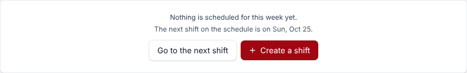

If you refresh the page, or send someone a copied link, it opens on the same
week or month you were looking at, not on today.

Four counts sit above the calendar: **Shifts on record (all dates)**,
**Shifts this week**, **Shifts this month** and **Department hours this
month**.

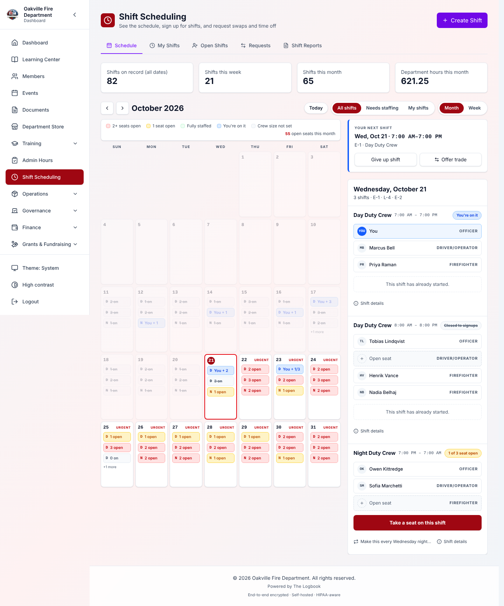

**The legend.** A row above the calendar says what each colour means, and how
many seats are open this week or month:

| Colour | Legend label          | Meaning                                         |
| ------ | --------------------- | ----------------------------------------------- |
| Red    | **2+ seats open**     | Two or more seats still to fill                 |
| Amber  | **1 seat open**       | One seat still to fill                          |
| Green  | **Fully staffed**     | Every seat is filled                            |
| Blue   | **You're on it**      | You are on this shift                           |
| Grey   | **Crew size not set** | Nobody said how many people this shift needs    |

The grey entry appears in the legend only when a grey shift is on screen.

**Filters.** Choose **All shifts**, **Needs staffing** or **My shifts**. A
filter dims the days that don't match. It does not hide them, so the month
keeps its shape. Past days are dimmed too.

**Opening a shift.** Select a day to see its shifts in the panel beside the
calendar. On a screen narrower than 1280 pixels, such as a tablet, the panel is
below the calendar so the days stay large enough to tap. Select **Shift
details** on a shift to open the full **Shift Details** window.

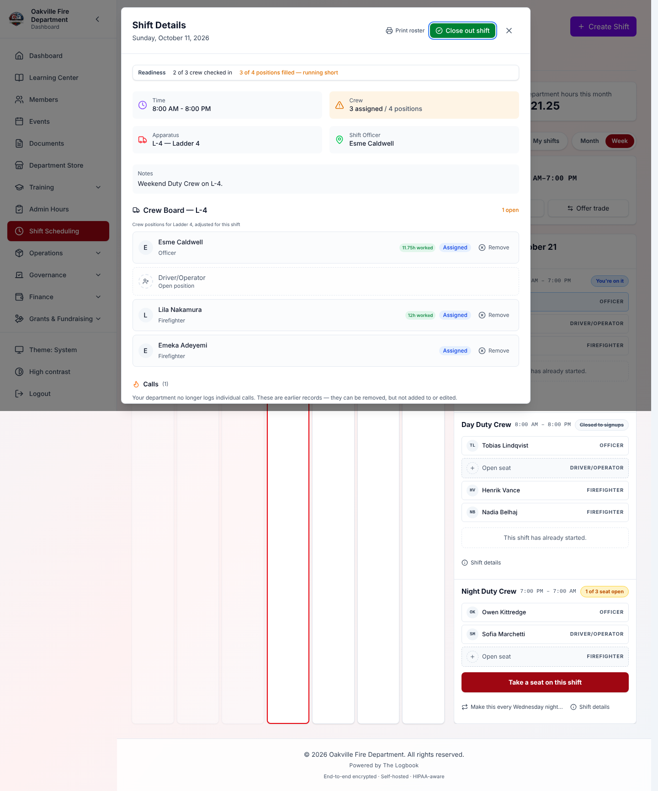

### The Shift Details window

Shift Details opens as a window in the middle of the screen. On a phone it
fills the screen. It scrolls inside itself. To close it, press **Escape** or
select the **X**.

If another window is open on top of it, such as the driver warning, Escape
closes only that top window. If you are editing a note on the shift, Escape
cancels the note first.

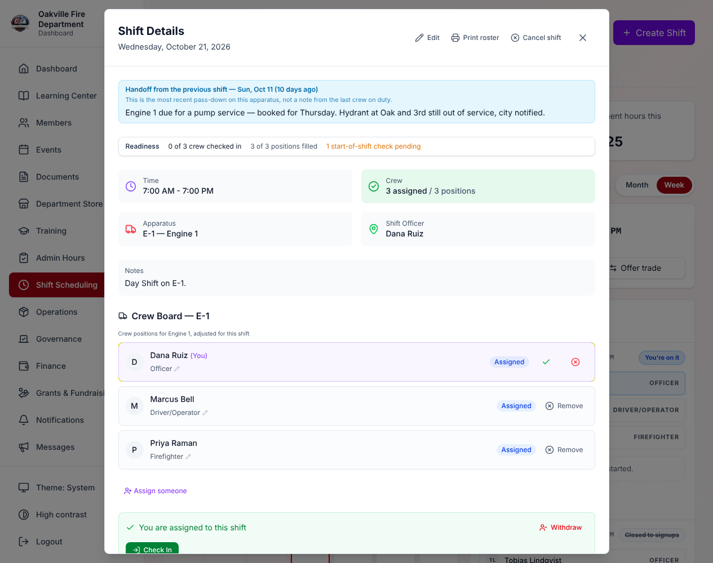

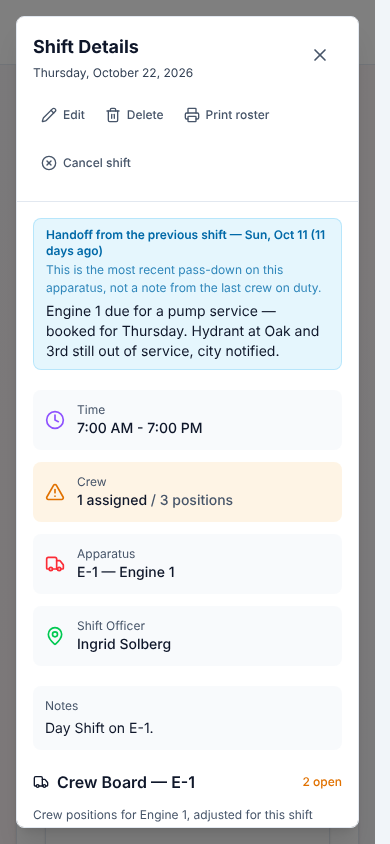

**The Readiness line.** On a shift that is running today, or has run and is
not yet finalized, a **Readiness** line at the top answers an officer's first
questions. For example: _"2 of 3 crew checked in · 3 of 4 positions filled —
running short · 1 start-of-shift check pending"_. Below it, the crew board is
headed by its apparatus, and each open seat is listed by its position.

**Seat names.** Every screen calls a seat by the same name. The EMT seat reads
**EMT** on the board, the phone day sheet, **My Shifts**, shift reports, the
printed roster and emails. A seat your department created shows the name your
administrator gave it.

### Past shifts lock

After a shift is over, its roster locks. You can't confirm, decline or
withdraw, and officers don't see **Remove** beside each name.

| Question                       | Answer                                                                                                                                                                                                     |
| ------------------------------ | ---------------------------------------------------------------------------------------------------------------------------------------------------------------------------------------------------------- |
| When does it lock?             | At the shift's **end time**, plus the grace period your department set for officers to add late members. An overnight crew keeps every control through the night                                         |
| What if the shift has no end time? | It is treated as running for 12 hours after it starts, then the grace period. If your department lets check-in stay open longer than 12 hours, that longer time is used, up to 72 hours            |
| What does it say?              | _"This shift ended too long ago to change its roster. A scheduling administrator can still correct it."_                                                                                                  |
| Who can still change it?       | Officers who can manage schedules. Fixing an old roster is record-keeping, and that is their job                                                                                                          |

The lock is enforced by The Logbook itself, not just hidden on screen.

> **What if the controls vanish while The Logbook is still loading?** Until
> your department's settings load, The Logbook keeps the controls showing. It
> does not guess and hide them.

**Reopening signup.** If a shift is short and someone can still get there, an
officer who can assign members (but does not manage schedules) sees **Signup
is closed for this shift** with **Reopen for 15 min**, **Reopen for 30 min**
and **Reopen for 60 min**. While it is open, the banner reads **Late signup is
open until** a time, with **Close it now**. These buttons disappear once the
roster locks.

---

## The Schedule Board and Standing Shifts

The **Schedule** tab is a board. It tells you whether each shift still needs
somebody, and lets you take the seat without leaving the page. For the phone
layout, see
[The schedule on a phone](./10-mobile-pwa.md#the-schedule-on-a-phone).

### Reading the month

Each shift carries a small label (a _chip_):

| Chip                  | Colour      | Meaning                                       |
| --------------------- | ----------- | --------------------------------------------- |
| `2 open`              | red / amber | Seats still to fill. Red means two or more    |
| `Full 4/4`            | green       | Fully staffed                                 |
| `You + 2/4`           | blue        | You are on it, with two others, out of four   |
| `3 on` (no ratio)     | **grey**    | **This shift never stated a crew size**       |
| `Cancelled`           | grey        | The shift is not happening                    |

A day with three or more open seats across its shifts is flagged as urgent.

**Grey means "nobody said how many".** The shift has no positions and no
minimum staffing set. You can still join it. It does not count toward open
seats or the urgent flag.

Select a day. The panel shows each crew and **one button that takes the first
open seat you are cleared for**. There is no position list to search.

- The button reads **Take a seat on this shift**.
- On a grey shift it reads **Join this shift**.
- When it works, you see **Seat claimed.**

When you can't take a seat, the panel tells you why instead of showing a
greyed-out button:

| Message                                                         | What it means / what to do                                   |
| --------------------------------------------------------------- | ------------------------------------------------------------ |
| **This crew is full. Nothing to claim here.**                   | Every seat is taken. Check again later                       |
| **You are not cleared for any seat on this shift.**             | None of its positions match your rank or qualifications      |
| **The open seats need a qualification you do not hold yet.**    | You could ride this shift once you earn that qualification   |

**Closed shifts.** Cancelled, finalized and past shifts read as closed and
have no claim button. The panel says **This shift was cancelled.**, **This
shift has been finalized.**, or why signup has closed, for example **This
shift has already started.** or **This shift has already run.** Their empty
seats don't count toward the day's open seats.

Every shift still has a **Shift details** link. Editing, attendance and
finalizing all happen in Shift Details.

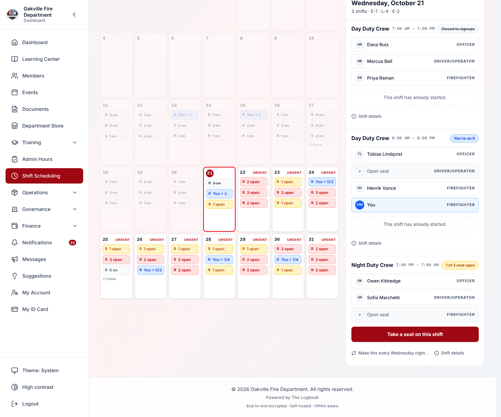

### Standing shifts

A _standing shift_ is a repeating claim on a seat, such as "every Tuesday
night". To start one, select a day, then **Make this every Tuesday night…**
(the words match the shift). The link appears only on a shift you could sign
up for.

1. Choose how often: **Every week**, **Every other week** or **Once a month**.
2. Choose the last date it covers. It starts one year out. You can pick from
   one week to one year ahead.
3. Check the preview. Each date reads **Will be claimed**, **Already yours**,
   **Skipped — you already hold a shift that day**, or **No shift scheduled
   that day yet**.
4. Select **Save this standing shift**.

How it behaves:

- **Giving up one date does not end the series.** The rest stay in place.
- **It works both ways.** It seats you on matching shifts already on the
  schedule. When officers create new shifts later, it seats you on those too.
- **It counts from the shift you started it on**, not from today. "Every
  other Tuesday" means every other one of _those_ Tuesdays.
- **It can cover dates nobody has scheduled yet.** That is what it is for.
- **It goes through the same checks as signing up by hand**: whether you are
  cleared, whether a seat is free, whether the shift is open, and whether the
  date has passed.

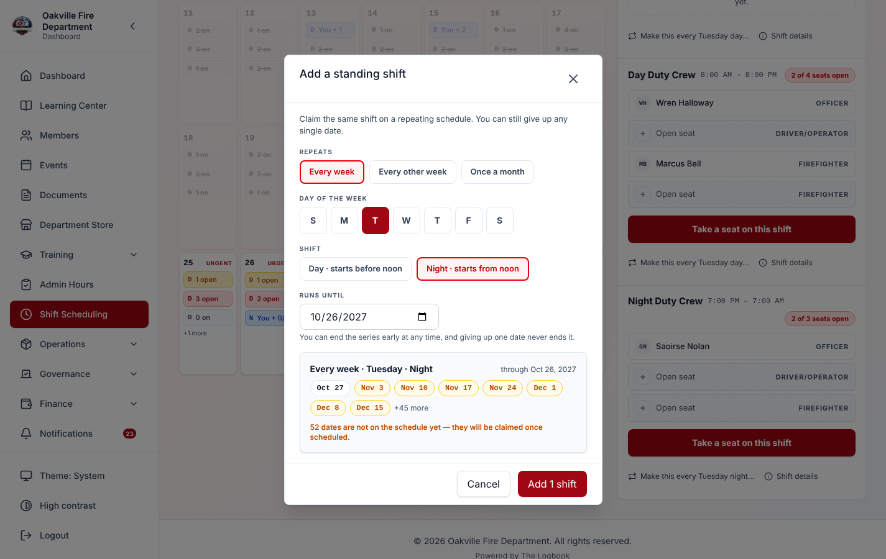

### Trades somebody can actually accept

When you give up a shift and pick someone to cover it, the list already leaves
out anyone who couldn't accept. That means anyone who is already on the shift,
on approved leave, not cleared for the position, or working a shift that runs
right up against this one. The least busy members are listed first.
On a shift that is open to all members, every current member is considered,
not only those in the seat's position _(2026-10-24)_.

- **The member you offer a seat to can accept it.** A duty officer can also
  approve the offer, which hands the seat to that member. On the **Requests**
  tab it reads "→ Offered to _name_".
- **An exchange needs both of you qualified.** On **My Shifts**, **Swap →
  Exchange With a Member** lists only seats you are qualified for, held by
  members qualified for yours. A driver can trade with another driver seat,
  but not with a firefighter who isn't cleared to drive. Giving your shift away
  without taking one back is not an exchange, so this limit doesn't apply.
- An exchange is refused when you submit it if it names a seat the other
  member doesn't hold, or a training seat. If nothing qualifies, the list says
  _"No upcoming seat you could exchange for. Both members must be qualified
  for the seat they would take."_
- **Qualification is checked again at approval.** If one of you stopped being
  qualified while the request waited, the officer's approval is refused with
  the reason. The **Requests** tab then asks _"Approve without
  qualification?"_ with **Approve anyway** and **Keep it pending**. Approving
  anyway seats the member. It skips only the position check, and the override
  is noted on the request and in the audit log. Exchange cards name the other
  member.

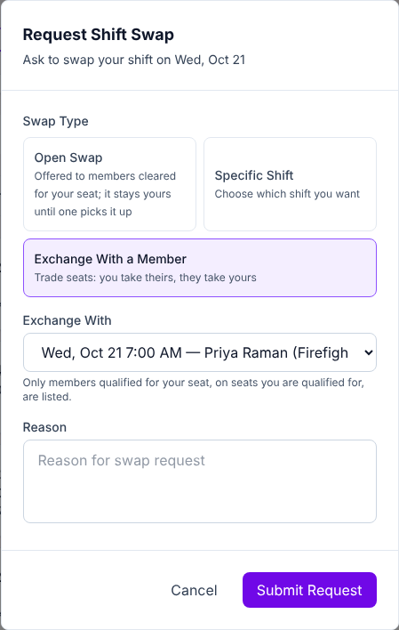

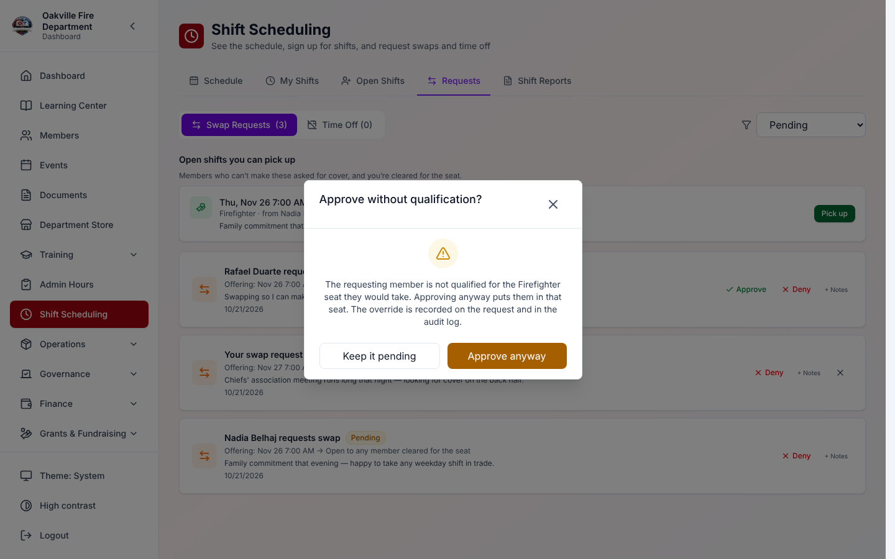

- **A request ends when its seat does.** If you leave a shift for any reason
  (you withdraw or decline, take approved time off, go on leave, or an officer
  removes or moves you), any pending swap or offer for that seat is cancelled.
  You and the member it was offered to are both told.
- **You can't give up a seat while your own offer of it stands.** Select
  **Withdraw the offer** first. Otherwise the first member would hold an offer
  that can't be kept.
- **A pending offer keeps you on the shift.** You stay on the roster, and
  nobody else can claim the seat, until the member accepts or the offer
  closes. **An offer nobody accepts closes the day before the shift.** Both
  members and the duty officer are told.
- **A training seat can't be traded.** It carries the trainee's program and
  evaluating officer, so moving only the member would file one person's
  training against another.
- Approved time off is checked again when the member accepts, not only when
  the list was made.

### Seat limits and who may sit where

**Named seats are a hard limit for everyone.** If a shift lists its positions,
each position has a set number of seats. Nobody can fill a seat that is
already taken, whether they sign up or an officer assigns them.

**A headcount limit applies only to members.** If a shift has no named
positions, only a minimum staffing number, members can't sign up past that
number. An officer can still add an extra person on purpose.

**Position rules apply to officers too.** If your department has set which
ranks may fill a position, that rule also applies when an officer assigns
somebody. The refusal names the missing qualification.

Officers who manage schedules can still add people to a past or closed shift
to correct records. The position rules still apply, because being cleared for
a seat is a safety question that doesn't go away when the shift ends.

### On the dashboard

Officers who can manage schedules see seven staffing tiles on the dashboard's
**My Department** tab when Scheduling is turned on: Today's Staffing, Future
Coverage Gaps, Open Slots, Pending Changes, Incomplete Closeouts, Workload
Balance and Special Operations. Each opens the schedule already filtered to
what it counted. Each tile remembers its own time range and filters, for each
person.

---

## My Shifts

The **My Shifts** tab shows only your own shifts. It has three views:
**Upcoming**, **Past** and **Hours**.

For each shift you see:

- the date and time;
- the shift and its apparatus;
- your status: **Assigned** (waiting for you to confirm), **Confirmed** or
  **Declined**; and
- whether you have checked in.

**Confirming a shift.** When you are put on a shift, it shows as **Assigned**.
Select **Confirm** to say you will be there, or **Decline** if you can't.
If more than one shift is waiting, a bar at the top lets you select them all
and use **Confirm All** or **Decline All**.

From here you can also **Swap** a shift or **Request Time Off**. See
[Shift Swap Requests](#shift-swap-requests) and
[Time-Off Requests](#time-off-requests).

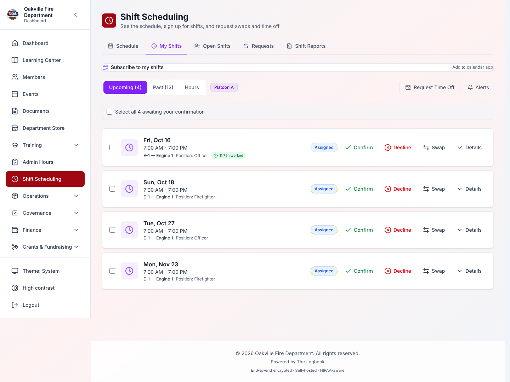

### Your hours and calls for the year

Select **Hours** to see your own totals. You don't need any special
permission. It shows only your own record.

- **Three cards:** **This month**, **This year** and **All time**. If you
  pick another year, the middle card is titled with that year.
- **A table** below lists every month of the chosen year: **Shifts**,
  **Hours**, **Calls**, and a **vs. busiest month** bar.
- **Hours count once an officer finalizes the shift.** This matches the
  department's own report, so your number and your officer's number agree.
- **Hours on shifts not yet closed out** show on their own line, for example
  _"6 more hours are logged on shifts your officer has not closed out yet."_
  They are never added into your total, so your total never drops without a
  reason.
- **No Calls column** appears if your department does not track calls.
- **Shifts with other departments** show beside your totals as "+N hrs with
  other departments". See
  [Shifts with Other Departments](#shifts-with-other-departments).

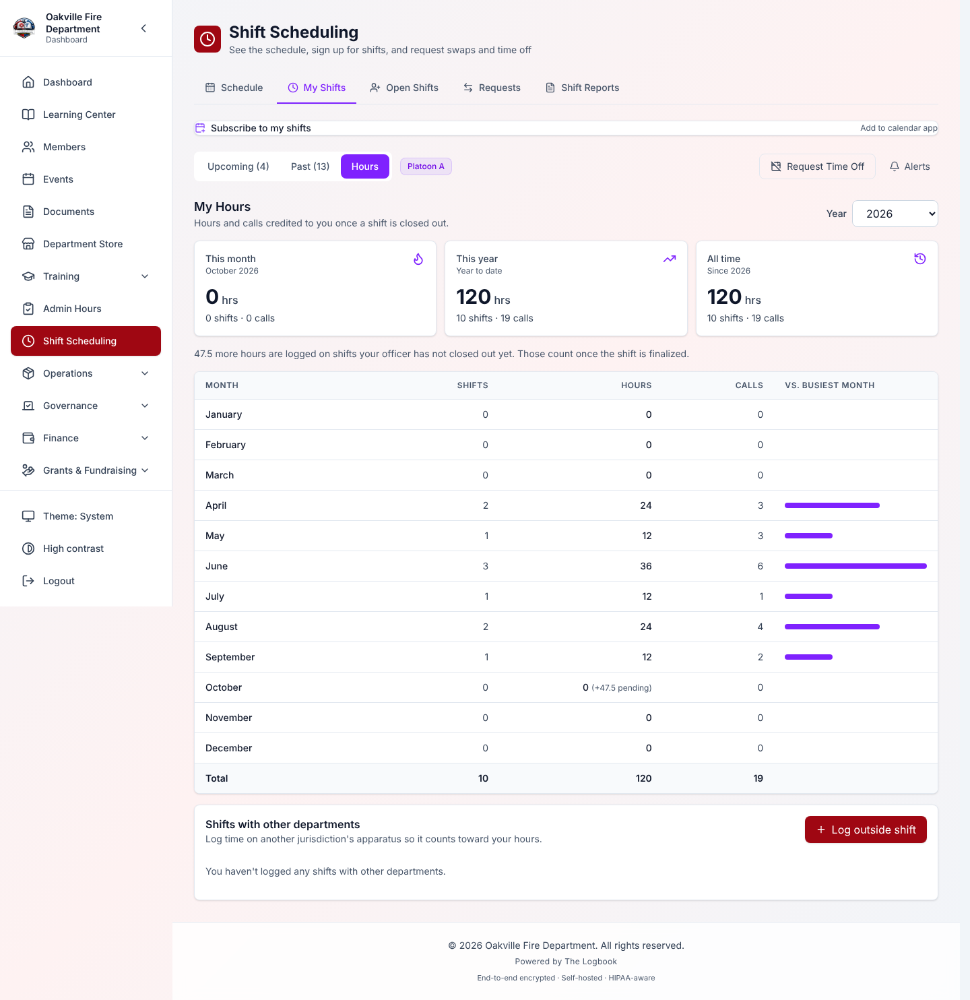

### Your shifts on the dashboard

The dashboard's **Next 30 Days** list shows your own shifts (marked **Yours**),
open shifts you can sign up for, and upcoming events. A line at the bottom
says how many more lie beyond 30 days. **All Shifts** opens the schedule on
the month view.

Shifts you declined, and shifts that were cancelled, don't appear. The
dashboard doesn't show whether you have confirmed a shift yet. Check **My
Shifts** for that.

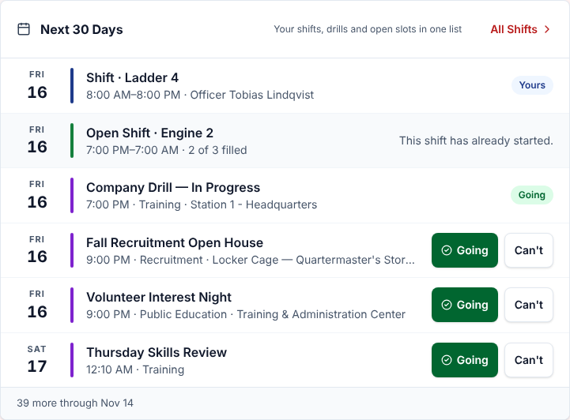

---

## Open Shifts

The **Open Shifts** tab lists shifts that still need people. The top of the
tab says: _"Shifts with open seats. Sign up for one and it goes straight onto
your schedule."_

1. Use **From** to pick a start date. The list shows the next 30 days from
   that date.
2. Select **Sign Up** on a shift.
3. Choose the **Position**, then select **Confirm Sign Up**.

You see **Signed up for shift**, and the shift appears on **My Shifts**,
where you can confirm it.

**There is no officer approval step.** Your signup goes on the roster exactly
as if an officer had assigned you, and it is saved as **confirmed** straight away
(_2026-10-18_), as the tab promises. An officer's assignment, or a standing
claim, still waits for the member to confirm. You leave a shift you signed up for the
same way as one you were assigned to.

If you sign up for a driver's seat without the driver training the apparatus
needs, or the shift puts you over your hours, you may see a warning after you
sign up.

**Signing up again after you declined.** If you declined a shift, or lost the
seat because it was cancelled or because of approved time off, you can sign up
for it again.

_(2026-10-18)_ A shift that has already ended no longer appears on the board, for
anyone, including scheduling officers (before, a shift dated today stayed listed
after its end time, with a live **Sign Up** button for an officer).

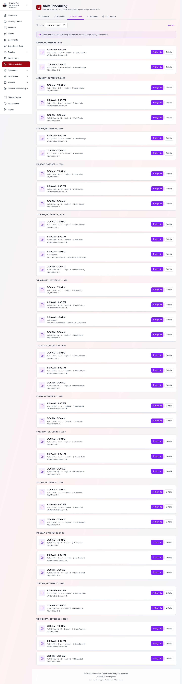

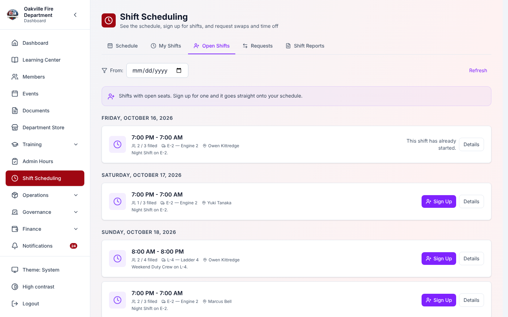

> **Tip.** Open shifts are a good way to pick up extra hours toward
> shift-based training requirements.

### What the board lists, and what it leaves out

**A shift appears on your list only when one of its free seats is a position
you are cleared for.** Shifts you are already on are left out too. For
example, a shift that still needs a driver, where every firefighter seat is
taken, does not appear for a firefighter. Signing up would be refused.

- **The position list offers only seats you can actually get.**
- **Two different messages** tell you why you can't sign up:

| Message                                                                                                                                      | What to do                                                    |
| -------------------------------------------------------------------------------------------------------------------------------------------- | ------------------------------------------------------------- |
| _"Every seat you are cleared for on this shift has been filled. Other positions may still be open, but not ones you are qualified to ride."_ | Come back later. A seat may free up                           |
| _"You are not eligible to sign up for this shift. Ask a scheduling admin if you think that is wrong."_                                       | Talk to an officer about your qualifications or rank          |

**Officers who can manage schedules see every short-staffed shift instead.**
This tab is also where they look for staffing gaps. So if an officer and a
member compare lists and see different shifts, that is why.

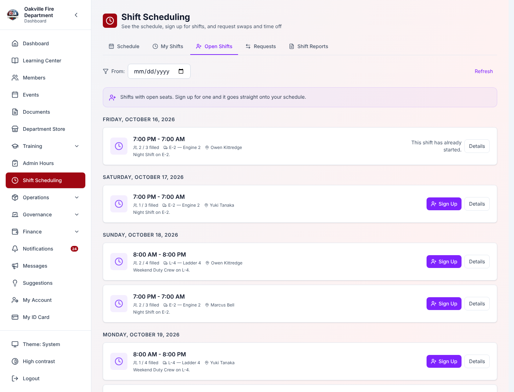

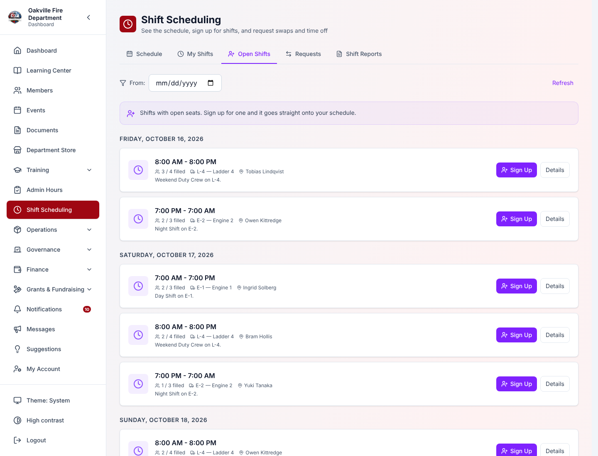

> **What if signup has closed?** You see why, for example _"Signup for this
> shift has closed."_, followed by _"Ask a duty officer to add you."_

---

## Shifts with Other Departments

If you ride a neighbouring department's apparatus, you can log that time so
it counts toward your hours.

**Where:** **My Shifts → Hours**, in the **Shifts with other departments**
card (_"Log time on another jurisdiction's apparatus so it counts toward your
hours."_). Select **Log outside shift**.

1. Enter the **Start** and **End**. **+12 hours** and **+24 hours** set the
   end from the start, for standard shifts. If you move the start, the end
   moves with it. The form shows what the entry **Counts as** in hours.
2. Choose the **Department**, then the **Apparatus**. Both come from a list
   your scheduling officers keep. If yours is missing, the form says: _"Don't
   see it? Ask a scheduling officer to add it under Scheduling → Settings →
   Outside Apparatus."_
3. If you like, add a **Position** (for example, Driver) and **Notes**. Then
   select **Log shift**.

**The rules:**

- A shift can't start in the future.
- It must end after it starts.
- One entry covers at most 48 hours. The form says to _"log a longer stretch
  as the shifts it was"_.
- A night shift counts on the day it **began**, by your department's
  calendar.

**It counts as soon as you save it.** There is no approval step. You can edit
or delete your own entry. If an officer decides an entry should not count,
they reject it with a reason. It then reads **Not counted**, with the reason
below it, and you can no longer change it. An officer can restore it.

> **What if an old entry has only a date and hours?** Some entries were logged
> that way. They open with _"This shift was logged as a date and hours,
> without its start and end times."_ Select **Enter start and end times
> instead** to add the times.

**Where it shows up.** Outside hours appear **beside** your own department's
figures, not inside them:

- "+N hrs with other departments" on your **Hours** view;
- an **Outside Hours** column on the Member Hours report.

The Shift Compliance report **does** add them into each member's shift and
hour totals.

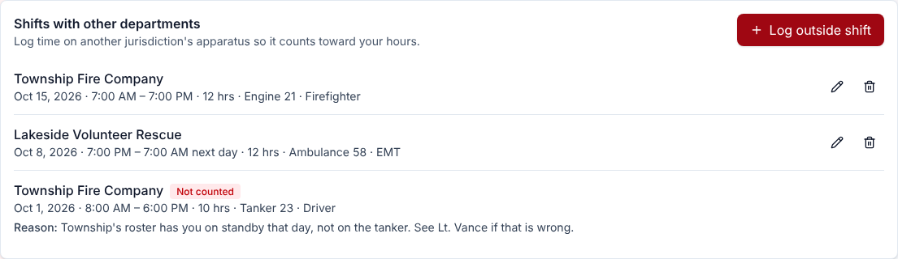

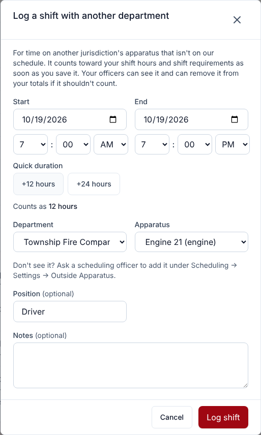

### For scheduling officers: the list and the review

You need to be able to manage schedules for both of these.

- **The list.** Go to **Scheduling Admin → Settings → Outside Apparatus**.
  Select **Add a department**, then add its units. Members can pick only an
  active unit of an active department. Turn an entry off to hide it from
  members. An entry that shifts have been logged on can't be deleted: _"Shifts
  have been logged on it, so it stays on record. Turn it off to hide it from
  members instead."_ Each logged shift keeps the names it was logged under, so
  renaming an entry never changes past records.
- **The review.** **Scheduling Reports → Member Hours** has two sections under
  the table. **Outside apparatus staffed** shows shifts, hours and members per
  unit for the period. **Shifts with other departments** lists every entry,
  with a **Show** filter (All / Counted / Not counted) and **Reject** (with a
  reason) or **Restore**. Officers who can only view reports see the list but
  can't reject or restore.

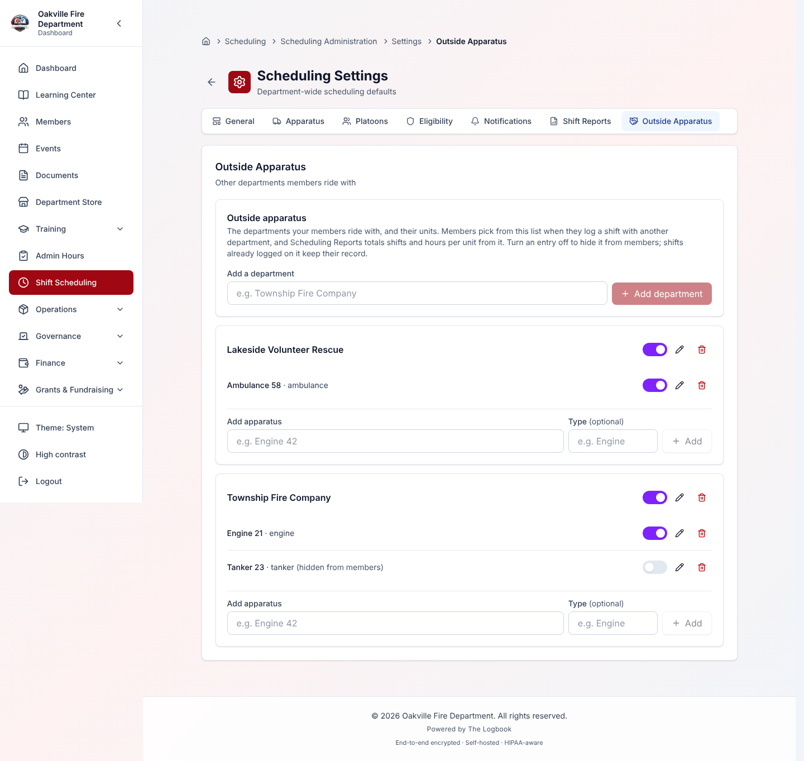

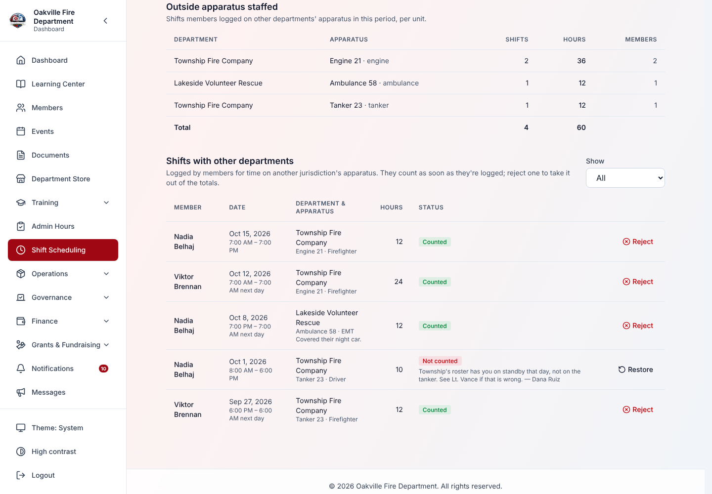

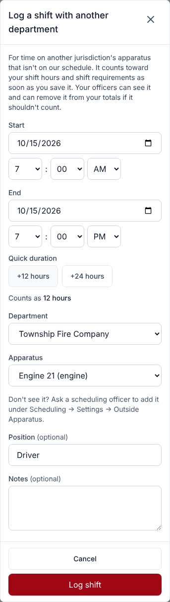

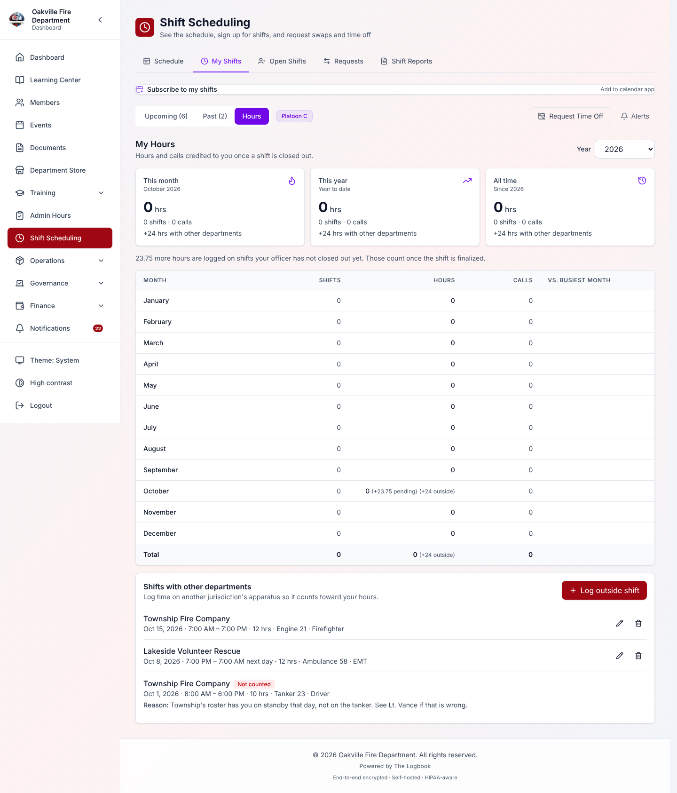

---

## Shift Assignments

**Who can do this:** officers whose position includes **Assign members to
shifts**, and the shift officer named on that shift. **Manage schedules** alone
does not let you assign anyone, and the buttons below are not shown to you.

1. On the calendar, open the shift's **Shift details**.
2. On an open seat in the crew board, select **Assign someone** (on a narrow
   screen it just says **Assign**). On a shift with no named seats, the
   button is beside **Crew Roster**.
3. The form asks for the **Position** first. It starts on the seat you
   selected. Open seats are marked "(open)".
4. Find the member. Type in **Search members...** to narrow a long list.
5. Select **Assign**.

On a shift with more than one open seat, **Fill All Open** lets you fill them
in one go.

The member is notified and can confirm or decline.

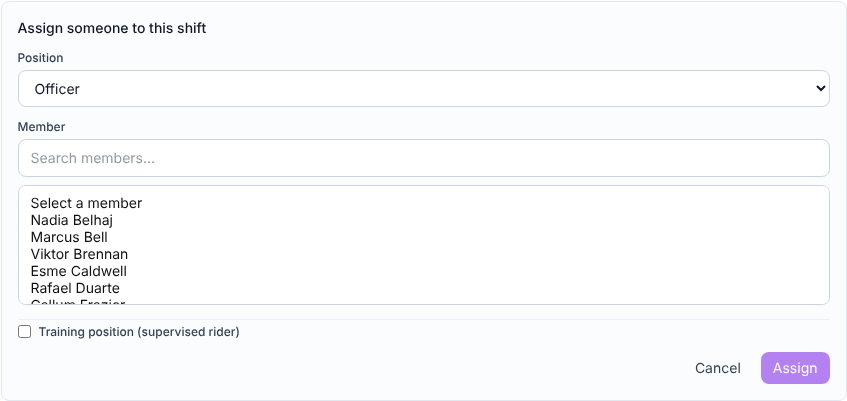

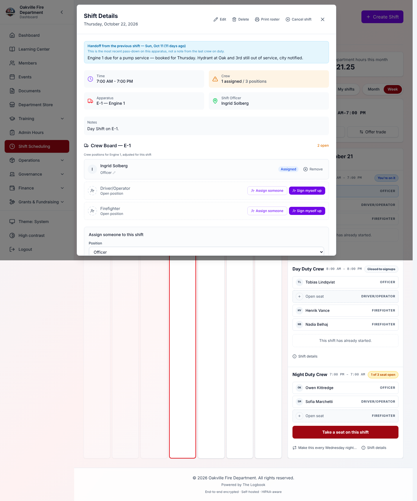

**Who appears in the member list.** The list leaves out members who can't work
the shift at all, for example because they are on leave or already on a
shift at the same time. It does not filter by qualification. If the member
isn't cleared for that position under your department's rules, the
assignment is refused and the message names what is missing.

**Drivers and EVOC.** An apparatus can require a level of Emergency Vehicle
Operations Course ([EVOC](./GLOSSARY.md)) training for its driver. If you put
someone in the driver's seat without it:

| Your department's setting                | What happens                                                                                                                                                               |
| ---------------------------------------- | -------------------------------------------------------------------------------------------------------------------------------------------------------------------------- |
| **Enforce EVOC for drivers** on (the usual setting) | The assignment is refused. A window explains what is missing, names who can approve an exception, and lets you request one for that member, unit and date |
| A chief has approved an exception        | The assignment goes through, with a warning showing the exception's end date and any restrictions                                                                         |
| **Enforce EVOC for drivers** off         | The assignment goes through, with a warning afterwards                                                                                                                    |

You may also see a warning if the assignment puts the member over their hours.
Warnings don't stop the assignment.

> **What if the member is on leave or off?** The assignment is refused with
> _"Member is on leave of absence for this date"_ or _"Member has approved
> time off for this date"_. See
> [Membership > Leave of Absence](./01-membership.md#leave-of-absence).

**Changing a member's position.** You can change a member's position (for
example, Officer, Driver or Firefighter) right on their row in the crew
board.

**Editing a shift.** Officers who can manage schedules can select **Edit** at
the top of Shift Details. You can change the date, start and end times,
apparatus, minimum staffing, colour, notes, shift officer and positions. Edit
is offered only on a shift that is today or later and is not finalized or
cancelled.

---

## Printing Station Documents

Two things crews read on paper can be printed on a **receipt printer** at the
watch desk: the **shift roster** and an **apparatus check sheet**. Both use a
receipt printer added under **Organization Settings → Label Printers**. See
[Direct printing to a network label printer](./05-inventory.md#direct-printing-to-a-network-label-printer)
for how to add one.

**The print buttons appear only once a receipt printer is added.** A
department with only a label printer doesn't see them at all.

### Shift roster

**Who can do this:** anyone whose position includes **View schedules** or
**Manage schedules**.

Open a shift and select **Print roster**. The sheet shows:

- the date, hours, apparatus and platoon;
- the shift officer;
- the crew, **officers first**, then the driver. A roster is read at shift
  change to find out who is in charge, so that name is at the top;
- the crew count against minimum staffing, so a short crew is easy to spot;
- any shift notes; and
- the pass-down notes from the outgoing crew, **but only for people allowed to
  read them**: officers who can manage schedules, the shift officer, and
  members on the shift. Everyone else gets the roster without that section.

**Who is left off.** Anyone who declined, was cancelled or was marked a
no-show is **not** printed. The oncoming crew should not look for someone who
isn't coming.

**Who is marked.** A seat nobody has confirmed is printed and marked
**(unconfirmed)**. That is the difference between a crew of four and a crew of
three. Training seats are marked too.

Times print in your department's time zone. On a narrow roll, a long seat name
is shortened. A name like "Driver/Operator" keeps only the part before the
slash.

### Apparatus check sheet

**Who can do this:** anyone who can open the checklist template on screen.
That means positions with any of **View equipment check templates and
results**, **Submit equipment checks on shifts** or **Create and edit
equipment check templates**. A member who can only submit checks gets the
checklists for the positions they check, just as on screen.

On **Equipment Check Templates**, select the printer icon on a template. The
sheet is the checklist to carry round the truck:

- one section per compartment, in the template's order;
- a container inside a compartment (a bag inside a cabinet) stays **under the
  same heading, indented**. It is a place inside the compartment already open,
  not a new trip round the truck;
- a tick box for every item, a `*` on required ones, and a short note of what
  "correct" looks like, such as `qty 6` or `min 4500psi`; and
- a line at the bottom to sign and date, because an unsigned sheet proves
  nothing.

### Before it prints

Both buttons show a **preview** first. It is laid out exactly as the printer
receives it. The preview is 48 characters wide, which fits an 80 mm roll. A
58 mm roll fits 32 characters, so lines wrap differently on narrow paper.
Select **Print** to send it.

After printing, The Logbook asks the printer how it is. You see **Sent to**
_printer name_. If the printer has a problem, such as **Out of paper**, a
second message names the problem. Check the printer before you assume the
sheet came out.

---

## Shift Notifications

Shift notifications in your **Notifications** inbox open and close like cards.

- **Pinned notifications come first.**
- **A closed card** shows only the subject, one line of the message, the time,
  and a pin marker if it is pinned. Open a card to act on it.
- **An open card** ends with a button for where the notification leads, then
  **Pin** (or **Unpin**).
- **A notification is marked read** when you close it after opening it, or
  when you select one of its buttons. Opening it alone does not mark it read,
  so a quick look doesn't lose it.
- **A notification with no link** has no buttons.

| Notification            | Buttons on the open card                                                                                       |
| ----------------------- | -------------------------------------------------------------------------------------------------------------- |
| Shift assignment        | **View Shift**, which opens the schedule with that shift's Shift Details showing                               |
| Shift reminder          | **View Shift**. During the start-of-shift checklist window, also **Start Checklist**                           |
| After-shift follow-up   | **View Shift**, **Start Checklist** if the checklist window is open, and **File Report**                       |
| Swap request            | **Review Swap**                                                                                                |

A shift reminder carries the shift's full briefing: your crew by position, the
apparatus, and the start-of-shift checklists assigned to it, or a line saying
_"No equipment checklists are assigned for this shift."_

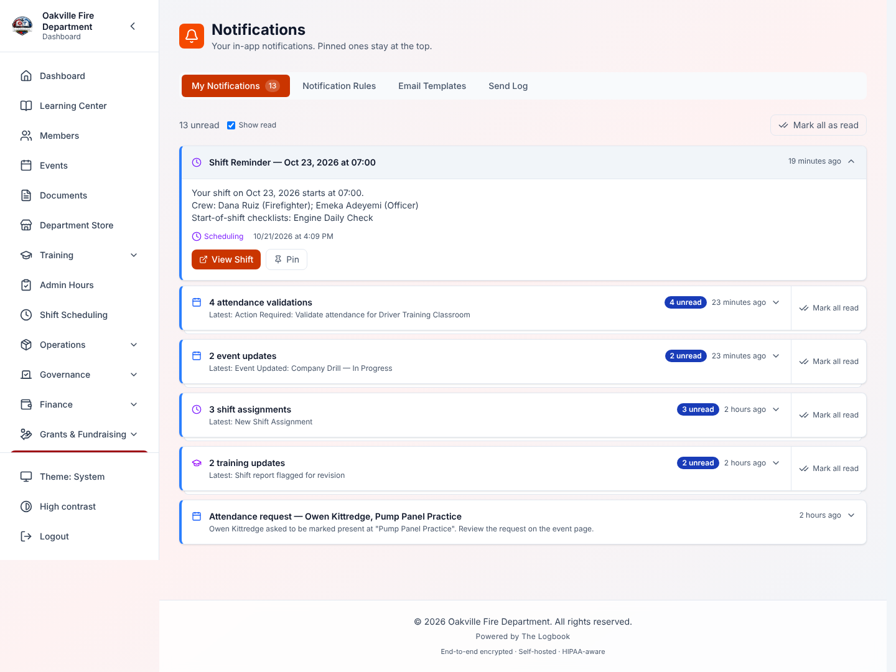

> **What if a shift link doesn't open the shift?** The schedule says _"That
> shift could not be opened. The full schedule is shown below instead."_
> Select **Retry** to try again, or **Dismiss** to close the notice.

## Attendance Tracking

The Logbook records who was on each shift and for how long. Members check
themselves in and out. Nobody can check in or out for someone else.

**To check in and out from the shift:**

1. Open the shift from the calendar.
2. Under your own assignment, select **Check In**.
3. The button changes to **Check Out**, with "Checked in at" and your arrival
   time beside it.
4. At the end of the shift, select **Check Out**. The panel then shows the
   hours recorded.

The Logbook works out the time between the two for you.

**To check in from the apparatus QR code:** scan the code on the apparatus.
It opens **Shift Check-In** for the shift that apparatus is running, with the
same **Check In** and **Check Out** buttons.

### Where attendance shows up

You cannot edit attendance in any of these places. They only show it.

| Where                                         | What it shows                                                                                                                                                 |
| --------------------------------------------- | ------------------------------------------------------------------------------------------------------------------------------------------------------------- |
| The **crew board**, on each member's row      | A badge: **In** and the arrival time while they are on shift, then **12h worked** (for example) once they are out. Point at the badge to see both times        |
| The **Readiness** line at the top of the panel | For example, **1 of 1 crew checked in**. It appears once the shift has started, or as soon as someone checks in                                               |
| The close-out checklist                       | For example, **1 of 1 checked in, 1 checked out**, plus a warning if anyone never checked in (pictured under [Shift Finalization](#shift-finalization)) |

### Checking out early

A check-out cannot be undone. You cannot check back in to the same shift.

So on the **Shift Check-In** page, if you select **Check Out** before the
shift's scheduled end, The Logbook asks first:

- Title: **"Check out early?"**
- Message: "Your shift runs until _time_. Checking out now records your hours
  up to now, and you cannot check back in to this shift."
- Buttons: **Stay checked in** and **Check out now**.

At or after the scheduled end, it checks you out without asking.

> **Important.** **Check Out** under your assignment on the shift panel does
> **not** ask first. One tap there ends your shift for good. If you check out
> by mistake, ask an officer to fix your hours.

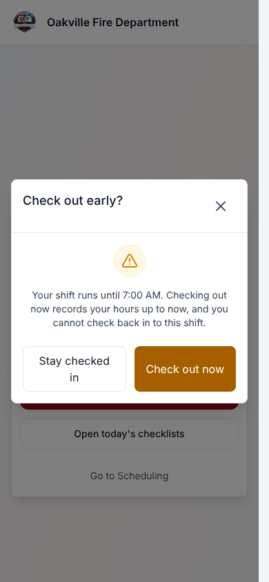

> **What if I forget to check out?** Anyone still checked in is checked out
> automatically at the shift's end time. The close-out checklist warns the
> officer about this.

> **What if I never checked in?** The officer closing out the shift sees
> **Add hours for members who didn't check in**. They enter a number of hours
> for you (up to 48), not exact times.

> **What if Check In is greyed out?** Check-in only opens around the shift's
> times. The reason shows under the button. If the shift ended too long ago,
> ask an officer to record your attendance.

### Post-Shift Validation

After a shift ends, its shift officer gets a notification asking them to check
the attendance and times. This makes sure the records are right before they
are used for compliance reports.

- It goes only to a shift that has a named shift officer.
- It is not sent for a cancelled shift, or one already closed out.
- By default it is sent within 2 hours of the shift ending.
- Administrators can turn it off, or change the window, under **Administration
  → Scheduling Admin → Shift Report Options** (**Enable post-shift
  validation** and **Validation window (hours after shift end)**).
- The email copy is part of the **Scheduling officer duties** kind of email.
  An officer can switch that email off and still get the in-app notice, unless
  the department has made it required.

---

## Call Logging

During a shift, officers can log each call the crew ran. The **Calls** section
is on the shift detail panel.

**Who can log calls:** officers who can manage schedules, and the shift's own
shift officer.

1. Open the shift from the calendar.
2. Scroll to the **Calls** section. A number beside the heading shows how many
   calls are logged.
3. Select **Log Call** to open the form.
4. Fill in the call:
   - **Incident Type** _(required)_. Pick it from your department's call
     types. These are set under
     [Name your own call types](#name-your-own-call-types).
   - **Incident #** _(optional)_. Your dispatch or run number.
   - **Dispatched** and **Cleared** _(optional)_. Enter them in your local
     time.
   - **Cancelled en route** and **Medical refusal**. Tick either if it
     applies.
   - **Notes** _(optional)_.
5. Select **Save Call**.

The call appears as a card. It shows the type and number, any badges (amber
**Cancelled en route**, blue **Refusal**), the dispatched and cleared times,
and the notes. Use the pencil to edit a call and the bin to remove it.

A call logged before the picker existed keeps its own wording when you edit
it.

Calls logged on a shift count toward **call-based training requirements** for
the members on it.

> **Important.** Once a shift is **finalized**, the Calls section is
> read-only. **Log Call**, edit and remove all disappear. Log calls before you
> finalize the shift.

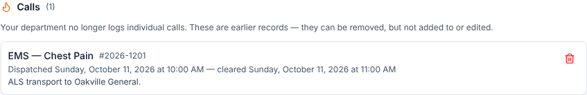


> **This is the department default.** You can only log calls while **How calls
> are recorded** is set to **Log individual calls**. On either other setting
> there is no **Log Call** button. Calls already logged are kept. They still
> show, with a note, and can still be removed, but not added to or edited. A
> shift with no calls on record shows no Calls section at all. See
> [Counting Calls Without an RMS](#counting-calls-without-an-rms) below.

### Counting Calls Without an RMS

Many departments have no records management system (RMS) for incident
reports. They still need to answer _"how many calls did we run last year, and
what did each apparatus go on?"_ That number is needed for grant applications,
Insurance Services Office ([ISO](./GLOSSARY.md#abbreviations)) ratings,
apparatus replacement, and budget hearings.

**Record a call count at close-out** is for that department. The officer
enters a number when closing out the shift. Nothing else is collected.

#### Turning it on

Go to **Administration → Scheduling Admin → General → Shift close-out rules →
How calls are recorded**. Then choose **Record a call count at close-out**.

There are three choices:

| Choice                               | What officers get                                                                                     |
| ------------------------------------ | ----------------------------------------------------------------------------------------------------- |
| **Log individual calls** _(default)_ | The Calls section on the shift panel. Each call has a type, incident number, times and notes          |
| **Record a call count at close-out** | The three-step close-out wizard asks for a number, with an optional breakdown by type. No call log    |
| **Don't track calls**                | No call log and no close-out question. For a department that records calls in an RMS, or runs none   |

Switching never deletes anything. Calls already recorded stay visible and can
still be removed. Your call types are kept, even through **Don't track
calls**.

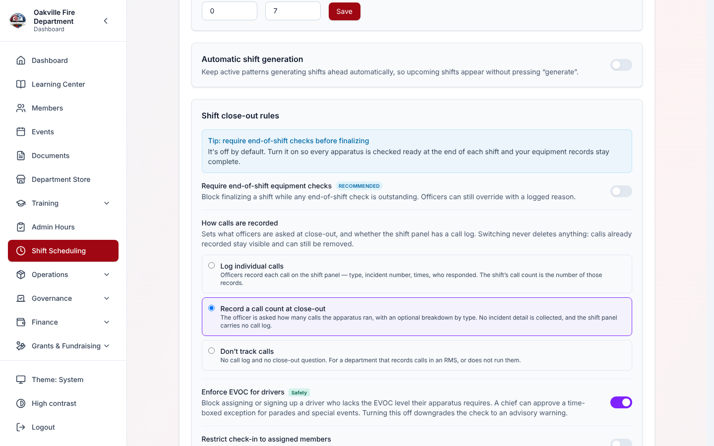

The change applies at once in **your own** browser. **Tell your officers
before you switch.** It changes what they see at close-out: the usual
checklist is replaced by a three-step wizard.

> **Important: anyone already signed in must reload the page.** The Logbook
> loads these settings once, when the page opens. An officer who had it open
> when you switched still sees the old checklist. The old checklist never asks
> for a call count. A shift closed out from that old page is finalized with
> **no calls recorded**, and nothing warns you. Switch at a shift change, or
> tell everyone on duty to refresh.

If your department never touches this setting, it keeps logging individual
calls as before.

#### What is recorded, and what is not

Recorded: the **date**, an optional **call type** from your own list, and
**which units responded**.

Not recorded, and there is nowhere to record it:

- no address or cross streets;
- no patient, caller or complainant names;
- no narrative;
- no dispatch, on-scene or clear times; and
- no dispatch incident number that anyone can read on screen.

This is on purpose. Those are the details that turn a call record into
protected health information ([PHI](./GLOSSARY.md#abbreviations)). A
department that wants full incident records needs a proper incident system,
with its own access controls.

**The date is only a date, not a time.** A time would let someone work out
response times, which is the first step back to an incident record.

#### Call types

Nine types come ready to use: Fire, EMS, Motor Vehicle Accident, Rescue,
Hazmat, Service Call, Alarm / Good Intent, Mutual Aid, and Other. You can
change them to suit your department. See
[Name your own call types](#name-your-own-call-types).

#### The three numbers, and why they will not add up

This causes arguments in budget meetings. Get it straight before anyone
quotes a figure.

| Number                     | What it counts                                         | Where you see it                                 |
| -------------------------- | ------------------------------------------------------ | ------------------------------------------------ |
| **Department call volume** | One call is one call, however many units went on it    | **Reports → Incident / Call Volume**             |
| **Apparatus runs**         | One per unit, per call                                 | The same report, under **Runs by Unit**          |
| **Member credit**          | Calls each member was actually on                      | The member's own hours and training credit       |

A 400-call department can truly show **380 engine runs and 240 medic runs**.
Those do not add up to 400, and they should not. Both units went on the same
car crash. It was one call for the department and one run for each unit.

Member credit is different again. A member who came on at 0300 was not on the
2200 call.

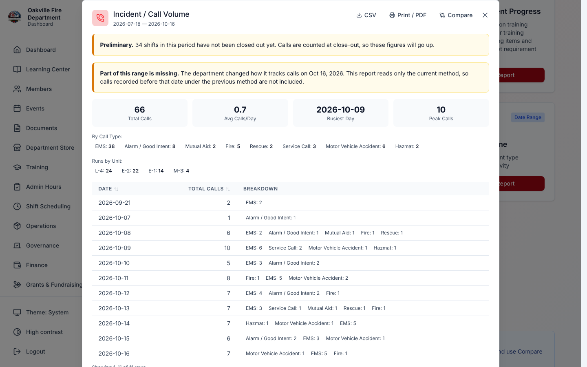

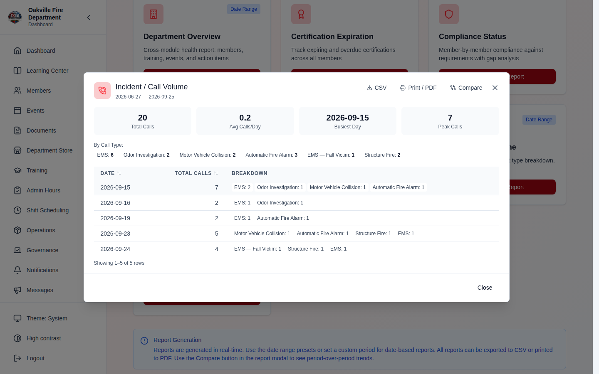

In count-only mode the report cards read **Total Calls**, **Avg Calls/Day**
and **Peak Calls**. When you log individual calls, they read **Member-Reported
Calls**, **Avg Member-Reported/Day** and **Peak Member-Reported** instead (see
below for why). The CSV export uses the same names.

#### The count is only as good as the ticks

In count-only mode, **Total Calls** counts each incident once. That works
because the second unit on an incident ticks the first unit's call at
close-out, instead of counting its own (see
[Claiming a call another unit logged](#claiming-a-call-another-unit-logged)).

So it depends on the closing officer ticking it. If a second unit types the
car crash into its own count, instead of ticking the one Medic 1 already
logged, the department total counts it twice. Nothing can catch this later.
The two calls have no details to match on, on purpose. Before you put a
figure in a grant application, ask the officers whether they ticked shared
calls.

> **What if my date range spans a change of setting?** The report uses your
> department's **current** setting for the whole range. It does not switch
> part-way. A department now on close-out counts sees **nothing** from its
> earlier months of logged calls, and the other way round. From 2026-10-11,
> The Logbook records the date of every change of setting. If your range
> starts before that date, the report opens with **Part of this range is
> missing** and names the date. A change made before 2026-10-11 was never
> dated, so it gets no warning: the number is just smaller. Either way, run
> each period separately.

> **Is "Member-Reported Calls" an incident count?** No. When you log
> individual calls, the report adds up the call counts on **shift reports**.
> Those are filed per member, so a shift two members reported counts its calls
> twice. Reports filed by hand are added as well. That is why it is not called
> Total Calls, and why a note sits under the cards. Neither mode gives a number
> you can hand to a funder without explaining how it was worked out.

#### Claiming a call another unit logged

Step 2 of the close-out wizard asks, for example, **How many calls did
Engine 5 run?** If another unit recorded a call while your shift was on, it
starts with a list called **Already logged by another unit**. Each line shows
the unit, the call type and the date, such as **Medic 1 · EMS · Aug 19**.

- **Tick any call your unit was also on.** The department counts it once, and
  your unit gets the run. The tick adds to your total straight away.
- **Do not type it into the rows below as well.** The rows are only for calls
  your unit logged itself. A ticked call keeps the type the other unit gave it.
- **Untick to take it back.** When you save, your unit is removed from the
  call. It stays on the other unit's record.
- A call only your unit was on is not in the list. Lower your count instead.

If you do not split your calls by type, enter them all under
**Not categorised**.

The list matches on when the shifts ran, not on the date of the call. So a
medic who came on at midnight still sees a 0300 call that a 24-hour engine
crew dated the day before. The list is not shown after a shift is closed out.
Reopen the shift to change what it claims.

#### Name your own call types

Go to **Administration → Scheduling Admin → General → Call types**. There you
can rename, reorder, add, retire and delete types.

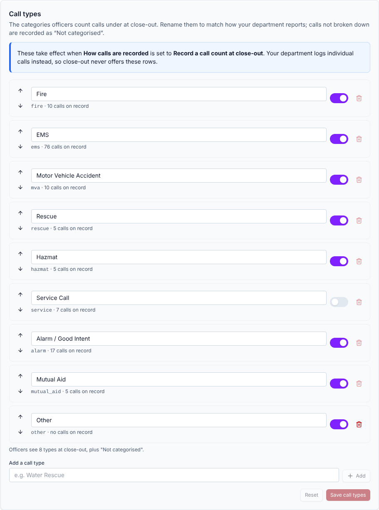

- **Rename freely.** Renaming does not change history. Reports, the
  spreadsheet export, the shift report badges, the printed report and the
  end-of-shift summary email all show your current name.
- **Retire, don't delete, a type with history.** A type with calls or a filed
  shift report behind it cannot be deleted. Turn it off instead. That removes
  it from the close-out screen and keeps every report that names it.
  Retired types still show their names in old reports.
- **Delete** works only for a type nothing refers to.
- **Turn every type off** if you want close-out to ask for a total only, with
  no breakdown.
- Select **Save call types** when you are done.

> **What about reports filed while logging individual calls?** They keep the
> officer's own wording, such as "MVA w/ entrapment". Renaming a type never
> rewrites them.

---

## Time-Off Requests

You request time off from the **My Shifts** tab.

1. Select **Request Time Off**.
2. Enter the **Start Date** (required).
3. Enter the **End Date** if it is more than one day. Leave it blank for a
   single day.
4. Add a **Reason** if you like. It helps your officer understand the request.
5. Select **Submit Request**.

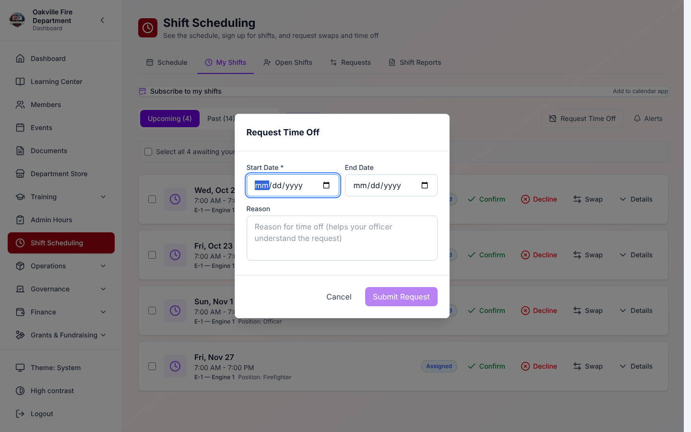

Your requests, and their statuses, are listed under **Requests → Time Off**.
An officer reviews each one and approves or denies it. You get a notification
when they do.

**Request statuses:**

| Status        | Meaning                                              |
| ------------- | ---------------------------------------------------- |
| **Pending**   | Waiting for an officer                               |
| **Approved**  | Time off granted                                     |
| **Denied**    | Not granted. The officer may add notes saying why    |
| **Cancelled** | You withdrew it                                      |

To withdraw a pending request, select the **✕** at the end of its row and
confirm.

> **What happens to my shifts when time off is approved?** Any shift you are
> assigned to in those dates is cancelled automatically. The officer's notes
> say how many, for example "(2 conflicting assignments auto-cancelled)". Any
> pending swap for those seats is cancelled too. While the time off stands,
> nobody can assign you to a shift in those dates.

---

## Shift Swap Requests

A swap starts from the shift you are giving up.

1. Go to **My Shifts** and stay on **Upcoming**. The **Swap** button only
   appears on shifts that have not happened yet.
2. Select **Swap** on the shift you want covered. The **Request Shift Swap**
   window opens. Its subtitle names that shift, for example "Ask to swap your
   shift on Tue, Oct 6". There is nothing to pick here.
3. Choose a **Swap Type** (see the table below).
4. Give a **Reason**, then select **Submit Request**.

| Swap type                  | What it means                                                                                                                         |
| -------------------------- | ------------------------------------------------------------------------------------------------------------------------------------- |
| **Open Swap** _(default)_  | "Offered to members cleared for your seat; it stays yours until one picks it up". The first to pick it up takes the seat               |
| **Specific Shift**         | "Choose which shift you want". Pick a shift under **Select Shift**. If an officer approves, you move to that shift in the same seat, and your original seat becomes open |
| **Exchange With a Member** | "Trade seats: you take theirs, they take yours". Pick a member's seat under **Exchange With**. Only seats you are both qualified for, in the next 90 days, are listed |

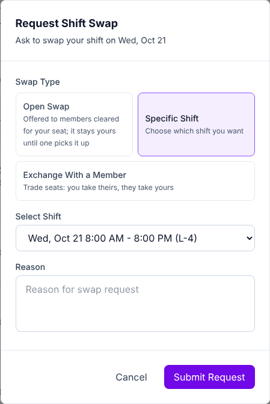

The request then appears under **Requests → Swap Requests**, where you can
follow it or cancel it.

**Specific Shift** lists neither cancelled shifts nor shifts you are already
on, and says so when the list was cut at 50. A request for a cancelled shift,
for a shift you already hold, or from a seat you no longer hold is refused
_(2026-10-24)_.

### Picking up an open swap

When another member's open swap is a seat you are cleared for, **Requests →
Swap Requests** starts with **Open shifts you can pick up**. Each card shows
the day and start time, the apparatus, the seat, who is asking, and their
reason.

1. Select **Pick up**.
2. Confirm with **Pick it up**.
3. The seat moves onto your schedule and off theirs straight away. They are
   told who took it.

**Who is offered an open swap.** The same rule decides this as decides who can
sign up for a seat: your rank, your qualifications and completed training,
Emergency Vehicle Operations Course ([EVOC](./GLOSSARY.md#abbreviations))
for a driver seat, and any positions your department leaves open to everyone.
So a firefighter is not offered a driver seat, but a lieutenant is offered an
engineer's.

You are **not** offered:

- a shift you are already on;
- a training seat; or
- a shift more than 90 days away.

> **What if the pick-up is refused?** The Logbook checks again at the moment
> you pick it up: approved time off, an overlapping shift, the seat limit, and
> whether sign-up for that shift has closed. The reason is shown. If two
> members pick up the same shift at once, the second is told it is no longer
> open.

To hand your seat to one particular member instead, offer it from the shift
on the board. See
[Trades somebody can actually accept](#trades-somebody-can-actually-accept).

### How each kind of swap is completed

| Kind of swap                                | How it is completed                                                                                                       | How the request reads on the Requests tab                                  |
| ------------------------------------------- | ------------------------------------------------------------------------------------------------------------------------- | -------------------------------------------------------------------------- |
| **Open Swap**                               | The first cleared member picks it up. An officer cannot approve it, because there is nobody to move the seat to. An officer can **Deny** it, or assign cover from the shift | "→ Open to any member cleared for the seat"                                |
| **Specific Shift**                          | An officer approves it. You move to the shift you chose                                                                   | The shift you asked for                                                    |
| **Exchange With a Member**                  | An officer approves it. The two of you trade seats                                                                        | The other member's shift                                                   |
| **Offer to a named member** (from the board) | That member accepts or declines it themselves, or an officer approves it, which hands them the seat                       | "→ Offered to _name_", then "→ Taken by _name_" once approved              |

When a swap is approved or picked up, The Logbook updates the assignments
automatically.

> **What if the member in an exchange isn't qualified for the seat?** When the
> officer selects **Approve**, The Logbook asks **"Approve without
> qualification?"** The choices are **Approve anyway** and **Keep it
> pending**. An override is recorded on the request and in the audit log.

> **When is a pending swap cancelled automatically?** As soon as the seat it
> names goes away. That happens if you withdraw or decline, an officer removes
> or reassigns you, the shift is cancelled, your time off is approved, you go
> on leave, or another swap of the same seat is approved. Both members are
> told.

### Reviewing requests (officers)

**Who sees what.** Officers who can manage schedules see the department's
whole queue of swap and time-off requests, and can approve or deny them.
Everyone else sees only their own requests (and, for swaps, ones offered to
them).

**You cannot review a request you are part of.**

- On a swap, the member who asked **and** the member it names are both
  blocked.
- On time off, the member who asked is blocked.
- Holding the permission does not override this. One person cannot be both
  sides of a decision.
- You **can** review a swap between two other members, even on a shift you
  are working yourself.

A blocked attempt changes nothing. The request stays pending for someone else.

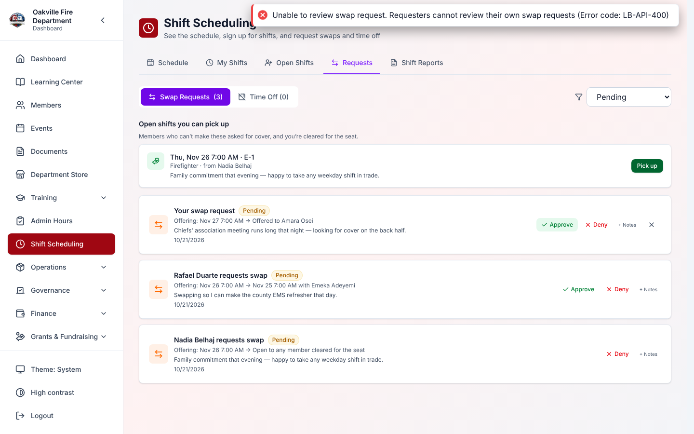

_**Approve** and **Deny** do not tell you which requests you can review. They
show on every pending request for officers who can manage schedules, your own
included. The refusal only appears after you press one. What does differ is
the small **✕** at the end of your own row. Only the requester can cancel, so
that ✕ marks your own request, which you cannot review._

> **Plan for a second approver.** If only one person in your department can
> manage schedules, and that person also asks for swaps or time off, nobody
> can approve their requests. Give the permission to a second person before a
> Saturday morning finds this out.

**Using the Requests tab:**

- It opens on **Pending**, so answered requests drop out of view. To see
  history, set the status filter to **All Statuses**.
- An empty filtered list says "Showing pending requests only. Choose All
  Statuses to see the rest."
- The number beside **Swap Requests** and **Time Off** is the full total, not
  just what is on screen.
- The tab shows 20 requests at a time. Select **Load more swap requests** (or
  **Load more time-off requests**) under them to see more. There are no page
  numbers. The button is not shown when there is nothing more.
- Use **+ Notes** to add reviewer notes before you approve or deny.
- Pressing **Approve** or **Deny** twice by accident sends it only once.

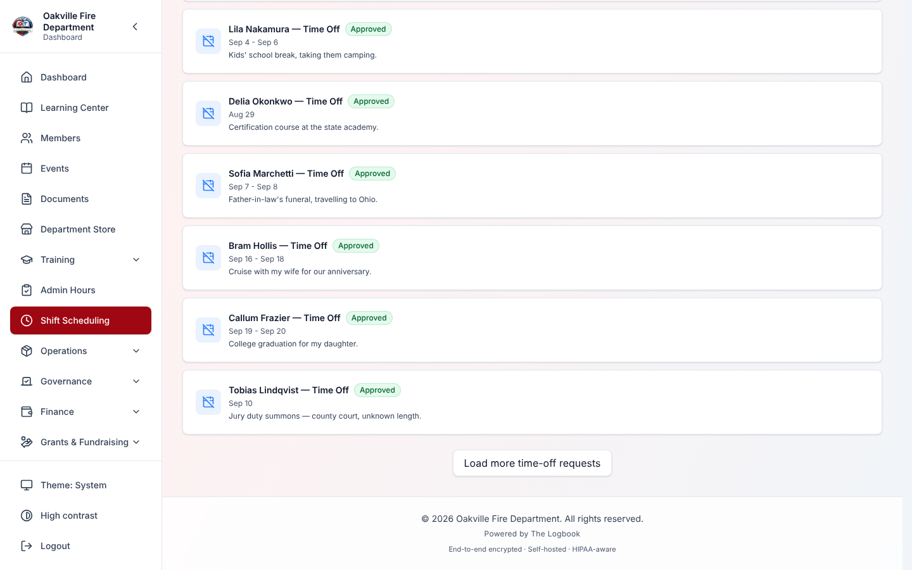

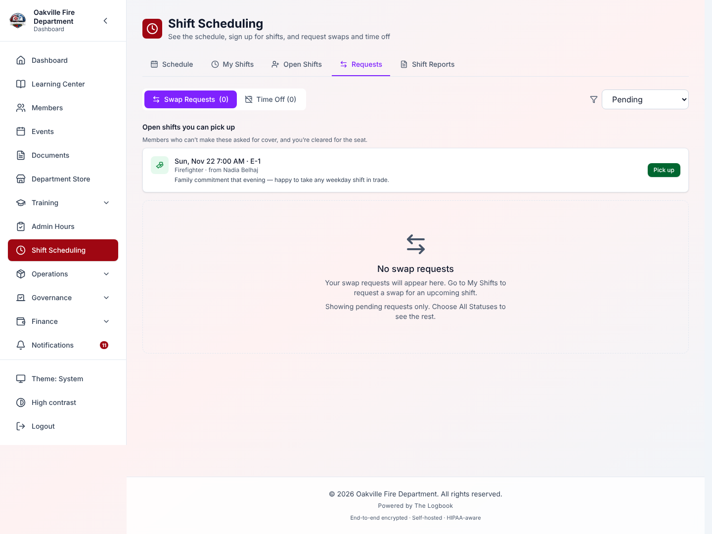

> **For administrators: which permissions does this need?** On the Role
> Management screen:
>
> - Asking for and cancelling swaps and time off needs **Request and manage
>   shift swaps**.
> - Reviewing them needs **Manage schedules**. That alone is enough to see the
>   queues.
>
> Every built-in rank and position that has **Manage schedules** also has
> **View schedules**. If you built an officer position by hand, check it has
> the permissions it needs.

---

## Closing Out a Shift

When a shift is over, an officer **closes it out**. Closing out locks the
shift's attendance, hours and calls, so they can count toward members' hours
and training. The Logbook calls a closed-out shift **finalized**.

**Who can close out a shift:**

- officers who can manage schedules (the **Manage schedules** permission on
  the Role Management screen); and
- the officer named as the shift's **Shift Officer**, for that shift only.

The named Shift Officer can run their own shift without a department-wide
scheduling permission. They can assign and adjust the crew, record attendance,
log calls, close the shift out and cancel it. Editing or deleting the shift
itself still needs an officer who can manage schedules.

**Which screen you get** depends on how your department records calls. An
administrator sets this under **Scheduling Settings → General → Shift
close-out rules → How calls are recorded**:

| Setting                              | What **Close out shift** opens                                                    |
| ------------------------------------ | --------------------------------------------------------------------------------- |
| **Log individual calls**             | A one-page checklist, **Before you close this shift** (below)                     |
| **Don't track calls**                | The same one-page checklist                                                       |
| **Record a call count at close-out** | A [three-step wizard](#the-three-step-close-out-wizard) that saves as you go      |

Everything else in this section applies to both.

### Shift Finalization

#### How to close out a shift

1. Open the shift's detail panel. The shift must have ended, and must not be
   cancelled or already closed out.
2. Select **Close out shift**. A checklist headed **Before you close this
   shift** opens in the panel.
3. Read the checklist. It is in two groups:
   - **Must be resolved first** appears only when something blocks the
     close-out (see "End-of-shift equipment checks" below).
   - **Noted on the record** shows things that are recorded but do not block
     you.
4. Add any pass-down notes for the next crew (optional).
5. Select **Close out shift** at the foot of the checklist.

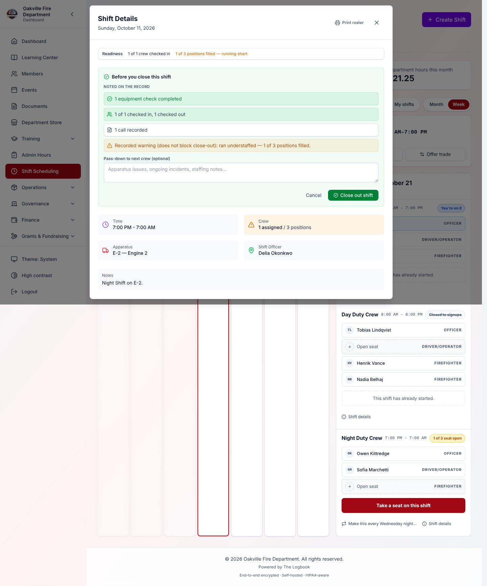

**What "Noted on the record" shows:**

- **Equipment checks.** How many end-of-shift checks are done, or a warning
  that some are not. If your account cannot read equipment checks, it says
  so.
- **Attendance.** For example, "3 of 4 checked in, 2 checked out". It names
  how many never checked in.
- **Anyone still checked in.** They are checked out automatically at the
  shift's end time when you close out.
- **Add hours for members who didn't check in.** A box for each assigned
  member with no attendance. Type the hours they worked (up to 48).
- **Calls.** The number of calls recorded on the shift.
- **Staffing.** If the shift ran short, a warning such as "Ran understaffed —
  1 of 4 positions filled". This does not block the close-out. It keeps the
  shortage on the record.

**End-of-shift equipment checks.** Outstanding end-of-shift checks only
_block_ a close-out if your department has turned on **Require end-of-shift
equipment checks**. It is off unless an administrator turns it on.

- **Rule off:** you see a tip and can close out anyway.
- **Rule on:** the **Close out shift** button stays greyed out. To go ahead,
  tick **Finalize anyway, with equipment checks outstanding** and type a
  reason. The reason goes on the shift's record and in the audit log.

Start-of-shift checks never block a close-out. For how the checks themselves
work, see [Equipment Check System](#equipment-checks).

#### What happens when you close out

| What happens                        | What it means                                                                                                    |
| ----------------------------------- | ---------------------------------------------------------------------------------------------------------------- |
| **Hours and calls are fixed**       | The shift's total hours and call count are saved as they stand. Later changes need the shift reopened            |
| **Each member's calls are counted** | Each member is credited with the calls they were on                                                              |
| **The shift is locked**             | The Logbook records who closed it out and when                                                                   |
| **Draft shift reports are created** | A draft [shift report](./GLOSSARY.md) is made for each trainee on the shift (see below)                          |
| **You get a notification**          | If any drafts were made: "Shift Finalized: N draft reports created". No drafts, no notification                  |
| **The reminder is cleared**         | The post-shift reminder asking you to close the shift out is archived                                            |

**Who gets a draft report.** A member gets a draft if they are in an active
training program, or if they were assigned to a **Training position** seat
(see [Training positions](#training-positions-on-the-crew)). Members with
neither get no draft. If one trainee's draft fails, the others still get
theirs.

#### After close-out

A green badge shows **Shift finalized on** and the date. Officers who can
manage the shift also see a **Reopen** link beside it. The **Close out shift**
button is gone.


**Reopening a shift.** Made a mistake? An officer who can manage schedules, or
the shift's Shift Officer, can reopen it:

1. Select **Reopen** beside the green badge.
2. Type a reason in **Reason for reopening (logged)**. The reason is optional,
   but it is kept in the audit log.
3. Select **Reopen shift**.
4. Correct the attendance or crew, then close the shift out again.

Reopening keeps any draft reports already made. Closing out again re-saves the
hours and calls. The post-shift reminder can be sent again for a reopened
shift.

#### Shift finalization: what if …?

| What happened                                     | What it means / what to do                                                                                        |
| ------------------------------------------------- | ----------------------------------------------------------------------------------------------------------------- |
| End-of-shift checks are not done, rule **off**    | You can close out. A tip explains the rule                                                                        |
| End-of-shift checks are not done, rule **on**     | **Close out shift** is greyed out until you finish the checks, or tick the override and give a reason            |
| Start-of-shift checks are not done                | Does not block close-out                                                                                          |
| The shift has not ended yet                       | **Close out shift** is not shown                                                                                  |
| The shift is cancelled                            | **Close out shift** is not shown                                                                                  |
| The shift is already closed out                   | The green badge replaces the button                                                                               |
| You want to edit a past or closed-out shift       | **Edit** and **Delete** are hidden once a shift is in the past. Reopen a closed-out shift to correct it           |
| Someone tries to delete a closed-out shift        | Refused: "Cannot delete a finalized shift."                                                                       |
| Someone tries to delete a shift that has reports  | Refused: "Cannot delete shift with N completion report(s). Remove the reports first."                             |
| You try to reopen a shift that was never closed   | Refused: "Shift is not finalized"                                                                                 |
| Someone adds, edits or removes attendance, or adds or edits a call, on a closed-out shift | Refused _(2026-10-24)_. Close-out has already credited the hours. Reopen the shift to correct it |
| Someone tries to close out, or check in to, a cancelled shift | Refused. A cancelled shift did not run, so it credits no hours                                     |
| An officer adds attendance for a member who already checked in | Refused, instead of creating a second row. A check-out earlier than the check-in is refused too   |
| A trainee's draft report fails to create          | The other trainees still get theirs                                                                               |
| A member has no active training enrollment        | No draft report is made for them                                                                                  |

### The three-step close-out wizard

Departments that **Record a call count at close-out** get a three-step wizard
instead of the checklist. It is the same **Close out shift** button, for the
same people, on the same ended shifts.

**Each step saves when you select Next.** Close-out often happens early in the
morning, on a phone, after a long tour. If the phone locks, the battery dies or
a call comes in, reopen the shift. The wizard opens on the step you left, with
your answers kept.

Use **Back** to return to an earlier step, or **Cancel** on step 1 to close
the wizard.

#### Step 1 — When was everyone on?

The crew is listed with their **Start** and **End** times. These are filled in
from check-in and check-out, and you can change them.

- Anyone with **no check-out recorded** is flagged.
- Anyone who was assigned but **never checked in** is listed too, with empty
  times. Fill them in, or that member gets no hours and no call credit.
- Members who declined, are pending, or were no-shows are not listed.

**The Hours box.** Each row also has an **Hours** box. For someone who forgot
to check in or out, type the hours they worked instead of picking two times.
The hours are counted from their check-in time. If they never checked in, they
are counted from the shift's scheduled start. The end time fills itself in.

- Rows missing a time offer a one-tap button: **Until shift end** (forgot to
  check out) or **Full shift** (never checked in).
- Hours must be between 0.25 and 48. Anything else shows a message and holds
  **Next** until you fix it.
- The footer counts anyone who still has no hours. Step 3 marks them **no
  hours recorded**, so nobody is closed out with zero hours by accident.

Step 1 may also list pre-shift work logged against the shift, for you to
review.

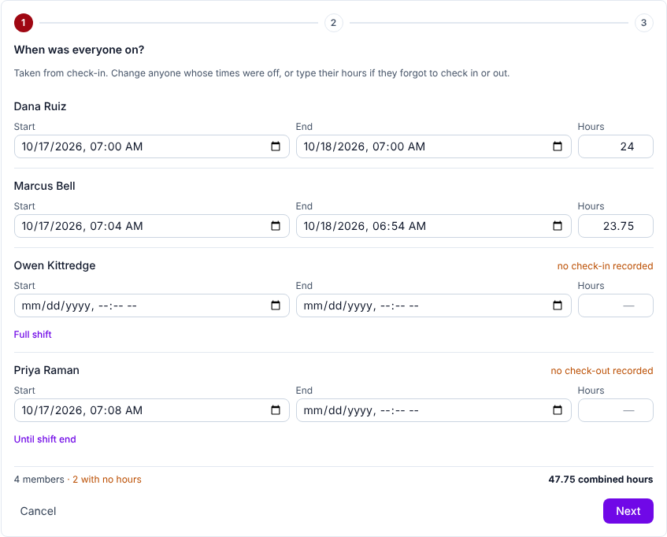

> **"Combined hours" is not the shift's length.** It adds up every member's
> time. A 24-hour tour with four people present approaches 96 combined hours.
>
> A combined figure well short of crew × hours is a warning. In the picture
> above it reads 47.8 because two members have missing times. Members with no
> times add nothing until someone fills them in.

#### Step 2 — How many calls did the apparatus run?

There is one row per call type, plus **Not categorised**. Enter a number
against each type you ran. The **Total calls** figure is added up from the rows.
You cannot type it directly.

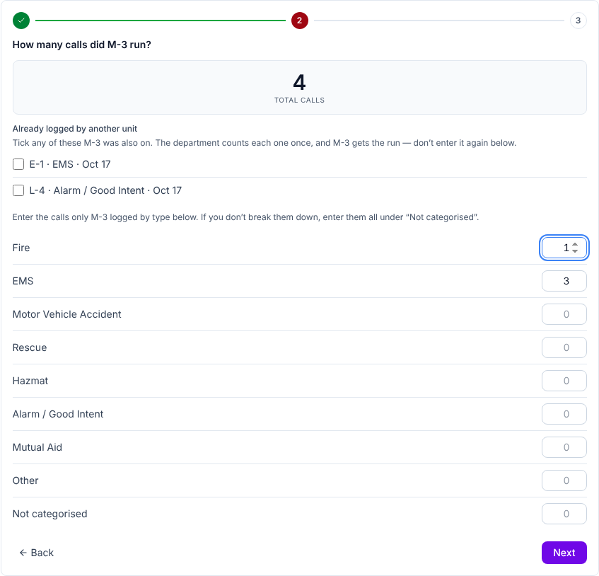

**Calls another unit already logged.** If another unit logged a call while
your shift was on, it may appear under **Already logged by another unit**.
Tick any your apparatus was also on. The department counts each call once, and
your apparatus gets credit for the run. Do not enter those calls again in the
rows below.

**Calls you cannot classify go under "Not categorised".** Say you ran six calls
and only remember that four were emergency medical services (EMS). Enter `4`
against EMS **and `2` against Not categorised**. The total is the sum of the
rows. If you enter only the four, the shift records **four calls, not six**,
and nothing on screen warns you.

> **Blank and zero end up the same.** Leaving every row blank means "we did not
> track it". Entering `0` means "we ran none". Once saved, both record no
> calls, and both read back as `0` if the shift is reopened. **If a quiet tour
> matters for your records, say so in the pass-down notes on step 3.**

**The limit is 100 calls for one shift.** This stops a typing slip such as
"500" from skewing every report.

> **Important.** The calls are added to the department's call record as soon
> as you select **Next** on this step. If you stop there and never close out,
> the call-volume report already includes them.

#### Step 3 — Does this look right?

Step 3 shows the **Combined hours** and **Calls** totals. Every member starts
credited with the apparatus's full call count. Lower the number for anyone who
came on late or left early.

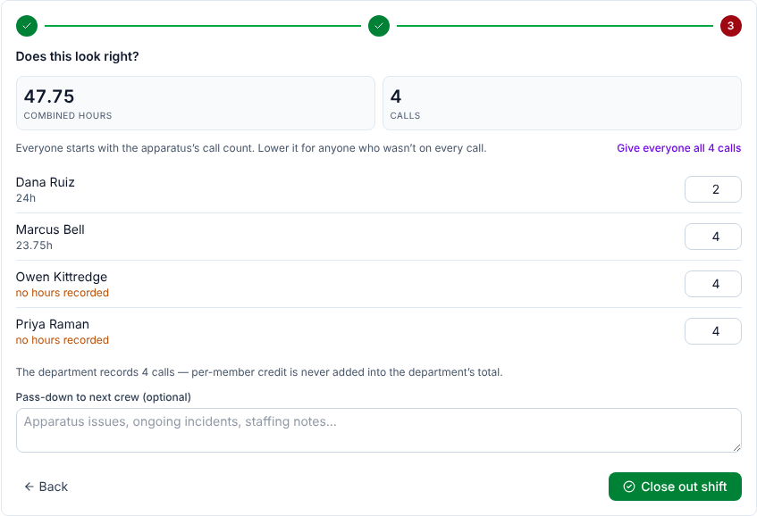

- If nobody is credited with every call, a warning says so. That is right if
  the crew changed mid-shift. Otherwise, a member is credited too low or the
  total is too high.
- A member's credit is never added into the department's total.
- **Give everyone all _N_ calls** _(2026-10-11)_. When you reopen a finalized
  shift and raise the call count, each member's credit still starts at the
  figure saved at the first close-out. Instead of retyping every row, select
  **Give everyone all _N_ calls** on this step. It appears whenever anyone is
  below the total, and the hint above the list says when the numbers shown are
  the saved credit rather than the apparatus's count. Lower individual rows
  afterwards for anyone who came on late.
- **A member credited with fewer calls than the apparatus ran gets a count,
  but not call types.** The Logbook does not know which calls they were on, so
  it does not guess. Guessing would wrongly count calls toward type-specific
  training requirements.

Type any notes for the next crew in **Pass-down to next crew (optional)**.
Then select **Close out shift**. You see "Shift closed out".

**If your department requires end-of-shift equipment checks,** step 3 shows
the outstanding checks. To close out anyway, tick **Close out anyway, with N
equipment checks outstanding** and type the reason. The reason is required,
and it goes on the shift's record and in the audit log.

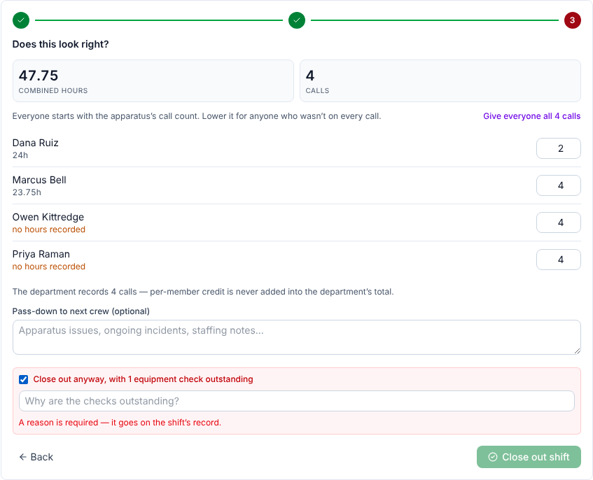

#### Wizard: what if …?

| What happened                                                     | What it means / what to do                                                                                                                                        |
| ----------------------------------------------------------------- | ----------------------------------------------------------------------------------------------------------------------------------------------------------------- |
| The phone locks or the browser closes mid-way                     | Reopen the shift. The wizard resumes on the step you left. Anything saved is kept                                                                                 |
| You lower the call count below the calls shared with another unit | Refused, with a message naming the number. Untick the shared call first. A lower total never silently removes another unit's call                                 |
| The shift's date or apparatus is corrected after close-out        | The calls move with the shift to the new date and unit                                                                                                            |
| A member declined, is pending, or was a no-show                   | Not listed, so they are not credited with calls                                                                                                                   |
| An administrator removes a call type while you are working        | The Logbook drops counts against that type rather than failing the save                                                                                           |
| You reopen a closed-out shift                                     | The wizard starts again at step 1                                                                                                                                 |
| The department switches back to logging individual calls          | Calls already recorded stay recorded. Reports read whichever source matches the current setting. They never add the two together, so no call is counted twice     |

### Cancelling, Hand-Offs and Training Seats

#### Cancelling a shift instead of deleting it

Use **Cancel shift** to call a shift off without losing the record. It is
offered to officers who can manage the shift, on shifts that are not yet past
or closed out. You can add an optional reason.

Cancelling:

- keeps the shift for history;
- marks everyone's assignment cancelled;
- notifies the assigned crew with a bell notice and an email, with the reason
  if you gave one (the email is under **Shift notices**, so a member who
  turned those off gets only the bell notice); and
- removes the shift from the Open Shifts list. It shows a **This shift is
  cancelled** banner.

A closed-out shift cannot be cancelled. Reopen it first.

#### Pass-down notes for the next crew

When you close out, you can leave a pass-down note: apparatus problems,
ongoing incidents, staffing notes. The next crew sees it in a blue banner,
**Handoff from the previous shift**, at the top of their shift. The banner
gives the note's date and how long ago it was written.

The banner shows the most recent pass-down left on the same apparatus. If that
note is three or more days old, the banner says it is the most recent note on
this apparatus, not one from the last crew on duty.

#### Training positions on the crew

When assigning a seat, an officer can tick **Training position (supervised
rider)**. They can then pick:

- **Program (optional)** — the trainee's training program; and
- **Evaluating officer (optional)** — who writes the report. If left blank,
  the officer who closes out the shift writes it.

When the shift is closed out, a draft report is made for that member against
the chosen program, ready for the evaluator to finish.

### Close-Out Rules and Other Shift Settings

These settings are under **Scheduling Settings → General**, for administrators
who can manage scheduling settings.


**Shift close-out rules:**

- **Require end-of-shift equipment checks.** When on, outstanding end-of-shift
  checks block a close-out unless the officer overrides with a reason. Turn it
  on if you want every apparatus verified ready at the end of each shift, and
  complete equipment records.
- **Restrict check-in to assigned members.** When on, only members rostered on
  a shift can check in, so attendance reflects the real crew. Open shifts are
  exempt. Anyone else sees "You are not assigned to this shift."
- **How calls are recorded.** Chooses the checklist or the wizard, as
  described at the start of this section.

**Overtime advisory.** Set a cap on scheduled hours over a window of time. If
assigning a member, or a member signing up, would push them over the cap, a
warning appears. It does not stop the assignment.

**Automatic shift generation.** When on, active patterns keep creating shifts
a chosen number of weeks ahead (up to 52). Nobody needs to select **Generate**
each cycle.

### Before and During the Shift

#### Subscribe to your shifts in your calendar

You can see your shifts in Google Calendar, Apple Calendar or Outlook.

1. Open **My Shifts**.
2. Select **Subscribe to my shifts**.
3. Copy the link. Add it to your calendar app as a subscribed (or "Internet")
   calendar.

Disconnecting the feed stops the link working for every calendar that
subscribed to it, and subscribing again issues a new link. Your shifts then appear and stay up to date. The feed shows your assigned,
non-cancelled shifts from 60 days ago to a year ahead. You cannot edit shifts
from your calendar.

> **Important.** The link is private to you. Do not share it. If it leaks,
> select **Reset link**. The old link stops working at once and you get a new
> one.

> **Screenshot omitted for security:** Expanding this card reveals a private
> calendar-feed credential. Do not capture or publish the expanded card.

#### The Readiness line

Open a shift that has started and you see a **Readiness** line at the top:

- how many assigned members are **present** (checked in) out of those
  assigned;
- **staffing** against the target, flagged if the shift is short; and
- any **start-of-shift equipment checks** still outstanding.

#### Shift lifecycle: what if …?

| What happened                                                     | What it means / what to do                                                                       |
| ----------------------------------------------------------------- | ------------------------------------------------------------------------------------------------ |
| Close out with end-of-shift checks not done, rule **off**         | Allowed. A tip appears                                                                           |
| Close out with checks not done, rule **on**                       | Blocked unless the officer overrides with a reason                                               |
| Cancel a closed-out shift                                         | Not allowed. Reopen it first                                                                     |
| A member who is not rostered checks in, restriction **on**        | Refused: "You are not assigned to this shift." Open shifts are the exception                    |
| Reopen a shift that was never closed out                          | Refused: "Shift is not finalized"                                                                |
| Your calendar link was shared or leaked                           | Select **Reset link**. The old link stops working immediately                                    |
| An officer tries to confirm a shift on a member's behalf          | Refused. Members confirm their own shifts                                                        |

---

### End-of-Shift Summaries

After a shift is closed out, each member who attended gets a summary by email
and in The Logbook: the date, times, vehicle, their hours, the calls they ran,
and a link to their report. The Logbook checks every 30 minutes for shifts
that ended in the last 4 hours. If the email fails, it tries again at the next
check, and the in-app notice is repeated each time. A member who can't be
emailed (no address, shift notices turned off, or the department can't send
email) gets the in-app notice once. A run that fails for your department shows
in [Error Monitoring](./08-admin-reports.md#error-monitoring).

## Shift Reports and Compliance

This section covers two things:

- **Scheduling Reports**, the department-wide reports on hours, coverage,
  calls, availability and compliance; and
- **Shift reports**, the officer's write-up of each crew member after a shift.

**An edit to a reviewed shift report sends it back to review** _(2026-10-27)_.
When the filing officer changes any field of a submitted report, it returns to
**Pending review** and the earlier reviewer and review date are cleared (the
reviewer's notes are kept). A flagged report always goes back; an approved one
goes back where the department requires review. Saving unchanged values keeps
the approval, and training credit is not granted twice.

### Scheduling Reports

Open **Scheduling Reports** from the Scheduling Administration hub. You need
the **Manage schedules** permission. It has five tabs:

| Report               | What it shows                                                                              |
| -------------------- | ------------------------------------------------------------------------------------------ |
| **Member Hours**     | Hours each member _worked_ in a date range, with scheduled hours and outside hours beside it |
| **Coverage**         | Shift staffing levels and gaps                                                             |
| **Call Volume**      | Calls by day, week or month                                                                |
| **Availability**     | Member availability over the dates you pick                                                |
| **Shift Compliance** | Each member's progress against shift and hours requirements                                |

### Member Hours: worked vs. scheduled

The headline figures, **Shifts Worked** and **Hours Worked**, come from shift
check-in and check-out. They count **closed-out shifts only**, so attendance
an officer has not yet reviewed is left out.

**Scheduled Hours** is the length of the shifts a member was assigned. A
**Difference** column shows the gap.

These will not match, and that is the point. A shift can run short or long,
and a member can be rostered for a shift they never work. Anything that
credits a member uses the worked figure.

> **What if a member worked a shift they weren't assigned to?** They still
> appear in the report. Hours are not lost because the roster did not match
> what happened.

**Outside Hours** is a column for time members logged on other departments'
apparatus. Below the table are **Outside apparatus staffed** and **Shifts with
other departments**. See
[Shifts with other departments](#shifts-with-other-departments).

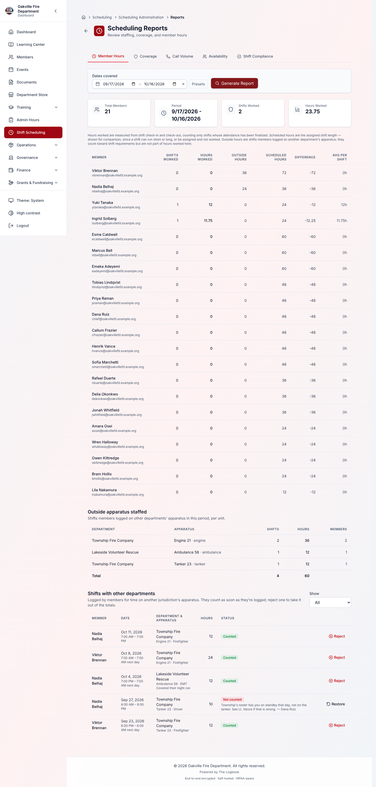

### Compliance Report

The **Shift Compliance** report checks each member against active
requirements of two kinds:

- **Shifts** requirements (a number of shifts); and
- **Hours** requirements (a number of hours).

A requirement only appears here if **Shift attendance satisfies this
requirement** is ticked. This is the **Shift Credit** box on the requirement
form.

- **Shifts requirements are ticked by default.**
- **Hours requirements are not.** Training hours, such as annual hazardous
  materials (hazmat) hours, are graded from training records on the training
  screens. Duty shifts do not count toward them. Tick the box on an hours
  requirement only when hours on shift are what it measures.

**The summary cards** count **requirement checks**: one for each member under
each requirement that applies to them. A member under three requirements is
three checks. **Checks Met** and **Checks Not Met** split that total. They are
not head counts of members.

**For each requirement, the report shows:**

- the required number of shifts or hours;
- each member's completed number;
- a percentage; and
- whether the member is compliant.

A requirement no member is held to reads **Not applicable**. Members a
requirement exempts, because they joined before it, are left out. See
[Training](./02-training.md).

> **Know what this report counts.**
>
> - A **shifts** requirement is counted exactly as on the Training screens:
>   shifts an officer has **closed out**, plus counted outside shifts, inside
>   the requirement's own period, with training waivers applied. So the count,
>   the target and "compliant" match the compliance matrix and My Training.
> - A shift that has not been closed out does not count until it is.
> - A one-time shifts requirement shows **All shifts on record** as its
>   period.
> - An **hours** requirement is graded here from shift attendance only when it
>   is ticked. The Training screens still grade it from training records.

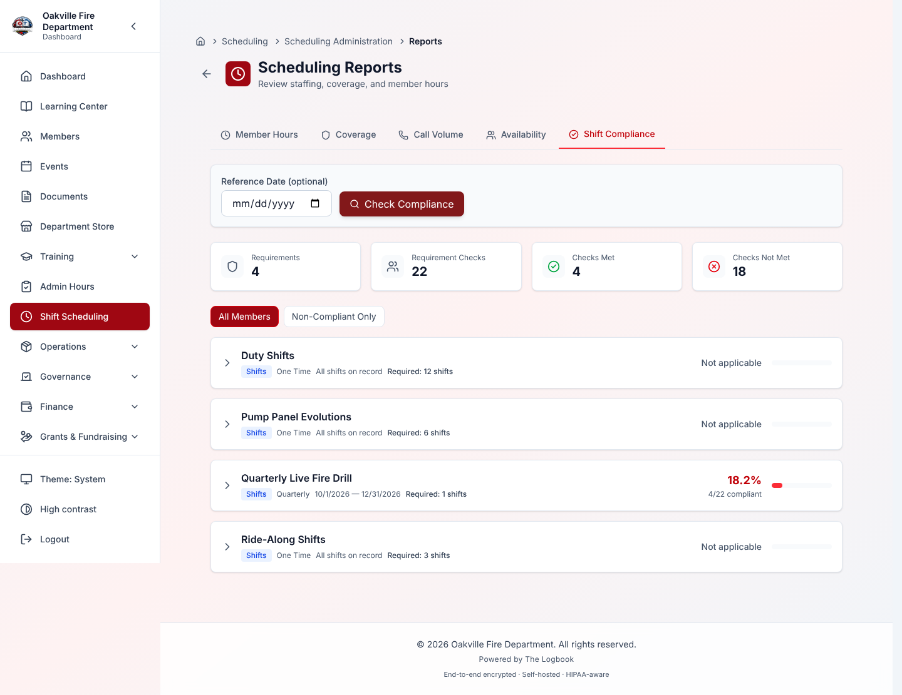

> **Tip:** Members on an active leave of absence have their requirements
> reduced. The report shows the adjusted target and the number of leave months.

### The Shift Reports tab

A **shift report** is an officer's write-up of a member's shift. It records
the hours and calls worked. For a trainee, it can also hold a rating, notes,
skills and tasks. Shift reports live on the **Shift Reports** tab in
Scheduling.

What you see on the tab depends on whether you can **Manage training
records** (a permission on the Role Management screen).

#### What a member sees

A member without that permission sees one heading, **Shift reports about
you**: "Feedback your officers write after shifts you worked. Open a report to
read it and acknowledge it."

- An approved report you have not acknowledged shows **Needs
  Acknowledgment**. Open it and acknowledge it. You can add a comment.
- With no reports yet, the page says: "When an officer files a report for a
  shift you worked, it will show up here." If your department reviews reports
  first, it adds: "A training officer reviews each report before it is shared
  with you." It also lists what a report holds.

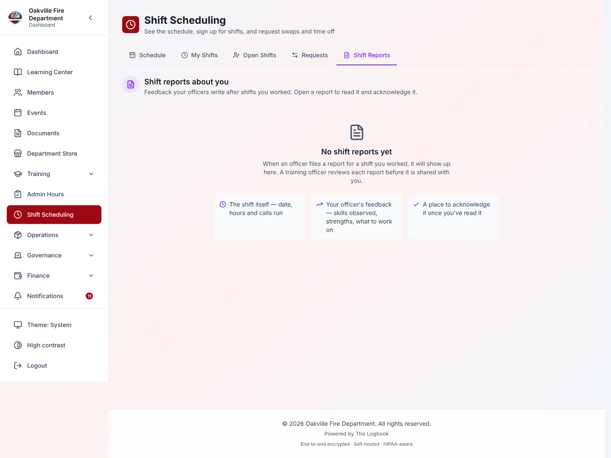

**If you were the Shift Officer** on a shift but cannot manage training
records, you can still file that shift's reports. Follow the link from your
close-out notification. The page heading becomes **File this shift's
reports**, and you also get a **Drafts** view for the drafts assigned to you.

#### What an officer sees

Officers who can manage training records get a strip of views:

| View              | What it lists                                                                                     |
| ----------------- | ------------------------------------------------------------------------------------------------- |
| **About me**      | Reports other people wrote about your shifts                                                      |
| **Written by me** | Reports you wrote about your crew, under **Your reporting summary**. This is the starting view    |
| **Department**    | Totals for every officer's reports. Needs the **View department-wide shift report analytics** permission as well |
| **Review Queue**  | Reports waiting for review. Only shown where the department requires review                       |
| **Flagged**       | Reports flagged for follow-up (see [Flagged Reports View](#flagged-reports-view))                 |
| **Drafts**        | Drafts, including those made when a shift is closed out, with a count badge                      |

The **New report** button sits beside the strip.

**Written by me:**

- **Your reporting summary** shows tiles for **Reports written**, **Shift
  hours covered** and **Calls covered**.
- **Drafts to finish →** and **Awaiting review →** appear only when there are
  some. Select one to open that view.
- A chart shows **Reports written per month**.
- The list is headed **Reports you've written (N)**: "Most recent shift first.
  Select a report to read it in full."
- An approved report the member has not acknowledged shows **Not acknowledged
  yet**.
- With nothing written yet, the page offers **Write a report**.

The **Department** view shows the same tiles under **Department reporting
summary**, for every officer. It shows totals only, not a list.

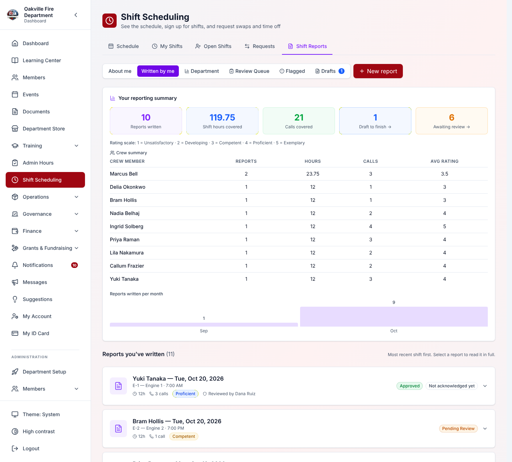

**What a report card shows.** Each card shows, without opening it:

- the member's name and the shift date (in **About me**, your own name is
  left off);
- the shift's apparatus and start time, where known;
- hours, calls and the rating;
- the officer who filed it, and "Reviewed by" once reviewed; and
- status badges: **Draft**, **Pending Review**, **Approved** or **Flagged**.

A report waiting for review, or flagged, also shows **Waiting N days**. This
turns amber at 3 days and red at 7.

On a phone, the status badges sit on their own row under the name.

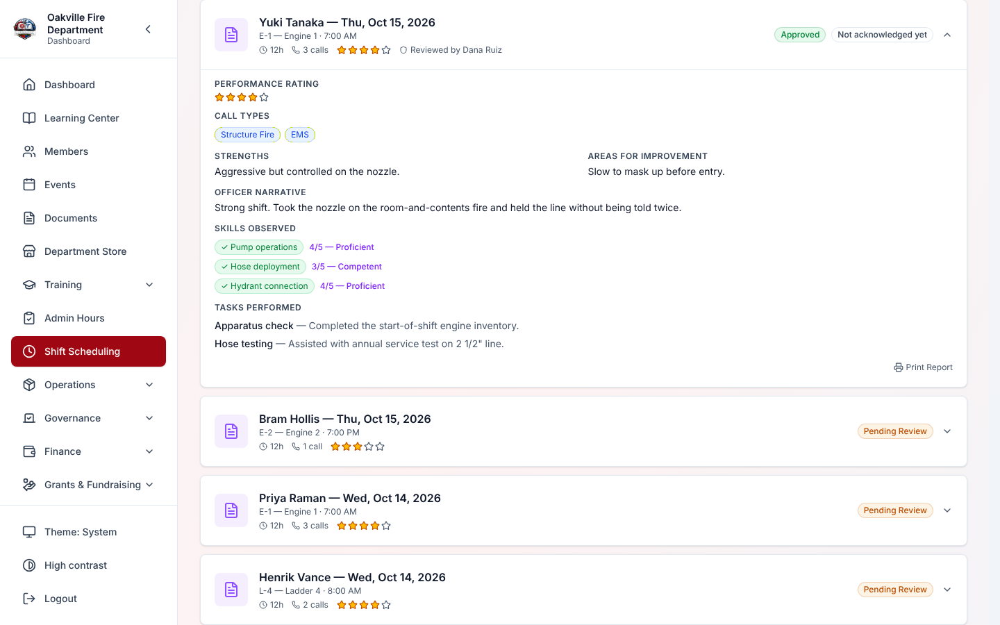

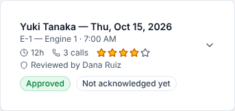

The view you pick is kept in the page address. Refreshing, sharing the link or
using the back button returns you to the same view.

### Writing Shift Reports for a Crew

You write reports for a whole crew at once, starting from the shift.

1. On **Shift Reports**, select **New report**.
2. **Select a Shift.** The list shows shifts from the last two weeks. Each
   card names the apparatus, the date, and how many members, calls and hours
   it had. You can search by apparatus, date or officer. Choosing a shift
   loads its crew.
3. Check **Hours on Shift**. This is the only required field. You can also
   write an **Overall Shift Narrative** about the shift as a whole.
4. Check each member's **Calls**. Each member's number is filled in from the
   shift's call log or its close-out. Change it if it is wrong.
5. For each **trainee**, select **Evaluate** to open their panel. Depending on
   your department's settings, it holds:
   - remarks for that trainee;
   - a performance rating, on the department's scale;
   - areas of strength and areas for improvement;
   - skills observed, each with a 1–5 score; and
   - tasks performed.
6. **Other crew members** (not in a training program) get a **Remarks
   (optional)** box only. They still get hours and calls credit, but no
   evaluation.
7. Untick anyone who was not really on the shift.
8. Select **Submit Reports (N)** to file them all, or **Save as Draft** to
   finish later.

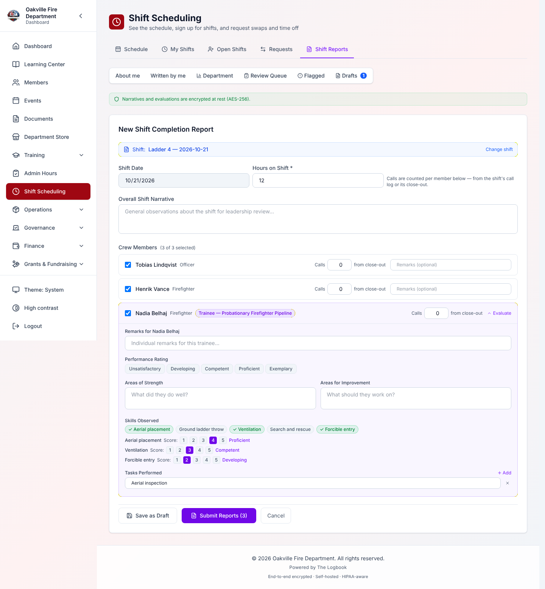

A message confirms how many reports were created. Crew who already have a
report for that shift show **Already reported** and are skipped, not
duplicated. The message says how many were skipped.

**Who counts as a trainee.** A member in an active training program, as long
as **Include Training Evaluations** is on in the settings. If it is off,
nobody gets the evaluation panel.

**If your department has reports filed by the officer on the rig,** the list
only offers shifts where you were the Shift Officer.

#### Skills and tasks for the apparatus

The **Skills Observed** list matches the shift's apparatus type. A ladder crew
is asked about aerial placement and forcible entry. A medic crew is asked
about patient assessment and airway management. If no list is set up for that
apparatus type, the department's general list is used.

**Adding a task.** Select **+ Add** beside **Tasks Performed**. A new row is
added with the next task from the apparatus type's list already filled in. Add
another and you get the next one. The name is an ordinary text box, so type
over it to record a task the list does not include.

In the picture above, the filled-in row at the foot of the panel reads
"Aerial inspection", the first task in that department's ladder list.

#### Score Labels

Selecting a skill marks it as observed, and a **Score:** row of five numbered
buttons appears under it. Scoring is optional. Select a chosen score again to
clear it.

The buttons show numbers, not words. The label for the score you pick appears
beside the row, and hovering over a button shows its label. Until your
department saves its own labels, they are:

| Score | Label          |
| ----- | -------------- |
| 1     | Unsatisfactory |
| 2     | Developing     |
| 3     | Competent      |
| 4     | Proficient     |
| 5     | Exemplary      |

A department that has set its own labels in **Shift Reports settings → Rating
Scale** sees its own wording everywhere the scale appears.

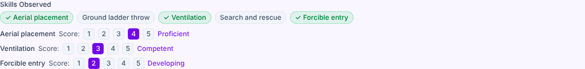

**Where skill scores go.** Scores are saved on the report and shown wherever
the report is read. A score also counts in the Training module (as a skill
check-off, in the competency history and in program progress) when the
skill's name matches a skill under **Training Admin > Setup > Skill
Evaluations**. A skill with no match stays on the report only. See
[Skill Linkage Status in Settings](#skill-linkage-status-in-settings).

#### Drafts

**Save as Draft** keeps reports in the **Drafts** view.

- Drafts give no training credit.
- You can come back and finish them at any time.
- Credit is applied when the report is submitted (or approved, if your
  department requires review).
- In the Drafts view, **Submit All Drafts** files every draft at once. A
  message says how many were submitted.

Drafts are also made automatically when a shift is closed out. See
[What happens when you close out](#what-happens-when-you-close-out).

#### Writing reports: what if …?

| What happened                                          | What it means / what to do                                                     |
| ------------------------------------------------------ | ------------------------------------------------------------------------------ |
| The crew mixes trainees and other members              | Other members get hours and calls only, with no evaluation                     |
| Some crew already have a report for this shift         | They show **Already reported** and are skipped                                 |
| Every optional section is turned off in settings       | Only the core fields remain: member, shift, hours and calls                    |
| The shift has no apparatus, or its type has no list    | The department's general skills and tasks are used                             |
| The report date does not match the shift's date        | Refused: "Report date does not match the linked shift date"                    |
| The member has no attendance or assignment on the shift | Refused: "Trainee has no attendance or assignment record for this shift"      |
| No crew loads                                          | Select **Retry** or **Refresh**                                                |

### Working Offline

Shift reports are built to survive a poor signal.

**Your work is saved on the device as you type.** This covers the shift you
picked, all the fields, who is ticked, each trainee's evaluation and the
remarks. If the connection drops, the tab closes or the browser crashes, open
the same shift again and your work comes back.

- The device keeps up to 20 saved forms. When there are more, the oldest is
  removed.
- A saved form is kept for 24 hours, then discarded.
- **Signing out clears saved forms from the device.** This protects shared
  station computers.

**Submitting with no signal.** If you select **Submit** while offline, the
reports are held on the device:

1. A message says: "You're offline — the report is saved and will be sent
   automatically when you're back online".
2. A banner shows "You're offline. Reports are saved on this device and sent
   automatically when you're back online." with **(N pending)**.
3. When the signal returns, a banner reads "Syncing N queued reports…".
4. A message confirms "Synced N offline reports".

**Save as Draft** needs a connection. Only submitting can be held offline.

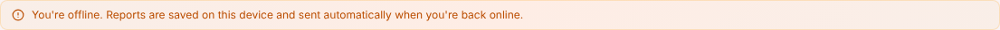

Held reports are not listed one by one. The banner count is how you know they
are waiting.

> **Important.** Do not sign out while reports are waiting to be sent. Signing
> out removes them from the device, and they are lost. Only the member who
> wrote them can send them; another member signing in on the same device does
> not.

#### Offline: what if …?

| What happened                                  | What it means / what to do                                       |
| ---------------------------------------------- | ---------------------------------------------------------------- |
| The browser closed with an unsent form         | Open the same shift within 24 hours and your work comes back     |
| A 21st form is saved on the device             | The oldest saved form is removed                                 |
| The signal returns with reports waiting        | They send automatically. No duplicates are created               |
| The same shift is submitted online and offline | The second set is skipped as already reported                    |

### Reviewing Shift Reports

If your department requires review, reports wait for a reviewer before the
member can see them. Reviewers are officers who can manage training records.
Training credit is given only when a report is approved.

#### Reviewing one report

Open a report and select review to open the review window. It shows the whole
report:

- hours on shift, calls and call types;
- the performance rating (with your department's labels);
- areas of strength and improvement;
- the officer's narrative;
- skills observed, with scores and notes;
- tasks performed;
- the member's comments, if they have acknowledged it; and
- program requirements it moved forward, if linked to a program.

Below the report are:

- **Redact Fields (clear before approving).** Tick any of these to remove
  them: the rating, Areas of Strength, Areas for Improvement, Officer
  Narrative and Skills Observed.
- **Reviewer Comment.** "Visible to the officer who filed the report. Not shown
  to the trainee."
- Three buttons: **Cancel**, **Flag for Revision** and **Approve**.

The window is taller than the screen, so scroll down to reach the controls.


> **Important.** Redacting a field **deletes it from the report**. It is gone
> for everyone, including officers and the printed copy, not just hidden from
> the member.

**Flagging needs a comment.** If you select **Flag for Revision** with no
comment, a message asks you to add one. The filing officer is notified that
the report was flagged, with your comment. The member is not shown the
comment.

**Approving** sends the member a notification that the report is ready to read
and acknowledge.

#### Batch Review

You can review several reports at once in the **Review Queue** or **Flagged**
view. The batch bar appears when the list has more than one report.

1. Tick each report you want, or use **Select all (N)**.
2. The bar shows "N selected" and the actions:
   - in the Review Queue: **Flag Selected** and **Approve Selected**;
   - in Flagged: **Approve Selected**.
3. Type a comment in the box under the bar. It applies to every selected
   report. A comment is **required to flag**. Approving without one is fine.
4. Select the action. There is no confirmation step. A message says how many
   were reviewed.

You can review up to 100 reports in one batch. If some fail, the others are
still reviewed.


> **Tip:** Batch review cannot redact fields. For a report that needs a field
> removed, review it on its own.

#### Flagged Reports View

The **Flagged** view lists every flagged report. Each card has a red
**Flagged** badge, the filing officer and the reviewer.

- **Open a card to see why.** The reason is under the report, in **Reviewer
  Comment — Flagged**. Below it, **Review History** lists every review with
  its date and note.
- If the reviewer left no comment, the card says instead: "This report is
  flagged. Review it again to approve it or add notes."
- **Re-Review Report**, at the foot of the opened card, reopens the review
  window. Approve it, or flag it again with a new note.
- Approving a flagged report gives the training credit, if it is linked to a
  program.

The reason and the **Re-Review Report** button are inside the opened card in
every view, not only in Flagged.

**Flagged stays available when review is turned off.** If any flagged reports
remain after an administrator turns review off, officers still see the
**Flagged** view until they are cleared. It stays while you are in it, even
after you clear the last one.


#### Reviewing: what if …?

| What happened                                  | What it means / what to do                                          |
| ---------------------------------------------- | ------------------------------------------------------------------- |
| You try to flag without a comment              | A message asks for one. Nothing is flagged until you add it         |
| You select more than 100 reports in a batch    | Refused. Review them in smaller groups                              |
| Some reports in a batch fail                   | The rest are still reviewed                                         |
| A flagged report is approved                   | Training credit is applied, if it is linked to a program           |

### Printing a Shift Report

1. On **Shift Reports**, find the report.
2. Open its card and select **Print Report** at the foot of the opened card.
   There is no print button on the closed card.
3. The print page opens. Your browser's print window opens on its own a moment
   later.
4. Choose your printer and print. The app's menus are left off the printed
   page.

The sheet is formatted for letter-size paper (8.5 × 11 inches).


**What the printed report includes:**

- **Header:** "Shift Completion Report", the report's reference, the date it
  was filed and its review status. It does not show your department's name or
  logo.
- **Shift:** the shift date only. Start and end times, apparatus and station
  are not printed.
- **People:** the member and the filing officer, by name. Ranks are not
  printed.
- **Performance:** hours, calls, call types, and the rating as a number such as
  "3 / 5". The rating's word label is not printed.
- **Assessment:** areas of strength, areas for improvement and the officer's
  narrative.
- **Skills Observed:** a table of skill, score out of five and comment.
- **Tasks Performed:** a table of task and description.
- **Signature lines:** one for the filing officer, and one headed **Member
  Acknowledgment**. It reads **(Pending)** until the member acknowledges the
  report in the app.
- **Reviewed by:** the reviewer's name, if reviewed.

| What happened                            | What it means / what to do                                       |
| ---------------------------------------- | ---------------------------------------------------------------- |
| A field was redacted at review           | It is not printed, because it no longer exists on the report     |
| Optional sections are empty or turned off | Those sections are left off the sheet                           |
| Your browser blocks the print window     | The page stays open. Press Ctrl+P (or Cmd+P on a Mac) to print   |

### Shift Reports Settings

Administrators set up shift reports under **Scheduling Settings → Shift
Reports**. This links Scheduling to the Training module and controls how
officers file reports.

Pick one section at a time from the list. There are seven:

| Section               | What it controls                                                     |
| --------------------- | -------------------------------------------------------------------- |
| **What's turned on**  | Whether shift reports and training evaluations are on                |
| **Filing & Validation** | Who files reports, and the post-shift reminder                     |
| **Feedback Defaults** | The general lists of call types, skills and tasks                    |
| **Apparatus Skills**  | Skills and tasks for each apparatus type                             |
| **Form Sections**     | Which optional parts the report form shows                           |
| **Review Workflow**   | Whether reports need approval before the member sees them            |
| **Rating Scale**      | The rating's name, style and levels                                  |

#### What's turned on

- **Enable Shift Reports.** Lets officers file reports. Every crew member gets
  hours and call credit. Turning it off hides the Shift Reports tab.
- **Include Training Evaluations.** Gives trainees the fuller evaluation
  panel. Needs the Training module.

#### Filing & Validation

| Setting                                         | Starts as | What it does                                                                                       |
| ----------------------------------------------- | --------- | -------------------------------------------------------------------------------------------------- |
| **Reports are filed by the officer on the rig** | Off       | Only the shift's Shift Officer can file its reports, and close-out drafts go to them. A shift with no Shift Officer can't have reports until one is set |
| **Enable post-shift validation**                | On        | Sends the Shift Officer a reminder after the shift ends, to check the records and close it out      |
| **Require officer shift completion report**     | Off       | Each trainee needs a report before the shift can be closed out (see the note below)                |
| **Validation window (hours after shift end)**   | 2         | How long after a shift ends it still gets a reminder. From 1 to 24 hours                          |

> **Require officer shift completion report** blocks close-out while any member
> in a training seat on the shift has no shift completion report for it, and
> the close-out screen names them. A shift with no training seats closes as
> normal. The reminder also says a report is required. A shift officer has to
> file the reports first; an officer with **Manage schedules** can tick **Close
> out anyway** and give a reason, which goes on the record. The box only
> applies while **Enable post-shift validation** is on.

The reminder goes only to shifts that have a Shift Officer. In departments
that record a call count at close-out, it also asks the officer to record the
number of calls.

#### Feedback Defaults

The general lists of call types, skills and tasks. These are used when a
shift's apparatus type has no list of its own. Save with **Save Training
Defaults**.

#### Apparatus Skills

Lists of skills and tasks for each apparatus type. These replace the general
lists on reports for shifts with that apparatus.

1. Pick an apparatus type from the row of buttons. The row lists your
   department's active apparatus types and some built-in examples. Each button
   shows how many skills and tasks it has. One type is shown at a time.
2. See the skills and tasks for that type.
3. Add one by typing it and selecting **+ Add**. You can also copy from the
   general lists.
4. Rename one with the pencil, or remove it with **×**.
5. Select **Save Apparatus Skills & Tasks**. This section has its own save
   button.


**How this reaches the report form.** An officer opens a report for an engine
shift. **Skills Observed** offers engine skills (pump operations, hose
deployment and so on), and **Tasks Performed** offers engine tasks. If the
shift has no apparatus, or the type has no list, the general lists are used.

#### Skill Linkage Status in Settings

Each skill under **Apparatus Skills** has a coloured tag:

- **Green** — the name matches a skill under **Training Admin > Setup > Skill
  Evaluations**. Scores count toward competency, check-offs and program
  progress.
- **Amber** — no match. The skill is recorded on reports but goes no further.

A key below the list explains the colours. It only appears once your
department has at least one skill evaluation set up.

**To turn a tag green,** add the skill under **Training Admin > Setup > Skill
Evaluations** with exactly the same name. Capital letters do not matter, so
"Pump Operations" and "pump operations" match. "Pump ops" does not. See
[Skill Evaluations](./02-training.md#skill-evaluations) in the
training guide.

#### Form Sections

Choose which optional sections appear on the report form. Each is a checkbox,
and all start ticked. A change saves as soon as you tick or untick it.

| Section                   | What officers see                     |
| ------------------------- | ------------------------------------- |
| **Performance Rating**    | Stars or labelled buttons             |
| **Areas of Strength**     | A box for what went well              |
| **Areas for Improvement** | A box for what to work on             |
| **Officer Narrative**     | A longer written assessment           |
| **Call / Incident Types** | A choice of call types responded to   |
| **Skills Observed**       | A list of skills, each with a score   |
| **Tasks Performed**       | A list of tasks completed             |

The core fields (member, date and hours) are always shown.


**When to turn sections off:**

- A small department may not need detailed skills tracking. Turn off
  **Skills Observed** and **Tasks Performed**.
- A department that does not track call types separately can turn off
  **Call / Incident Types**.
- A department with a separate evaluation system can turn off **Performance
  Rating**.

A section that is off disappears from the form completely. Officers cannot
enter anything in it.

#### Review Workflow

**Require report review before trainee visibility.** When on, reports must be
approved before the member can see them, and the **Review Queue** view
appears.

#### Rating Scale

| Setting           | Starts as              | What it does                                                    |
| ----------------- | ---------------------- | --------------------------------------------------------------- |
| **Field label**   | "Performance Rating"   | The name shown above the rating                                 |
| **Display style** | **Stars (1-5)**        | Choose **Stars (1-5)** or **Labeled Bubbles**                   |
| **Rating levels** | Five levels            | A name for each level. Add, remove, rename and reorder. Numbered from 1 |

The level names only appear when you choose **Labeled Bubbles**. Select
**Save Rating Scale** to save this section.


> **What if we never save a rating scale?** The report form uses its built-in
> labels: Unsatisfactory, Developing, Competent, Proficient, Exemplary. The
> settings editor suggests different names (Needs Improvement through
> Outstanding). Those only take effect once you select **Save Rating Scale**.

#### Settings: what if …?

| What happened                                      | What it means / what to do                                               |
| -------------------------------------------------- | ------------------------------------------------------------------------ |
| Every form section is turned off                   | Core fields (member, date, hours, calls) remain. Reports can still be filed |
| An apparatus type has no skills listed             | The general skills are used. If those are empty too, the section is empty |
| A draft is saved with fields missing               | It saves. Required fields are only checked when you submit               |
| **Labeled Bubbles** with no level names            | Levels show as "Level 1" to "Level 5"                                    |
| A member was assigned but has no attendance        | Their hours start at zero. Type the hours in                             |

---

## How Shift Hours Feed Training Compliance

Shift attendance feeds the Training module in two separate ways. Knowing which
is which explains why accurate attendance, prompt close-outs and filed shift
reports all matter.

### Path 1: Department-wide compliance

This is the compliance matrix, My Training and the
[Compliance Report](#compliance-report) above.

| Requirement type | What counts toward it                                                                                         |
| ---------------- | ------------------------------------------------------------------------------------------------------------- |
| **Shifts**       | Closed-out shifts the member attended, plus counted outside shifts — if **Shift attendance satisfies this requirement** is ticked (it is by default) |
| **Hours**        | Training records. Shift hours count only on the Scheduling **Shift Compliance** report, and only if the box is ticked |
| **Calls**        | Training records, not the shift call log                                                                      |

For a shift to count toward a shifts requirement:

1. **The member must have attendance on the shift.** A shift with no check-in
   (and no hours entered at close-out) gives nothing.
2. **An officer must close out the shift.** Attendance on a shift that is not
   closed out does not count.
3. **The requirement must be active**, and the shift must fall inside its
   period.

### Path 2: Training program progress

A member in a training program moves forward through **shift reports**, not
through raw attendance. When a shift report is approved (straight away, or
after review if your department requires it), it adds to the member's program
requirements:

| Program requirement | What one approved report adds                                                    |
| ------------------- | -------------------------------------------------------------------------------- |
| **Shifts**          | 1 shift                                                                          |
| **Hours**           | The report's hours on shift                                                      |
| **Calls**           | The report's calls. If the requirement names call types, only matching calls count |
| **Skills**          | Skills on the report that match the program's skill evaluations                  |

Drafts and reports still waiting for review add nothing until approved.

The whole flow:

```
Members check in and out
    ↓
Officer closes out the shift  →  Shifts requirements count it
    ↓
Officer files shift reports (drafts are made for trainees at close-out)
    ↓
Report approved  →  Training program requirements move forward
```

### Leave of Absence Adjustments

When a member has an active leave of absence, shift requirements are reduced
the same way as training hours:

```
adjusted target = base target × (active months ÷ total months)
```

For example, take a requirement of 8 shifts per quarter. A member with 1 month
of leave has 2 active months out of 3. The target becomes 8 × 2/3 = 5.33.
Because shifts are whole, the member needs **6 shifts**.

> For full details on leave adjustments, see
> [Membership > Leave of Absence](./01-membership.md#leave-of-absence) and
> [Training > Compliance Matrix](./02-training.md#compliance-matrix).

---

## Equipment Checks

An equipment check is a walk around a truck, or through a kit, with a list.
The crew answers each item. The Logbook files the answers as a signed report,
marks anything that failed, and tells the people who fix or restock it.

Equipment checklists are part of the **Inventory** module, because a checklist
is a list of inventory items. Your department must have Inventory turned on to
use them. Crews still reach their checks from their shift, as described below.

This section is in three parts:

1. [Doing your shift checks](#doing-your-shift-checks) — for every crew member.
2. [Supply tracking](#supply-tracking-keeping-the-truck-and-the-shelf-in-step)
   — what is on each truck, and restocking it.
3. [Building a check template](#building-a-check-template) and
   [reports](#for-officers-reports) — for officers and the quartermaster.

### Where Equipment Checks Live

| Screen                    | Where to find it                                                       | Who can open it                                                         |
| ------------------------- | ---------------------------------------------------------------------- | ----------------------------------------------------------------------- |
| **My Checklists**         | Menu: **Operations → My Checklists**                                   | Every member                                                            |
| **Apparatus Inventory**   | Menu: **Operations → Apparatus Inventory**                             | Every member who can submit equipment checks (the default member position can) |
| **Fleet Readiness**       | Menu: **Operations → Fleet Readiness**                                 | Officers who can view equipment check results, and scheduling managers  |
| **Equipment Checklists**  | **Administration → Inventory Admin**, then the **Equipment Checklists** card | Officers who can create and edit equipment check templates, including the Quartermaster |
| **Check Reports**         | **Inventory Admin**, **Check Reports** card                            | Officers who can view equipment check results                           |
| **Expiring on Apparatus** | **Inventory Admin**, **Expiring on Apparatus** card                    | Officers who can view equipment check results, and inventory managers   |

The full list of checklist screens and who can open each one is in the
Inventory guide, under
[Equipment Checklists](./05-inventory.md#equipment-checklists).
The settings that decide when crews are prompted, and how early or late a
member may check in, are under
[Checklist Settings](./05-inventory.md#checklist-settings).

---

### Doing Your Shift Checks

#### Opening a check

Open **Operations → My Checklists**. The page is headed **My Equipment
Checklists**. It lists the checks you owe under **Due now and coming up**,
soonest first.

You can also get there from your shift:

- After you check in, the check-in screen offers **Start-of-shift checklist**
  when one is outstanding, and **Open today's checklists**.
- The shift's detail panel offers **Complete Checklists** while any check is
  still open.

Both take you to My Checklists with that shift's checks at the top.

On a phone the list is compact: one row per checklist under a heading for each
day (**Today**, **Tomorrow**, then the date). A day is marked overdue once one
of its shifts has ended with a check still unfiled, and you can still start
that check from it. An overnight shift is not overdue at midnight: its
end-of-shift check stays under the day the shift started, unmarked, until the
shift ends. A missed check stays on your list for seven days; after that it
drops off your list, though the fleet board and compliance report still count
it. **Unscheduled checklist** sits beside
the title (shortened to **Unscheduled**), and **Apparatus Inventory** and
**Manage Templates** (shown only to those who manage checklists) fold into a
**⋯** menu. Completed checklists are grouped
by the day checked. The **All / Start / End** filter is gone; every row carries
its own **Start** or **End** badge. On a laptop the cards below are unchanged.


Each card shows:

- the truck, and whether it is a **Start of shift** or **End of shift** check;
- the shift date, with a label such as **Today**, **Tomorrow** or **2 days ago**;
- how many items are answered, with a progress bar; and
- a status: **Not Started**, **In Progress** (with a percentage), **Passed** or
  **Failed**.

The button follows the status:

| Card shows                   | Button                            |
| ---------------------------- | --------------------------------- |
| Not started                  | **Open checklist**                |
| Part answered                | **Continue checklist**            |
| Already filed for this shift | **Submitted for this shift** (no button) |

Your finished checks are under **Completed checklists** at the bottom.

If nothing is due, the page says: _"Nothing to check right now. When one of
your shifts has an equipment checklist, it will show up here. If you expected
one, ask your shift officer."_

**Which checks you see.** A checklist can be set for the whole crew or for
certain seats only. If it names seats, such as Driver/Operator, only members
in those seats see it.

#### Checks without a shift

You do not need a shift to run a check. Select **Unscheduled checklist** at the
top of My Checklists. It offers every published checklist. The check is saved
with no shift attached, and it still counts in the reports.

#### The check form

The form is one page you scroll. Each compartment has a heading, and any
compartment stored inside another appears under its parent. A **section
header** shows as a bold label for grouping. It has no pass or fail buttons and
does not count towards your progress.

A **statement** is text for you to read, such as "Verify all compartment doors
are secure before moving apparatus". You do not answer it, and it is not
scored.


#### Answering each item

Every item asks for one of five kinds of answer:

| Type         | What you do                                                    | What passing means                                                                                                  |
| ------------ | -------------------------------------------------------------- | ------------------------------------------------------------------------------------------------------------------- |
| **Function** | Select **Pass** or **Fail**                                    | It works. Selecting an answer moves you straight on to the next item                                                |
| **Count**    | Set the count with the stepper                                 | The count is at or above its **Min to Pass**. Short of _par_ but at the minimum passes and becomes a restock line   |
| **Level**    | Enter the reading, then pass or fail                           | The reading meets its minimum. An empty box means "not read yet", not zero. The reading is kept, so trends show     |
| **Expiry**   | Check the serial number, lot number and expiry date on record, then pass or fail | The date on record has not passed. Items close to their date show amber on every shift until they are replaced |
| **Present**  | Select **Present** or **Absent**                               | It is on the truck. **Absent** fails the item without a note — it already says what is wrong. **Not on truck** and **Out of service** are not offered |

For an item linked to the department's stock, the expiry date, lot and serial
number come from the stock records and you cannot change them on the check
form. To record a replacement, use **Swap** (below) or
[Apparatus Inventory](#apparatus-inventory--what-the-truck-is-carrying-right-now).

**Replaced an expiring item that is not linked to stock?** Select **Put in a
replacement? Record its date** and enter the date printed on the unit you put
aboard, and its lot number if you read one. The item then reads as in date and
passes. When you submit, the new date replaces the old one on the checklist,
and the checklist's change log records that you made the change. A date that
has already passed is refused.

**Items with no location.** Some items sit directly on the checklist rather
than in a compartment or bag, such as the radios or the map book. They appear
between the locations, wherever the checklist places them, with no heading of
their own.

**When an item fails.** After you select **Fail**, two more choices appear:

- **Not on truck** — it is not on this truck, or does not apply to it. This
  counts as answered, not as a failure.
- **Out of service** — it is on the truck but cannot be used. This counts as a
  failure.

Neither choice is offered on an expired item.

**A failure needs a note.** If you chose **Fail** or **Out of service**
yourself, you must say what is wrong before you can submit. The **Note** button
reads **Note required**, and the box asks _"What's wrong with it?
(required)"_. A failure that a count, a reading or an expiry date already
explains does not need a note.

**Photos.** Select **Note** on an item, then **Add photo (max 3)**. Each photo
can be up to 5 MB, in JPEG, PNG or WebP format. Only the member who did the
check, or an officer who can edit checklists, can add photos to it.


**Par, Min to Pass and Critical Min.** A count item can carry three numbers,
and they answer two different questions:

| Number           | What it does                                                                                 |
| ---------------- | -------------------------------------------------------------------------------------------- |
| **Par**          | What the truck should carry. A count below par shows **Restock _N_** and goes on the restock list. It does **not** fail the item |
| **Min to Pass**  | A count below it fails the item, shown as **Below minimum (_N_) — fails**                    |
| **Critical Min** | A count below it fails the item even when Min to Pass is blank, shows a red **CRITICAL — below minimum** warning, and alerts leadership in the failure email |

For example, with par 10 and Min to Pass 6, a count of 8 passes and asks for 2
more; a count of 5 fails. With only a par of 10 set, a count of 3 still passes
and asks for 7. A count exactly at a minimum is not below it, and a count that
meets par is never critical.

**Count units.** A count item can say what is counted — each, rolls, boxes,
pairs, packs, bottles, or the department's own word — and the count reads with
it, for example "8/10 each". Count a partly used pack in the smaller unit (12
each rather than half a box). An item linked to an inventory item always counts
in that item's unit.

#### Counts carried over from last time

A count item opens showing **what the truck is carrying right now**. This
includes anything a crew recorded as used since the last check. It reads
against par with its unit, for example "2/4 Box".

A carried-over count is a starting point, not an answer. Every count item
opens unmarked. A line at the top of the form says: _"Counts are carried over
from the last recorded count. Change what is different — anything you leave
alone still needs a tap to confirm you looked."_ The line goes away once
nothing is left unconfirmed.


#### Confirm Counts vs. Set All to Par

A compartment with count items has two buttons. They say different things:

| Button             | What it records                                                                    |
| ------------------ | ---------------------------------------------------------------------------------- |
| **Confirm Counts** | "The numbers shown are right." It cannot record stock nobody has                   |
| **Set All to Par** | "It is all full." It writes the par over whatever number is showing                |

A compartment with no count items has **Pass All** instead.

**Set All to Par asks first** if it would raise any count. It names each item
and the change, for example `18 → 24`. Choose **Keep the counts** or **Yes,
they are full**. A compartment already at par does not ask.

The status always comes from the number. Confirming 18 of 24 files a
**failure**.


#### Sealed Containers

A drug bag, trauma kit or sealed pack can be marked as **closed with a numbered
tamper seal**. On the check, it shows a seal card:

1. Read the number on the tag and type it in.
2. If it matches the last check and that seal was intact, select **Seal intact
   — clear _N_ checks**. Every count inside is answered in one tap.
3. If there is no earlier seal to compare, or the number is different, or the
   last check found the seal broken, the button reads **Record seal**. The seal
   number is filed, and you count the contents by hand.
4. If the seal is broken or gone, select **Broken or missing** and count the
   contents.

Three rules keep this safe:

- **A seal clears counts only.** Expiry dates and readings still need checking,
  because they change while the bag is shut. The card lists them under
  **Still needs eyes on**.
- **A seal proves the bag is unchanged, not full.** It carries the last counts
  forward. A bag that was three short last time is still three short, and that
  is filed as a failure.
- **A bag inside a bag gets its own card.** A broken outer seal says nothing
  about an intact inner one.


#### Swapping stock during a check

An item linked to inventory shows a **Swap** button. It takes fresh units off
the shelf and puts them on the truck.

- Any crew member can swap in fresh stock for an **expired** item, and say what
  happened to the old unit. They can also top up a **short** count, up to what
  is missing.
- Topping up an item that is neither expired nor short needs an officer who can
  edit checklists, or the quartermaster.

You can only replace a lot that is actually on that item.

#### Submitting

Select **Submit Report** at the bottom of the form.

- **Submit Report stays greyed out** until every _required_ item is answered.
  A line under it counts what is still outstanding.
- **Optional items** can be skipped. If any are unanswered, The Logbook asks
  _"Submit an incomplete check?"_, says how many items are unchecked, and warns
  that the report will be filed as incomplete. Choose **Go back** or **Submit
  anyway**.


**Only one check per checklist per shift.** Whoever on the crew files it first,
that is the check for the shift. A check already filed shows **Submitted for
this shift** on My Checklists.


#### Checks without signal

If you lose signal, the button reads **Save Offline**. The check is kept on
your phone and sent when the signal returns. The phone labels each check before
sending it. So a check sent twice — from a double tap, a dropped connection or
a resend after reconnecting — still files only once.

The time of the check, and whether any item had expired, are decided by The
Logbook when the check arrives, from the department's own records. A lot that
expires later does not change a check already filed.

#### Resuming In-Progress Checks

Your answers are saved on your phone as you go. If you leave the form part-way,
open the same check again and The Logbook restores them. A message says how
long ago they were saved and how many items are done.

A check filed incomplete shows **In Progress** on My Checklists, with its
percentage. To finish it:

1. Open **Operations → My Checklists**.
2. Select **Continue checklist** on the card. The form opens with your answers
   already filled in.
3. Answer what is left and submit.


> **What if the checklist changed while I was part-way through?** Answers to
> items that did not change are restored. A notice lists the items that were
> removed or changed, and you must check those again. Your old answers are never
> scored against questions that have since changed.

#### What makes an item fail

The Logbook marks some items failed whatever you selected:

- an item whose expiry date on record has passed;
- a count below its par.

**The truck's deficiency flag.** When a fully answered check has any failure,
the truck is flagged with a **Deficiency** badge. The flag clears only when a
later fully answered check passes every item. A check filed incomplete leaves
the flag as it was. Logging a repair does not clear it.

#### Equipment Check Edge Cases

| What happened                                  | What it means / what to do                                                                                       |
| ---------------------------------------------- | ---------------------------------------------------------------------------------------------------------------- |
| No checklist covers the truck on your shift    | No checklist appears for that shift                                                                              |
| The checklist names seats you don't hold       | You don't see it. Members in those seats do                                                                      |
| You marked an expired item **Pass**            | It is filed as failed, with "expired" as the reason                                                              |
| You entered a count below par, at or above its minimum | It passes, and the shortfall goes on the restock list                                                    |
| You entered a count below Min to Pass or Critical Min  | It is filed as failed. You cannot mark it **Pass**                                                       |
| Every item passes                              | The truck's deficiency flag clears, if it was set                                                                |
| You try to open a check someone already filed  | My Checklists shows **Submitted for this shift**. Only one check per checklist per shift is kept                 |
| A checklist has only optional items, and you answered none | You can still submit, after confirming the warning                                                   |

---

### Standalone Equipment Checks

A standalone check is any check run with no shift attached — for example,
after a call, or when a truck comes back from the shop. Any member who can
submit equipment checks can run one:

1. Open **Operations → My Checklists**.
2. Select **Unscheduled checklist**.
3. Pick the checklist, complete it and submit.

The check is saved with no shift and still counts in the reports.

**Fleet Readiness** (for officers) shows each truck, its last check and
anything it is due or owes. Select a truck to see its outstanding checks,
findings and inventory. It does not start checks. Its own page points you to
My Checklists for that.


---

### Supply Tracking: Keeping the Truck and the Shelf in Step

An equipment check is a scheduled pass over a whole truck that produces a
report. It is a poor fit for "we just used two of these at three in the
morning." Supply tracking covers that. It gives you two screens outside a
check, and keeps them and the check form telling the same story:

- **Apparatus Inventory**, where the crew records what they used; and
- **Expiring on Apparatus**, the supply officer's worklist.

> **Important.** Everything here depends on a checklist item being **linked to
> an inventory item**. An unlinked item has no expiry tracking, no lots, no
> ready stock and no restock reports. See
> [Linking a checklist item to the catalog](#linking-a-checklist-item-to-the-catalog).

#### Apparatus Inventory — what the truck is carrying, right now

Open **Operations → Apparatus Inventory** and pick a truck. You can also open it
from **Apparatus Inventory** at the top of My Checklists. Its subtitle reads:
_"Record what you used when you use it, and put fresh stock in the bracket. No
check required."_

You see the truck's tracked items compartment by compartment: what is aboard,
the lot and expiry date, and the ready stock on the shelf. **No check and no
shift are needed.** It is open to every member who can submit equipment checks
— the default member position can. Recording what you just used is crew work,
and it should not wait for an officer.


The header counts the truck three ways: how many items are **tracked**, how
many **need restock**, and how many are **expiring** (within 30 days).

Each item states its count, for example "2 of 2 Box aboard". An item under par
has an orange **Short** badge and an orange count, for example "18 of 24 Box
aboard". Other badges are **EXPIRED**, **Expiring** and **Needs restock**.

**On a phone** _(2026-10-14)_ each item stacks under 640 pixels wide: its name
and badges, then its details on one wrapped line, then the buttons. Each
location heading stays pinned under the app header as you scroll. The three
header counts (**expired**, **need restock**, **expiring**) are filter chips in
a sideways-scrolling row; tap one to see only those items, and a location with
nothing matching drops out. There is **no Save button**: every tap already
saves on its own, and a line under the list reads **Saving…**, then **All
changes saved**, or **Last change didn't save** if it failed (tap again).


The lot number shown is **the lot the date belongs to** — the one expiring
soonest — not the last one put aboard.

> **What if a truck shows nothing?** Tracked items come from a checklist set up
> for **that one truck**. A checklist that applies to every engine, by vehicle
> type, gives shifts their checks but stocks no particular truck. A truck with
> only type-wide checklists shows an empty inventory. The truck list shows the
> trucks in your Apparatus module.

Headers and statements do not appear here. They are checklist layout, not
things anyone stocks.

#### Recording what you used, and the report it raises

Each item offers these actions:

| Action                  | What it records                                                                                                                                                       | Who can use it                                 |
| ----------------------- | --------------------------------------------------------------------------------------------------------------------------------------------------------------------- | ---------------------------------------------- |
| **−**                   | **You used one.** The count drops and a restock report goes up, so the supply officer sees the gap without anyone filling in a form                                   | Crew                                           |
| **+**                   | You put one back yourself                                                                                                                                             | Crew                                           |
| **Flag**                | On a counted item: damaged, contaminated, missing or recalled. It raises a restock report **without** changing the count — use **−** for units actually used         | Crew                                           |
| **Used**                | On an item with no count: report it used or pulled                                                                                                                    | Crew                                           |
| **_N_ lots**            | Opens the lots aboard. An item carrying lots shows this **instead of** the − and + buttons, because two units with two dates cannot move with one plus or minus       | Crew                                           |
| **Swap**                | Takes units off a shelf lot and puts them on the truck. It suggests the shortfall, so filling a gap needs no arithmetic                                               | Officers who can edit checklists, or the quartermaster |
| **Undo**                | Withdraws a restock report without restocking                                                                                                                         | Officers who can edit checklists, or the quartermaster |

**Flag** and **Used** open a box for an optional note, such as "used two on a
call". The report shows who raised it, when, and the note. It appears on the
supply worklist next to the expiring items.


**A report clears only when the truck is back at par.** Two of four back is
still a truck two short, so the report stays open. When the count reaches par —
by **+**, a swap or a check — the report clears, along with the reporter's name
and note. An item with no par clears on any restock.

#### Lots Aboard

One item can carry units from several lots with different expiry dates. The
Logbook records each lot aboard separately:

- The item's **count** is the total of its lots.
- The item's **expiry date** is the earliest of them. Every screen shows that
  date, and the check's expiry verdict uses it.
- **Units used come off the soonest-expiring lot first.** That is the order a
  crew should draw from.
- **Lots with no date go last.**


The sheet lists lots soonest to expire first. On Apparatus Inventory:

- **Correct** fixes a lot that was miscounted or mistyped. It sets the count,
  lot number and expiry date together.
- **Remove** takes the lot off the truck.
- A lot counted down to nothing disappears on its own.

Any crew member can lower a lot's count or remove it. **Raising a count, or
changing a lot number or expiry date, needs an officer who can edit checklists,
or the quartermaster.** On the check form, the lots aboard are shown for
reference only.

#### Expiring on Apparatus — the supply officer's worklist

Open **Administration → Inventory Admin** and select **Expiring on Apparatus**.
A truck's own page also has **Open the supply worklist**.

The page lists items on the trucks that need attention — expiring, reported
used, or short of par — **with the ready replacement stock for each**. "Swap
it" and "order it" are different jobs, and this shows which each row is.

| Control    | Options                                       |
| ---------- | --------------------------------------------- |
| Look-ahead | 30 / 60 / 90 days                             |
| Filter     | All · Needs restock · Used or short · Expired |
| Sort       | Soonest expiry · By apparatus                 |

**Needs restock** shows only rows with no ready stock behind them.

Summary pills sit above the list: how many rows need attention, and how many
have ready stock. A third, red pill — **_N_ need restock** — appears only when
something has no ready stock. If you never see it, there is nothing you have to
order this week.


**Expired shelf stock is struck through and cannot be swapped.** Swapping it in
would fail the item on the next check. It is also left out of the ready-stock
count, so the count never hides a shortage.

#### Working from the item instead of the truck

The worklist answers "what is expiring on my trucks?" A recall, or a lot in
your hand, works the other way round. An inventory item's **Stock** tab lists
every truck and compartment that carries it, and what each one has aboard. See
[Inventory → Which trucks carry this item](./05-inventory.md#which-trucks-carry-this-item).

#### Alerts

Every Monday morning, The Logbook emails a **Supplies to Replace** alert to the
people who get the department's stock alerts. It covers both ends of the loop:

- items on the trucks expiring within 30 days;
- items a crew reported **used or pulled**;
- items counted **below par**; and
- shelf lots that are expiring.

The subject and opening line count each kind separately and name only the
kinds present, for example _"1 expiring on apparatus, 2 to restock on
apparatus, 1 stock lot expiring"_. Truck items are split into **On apparatus —
no replacement stock** (order these) and **On apparatus — replacement ready**
(swap these in).

The **Status** column says why each row is there:

| Row               | Status reads                                    |
| ----------------- | ----------------------------------------------- |
| Expiring          | The date, and the days left                     |
| Reported by crew  | **Restock reported**, with the crew's note      |
| Short of par      | **Short**, with the count, such as "2 of 4 aboard" |

It is weekly on purpose. An item that has **already** expired fails its truck
on every check and is reported that way. This alert is for getting ahead of the
date.

#### Supply Tracking Edge Cases

| What happened                                                     | What it means / what to do                                                                                                                                                  |
| ----------------------------------------------------------------- | --------------------------------------------------------------------------------------------------------------------------------------------------------------------------- |
| Nobody has ever counted an item                                   | It reads as not counted, and par stands in. It is _not_ shown as zero, which would make every untouched truck look stripped                                                 |
| A crew reports more used than the record held                     | It takes what was there. The count never goes below zero                                                                                                                    |
| An item has units with no lot recorded, then a lot is added       | The existing units get their own lot row first, so they do not vanish behind the new lot's count                                                                            |
| A count comes out **over** the record                             | The extra units go in a row with no date. Nobody knows when found stock expires                                                                                             |
| A count comes out **under** the record                            | The difference comes off the soonest-expiring lot first, like any use                                                                                                       |
| A lot is counted down to zero                                     | The lot is removed, so a spent box stops setting the item's date                                                                                                            |
| A restock puts the truck part-way back                            | The restock report **stays open**                                                                                                                                           |
| A counted item is below par and nobody reported it                | It reaches the supply worklist anyway, with the numbers                                                                                                                     |
| Shelf stock has expired                                           | Left out of the ready-stock count, struck through, and **refused by the swap**                                                                                              |
| Everything on an item has expired                                 | It counts as **expired**, apart from _expiring_. Its count shows **red**: two of two expired units are still nothing a crew can use                                         |
| A unit was replaced from stock The Logbook does not track         | Ask an officer or the quartermaster to correct the lot's date on Apparatus Inventory. Until then the old date stands, and the item fails every check                        |
| A checklist is cloned to a second truck                           | Each item's inventory link comes with it                                                                                                                                    |
| A shelf lot is deleted while units from it are on a truck         | The truck's record keeps its lot number and expiry date                                                                                                                     |
| A member can submit checks but cannot manage inventory            | They can record use, recount down, flag, and swap within the limits above. They cannot create a new catalog item from the quick-add bar                                     |

---

### Building a Check Template

This part is for officers who can create and edit equipment check templates.
The seeded **Quartermaster** position can. Building a checklist does not, on
its own, let you see **Check Reports** or **Fleet Readiness**. Those need the
permission to view equipment check results.

Open **Administration → Inventory Admin** and select **Equipment Checklists**.
The list of checklists opens. Select **Create Template** to open the builder.
The same page has links to **Fleet readiness**, **Check log**, **Check
reports**, **Expiring on apparatus** and **Checklist settings**, for the
officers who can open them.

> **Important.** Editing a published checklist takes it **off every shift**
> until you publish it again. A banner says so, with **Publish now**. See
> [Inventory → Building a checklist](./05-inventory.md#building-a-checklist)
> for the full behaviour.

#### Which checklists a shift gets

The Logbook decides which checklists a shift carries in this order. The first
rule that applies wins.

1. **The shift template names them.** On a shift template, under the vehicle
   picker, tick the **Equipment checklists** that shifts from it should carry.
   Naming them **replaces** the truck's own. Crews see them in the order you
   ticked them, and the shift reminder follows that order. Leave them all
   unticked to keep using the truck's own.
2. **A checklist made for that one truck.** If any published checklist names
   the truck, the shift gets those.
3. **A checklist for the truck's type**, such as every engine. These apply only
   when step 2 finds none.

> **Important: a truck's own checklist replaces its type's.** As soon as one
> truck has a published checklist of its own, every type-wide checklist stops
> applying to it. Say Medic 3 has its own supply check, and your department also
> runs an "Ambulance Close-Out" for every ambulance. Medic 3's crew see only the
> supply check. The close-out is still listed and still published, but never
> asked for on Medic 3. Give a truck with its own checklist the full set by name.

> **What if a shift template names checklists that are all unpublished?** The
> shift gets no checklists. The Logbook does not fall back to the truck's own.

#### Setting what a checklist applies to

Name the checklist. The **Applies to** chips beneath the name show its
settings. Select any chip to change them:

- **Timing:** **Start of shift** or **End of shift**.
- **Scope:** **Equipment Check**, **Vehicle Check** or **Combined**,
  optionally for one truck or for every truck of a type.
- **Seats:** **Whole crew**, unless you name seats — for example, only the
  Driver/Operator sees this checklist.
- **Description.**

#### The row is the editor

The builder is **one list, in the order a crew walks the truck**. Sections,
locations and items are all rows in it.

- **Add location** adds a physical area, such as "Officer Door Entry", "Pump
  Panel" or "Cab Interior". Adding the first location opens it ready for items.
- **Add section** adds a heading.
- To store one location inside another, use the **indent** button on its row
  ("Nest inside the location above"). To move a location a long way, use the
  move option in the row's actions menu.

Edit an item's **name**, **answer type** and **the number it is graded
against** right in the row. The four answer types are:

| In the row | On the check form | What it records               | Example                 |
| ---------- | ----------------- | ----------------------------- | ----------------------- |
| **Works**  | Function          | Pass / fail                   | "PA system"             |
| **Count**  | Count             | A quantity against a par      | "SCBA bottles — par 4"  |
| **Level**  | Level             | A reading against a minimum   | "Fuel — gallons"        |
| **Date**   | Expiry            | The expiry date on record     | "EpiPen — exp: 2026-09" |

The builder shows what each type stores beside its label. A **statement**
(text the crew reads) and a **section header** are layout rows, not checks.

Numbers keep their labels once they hold a value — "par 4" and "min 2" on a
count, "30 days" on an expiry warning. So two numbers side by side are never
confused.

Everything else sits behind a **disclosure on the row**: description, serial
and lot numbers, image, critical minimum and the inventory link. You never need
to open it to finish an item. You can fill a whole truck's names and answer
types without opening anything.

> **What if the numbers are out of order?** They should run Critical Min ≤
> Min to Pass ≤ Par. The item editor says so as soon as they do not, and when
> you publish, The Logbook lists the item in a **Save with warnings?** box. You
> can go back and fix it, or save anyway. Equal numbers are allowed.


#### Adding items

**One box per location.** Type an item and press **Enter**. Or paste a whole
list, one per line. A preview names every line and lets you set the answer
type for all of them at once.

The box also searches the inventory catalog as you type (see
[Linking a checklist item to the catalog](#linking-a-checklist-item-to-the-catalog)).

Drag a saved row by its handle to reorder it among the rows beside it. Tick
**Sealed** on a location that is a tamper-sealed bag or kit (see
[Sealed Containers](#sealed-containers)).

**Items directly on the checklist.** When you delete or move out the last item
in a group of items that sit directly on the checklist, the group goes too.
It has no heading, so there would be nothing left to find it by.

**Older "in place" checks.** Lines that asked the crew to "Confirm the item is
in place." were Works checks before the **Present** type existed. When a
checklist still has any, **Tools** offers **Switch "in place" checks to
Present** with the number found. It lists the lines first, and switches all of
them in one step. Other Works lines are never changed. The built-in vehicle
layouts and equipment kits already add these lines as **Present**.

#### Starting from a vehicle layout

On an empty checklist, a **How would you like to start?** card offers **Use a
vehicle layout**, **Import a list** and **Build from scratch**. **Use a vehicle
layout** appears on **Vehicle Check** and **Combined** checklists only.

It offers nine ready-made checks: Engine / Pumper, Ladder / Tower, Ambulance /
Rescue, Tanker / Water Tender, Rescue / Heavy Rescue, Brush / Wildland, Boat /
Watercraft, Utility / Command and Generic Vehicle. Each shows how many
locations and items it adds before you pick it. The picker replaces the card.

Inside a location, you can also add a ready-made **equipment kit**, such as an
SCBA kit or an AED.


#### Publishing

Beside the checklist, a **Before publishing** list names each thing you must
fix, such as "A count check needs a par or a minimum to compare against".
Select an entry to jump to that row, open its location, and put your cursor in
the empty field.

On tablets and smaller laptops (narrower than 1440 pixels), the list is a bar
along the bottom of the checklist that opens as a sheet.

#### The preview

The preview shows the checklist the way a crew will walk it.

- On screens **1440 pixels wide or more**, it sits beside the checklist and
  updates as you edit.
- On narrower screens — tablets, many laptops (a 1366-pixel screen included)
  and phones — select **Preview** to open it in a window.

On a phone, the builder uses compact rows, a full-height item editor and a
search-inventory add sheet.

> **Note.** The preview can also show a stop-by-stop walk of the truck. Crews
> do not see this yet. Their check form is the scrolling list described in
> [The check form](#the-check-form).

#### Linking a checklist item to the catalog

Supply tracking works only for items linked to an inventory item. There are two
ways to link them.

**1. While adding an item.** The add box searches the catalog as you type.
Pick a result to link it. The item takes the catalog's name, whether it is
counted, and whether it carries dated stock. Typing a name nobody stocks still
adds a plain checklist line — plenty of lines are not stock. If the catalog has
no exact match, the box offers **Create "_name_" in inventory**. That adds it to
the catalog and links it in one step. This option needs permission to manage
inventory.


**2. For a checklist you already have.** Open **Tools** in the builder's top
bar and select **Link to inventory (_linked_/_linkable_)**. Or select **link
the rest** beside the "_N_ of _M_ items linked to inventory" line. A dialog
proposes a catalog item for every unlinked item. Read down the list once and
apply it.


- **Only exact name matches are pre-selected.** A close match never is.
  "Oxygen Mask" scores high against both the adult and the child's mask, and
  picking the wrong one would put the wrong expiry on a truck.
- Items with nothing like them in the catalog are grouped in one panel at the
  bottom — "_N_ items have nothing like them in inventory". Add them to
  inventory, or leave them as plain lines if they are not stock.

#### Copying, bulk changes and drafts

- **Clone** (on the checklist list, or **Clone checklist** under **Tools**)
  makes an unpublished copy, with all its locations, items, section headers,
  critical minimums and inventory links.
- **Duplicating a location** makes an independent copy. Editing the copy does
  not change the original.
- **Bulk edit** saves every item you selected.
- **Bulk delete** is safe to retry. If it is sent twice — a weak connection, a
  double tap — the second one cannot delete rows you did not select.
- **A crew member's saved draft is matched to the checklist's version.** If you
  change the checklist while someone has a draft open, their draft is not
  scored against questions that have changed (see
  [Resuming In-Progress Checks](#resuming-in-progress-checks)).

---

### For Officers: Reports

Open **Administration → Inventory Admin** and select **Check Reports**. Pick a
date range at the top. It applies to all three tabs.

| Tab             | What it shows                                                                                                                                      |
| --------------- | -------------------------------------------------------------------------------------------------------------------------------------------------- |
| **Compliance**  | Total checks, pass rate, overdue checks and average items per check. Then each truck — with its **Deficiency** badge if flagged — and each member's checks, passes and failures |
| **Failures**    | Every failed item in the date range, a page at a time. Search by item name                                                                         |
| **Item Trends** | Pick a checklist and an item to see its pass/fail history over the date range                                                                      |

**Compliance** and **Failures** export as **CSV** or **PDF**. **Item Trends**
exports as CSV. Standalone checks are included.


> **What if a shift won't finalize?** Your department can turn on **Require
> end-of-shift equipment checks** in Scheduling settings. Then a shift cannot
> be finalized while any end-of-shift check is outstanding. Officers can still
> override it, with a reason that is logged. See
> [Shift Finalization](#shift-finalization).

## Shift Templates and Patterns

**Who can do this:** officers who can manage schedules (**Manage schedules**
on the Role Management screen).

A _template_ describes one kind of shift: its hours, its crew seats and its
vehicle. A _pattern_ repeats a template on a rotation, so you can put weeks of
shifts on the calendar at once.

Both live under **Administration → Scheduling Admin → Shift Planning**, which
has three tabs: **Staffing gaps**, **Templates** and **Patterns**. The hub
also has its own **Shift Templates** and **Shift Patterns** cards that open the
same tabs.

### Templates

Select **New Template** to create one, or select a template to edit it.

**Deleting a template or a basic vehicle.** A shift template used by any shift
or pattern, and a basic apparatus named by any template, shift, pre-work
session, equipment check or call, is **deactivated** rather than deleted, so
existing shifts keep their checklists and templates keep saving. Inactive
records are hidden from pickers for new records. Unused ones are deleted. The
confirmation and toast say which happened. A pattern that uses an inactive
template — as its own template, or as its day or night template — **stops
generating shifts**: automatic generation skips it, **Generate shifts** is
refused, and the pattern shows _Template inactive — this pattern is not
generating shifts_. Shifts it already made stay. It resumes once the template is
reactivated or the pattern is pointed at another template. To reactivate a
template, select **Reactivate** on its card on the **Templates** tab
_(2026-10-24)_; patterns using it generate shifts again.

**Pausing a pattern** _(2026-10-24)_. Each pattern has **Pause** and
**Resume**. A paused pattern reads **Paused**, generates nothing on the nightly
run, and its **Generate** button is disabled. Shifts it already made stay.
**Generate** is also disabled while the pattern's template is inactive.

<!-- Screenshot needed: The Templates tab with an inactive template and its Reactivate button -->

<!-- Screenshot needed: The Patterns tab with a pattern reading Paused, its Resume button, and Generate disabled -->

On the basic apparatus list, anyone with scheduling manage rights can turn on
**Show inactive** and select **Reactivate**; reactivating changes only the flag
and re-adds nothing to shifts.

| Field                                                                | What it does                                                                                                                                             |
| -------------------------------------------------------------------- | -------------------------------------------------------------------------------------------------------------------------------------------------------- |
| **Name**                                                             | Required, for example "Day Shift A"                                                                                                                      |
| **Description**                                                      | Optional                                                                                                                                                 |
| **Category**                                                         | **Standard**, **Specialty Vehicle** or **Event / Special**                                                                                               |
| Vehicle                                                              | Optional. A vehicle type loads that type's default seats from your settings. The template sets the vehicle _type_ only; the specific vehicle is picked on each shift                                 |
| Start and end times                                                  | The shift's hours. The length is worked out for you; you type it only for a shift longer than a day                                                      |
| Colour                                                               | How the template's shifts are tinted                                                                                                                     |
| **Smallest crew that can run**                                       | Required. Below this number the shift is flagged as running short                                                                                        |
| **Crew Positions**                                                   | The seats on every shift made from this template (not shown for Event / Special templates, which list resources instead)                                 |
| **Set as default template**                                          | Makes this the template picked first                                                                                                                     |
| **Open to all operational members regardless of rank or training**   | Any operational member may take any seat on these shifts                                                                                                 |

Select **Save Template** when you are done.


#### Required and optional seats

Under **Crew Positions**, each row is a seat: a drop-down list and a badge
beside it. **The badge is the control.** Select it to switch the seat between
**Required** and **Optional**.

- **Required** (violet badge): the seat counts towards minimum staffing.
- **Optional** (grey badge): the seat is there to fill, but an empty one does
  not make the shift short.

The drop-down list offers Officer, Driver/Operator, Firefighter, EMT,
Probationary, Volunteer and Other, plus any seats your department has added
(see [Scheduling Settings](#scheduling-settings)). **Add Position** adds a
row, and the **−** removes one.

Each row also has an **Administrative access** box. Administrative members can
take only the seats where that box is ticked.


> **What about templates made before seats could be optional?** Every seat on
> them counts as required until you change it.

### Template Positions Carry to Crew Roster

When a shift is made from a template, by hand or by a pattern, it copies the
template's seats and its smallest crew size. The shift's crew board is built
from them.

> **The crew board prefers the vehicle's own riding positions.** In the full
> Apparatus module, each vehicle has crew positions in riding order, set on the
> vehicle's form. The board shows those whenever the shift's vehicle has any,
> and uses the shift's own seats when it has none. A shift created for a
> vehicle with no seats given copies the vehicle's crew positions. The board's
> subheading names the vehicle, for example "Crew positions for E-2", and adds
> ", adjusted for this shift" when the shift has seats of its own. With seats
> on neither, the shift has no crew board.

The board is pictured under
[Structured Position Slots & Decline Handling](#structured-position-slots--decline-handling).

| What if…?                                 | What happens                                                                 |
| ----------------------------------------- | ---------------------------------------------------------------------------- |
| You edit a template after shifts were made | Shifts already made keep their seats. Only new shifts get the change         |
| A shift was made before seats were copied  | It has no seats of its own, so the board uses the vehicle's seats            |

### Times on the shift form

Shift times are stored once and shown in your department's time zone. The
times you see when you edit a shift are the local times. A shift starting at
2:30 PM shows as 14:30, wherever you are.


> **What if my department has no time zone set?** The screens use your own
> device's time zone instead.

### Patterns

On the **Patterns** tab, select **New Pattern**. There are three ways to build
one:

| Choice                | Use it for                                                                                                                                          |
| --------------------- | --------------------------------------------------------------------------------------------------------------------------------------------------- |
| **Fire Dept Presets** | Common schedules ready to use: 24/48, 48/96, 12-hour 4 on / 4 off, Kelly, California Swing, 6-day, 9-day, 21-day, 10/14-hour and forward rotating  |
| **Custom Builder**    | Your own cycle, built day by day as day, night or off                                                                                               |
| **Manual Setup**      | One of four basic pattern types (below)                                                                                                             |

The four basic pattern types in **Manual Setup**:

| Pattern type         | What it does                         | Common use                                                        |
| -------------------- | ------------------------------------ | ----------------------------------------------------------------- |
| **Daily**            | A shift every day                    | Stations staffed every day                                        |
| **Weekly**           | Shifts on the weekdays you pick      | Volunteer departments with set drill nights (for example Tuesdays) |
| **Platoon Rotation** | Rotates on and off days in a cycle   | Career departments on 24/48, 48/96 or Kelly schedules             |
| **Custom Dates**     | Only the dates you choose            | One-off details, special events, holiday cover                    |

**Weekly patterns can separate day and night shifts** _(2026-10-12)_. In Manual
Setup, choose **Weekly**, then tick **Separate day and night shifts**. Each weekday
you pick carries **Day**, **Night** or both, so one weekday (Saturday) can
generate both shifts. Day and night shift templates are required for whichever
shift types you use. Each shift is built from the template chosen for its side
_(2026-10-25)_: its hours and colour, its positions, minimum staffing,
apparatus, whether it is open to all members, and its equipment checklists. A
night side staffed with three positions generates night shifts with three
seats, even when the day side has four. Night shifts generated before this
change carry the day template's positions; delete them and generate again to
rebuild them from the night template. The **Weekend Only** preset under **Fire Dept Presets** builds the common
case: Friday night, Saturday day and night, Sunday day. In the pattern list, a
weekly pattern shows sun and moon glyphs on the covered weekdays, and its expanded
details list the shifts per weekday.

**The start date means different things by type.** Rotations count their cycle
from it. Daily, weekly and custom-date patterns have no cycle, so for them the date
only bounds when automatic generation begins.


Select **Create Pattern** to save it.

**A pattern needs a template.** Generating from a pattern with no template
linked is refused: _"A shift template must be linked to the pattern before
generating shifts"_.

**To put shifts on the calendar:**

1. Find the pattern and select **Generate Shifts**.
2. Enter a **Start Date** and an **End Date**.
3. Select **Generate**.

The shifts are created straight away. There is no review step, so check the
dates before you select **Generate**. Afterwards, The Logbook tells you:

| Message                                                                                                                   | What it means                                                                                                                                                             |
| ------------------------------------------------------------------------------------------------------------------------- | ------------------------------------------------------------------------------------------------------------------------------------------------------------------------- |
| **"Generated N shifts"**                                                                                                  | The number of shifts created                                                                                                                                              |
| **"No new shifts. Dates already on the schedule are skipped, as are dates outside the pattern's own start and end."**      | The normal answer when you run a range again. Nothing is wrong                                                                                                            |
| **"N driver seats were left unfilled: …"** (red, stays 8 seconds)                                                         | A member in the rotation doesn't hold the Emergency Vehicle Operations Course (EVOC) level the vehicle needs. The driver seat was left empty and each one is named. Fill them before the shift |


**To extend a schedule,** generate the same pattern again for the next range.
Dates already on the schedule are skipped, so overlapping ranges are safe.

**Or let The Logbook do it.** Under **Scheduling Settings → General →
Automatic shift generation**, active patterns keep generating shifts ahead by
themselves. It is off unless you turn it on. **Weeks ahead** sets how far
(1 to 52; 4 when first turned on).

#### Pausing a pattern and reactivating a template _(2026-10-25)_

- **Pause** on a pattern stops it generating shifts, by schedule or by hand;
  **Resume** starts it again. Manual **Generate** is disabled on a paused
  pattern, or on one whose template is deactivated.
- A template deactivated because it was in use shows **Reactivate**. Creating a
  shift from an inactive template is refused.
- A pattern with separate day and night templates builds each side from its
  own template: seats, minimum staffing, apparatus, open-to-all setting, colour
  and times. Before, a night shift took only the night hours and colour, so a
  night side set up with three seats came out with the day side's four.
- Generated shifts are checked against each member's seat, eligibility, leave and
  overlapping shifts. A platoon member who cannot take a seat is left off, and the
  message after **Generate** lists who was not seated and why.
- An open-to-all shift that names no seats now lets anyone sign up for the
  built-in seats. It used to offer nobody anything.
- Shift dates are calendar days. They no longer shift by one day when your
  device's time zone is far from the department's.

> **Screenshot to create:** Shift Patterns with a paused pattern and Resume;
> the generate message listing members who were not seated.

### Understanding Platoon Rotations

A platoon pattern repeats a fixed on/off cycle:

| Schedule  | Days on                               | Days off           | Cycle length | Average hours a week |
| --------- | ------------------------------------- | ------------------ | ------------ | -------------------- |
| **24/48** | 1 day (24 hours)                      | 2 days             | 3 days       | about 56             |
| **48/96** | 2 days (48 hours)                     | 4 days             | 6 days       | about 56             |
| **Kelly** | 1 on, 1 off, 1 on, 1 off, 1 on, 4 off | (built into cycle) | 9 days       | about 49             |

**How the cycle works.** For a 24/48 rotation with three platoons (A, B, C):

```
Day:     Mon   Tue   Wed   Thu   Fri   Sat   Sun   Mon   Tue
A:        ON   off   off    ON   off   off    ON   off   off
B:       off    ON   off   off    ON   off   off    ON   off
C:       off   off    ON   off   off    ON   off   off    ON
```

Each platoon works every third day. You set the pattern's start date and its
platoons, and The Logbook works out the rest.

> **Tip:** For a Kelly schedule, choose **Kelly Schedule** under **Fire Dept
> Presets**. It already holds the 9-day cycle (1 on, 1 off, 1 on, 1 off, 1 on,
> 4 off).

**Who is put on generated shifts:**

- Each platoon's shifts are filled with that platoon's current members, read
  when you generate.
- Members who are no longer active are never put on generated shifts.
- A member on approved time off or leave is left off the shifts in that time.

> **What if a departed member shows on future shifts?** They were put there
> before they left. Generate the affected dates again, or remove them from
> those shifts.

> **What if a pattern shows no platoons where you expect some?** Its platoon
> list could not be read. Open the pattern and save it again.

More on platoons: [Platoon Management](#platoon-management).

---

## Minimum Staffing and Coverage Rules

**Who can do this:** officers who can manage schedules.

The Logbook tells you when a shift is short. It does not stop a short shift
from going ahead. Officers decide what to do.

### Configuring Minimum Staffing

You say how big a crew should be in three places:

| Where                                                              | What you set                                                                    |
| ------------------------------------------------------------------ | ------------------------------------------------------------------------------- |
| **The template** (Shift Planning → Templates)                      | **Smallest crew that can run**, and which seats are **Required** or **Optional** |
| **Scheduling Settings → Apparatus**                                | Default seats (in seat order) and a minimum crew for each vehicle type          |
| **The vehicle itself** (Apparatus module)                          | Its riding positions, which the crew board uses first                           |

A shift with neither seats nor a minimum crew size has never said how big
its crew is. It shows as **Crew size not set**, and nothing can call it
short.

### How Understaffing Is Handled

When a shift has fewer people than it needs:

- **On the schedule,** the shift's chip turns **amber** (1 seat open) or
  **red** (2 or more seats open). See
  [Bulk Actions and Staffing View](#bulk-actions-and-staffing-view).
- **On the shift itself,** the **Readiness** line reads, for example, _"2 of
  4 positions filled — running short"_.
- **At close-out,** a shift that ran short gets a recorded warning. It does
  not block close-out.
- **On Shift Planning → Staffing gaps,** every upcoming short shift is listed,
  with an assign control on each row.
- **In Scheduling Reports → Coverage,** each day shows how many shifts were
  understaffed in the dates you choose.

> **Important.** The Logbook does not create extra open shifts for you. An
> empty seat on a shift is already open: eligible members can sign up for it,
> and officers can assign someone.

---

## Scheduling Settings

**Who can do this:** officers who can manage schedules.

Open **Administration → Scheduling Admin** and choose the **Settings** area
card. Its strip lists **General**, **Apparatus Defaults**, **Platoon Rosters**
(only once platoon scheduling is on), **Outside Apparatus** and
**Notifications**. The other two settings sections sit with the work they
govern: **Eligibility Rules** under **People & Eligibility**, and **Shift
Report Options** under **Reports**. Each opens under the hub's header, with no
second list of sections below it _(2026-10-25)_.

| Section               | What it holds                                                                                                                         |
| --------------------- | ------------------------------------------------------------------------------------------------------------------------------------- |
| **General**           | Platoon switch, overtime advisory, automatic shift generation, close-out rules, the EVOC switch, department defaults and seat names  |
| **Apparatus**         | Default seats and minimum crew for each vehicle type and resource type                                                                 |
| **Platoon Rosters**   | Platoon rosters and assignments. Only shown once platoon scheduling is on                                                              |
| **Eligibility**       | Who may sign themselves up for a shift, and how late                                                                                   |
| **Notifications**     | Shift reminders and alerts                                                                                                             |
| **Shift Reports**     | End-of-shift reporting options                                                                                                         |
| **Outside Apparatus** | Other departments members ride with. See [Shifts with other departments](#for-scheduling-officers-the-list-and-the-review)             |

Equipment-check checklists and their timing are not here. They are managed in
**Inventory Admin**, from the checklist console.


**Each section has its own web address.** You can bookmark it, reload it, and
use your browser's **Back** button to return to the section you came from.

**A section for something your department has switched off** (usually
Platoons) opens General instead of an empty page. A saved link to it works
again once the feature is turned back on. Turning platoons off while you are
on that section also takes you back to General.

### Saving your changes

- **General** and **Apparatus** have a **Save** / **Reset** bar at the foot of
  the page for their main settings.
- The switches and smaller boxes in General save on their own, or with their
  own **Save** button.
- Every other section has its own save control.

**These settings belong to the department, not to your browser.** Every
administrator sees the same values on any device. Your browser keeps a copy of
the last saved values in case The Logbook can't be reached. The copy is marked
with your department, so another department signing in on the same station
computer never sees your values.

### What is in General

| Setting                                                   | What it does                                                                                                                                                                                                   |
| --------------------------------------------------------- | -------------------------------------------------------------------------------------------------------------------------------------------------------------------------------------------------------------- |
| **Platoon Scheduling**                                    | Turns on A/B/C platoons. See [Platoon Management](#platoon-management)                                                                                                                                         |
| **Overtime advisory**                                     | Warns, without blocking, when you assign a member whose scheduled hours in the **Window (days)** go over the **Hours limit**. Set the limit to 0 to turn it off                                                |
| **Automatic shift generation**                            | Keeps active patterns generating shifts **Weeks ahead**                                                                                                                                                        |
| **Require end-of-shift equipment checks**                 | Blocks closing out a shift while an end-of-shift check is outstanding. Officers can override with a logged reason. Off unless you turn it on                                                                   |
| **How calls are recorded**                                | What officers are asked about calls at close-out                                                                                                                                                               |
| **Enforce EVOC for drivers**                              | On unless you turn it off. See [Position Eligibility](#position-eligibility)                                                                                                                                   |
| **Restrict check-in to assigned members**                 | Only members on a shift's roster can check in to it (open shifts are exempt)                                                                                                                                   |
| **Allow pre-shift work**                                  | Lets a member time prep work, such as an early equipment check, before check-in opens. An officer approves the time before it counts                                                                           |
| **Department Defaults**                                   | **Default Shift Duration (hours)**, **Default Min Staffing** and **Overtime Threshold (hours/week)**. These are shown as your department's defaults on Shift Planning. The card is marked **Not in effect yet**: new shifts and templates don't use them, and no overtime warning reads the threshold |
| **Position Names**                                        | Add your own seats under **Add Custom Position**. See [Your department's own seats](#your-departments-own-seats). The on/off ticks for built-in seats are saved but marked **Not in effect yet**: templates and shifts still offer the full built-in list                                                                  |

### What the settings do not do

- **There is no "Require assignment confirmation" setting.** Assignments are
  never held waiting for confirmation.
- **Notifications has no on/off switches for single scheduling notices** such
  as "Time-Off Approved" or "Swap Request". Those notices are always sent. The
  section only controls the alerts described below.

### Notifications

The **Notifications** section has four groups. In each, **Also send email
notification** adds an email, and **CC additional email addresses** appears
once email is ticked.

| Group                              | Who is told                                                                                     |
| ---------------------------------- | ----------------------------------------------------------------------------------------------- |
| **Shift Decline / Drop Alerts**    | The shift officer (if ticked) and the ranks you pick, when a member declines or drops a shift   |
| **Shift Assignment Alerts**        | The member, when an officer assigns them to a shift                                             |
| **Start-of-Shift Reminders**       | Members assigned to a shift that is about to start                                              |
| **Equipment Check Alerts**         | Chosen ranks and the shift officer, when an equipment check fails                               |

**Shift Assignment Alerts.** The in-app notice gives the seat, the shift date
and its start time in your department's time zone. If the shift has
start-of-shift checklists, it names them too.


**Start-of-Shift Reminders.** The Logbook checks every 30 minutes for shifts
starting soon. **How long before the shift starts** sets how early the
reminder goes: 1, 2, 3, 4, 6, 12 or 24 hours (2 hours unless you change it).
The reminder gives the shift time, seat, vehicle and the equipment checklists
to complete.

- Each shift is reminded once.
- A shift that has already started is skipped.
- A shift with nobody on it yet is not counted as reminded. A member added
  later, still before the start, gets the reminder.


> **What if nobody has ever saved the reminder settings?** Reminders are then
> emailed as well, and **Also send email notification** shows ticked. Untick
> it to stop the emails. The change saves at once, and the in-app reminder
> still goes out.

### Scheduling Administration

Everything an officer sets up for the schedule is under **Administration →
Scheduling Admin**, beside Training Admin and Inventory Admin. Every page there
needs **Manage schedules**. A named shift officer still closes out their own
shift from the shift itself.

The hub shows four headline numbers (**To close out**, **Short-staffed**,
**Hours this month** and **Needs attention**) and a **Needs attention** list.
Below them are the same navigation cards Training Admin and Inventory Admin
use _(2026-10-25)_: seven **area cards**, then a strip of the chosen area's
pages, and a line naming the page you are on and what it is for.

| Area                     | Pages in its strip                                                        |
| ------------------------ | ------------------------------------------------------------------------- |
| **Overview**             | Dashboard, Headline Metrics                                               |
| **Planning**             | Shift Planning, Shift Templates, Shift Patterns                           |
| **On the Shift**         | Equipment Checklists, Checklist Timing (both open Inventory's own pages)  |
| **Close-Out & History**  | Shift Close-Out, Shift History Import                                     |
| **People & Eligibility** | Who Can Fill What, Platoons, Eligibility Rules                            |
| **Reports**              | Scheduling Reports, Shift Report Options                                  |
| **Settings**             | General, Apparatus Defaults, Platoon Rosters (once platoons are on), Outside Apparatus, Notifications |

Every page in the strip opens under that same header, so the area cards are
always there to move to another page. Selecting an area card opens its first
page. **On the Shift** is the exception: both its pages belong to Inventory,
so the card shows the strip and leaves you on the page you were on. Those two
links carry an arrow to say they open a page of their own.

The red **Create Shift** button at the top right opens the Create Shift form
on the Schedule page.

You only see the areas and pages your permissions and your department's
modules allow.


**Setting up for the first time.** Until your department has what it needs to
schedule, the hub opens with **Set up scheduling for your department**, which
says "N of 2 required steps done":

1. **Create a shift template**: **Open Shift Templates**
2. **Set up a repeating pattern** _(optional)_: **Open Shift Patterns**
3. **Put shifts on the calendar**: **Go to the Schedule**

Each step ticks itself off once it is done (an active template, an active
pattern, a shift on the calendar). The guide disappears when the two required
steps are done; the optional pattern does not keep it open. The **×** hides it
on that browser.


**Empty screens say so.** On a department with no shifts yet:

- the close-out number reads **"no shifts scheduled yet"**;
- **Shift Planning** says **"No shifts are scheduled in this range"** and how
  to fill it; and
- **the schedule, for a member,** says _"Your scheduling officer has not
  published shifts for these dates. Once they do, shifts with open seats show
  up here and you can sign up for them."_ Officers see **Create the first
  shift** instead. Neither message shows if the page failed to load.

**Shift Planning** lists every upcoming shift with fewer people than it needs,
over the dates you choose, with an assign control on each row. You can fill
ten gaps without opening ten shifts. Assigning from a row works exactly like
assigning from the shift: you get the same EVOC and overtime warnings, and the
same **Driver qualification required** window (see
[Position Eligibility](#position-eligibility)). Shift Templates and Shift
Patterns sit beside it in the **Planning** strip, because the reason to open a
template is usually a shift that keeps coming up short.

> **Why does the hub's Short-staffed number not match Shift Planning?** A
> shift with neither seats nor a minimum crew size reads **Crew size not set**
> on the schedule. Shift Planning leaves it out, because nothing says how big
> its crew should be. The hub's **Short-staffed** number does count it. To make
> the two agree, give every template a crew size.


**Shift Close-Out** lists every ended shift not yet closed out, oldest first,
beside the close-out settings.


Every page in Scheduling Admin opens under the hub's header, with the area
cards and page strip above it, in place of the back arrow and page title each
one used to carry. The one exception is the review screen for a history
import, which you reach from an import in the list and which keeps its own
trail back to it.


---

## Platoon Management

A _platoon_ is a group of members who work the same rotation, such as A, B or
C. Each member belongs to one platoon, and the schedule is built from those
memberships.

### Enabling Platoons

Platoons are off unless you turn them on.

1. Open **Scheduling Admin → Settings → General**.
2. Turn on **Platoon Scheduling**.
3. **Platoon Rosters** appears in the **Settings** strip, and platoon details
   show across scheduling.


### Assigning Members to Platoons

**Who can do this:** officers who can manage schedules.

1. Open **Scheduling Admin → Platoons**. The page shows a card for each
   platoon and one for **Unassigned** members, with a member count on each.
2. Tick the members you want to move.
3. Choose the platoon from the drop-down list (Platoon A to D, plus any other
   platoon names already in use).
4. Select **Assign to platoon**.
5. To take members out of their platoon, tick them and select **Clear
   platoon**.

You can also change members one at a time under **Settings → Platoons**,
which lists members with a platoon drop-down beside each, and a **Save**
button.

**Your own platoon names.** To use a name other than A to D, type it in the
**Platoon** field on the member's record (up to 20 characters). It then
appears in the drop-down lists.

If platoon scheduling is off, the Platoons page still works. A notice says
platoon features won't appear until you turn them on.


### How Platoon Shift Generation Works

When you generate shifts from a platoon pattern:

- Every platoon runs the same cycle, started a few days apart, so one platoon
  is on each day:
  - 24/48 with three platoons: days 0, 1 and 2;
  - 48/96 with three platoons: days 0, 2 and 4;
  - Kelly (9 days) with three platoons: days 0, 3 and 6.
- Each shift is filled with that platoon's members. A member on approved time
  off or leave is left off shifts in that time.
- **Approving time off cancels the member's shifts in that time,** whether the
  shift was generated or made by hand. The number cancelled is added to the
  reviewer's notes.

### Who Can See the Platoon Roster

A shift that belongs to a platoon has a second list under its crew board:
every active member of that platoon, and what each is doing that day. Officers
use it when a shift comes up short.

The roster comes from who is on approved leave, so it says something about
individual members. It is staffing information, not a member list.

| Screen                                                                    | Who sees it                                                                                         |
| ------------------------------------------------------------------------- | --------------------------------------------------------------------------------------------------- |
| **Platoons** page (department-wide roster and bulk assignment)            | Officers who can manage schedules                                                                   |
| The platoon roster on a shift                                             | Officers who can manage schedules or assign members to shifts, and **the officer named on that shift** |
| Everything else on a shift (time, vehicle, who is on it, check-in)        | Any member                                                                                          |

- A shift officer sees the roster **only on their own shift**. It appears and
  disappears as they are named on and taken off the shift.
- A member without permission sees no error and no empty panel. The roster is
  simply not there, and the rest of the shift page works normally.


_A member without permission who opens the Platoons page gets **Access
Denied**, not an empty roster._

### The Roster on a Shift

The roster appears only when platoon scheduling is on **and** the shift
belongs to a platoon. Each member has one of three labels:

| Label         | Meaning                                                              |
| ------------- | -------------------------------------------------------------------- |
| **On shift**  | Already assigned to this shift                                       |
| **On leave**  | Has approved time off covering the date                              |
| **Available** | In the platoon and free. An **Assign** button puts them on the shift |

Members on leave are listed, not hidden, because "why is this shift short?"
and "who can I call?" are the same question. The **Assign** button shows only
to officers who can assign, and not on a shift that has been closed out.


_As a scheduler: six on shift, one on leave, and one available with
**Assign** beside them._


_As an ordinary member: the crew board is there, the roster is not, and
nothing marks its absence._

**A shift only has a platoon if a platoon pattern made it.** The pattern must
be a **Platoon Rotation** that names its platoons. A shift created by hand has
no platoon and no roster, however your members are organized.

> **What if my department doesn't run platoons?** Fill a gap from the crew
> board: the **Assign someone** button on the open seat, or **Assign
> someone** under the board. Both are pictured under
> [Permission Model](#permission-model).

> **Screenshot held back.** Picturing the roster with platoons switched on
> needs a department that generates shifts from a platoon pattern, which the
> demo department does not run. See
> [KNOWN_LIMITATIONS.md](../KNOWN_LIMITATIONS.md).

### Platoon Badge on Shifts

A shift made by a platoon pattern shows its platoon on its calendar card, and a
**Platoon A** (or B, C…) badge in the shift's details.

### Platoon Edge Cases

| What if…?                                    | What happens                                                              |
| -------------------------------------------- | ------------------------------------------------------------------------- |
| Platoons are turned off                      | No platoon fields or roster show; scheduling works as normal              |
| A member is in no platoon                    | They are listed under **Unassigned** and left off platoon shifts          |
| Two platoons share a calendar day            | Each shift shows its own platoon correctly                                |
| Time off is approved after shifts were made  | The member's shifts in that time are cancelled                            |
| You use your own platoon names               | They work alongside A to D                                                |
| You move 50 or more members at once          | It is done in one step and recorded in the audit log                      |

---

## Position Eligibility

**Who can do this:** officers who can manage schedules, and administrators who
manage operational ranks.

A member can take a seat on a shift only if they are _eligible_ for it. A
member is eligible for a seat if any of these gives it to them:

- their **rank**;
- a current **qualification** (certified on the date of the shift);
- **training** they have completed that unlocks the seat; or
- the department's **open positions**, which any eligible member can fill.

The shift must also have that seat. When members sign up for an open shift,
they see only the seats they are eligible for.

**Some members are not eligible for anything:**

- a member whose account is not active;
- a member whose membership type is excluded from self-signup (see below),
  unless the shift is open to all members.

**An open-to-all shift that names no seats** _(2026-10-24)_ offers the
built-in seats to everyone. It used to offer nothing, so nobody could sign up.
A department's own custom seat has to be named on the shift to be filled.

**The same checks apply however a member is seated** _(2026-10-24)_: signing
up, an officer's assignment, a standing claim, an offer, a pickup, a swap, a
pattern, and changing someone's seat or reviving a declined one. A firefighter
can no longer be placed in an officer's seat by one of the side routes. Only
officers who can manage schedules can seat someone on a cancelled or
closed-out shift. A member can confirm only a seat that is assigned or pending,
on a shift that is neither cancelled nor closed out. Seat names are capped at
100 characters.

### Shift Position Eligibility

**To choose which seats a rank can fill:**

1. Open **Members Administration → Settings → Operational Ranks**.
2. On the rank, select **+ Choose shift positions this rank can fill** (or
   **Edit** beside the seats it already has).
3. Select each seat to turn it on or off. Each change saves as you make it.
4. Select **Done**.

You set one rank at a time. The list of seats shows the built-in seats first,
then your department's own.

> **Important.** A rank with no seats ticked can fill nothing through its
> rank. Members of that rank can still be eligible through a qualification,
> training or an open position.

**Which seats a qualification clears.** A qualification on a member's profile
clears these seats while it is in force on the day of the shift:

| Qualification               | Seats it clears                |
| --------------------------- | ------------------------------ |
| Firefighter I, Firefighter II | Firefighter                  |
| Driver / Operator           | Driver/Operator                |
| EMT, Advanced EMT           | EMT                            |
| Paramedic                   | EMT, Paramedic                 |
| Officer in Charge           | Officer, Captain, Lieutenant   |

**Officer in Charge** _(2026-10-29)_ is how a member with no officer rank is
cleared to lead a shift: give it on the profile, with an expiry if your
clearance has one. A held office such as Quartermaster or Treasurer never
clears a seat; an office says nothing about what its holder is trained to do
on a rig.


**Who Can Fill What** (on the Scheduling Admin hub) shows the result: which
seats each member is cleared for, and why. Its **Driver exceptions** tab is
covered under [EVOC Certification](#evoc-certification-and-driver-seats).

### Your department's own seats

A seat you add under **Scheduling Settings → General → Position Names**, such
as "Rescue Technician", is a real seat. Members can sign up for it, officers
can assign it, and it can be swapped, offered, picked up and claimed as a
standing shift like any built-in seat.

**Nobody is eligible for a new seat until you say who is.** Either:

- tick it on the ranks that should fill it (see above); or
- open it to everyone under **Scheduling Settings → Eligibility → Open
  Positions**.

A shift that is open to all members also opens it. Paramedic is never on
either list: that seat comes from a member's certification, not their rank.

**A member can only be put in a seat the shift has.** Asking for a seat the
shift doesn't have is refused with _"'…' is not a seat on this shift. Choose
one of the seats the shift lists, or add the seat to the shift first."_
(support code **LB-SCHED-003**). This happens if the seat was removed from the
shift, or only another template has it. Add the seat to the shift, or to the
template or vehicle it comes from, first.

### Eligibility settings

**Scheduling Settings → Eligibility** is a different control from rank
eligibility. Don't confuse the two:

| Setting                       | What it does                                                                                                                         |
| ----------------------------- | ------------------------------------------------------------------------------------------------------------------------------------ |
| **Excluded from Self-Signup** | Types that can't sign up or be assigned, except to a shift open to all. By default: Prospective, Retired, Honorary, Administrative  |
| **Open Positions**            | Seats any eligible member can sign up for, whatever their rank or training                                                           |
| **Members can sign up until** | When a shift stops taking sign-ups: when it starts, or 15 minutes to 1 day before                                                    |

Select **Save Eligibility Settings** to save the first two.

- **Administrative members** can take only seats marked **Administrative
  access** on the template.
- **Probationary members are active.** They can sign in and be scheduled. To
  stop them signing themselves up, tick **Probationary** under **Excluded from
  Self-Signup**.

> **What if an officer needs to put an excluded member on a shift?** The
> screen says admins can still assign them. The Logbook checks eligibility on
> officer assignments too, so an excluded member is refused unless the shift
> is open to all members.


### How it affects shift signup

- The dashboard's **Next 30 Days** list checks each open shift when it loads.
  A shift you can take shows **Sign Up**; one you can't shows **Not
  eligible**.
- **Sign Up** opens a drop-down list with **only the seats you are eligible
  for**, and a confirm button beside it.
- If the check couldn't run when the list loaded, **Sign Up** still shows. The
  check runs when you select it. If you are eligible for none of the seats,
  you see _"Not eligible for this shift."_ instead of a drop-down list.


### Permission Model

Scheduling uses two permissions. On the Role Management screen:

| Permission                   | Lets you                                                                    | Usually held by                   |
| ---------------------------- | --------------------------------------------------------------------------- | --------------------------------- |
| **Manage schedules**         | Create, edit and delete shifts, templates and patterns; use Scheduling Admin | Scheduling officers               |
| **Assign members to shifts** | Assign members, change their seat, remove them, edit notes                  | Shift officers, crew chiefs       |

- With **Assign members to shifts** only, you can fill existing shifts but not
  create or delete them.
- **Assigning always needs Assign members to shifts** (or being the officer
  named on that shift). With **Manage schedules** alone, the crew board's
  assign controls are not shown. Give scheduling officers both.
- **The officer named on a shift** can manage that shift's crew, attendance,
  calls and close-out without either permission. Editing or deleting the shift
  itself still needs **Manage schedules**.
- **Signing yourself up** needs no special permission. Any member can sign up
  for a shift they are eligible for.

On the shift panel, the two sets of controls are easy to tell apart. **Assign
members to shifts** gives you everything on the crew board: the pencil beside a
member's seat, the ⊗ that removes them, **Assign someone** on an open seat and
**Assign someone** under the board. **Manage schedules** gives you only the
pencil and bin in the panel's header. Without the permission, those controls
are not shown.


### Structured Position Slots & Decline Handling

A shift's seats appear on the shift panel as a **Crew Board**, headed with
the vehicle and a count of open seats. Each seat is a row:

- **A filled seat** names the member and their seat, with an **Assigned**
  badge and a remove control.
- **An open seat** reads **Open position** (or **Optional position**) and has
  its own **Assign someone** and **Sign myself up** buttons. On a phone they
  read **Assign** and **Sign up**.

When a member declines or is removed:

- the people chosen under **Shift Decline / Drop Alerts** are told;
- the seat goes back on the board as an open seat; and
- another eligible member can sign up for it, or an officer can assign
  someone.

> **The board only appears once the shift has seats.** They come from the
> vehicle's riding positions plus any changes made for this shift; the panel
> says so under the heading. A shift with no seats shows a plain **Crew
> Roster** of whoever is assigned, with no open seats to fill.


**Other things to know about shift lists:**

- **My Upcoming Shifts** on the dashboard hides shifts you declined and
  shifts that were cancelled. **Open Shifts** hides shifts you already signed
  up for, and shifts that have already ended, even one dated today.
- If you cancelled a sign-up, you can sign up for the same shift again.
- A shift's head count leaves out cancelled and no-show members.

### EVOC Certification and Driver Seats

The Emergency Vehicle Operations Course (EVOC) certifies a member to drive
apparatus. The Logbook checks it in three places:

1. **Operator records.** A member's EVOC level is kept on each vehicle's
   **Operators** tab, one record per vehicle, not on the member's profile.
   Your department sets up its own EVOC levels. See
   [Membership → EVOC Certification](./01-membership.md#evoc-certification).
2. **The vehicle.** Each vehicle can say which EVOC level is needed to drive
   it.
3. **Scheduling.** The two are compared when someone is put in a
   **Driver/Operator** seat.

**How the check works.** The Logbook takes the highest level from the
member's operator records that are active, certified and not expired **on the
date of the shift**. It compares that with the vehicle's required level. A
certificate that runs out before the shift does not count.

**What happens when a member falls short:**

| **Enforce EVOC for drivers** (Settings → General) | What happens                                                                                                             |
| ------------------------------------------------- | ------------------------------------------------------------------------------------------------------------------------ |
| **On** (unless your department turns it off)      | The member cannot be assigned, or sign up, as driver. Pattern generation leaves the driver seat empty and tells you      |
| **Off**                                           | The assignment goes ahead with a warning naming the required level                                                      |

A vehicle with no required level is never checked.

**When an officer is refused,** a **Driver qualification required** window
opens. It says the member was not assigned as driver, and lists **who can
approve an exception**. Officers who can assign shifts, manage schedules or
manage apparatus can select **Request an exception**:

1. Choose a **Reason** (for example a parade).
2. Write a **Justification**, which is required.
3. Add any **Operating restrictions**.
4. Send it. It covers that member, that vehicle and that shift date only.

_"Exception requested — it takes effect only once a chief approves it."_ The
member stays off the driver seat until it is approved. A request does not page
anyone, so contact the approver as you normally would.

**Approving exceptions.** Only members holding **Approve exceptions to the
EVOC driving requirement** can approve. By default, that is the chief ranks.
Requests are reviewed on **Who Can Fill What → Driver exceptions**, with
**Approve**, **Deny** and **Revoke**.

- You cannot approve your own request.
- Every exception has an end date, at most a year ahead. There is no
  permanent exception.
- After **Revoke**, the member is blocked from the driver seat again
  straight away. Shifts they are already on are not changed.
- A member driving under an exception is shown with a warning that gives the
  end date and any restrictions.

> **What if nobody can approve?** The window says _"Nobody currently holds
> the approval permission."_ A system administrator must give that
> permission to a chief first.

**Setting the requirement.** Edit the vehicle (**Operations → Apparatus →**
_a vehicle_ **→ Edit**) and choose a **Required EVOC Level**. The control is on
the edit form, not the detail page. It appears only once your department has
EVOC levels set up.


| What if…?                                 | With **Enforce EVOC for drivers** on                  | With it off                        |
| ----------------------------------------- | ----------------------------------------------------- | ---------------------------------- |
| The member has no EVOC record             | Refused as driver, unless an exception is approved    | Assigned, with a warning           |
| The member's certificate has expired      | Refused as driver, unless an exception is approved    | Assigned, with a warning           |
| The vehicle has no required level         | No check                                              | No check                           |
| The shift has no vehicle                  | No check: the seat is a label, not a seat at a wheel  | No check                           |

---

## Bulk Actions and Staffing View

### Bulk Confirm/Decline on My Shifts

When two or more of your assigned shifts are waiting for you to confirm, a bar
appears above them on **My Shifts**:

1. Tick the shifts one by one, or tick **Select all N awaiting your
   confirmation**.
2. Select **Confirm All** or **Decline All**.

The Logbook works through them one at a time, then tells you, for example,
_"4 shifts confirmed"_ and _"1 shift could not be confirmed"_.

Only shifts still waiting for an answer have a box. A confirmed shift shows a
green **Confirmed** badge and drops out of the selection, so the count always
matches what is still waiting.


> **What if one of them fails?** If you confirm five and one was cancelled by
> an officer meanwhile, the other four are confirmed. The fifth is reported as
> not confirmed and stays as it was.

When you ask for time off on **My Shifts**, the form warns you in amber if you
already have shifts in those dates, and lists them. **Alerts** on My Shifts
opens your scheduling notifications.

### Inline Approve/Deny on Requests

**Who can do this:** officers who can manage schedules.

Swap and time-off requests on the **Requests** tab have **Approve** and
**Deny** buttons on the card. Select **+ Notes** to open the review window and
add comments for the member.

- **An open swap has no Approve button.** It names nobody to take the seat, so
  it is completed when an eligible member picks it up. **Deny** still works.
- **Approving a swap with a member who isn't qualified for the seat** asks
  **Approve without qualification?** first. **Approve anyway** puts them in
  the seat and records the override. **Keep it pending** leaves the request
  as it is.


### Staffing Status on Shift Cards

On the schedule, each shift is a chip coloured by its staffing, with a legend
above the grid:

| Colour | Legend                | Meaning                                         |
| ------ | --------------------- | ----------------------------------------------- |
| Red    | **2+ seats open**     | Two or more seats still empty                   |
| Amber  | **1 seat open**       | One seat still empty                            |
| Green  | **Fully staffed**     | Every seat filled                               |
| Blue   | **You're on it**      | You have a seat on this shift                   |
| Grey   | **Crew size not set** | No crew size set, so there is nothing to count  |

The chip reads **N open** while a shift is short, **Full 4/4** once every seat
is taken, and **You + 2/4** on a shift you are on.

- A shift that has already run, or is closed to sign-ups, is grey and crossed
  out, and reads **N on**. There is nothing on it to act on.
- A shift with no crew size also reads **N on**, because there are no seats to
  count.
- A cancelled shift reads **Cancelled**.
- **Crew size not set** appears in the legend only when a shift on screen is
  in that state.

Switch between **Month** and **Week** at the top of the schedule. The day you
select is outlined in red.


### Assigning a Member to a Seat

**Who can do this:** officers who can assign members to shifts, and the
shift's own officer.

1. On the crew board, select **Assign someone** under the board, or **Assign
   someone** on an open seat to pick that seat for you.
2. Choose the **Position**. Open seats are marked **(open)**, and the first
   open seat is chosen for you.
3. Search for and choose the **Member**.
4. Select **Assign**.

**Fill All Open.** When two or more seats are empty, **Fill All Open (N)**
appears under the board, next to **Assign someone**. It opens one member
drop-down list per open seat, so you can fill them all at once.

> **Who is left out of the member list?** Members on leave, members with
> approved time off covering the shift date, and members already on the shift.

> **What if the member isn't allowed in that seat?** The Logbook checks
> eligibility on officer assignments too, and refuses a member not cleared for
> the seat. A driver short of the vehicle's EVOC level opens the **Driver
> qualification required** window (see
> [Position Eligibility](#position-eligibility)).

### Other things you may notice

- **Creating a shift by hand** shows only the dates at first. Custom times,
  vehicle, officer and notes are under **Additional Options**.
- **Picking a template** when creating a shift: if your department has more
  than 5 templates, a search box appears.
- **Asking for a swap** offers two cards to choose between: an open swap or a
  swap with a named member.
- **Buttons are at least 44 pixels** on phones and touch screens, so they are
  easy to tap.

## Edge Cases

These describe what The Logbook does in unusual situations when members are
assigned, time off is approved, shifts are generated, and staffing is checked.

### Assigning members to shifts

| What happened                                                             | What it means / what to do                                                                                                                                                                         |
| ------------------------------------------------------------------------- | -------------------------------------------------------------------------------------------------------------------------------------------------------------------------------------------------- |
| "Member is already assigned to this shift"                                | They already hold a seat on it. A seat they declined, or that was cancelled, does not count. They can sign up again after declining, being cancelled, or approved time off                          |
| Two officers add the same member at the same moment                       | The second one gets "Member is already assigned to this shift". Nothing is doubled                                                                                                                 |
| "Member has a conflicting shift on …" with one or more dates              | Their times overlap another shift they hold on the day before, the same day, or the day after. All the clashing dates are listed                                                                    |
| A shift has no end time                                                   | The Logbook cannot compare times, so any other shift that member holds on the same date counts as a clash                                                                                          |
| "Member is on leave of absence for this date"                             | They have an active leave of absence on the shift's date. Only the date is checked, not the hours                                                                                                  |
| A member with approved time off is assigned                               | Refused. Approved time off blocks assignments in those dates                                                                                                                                       |
| An officer assigns an Officer, Captain or Lieutenant to a shift with no shift officer | That member becomes the shift officer automatically, with no notification. This never happens when a member signs themselves up                                                         |
| The shift officer is changed to someone else                              | Anyone else in the **Officer** seat is moved to **Firefighter**. Nobody is notified                                                                                                                |
| A probationary member signs up or is assigned                             | Allowed. Probationary members count as active. To stop them signing themselves up, exclude their membership type under **Eligibility** in Scheduling Admin                                        |
| An evening shift today shows as already past                              | It should not. The Logbook dates "today" by your department's time zone, for the open shifts list, the calendars, swap expiry, leave and the compliance report. Ask an administrator to check the department time zone |

### When time off is approved

| What happened                                  | What it means / what to do                                                                                                       |
| ---------------------------------------------- | -------------------------------------------------------------------------------------------------------------------------------- |
| Time off is approved                           | Every shift the member is assigned to in those dates is cancelled. The officer's notes say how many, e.g. "2 conflicting assignments auto-cancelled" |
| Which assignments are cancelled                | Only active ones. Seats they already declined or that were already cancelled are left alone                                      |
| Pending swaps for those seats                  | Cancelled, and both members are told                                                                                              |
| "Time-off request is no longer pending"        | Someone has already approved, denied or cancelled it. Only pending requests can be reviewed                                       |

### Generating shifts from a pattern

| What happened                                                  | What it means / what to do                                                                                                                                                          |
| -------------------------------------------------------------- | ----------------------------------------------------------------------------------------------------------------------------------------------------------------------------------- |
| A template ends earlier in the day than it starts (e.g. 19:00–07:00) | The shift ends the next morning. The Logbook handles this for you                                                                                                             |
| Some dates got no shift, or "no new shifts" were created       | The Logbook skips a date that already has a shift **from this pattern's template** starting at the same time, including one that was cancelled. Since 2026-10-24 another unit's shift, or a shift added by hand, at the same time no longer stops the pattern's shift being made |
| The toast says some members were not seated                   | Each platoon member is placed in the first seat they are cleared for, with the same checks as assigning by hand: rank and seat eligibility, the seat's cap, leave, time off, another shift at the same time and the driver rule. The toast names who was left off and why. Their seat stays open |
| An overnight or 24-hour shift on a daylight-saving day          | It ends at its usual clock time, not an hour early or late                                                                                                                         |
| A shift made from a template that is open to all members        | The shift is open to all members too                                                                                                                                              |
| Generating the same range twice                                | Safe. Shifts that already exist are skipped                                                                                                                                         |
| A platoon member is on approved time off or leave              | They are left off the generated shifts on those dates. Their seat stays open for someone to fill                                                                                    |

### Staffing counts

| What happened                                       | What it means / what to do                                                                                                       |
| --------------------------------------------------- | -------------------------------------------------------------------------------------------------------------------------------- |
| The shift has named crew positions                  | Staffing is checked seat by seat: each required position must be filled by someone in that position (capital letters don't matter) |
| The shift has no named positions                    | Staffing compares the number of people against the shift's minimum crew (or the apparatus's minimum)                              |
| Some members are pending, declined, cancelled or a no-show | They do not count. Only members whose assignment is **assigned** or **confirmed** count toward staffing                    |

---

## Troubleshooting

| What happened                                                        | What it means / what to do                                                                                                                                                                     |
| -------------------------------------------------------------------- | ---------------------------------------------------------------------------------------------------------------------------------------------------------------------------------------------- |
| You cannot sign up for an open shift                                 | Check that the shift still has an open seat your rank can fill, and that your membership type is not excluded from signing up. See the rows below                                              |
| **Sign Up** button missing, or signup shows no positions             | Your rank may not be cleared for the seats still open, or your membership type may be excluded from self-signup. An administrator checks the operational ranks in Members administration and **Eligibility** in Scheduling Admin |
| "Member is on leave of absence for this date"                        | The member has an active leave covering the shift date. The leave must end, or be turned off, before they can be assigned                                                                      |
| Attendance hours are missing                                         | The member needs both a check-in and a check-out. If they never checked in, the officer can add hours at close-out                                                                             |
| Shift hours do not appear in training compliance, or look wrong      | Hours come from attendance. A shift with no check-in and check-out adds no hours. Check the attendance times on the shift                                                                      |
| Generated shifts do not appear on the calendar                       | Move the calendar to the dates you generated. Also see "Some dates got no shift" under [Edge Cases](#edge-cases)                                                                                |
| The platoon rotation seems a day off                                 | Platoon A starts on the pattern's **Start Date**, then B the next day, then C. If the wrong platoon is on day 1, the pattern's start date is wrong. Delete the pattern (its shifts stay), and create it again with the right start date |
| A staffing warning on a fully staffed shift                          | A member whose assignment is still pending does not count toward staffing. Check every member on the crew is assigned or confirmed                                                            |
| A swap request is stuck on pending                                   | It depends on the kind. An open swap waits for an eligible member to pick it up. A Specific Shift or exchange waits for an officer. An offer to a named member waits for that member or an officer. See [Shift Swap Requests](#shift-swap-requests) |
| A swap is still pending after the member left the shift              | It should not be. Removing, declining, reassigning or cancelling the seat cancels its swaps and tells both members. Refresh the page                                                           |
| Scheduling screens show old information                              | Since 2026-10-24, a change made in the shift panel also refreshes **My Shifts** and **Open Shifts**, and the board's "today" follows your department's calendar day, moving over at midnight on a tablet left open. If something still looks stale, refresh the page |
| A shift's date reads a day early or late                             | Fixed on 2026-10-24: shift, leave and pattern dates now show as the calendar day they were set for, whatever time zone the device is in                                                       |
| You cannot find scheduling settings                                  | They are under **Administration → Scheduling Admin**. You need the **Manage schedules** permission. Ask your administrator                                                                     |
| "Too many requests" or a similar message when signing up             | You sent too many requests in a short time. Wait a minute and try again                                                                                                                         |
| You need to change a shift's times                                   | Officers who can manage schedules can edit start and end times, apparatus, colour and notes from the shift detail panel                                                                         |
| You need to change a member's position on a shift                    | Change it directly on the shift's crew list. You do not need to remove and re-add them                                                                                                          |
| You can see assignment controls but get "Access Denied" or an error  | Editing the shift needs **Manage schedules**. Adding members to it needs **Assign members to shifts** (or **Manage schedules**). The shift's own shift officer can manage its crew. Ask your administrator |
| An equipment check template does not appear for the shift            | The template must be assigned to the shift's apparatus (or its type), and your position must match one of the template's positions                                                             |
| An equipment check fails an item that works                          | Check the item's expiration date. Expired items fail automatically, whatever result you enter                                                                                                   |
| The apparatus shows a deficiency badge although a check passed       | A later full check must pass every item to clear it. A partial check does not clear it                                                                                                          |
| An equipment check photo will not upload                             | Photos must be JPEG, PNG or WebP, and 5 MB or smaller. You can add up to 3 photos per item                                                                                                     |
| Equipment check reports show no data                                 | At least one check must have been submitted. Check the date range                                                                                                                               |
| Barcode or QR scan does not work on a desktop                        | On a desktop or laptop, The Logbook uses the built-in front camera. Allow camera access in your browser                                                                                         |
| You get too many scheduling emails                                   | Shift reminders and assignment emails are the **Shift notices** kind. An officer's "a member declined a shift" and "shift drafts finalized" emails are **Scheduling officer duties**. You can switch a kind off and still get the in-app notice, unless your department has made it required |
| You cannot write the apparatus NFC tag from the shift panel          | Writing the tag needs the **Write NFC shift check-in tags for apparatus** permission. Printing the QR card does not                                                                             |
| You use a screen reader and the buttons sound alike                  | Each row's buttons name their shift or member, such as "Sign up for shift on Sun, Oct 4, 7:00 AM (E-1)" or "Approve swap for _name_"                                                            |
| The app footer prints on the check-in sheet and the printed shift report | A known problem, not yet fixed. It does not affect the content                                                                                                                              |

---

## Realistic Example: Setting Up a 24/48 Platoon Rotation

This walk-through shows a full scheduling setup, from template to a month of
shifts, for a typical department.

### Background

**Oakville Fire Department** is moving from a paper schedule to The Logbook.
Captain **Mike Reilly**, the scheduling officer, needs a three-platoon, 24/48
rotation for **Station 1**, starting April 1. The station runs one engine
(Engine 1) with a crew of at least 4.

The three platoons are:

- **A Platoon**: Lt. Davis, FF Carter, FF Nguyen, FF Patel
- **B Platoon**: Lt. Morrison, FF Brooks, FF Kim, FF Walsh
- **C Platoon**: Lt. Hernandez, FF Cooper, FF Yamada, FF Schmidt

Platoons are turned on for the department (see
[Enabling Platoons](#enabling-platoons)). Each member has been given their
platoon (see
[Assigning Members to Platoons](#assigning-members-to-platoons)).

---

### Part 1: Creating the Shift Template

Capt. Reilly goes to **Administration → Scheduling Admin → Shift Planning →
Templates** and selects **Create Template**.

| Field                           | Value                                       |
| ------------------------------- | ------------------------------------------- |
| **Name**                        | Station 1 — 24-Hour Shift                   |
| **Category**                    | Standard                                    |
| **Vehicle**                     | Engine 1                                    |
| **Starts at**                   | 07:00                                       |
| **Ends at**                     | 07:00 (next day)                            |
| **Total hours on duty**         | 24                                          |
| **Smallest crew that can run**  | 4                                           |
| **Crew Positions**              | 1 Officer, 1 Driver/Operator, 2 Firefighter |

He saves it. The template is now in the list and can be reused for any
24-hour shift at Station 1.

---

### Part 2: Generating the April Schedule

Next he opens **Shift Planning → Patterns** and starts a new pattern. He
chooses **Manual Setup** and fills in:

| Field                | Value                                |
| -------------------- | ------------------------------------ |
| **Pattern Type**     | Platoon Rotation                     |
| **Days On**          | 1                                    |
| **Days Off**         | 2                                    |
| **Rotation Cycle**   | 3                                    |
| **Pattern Name**     | Station 1 24/48                      |
| **Shift Template**   | Station 1 — 24-Hour Shift            |
| **Start Date**       | April 1                              |
| **Platoons**         | 3 (A, B and C)                       |

The **Start Date** is the day the cycle starts counting from. Platoon A works
that day, B the next day, and C the day after. The platoon list shows how many
members each platoon has, so he can see nobody is missing.

He selects **Create Pattern**. Then, on the new pattern, he selects **Generate
shifts**, enters **Start Date** April 1 and **End Date** April 30, and selects
**Generate**.

The Logbook creates 30 shifts, one per day, straight onto the calendar:

```
April Schedule — Station 1

  Sun   Mon   Tue   Wed   Thu   Fri   Sat
              1(A)  2(B)  3(C)  4(A)  5(B)
  6(C)  7(A)  8(B)  9(C)  10(A) 11(B) 12(C)
  13(A) 14(B) 15(C) 16(A) 17(B) 18(C) 19(A)
  20(B) 21(C) 22(A) 23(B) 24(C) 25(A) 26(B)
  27(C) 28(A) 29(B) 30(C)
```

Each platoon works every third day. A Platoon works April 1, 4, 7, 10, 13, 16,
19, 22, 25 and 28 (10 shifts). B and C also work 10 shifts each.

---

### Part 3: Checking the Crews

Because the members already belong to platoons, each generated shift is
already staffed with its platoon. Anyone on approved time off or leave that
day is left off, and their seat stays open.

Every member is placed in a **Firefighter** seat. So Capt. Reilly opens the
first A Platoon shift (April 1) from the calendar and changes positions on the
crew list:

1. **Lt. Davis** to **Officer**.
2. **FF Carter** to **Driver/Operator**.
3. FF Nguyen and FF Patel stay as **Firefighter**.

He does the same on the other shifts. The **Readiness** line shows **4 of 4
positions filled**. If a seat were empty it would read, for example, **3 of 4
positions filled — running short**.

To fill an empty seat, he uses **Assign someone** on that seat.

Each member sees their shifts on their **My Shifts** tab.

---

### Part 4: Handling a Swap Request

On April 8, FF Brooks (B Platoon) wants to trade his April 8 shift for
FF Nguyen's April 10 shift (A Platoon):

1. FF Brooks opens **My Shifts**, and selects **Swap** on his April 8 shift.
2. He chooses **Exchange With a Member**, and picks FF Nguyen's April 10 seat
   under **Exchange With**.
3. He gives a reason and selects **Submit Request**.

Capt. Reilly sees it on the **Requests** tab and selects **Approve**. FF
Nguyen does not need to accept it; an exchange is decided by an officer. The
Logbook updates both shifts:

- April 8: FF Nguyen works, instead of FF Brooks.
- April 10: FF Brooks works, instead of FF Nguyen.

Both members see the change on their **My Shifts** tab.

---

### Part 5: End-of-Month Compliance Check

At the end of April, Capt. Reilly opens **Administration → Scheduling Admin →
Scheduling Reports → Shift Compliance** and selects **Check Compliance**.

The department has a training requirement: **"Minimum 8 shifts per month"**
(type: Shifts, every month).

For April, the report shows (simplified):

| Member        | Required Shifts | Completed | Status    |
| ------------- | --------------- | --------- | --------- |
| Lt. Davis     | 8               | 10        | Compliant |
| FF Carter     | 8               | 10        | Compliant |
| FF Nguyen     | 8               | 10        | Compliant |
| FF Patel      | 8               | 10        | Compliant |
| Lt. Morrison  | 8               | 10        | Compliant |
| FF Brooks     | 8               | 10        | Compliant |
| FF Kim        | 8               | 10        | Compliant |
| FF Walsh      | 8               | 10        | Compliant |
| Lt. Hernandez | 8               | 10        | Compliant |
| FF Cooper     | 8               | 10        | Compliant |
| FF Yamada     | 8               | 10        | Compliant |
| FF Schmidt    | **4** (leave)   | 5         | Compliant |

FF Schmidt was on a two-week leave of absence (April 1–14). His requirement
was reduced from 8 to 4 shifts to match. He worked 5 shifts in the rest of the
month, so he is Compliant. See
[Leave of Absence Adjustments](#leave-of-absence-adjustments).

> **Tip.** These numbers feed the Training module's Compliance Matrix too.
> Members and training officers see the same figures in both places. Nobody
> needs to type shift data into training records.

---

## If You Learned an Older Version

If you are following older notes, an older recording or an SOP, these things
have moved, been renamed or work differently.

### Renamed or moved

- **Scheduling setup moved.** Settings, templates, patterns, reports,
  platoons and "who can fill what" are under **Administration → Scheduling
  Admin**, not tabs on the scheduling page. Six old addresses for those pages
  open the dashboard instead of an error, so a bookmark or SOP link can look as
  if it worked while showing the wrong page. Open the page from the menu and
  update the link.
- **Equipment checks are part of Inventory.** The **Equipment Checks** tab and
  the **Supply** tile on the scheduling page are gone. Crews use **Operations →
  My Checklists**; officers use **Operations → Fleet Readiness** and
  **Inventory Admin → Equipment Checklists**. The supply worklist is
  **Inventory Admin → Expiring on Apparatus**. Old links to the equipment pages
  land on the dashboard.
- **Checklist settings** (prompting crews at shift start and end, and how long
  the check-in link works) are at **Inventory Admin → Equipment Checklists →
  Checklist settings**.
- **Buttons with new names:** **Assign someone** (there is no Add Assignment),
  **Close out shift** (not Finalize), **Calls** and **Log Call** (not Calls /
  Runs), and on the Shift Reports tab **About me** and **Written by me**.
- **Shift Reports settings sections** are **What's turned on**, **Filing &
  Validation** and **Form Sections**.
- **Shift Details** opens as a window in the middle of the screen.
- **"Trade" is now "swap"** on screen.
- **The Hours cards** read **This month / This year / All time**.
- **The dashboard's "My Upcoming Shifts" panel** is part of the **Next 30
  Days** list.
- **The checklist builder was rebuilt.** Item types are four: Function, Count,
  Level and Expiry. "Text" is a read-only statement. Nesting a location uses
  the **indent** button.

### Works differently now

- **Signing up for an open shift puts you straight on the roster.** No
  officer reviews it.
- **Open Shifts lists only shifts with a seat you are cleared for.** Officers
  who manage schedules still see every gap.
- **An Open Swap is picked up by an eligible member**, not approved by an
  officer. Two-way swaps (**Specific Shift**, **Exchange With a Member**) are
  decided by an officer only.
- **EVOC blocks an uncertified driver** unless a chief approves an exception or
  the department turns off **Enforce EVOC for drivers**. Assignments that went
  through before may now be refused.
- **Past shifts lock.** Once the roster locks, confirm, decline, withdraw and
  remove are no longer offered.
- **Probationary members can sign in and be scheduled.**
- **The Platoons page and a shift's platoon roster need permission** to manage
  schedules (or, for the roster, to assign members or be the shift officer).
- **A failed equipment-check item needs a note** before you can submit.
  **Set All to Par** asks first when it would raise a count.
- **The call volume report counts a call once** even when several units logged
  it. A figure quoted from an older report may count shared calls twice.

### Things to check if your department has used The Logbook for a while

- **Hours requirements on the Shift Compliance report.** An hours requirement
  appears there only if **Shift attendance satisfies this requirement** is
  ticked. Tick it once on each hours requirement that should stay on the
  report.
- **Apparatus-type skill and task lists** on the shift report form once had no
  effect. If you set some up and gave up on them, they work now.
- **Skill evaluations** can now be added under **Training Admin → Setup →
  Skill Evaluations**, so skill tags no longer all read amber.
- **Outside shifts logged as a date and hours** offer **Enter start and end
  times instead**. Update them when convenient.
- **Six scheduling notification switches and "Require assignment
  confirmation" were removed** because they did nothing. The notices they
  seemed to control are always sent.

---

**Previous:** [Training & Certification](./02-training.md) | **Next:** [Events & Meetings](./04-events-meetings.md)

## Pre-Shift Work and Importing Shift History _(2026-10-11)_

### Timing work you do before check-in opens

Vehicle check-in opens two hours before a shift. A member who does the
equipment check the afternoon before a 04:00 start used to have no way to record
that hour. Now they can, without stretching their shift attendance back over the
night in between.

**As a member**

1. Scan the vehicle's QR code or tap its NFC tag while check-in is still closed.
2. The check-in page asks **Doing pre-shift work?** and lists your rostered
   shifts starting in the next 48 hours (the scanned vehicle's shift first).
   Pick the shift this work is for and choose **Start pre-shift work**.
3. When you finish, scan the vehicle again (or choose **End pre-shift work**).
   Checking in to the shift also ends a session still running. A session left
   open for more than 24 hours needs an officer to enter when it ended.

**Nothing counts until an officer approves it.** The shift officer, or anyone
with `scheduling.manage`, approves, adjusts or rejects the time from the
close-out wizard, the shift panel, or the **Pre-shift time awaiting review**
queue on Shift Close-Out. An officer cannot approve their own time. A shift can
be finalized with sessions still waiting; approving one afterwards updates the
shift's total hours.

> **Hint:** Approved pre-shift time adds **hours, never a shift**. It shows in
> the member hours report, My Hours, the scheduling summary, the administration
> hub's monthly hours and the Shift Compliance hours column, but it does not
> make a member "present" for an extra shift.

**Turning it off.** Shift Settings → **Allow pre-shift work** (on by default).
Off stops new sessions; running ones can still be ended and reviewed.

### Importing years of past shifts

A department moving off another scheduling system can bring its history in
rather than starting from zero. It needs `scheduling.manage`.

1. Go to **Administration → Scheduling → After the shift → Shift History
   Import** (`/scheduling/admin/history-import`).
2. Download the CSV template (one row per member per shift), fill it in, choose
   the **time zone** the times were written in (it defaults to the department's)
   and upload it. The upload is a **draft**; nothing is written yet.
3. Open the draft and work through its tabs. Each issue links to the tab that
   settles it: **Members** (map to an existing member, or create a former member
   as an **archived** former member with no password and no email (they stay off the current roster; the Members list opens on **All Current**, and **Archived** or **All Statuses** still show them) — a bulk create handles names
   nobody matches), **Units** (your own apparatus, another agency's unit, or add
   a new outside unit — names must match exactly, so `A106` is not `A106E`),
   **Positions**, **Shifts** (the shifts the import proposes, each with a
   confidence score), joined entries and duplicates, and **Rows** (edit, revert
   or exclude any row).
4. Choose **Commit**. The dialog says plainly that a commit **cannot be undone**.

How it reads your file: an end time at or before the start time means the shift
crossed midnight; back-to-back entries for one member on one unit with a gap of
30 minutes or less are **joined** into one (use **Split apart** on the Shifts
tab, or **Rejoin** on the Rows tab, to override); crews are grouped by unit and
day; a score of 90 or more is accepted automatically and 60–89 is held for you.
Shifts already in the system, and hours already recorded for another agency's
unit, are matched so importing the same file twice adds nothing.

**Remembered decisions.** Departments usually import over several files from the
same old system. Once an import is committed, its member, unit and position
decisions are remembered, and later drafts apply them (marked **Remembered**)
beneath whatever you decide on that draft. A discarded draft teaches nothing.

Imported shifts are written already finalized: they count toward hours and shift
compliance, but send no notifications and skip the equipment-check gate and
completion-report drafts.

**Review-screen wording** _(2026-10-14)_. Issue messages now read "an 85% match"
(the article follows how the number is spoken). Seats show your department's
label (**EMT**) rather than the stored token (`ems`) on the **Shifts** and
**Positions** tabs and in the seat dropdown. A shift that ends on a later day
dates its end in the card heading, so a 25.5-hour attendance no longer reads as
"6:00 AM - 7:30 AM". Counts read "1 shift", "1 entry" and "1 archived
former-member record".


