# Events & Meetings

The Events part of The Logbook holds your department's events: meetings,
drills, training nights, socials and open houses. Members see what is coming
up, say whether they are going, and check in when they arrive. Officers create
the events, track attendance and close them out. The Minutes part keeps formal
meeting records, motions and action items. Elections have their own guide.

## Lesson at a Glance

|                     |                                                                                                              |
| ------------------- | ------------------------------------------------------------------------------------------------------------ |
| **Who this is for** | Every member, for RSVPs and check-in. Event organizers and officers, for creating and closing out events     |
| **What you need**   | A Logbook account. Creating events needs a position that lets you manage events                              |
| **Essential path**  | Members: about 20 minutes. Event organizers: about 60 minutes. Secretaries: add about 30 minutes for minutes |
| **Full guide**      | About 2½ hours                                                                                               |
| **Last verified**   | 2026-10-14                                                                                                   |
| **Owner**           | Your department's secretary or events officer                                                                |

**Members:** read [Events Overview](#events-overview),
[Viewing and RSVPing to Events](#viewing-and-rsvping-to-events) and
[QR Code Check-In](#qr-code-check-in).

**Event organizers:** add [Creating Events](#creating-events-officers),
[Ending and Finalizing an Event](#ending-and-finalizing-an-event),
[Event Templates and Recurring Events](#event-templates-and-recurring-events)
and [Guest Check-In for Non-Members](#guest-check-in-for-non-members).

**Secretaries:** add [Meeting Minutes](#meeting-minutes) and
[Action Items](#action-items).

**New to these words?** The [Glossary](./GLOSSARY.md) explains terms such as
_RSVP_, _check-in window_ and _finalize_.

---

## Table of Contents

1. [Events Overview](#events-overview)
2. [Viewing and RSVPing to Events](#viewing-and-rsvping-to-events)
3. [QR Code Check-In](#qr-code-check-in) — including
   [NFC tags](#nfc-tags--a-second-way-in) and
   [ID cards](#checking-members-in-with-an-id-card)
4. [Guest Check-In for Non-Members](#guest-check-in-for-non-members)
5. [Creating Events (Officers)](#creating-events-officers)
6. [Ending and Finalizing an Event](#ending-and-finalizing-an-event)
7. [Event Templates and Recurring Events](#event-templates-and-recurring-events)
8. [Calendar View and Attendance Trends](#calendar-view-and-attendance-trends)
9. [Event Notifications](#event-notifications)
10. [Managing Many Events at Once](#managing-many-events-at-once)
11. [Event Settings](#event-settings)
12. [Meeting Minutes](#meeting-minutes)
13. [Action Items](#action-items)
14. [Elections and Voting](#elections-and-voting)
15. [Public Outreach Request Pipeline](#public-outreach-request-pipeline)
16. [Realistic Example: Outreach Request from Submission to Completion](#realistic-example-outreach-request-from-submission-to-completion)
17. [Event, Check-In & RSVP Edge Cases](#event-check-in--rsvp-edge-cases)
18. [Troubleshooting](#troubleshooting)
19. [If You Learned an Older Version](#if-you-learned-an-older-version)

---

## Events Overview

Select **Events** in the sidebar to see your department's upcoming events.
Past events are hidden until you ask for them.

Every event has a type:

| Type                 | Used for                                                                      |
| -------------------- | ----------------------------------------------------------------------------- |
| **Business Meeting** | Regular department meetings                                                   |
| **Public Education** | Fire-safety talks, station tours and other outreach                           |
| **Training**         | Drills and training sessions                                                  |
| **Social**           | Department social events                                                      |
| **Fundraiser**       | Fundraising events                                                            |
| **Ceremony**         | Ceremonies and formal occasions                                               |
| **Recruitment**      | Open houses and recruitment nights (see [below](#the-recruitment-event-type)) |
| **Other**            | Anything else                                                                 |

Your department can also add its own **custom categories**, each with a
coloured badge. An administrator sets them up under **Event settings →
Categories**. A category that is switched on appears as an extra filter tab
beside the built-in types.

**Finding an event:**

- **Upcoming** and **Past** switch between events still to come and events
  that have ended. Every member can see past events.
- The **Search events...** box matches an event's title, location or
  category.
- **My Events** shows events you have responded to, plus any that still need
  something from you.
- The sort list offers **Sort by Date**, **Sort by Title** and **Sort by RSVP
  Count**.
- The calendar icon switches to a month view (see
  [Calendar View](#calendar-view)).

Each event card shows your own response (**Going**, **Maybe** or **Not
Going**), the RSVP deadline if there is one ("RSVP by Thu 7:00 PM"), and how
many places are taken on an event with a limit ("3 of 10 slots filled"). A
card's hours line reads "Credits up to …", because what you are credited
depends on when you actually checked in and out.

**The Needs You band.** Events that need something from you sit in a **Needs
You** band at the top of the list — an RSVP that is due, or a check-in that is
open now. The band clears itself as you respond. A member who joined after an
event ran, or who was not in its audience, is never listed as having missed
it.

**An empty list.** When nothing is scheduled you see **No upcoming events
yet**, a short explanation of what will appear here, and a link: **Take the
short walkthrough in the Learning Center**. **No events found** means a
search, a filter, **Past** or **My Events** has narrowed the list to nothing.
On **Past** with nothing to show, the page says "Events appear here after they
end."

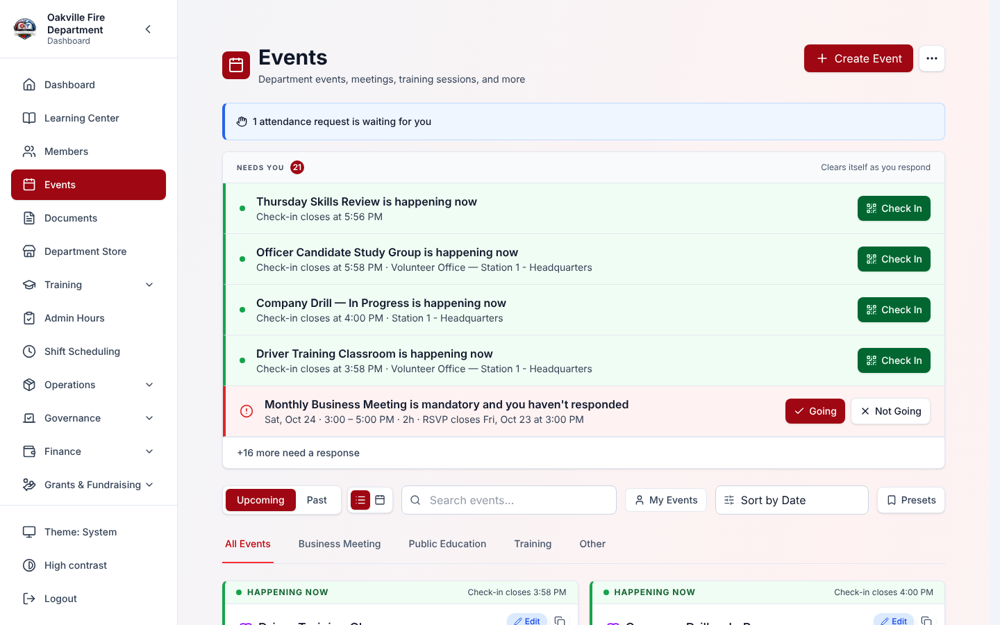

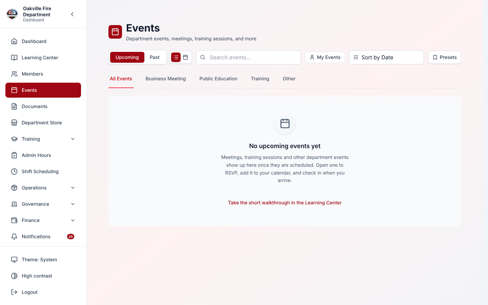

---

## Viewing and RSVPing to Events

Select any event to open its page. It shows:

- the title, type, date, time and location, with a **Get Directions** link
  when there is a location;
- the description;
- the RSVP counts;
- your own response, under **Your RSVP**;
- an **Event Information** card. It says whether a response is required and
  by when, the **Capacity** if the event has a limit ("3 / 3 spots filled",
  with an **Event Full** badge once full), and whether guests are allowed. If
  none of these apply, the card is left out.

Officers who manage events also see the full attendee list, a **Statistics**
card, and the tools to check people in. Other members may see a **Who's
going** list, if the department shares it (see
[Who's going](#whos-going-rsvp-and-the-waitlist)).

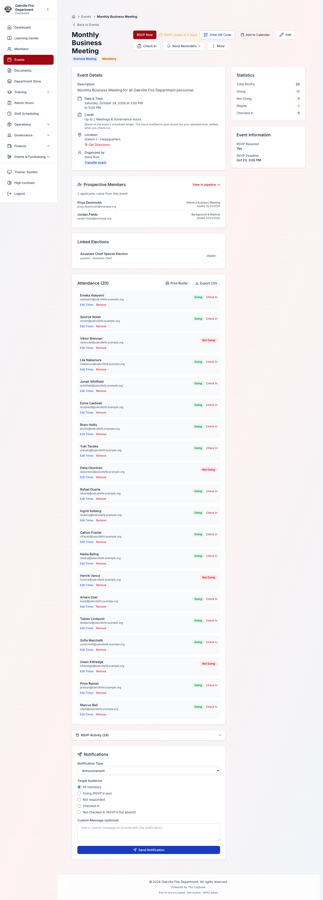

**To RSVP:**

1. On the event page, select **RSVP Now** (or **I'm coming** on an event that
   does not require a response; **Update RSVP** once you have answered). You
   can also answer straight from the event card on the events list or the
   dashboard. Until you answer, the page shows how long is left before the
   RSVP deadline.
2. Choose your response. An event offers only the choices its organizer
   allowed. New events offer **Going** and **Not Going**; **Maybe** appears
   when the organizer ticks it.
3. Optionally fill in **Number of Guests** (if the event allows guests),
   **Notes**, **Dietary Restrictions** and **Accessibility Needs**. Event
   officers see these; other members never do.
4. Save. **Your RSVP** shows your answer straight away.

You can change your answer at any time while RSVPs are open. When you reopen
the dialog it starts from your current answer and notes, so nothing is lost.

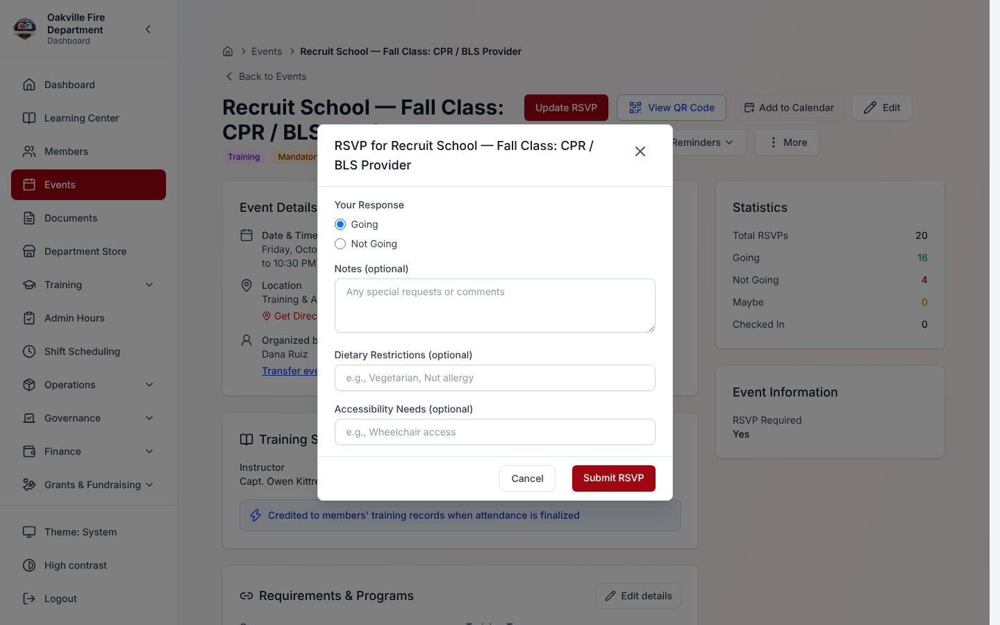

> **When can I RSVP?** Only on a **published** event that has not ended and
> whose **RSVP deadline** has not passed. A **draft** event (one an officer is
> still preparing) takes no responses. Once RSVPs close, the event page, the
> event card and the dashboard all stop offering the RSVP buttons. If you
> missed the window, check in at the event — or, once check-in has closed,
> use **I was there** (below).

> **What does "Required" mean?** A **Required** badge means a response is
> expected. It drives the deadline and the reminders sent to people who have
> not answered. You can still respond to an event that does not require it.

**Series RSVP.** On a recurring event you can answer for **every event in the
series** at once. Each occurrence is checked on its own: its capacity, guests
and deadline apply as if you had answered it separately. If you answer
**Going** and some sessions are training-program sessions in a phase ahead of
yours, The Logbook warns you once for the whole series. **Sessions ahead of
your phase** lists each one by name and date. **RSVP to series** answers Going
for all of them. **Not now** saves nothing, so you can answer the sessions you
are ready for one at a time.

### Who's going, RSVP and the waitlist

**Who's going.** A member can see a **Who's going** list on an event — names
and going status only — when the department allows it. Contact details, notes,
dietary and accessibility needs, guest counts and check-in times are never
shown to members; they stay in the organizer's view.

| Setting                | Where                                                        | Starts as                    |
| ---------------------- | ------------------------------------------------------------ | ---------------------------- |
| The department default | **Manage Events → Settings → Attendance**                    | **Only event managers**      |
| One event's choice     | **Who can see who's going** in the event's **RSVP Settings** | **Use organization default** |

On an event, **Everyone in the department** or **Only event managers**
overrides the default in either direction.

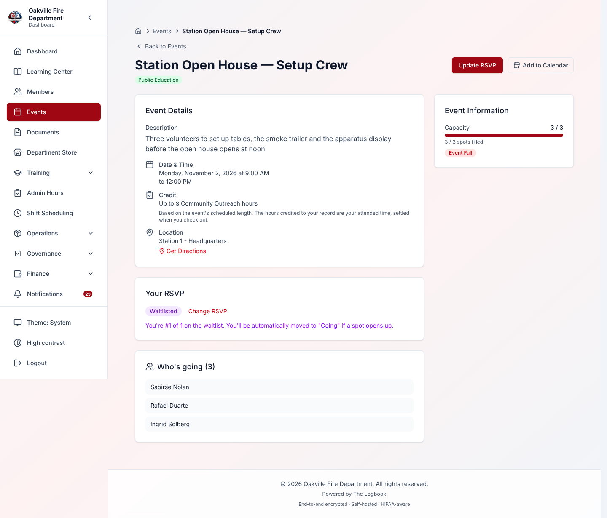

**The waitlist.** When an event with a limit is full:

1. A **Going** answer puts you on the **waitlist** instead. A toast says "This
   event is full. You're on the waitlist." and **Your RSVP** reads
   **Waitlisted**.
2. The event page tells you where you stand: "You're #2 of 5 on the
   waitlist."
3. When places free up — someone changes to **Not Going**, brings fewer
   guests, or an officer removes a **Going** attendee — the people at the
   front of the queue are moved to **Going**, in the order they answered.
   Several places can promote several people at once.
4. You are told in the app and by email (_"You're off the waitlist: …"_, with
   the event's time and place and a link to it).

You can turn the email off under **Settings → Notifications → Off the
waitlist**. The in-app notice stays either way, and a department can make the
email required. Its wording is the **Off the Waitlist** template under
**Communications → Email Templates**.

> **Guests take seats.** Capacity counts seats, not responses: a member going
> with two guests uses three. A party bigger than the whole event is refused
> when you answer, rather than blocking the queue. If an event is already over
> its limit, nobody is moved off it; it simply admits nobody new.

> **What if an officer raises the limit?** Raising **Max Attendees** does not
> promote anyone from the waitlist by itself. The next place that frees up
> does.

**RSVP Activity (officers).** Officers see a collapsible **RSVP Activity**
feed listing every change, such as "John Smith changed from Maybe to Going at
2:15 PM". An automatic promotion reads "… was moved from Waitlisted to Going
(automatically, when a spot opened up)".

**More tools on the attendee list (officers):**

- **Print Roster** prints the attendee list for use at the door.
- **Export CSV** downloads it.
- **Send Reminders** sends a reminder to **Non-respondents only** (everyone
  who has not answered) or **All members**.

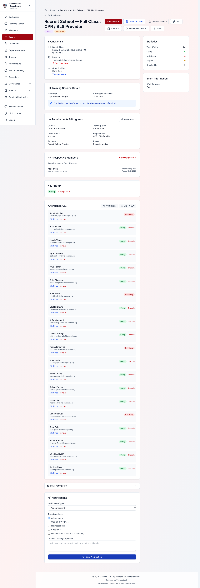

### After an event has ended

The event page drops actions that can no longer do anything:

- **Add to Calendar** is hidden once the event has ended — its scheduled end
  has passed, or an officer recorded an actual end.
- **View QR Code** is hidden once self check-in can no longer succeed: the
  check-in window has closed, the event is cancelled, or attendance is
  finalized. A **Window** event keeps taking check-ins for its "minutes after
  end", so the button stays until then.

### "I was there" — asking to be marked present

A dead phone, no signal, a QR code nobody put up: a member who was at an event
but has no check-in can ask its organizer to mark them present.

**Who sees it.** Once the event's check-in window has closed, a member with no
check-in sees _"Were you at this event but never checked in? Ask the organizer
to mark you present."_ with an **I was there** button. It is offered:

- for **30 days** after the event ends;
- once per member per event;
- not on a draft or cancelled event.

The button appears only when a request would be accepted.

**Sending it.** **I was there** opens **Ask to be marked present**:

1. **Why is there no check-in?** — required, up to 1,000 characters.
2. **When did you arrive?** and **When did you leave?** — both optional. If
   you give both, the second must be later. Neither can be in the future.
3. Select **Send request**. The toast reads _"Request sent to the event
   organizer"_.

The page then shows where the request stands: waiting, **"Your attendance was
confirmed by …"**, or **"Your request to be marked present was not approved
by …"** with the organizer's reason. A declined member cannot ask again for
that event.

**Withdrawing it.** While the request is waiting, the notice has a **Withdraw
request** button. Use it for a request sent for the wrong event or with the
wrong times. Confirm with **Withdraw request** (or **Keep it** to back out).
**I was there** comes back so you can send a corrected one.

- You can withdraw **twice** per event. After that the notice says _"You have
  withdrawn this request as many times as allowed."_ and the request waits
  for an answer.
- Once the organizer has approved or declined it, it can no longer be
  withdrawn.

**Deciding it (organizers).** The event's organizer, its alternate and
officers who can manage events see an **Attendance Requests** card on the
event page. Each request shows the member, when they asked, their reason and
the times they gave, with **Approve** and **Decline**. A request the member
withdrew and sent again says so — _"Withdrawn and sent again once"_ (or
_twice_) — which is why you may have been told about it more than once.

- **Approve** opens **Confirm attendance**. Enter a **Check-in** and a
  **Check-out** (both required — _"These times decide the hours credited"_)
  and an optional **Note to the member**. This writes the same times **Edit
  Times** writes, so the member is credited when attendance is finalized.
- **Decline** asks for a **Reason**, which the member is shown.

Nobody decides their own request.

> **What if attendance is already finalized?** Approving is refused — the card
> says _"Attendance is finalized. Reopen attendance to approve a request;
> declining still works."_ Approving would change what finalizing already
> credited. A request that arrives after finalizing says so in the
> notification itself, so you know before you open the event.

**Every request in one place.** When requests are waiting on your events, the
Events page shows _"N attendance requests are waiting for you"_. It opens
**Attendance Requests**, which lists every waiting request on events you
organize or are alternate for, oldest first, with the same **Approve** and
**Decline**. Officers who can manage events can switch between **My events**
and **All events**.

**Who is told.**

- A new request goes to the event's organizer and alternate, in the app and by
  email (the **Event officer duties** member email switch).
- If neither can be reached — both have left, or the only one set is the
  member asking — it goes to the position chosen for that event type under
  **Event settings → Attendance**, then to the **Secretary**, and only as a
  last resort to every officer who can manage events.
- The member hears the decision in the app and by email (**Event
  reminders**).

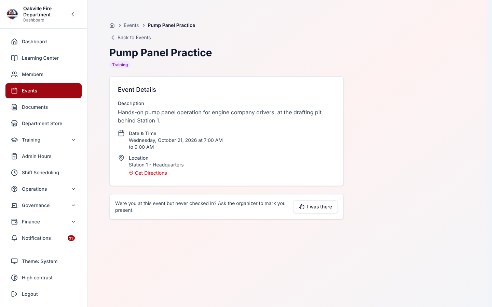

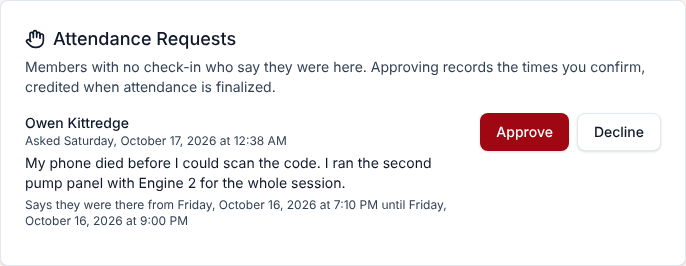

---

## QR Code Check-In

Members record their attendance by checking in when they arrive, and out when
they leave. The usual way is a QR code shown at the door.

### For Officers (Setting Up Check-In)

1. Open the event page.
2. Select **View QR Code**. The button is not offered once check-in can no
   longer succeed (see [After an event has ended](#after-an-event-has-ended)).
3. Show the code on a screen, or print it for the entrance.

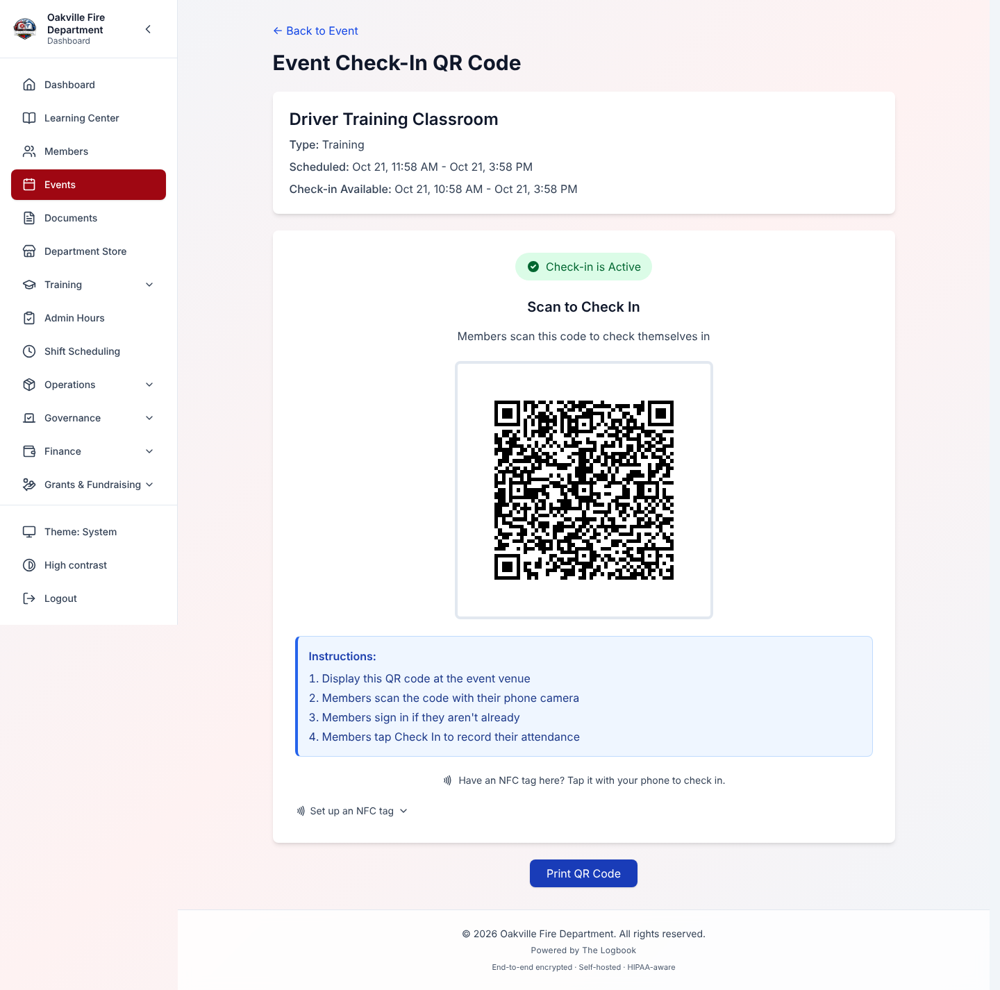

The page reads "Members scan this code to check themselves in", with short
steps for members. It refreshes itself every 30 seconds.

**The code is hidden until check-in can succeed.** Before then the page shows
a blank placeholder the same size, so nobody scans early and hits a refusal.
The code appears on the next refresh after check-in opens. A member who opens
the page early is told what it is for: _"This code is put on display at the
event. When you arrive, scan it with your phone camera to check yourself
in."_

### For Members (Checking In)

You can also check in from the event page itself. While check-in is open the page
offers **Check In**; afterwards it reads **You're checked in** and states the hours
and category credited, as the event card does. **View QR Code** is shown only to
people who can manage the event or are its organizers, because it opens the page
meant to be put up at the door. The optional RSVP button on an event that does
not require a response reads **Going**. The attendee list is requested only when
your department shares it.

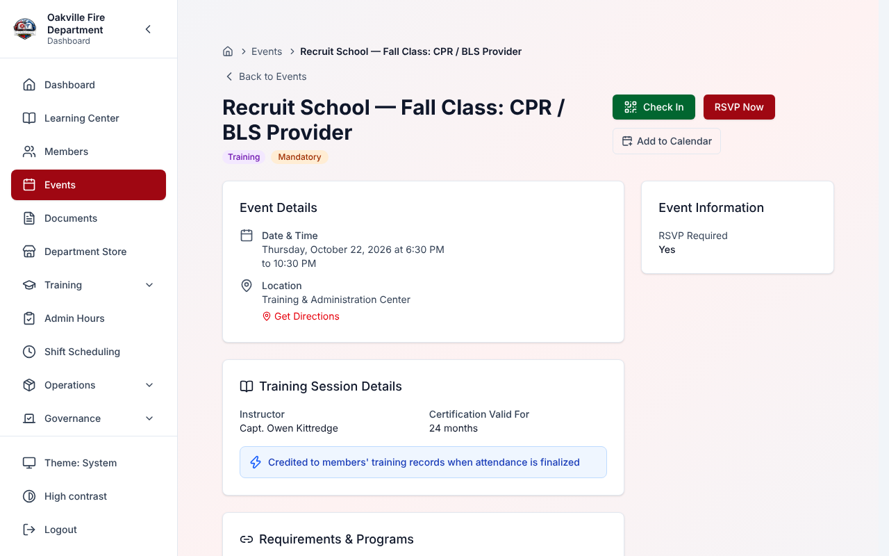

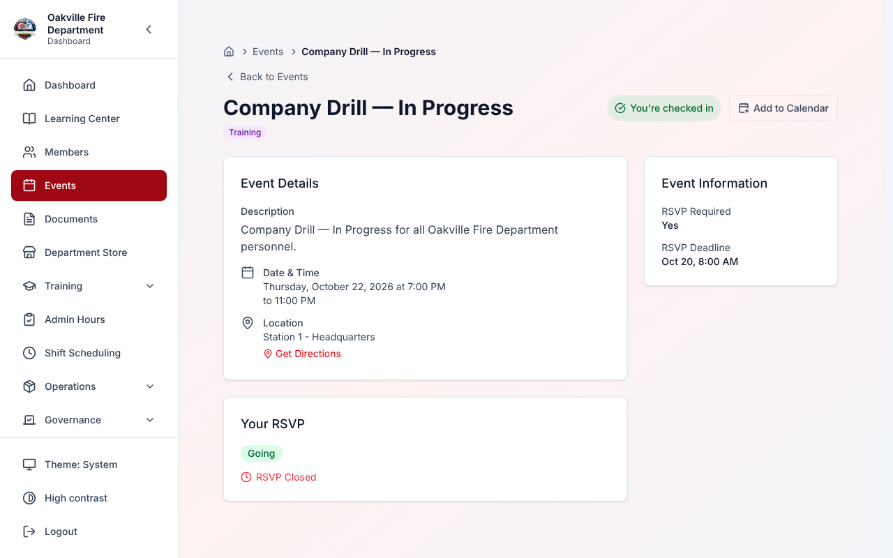

1. Scan the QR code with your phone's camera.
2. Sign in if you are not already. The self check-in page opens.
3. Tap **Check In to This Event**. The confirmation reads **You're Checked
   In**.
4. When you leave, scan again and tap **Check Out of This Event** (**You're
   Checked Out**).

If you check in without having answered the RSVP, The Logbook records you as
**Going**.

On a **Training** event linked to a training session that writes records, the
confirmation adds a **Training Record** notice: _"Your attendance will be
added to your training record when the event's attendance is finalized."_ On
any other event no such notice appears. See
[Training Credit from Events](#training-credit-from-events).

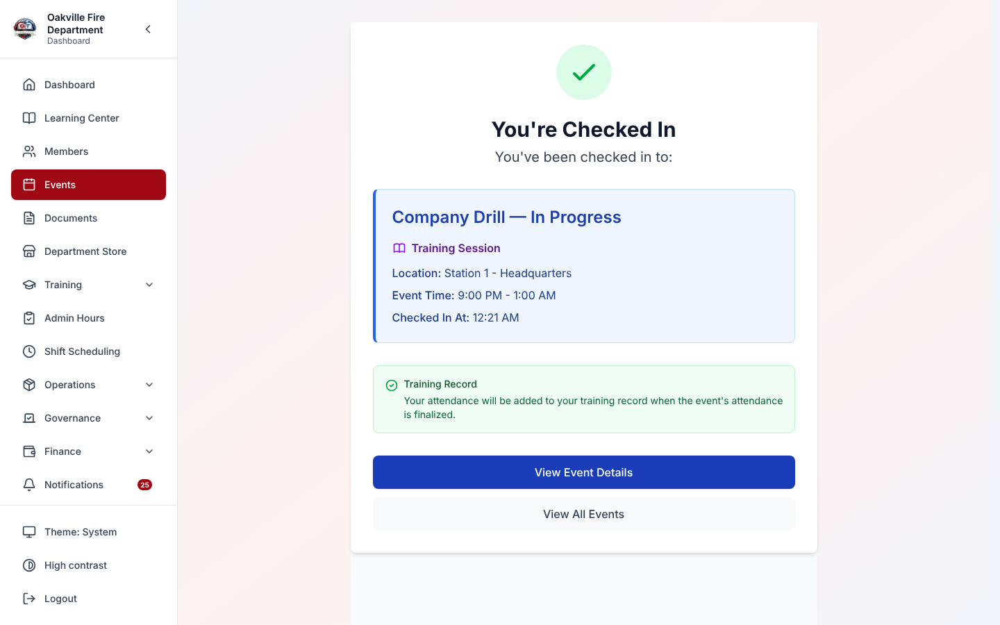

### Check-In Window Types

Each event has a **check-in window**: the time during which members can check
themselves in. The organizer picks one of three kinds on the event form.

| Window type            | Check-in opens                                        | Check-in closes                                         |
| ---------------------- | ----------------------------------------------------- | ------------------------------------------------------- |
| **Flexible** (default) | A set number of minutes before the start (default 60) | When the event ends (the recorded end, if there is one) |
| **Strict**             | At the start (the recorded start, if there is one)    | When the event ends (the recorded end, if there is one) |
| **Window**             | A set number of minutes before the start (default 15) | A set number of minutes after the end (default 15)      |

On the form they read "Flexible - Opens before the start, closes when the
event ends", "Strict - Only while the event is running" and "Window - Opens
before the start, closes after the end". A Window event's second number is
**Minutes after end**.

**Lead time on a new event.** A new Flexible event opens check-in 60 minutes
before the start. If a business meeting you have RSVP'd to ends less than an hour
before this event starts, the form shortens the lead time to the gap, at most
15 minutes, so check-in never opens while the earlier meeting is running. Once
you change the lead time yourself, the form leaves it alone.

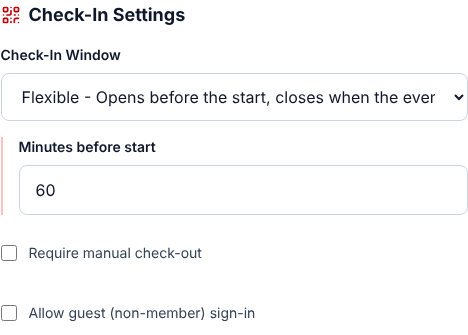

After the window closes, the page says _"Check-in has closed for this event.
Ask an event organizer to record a late check-in."_ All times shown are in
your department's time zone.

### Arriving before the window opens

**Flexible** and **Window** events give members an extra **one hour** before
the window opens. A member who arrives in that hour is checked in, and told
when the official window starts:

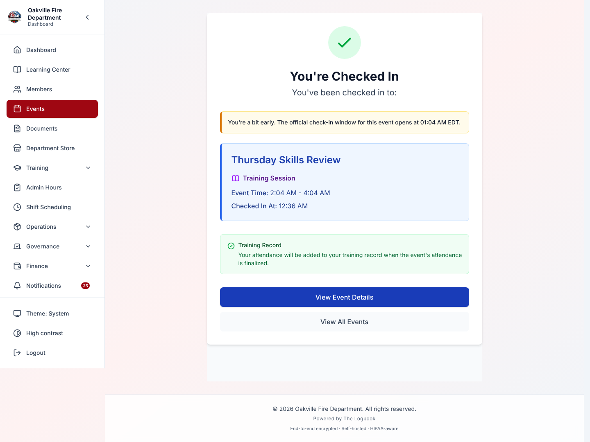

The notice reads _"You're a bit early. The official check-in window for this
event opens at 06:30 PM EDT."_ Three things about it:

- **The time is the department's, not the phone's.** A member travelling with
  a laptop reads the same time as the member standing in the bay.
- **It is a caution, not a refusal.** The check-in worked. The notice only
  tells you the window you were given has not started yet.
- **The grace is exactly one hour, and Strict has none.** Earlier than that,
  the page says _"Check-in is not available yet. Opens at …"_. A **Strict**
  event takes no check-in before its start at all.

How early check-ins are credited is covered under
[Members who check in early](#members-who-check-in-early).

### NFC Tags — a second way in

A QR code has to be reprinted for every event and needs a working camera. In a
dark apparatus bay, or with gloves on, the camera is the part that fails.

An **NFC tag** is a reusable sticker you write once and mount on the wall. A
member holds their phone near it and lands on the same check-in page the QR
code opens.

**Writing one (officers who can manage events):** open the event's QR code
page and select **Set up an NFC tag**. Select **Write tag** and hold a blank
tag to the back of the phone. Writing replaces whatever the tag held before.

**Tapping one (members):** with The Logbook closed, Android opens the link by
itself. With The Logbook already open on screen, Android does _not_ pass the
tag on — so select **Tap Tag** on the Events page instead, then hold the
phone to the tag.

**Requirements: Chrome on Android, over a secure (https) connection.** NFC
works nowhere else — not on an iPhone, and not in a desktop browser. A
department that reaches The Logbook over a plain, unsecured address on its
local network cannot use it.

- Where NFC is missing, **Set up an NFC tag** opens a line of text saying
  which requirement is not met, instead of the **Write tag** button.
- Where NFC is missing, **Tap Tag** is not on the page at all — not greyed
  out, absent. If you cannot find it on a desktop or an iPhone, that is why.
  It is not a permission problem.

**QR codes still work everywhere.** NFC is an extra, never a replacement.

> **Why no screenshot?** The screenshots in these guides are taken by a
> desktop browser, which cannot use NFC, so these controls cannot be
> photographed. On a supporting phone you will see the **Write tag** button
> and, once tapped, a "hold the tag to your phone" state until a tag touches
> it or you cancel.

#### An unrecognized tag does nothing, on purpose

Anyone with a phone can write an NFC tag, so The Logbook treats a tag like a
QR code a stranger handed you. It accepts only links that point back at your
own Logbook, and only to check-in pages it knows.

With any other tag, the scan **stays ready** and says the tag was not
recognized. It does not open the link, it does not close, and it does not ask
whether to trust it. Hold a valid tag to the phone and the same scan picks it
up.

> **Room kiosk codes are never written to a tag.** A kiosk code is a check-in
> pass for an unattended screen. Putting it on a sticker in a public hallway
> hands it to whoever walks past. A room card's **Write NFC tag** writes the
> room's own sign-in link instead, described next.

### Room NFC tags

A tag by a room's door checks a member in to **whatever event is open in
that room right now**. One sticker serves every meeting and class held there.

**Writing one.** On the **Check-In QR Codes** page, each room card offers
**Write NFC tag**. The tag opens a page that needs the member to sign in. The
card's QR code still opens the public kiosk display.

Writing room tags needs the **Write NFC check-in tags for rooms** permission.
It starts with the Fire Chief, Deputy Chief, Assistant Chief, President, Vice
President and Facilities Manager. Apparatus tags have their own matching
permission, held by the same leaders and the Apparatus Officer. An officer who
may write room tags but may not see kiosk codes gets a tag-only **Room NFC
Tags** list instead of the kiosk cards.

**Tapping one.** The member signs in if needed. The page then looks for
events whose check-in window is open in that room:

| What is open in the room  | What the member sees                                                                                                  |
| ------------------------- | --------------------------------------------------------------------------------------------------------------------- |
| One event                 | Taken straight to that event's check-in page                                                                          |
| Several                   | **Which event are you here for?** — the member picks; the page does not guess                                         |
| None                      | **Nothing to check in to**, with **Check again** and **Go to Events**                                                 |
| The room no longer exists | **Room unavailable** — "This tag points at a room that no longer exists. Let an officer know so it can be rewritten." |

The event's own check-in window and rules still apply. Tapping needs Chrome on
Android over a secure connection, as above.

### ID-card check-in at a room kiosk

A room's public kiosk display can also accept **member ID card taps**, from an
Android tablet's NFC or a USB card reader beside the screen, with **nobody
signed in at the kiosk**. When the room's switch is on, the display adds **Or
tap your ID card here**.

A tap checks the member in to the one event whose check-in window is open in
that room — or **out**, if they are already checked in. The screen shows only
the member's first name and last initial.

- **Off for every room until switched on**, room by room, with the **Badge
  check-in** switch on the room's card on **Check-In QR Codes**. Switching it
  on asks first: **Turn on badge check-in** — _"Turn it on only where a card
  reader is mounted beside the display"_ — with **Turn on** and **Leave it
  off**.
- The switch needs the **Write NFC check-in tags for rooms** permission. Every
  change is recorded in the audit log. It cannot be turned on while the **NFC
  ID Cards** integration is off.
- **Both switches are checked on every tap.** Turning the integration or the
  room off stops the very next tap.
- **Two events open in the room at once:** the tap is refused ("More than one
  event is running in this room…"), unless the member is checked in to exactly
  one of them — which can only mean a check-out.
- **No event open:** the tap is refused.
- A kiosk takes at most **60 taps a minute**. Every tap that changes
  attendance is recorded in the audit log, with the room and the kiosk's
  network address.

> **⚠️ This is an unattended reader.** A copied or borrowed card checks its
> owner in with nobody watching. Your department accepted that trade-off; it is
> recorded in the project's known-limitations notes. Turn badge check-in on
> only for rooms where that is acceptable.

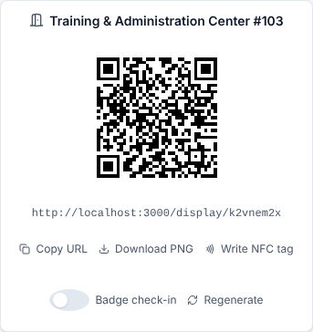

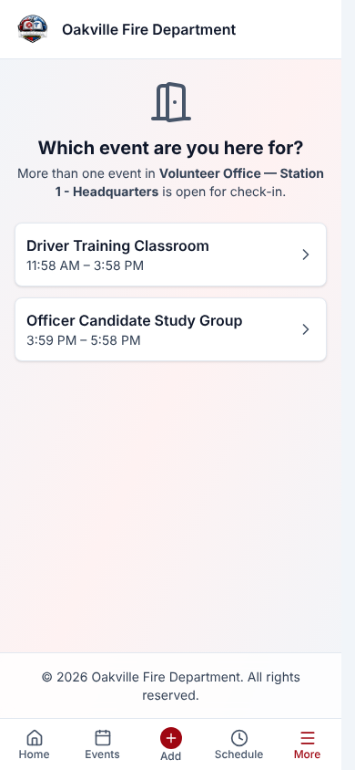

### Checking Members In With an ID Card

An officer can also leave a **check-in station** running at the door of a
meeting or drill night, and have members tap their physical ID card. The
station needs its own permission, issuing cards needs another, and the whole
feature stays off until **Settings → Integrations → NFC ID Cards** is turned
on. The full walkthrough is in
[Membership → Member ID Cards and the Check-In Station](./01-membership.md#member-id-cards-and-the-check-in-station).

What matters for events:

- A station is set up for one specific event or meeting.
- Retired and on-leave members are accepted, because they attend meetings and
  banquets. Inactive, suspended, dropped, archived and deleted members are
  not.
- A tap from an unregistered card, or from a member already checked in, is
  shown on screen, and the station stays ready for the next person.

### Seeing who tapped a card _(2026-10-24)_

Every ID-card tap, at a station or a room kiosk, is logged, including the ones
that were refused. Three places show it:

- **On the event page**, officers who can **Manage all events** see a **Card
  taps** section: each tap for this event, its outcome (**Checked in**,
  **Checked out**, **Already checked in**, **Unknown card**, **Card not
  active**, **Member not active** or **Refused**) and its reader (**Check-in
  station** or **Room kiosk**).
- **Events Admin → Card Check-ins** lists taps across all events, filterable by
  outcome, reader and date.
- **Card Readers** (from **Locations**, **Check-In QR Codes** or the command
  palette) lists every room, whether its reader is on, and its kiosk taps over
  the last 7 days: taps, refusals and the last tap, with each room's recent
  taps on demand. **Only rooms with a reader on** narrows the list. The
  **Badge check-in** switch is here too, with the same rules as above.

**Card Readers** opens for officers who manage locations or facilities, or who
can **Write NFC check-in tags for rooms**, whether or not the Facilities module
is on. It shows whose card each tap was only to officers who can also issue ID
cards. The full card list and tap log are on **Members Admin → Member ID
cards** (see [Membership](./01-membership.md#the-member-id-cards-page)).

<!-- Screenshot needed: The Card taps section on an event page, listing station taps with their outcomes and readers -->

<!-- Screenshot needed: The Card Check-ins tab of Events Admin, with its outcome, reader and date filters above the taps -->

<!-- Screenshot needed: The Card Readers page with the Volunteer Office reader on and its kiosk taps over the last 7 days -->

### Monitoring Check-Ins

Officers can watch check-ins as they happen. On the event page, open **More →
Monitoring Dashboard**. It shows:

- who has checked in, and their check-in and check-out times;
- the total attendee count;
- members who said **Going** but have not checked in.

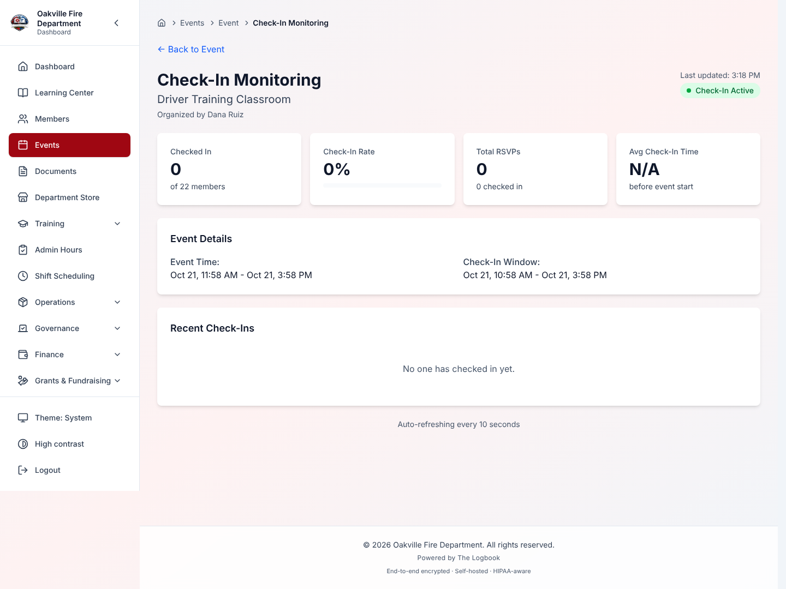

> **Hint:** The monitoring view is read-only. To check in a member who forgot
> to scan, or to correct their times, use **Check In** and **Edit Times** on
> the event's attendance list. On a phone these buttons, **Remove** and its
> **Yes / No** are full-size touch targets.

An officer-edited time is marked "(times edited)" on the attendance list.
**Edit Times** shows the exact minutes it will save: a member who tapped in at
9:07 shows as 9:07. Pick the quarter hour you mean, and the duration under the
pickers shows what will be credited.

#### Members who check in early

Check-in usually opens an hour before the event. So a member can tap their ID
card or scan the QR code well before the event actually starts. When that
happens:

- **Their hours are credited from the event's scheduled start**, not from the
  tap. A drill that runs 19:00–21:00 credits two hours whether the member
  arrived at 18:20 or at 19:00. Arriving _late_ still costs the time missed.
- **The tap time is kept** as the true record of when they arrived.
- The monitoring view lists everyone who tapped in before the start and how
  early they were. The same flag appears beside them on the attendance list.

There is nothing to correct for a member who simply turned up early. The list
is there for the other case: somebody who really **was** working before the
event, setting up or on another task. Use **Edit Times** to set their
check-in, and that time is credited exactly as entered.

**Edit Times** opens on the **scheduled start** for an early member, because
that is what they are credited from. Saving it unchanged changes nothing. To
credit time before the start, set the earlier time yourself.

---

## Guest Check-In for Non-Members

The member QR code is for **members**. Scanning it without an account leads
to the sign-in page. That is the wrong answer at a volunteer interest night,
where most of the room has no account and no reason to make one.

An event can show a **second QR code** for guests. The two sit side by side
on the room display. A guest scans theirs and signs in from their phone —
by typing their name, or, at an event that feeds the recruitment pipeline, by
entering the email they applied with (see
[Recruitment events: sign-in by email](#recruitment-events-sign-in-by-email)).

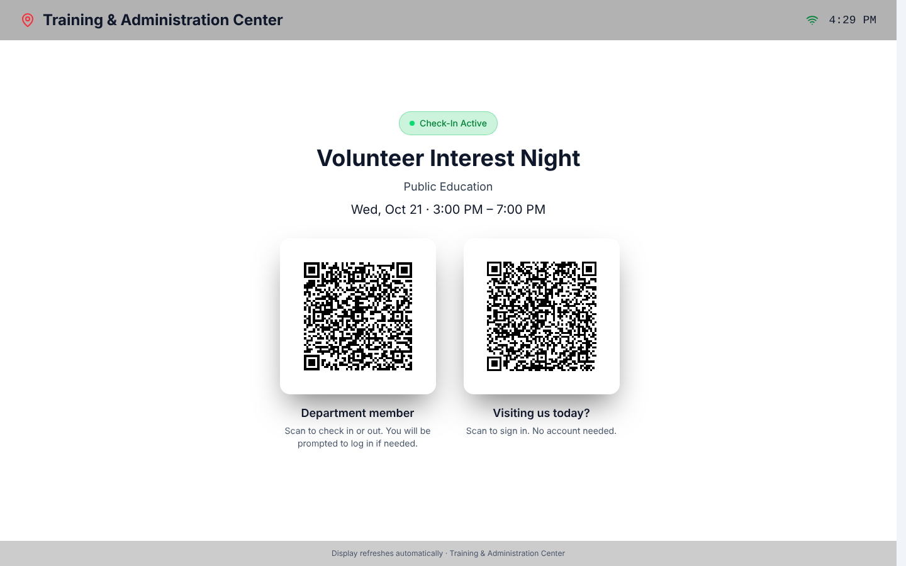

### Switching it on

Both settings are on **Edit Event → Check-In Settings**. Both start off.

| Setting                                            | What it does                                                                                |
| -------------------------------------------------- | ------------------------------------------------------------------------------------------- |
| **Allow guest (non-member) sign-in**               | Adds the guest QR code to the room display and opens the public sign-in page for this event |
| **Add guests to the prospective members pipeline** | Signs guests in by email instead: only active applicants are signed in, onto their application |

The second appears only once the first is ticked. A
[Recruitment](#the-recruitment-event-type) event switches both on for you.

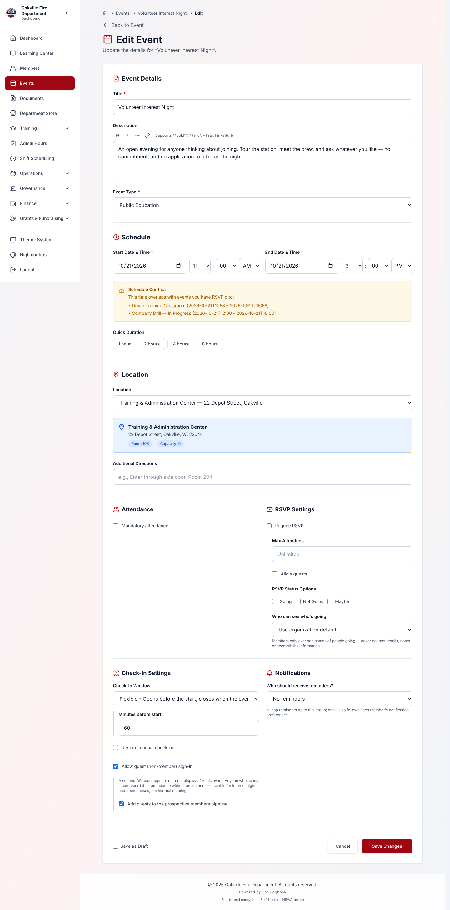

> **Only switch this on for outreach events.** With guest check-in on, anyone
> who can reach that QR code can add a name to your event's attendance list
> without signing in. That is the right trade for an open house or an interest
> night. It is the wrong trade for a business meeting or a training session,
> whose attendance feeds member records — leave it off there.

### A guest QR code for an event with no kiosk room _(2026-10-25)_

The second code used to exist only on a room's kiosk display, so an event held
at an outside venue had no guest code at all. An event now has its own. Anyone
with **events.manage** sees **Guest check-in QR code** on the event's QR page
and detail page. It is created the first time you open it. **Reset** issues a
new one and stops any printed copy from working. Guests who scan it reach the
same sign-in page as the kiosk's guest code. The QR page can print either code
on its own. Members who are not managers never receive the code.

**The guest code waits for check-in to open** _(2026-10-28)_. Like the member
code, it is not shown before the check-in window opens or after it closes, so
nobody scans it early and meets a sign-in that refuses them. The card says when
it will appear and shows it by itself at opening time (it refreshes every 30
seconds). **Reset** is offered even while the code is hidden, for a code that
leaked before the event.

> **Screenshot to create:** the event QR page with the guest code and its
> Reset button, and the print choice for one code. Also the card before
> check-in opens, with the "will appear" note.

### Signing in a walk-in yourself _(2026-10-25)_

On the event page, the **Guests** card has **Add guest** (first and last name
required; email and phone optional), which adds and signs in the guest in one
step, and **Sign in** on any listed guest who has not signed in. At an event
that feeds the pipeline, a walk-in with an email who is not already an
applicant gets an application opened, marked as entered by staff. A member
account is left alone.

### What the guest fills in
### What the guest fills in

This is the form at an event **without** the pipeline switch. Name is
required. Email, phone and why they came are optional. The form is
deliberately short: a walk-in should be asked for the minimum needed to follow
up, not for a membership application. The real application is what your
follow-up email links to.

The form does not ask which department or agency a guest is with. If you need
that, add it to the guest's entry by hand afterwards.

### Recruitment events: sign-in by email

At an event with **Add guests to the prospective members pipeline** ticked —
every [Recruitment](#the-recruitment-event-type) event, by default — the guest
page asks for an email address instead of a name:

1. The guest types the email they applied with and taps **Continue**.
2. If it belongs to an **active applicant**, the page asks "Is this you,
   Jane S.?" — first name and last initial only, so a bystander who knows
   someone's email learns no more than that.
3. **Yes, check me in** signs them in with the name, email and phone already
   on their application, and links the event to it. **That's not me** returns
   them to the email box with a hint to check for typos; nothing is recorded.

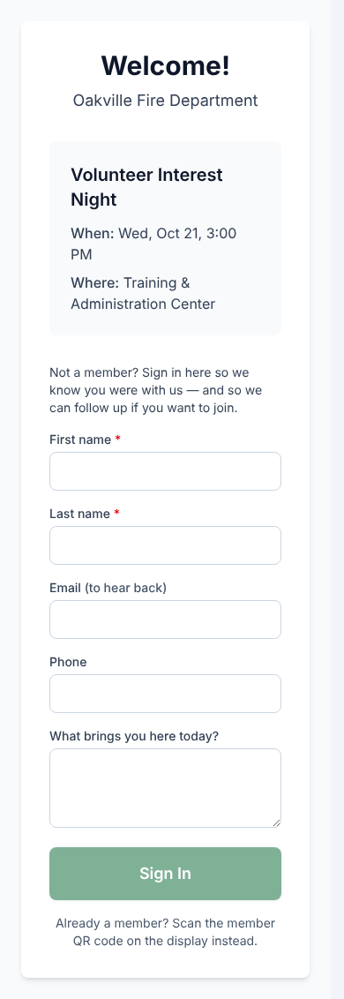

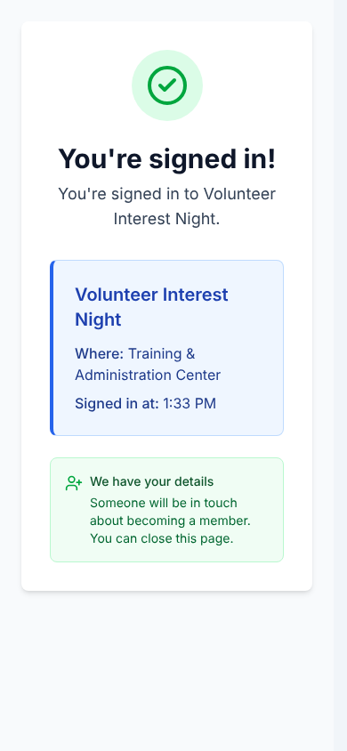

Anyone else is stopped with a message rather than signed in:

| The email belongs to                                         | The guest is told                                      |
| ------------------------------------------------------------ | ------------------------------------------------------ |
| A member account (active or probationary)                    | To scan the **member** QR code instead                 |
| Nobody — or a withdrawn, rejected or on-hold applicant       | To see a member of staff                               |

> **First-time visitors are not signed in by the kiosk at these events.** A
> recruitment event's kiosk records the attendance of people already in your
> pipeline; it does not open new applications from an anonymous phone. For a
> walk-in, someone at the door signs them in from the event page with **Add
> guest** (see below) — with their email, that opens their application. If you
> want walk-ins to sign themselves in, untick **Add guests to the prospective
> members pipeline** — the page then shows the name form above.

A guest who confirms a second time sees "You're already checked in, Jane S."
and nothing changes.

### Where the guest ends up

| Record                                         | When                                                                   |
| ---------------------------------------------- | ---------------------------------------------------------------------- |
| An entry on the event's guest list             | Always                                                                 |
| A link on the guest's **prospective members** card | When an applicant signs in by email at an event with the second switch on |
| A new **prospective members** card                 | When staff sign a walk-in in with **Add guest**, at an event with the second switch on, and give an email |

**Seeing who came.** Officers who manage events see a **Guests (_n_)** card
on the event page. It lists each guest's name, organization, email and phone,
when they signed in, and "Signed in at the kiosk" for a QR sign-in. On an
event that takes guest sign-ins it shows even when empty ("No guests have
signed in yet."). Guests are **not** counted in the event's attendance, which
stays a record of members — the card says so. Other members do not see the
card.

**Signing a guest in by hand.** **Add guest** on the card takes a first and
last name, and optionally an email and phone, and signs the guest in straight
away. A guest who was entered earlier but has not signed in has a **Sign in**
button on their row. At an event with **Add guests to the prospective members
pipeline** ticked, signing in a guest who gave an email also files them in the
pipeline:

| The email belongs to                     | What happens                                       |
| ---------------------------------------- | -------------------------------------------------- |
| An active applicant                      | The event is linked to their existing card         |
| Nobody yet                               | A new card is opened, noting "by staff"            |
| A member account (active or probationary) | Nothing — a member is not an applicant             |

No card is opened without an email, or for a guest entered with only one name.

An applicant who signs in this way has the event linked to their card. The pipeline
card's **Linked Events** panel names the open house, its date and its type,
so at the next pipeline review you can see where each lead came from.

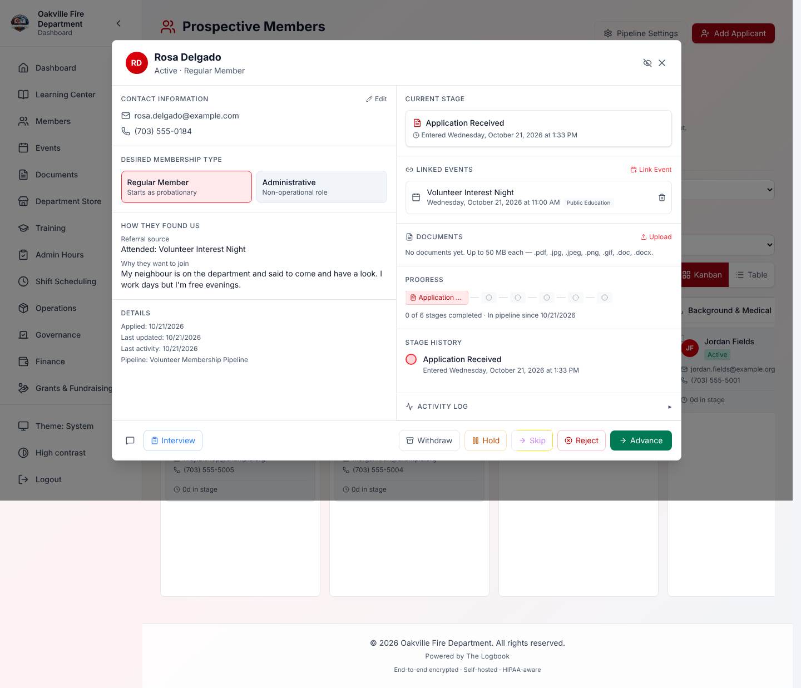

### Edge cases

| What happens                                                                             | Why                                                                                                                                           |
| ---------------------------------------------------------------------------------------- | --------------------------------------------------------------------------------------------------------------------------------------------- |
| **A guest who arrives early is turned away** until the check-in window opens             | Members get the one-hour early grace; guests do not. A member's early check-in can be identified and corrected later. An anonymous one cannot |
| **A guest who taps the code twice is not counted twice** — they see "already checked in" | Matched on their email if they gave one, on their name if they did not                                                                        |
| **Two guests with the same name and no email become one entry**                          | The name match is the weaker fallback, chosen on purpose: a double-tap at a kiosk is far more common than two Chris Smiths at one open house  |
| **A guest you added in advance keeps the details you typed**                             | The kiosk sign-in only fills in blanks. It never overwrites something a person entered on purpose                                             |
| **An applicant who signs in by email does not get a second card**                         | Their existing card is linked to the event instead                                                                                            |
| **If the link to the pipeline card fails, the applicant is still signed in**             | Signing in is what they came to do. The failure is logged for your administrator                                                              |
| **"Is this you?" waits only ten minutes** — after that the guest enters their email again | The confirmation is tied to that event, that room and that moment, so it cannot be reused later                                               |
| **Deleting a prospect does not delete the attendance**                                   | Who was in the room is the event's history, not the prospect's                                                                                |
| **A busy night can hit the daily limit** — 300 guest sign-ins per event per day          | Sized for an open house, not a stadium. Ask your administrator if you really need it raised                                                   |

> **Troubleshooting: the guest QR code is missing from the display.** Check
> three things, in this order: the event has **Allow guest (non-member)
> sign-in** ticked; the event is assigned to **that room**; and the display is
> showing the event you think it is. The guest code belongs to the event, not
> the room, so an event without the setting shows the member code alone.

---

## Creating Events (Officers)

**Who can do this:** officers who can manage events (the **Manage all events**
permission).

Select **Create Event** on the Events page. It opens the **Create Event** tab
of **Manage Events**.

1. Optionally pick a template under **Start from a Template** — _"Pick a
   template to pre-fill common settings, or start blank."_
2. Set the **event type**, **title**, start and end date and time. Moving the
   start past the end carries the end with it, keeping the event's length.
3. Add a **location** and a **description**.
4. Choose the **Organizer** (it starts as **Me (default)**) and an optional
   **Alternate (optional)**. Attendance requests go to these two (see
   [Organizer, alternate and transferring an event](#organizer-alternate-and-transferring-an-event)).
   These pickers are on **Create Event** only. Afterwards, use **Transfer
   event**.
5. Under **Check-In Settings**, choose the
   [check-in window](#check-in-window-types), and guest sign-in if needed.
6. Under **RSVP Settings**:
   - tick **Require RSVP** if a response is expected;
   - set **Max Attendees** to cap the event (leave blank for unlimited);
   - tick the **RSVP Status Options** to offer — Going, Not Going, Maybe;
   - tick **Allow guests** if members may bring guests;
   - choose **Who can see who's going** — **Use organization default**,
     **Everyone in the department** or **Only event managers**.
7. Under **Notifications**, choose who gets reminders and when (see
   [Event Reminders](#event-reminders)).
8. Tick **Save as Draft** to keep it hidden while you finish it; leave it
   unticked to publish now.
9. Select **Create Event**.

> **What if Require RSVP is on but there is no deadline?** On a single event,
> **RSVP Deadline** is then required and marked with an asterisk. The form
> says _"Set an RSVP deadline, or turn off Require RSVP"_. A recurring series
> does not need one. If you set one, it is read against the first
> occurrence's start, and every occurrence keeps that same lead time before
> its own start — a deadline two days before the first drill closes RSVPs two
> days before each drill.

> **Attachments cannot be added from The Logbook.** The attachments area says
> _"Files can't be attached from the app yet."_ — and there is no upload on
> the event page either.

**Mandatory attendance.** Ticking **Mandatory attendance** opens **Mandatory
for**, a checklist of your department's membership types. The form will not
save until at least one is ticked. The event is mandatory only for members
whose membership type is ticked. A member is not counted as required to
attend if they were hired after the event date, were on approved leave that
day, or have no membership type recorded.

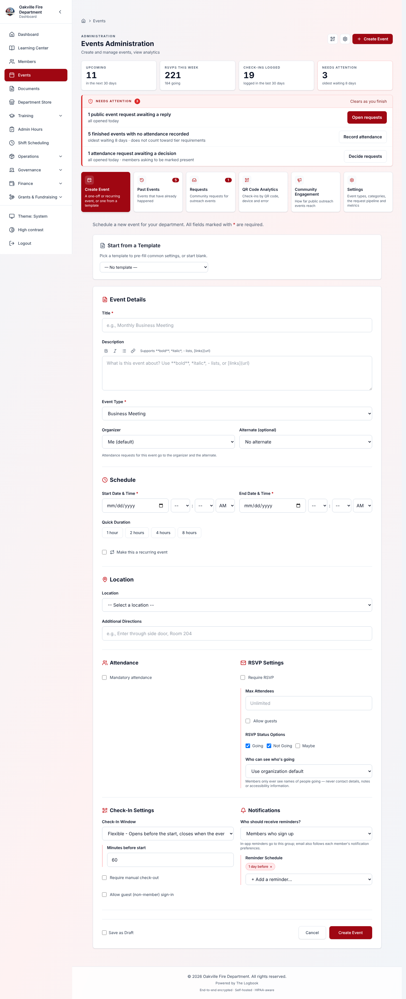

**The form's layout.** On a desktop some sections sit side by side to cut
scrolling: **Attendance** beside **RSVP Settings**, and **Check-In Settings**
beside **Notifications**. Inside **Event Details**, **Start Date & Time** sits
beside **End Date & Time**. Everything else — the template picker, Event
Details, Location and Recurrence — is full width. On a phone it is all one
column.

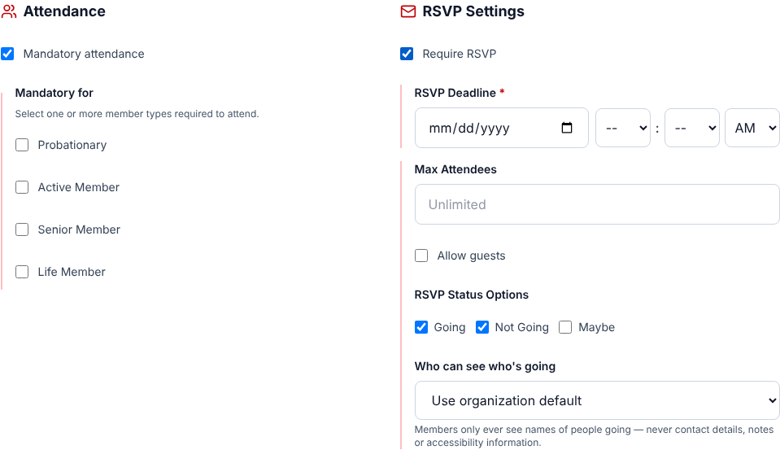

**Time pickers** step in quarter hours (:00, :15, :30, :45). A time that is
already stored on another minute shows as it is.

**Schedule Conflict.** If the time overlaps an event you have RSVP'd to, a
**Schedule Conflict** note lists those events. It is only a warning.

**Room double-booking is a hard stop.** If you pick a room from your
department's location list and another event already has it at that time,
saving is refused. The message names up to three of the clashing events.
Choose another room or time.

**Drafts.** A draft is visible only to officers who can manage events. When it
is ready, open it and select **Publish**. Editing and saving a draft keeps it a
draft; before 2026-10-26 the edit form did not know the event was a draft, and
saving it published it.

**Lead time when you edit.** An event saved without a lead time opens the form
with the value the server uses: 15 minutes on a Window-type event, 60 on others.
Saving no longer moves the check-in window of an open event.

### The Recruitment event type

Open houses and recruitment nights have their own **Recruitment** type, so a
membership-pipeline stage can point at "the next recruitment event" without
also matching every fire-safety talk.

**Choosing Recruitment on a new event switches guest sign-in on**, along with
**Add guests to the prospective members pipeline**, so applicants who come
sign in by email and have the event recorded on their application (see
[Recruitment events: sign-in by email](#recruitment-events-sign-in-by-email)).

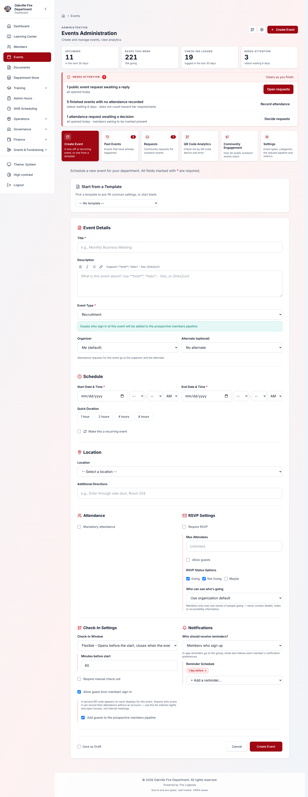

The event page lists the applicants the event brought in, each linked into
the pipeline. The pipeline board can be filtered by the event applicants came
from.

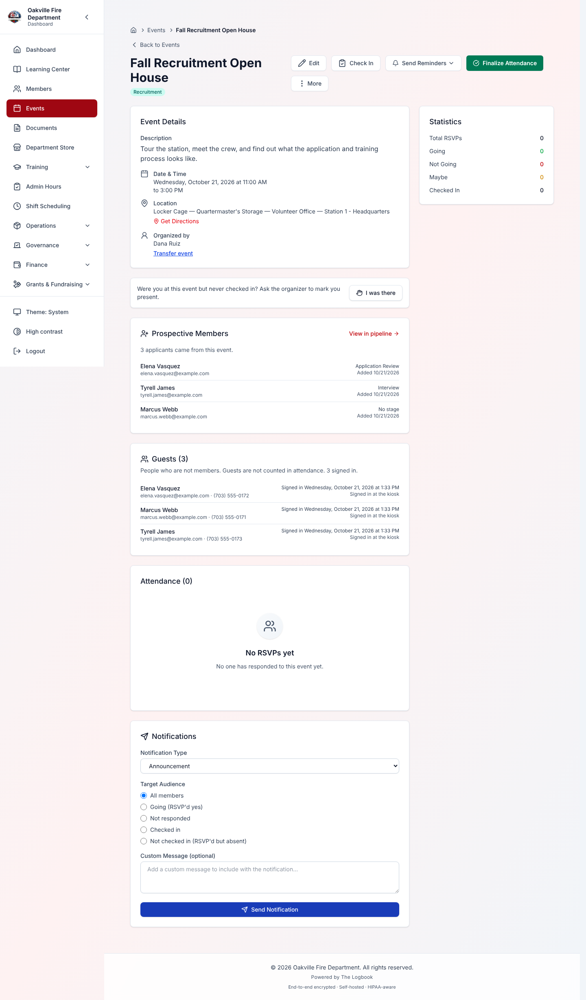

Edge cases:

- **The automatic switch works only when creating.** Changing an _existing_
  event to Recruitment does not flip its switches. The form shows a banner
  explaining what to turn on, with a button to do it.
- **It gives way to you.** Once you set either switch yourself, the automatic
  choice stops applying for that form.
- **It undoes itself cleanly.** Pick Recruitment, change your mind, and the
  switches it set go back off. Switches you set yourself are untouched.
- **Templates do not trigger it.** A template fills the form the same way an
  edit does.
- On the **Past Events** tab, recruitment events are grouped with **Other**.

### Event Reminders

The **Notifications** section separates **who** gets reminders from **when**.

**Who should receive reminders?**

| Choice                  | Who gets the in-app reminder                       | Email                                          |
| ----------------------- | -------------------------------------------------- | ---------------------------------------------- |
| **Members who sign up** | Active members who answered **Going** or **Maybe** | Follows each member's notification preferences |
| **All active members**  | Every active member of your department             | Follows each member's notification preferences |
| **No reminders**        | Nobody                                             | None                                           |

**When:** pick one or more reminder times, such as 24 hours and 1 hour
before. New events start with one reminder, 24 hours before.

**The default audience:**

- A new optional event or template starts on **Members who sign up**.
- A new **mandatory** event switches to **All active members** — until you
  choose an audience yourself. Your own choice is never overwritten.
- A copied event, a series' occurrences and a series' extension all keep the
  audience that was chosen.

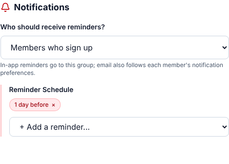

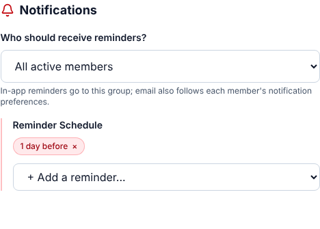

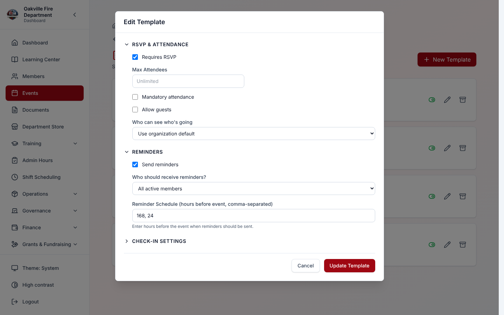

**Above: a mandatory event, audience untouched. Below: a template that is not
mandatory, audience set by hand.** Both read **All active members**, for two
different reasons. The first comes from the automatic default. The second is
a value saved on the template itself. Starting an event from that template
carries the saved value in, like every other template setting.

> **Good to know.** "All active members" never reaches another department and
> leaves out inactive members. **No reminders** stops reminders even if
> reminder times are still set; to turn them back on, choose an audience and
> a time. Choosing an audience does not guarantee an email: each member's own
> preferences still apply.

### Markdown Descriptions

The description box is plain text with a small toolbar above it. The toolbar
wraps the selected text in **markdown** codes, and the event page shows the
formatted result.

| Button      | Inserts       |
| ----------- | ------------- |
| **B**       | `**bold**`    |
| _I_         | `*italic*`    |
| Bullet list | `- item`      |
| Link        | `[text](url)` |

There is no button for underline, numbered lists or headings. The hint beside
the toolbar — `Supports **bold**, *italic*, - lists, [links](url)` — is the
full list of what the box supports.

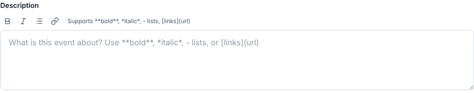

### Organizer, alternate and transferring an event

Every event names an **organizer** and, optionally, an **alternate**. They
vouch for a member who missed check-in (see
["I was there"](#i-was-there--asking-to-be-marked-present)). They need not be
able to manage events to decide their own event's attendance requests or to
hand the event over.

- **Where they show.** The event page's details card shows **Organized by**,
  with the alternate beneath it, and a **Transfer event** link. Only the
  organizer, the alternate and officers who can manage events see it.
- **Transferring.** **Transfer event** opens **Transfer Event**. Pick the new
  organizer and alternate. On a recurring event, choose **Apply to**: **This
  and all future events in the series** (the default — _"Past events keep the
  organizer who ran them."_) or **This event only**. Select **Transfer**, or
  **Keep as is** to leave it.
- **What a transfer does.** Requests still waiting go to the new pair. The new
  organizer and alternate are told, and so is anyone relieved of the role. The
  transfer is recorded in the audit log.
- **When neither can be reached**, requests go to the position chosen for that
  event type under **Event settings → Attendance → Attendance requests** (each
  type starts on **Default (Secretary)**), then to the Secretary, then to
  every officer who can manage events.

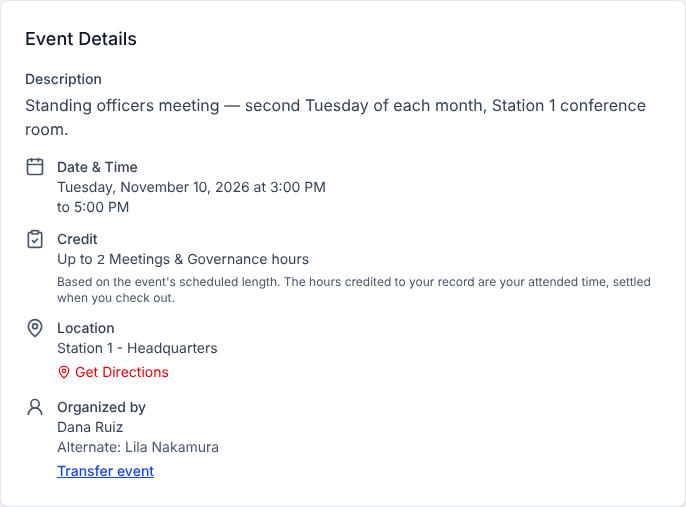

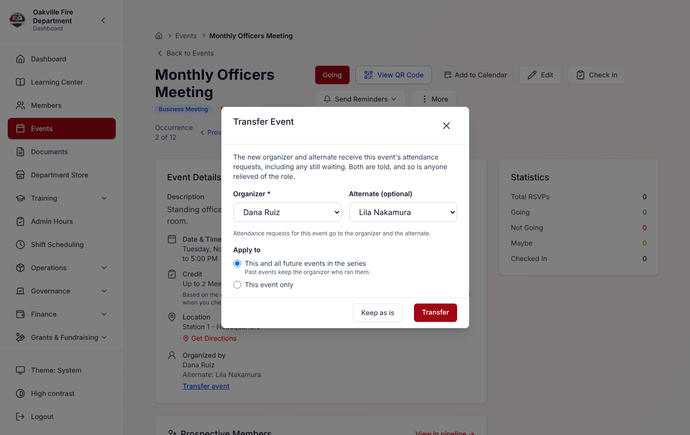

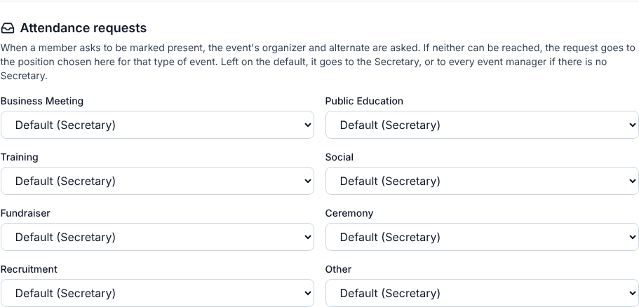

### Who runs an event's attendance _(2026-10-27)_

Officers who can manage events (**events.manage**) run attendance on every
event. Two more groups now do too, without that permission.

**The organizer and alternate run their own event's attendance.** On the event
page they see the attendance list, its counts and the **Check In** button,
which opens **Check In Members**. They can add and check in members,
**Remove** them, and use **Edit Times**. Two limits apply:

- **You cannot record your own attendance** at an event you organize. You are
  left out of the **Check In Members** list, and your own row has no check-in
  or **Remove**. Check in like any member, or ask the alternate or a manager.
  This is the same rule as ["I was there"](#i-was-there--asking-to-be-marked-present):
  someone else vouches for you.
- **On a Training event, the organizer pair do not get Edit Times.** Those
  minutes become training credit, so a training manager or an event manager
  corrects them.

The organizer pair do not get **Edit**, **End Event**, **Finalize
Attendance**, **Record Times**, the **More** menu or the **Monitoring
Dashboard**. Those stay with officers who can manage events.

**Training managers run Training events.** A member with **training.manage**
(in the standard setup: the chiefs, President, Training Officer, Captain,
Lieutenant, Safety Officer and Compliance Officer) gets, on any event of type
**Training**:

- the attendance list, **Check In**, **Remove** and **Edit Times**;
- **Edit**, **End Event**, **Finalize Attendance** and **Record Times**
  (a button of its own, not under **More**);
- **Reopen Attendance**, even on an event they closed themselves. The audit
  log records who reopened it.

When a training manager edits a Training event, the type is greyed out with
_"Only an event manager can change a training event's type."_ Changing **This
and all future events** is refused if any event it would reach is not a
Training event. The **More** menu (duplicate, cancel, delete, templates,
meetings) and reminders stay with officers who can manage events. On any
other type of event, a training manager sees what any member sees; opening
its edit page says _"Only an event manager can edit this event. A training
manager can edit training events."_

---

## Ending and Finalizing an Event

When an event is over, its attendance is **finalized**: the roster is fixed
and hours are credited to everyone who was checked in. These tools are on the
event page, for officers who can manage events, and for training managers on a
Training event (see
[Who runs an event's attendance](#who-runs-an-events-attendance-2026-10-27)).

### End Event

**End Event** closes out an event that is **still running** — for example a
meeting that finishes early. It appears only while the event is in progress:
it has started, its scheduled end has not passed, it is not cancelled, and
attendance is not finalized.

1. On the event page, select **End Event**.
2. **End Event Early** asks you to confirm: _"This will end "…" now and check
   out all currently checked-in members. Attendance durations will be
   calculated based on the current time."_
3. Select **End Event Now**, or **Keep It Running** to back out.

Ending the event:

- records the current time as its actual end;
- checks out everyone still checked in, at that time;
- **finalizes attendance**, so each attendee is credited up to that moment.

The toast reads "Event ended — 12 members checked out", or just **"Event
ended"** if nobody was checked in. The event still ends either way. The event
page then says "This event was ended early."

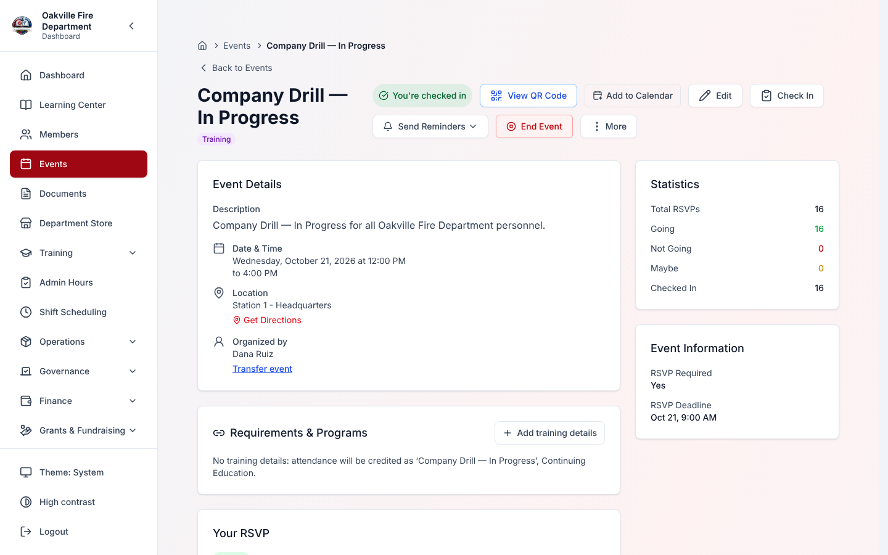

> **What if the event's scheduled end has already passed?** **End Event** is
> no longer offered. Use **Finalize Attendance** instead (below).

### Finalizing attendance

Once an event has ended, the event page offers **Finalize Attendance**.
**More → Record Times** (for a training manager, **Record Times** on its own)
lets you record the real start and end first;
recording an end time also finalizes attendance.

Soon after an event ends, its organizer and alternate (or its creator, if
neither can be reached) get a notification asking them to check the attendance
and close it out.

**Finalizing closes the event.** The roster is fixed and hours are credited.
Members who checked in but never checked out are credited to the event's end.

**Reopening.** Reopening a finalized event needs the **Reopen finalized event
attendance** permission. It is deliberately separate from managing events, so
the organizer who closed an event cannot quietly reopen it and change numbers
already fed into admin hours, training records and compliance. By default the
Fire Chief, Deputy Chief, Assistant Chief and President hold it. On a
**Training** event, a training manager (**training.manage**) can also reopen
it, including one they finalized themselves; the audit log records who did.
**Reopen Attendance** asks for a reason (**Reopen for corrections**).

**A change refused because attendance is finalized** says so in one sentence:
_"Attendance for this event has been finalized, so … is no longer available.
A department leader can reopen attendance to make corrections."_ It names
what was refused.

**Applicants move on when you finalize.** If your department runs a
membership pipeline, an applicant on a **Meeting** stage that names this kind
of event advances when the event is finalized — by **End Event**, by
recording an actual end time, or by **Finalize Attendance** — not the moment
they sign in at the door. An event nobody finalizes releases them on its own
seven days after it ends. See
[What counts as attendance on a Meeting stage](./15-prospective-members.md#stage-types)
for the coordinator's side.

### Editing a finalized event

A finalized event can still be edited:

- **Still editable:** title, description, location, RSVP, reminder and guest
  sign-in settings.
- **Locked:** type, category, schedule and check-in rules. Members' credited
  hours were worked out from them. They are greyed out on the edit form, and a
  notice at the top explains what is locked, why, and how to unlock it.

To change a locked field, have attendance reopened, make the change, then
finalize again. Saving the form with a locked field unchanged is fine; only an
actual change is refused, and the message names just the fields that would
change. A category your department no longer lists still shows, so it is not
lost when you save.

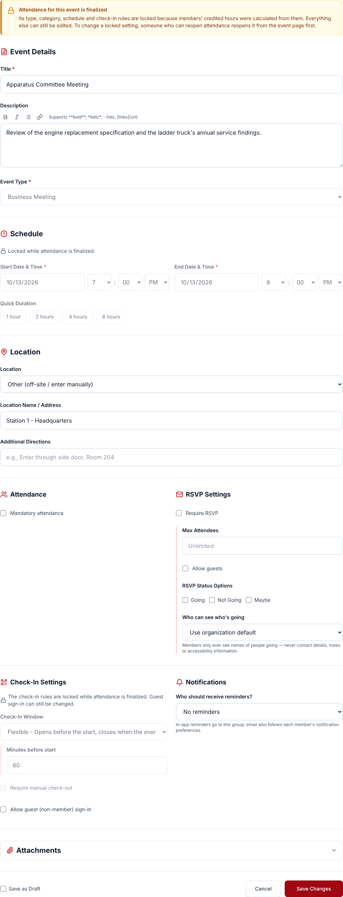

### Training Credit from Events

Any event with type **Training** credits its attendees' training records when
its attendance is finalized — however the event was created.

1. Create the event with type **Training** — on **Create Event**, or under
   Training → **Create Training Session** for sign-off, certification or an
   assigned instructor.
2. Optionally fill in **Training details (optional)** on the form: course,
   category, training type, program and requirement. Then the credit counts
   toward the right requirements. You can add or change them later on the
   event's **Requirements & Programs** card while attendance is open. Without
   details, the record is filed under the event's title as Continuing
   Education. That counts toward total hours, but not toward a requirement
   based on a category.
3. Check members in (or use **Check In** and **Edit Times**), then
   **Finalize Attendance** after the event ends. A Training event can only be
   finalized once it has ended.
4. To correct a finalized event, someone who can reopen attendance (or any
   training manager) reopens it.
   Change the details or times, then finalize again.

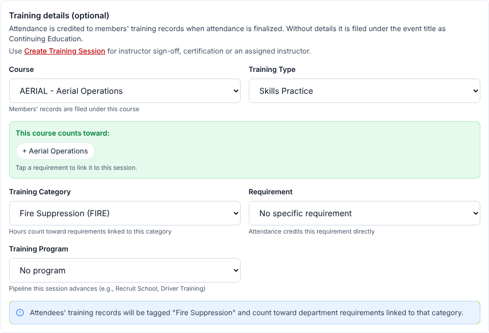

**What each member is credited.** Finalizing gives every checked-in member a
**Completed** training record for:

1. the times you set with **Edit Times**, if any;
2. otherwise their real check-out (or **End Event**'s);
3. otherwise from their check-in to the event's end.

A member with no time to credit — added after the event with no times set,
say — gets no record, and the finalize message names them so you can set their
times. Reopen, correct and finalize again: the record is updated in place,
never duplicated.

If the event's training session needs a training officer's confirmation,
finalizing sends the attendance to training officers instead. Members see the
class as **In Progress** until an officer approves it. The approval page is
linked from their email and from the event's **Requirements & Programs**
card.

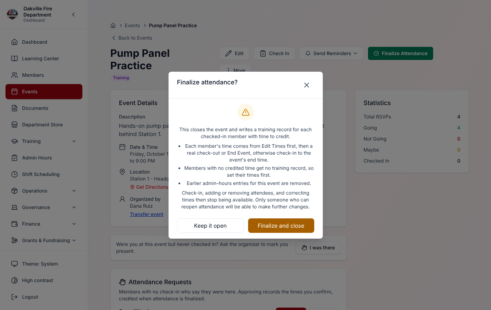

**Training events do not credit admin hours.** Their attendance goes to
training records; crediting admin hours too would count the same hours twice.
Finalizing a Training event removes any admin-hours entries that event wrote
earlier, and the finalize message says how many.

**Multi-class courses.** For a recruit school or a five-night refresher,
generate a **course cohort** instead. The Logbook creates the events _and_
their linked training sessions, one per class, with the roster already
RSVP'd to each. See
[Multi-Class Courses & Cohorts](02-training.md#multi-class-courses--cohorts)
in the training guide.

### Event-to-Admin-Hours Integration

Events can credit attendance to **admin hours** categories, which count toward
compliance requirements.

**Setting it up:**

1. Go to **Manage Events → Settings → Hour Tracking**.
2. In the **Add Mapping** row, pick an event source and an admin hours
   category, set the percentage of attendance to credit, and select **Add**.
3. Each event source becomes a card listing its categories, with a badge
   showing how much of it is allocated. **A source can be split across
   categories.** The percentages for one source add up to at most 100;
   anything left over is not tracked.

**How many hours are required is not set here.** This screen decides where
the hours land; the requirement lives with the admin hours categories
themselves. When members attend events with a mapping, their hours are
credited automatically.

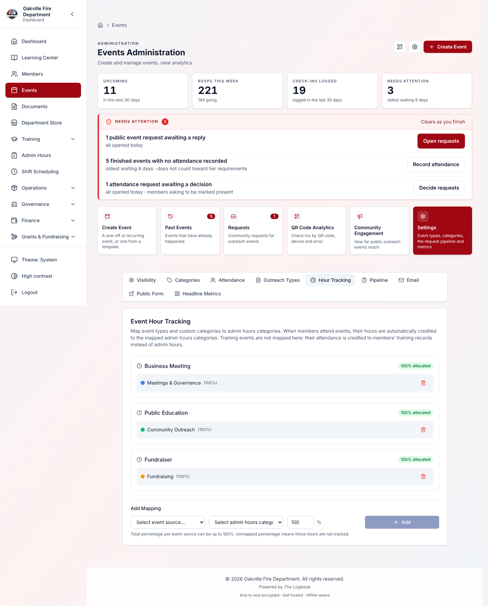

> **What if no mapping is set for an event type?** Its attendance is not
> credited to admin hours.

> **Training events are not offered here.** Their attendance is credited to
> training records when attendance is finalized. An older training mapping is
> still listed, labelled **Not in effect**, and credits nothing. Delete it
> when convenient.

---

## Event Templates and Recurring Events

**Who can do this:** officers who can manage events.

### Templates

A template saves the settings you use again and again — title, type,
location, time, length, description and reminders.

**Making one:**

- On an event's page, select **More → Save as Template**; or
- on the Events page, open the **⋯** menu → **Event Templates** and select
  **Create Template**.

**Using one:** pick it under **Start from a Template** on **Create Event**, or
choose it from **Create from Template** in the Events page's **⋯** menu.

**Managing them** (Events page → **⋯** → **Event Templates**):

- Edit a template, or switch it **active/inactive**. Inactive templates are
  not offered when you create an event.
- Templates are never deleted, because events made from one stay linked to
  it. The archive icon reads **Deactivate**. **Deactivate Template** asks
  first: _"It will no longer be offered when creating an event. Events already
  created from it are not affected, and you can reactivate it at any time
  with its switch."_ It is shown only on active templates.
- Emptying an optional default (such as **Default Duration** or **Default
  Location**) and saving clears it.
- A template's default start is the next hour on your department's clock.

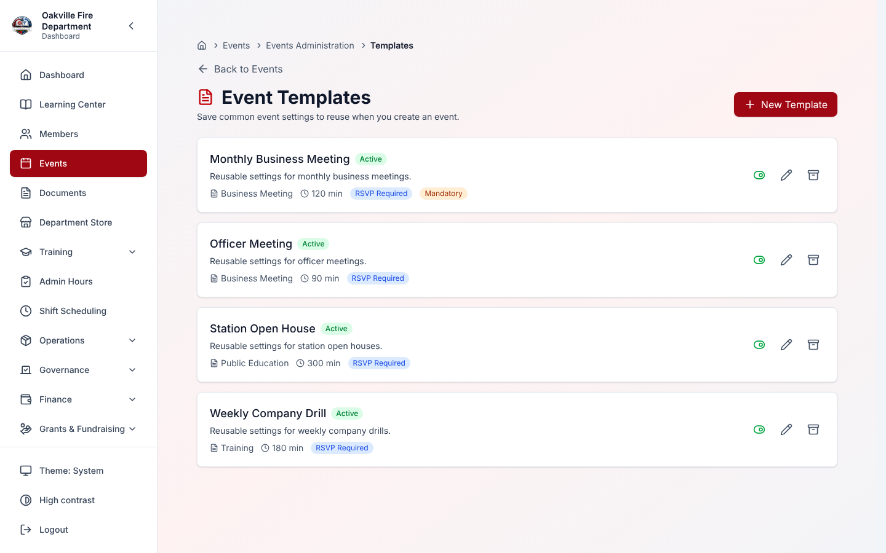

### Recurring Events

To create a series of repeating events:

1. Open **Create Event** and fill in the event as usual.
2. Tick **Make this a recurring event**. The recurrence controls appear
   beneath it.
3. Choose the pattern from **Repeats**:
   - **Daily**
   - **Weekly**
   - **Every 2 Weeks**
   - **Monthly (same date)** — for example the 15th
   - **Monthly (by weekday)** — shows **Which Occurrence** (1st–4th, or Last)
     and **Day of Week**, so "2nd Tuesday of every month" is two choices
   - **Annually (same date)**
   - **Annually (by weekday)** — the same two choices, plus the month
   - **Custom Days** — pick the weekdays
4. Under **Duration**, set the date the series ends, or tick **Rolling
   12-month cycle** (below).
5. Add any dates to skip — a date picker and an **Add** button.
6. Each occurrence is created as its own event, which you can edit or cancel
   on its own.

A series can have at most 365 occurrences. A longer one is refused with "Too
many occurrences (max 365). Please narrow the date range."

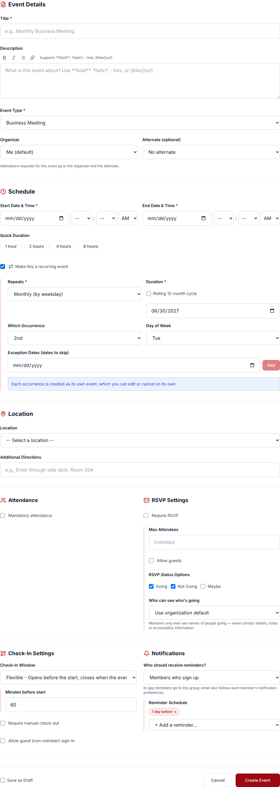

**Rolling 12-month cycle.** Instead of an end date, a rolling series keeps
adding occurrences so it always runs 12 months ahead, ready for RSVPs. Ticking
**Rolling 12-month cycle** replaces the end-date field — the two are
alternatives. The note beneath reads "New occurrences are added automatically
so the series always runs 12 months ahead."

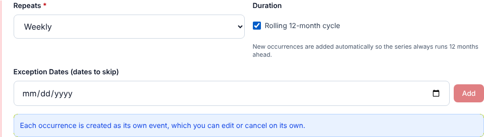

**Dates and times stay put.** A series is laid out in your department's own
time. A weekly 7:00 PM drill stays at 7:00 PM across a daylight-saving change.
Weekdays, "2nd Monday" patterns and skipped dates are matched against your
department's calendar, so an evening series lands on the right day.

**End-of-series reminder.** When a series with an end date is within six
months of its last occurrence, its organizer and alternate (or its creator,
if neither can be reached) get an email reminder.

### Managing Recurring Event Series

Each occurrence appears as its own event with a **recurring event badge** on
the events list. On any occurrence's page:

- The series line reads **Occurrence 3 of 7**, with **Previous** / **Next**
  links and **View All (7)**, which lists every occurrence. A cancelled
  occurrence is no longer counted, so its line reads **Series of 6**.
- **Edit** asks which events to change: **This event only** or **This and all
  future events**. "Future" means this occurrence and every later one — not
  "everything after today".
- **More → Cancel Entire Series** cancels the series. It offers **Only cancel
  future events (keep past events)**.
- **More → Delete Event** offers **Delete only this event** or **Delete all
  events in this series** (see
  [Deleting an event or a series](#deleting-an-event-or-a-series)).

**What "This and all future events" changes:**

- Only the occurrence you edited and the later ones change. Earlier ones are
  never touched.
- A change to the time **moves** each later occurrence by the same amount, in
  your department's clock time, and gives it the new length.
- An RSVP deadline keeps the same lead time before each occurrence's start.
- Leaving the time alone leaves every date where it was, including
  occurrences you had moved one by one.

> **Hint:** Deleting a single occurrence does not affect the others. The
> Logbook warns you when an edit will affect several events.

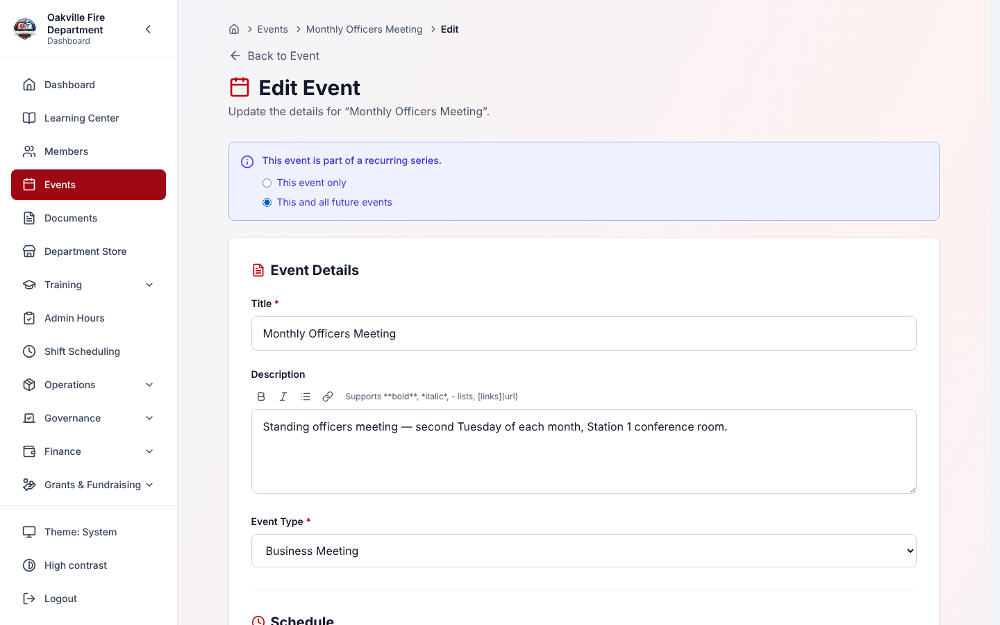

### Recurring Event Edge Cases

| Scenario                                    | What happens                                                                                                                                                                                                                                                                                                                                                                                                                                                                                      |
| ------------------------------------------- | ------------------------------------------------------------------------------------------------------------------------------------------------------------------------------------------------------------------------------------------------------------------------------------------------------------------------------------------------------------------------------------------------------------------------------------------------------------------------------------------------- |
| Monthly or annual by weekday, **Last**      | Uses the last such weekday of the month, whether the month has four or five of them                                                                                                                                                                                                                                                                                                                                                                                                               |
| Monthly on the 31st                         | Falls on the last day of shorter months, and goes back to the 31st in longer ones                                                                                                                                                                                                                                                                                                                                                                                                                 |
| Annual event on 29 February                 | Falls on 28 February in other years, and goes back to the 29th in leap years                                                                                                                                                                                                                                                                                                                                                                                                                      |
| A series using a booked room                | Creating a series does not check the room for double-booking. Check the room's calendar yourself                                                                                                                                                                                                                                                                                                                                                                                                  |
| Series spanning a daylight-saving change    | Each occurrence keeps its local time — a 7:00 PM drill stays at 7:00 PM                                                                                                                                                                                                                                                                                                                                                                                                                           |
| Editing a series with finalized occurrences | Refused when the save would change a finalized occurrence's times, type, category or check-in rules — for example "(2 of 3 finalized occurrences would change)". Saved from a finalized occurrence, those fields are left out, so a description-only edit goes through. Saved from an open occurrence, its type, category and check-in rules are copied onto every later one, so even a description-only edit is refused when a finalized later one differs. Edit those occurrences one at a time |
| Cancelling or deleting a series             | Refused whenever any occurrence is finalized                                                                                                                                                                                                                                                                                                                                                                                                                                                      |
| Duplicating an occurrence                   | Makes a stand-alone event. The recurrence is not copied                                                                                                                                                                                                                                                                                                                                                                                                                                           |

---

## Calendar View and Attendance Trends

### Calendar View

The calendar icon on the Events page switches to a month view:

- Days with events carry coloured dots.
- Select a day to see that day's events.
- **Previous month**, **Next month** and **Today** move between months.
- Times are shown in your department's time zone.
- The calendar shows the same events as the list, so the type filter applies.

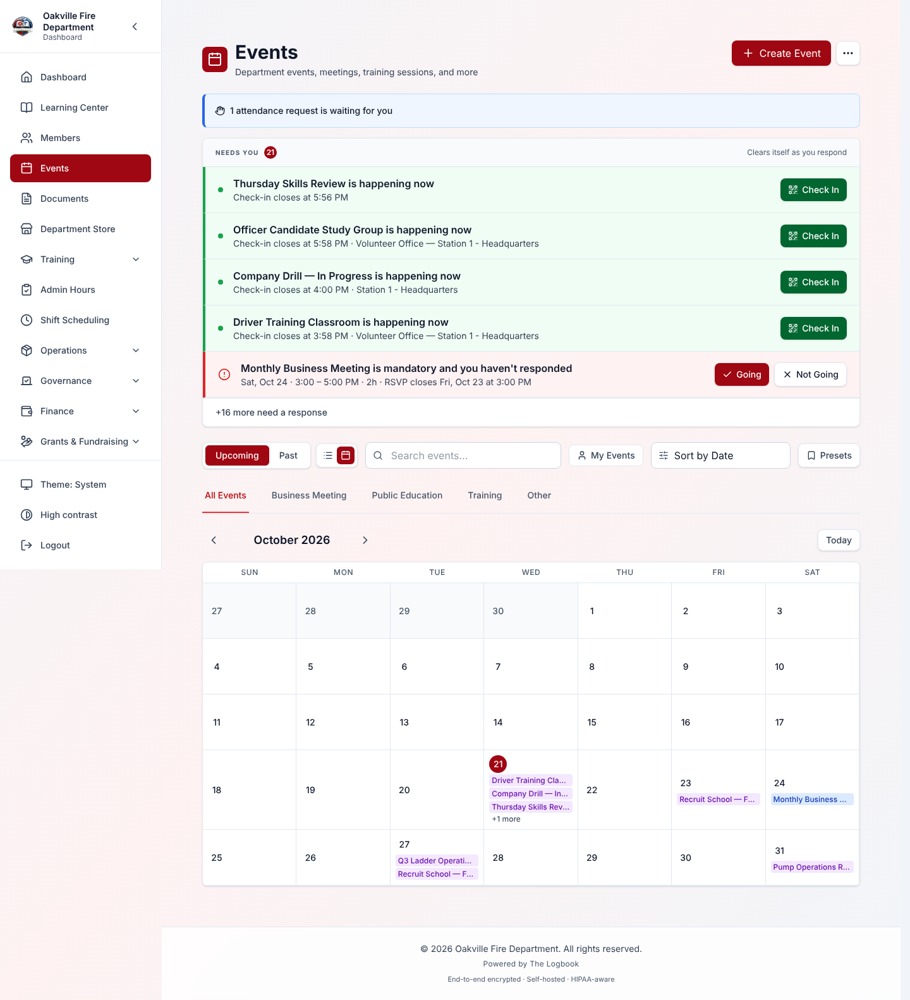

### Attendance Trends

**Who can see it:** members with the **View analytics and dashboards**
permission. It is linked from the Events page's **⋯** menu as **Attendance
Trends**.

The page — _"Attendance and check-in rates across your events"_ — shows, for
the **Period** you choose:

- four summary cards: **Total Events**, **Avg Attendance Rate**, **Total
  RSVPs** and **Check-in Rate**;
- **Event Type Distribution** — events by type;
- **Monthly Event Trend** — events per month;
- **Top Events by Attendance**.

> **What Avg Attendance Rate measures.** For each event in the period that
> has **already ended** and had at least one member answer **Going**, it takes
> checked-in ÷ Going. The card shows the average of those rates. Upcoming and
> running events are left out, so RSVPs to future events do not pull the
> figure down. **Top Events by Attendance** still lists upcoming events, at 0%
> until they happen.

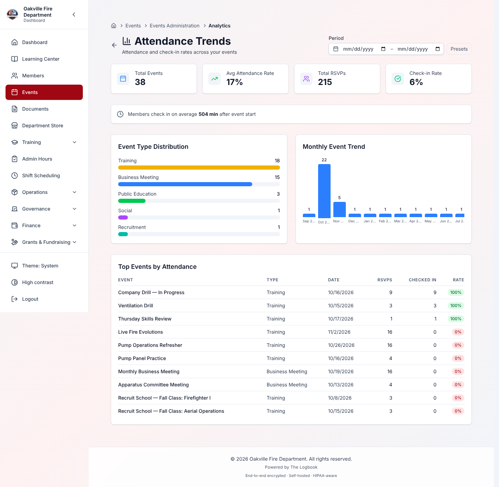

---

## Event Notifications

**Who can do this:** officers who can manage events.

On an event's page, the **Notifications** panel sends a message about that
event. Choose a **Notification Type**, the audience, and an optional message,
then send. It arrives in each member's Notifications inbox in The Logbook and
by email.

Whether a member gets the email depends on the type:

- **Announcement** is always emailed, like a department message.
- **Pre-Event Reminder**, **Missed Event Notice** and **Check-In
  Confirmation** follow the member's **Event reminders** email switch.
- **Post-Event Follow-Up** follows their **Event changes and cancellations**
  email switch.

The inbox entry arrives either way.

| Notification Type         | Purpose                                       |
| ------------------------- | --------------------------------------------- |
| **Announcement**          | General news about the event                  |
| **Pre-Event Reminder**    | A reminder before the event                   |
| **Post-Event Follow-Up**  | A message after the event                     |
| **Missed Event Notice**   | For members who said Going but did not attend |
| **Check-In Confirmation** | For members who checked in                    |

| Audience                               | Who receives it                                     |
| -------------------------------------- | --------------------------------------------------- |
| **All members**                        | Every active member of your department              |
| **Going (RSVP'd yes)**                 | Members who answered **Going**                      |
| **Not responded**                      | Active members who have not answered                |
| **Checked in**                         | Members who checked in                              |
| **Not checked in (RSVP'd but absent)** | Members who answered **Going** but did not check in |

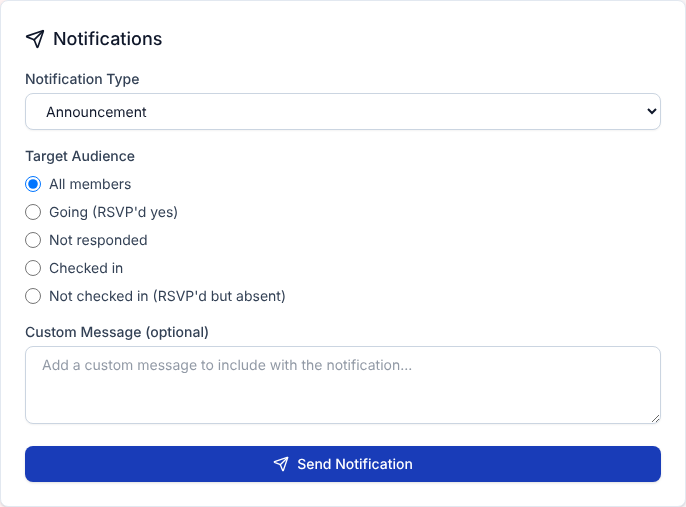

> **What if the event is cancelled?** Notifications cannot be sent for a
> cancelled event.

**Where they arrive.** The bell at the top of the screen is a link straight
to **Notifications → Inbox**, with a badge counting unread items. Event
notices also appear in the dashboard's **My Updates** feed; opening a row
marks it read and takes you to the event. See
[Administration & Reports → Dashboard Notification Management](./08-admin-reports.md#dashboard-notification-management)
for the feed, and
[Notification Channel Filter](./08-admin-reports.md#notification-channel-filter)
for filtering the inbox by **All**, **Email** or **In-App**.

Department-wide announcements are sent from **Communications → Messages**
instead — see
[Documents, Forms & Communications → Department Messages](./07-documents-forms.md#department-messages).

---

## Managing Many Events at Once

### Duplicating an event

**More → Duplicate Event** on an event's page makes a copy with the same
settings, date and time, and opens it for editing so you can change the date.
RSVPs, attendance, cancellation and recurrence are not copied.

### Selecting several events

On the Events page, open the **⋯** menu and choose **Select Events**. Tick the
events you want. A bar at the bottom offers:

- **Export CSV** — downloads the selected events;
- **Cancel Selected** — cancels them (officers who can manage events);
- **Done** — leaves selection mode.

There is no bulk delete and no bulk change of type. **Cancel Selected** asks
first: _"The selected events will be cancelled without notifying members. You
can't undo this."_ — with **Cancel Events** and **Keep Events**.

**Export to CSV** in the same **⋯** menu exports the whole list without
selecting.

### Cancelling an event or a series

**More → Cancel Event** asks for a reason (at least 10 characters) and offers
**Notify members who RSVP'd Going or Maybe**. **Keep Event** backs out.

With **Notify** ticked, those members are told in the app and by email, with
the reason. The email's wording is the **Event Cancelled** template under
**Communications → Email Templates**. A member can turn the email off under
**Settings → Notifications → Event changes and cancellations**; the in-app
notice stays either way, and a department can make the email required.

On a recurring event, **More → Cancel Entire Series** cancels the whole
series, with **Only cancel future events (keep past events)**. Its buttons are
**Cancel Series** and **Keep Series**. It shows the same **Notify** box, but
notifies no one even when it is ticked. **Cancel Selected** notifies no one
either.

**Changing an event.** When you change an event's title, start or end time, or
location, members who answered **Going** or **Maybe** are told in the app and
by an "Event Updated" email showing the new time and place. The email follows
the same **Event changes and cancellations** switch.

A cancelled event stays on the calendar with its attendance intact, and reads
"This event has been cancelled. Reason: …". A finalized event cannot be
cancelled.

### Deleting an event or a series

1. On the event's page, select **More → Delete Event**.
2. On a recurring event, choose **Delete only this event**, **Delete this
   and future events in this series**, or **Delete all events in this
   series**.
3. The dialog reads "Permanently delete "…"? Its RSVPs and attendance records
   are deleted too. You can't undo this." Select **Delete Event** (or **Delete
   Entire Series**), or **Keep Event** to back out.

> **What if I want to keep the history?** **Delete all events** removes every
> occurrence, past ones included. To keep the past, choose **Delete this and
> future events in this series** from the first occurrence you want gone: earlier
> events, with their attendance, stay, and the series is ended at its last
> remaining occurrence with rolling extension off, so the deleted ones are not
> created again. Only the occurrences being deleted are checked for finalized
> attendance. To keep every event on the calendar, use **Cancel Entire Series**
> instead.

> **Deleting the first event of a series no longer loses the series.** The
> earliest surviving occurrence takes over the recurrence settings, so a later
> **Delete all events in this series** still removes every remaining occurrence.

> **An approved meeting cannot be deleted.** Its attendance is part of the
> membership record.

> **What if the event has minutes?** An event with linked records, such as
> meeting minutes, cannot be deleted: "Cannot delete event because it has
> linked records (e.g. meeting minutes). Remove or unlink them first." One
> such event in a series blocks deleting the whole series. A finalized event
> cannot be deleted either.

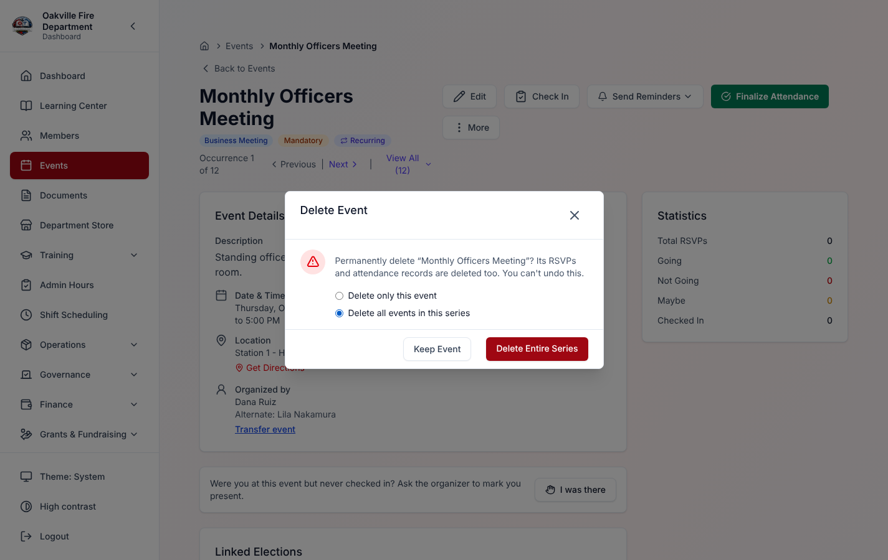

### Importing events from a CSV file

1. On the Events page, open the **⋯** menu → **Import from CSV**.
2. Select **Download Template** for a blank file with the right columns:
   title, event type, start and end date and time, location, description and
   whether it is mandatory. The dialog lists the event types and date formats
   it accepts.
3. Choose your file and select **Import**.

The result says how many events were imported and lists each row that was
skipped, with the reason. Good rows in the same file are still imported.

### Saved filter presets

The **Presets** menu on the Events page saves your current type filter, sort,
search, **My Events** choice and list or calendar view under a name, to load
again later. Presets are kept in your browser, so they do not follow you to
another device.

---

## Event Settings

**Who can do this:** officers who can manage events.

The **Manage Events** entry in the sidebar opens the Events page. Its **⋯**
menu links to **Event Settings**; the **Create Event** button opens the
creation tab. Both are pages of **Events Administration**, which is laid out
like Training, Scheduling and Inventory Administration: four area cards, and
under them a strip of the chosen area's pages with a line naming the open one.

| Area                   | Pages                                   |
| ---------------------- | --------------------------------------- |
| **Events**             | **Create Event**, **Past Events**       |
| **Community Outreach** | **Requests**, **Community Engagement**  |
| **Check-ins**          | **QR Code Analytics**, **Card Check-ins** |
| **Settings**           | **Settings**                            |

An area card and the page under it carry a red count when the **Needs
attention** list has items there.

**The top of the page.** Like every administration page, it opens with four
headline numbers and a **Needs attention** list. The built-in numbers are
**Upcoming**, **RSVPs this week** and **Check-ins logged**; the fourth is
always the count the **Needs attention** list is about. Choosing the numbers,
and who may see the list, is covered in
[Administration & Reports → Administration Hubs](./08-admin-reports.md#administration-hubs).

**The Event settings sections:**

| Section              | What it holds                                                                  |
| -------------------- | ------------------------------------------------------------------------------ |
| **Visibility**       | Which event types and categories appear as filters (**Event Type Visibility**) |
| **Categories**       | Your **Custom Event Categories** and their colours                             |
| **Attendance**       | _"Who sees who's going; who takes requests"_                                   |
| **Outreach Types**   | The kinds of outreach the public can request                                   |
| **Hour Tracking**    | Mapping events to admin hours                                                  |
| **Pipeline**         | _"How requests are handled"_ — the public request pipeline                     |
| **Email**            | Request email triggers and templates                                           |
| **Public Form**      | The public event-request form                                                  |
| **Headline Metrics** | The four numbers at the top of the page                                        |

On a phone the sections become a scrollable strip of tabs, and every control
is a full-size touch target.

---

## Meeting Minutes

Select **Minutes** in the sidebar. The **Meeting Minutes** page — _"Record
meetings, write up their minutes, and track action items"_ — lists
**meetings**. Under each meeting card are the **minutes** written from it, as
links that show their state: **Draft**, **Circulated for review**, **Adopted**
or **Returned for changes**. (Before 2026-10-14 the middle two read **Awaiting
approval** and **Approved**; see
[Circulating and adopting minutes](#circulating-and-adopting-minutes).)

Who sees which minutes is decided for you: members see circulated and adopted minutes, never drafts or executive sessions.
The **Pending Approval** tile counts minutes awaiting approval.

**Search the minutes themselves.** _(2026-10-19)_ The search box above the list
finds meetings by title and also searches the **words inside the minutes**. Type
two or more characters and a **Found in the minutes** card appears under the box:
one entry per set of minutes, newest meeting first, each showing where it matched
(a section, a motion and its discussion, an action item and its notes or
assignee) with the found words highlighted. Every word you type must appear
somewhere in the minutes, not necessarily in the same section, and a word matches
where a word starts (`hose` finds `hoses`, not `purchase`). Put a phrase in
double quotes to find it exactly as typed. The meeting-type filter beside the box
narrows the search. Members search only circulated and adopted minutes, never a
draft or an executive session; people who manage minutes search everything, and
each result shows its status.

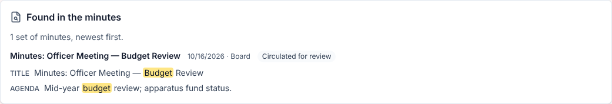

**Minutes Settings.** _(2026-10-19)_ The department-wide choices about minutes
are on one screen, opened with the **Settings** button beside **Outlines** at the
top of the Minutes page (`minutes.manage`). It has four sections: **Attendance**
(who the minutes name), **Signatures** (who signs adopted minutes), **Reminders**
(following up action items) and **Publishing** (the library and the public page).
Anyone who manages minutes can read every section. Changing one needs the
settings permission; without it the controls are greyed out, the section says a
settings administrator changes it, and there is no Save. **Save** stays disabled
until something changes. Before 2026-10-19 these were four separate buttons on the
Minutes page (**Reminders**, **Roll listing**, **Publishing**, **Signers**), each
opening its own dialog.

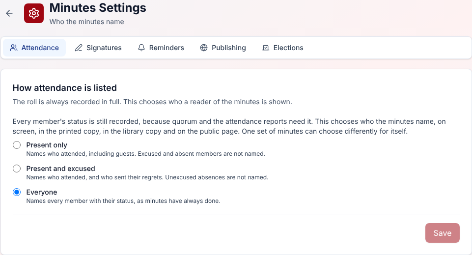

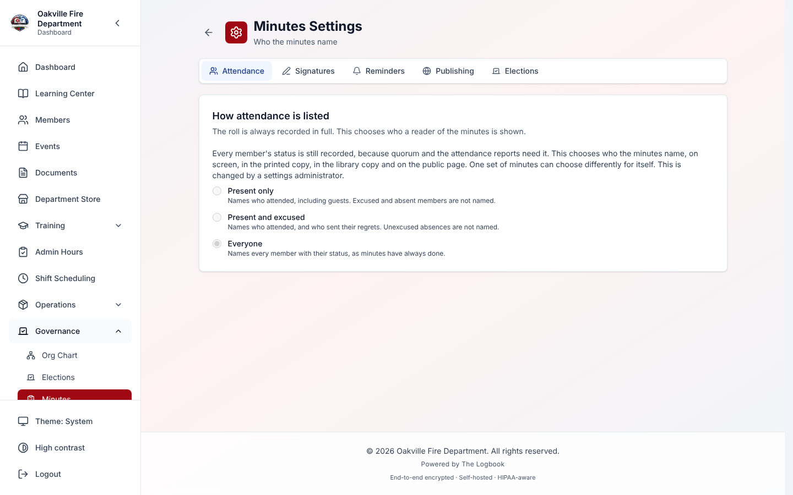

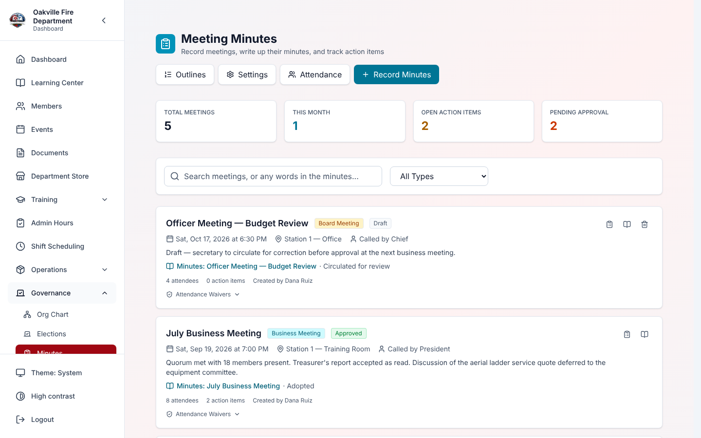

### Creating Minutes

1. Select **Record Minutes** (**Record First Minutes** on an empty page).
2. Fill in **Meeting Title** and **Meeting Date** — both required; **Start
   Recording** stays disabled until there is a date. Optionally add **Meeting
   Type**, **Called By**, **Meeting Time**, **Location** and **Initial
   Notes**.
3. Select **Start Recording**. This creates the meeting. The book icon on its
   card then writes the minutes (below).
4. In the minutes, record the **content** — call to order, roll call, agenda
   items, motions, discussions, adjournment — and any **action items**.

**Meeting Type** offers Business, Special, Committee, Board, Trustee,
Executive, Annual and Other. Minutes written from a meeting keep its type.
Each type starts with its own sections. **Executive** minutes cannot be read
by members, even once approved.

### Motions

Record each formal motion with:

- the motion text;
- the mover;
- the seconder;
- the result (Passed, Failed, Tabled).

**Prepared motions, and accepting the previous minutes.** _(2026-10-18)_ A
section marked **Needs a motion and a second** has its motion from the moment the
minutes are made, so you record who moved and the vote instead of building the
motion. Out of the box those are **Approval of Previous Minutes** and
**Adjournment**; a department marks others on the Outlines screen (an outline
saved earlier is not changed until you tick the box). A prepared motion is wording
only until the meeting acts on it: it is not printed, published or counted among
the motions until you record a result, and it disappears again if its section
stops needing one.

The **Approval of Previous Minutes** motion names the most recent earlier minutes
of the same kind of meeting that have been circulated or adopted ("Accepting the
minutes of the September 3, 2026 business meeting", linked). When you record it
as **Passed**, say whether the minutes were accepted **As submitted** or **As
revised**. Recording it fills in the adoption of those minutes; it does not adopt
them. An officer other than the one who circulated them still confirms it, and
the earlier minutes show a note that this meeting accepted them, and **Adopt
Minutes** then opens already filled in from the motion (see
[Circulating and adopting minutes](#circulating-and-adopting-minutes)).


### Creating Minutes from a Meeting or an Event

- **From a meeting:** the book icon on a meeting card reads **Create minutes
  from this meeting** when it has none. It copies the meeting's title, date,
  type, location and attendees into a new set of minutes. Once the meeting
  has minutes, the same icon reads **Open the minutes of this meeting** and
  opens the newest set.
- **From an event:** on a business meeting's event page, **More → Create
  Meeting** creates the meeting record and opens the Minutes page. Attendees
  are taken from the event's **check-ins**, not its RSVPs. Write the minutes
  from the meeting's card as above.

**Agenda items become the minutes outline.** A meeting can carry a structured
agenda. On **Minutes → Meetings**, select the clipboard icon on the meeting's
card (**Agenda**; it needs permission to manage meetings). For each item enter a
title, an optional **presenter** and notes, tick **Needs a motion and a second**
and type the prepared motion wording if one is ready, and link library
documents (you can only link a file in a folder you could open yourself). Move,
add or remove items with the arrows and buttons beside them; there can be up to 60.

When minutes are created from a meeting that has agenda items, the sections are
those items, in order, each carrying its presenter, notes, prepared motion and
linked documents. They replace the outline's sections, so Call to Order and
Adjournment are agenda items like any other if you want them; the outline still
supplies the header and footer, and you are not asked to choose one. A meeting
with no agenda items behaves as before.

- **Sync from agenda** on draft minutes lists what changed in the agenda since
  the minutes were started (new, changed, removed, reordered items). Tick the
  changes to apply. Text you have written is never touched: an item removed from
  the agenda whose section holds text keeps the section as an ordinary one.
  Saving the agenda never alters minutes already drafted.
- **Not taken up.** A section left blank can be marked **The meeting did not
  take this up**. It stays in the record and prints as _Not taken up_ instead of
  vanishing.


**Linked events.** Minutes can be linked to an event, and **Unlink** removes
the link for good.

**Linked elections.** When the minutes name a meeting event and an election
is linked to that same event, the minutes page shows a **Linked Elections**
card.


### Submitting and Approving Minutes

**Who can do this:** officers with the **Create, edit, and manage meeting
minutes** permission.

> **Renamed 2026-10-14.** **Submit for Approval** now reads **Circulate for
> Review**, **Approve Minutes** reads **Adopt Minutes** and **Reject Minutes**
> reads **Return for Changes**. The rules below are unchanged; the new steps are
> in [Circulating and adopting minutes](#circulating-and-adopting-minutes).

1. On a draft (or returned) record, select **Circulate for Review**.
2. A second officer opens it and selects **Adopt Minutes** or **Return for
   Changes**.

**You cannot approve minutes you submitted yourself.** Approval needs a
second person. The submitter is not offered **Adopt Minutes**; they read
_"Waiting for another officer to approve. You submitted these minutes, so you
cannot approve them."_ **Return for Changes** stays available to them as a way to
withdraw the submission. So a secretary who writes and submits the minutes
needs a second officer with the same permission to approve them.

An action item's **Due** date shows the calendar day it was set for.

**Correcting approved minutes.** Approved minutes are locked: their content,
motions, action items and quorum settings cannot be changed. The record the
department approved — including whether quorum was met — stays as it was.

1. Open the minutes and select **Reopen for Correction**.
2. Say what needs correcting (at least 10 characters). The minutes go back to
   **Draft**, and members cannot see them until they are approved again.
3. Make the correction, then **Circulate for Review**. Another officer
   approves them as before.

The earlier approval and your reason are kept in the audit log.

**A published copy is marked while you correct it.** If the minutes were
published to Documents, that copy stays readable. From the moment you reopen
the minutes, it carries a **Being corrected** notice wherever it is listed:
_"These minutes were reopened for correction on [date]. A corrected version
will replace this document when it is approved."_ The minutes page reminds
you: _"The copy published to Documents is marked as being corrected. Once
these minutes are approved again, re-publish them to replace it."_

Re-approval alone does not remove the notice, because the copy in Documents
still holds the old text. Once the corrected minutes are approved, select
**Re-publish to Documents**. The corrected text replaces the same document —
it is not added as a second copy — and the notice disappears.

**The meeting record has a lighter approval.** A meeting (the card the
minutes hang off) has its own **Draft → Pending Approval → Approved** status.
One officer may take it through all three, but only in that order:

- a meeting is approved only from **Pending Approval**;
- an approved meeting is not approved again;
- editing a meeting cannot set it to **Approved** — _"A meeting cannot be
  marked approved by editing it; submit it for approval and use Approve
  instead"_.

So every approved meeting records who approved it and when. Creating,
editing, deleting or approving a meeting — and changing its attendees or
action items — is recorded in the audit log.

### Who is listed on the roll (department default and per minutes)

_(2026-10-18)_ The roll is always recorded in full; quorum and the attendance
reports read all of it. A new setting chooses which statuses a **reader** of the
minutes sees: **everyone**, **present and excused**, or **present only**. Guests
are named under every choice. Open **Minutes → Settings → Attendance** to set
the department default (a settings administrator changes it; other minutes
managers can read it). On draft or rejected minutes the roll panel has its own
selector that overrides the default for that one set of minutes (leave it on
"follow the department" to inherit). The choice applies to the minutes page, the
PDF, the library copy and the public copy; the public copy leaves out counts that
are not listed rather than showing zero. Nothing changes until someone sets it.


### Publishing adopted minutes (library and public page)

_(2026-10-18)_ Publishing adopted minutes files the library copy in Documents.
When the department allows it, it also posts a **public copy** on a hosted
`/public/minutes` page. Three settings, all **off** by default, are in the
**Minutes → Settings → Publishing**: **Also post a public copy on the public
minutes page**, and under **Executive-session minutes** two switches, **Allow
publishing to the library** and **Allow posting them on the public minutes page**
(the second needs the first and public posting). Turning on the last one asks
for confirmation.

- **Republishing** replaces the library document and the public copy in place and
  notes which version it replaced. Reopening adopted minutes marks the public copy
  as **under correction**; a public copy can also be withdrawn on its own.
- **The public copy is deliberately thinner than the PDF:** attendance as counts
  plus the officers present, no individual votes, no closed-session participants
  and no attachments. Settings are checked when posting and again on every public
  read, so turning posting off hides the page at once.
- **Executive-session minutes** go only to a leadership-only folder, and
  publishing refuses if that folder's access was loosened.
- The Minutes page shows a publishing status line for each set of minutes.


### Circulating and adopting minutes

_(2026-10-14)_ Most departments send the draft minutes round, take corrections
and adopt them at the next meeting. The screen now follows that order:

**Draft → Circulated for review → Adopted.** The buttons on the minutes page are
**Circulate for Review**, **Recall to Draft**, **Return for Changes** and
**Adopt Minutes**.

- **Circulating sends the minutes to members.** Everyone without
  `minutes.manage` can now read circulated minutes (before, only adopted ones),
  and every active member with an email address, except the officer who
  circulated them, gets an email linking to them. A member can switch that email
  off under their notification settings; a department can make it required.
  Executive-session minutes are never announced and members cannot read them.
- **Required sections.** An outline can mark a section **required**. Minutes
  cannot be circulated until each required section has words in it (the roll-call
  section is satisfied by a recorded roll). An empty paragraph does not count.
- **Members suggest changes from the section.** While minutes are circulating,
  each section card carries **Suggest a change**. It opens a form under the text
  with a comment and, optionally, the wording you suggest. A member sees only
  their own suggestions. A suggestion never edits the minutes.
- **The secretary works the suggestions.** Someone with `minutes.manage` sees all
  suggestions, a count of open ones on each section, and **Accept** or
  **Decline** (with a note). To work accepted changes in, click **Recall to
  Draft** (suggestions are kept), edit, and circulate again, which emails
  members again. **Return for Changes** sends the minutes back as rejected.
- **Adopting.** **Adopt Minutes** opens **Adopt these minutes**: the date the
  body voted (**When the body voted**), the minutes of the meeting at which it
  voted, and whether they were adopted **as amended** (ticked for you when any
  suggestion was accepted). The same rule as before applies: you cannot adopt
  minutes you circulated yourself. When a later meeting has already recorded
  its **Approval of Previous Minutes** motion for these minutes, the dialog opens
  filled in from it (the meeting, the date, as submitted or as amended, mover and
  seconder) under a note saying so; check it, then adopt.


- **Adopted minutes are locked.** **Reopen for Correction** works as described
  above; it clears the adoption details but keeps the earlier version.


**Writing sections with formatting.** A section's text now has a small editor:
bold, italic, underline, two heading levels, bulleted and numbered lists, block
quotes and links. Nothing else (no tables, pictures or colours) is accepted, and
that is what the printed copy and the copy published to Documents can show.
Sections written before the editor stay plain text, exactly as typed, until
someone edits them.

**Keeping the record.** Under the minutes themselves, these panels start folded
and show their count ("Motions (3)"); open one to add to it. Attendance, the
suggestions and the sections stay open.

| Panel                 | What it holds                                                                                                                                                                                                                                        |
| --------------------- | ---------------------------------------------------------------------------------------------------------------------------------------------------------------------------------------------------------------------------------------------------- |
| **Attendance**        | Roll call with six statuses: present, late, left early, excused, absent, guest. **Present, late and left early count toward quorum**; the rest do not. A suggested roll is built from the event's check-ins, or the member list if there is no event |
| **Motions**           | Mover, seconder and result; a motion can link to the election or ballot item that decided it                                                                                                                                                         |
| **Closed sessions**   | Reason, legal basis, start and end times, who stayed (someone who stepped out is recorded), a summary, and the motion that moved into it                                                                                                             |
| **Election results**  | A closed election's certified tally, frozen into the minutes. If the election ends after minutes are circulated, the result is filed as a permanent, labelled **addendum**                                                                           |
| **Action items**      | Items, with **Carry action items forward** to bring open ones from earlier adopted minutes of the same meeting type (an item is open in only one place)                                                                                              |
| **Attachments**       | Reports, handouts and the signed copy. Files are scanned and stored encrypted; members see them only once the minutes are adopted. The scanned **signed copy** can be added after adoption and cannot be removed                                     |
| **Approved versions** | One entry per adoption, with a SHA-256 fingerprint. It opens itself and says **Needs attention** if the record no longer matches the adopted version                                                                                                 |


**Print the minutes** for the signature lines. The printed copy shows
attendance by status, quorum, sections, motions, action items, filed election
results and the attachment list, and — once adopted — the approver, version and
fingerprint.

**Signing adopted minutes.** Once minutes are adopted, the people named in the
department's signature slots sign them in the app. The slots default to a
**Recording Secretary** and a **Presiding Officer**, both open to anyone who
manages minutes; a settings administrator can rename them or name positions
instead (up to six) under **Minutes → Settings → Signatures**. To sign, type your name as it
stands on your account and confirm your password, so the signature belongs to a
person at the keyboard. An account that signs in only through single sign-on
cannot sign. A slot is signed once, a person may sign more than one slot, and
the person who circulated or adopted the minutes may sign too. A signature is
tied to the adopted version and prints on the PDF. If the minutes are reopened
and corrected, the new version starts unsigned and the earlier signatures stay
on file against the text they were given for. Signing is rate-limited, since it
is a place a password could be guessed from a signed-in session.


**Outlines (the standard order of business).** **Minutes > Outlines**
(`minutes.manage`) edits the department's standard sections for each meeting
type: title, prefilled text and a **required** flag. **Make default** chooses the
one new minutes start from. When a meeting type has more than one outline,
starting minutes asks which; **Apply outline** on a draft lays an outline over
it, keeping every section that already has text. Deleting an outline does not
change minutes already written from it.


**Upgrading?** Minutes' rich-text editor needs the `nh3` package on the
server; rebuild the backend image (see [`UPGRADING.md`](../UPGRADING.md)).

---

## Action Items

Select **Action Items** in the sidebar for one list of every task assigned
from meetings and minutes.

Each action item has:

- a **description**;
- an **assignee** — the member responsible;
- a **due date**;
- a **priority** — Low, Medium, High or Urgent;
- a **status** — such as Pending (or Open), In Progress, Completed or
  Cancelled.


> **Hint:** Members see their own action items first. Officers can see and
> manage every action item in the department.

**Assigning an item.** On the minutes page, **Add Action Item** offers an
**Assignee** list of every active member (or **Unassigned**). Only an item
assigned this way appears under **Assigned to me**.

**Closing your own item.** If an item is assigned to you, the Action Items
page shows **Update status** beside it, even if you cannot open the minutes
it came from. Set it to Pending, In Progress, Completed or Cancelled, and add
**Completion notes**. Anything else about the item — its wording, due date,
priority or assignee — is changed by whoever keeps the minutes.

**Reminders.** An open or in-progress item with a due date reminds its
assignee in the app three days before it is due, one day before, on the due date,
and on the day after. The check runs once a day.

**Reminder emails.** _(2026-10-15)_ Assignees also get an email, one per member
per day, listing their items that are due soon or overdue. It covers items on
**adopted** minutes with a due date; an item more than 90 days overdue is no
longer chased by email. People who manage minutes also get a weekly list of every
open item, overdue first. A member can turn either email off in their
notification settings. The department sets the timing under **Minutes → Settings
→ Reminders**: **Email reminders to assignees** (on or off), **First reminder,
days before the due date** (default 3; 0 is the due date itself), **Repeat while
overdue, every this many days** (default 7; 0 is one overdue reminder only) and
the weekly open-items list. Changing them needs the settings permission.


### Attendance Dashboard (Secretary)

**Who can see it:** officers with the **Manage meetings** permission.

On the **Minutes** page, select **Attendance** beside **Record Minutes**. It
opens **Meeting Attendance**.

1. Choose the **Period** — the last 3, 6, 12 or 24 months — and optionally a
   **Meeting type**.
2. The tiles show the meetings in the period, the average attendance, how
   many members may vote, and how many are blocked by attendance.
3. The table lists each active member: attendance percentage, meetings
   attended out of those counted, absences, waived meetings, meetings during
   leave, and whether they may vote (with the reason when not).

A member with no meeting to count reads **Not applicable**, not a
percentage.

**How the percentage is worked out:**

> attendance % = meetings attended ÷ meetings counted × 100
>
> meetings counted = all meetings in the member's window − meetings waived −
> meetings during leave

**The member's window** runs from the later of:

- the start of the look-back period, in calendar months — the **Period** you
  chose here, or, for the voting check, **Over the last (months)** on the
  member's membership tier _(2026-10-29)_ — and
- the start of the member's current service — their latest service period,
  otherwise their hire date —

up to today, on your department's calendar. So a member hired two months ago
is not charged with meetings held before they joined. A reinstated member is
not charged with meetings held while they were away. Nobody is charged with
next week's meetings. A meeting that is both waived and during a leave is
left out once, not twice.

This dashboard and the voting-eligibility check use the same calculation, so
they always agree.

**Not yet on this screen:** granting a waiver for one meeting. Waivers are
granted from the meeting.

### Leave of Absence & Meeting Attendance

When a member has an active **leave of absence**, meetings during the leave
are left out of their count automatically. Leaves are created on the
**Waiver Management** page (see
[Membership → Leave of Absence](./01-membership.md#leave-of-absence)).

- The member's percentage is not lowered by meetings they could not attend.
- Officers do **not** need to waive each meeting for a member on formal
  leave.
- Voting eligibility uses the adjusted percentage too.

Waivers for single meetings and leave exclusions are shown separately on the
dashboard. Each lowers the count on its own.

---

## Elections and Voting

Elections have their own guide: [Elections & Voting](./14-elections.md). The
parts most often looked for from here:

| To learn about                                  | Read                                                                               |
| ----------------------------------------------- | ---------------------------------------------------------------------------------- |
| Viewing elections and how they work             | [Elections Overview](./14-elections.md#elections-overview)                         |
| Voting in The Logbook or from an emailed ballot | [Casting Votes](./14-elections.md#casting-votes)                                   |
| Creating an election                            | [Creating an Election](./14-elections.md#creating-an-election)                     |
| Ballot items, candidates and write-ins          | [Configuring Ballot Items](./14-elections.md#configuring-ballot-items)             |
| Saved ballots                                   | [Saved Ballot Templates](./14-elections.md#saved-ballot-templates)                 |
| Who may vote, and secretary overrides           | [Voter Eligibility & Overrides](./14-elections.md#voter-eligibility--overrides)    |
| The pre-meeting package                         | [The Pre-Meeting Package](./14-elections.md#the-pre-meeting-package)               |
| Sending ballots and the eligibility summary     | [Opening an Election](./14-elections.md#opening-an-election)                       |
| Proxy voting                                    | [Proxy Voting](./14-elections.md#proxy-voting)                                     |
| Results, publishing and the emailed report      | [Monitoring & Results](./14-elections.md#monitoring--results)                      |
| Receipts and vote integrity                     | [Vote Integrity & Forensics](./14-elections.md#vote-integrity--forensics)          |
| Linking an election to a meeting or event       | [Meeting Attendance Integration](./14-elections.md#meeting-attendance-integration) |
| Election problems                               | [Elections troubleshooting](./14-elections.md#troubleshooting)                     |


**Elections on the event page.** An event that an election is linked to shows
a **Linked Elections** card: each election's title, its status (Draft, Open,
Closed or Certified), a link to it and a vote count. The same card appears on
minutes for that event (see [Meeting Minutes](#creating-minutes-from-a-meeting-or-an-event)).


---

## Public Outreach Request Pipeline

The **Public Outreach Request Pipeline** lets people in your community ask
your department for an event — a fire-safety talk, a station tour, a school
visit, a CPR class. Your department controls the workflow, who handles it,
scheduling and communication.

### How It Works

1. **Someone in the community submits a request** on a public form. No
   account is needed.
2. **A coordinator is assigned automatically** (you choose who in Settings)
   and told by email.
3. **The coordinator works the request** — ticking off your pipeline tasks,
   adding comments and writing to the requester.
4. **When ready, the coordinator schedules it** — a confirmed date, a room,
   and an event on the department calendar.
5. **The requester follows progress** on a status page, and can cancel if
   plans change.
6. **After the event, the coordinator marks it completed.**

### Setting Up the Pipeline

**Who can do this:** officers who can manage events.

1. Go to **Manage Events → Settings**.
2. Under **Pipeline**, switch on **Accept Public Requests**. It controls
   **both** ways a request arrives: the public request form and any Forms
   form set up as an event request form. While it is off, those forms stop
   creating requests. Publishing such a form from the Forms screen while it
   is off asks **Publish this form?** and says so. Choose **Not yet**, turn
   this on, and publish again.
3. Under **Outreach Types**, add the kinds of outreach you offer. Select **Add
   Type** and enter a short key (for example `fire_safety_demo`) and a label
   (for example "Fire Safety Demonstration"). These are the choices on the
   public form.
4. Also under **Pipeline** (**Request Pipeline**), set:
   - **Default Coordinator** — the member assigned every new request. The
     list shows each member's rank by name ("Jordan Avery — Firefighter").
   - **Pipeline Tasks** — your checklist steps, such as "Chief Approval",
     "Email Volunteer Signup" or "Prep Equipment". Use the up and down arrows
     to reorder them.
   - **Public Progress Visibility** — whether the requester sees task
     progress on their status page. Off by default.
5. Under **Email**, set the **triggers** — which status changes send an email
   (for example on submitted, scheduled or postponed), and whether each goes
   to the requester, the coordinator, or both.
6. Also under **Email**, write **Email Templates** — reusable messages, such
   as "How to Find Our Building" with directions and parking.
   - Templates can use fill-in fields: `{{contact_name}}`, `{{event_date}}`,
     `{{organization_name}}` and `{{outreach_type}}`. Type them with double
     curly braces and no spaces.
   - The event's date and time are printed in your department's time zone.
   - A template can also have a trigger (for example "7 days before event")
     to send itself.

### Managing Requests

Requests arrive on the **Requests** tab of Events Administration.

1. **Open a request** to see the contact details, date preferences and
   description.
2. **Assign or reassign** the coordinator from the list.
3. **Add comments** for internal notes. The requester never sees them.
4. **Tick off pipeline tasks** as they are done. The first one ticked moves
   the request from **Submitted** to **In Progress**.
5. **Schedule Event** — enter the **Start Date & Time**, **End Date & Time**
   and **Location / Room** (or "Off-site or none"), then select **Confirm &
   Create Calendar Event**. This creates a **Public Education** event on the
   department calendar. A room that is already booked at that time is
   refused.
6. **Postpone** — push it back, with a new date or none.
7. **Send Email** — pick a template to send to the requester.
8. **Mark as Completed** — once a scheduled event is done.
9. **Copy the status link** with the link icon, to send to the requester.

A request can also be **declined** or **cancelled**.

> **Send the requester their status link yourself.** Neither the confirmation
> screen nor the default acknowledgement email gives the requester the status
> page. Copying it from here is the only way they get it.

> **What if scheduling or postponing is refused?** The message gives the real
> reason — for example, that the event's attendance is already closed.

### Public Request Form

The quickest way to make the public form is **Manage Events → Settings →
Public Form** → **Generate Event Request Form**. It creates a public form
already connected to the request pipeline.

You can also build one in **Forms**:

1. Create a form (or edit one) in **Forms**.
2. Turn on **Public Access** and give it a **public slug** (for example
   `request-event`).
3. Under **Integrations**, add an **Event Request** integration to connect it
   to the pipeline.
4. Share the form's link on your website, social media or flyers.

**The Public Form section** lists your department's request forms, grouped as
published, draft and archived, each with its public link. It lists only forms
connected to the pipeline — one made by the generate button, or any form
given an **Event Request** integration. Your other published forms (a
near-miss report, a gear-sizing survey) never appear there. Answers to a form
without that integration are kept as form submissions; they do not open
requests.

Officers who can manage events see this section without needing any Forms
permission.


The form collects:

- contact details (name, email, phone, organization);
- the outreach type (from your list);
- a description;
- date preferences (specific dates, a general timeframe, or flexible);
- preferred time of day (morning, afternoon, evening, or flexible);
- audience size and age group;
- where (their location, your station, or either);
- special requests.

Every field on the form is announced by its label to screen readers.

### Public Status Page

Each request has its own private status page. It needs no sign-in.

- It shows the current status as a row of steps, the date submitted, the
  date preferences and the scheduled date.
- If you allow it, it shows the pipeline tasks too.
- A postponed request shows the new date, or that it is awaiting a new date.
- The requester can **cancel** while the request is submitted, in progress,
  scheduled or postponed, with an optional reason. **Keep Request** backs
  out. A completed, declined or cancelled request cannot be changed.

### Common Public Programs

Programs departments commonly set up:

| Program                     | Key                      | Typical length     | Audience                             |
| --------------------------- | ------------------------ | ------------------ | ------------------------------------ |
| Fire Safety Demonstration   | `fire_safety_demo`       | 45–60 min          | Offices, senior living, school staff |
| Station Tour                | `station_tour`           | 30–45 min          | Scouts, daycares, school trips       |
| School Visit / Classroom    | `school_visit`           | 30 min per session | Elementary schools (K-5)             |
| CPR / First Aid Class       | `cpr_first_aid`          | 2–3 hours          | Community groups, company teams      |
| Smoke Detector Installation | `smoke_detector_install` | 15–30 min per home | Seniors, low-income residents        |
| Community Open House        | `open_house`             | 2–4 hours          | General public, potential recruits   |

For program descriptions, suggested pipeline tasks and sample email
templates, see [Public Programs How-To](../../wiki/Public-Programs.md).


---

## Realistic Example: Outreach Request from Submission to Completion

This walkthrough follows one community request through the pipeline, from
the form to the finished event. It shows what the **requester** sees and what
the department's **coordinator** sees.

### Background

**Riverside Fire-Rescue** uses the Public Outreach Request Pipeline. Its
setup:

- **Outreach Types:** Fire Safety Demonstration, Station Tour, School Visit,
  CPR/First Aid Class
- **Default Coordinator:** Lt. Sarah Chen (Community Outreach Officer)
- **Pipeline Tasks:** Chief Approval → Confirm Volunteers → Prep Equipment →
  Pre-Event Email
- **Email Triggers:** on submitted (to the coordinator), on scheduled (to the
  requester), on completed (to the requester)
- **Email Templates:** "Directions & Parking" and "What to Expect"

---

### Step 1: Community Member Submits a Request

**Maria Rodriguez**, PTA president at Lincoln Elementary School, selects
"Request a Visit" on the department's website. It opens the public form.

She fills it in:

| Field                | Value                                                                                                                                                                       |
| -------------------- | --------------------------------------------------------------------------------------------------------------------------------------------------------------------------- |
| **Contact Name**     | Maria Rodriguez                                                                                                                                                             |
| **Email**            | maria.rodriguez@email.com                                                                                                                                                   |
| **Phone**            | (555) 234-5678                                                                                                                                                              |
| **Organization**     | Lincoln Elementary School PTA                                                                                                                                               |
| **Outreach Type**    | Fire Safety Demonstration                                                                                                                                                   |
| **Description**      | We'd like a fire safety presentation for our K-2 students during Fire Prevention Week. Topics: stop-drop-roll, smoke alarms, escape plans. Kids love seeing the fire truck! |
| **Date Preference**  | Specific dates: October 7 or October 8                                                                                                                                      |
| **Preferred Time**   | Morning (school starts at 8:15, assembly at 9:00)                                                                                                                           |
| **Audience Size**    | 120 students + 8 teachers                                                                                                                                                   |
| **Age Group**        | 5-8 years old                                                                                                                                                               |
| **Venue**            | Their location (school gymnasium)                                                                                                                                           |
| **Special Requests** | We have a student in a wheelchair — please ensure any activities are accessible. Parking available in the staff lot.                                                        |

She selects **Submit** and the form thanks her.

Lt. Chen copies the request's status link from the request and emails it to
Maria (see [Managing Requests](#managing-requests)). Maria's status page
shows:

```
Request Status: ● Submitted

Progress:  [●]─────[○]─────[○]─────[○]
         Submitted  In Progress  Scheduled  Completed

Submitted: October 1
Date Preference: October 7 or October 8

[Need to cancel this request?]
```

---

### Step 2: Coordinator Receives and Reviews the Request

Lt. Chen gets an email about the new request from Lincoln Elementary School
PTA.

She opens **Manage Events → Requests** and selects the new request. It shows
Maria's full submission, the pipeline task checklist, and the action buttons.

She adds an internal comment, which Maria never sees: _"Perfect timing for
Fire Prevention Week. We should bring Engine 3 and the smoke house trailer.
Need 3 volunteers minimum."_

---

### Step 3: Working Through Pipeline Tasks

**Task 1 — Chief Approval.** Lt. Chen walks the request by Chief Williams,
who approves. She ticks "Chief Approval". Ticking the first task moves the
request from **Submitted** to **In Progress**.

**Task 2 — Confirm Volunteers.** She posts a sign-up in the station and
confirms three volunteers: FF Martinez, FF Okafor and FF Lee. She ticks
"Confirm Volunteers" and comments: _"Martinez, Okafor, Lee confirmed. Martinez
will drive Engine 3."_

**Task 3 — Prep Equipment.** She reserves the smoke house trailer and gathers
handouts for the K-2 age group, then ticks "Prep Equipment".

---

### Step 4: Scheduling the Event

Lt. Chen selects **Schedule Event** and fills in:

| Field                 | Value                                  |
| --------------------- | -------------------------------------- |
| **Start Date & Time** | October 7, 9:00 AM                     |
| **End Date & Time**   | October 7, 10:30 AM                    |
| **Location / Room**   | Off-site or none (it is at the school) |

She selects **Confirm & Create Calendar Event**. The Logbook:

1. changes the request to **Scheduled**;
2. creates a **Public Education** event on the department calendar for
   October 7. With no room chosen, the event's location is the address Maria
   gave;
3. sends Maria the "on scheduled" email.

**What Maria now sees on her status page:**

```
Request Status: ● Scheduled

Progress:  [●]─────[●]─────[●]─────[○]
         Submitted  In Progress  Scheduled  Completed

Submitted: October 1
Scheduled Date: October 7, 9:00 AM
```

---

### Step 5: Pre-Event Communication

**Task 4 — Pre-Event Email.** A week before, Lt. Chen uses **Send Email** to
send Maria the "What to Expect" template. The fill-in fields are completed for
her:

> Dear Maria,
>
> We're looking forward to the fire safety demonstration at Lincoln Elementary School on October 7 at 9:00 AM.
>
> **What to expect:**
>
> - 3 firefighters will arrive with Engine 3 at approximately 8:45 AM
> - The presentation lasts about 60-90 minutes
> - We'll cover stop-drop-roll, home escape plans, and smoke alarm awareness
> - Students will have the opportunity to see the fire truck up close
>
> Please let us know if anything changes.
>
> — Lt. Sarah Chen, Riverside Fire-Rescue

She ticks the last task. All four are done.

---

### Step 6: Day of the Event

The event is on the department calendar. FF Martinez, FF Okafor and FF Lee
see it in their events. The event's QR code is ready for check-in.

After the presentation, Lt. Chen opens the request and selects **Mark as
Completed**. The status changes to **Completed**, and Maria gets the
completion email.

**What Maria now sees on her status page:**

```
Request Status: ● Completed

Progress:  [●]─────[●]─────[●]─────[●]
         Submitted  In Progress  Scheduled  Completed

Submitted: October 1
Scheduled Date: October 7, 9:00 AM
```

---

### What This Looked Like for Each Person

| Step      | Maria (requester)                                 | Lt. Chen (coordinator)                                                    |
| --------- | ------------------------------------------------- | ------------------------------------------------------------------------- |
| Submit    | Fills in the public form                          | Gets an email, sees the request in the queue, sends Maria the status link |
| Review    | Sees "Submitted" on her status page               | Reviews the details, adds internal comments                               |
| Pipeline  | Sees nothing of it (public progress is off)       | Ticks Chief Approval, Volunteers, Equipment, Email                        |
| Schedule  | Gets the "scheduled" email; status page updates   | Sets the date, creates the calendar event                                 |
| Pre-Event | Gets the "What to Expect" email                   | Sends the template from the request                                       |
| Complete  | Gets the completion email; status page shows done | Selects Mark as Completed; the request is closed                          |

> **Hint:** With **Public Progress Visibility** switched on, Maria would also
> see the pipeline tasks on her status page. That is open, but some
> departments prefer to keep their internal steps private.

---

## Event, Check-In & RSVP Edge Cases

### Check-In Behavior

| Scenario                                | What happens                                                                          |
| --------------------------------------- | ------------------------------------------------------------------------------------- |
| Check-in without an RSVP                | You are recorded as **Going** and checked in                                          |
| Scanning again while checked in         | The page offers **Check Out of This Event**                                           |
| Check-out without a check-in            | "Cannot check out without checking in first."                                         |
| Checking out twice                      | "You have already checked out of this event."                                         |
| Check-in to a cancelled event           | "Event has been cancelled."                                                           |
| Check-in after attendance is finalized  | Refused, with the finalized-attendance message                                        |
| An officer checks in someone already in | "Already checked in." Use **Edit Times** on the attendance list to change their times |

### RSVP Behavior

| Scenario                                 | What happens                                                                                                                                                                                     |
| ---------------------------------------- | ------------------------------------------------------------------------------------------------------------------------------------------------------------------------------------------------ |
| RSVP to a cancelled event                | "Cannot RSVP to cancelled event."                                                                                                                                                                |
| RSVP after the deadline                  | "RSVP deadline has passed."                                                                                                                                                                      |
| A choice the event does not offer        | Refused. Events offer only the choices their organizer ticked (for example no **Maybe**)                                                                                                         |
| **Going** on a full event                | You are put on the waitlist. There is no error: **Your RSVP** reads **Waitlisted**                                                                                                               |
| Series RSVP on a series with full events | Each occurrence is handled on its own. You are waitlisted on the full ones                                                                                                                       |
| Waitlist promotion                       | Happens when seats are released: a **Going** member changes their answer or brings fewer guests, or an officer removes a **Going** attendee. Raising the limit does not promote anyone by itself |

---

## Troubleshooting

| Issue                                                     | What to do                                                                                                                                                                                                                                                                                   |
| --------------------------------------------------------- | -------------------------------------------------------------------------------------------------------------------------------------------------------------------------------------------------------------------------------------------------------------------------------------------- |
| QR code not scanning                                      | Check the lighting and that the code is shown large enough. An officer can check the member in by hand                                                                                                                                                                                       |
| QR page shows a blank square                              | Check-in has not opened yet. The code appears on its own when it does                                                                                                                                                                                                                        |
| "Check-in is not available yet"                           | You are more than an hour early (or any time early on a **Strict** event). The message gives the opening time                                                                                                                                                                                |
| "Check-in has closed for this event"                      | Ask an event organizer to record a late check-in, or use **I was there**                                                                                                                                                                                                                     |
| "Already checked in"                                      | The member is already checked in. Use **Edit Times** on the attendance list to check or change their times                                                                                                                                                                                   |
| Cannot RSVP to an event                                   | Check that the event is published, has not ended, and its deadline has not passed                                                                                                                                                                                                            |
| Members show 0 hours despite checking in                  | Attendance is credited when it is finalized. Use **Finalize Attendance** (or **End Event** while it is running)                                                                                                                                                                              |
| Training records not created from an event                | Records are written when a **Training** event's attendance is **finalized** — not at check-in, and not for other event types. A member with no time to credit is named in the finalize message. If the session needs officer confirmation, records complete when a training officer approves |
| End Event button is missing                               | It shows only while the event is running. After the scheduled end, use **Finalize Attendance**                                                                                                                                                                                               |
| Minutes not showing attendees                             | Minutes made from an event take attendees from check-ins, not RSVPs. Make sure members checked in                                                                                                                                                                                            |
| Event request form not showing outreach types             | Add outreach types under **Manage Events → Settings → Outreach Types**. At least one is needed                                                                                                                                                                                               |
| A published request form is not creating requests         | Switch on **Accept Public Requests** under **Settings → Pipeline**                                                                                                                                                                                                                           |
| Submitted request not appearing for coordinator           | The coordinator needs permission to manage events. Check their position in Role Management                                                                                                                                                                                                   |
| Room double-booking error when scheduling or saving       | Another event already has that room at that time. Choose a different room or time                                                                                                                                                                                                            |
| Email template shows `{{something}}` instead of a value   | Use double curly braces with no spaces, and one of the supported fields: `{{contact_name}}`, `{{event_date}}`, `{{organization_name}}`, `{{outreach_type}}`                                                                                                                                  |
| Requester cannot cancel from the status page              | A completed, declined or cancelled request cannot be changed                                                                                                                                                                                                                                 |
| Pipeline tasks not visible to the requester               | **Public Progress Visibility** is off by default. Turn it on under **Settings → Pipeline**                                                                                                                                                                                                   |
| Custom categories not on the event form or as filter tabs | Add them under **Event settings → Categories**, then switch each one on under **Visibility**                                                                                                                                                                                                 |
| Calendar view not showing events                          | Check the month — use the arrows. The calendar also follows the type filter                                                                                                                                                                                                                  |
| Attendance Trends shows no data                           | You need the **View analytics and dashboards** permission. Widen the **Period**                                                                                                                                                                                                              |
| Template picker shows no templates                        | No active templates exist. Create one, or switch a deactivated one back on, under **Event Templates**                                                                                                                                                                                        |
| Waitlist not promoting anyone                             | Promotion happens only when seats are released. Raising the limit does not promote by itself                                                                                                                                                                                                 |
| CSV import skipped rows                                   | The result lists each skipped row with its reason. Fix those rows and import them again                                                                                                                                                                                                      |
| Draft event visible to members                            | It was published. Drafts are visible only to officers who can manage events                                                                                                                                                                                                                  |
| Non-respondent reminder reached someone who answered      | **Non-respondents only** leaves out everyone who answered Going, Not Going or Maybe. Refresh the page and check their answer                                                                                                                                                                 |
| "Schedule Conflict" on the form                           | The time overlaps an event you have RSVP'd to. It is only a warning                                                                                                                                                                                                                          |
| Series-end reminder not received                          | It is sent once a series with an end date is within six months of its last occurrence, to the organizer and alternate. A rolling series has no end date                                                                                                                                      |
| Recurring event dates look wrong                          | "Last" picks the final such weekday; a 31st or 29 February falls back in short months or years. An evening series created before 28 September 2026 may need checking — see [If You Learned an Older Version](#if-you-learned-an-older-version)                                               |
| Election problems                                         | See [Elections troubleshooting](./14-elections.md#troubleshooting)                                                                                                                                                                                                                           |

---

## If You Learned an Older Version

If you are following older notes, an older recording or an SOP, these things
have moved, been renamed or work differently.

### Renamed or moved

- **"Events Admin" is now Manage Events** in the sidebar. It opens the Events
  page; creating events and the settings are reached from there. The settings
  tab is **Event settings** (it was "Events settings" or "Event Module
  Settings").
- **Event Analytics is Attendance Trends**, reached from the Events page's
  **⋯** menu.
- **Buttons and messages with new wording:**
  - Check-in confirmation: **You're Checked In** (was "Successfully Checked
    In!").
  - End Event's dialog: **End Event Now** / **Keep It Running** (was "Go
    Back"). An ended event reads "This event was ended early."
  - Bulk cancel: **Cancel Events** / **Keep Events** (was "Confirm Cancel" /
    "Go Back"). The delete dialog's back-out button is **Keep Event**.
  - Templates: **Deactivate** (was "Delete Template", which only ever
    deactivated).
  - Check-in window options now describe when check-in opens and closes. A
    Window event's second number is **Minutes after end** (it was labelled
    "Minutes after" or "Minutes After Start", but always counted from the
    end).
  - An officer-edited time reads "(times edited)" (was "(times overridden)").
  - **Schedule Conflict** (was "Schedule Conflict Detected"); **Keep
    Request** on the public status page (was "Never mind").
- **NFC tags** are written from **Set up an NFC tag → Write tag** on the QR
  code page.
- **Event types:** there are no "Community" or "Work Detail" types. The list
  is Business Meeting, Public Education, Training, Social, Fundraiser,
  Ceremony, Recruitment and Other.

### Works differently now

- **Training events credit training records, not admin hours.** Finalizing
  writes the records. Older admin-hours mappings for training show **Not in
  effect**.
- **Applicants on a Meeting stage advance when the event is finalized**, not
  when they sign in at the door.
- **Early check-ins are credited from the scheduled start.** The tap time is
  kept, and officers see how early it was.
- **The QR code is hidden until check-in can succeed.**
- **Guests take seats.** A capped event fills sooner than it once did.
- **"Require RSVP" means a response is expected**, not that only some events
  accept responses. Any published event takes responses.
- **The attendee list can be shared with members**, by name only, if the
  department chooses.
- **Approved minutes are locked.** Use **Reopen for Correction**.
- **The Minutes page links to the minutes** under each meeting, and the
  meeting's book icon opens existing minutes rather than starting another
  draft.
- **Action items are assigned from a member list.** Items assigned by typed
  name before 11 October 2026 keep that name but are not matched to anyone,
  so they do not appear under **Assigned to me**.
- **Meeting attendance counts only the member's own service window.**

### Things to check if your department has used The Logbook for a while

- **Recurring series created before 28 September 2026.** Nothing stored was
  repaired. A series spanning a daylight-saving change may be an hour off
  after it. An evening series with custom weekdays, an Nth-weekday pattern or
  skipped dates may sit on the wrong day. A series edited with **This and all
  future events** may have its later occurrences collapsed onto one date,
  which cannot be recovered. Your administrator has a report that lists the
  affected series, with how many RSVPs each occurrence has, so you know whom
  to tell when you move it. Fix or recreate any that look wrong.
- **Minutes created from a meeting before 3 October 2026** may show the
  previous evening, or a time 4–6 hours early. Your administrator can run a
  correction that changes only minutes still carrying the shifted date. Until
  then, check any you rely on. Meetings created from an event before 26
  September 2026 had the same kind of shift.
- **Training events created from Create Event before 29 September 2026**
  wrote no training records. Have someone who can reopen attendance reopen
  them and finalize again.
- **An event reopened on 24 August 2026** may be open even though the screen
  showed an error. Check it and finalize or correct it deliberately.
- **Hours corrected by reopening before 25 August 2026** updated the training
  record but not the certification and phase totals behind it. Re-check any
  member corrected that way.
- **Check-ins recorded before 23 August 2026** show no "how early" figure.
  Blank means not recorded.
- **Waitlist promotions before 11 October 2026** do not appear in RSVP
  Activity.

---

**Previous:** [Shifts & Scheduling](./03-scheduling.md) | **Next:** [Inventory Management](./05-inventory.md)
