# Inventory Management

The Inventory module keeps track of the department's equipment, uniforms and
supplies. It records who holds what, where things are stored, what needs
inspecting, and what is running low. It also covers barcode and NFC tags,
label printing, gear requests, and the equipment checklists crews run on the
apparatus.

Most of this lesson is for quartermasters and the officers who help them. If
you are a member who only wants to see your own gear or ask for something, read
[My Issued Gear](#my-issued-gear) and [Gear Requests](#gear-requests).

## Words This Lesson Uses

The Logbook uses these words the same way on every inventory screen:

| Word               | Meaning                                                            |
| ------------------ | ------------------------------------------------------------------ |
| **Assignment**     | A tracked item (one with its own serial number) a member keeps     |
| **Temporary loan** | A tracked item lent to a member and due back by a date             |
| **Issuance**       | A number of counted items (gloves, T-shirts) handed to a member    |
| **Return**         | Taking assigned or issued gear back                                |
| **Check-in**       | Closing a temporary loan when the item comes back                  |
| **Transfer**       | Moving a tracked item from one holder to another                   |
| **Distribution**   | Handing out a mixed batch, which can create all three of the above |

A few screens still say "checkout" for a temporary loan. It means the same
thing.

---

## Table of Contents

1. [Inventory Overview](#inventory-overview)
2. [First-Run Setup](#first-run-setup)
3. [Browsing Items](#browsing-items)
4. [Categories](#categories)
5. [Individual vs Pool Items](#individual-vs-pool-items)
6. [Variant Groups](#variant-groups)
7. [Gear Kits](#gear-kits)
8. [Member Size Preferences](#member-size-preferences)
9. [Item Detail Page](#item-detail-page)
10. [Item Assignments](#item-assignments)
11. [Item Distribution and Batch Return](#item-distribution-and-batch-return)
12. [Temporary Loans and Returns](#temporary-loans-and-returns)
13. [Members Inventory View (Admin)](#members-inventory-view-admin)
14. [My Issued Gear](#my-issued-gear)
15. [Gear Requests](#gear-requests)
16. [Issuance Allowances](#issuance-allowances)
17. [Reorder Requests](#reorder-requests)
18. [Low Stock Alerts](#low-stock-alerts)
19. [Dated Stock Lots and Receiving](#dated-stock-lots-and-receiving)
20. [CSV Import](#csv-import)
21. [Storage Areas](#storage-areas)
22. [Barcode and QR Scanning](#barcode-and-qr-scanning)
23. [NFC Tags](#nfc-tags)
24. [Label Printing](#label-printing)
25. [Maintenance Tracking](#maintenance-tracking)
26. [Write-Off Requests](#write-off-requests)
27. [Departure Clearance](#departure-clearance)
28. [NFPA 1851/1852 Compliance Tracking](#nfpa-18511852-compliance-tracking)
29. [Impact Planner](#impact-planner)
30. [Inventory Admin Hub](#inventory-admin-hub)
31. [Equipment Checklists](#equipment-checklists)
32. [Medical Supplies](#medical-supplies)
33. [Realistic Example: Departure Clearance for a Departing Member](#realistic-example-departure-clearance-for-a-departing-member)
34. [Realistic Example: NFPA 1851 PPE Lifecycle Tracking](#realistic-example-nfpa-1851-ppe-lifecycle-tracking)
35. [Inventory System Edge Cases](#inventory-system-edge-cases)
36. [Troubleshooting](#troubleshooting)
37. [If You Learned an Older Version](#if-you-learned-an-older-version)

---

## Inventory Overview

Members and quartermasters use different screens:

| Screen                        | Who uses it                              | What it is for                                                                              |
| ----------------------------- | ---------------------------------------- | ------------------------------------------------------------------------------------------- |
| **My Issued Gear**            | Every member                             | Your own gear, your temporary loans, your requests and your sizes                           |
| **Inventory** (the item list) | Officers who can manage inventory        | Every item in the department, with search, filters and sorting                              |
| **Item detail**               | Officers, and members opening their gear | One item's full record: barcode, history, inspections, NFPA data                            |
| **Storage Areas**             | Officers who can manage inventory        | Racks, shelves and bins inside each room                                                    |
| **Inventory Administration**  | Quartermasters and some other officers   | The hub that links to every inventory tool. See [Inventory Admin Hub](#inventory-admin-hub) |

The item list needs the **Manage gear, uniforms and equipment** permission.
Members do not browse the whole list. They see their own gear and ask for more
from **My Issued Gear**.

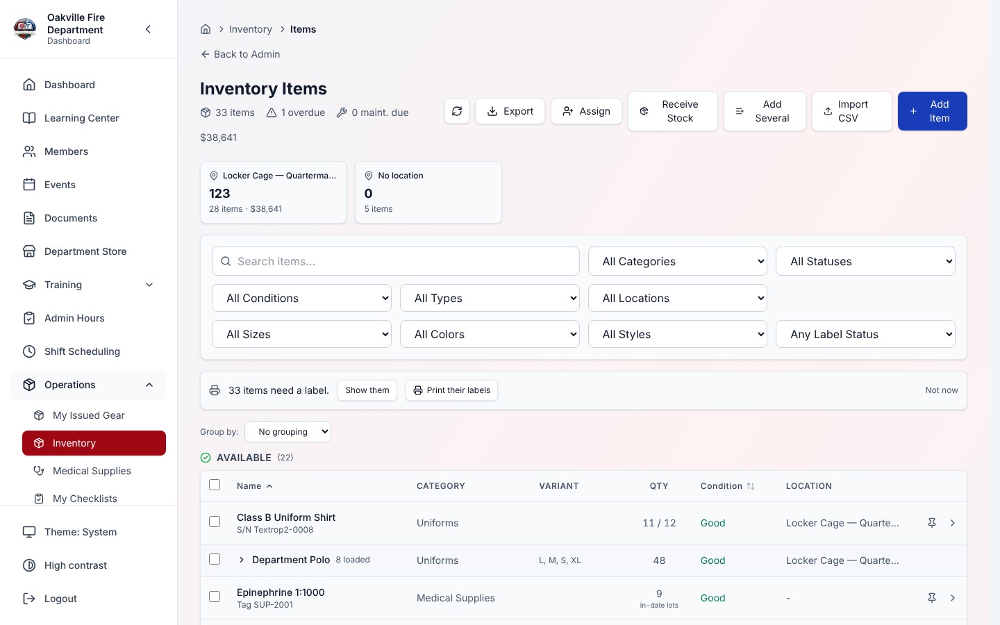

### Putting your own items first

The list is in alphabetical order. That is a poor match for how a quartermaster
works: the gear you handle every day sits between things touched once a year.

Select the **pin** at the right of a row to pin that item. It moves to a
**Pinned** section above **Available** and **Unavailable**.

- Pins are yours alone. Another quartermaster's pins never change your list.
- Drag a pinned row, or use the arrows beside it, to set the order. On a phone,
  use the arrows; dragging does not work there.
- You can pin up to 25 items.

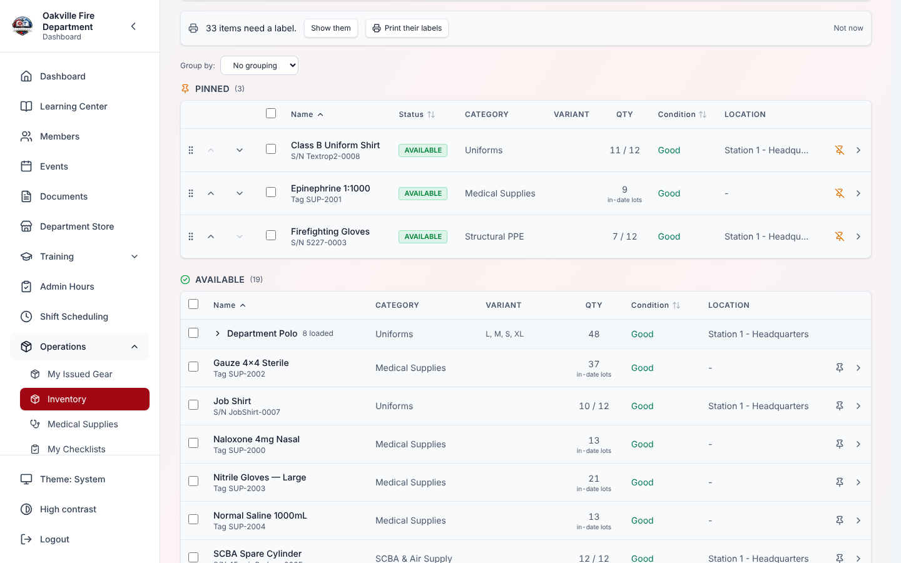

### Grouping the list

**Group by**, beside the filters, sorts the list into groups by **Category**,
**Item type**, **Color**, **Size**, **Condition**, **Style**, **Location** or
**Vendor**. Each group has a heading you can collapse.

- **The count on a heading is the real total.** The list loads 50 rows at a
  time, so a group can hold more than you can see. A collapsed group still
  shows how many items are in it.
- **The column you group by disappears from the rows**, because the heading
  already says it. When you group by Category, a **Size** column takes its
  place.

**Export** gives you a spreadsheet of what you are looking at: the current
filters and grouping, not the whole catalog.

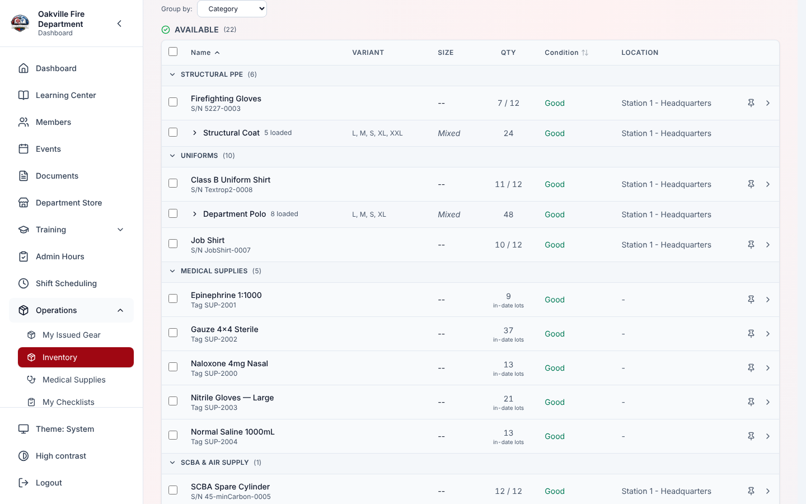

### On a phone

On a phone, the item list and the other inventory tables turn each row into a
card, with the field name on the left and the value on the right. Some columns
that are hidden on a desktop to save width (manufacturer, serial number, asset
tag, barcode and cost) come back on the phone card, where there is room for
them.

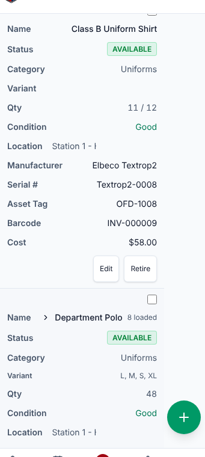

---

## First-Run Setup

A new quartermaster meets an ordering problem the screens do not explain: **an
item depends on three other records that must exist first.**

- A **room** holds storage areas.
- A **storage area** holds items.
- A **category** decides which fields the item form shows.

If you open the item form first, its **Category**, **Room** and **Storage
Area** lists are all empty. An item saved with all three blank cannot be found
on a shelf, never appears in a low-stock alert, and has no inspection schedule.

**Inventory Administration → Setup Guide** puts the four steps in the right
order on one screen. Until all four are done, the administration page shows a
**Finish inventory setup** prompt that names what is still missing.

The item list helps too:

| What you see                                 | What it means                                                                        |
| -------------------------------------------- | ------------------------------------------------------------------------------------ |
| "Your department has no inventory items yet" | The catalog is empty. A quartermaster gets **Open the Setup Guide** and **Add Item** |
| "No items found"                             | Your filters match nothing. Change them                                              |
| "The items did not load", with **Retry**     | The list failed to load. It does not mean the department is empty                    |

The **Request Equipment** form members use makes the same distinction. An
empty catalog reads "Your department has not listed any equipment yet". A
failed load reads "The equipment list did not load". Only a search that found
nothing says "Nothing matches that".

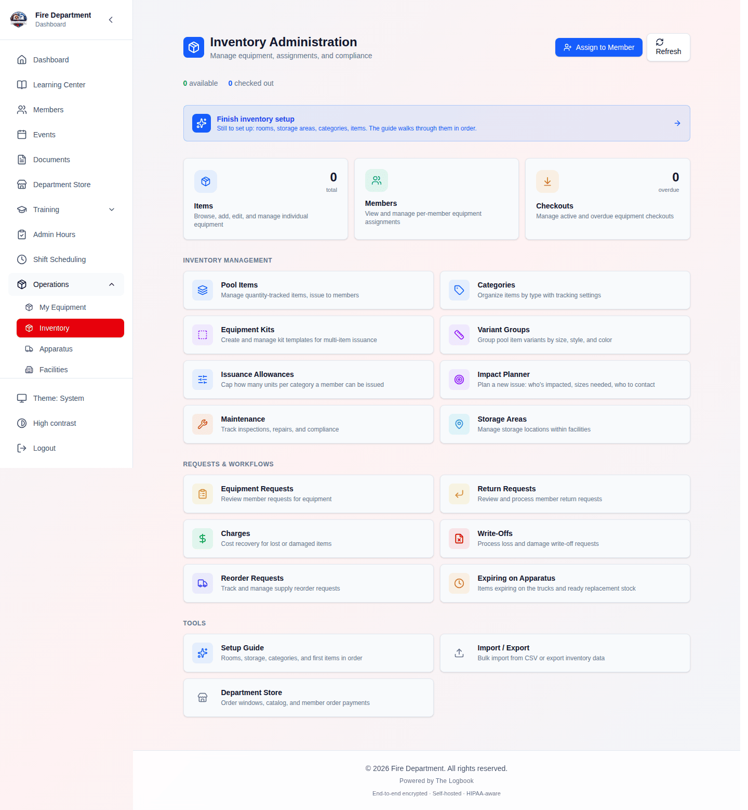

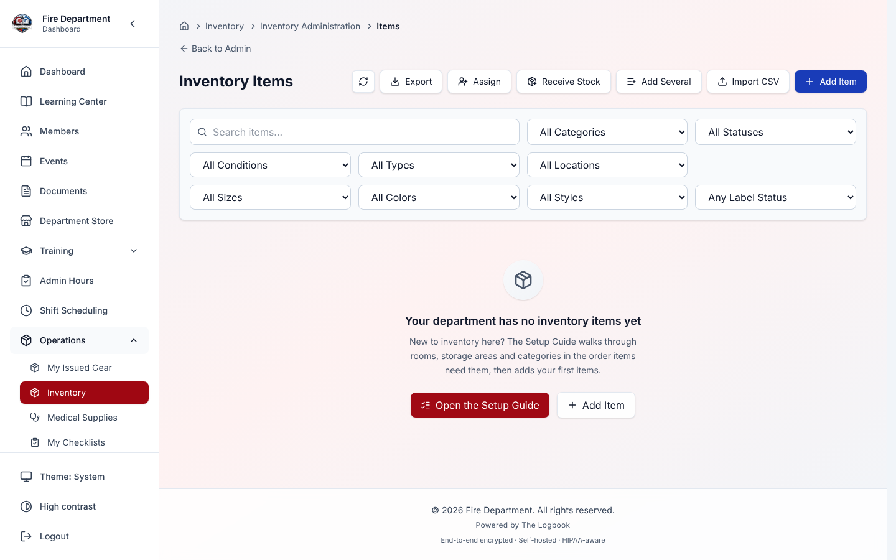

### The four steps

| Step               | What it produces     | Why it comes here                                                                       |
| ------------------ | -------------------- | --------------------------------------------------------------------------------------- |
| **1. Rooms**       | A place              | Storage areas belong to a room, so nothing else can be filed until one exists           |
| **2. Storage**     | Racks, shelves, bins | Turns "it's in the gear room somewhere" into a shelf someone can walk to                |
| **3. Categories**  | Item groups          | Decides which fields an item asks for, and whether it gets inspection and NFPA tracking |
| **4. First items** | Actual equipment     | The item form opens with steps 1 to 3 already filled in                                 |

You can skip any step. A department that already has rooms does not have to
add them again. Each step also links to its own full page for doing the work
in bulk. The page remembers which step you are on, so you can bookmark it or
reload it without losing your place.

### Step 1 — Rooms

A room is the place an item is kept: a station bay, a gear room, a supply
closet. Only the name is required. The building and room number are optional;
they help you tell two similar rooms apart.

> **Who can add a room?** Adding a room needs the **Create locations** or
> **Manage all locations** permission. The standard **Quartermaster** position
> has **Create locations**. It can add rooms but not edit or delete them; that
> stays with whoever manages locations. A position without either permission
> sees no form here. The step reads _"Adding a room needs permission to create
> locations, which your position does not have. Use a room listed above, or ask
> someone who manages locations to add the one you need."_

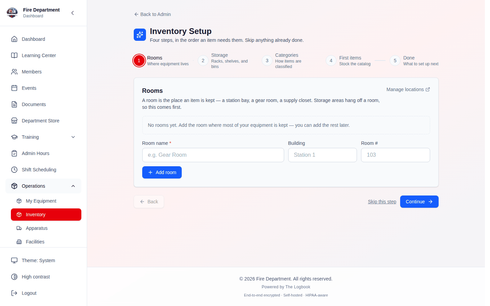

### Step 2 — Storage areas

Choose the room, then add an area for each place gear actually sits. On the
full **Storage Areas** page you can nest areas inside each other later (rack,
then shelf, then box). This step keeps to one level so you can get started.

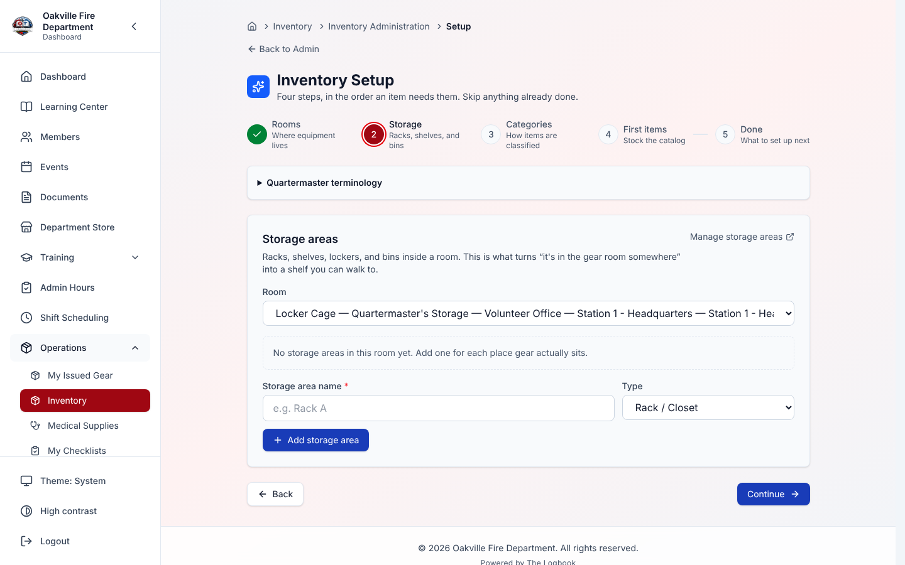

### Step 3 — Categories

This step saves the most time. Instead of inventing your own groups, pick from
the standard fire-service categories: turnout gear, SCBA, helmets, station
uniforms, hand tools, power equipment, ladders, radios, EMS supplies and more.
Each one arrives with its serial-number, maintenance and NFPA switches already
set.

- A category your department already has is marked **already added**, so you
  can come back to this step safely. A second visit adds only what is missing.
- **Select all** ticks everything still available.
- **Continue** saves what you ticked and moves on. You do not need to press the
  add button first. If saving fails, the page stays on this step so nothing is
  lost.
- Everything created here is an ordinary category afterwards. You can edit or
  remove it on the **Categories** page.

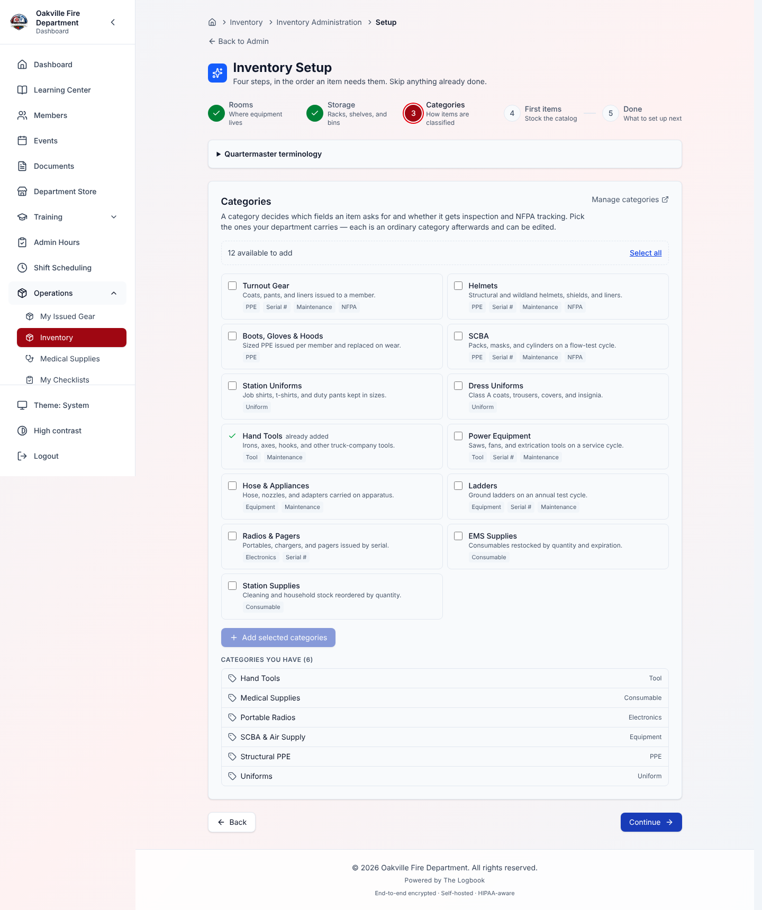

### Step 4 — First items

Choose the room, storage area and category for your first items. **Add an
item** then opens the item form with all three already selected. If your
catalog is already in a spreadsheet, use **Import from CSV** beside it.

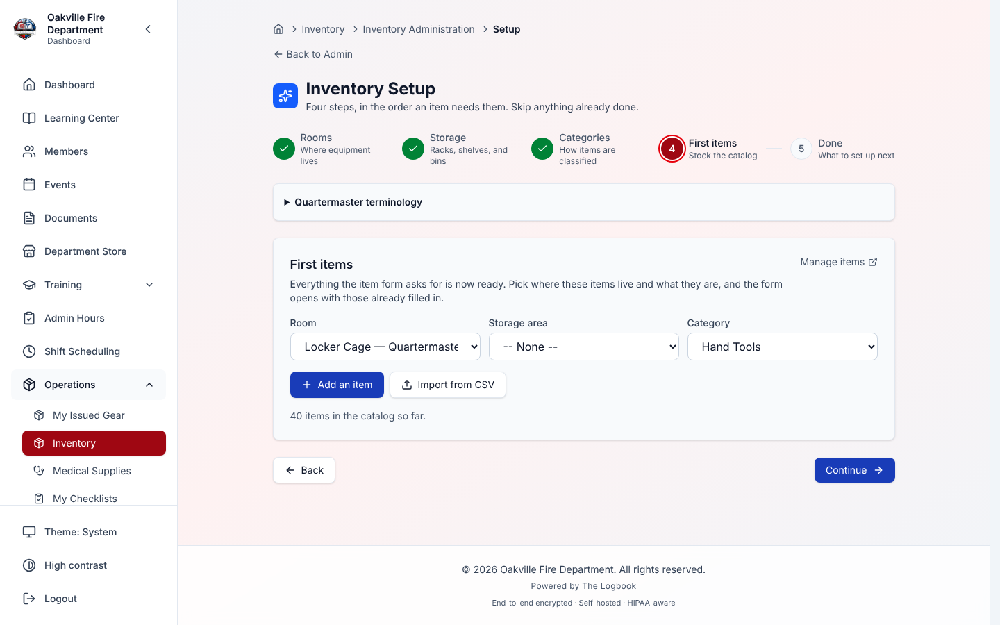

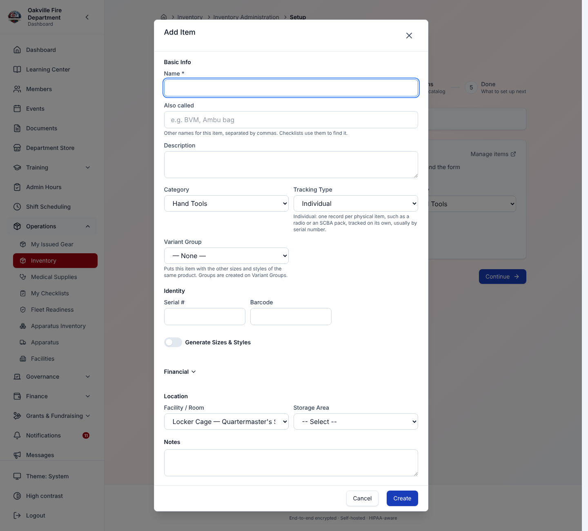

### Step 5 — What to set up next

The last step sums up what was created. It points to what most departments need
next: issuance allowances, gear kits, the impact planner, and barcode labels.

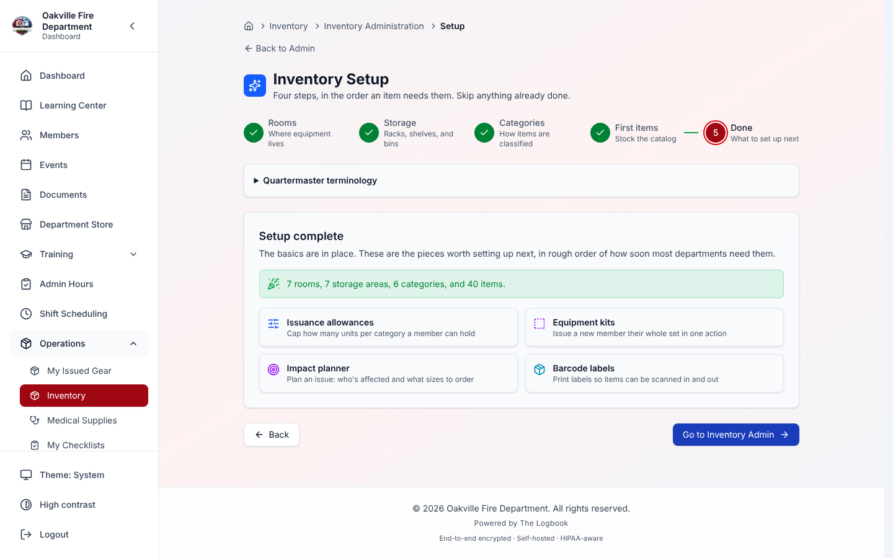

### Edge Cases

- The prompt on the administration page disappears once rooms, storage areas,
  categories and items all exist. The **Setup Guide** card under **Setup &
  Tools** stays, so you can always reach the steps again.
- Retired items do not count. A department that has retired every item is
  offered the setup steps again.
- A deleted category is switched off rather than removed. Its starter category
  becomes available again, so the setup steps can re-create it.

### On a phone

The setup steps work at phone width. The step bar becomes a progress bar
("Step 3 of 5"). The category grid becomes one column, and the count with
**Select all** sits above the list so you do not have to scroll past every
card.

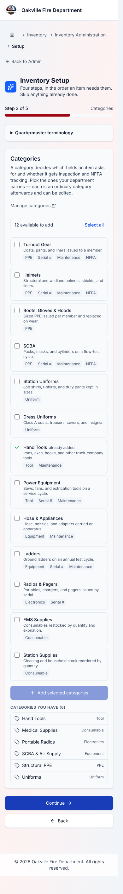

---

## Browsing Items

Officers who can manage inventory see every item on the **Inventory** list
(also reached from **Inventory Administration → All Items**). You can:

- **Search** by item name, serial number or asset tag.
- **Filter** by category, status, condition, item type, location, size,
  colour, style, vendor and label status. The statuses are Available,
  Assigned, Checked Out, In Maintenance, Lost, Stolen and Retired.
- **Filter by location**, including a **no location at all** choice for items
  that have not been put anywhere.

The location cards above the list are links into the same list, and their
counts match it. Medical supplies are not on this list; they have their own
page (see [Medical Supplies](#medical-supplies)). A location that holds only
medical stock gets no card here.

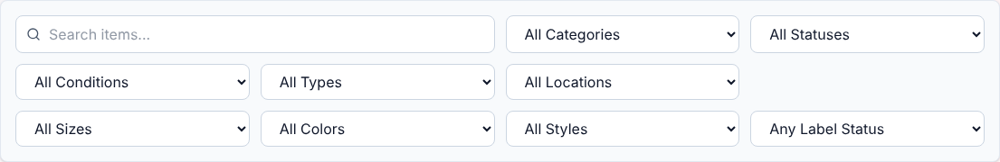

Items that come in sizes, colours or styles show small coloured tags called
**variant capsules**: blue for size, purple for colour, amber for style. They
appear on the item list, the item page, **My Issued Gear**, **Pool Items** and
**Variant Groups**. An item that is not part of a variant group has none.

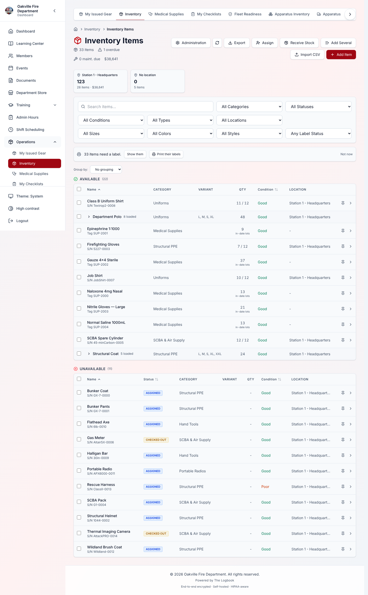

Select an item's row to open its edit form. There you can see and change its
description, serial number and asset tag, condition and status, storage place,
purchase and warranty details, and notes.

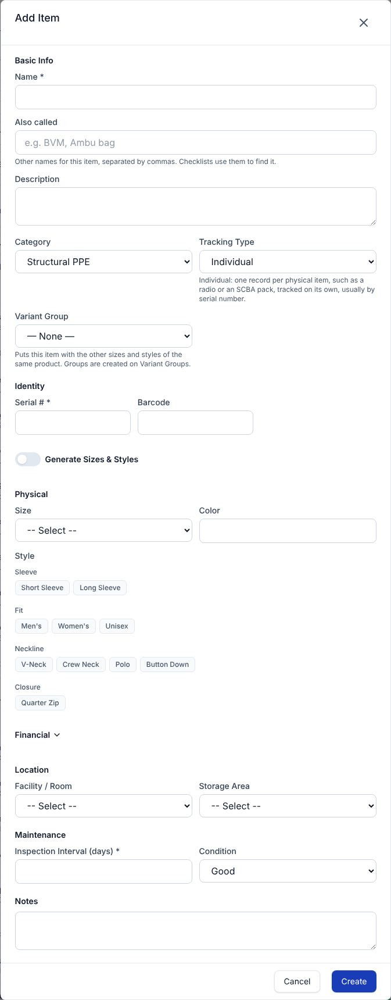

The form shows what the category requires:

- If the category requires serial numbers, **Serial #** is marked required.
- If the category requires maintenance, **Inspection Interval (days)** is
  required and must be at least 1.
- The line under **Tracking Type** explains the choice you made. See
  [Individual vs Pool Items](#individual-vs-pool-items).

### Editing an item's size

The **Size** box in the edit form is a list of every standard size, grouped as
**Garment**, **Boot / Glove** and **Waist**. A boot width or a chest
measurement goes in through the **Custom** choice. Sizes show the same way on
every screen, for example **One Size** and **3XL**.

### Taking an item out of service

Use **Retire**. The edit form does not let you switch an item off or set it to
retired. **Retire** refuses an item that is assigned, on loan, or (for counted
stock) still issued to someone, and it checks who holds the item at the moment
you press it. Officers who manage medical supplies have their own **Retire**
action for medical items.

---

## Categories

The **Categories** page (**Inventory Administration → Categories**) sorts items
into groups, such as personal protective equipment (PPE), radios, tools,
uniforms and medical equipment.

To add a category:

1. Go to **Inventory Administration → Categories**.
2. Select **Add Category**.
3. Enter the name and description, and set the switches you need:
   - **Requires Serial Number**
   - **Requires Maintenance** (items get an inspection schedule)
   - **Requires Assignment**
   - **NFPA Tracking Enabled** (see [NFPA 1851/1852 Compliance Tracking](#nfpa-18511852-compliance-tracking))
   - **Allow self-checkout at the kiosk** and **Kiosk loan period (days)**
     (see [Self-service kiosk](#self-service-kiosk))
4. Save.

Every category appears in every category picker and filter, however many your
department has.

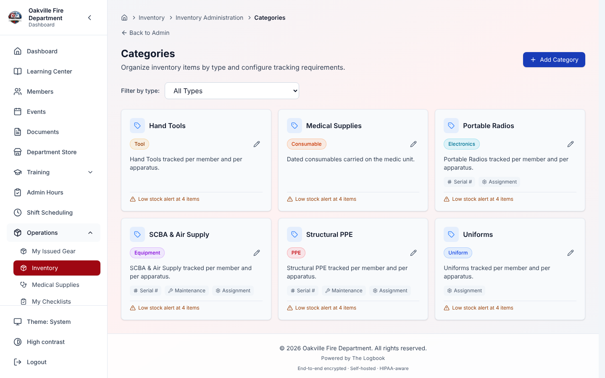

---

## Individual vs Pool Items

Every item is tracked one of two ways:

| Tracking type  | How it works                                                               | Good for                                       |
| -------------- | -------------------------------------------------------------------------- | ---------------------------------------------- |
| **Individual** | One record per physical item, tracked on its own, usually by serial number | Radios, SCBA packs, turnout coats, tools       |
| **Pool**       | One record for a stock of identical items, counted by quantity             | Gloves, T-shirts, batteries, cleaning supplies |

### Individual Items

- Tracked by serial number, barcode or asset tag.
- Held by one member at a time.
- Full history of every assignment and loan.
- Condition is tracked for each item.

### Pool Items

- Members receive an **issuance**, for example "3 pairs of gloves".
- A pool item has two counts: **on hand** (on the shelf) and **issued** (out
  with members).
- Issuing moves units from on hand to issued. A return moves them back.
- A pool item must start with a quantity of at least 1.

> **Tip.** Choose the tracking type when you create the item. It decides
> whether the item goes through assignment (individual) or issue and return
> (pool). The line under **Tracking Type** on the item form describes the one
> you picked.

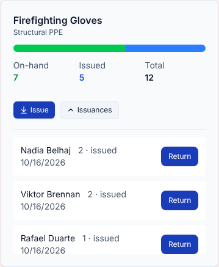

### Reading the stock numbers

There is no single panel showing on hand, issued and available side by side.
Read them like this:

| Number                    | Where to find it                                                         | Example: Class B shirt |
| ------------------------- | ------------------------------------------------------------------------ | ---------------------- |
| On hand                   | The **Qty** column on the item list, left of the slash                   | 11                     |
| Total the department owns | The same column, right of the slash                                      | 12                     |
| Issued                    | The difference, and per member on **Inventory Administration → Members** | 1                      |

**On hand and available are the same number.** Issuing lowers the on-hand
count and a return raises it, so what is on the shelf is exactly what you can
issue next. The total is on hand **plus** what is out. Do not subtract the
issued count from the on-hand figure; that counts every issued unit twice. An
item with every unit out reads `0` on hand, never a negative number.

Items kept in dated batches work differently. See
[Dated Stock Lots and Receiving](#dated-stock-lots-and-receiving).

---

## Variant Groups

A **variant group** links items that are the same product in different sizes,
colours or styles. For example, a uniform polo in S, M, L and XL is one group
of four items. Each item in the group keeps its own stock, serial numbers and
holders.

There are two ways to make one:

- **Generate them all at once** from the item form (below). This is the usual
  way for uniforms and PPE.
- **Add a group by hand** on **Inventory Administration → Variant Groups**, then
  put existing items into it.

In the item list, a product's size variants fold into one row that you expand
to see each size. A coat in six sizes is one line until you open it.

### Renaming a variant product

Rename a product once and every size follows. On **Inventory Administration →
Variant Groups**, edit the group's name, or on the folded product row in the item
list choose **Rename** (needs **Manage inventory**). The first part of each size's
name, before the dash, becomes the new name; the size, colour and style after it
stay. A size filed under a different name is left alone. If any new name would be
over 255 characters, nothing changes. Generating more sizes afterward reuses the
group by its new name.

### Generating sizes and styles

Needs the **Manage gear, uniforms and equipment** permission.

1. Go to the item list and select **Add Item**.
2. Fill in the base details: name, category and description.
3. Switch on **Generate Sizes & Styles**. The switch appears only when you are
   adding a **new** item. It is not offered while editing an existing one.
4. Pick the **Sizes**. At least one is required. They come in three groups:
   - **Garment**: XXS, XS, S, M, L, XL, XXL, 3XL, 4XL and One Size
   - **Boot / Glove**: 6 to 15, including half sizes up to 12.5
   - **Waist**: 28 to 46, in steps of 2
5. Optionally pick **Styles**. They are grouped by what they describe:
   - **Sleeve**: Short Sleeve, Long Sleeve
   - **Fit**: Men's, Women's, Unisex
   - **Neckline**: V-Neck, Crew Neck, Polo, Button Down
   - **Closure**: Quarter Zip

   One choice from each group describes **one** garment. Men's, Long Sleeve and
   Polo together make one men's long-sleeve polo. Only two choices in the
   **same** group multiply: Short Sleeve and Long Sleeve together make one item
   for each.

6. Optionally type **Colors** as a list separated by commas, for example
   "Navy, White".
7. Read the preview. It shows the total and how it was reached, for example
   "16 items will be created" and "4 sizes × 2 sleeve options × 2 colors". The
   button counts along with it: **Create 16 Items**.
8. Under **Quantity Per Variant**, set **Starting Quantity (each)**. It applies
   to each item, not to the whole batch. Then submit.

Every combination is created as a pool item and grouped under one variant
group.

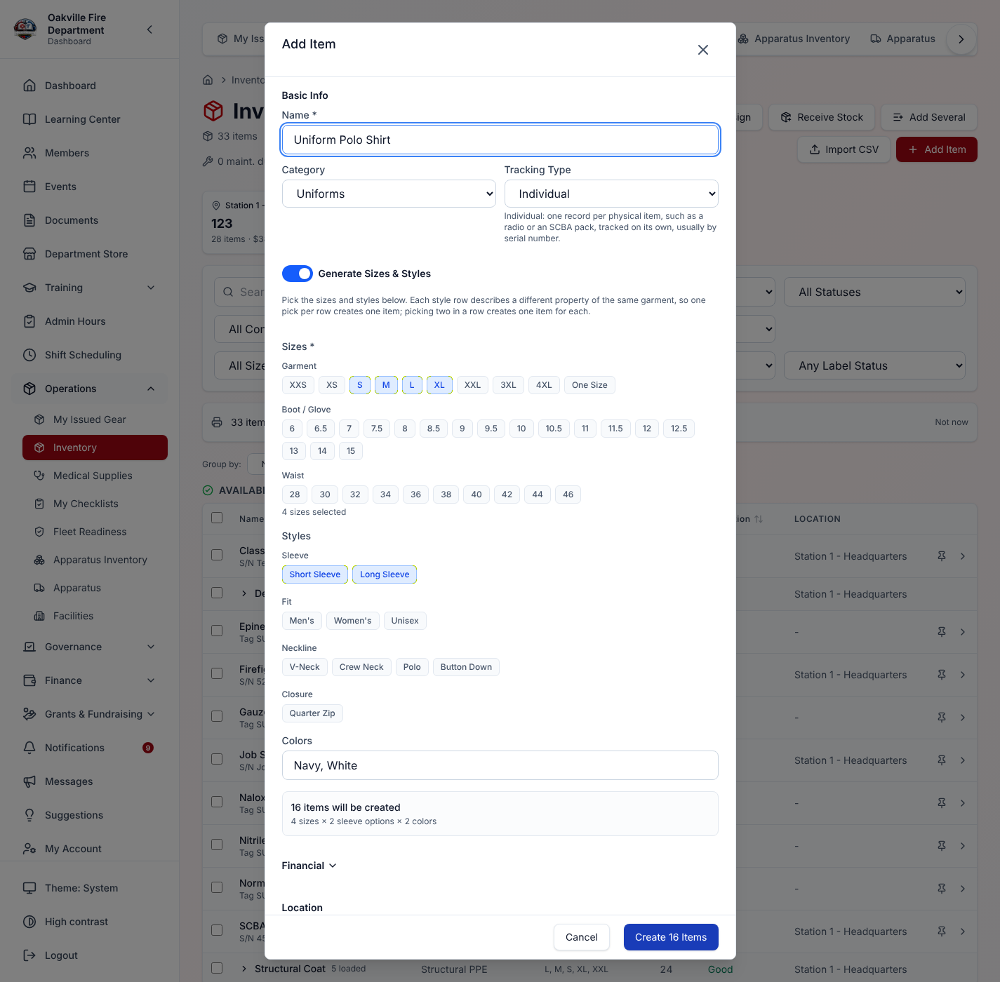

#### Example

For a uniform polo with:

- 4 sizes: S, M, L, XL
- 2 sleeve lengths: Short Sleeve, Long Sleeve
- 2 colours: Navy, White

The Logbook creates 4 × 2 × 2 = 16 pool items, named like this:

- Uniform Polo Shirt — S — Navy — Short Sleeve
- Uniform Polo Shirt — S — White — Short Sleeve
- Uniform Polo Shirt — S — Navy — Long Sleeve
- … (16 in all)

All 16 share one variant group, description and category.

#### Generating: what if …?

| What happens                                       | What it means                                                                                                                              |
| -------------------------------------------------- | ------------------------------------------------------------------------------------------------------------------------------------------ |
| You pick no styles                                 | The items have no style. You get one item per size and colour                                                                              |
| You type no colours                                | The items have no colour. You get one item per size and style                                                                              |
| You generate again with the same name and category | The existing group is reused. Only combinations you do not already stock are added, so this is how you add 3XL to a polo you already carry |
| You type a colour in different capitals ("navy")   | It is matched to the spelling you already use ("Navy")                                                                                     |
| You change an item after it was created            | Edit it like any other item. It stays in its group                                                                                         |
| You get far more items than expected               | The count is sizes × colours × styles. Remove sizes or styles you do not need; the preview shows the count before anything is created      |

### Adding a group by hand

Needs the **Manage gear, uniforms and equipment** permission.

1. Go to **Inventory Administration → Variant Groups** and select **Add
   Group**. The **Add Variant Group** dialog opens.
2. Enter the group **Name** (the only required field), an optional
   **Description**, and choose a **Category**.
3. Set the **Base Price** and **Replacement Cost**.
4. Type the **Unit of Measure**, such as "each", "pair" or "set". It is a text
   box, not a list.
5. Select **Create Group**. Opening an existing group shows the same dialog
   with **Update Group**.

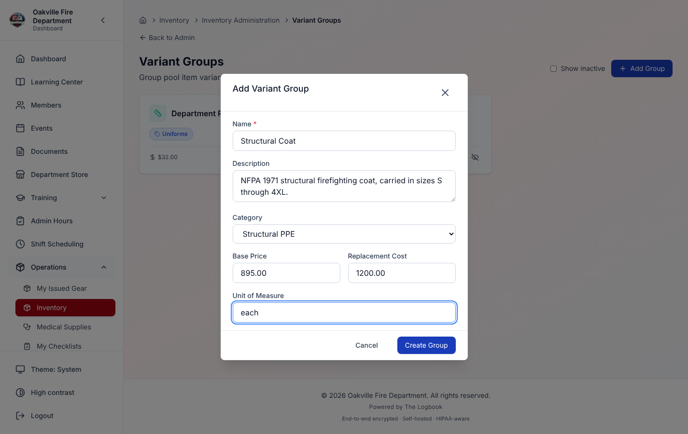

To put an item into a group, open it from the item list and choose the group in
the **Variant Group** picker beside **Tracking Type**. Choose **— None —** to
take an item out of its group. Only active groups are offered; an item already
in a switched-off group shows it marked "(inactive)". The picker is hidden while
**Generate Sizes & Styles** is on, because generating makes its own group. An
empty group's detail view points you to this picker.

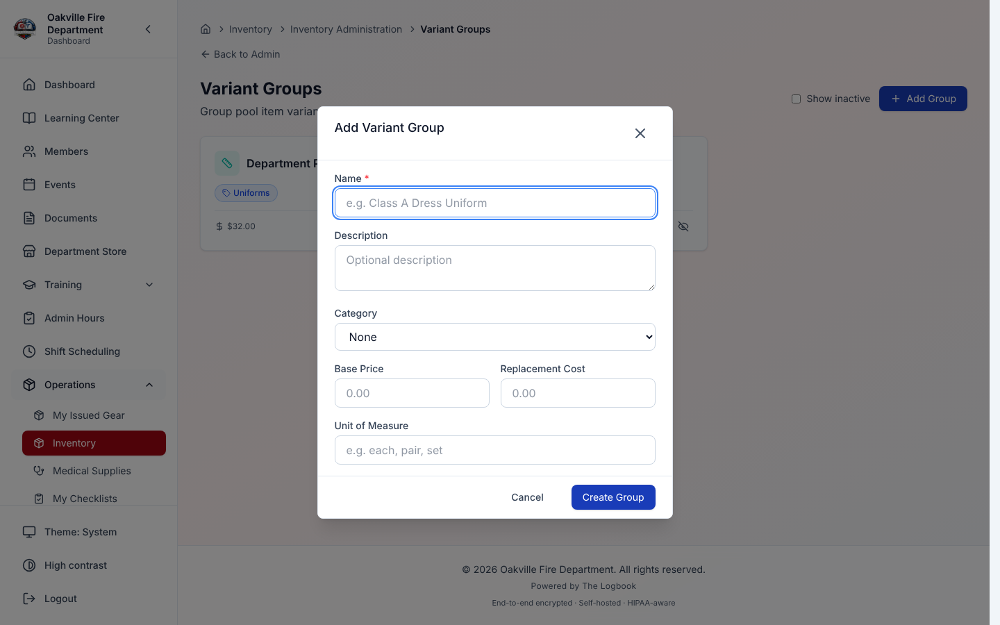

### Managing variant groups

On the **Variant Groups** page:

- Each group is a card with its name, category, price and number of variants.
- Select a card to open its detail view, with every item in the group and a
  **Stock Matrix**. Sizes run down the side and colours (or styles) across the
  top. Each cell shows the number on hand: green when there is stock, red at
  zero. Empty sizes stay visible so you can see what to reorder.
- **Active/Inactive**: switching a group off does not change its items. They
  stay linked for reporting, but the group is not offered for new items.
- Changing a group's price does not change the cost recorded on existing
  items.

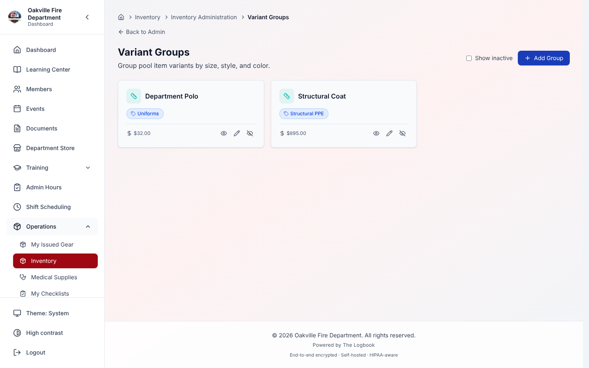

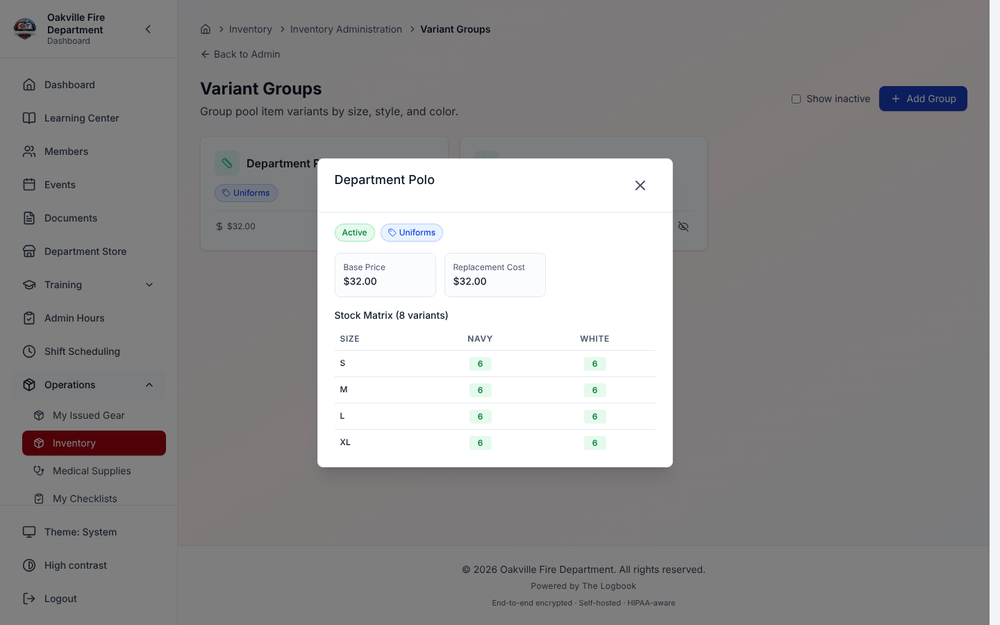

---

## Gear Kits

A **gear kit** bundles several items into one named package, so you can hand
them out in one step. For example, a "New Recruit PPE Kit" with a coat, pants,
helmet, gloves and boots.

Kits live on **Inventory Administration → Gear Kits** and need the **Manage
gear, uniforms and equipment** permission.

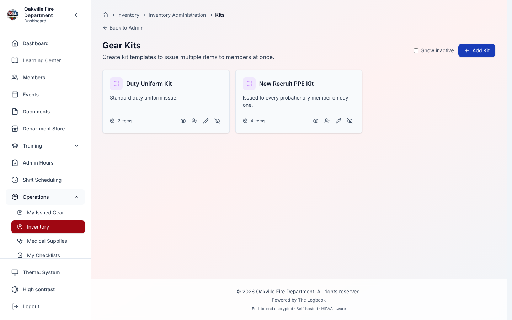

### Creating a Kit

1. Select **Add Kit**.
2. Enter a name and, if you like, a description.
3. Select **Add Item** for each part of the kit:
   - Choose the item.
   - Set the quantity (for example 2 pairs of gloves).
   - Tick **Size** to mark a part that comes in sizes.
   - Tick **Optional** for a part the kit can go out without.
4. Select **Create Kit**. Editing a kit shows **Update Kit** instead.

A kit must have at least one item.

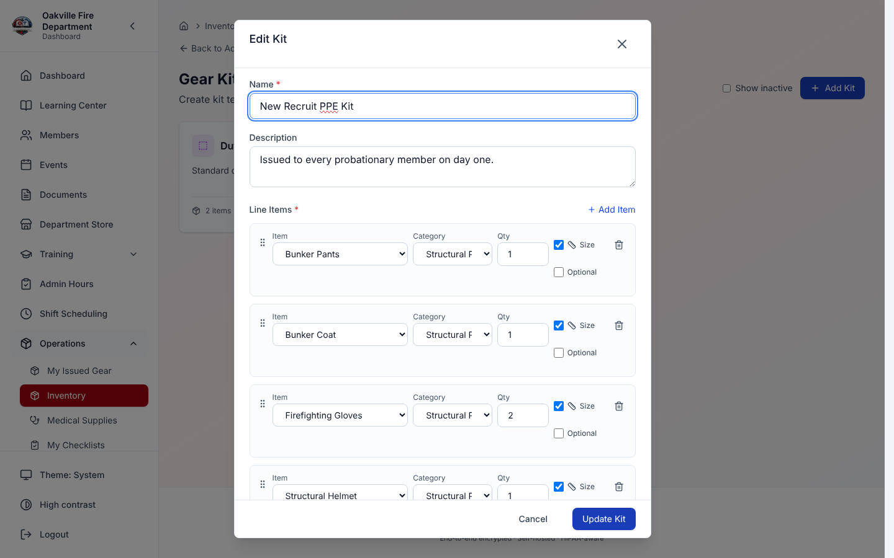

### Issuing a Kit

1. On the kit's card, select the issue button ("Issue _kit_ to a member").
2. In **Issue "_kit_" — Select a Member**, choose the member.
3. A review lists every line of the kit with the size The Logbook resolved for
   that member from their size preferences. Change a line's size from its
   list if the quartermaster knows better. Select **Issue to _member_**, or
   **Don't issue** to back out.

Each item in the kit is then given to the member on its own record: tracked
items as assignments, counted items as issuances. The message says how many
were issued.

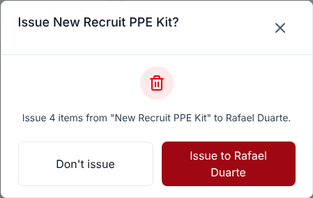

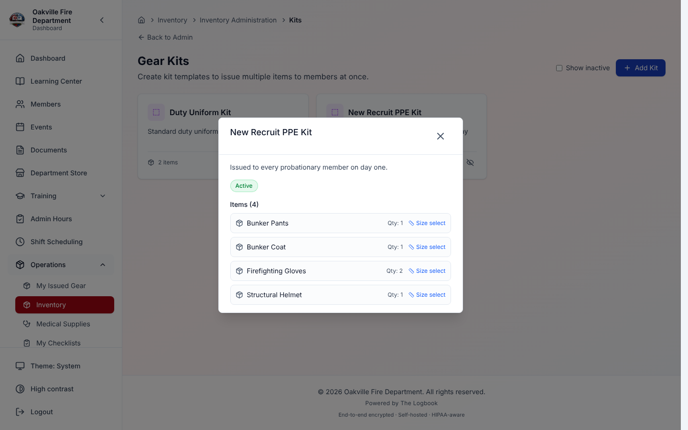

> **Sizes follow the member, not the kit.** A kit line names a product, not one
> size. When you add a sized product (a jacket, boots, gloves) the line
> defaults to **Member's size**, and issuing resolves it from the size the
> member recorded under **My Sizes**. Pin a line to one size only when every
> member should get that size. The review shows the resolved size per line,
> and the quartermaster can change it for this issue only. A member with no
> size on file for a sized line is told so on the review rather than being
> handed the size the kit was built with.

> **What if one part cannot be issued?** If a required part cannot be handed
> out (for example none is on hand, or a tracked item is already assigned),
> issuing stops and the message names the problem. Parts handed out before it
> stay issued, so check the member's gear before trying again. A part marked
> **Optional** is skipped instead.

> **Tip.** Each part is returned on its own. There is no "return the whole kit"
> action, because parts often come back at different times and in different
> condition.

### Managing Kits

- Each kit is a card with its name, number of items, description and status.
- **Show inactive** shows kits that are switched off.
- Select a kit to see everything in it, with quantities.
- The kit editor lists products with their sizes collapsed. A kit built
  before this change keeps its pinned sizes.
- **Deactivate** stops a kit being issued. Items already handed out are not
  affected. **Activate** brings it back. Only active kits show the issue
  button.

---

## Member Size Preferences

Members can record their uniform and PPE sizes. Quartermasters use them when
planning orders, and the request form uses them to pick the right size.

- **Members** edit their own sizes from **My Issued Gear** → **My Sizes**.
- **Quartermasters** edit any member's sizes from **Inventory Administration →
  Members** → **Sizes** on the member's row. Seeing or changing another
  member's sizes needs the **Manage gear, uniforms and equipment** permission.

### Recording Size Preferences

1. Open the sizes window. Its title reads "My Sizes" or "Sizes — _member
   name_".
2. Fill in any of these fields. All are optional:
   - **Shirt Size**, **Jacket Size**, **Pant Waist**, **Pant Inseam**,
     **Boot Size**
   - Under **Additional sizes (optional)**: **Fit** (such as Women's),
     **Boot Width**, **Glove Size**, **Hat Size**
3. Select **Save Sizes**.

If a member has never saved sizes, the form simply opens blank. Fields you leave
empty are not stored.

### How Size Preferences Are Used

- **Request Equipment** starts the size step from the member's sizes on file
  and preselects their fit (see [Gear Requests](#gear-requests)).
- The **Impact Planner** groups members by size so you know what to order, for
  example "12 members need L coats, 8 need XL" (see
  [Impact Planner](#impact-planner)).

> **Privacy.** Sizes are body measurements. Only the member and officers who
> can manage gear can see them.

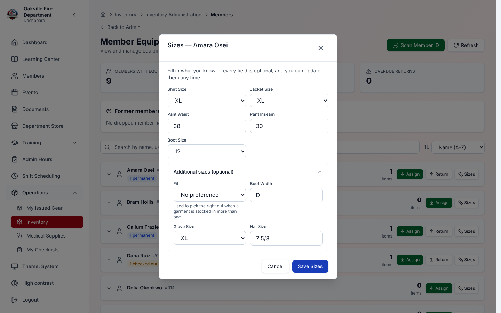

---

## Item Detail Page

Each item has its own page. Open it from the item list, from a member's gear,
or by scanning its label.

The top of the page shows cards:

| Card           | What it shows                                                            |
| -------------- | ------------------------------------------------------------------------ |
| **Basic Info** | Name, category, status, **Barcode**, **Asset Tag** and **Label Printed** |
| **Location**   | Where the item is kept                                                   |
| **Identity**   | Serial number and manufacturer details                                   |
| **Financial**  | Purchase and warranty details                                            |
| **Physical**   | Size, colour and style                                                   |
| **Stock**      | Counts for pool items. For dated stock, the current count from its lots  |
| **Inspection** | Inspection dates, for categories that require maintenance                |
| **Assignment** | Who holds a tracked item, with **Assign Item** or **Unassign**           |

With NFC tags switched on, quartermasters also see **NFC Tags** and **Last
Seen (NFC)** cards (see [NFC Tags](#nfc-tags)).

Below the cards are tabs:

| Tab                 | Shown when                        | What it holds                                                           |
| ------------------- | --------------------------------- | ----------------------------------------------------------------------- |
| **History**         | You can manage inventory          | Every status change, assignment, loan, return and confirmed label print |
| **Stock Lots**      | Always                            | Dated lots on the shelf, and which apparatus carry the item             |
| **NFPA Compliance** | The category has NFPA tracking    | Lifecycle dates, ensemble and SCBA details                              |
| **Inspections**     | The category requires maintenance | Inspection and repair records                                           |
| **Exposures**       | The category has NFPA tracking    | Hazardous exposures and cleaning                                        |

A member opening their own gear sees the page without the **History** tab, so
it opens on **Stock Lots**.

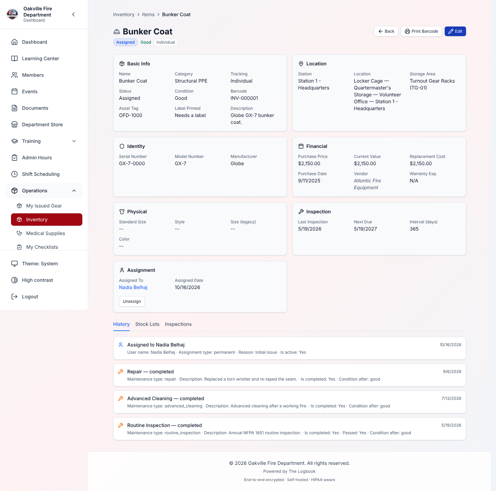

### Barcode and asset tag

**Barcode** and **Asset Tag** are always shown in the **Basic Info** card. When
there is no value, they show `--`. The same `--` is used on the other cards, so
a missing size reads as blank rather than as a missing section.

The page shows the barcode number, not a picture of the code. To print it,
select **Print Barcode** at the top of the page.

Every item gets a barcode number when it is created, numbered in order for your
department: `INV-000001`, `INV-000002` and so on. The number is unique within
your department.

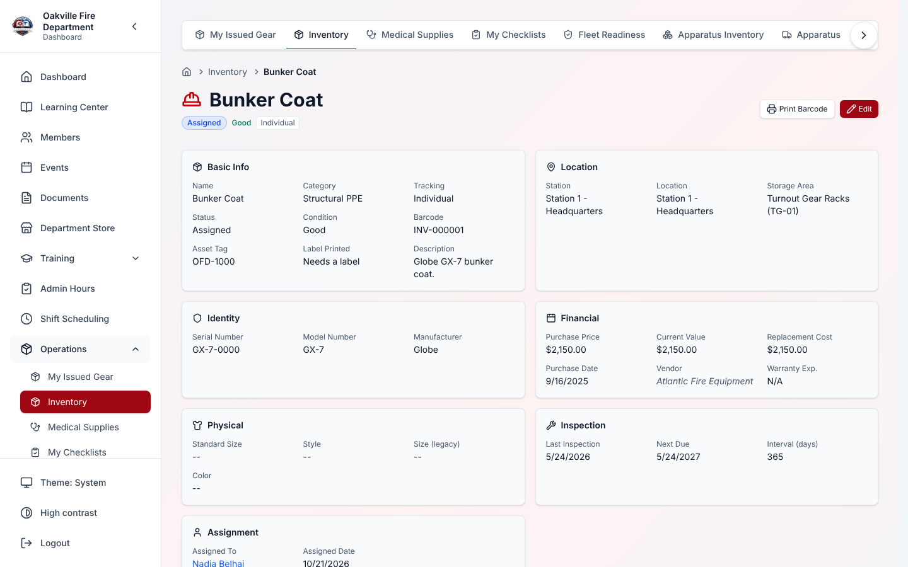

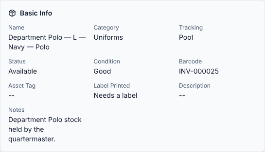

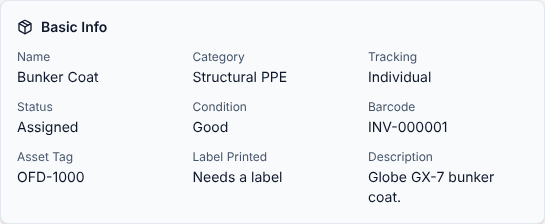

---

## Item Assignments

Tracked items can be assigned to members. Assigned items appear on the member's
profile and on their **My Issued Gear** page.

### Assigning an Item

Needs the **Manage gear, uniforms and equipment** permission. There are two ways
in, depending on whether you start from the item or from the person.

**From the item** (one item, one member):

1. Open the item's page.
2. In the **Assignment** card, select **Assign Item**. It appears only on
   tracked items that are not already assigned. An assigned item shows
   **Unassign** instead.
3. Search for the member and choose them.
4. Choose **Permanent** ("Theirs until they return it or leave, like
   turnouts.") or **Temporary** ("Due back on a date you choose, such as gear
   for an acting role."). **Temporary** asks for a **Return date**.
5. Select **Assign to _member_**. The date is filled in for you. This path has
   no notes or condition field.

**From the member** (kitting somebody out with several items): see
[Item Distribution](#item-distribution) below.

### Viewing Your Assignments

Your assigned items appear in two places:

- **Your member profile**, under **Assigned Inventory**.
- **My Issued Gear**, under **Issued to Me**.

> **Who can see a member's gear?** The **Assigned Inventory** section on a
> member profile is shown only to the member themselves and to officers who can
> manage gear. Other members do not see what you have signed for.

---

## Item Distribution and Batch Return

Use these when you hand out or take back several items at once, for example at
a training night or an annual PPE handout. Both start from a **member**: you
choose the person first, then work on their gear.

### Item Distribution

1. Go to **Inventory Administration → Members** and select **Assign** on the
   member's row. Or select **Assign to Member** at the top of **Inventory
   Administration** and pick the member there. The **Distribute Items** window
   opens.
2. Under **Intended duration**, choose one:
   - **Ongoing assignment**: "Theirs until they return it or leave, like
     turnouts."
   - **Temporary assignment**: "Assigned to them until a return date you
     choose, such as gear for an acting role."
   - **Temporary loan**: "Lent for a set time and due back on a date you
     choose."

   Both temporary choices ask for an **Expected return** date. A temporary
   assignment stays on the member's gear with a due date. A temporary loan is
   checked in when it comes back, and is flagged overdue if it is late. Pool
   items are issued from stock whichever you choose.

3. Scan each item, or type its name, barcode, serial number or asset tag and
   press **Enter**. Items stack up in a list, each with a quantity. An item
   added twice is refused with a message, not counted twice.
4. Select **Review _n_ Items**. Check the list; each line says what it will
   become. Then select **Confirm** in the **Confirm Distribution** box.

There is no default duration. Until you choose one, **Review _n_ Items** stays
off and the line beside it reads _"Choose Ongoing assignment, Temporary
assignment or Temporary loan above to continue."_ For a temporary choice with no
date it reads _"Set the expected return date to continue."_ This stops anyone
handing out turnouts as a loan by accident.

Each item is handled on its own. If one fails (for example, it is already on
loan), the others still go through, and the results list says what happened to
each. If an item is held by someone else, you are asked to **Confirm custody
transfer** before it moves. The transfer takes effect immediately, and the
record notes who made it.

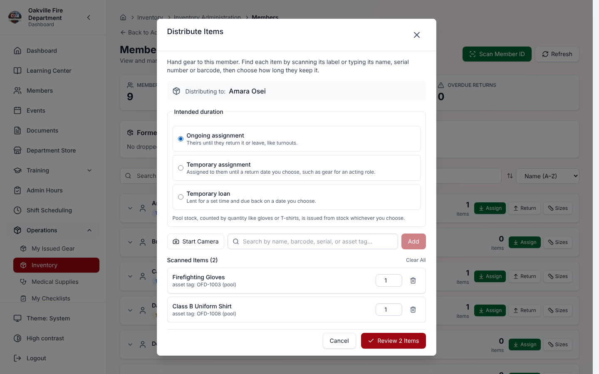

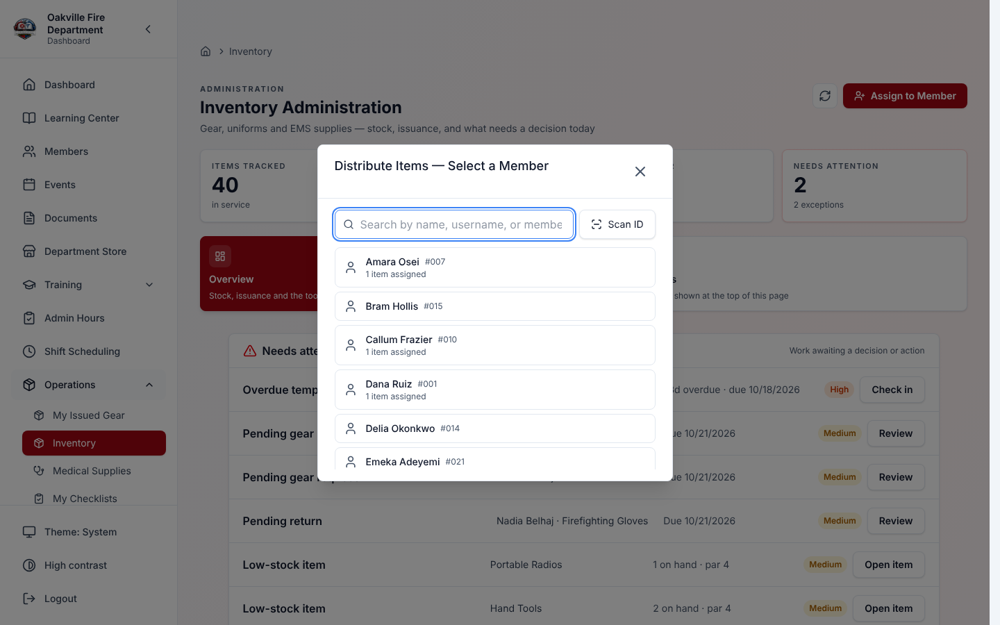

### Batch Return

1. Go to **Inventory Administration → Members**.
2. Select **Return** on the member's row. The **Return Items** window lists
   everything they hold, all selected, with **Select All** and **Deselect All**
   above.
3. Set a return condition for each item: **Excellent**, **Good**, **Fair**,
   **Poor** or **Damaged**. For pool items you can return fewer than were
   issued.
4. Select **Return _n_ Items**.

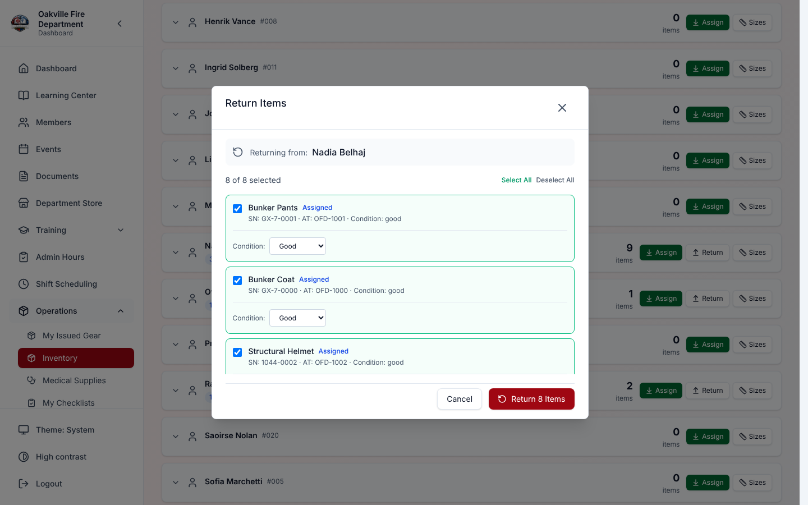

> **What if the item was reassigned meanwhile?** Each item is checked on its
> own. If an item is no longer held by this member (for example, someone else
> changed it at the same time), that item's return fails with a clear message
> and the rest succeed.

---

## Temporary Loans and Returns

### Temporary loans

A temporary loan is a tracked item lent to a member until a set date. You
create one with **Temporary loan** in [Item Distribution](#item-distribution).

**Inventory Administration → Temporary Loans** lists them, with **Active** and
**Overdue** tabs and a search box.

- **Check In** closes a loan when the item comes back.
- **Extend** gives the member a new due date. The new date runs to the end of
  the day you choose, in your department's time zone.
- A loan is overdue once its current due date has passed. Changing a loan
  keeps its due date.

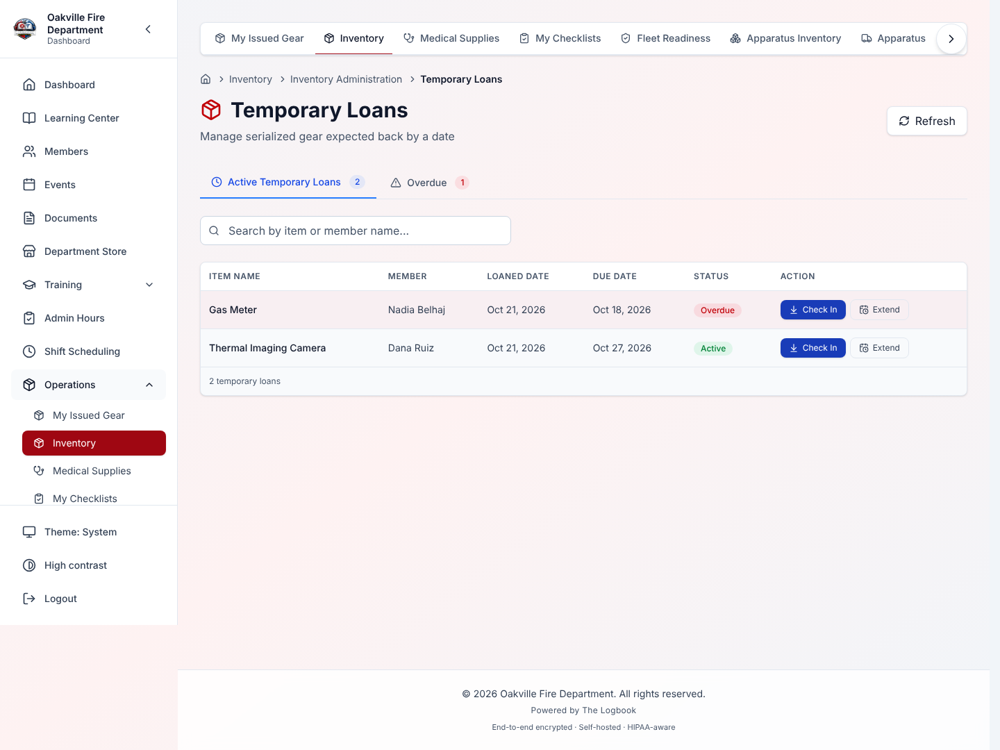

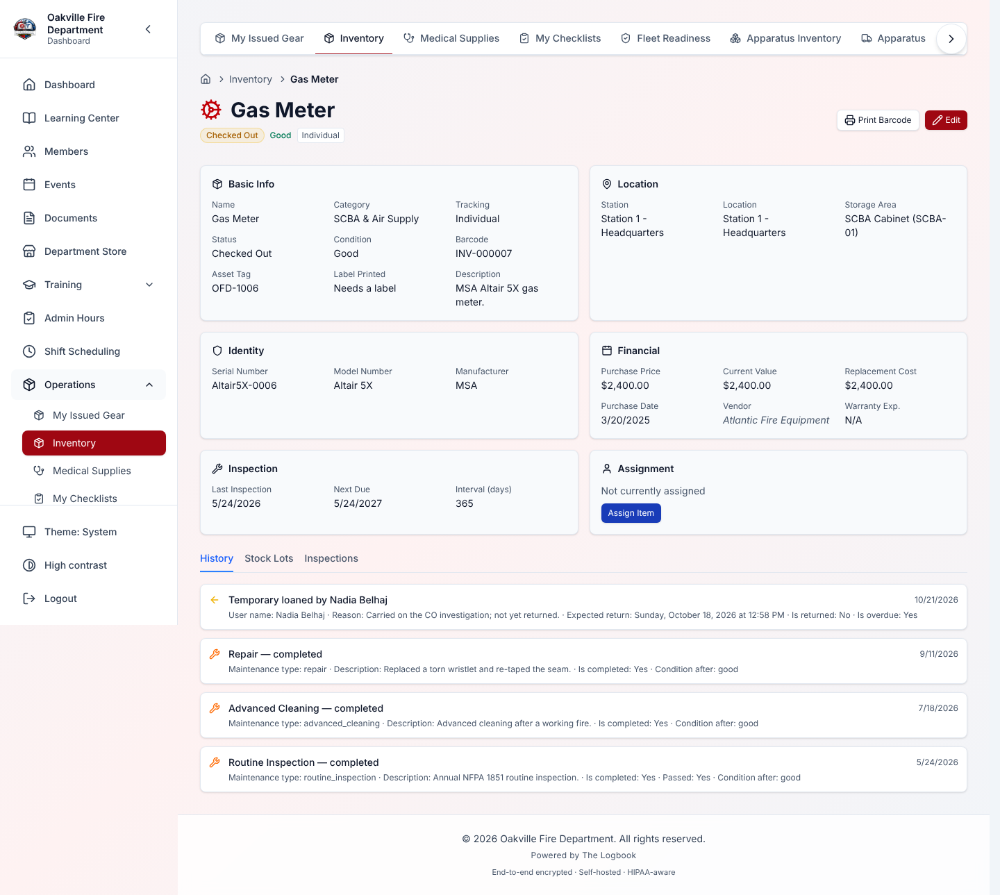

### What happens to returned gear

The condition you record decides what happens next:

| Return condition      | What happens to the item                                    |
| --------------------- | ----------------------------------------------------------- |
| Excellent, Good, Fair | Goes back to **Available**                                  |
| Poor, Damaged         | Goes to **In Maintenance**, so it is inspected before reuse |

For a pool item, a partial return keeps the issuance open. It closes when every
unit is back.

### When a member says they are bringing gear back

On **My Issued Gear**, a member can select **Notify quartermaster of return**.
The member is told: "This tells the quartermaster you are bringing it back.
Hand the item in as usual; it stays on your list until they confirm they have
it."

The notice appears on **Inventory Administration → Return Requests**, and as a
"Pending return" row in **Waiting for action**. When the gear arrives:

1. Open the notice and receive it.
2. Choose the condition you see.
3. For a pool return, type the count. The quantity box starts empty and says
   "Count what came back. It must match the _n_ the member reported."
4. If the gear is poor, damaged or out of service, choose a **Safety
   follow-up**:
   - **Maintenance**
   - **Charge review**
   - **Write-off review** (tracked items only)
   - **Automatic** lets The Logbook pick. For an out-of-service pool return it
     picks Maintenance.

Each review starts clean. A choice made on one notice is never carried to the
next one. If two quartermasters act on the same notice at once, only one
decision is recorded.

Damaged units of a pool return are kept out of the stock you can issue. A
write-off is not offered for a pool return, because a write-off covers the whole
item and would end every other member's issuance.

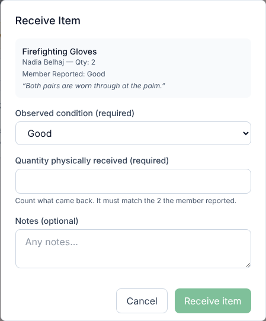

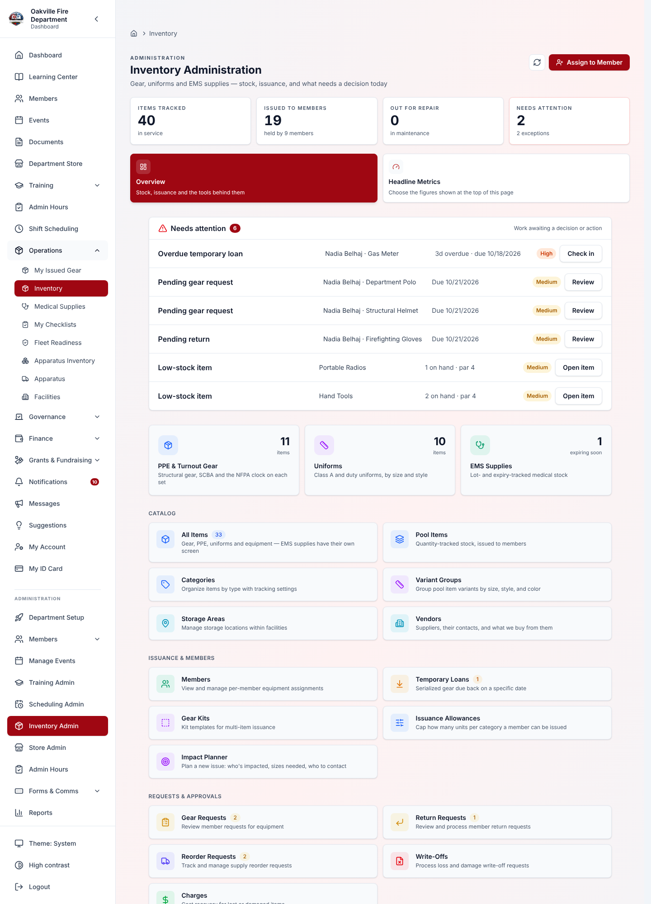

> **What if the gear came back another way?** If you take the item back through
> **Return** on the members page, a pool return or a loan check-in, the
> member's open notice is marked **received**. It leaves the returns queue and
> the member's **Pending requests**. Find it under **Status: Received another
> way**, with the note "Received through a direct return, not through this
> notice; not inspected here." A pool return of fewer units than the notice
> announced leaves the notice open.
>
> To inspect such a notice afterwards, select **Inspect** on its row. Choose the
> **Observed condition**, a **Safety follow-up** if the gear is poor, damaged or
> out of service, and any notes, then select **Record inspection**. Nothing is
> returned to stock again. A tracked item you find unsafe while it is on the
> shelf is moved to maintenance.
>
> Receiving through the notice is still the better path when there is one,
> because it records the inspection against the member's report.

### Charges

**Inventory Administration → Charges** recovers the cost of lost or damaged
gear. **Apply Charge** needs an amount greater than $0. A charge is final.

For a pool item, the cost is based on the item's replacement cost (or its
purchase price if no replacement cost is set) on the day it was issued. Later
price changes do not change the amount owed for gear already issued.

---

## Members Inventory View (Admin)

Needs the **Manage gear, uniforms and equipment** permission.

**Inventory Administration → Members** opens the **Member Equipment** page, a
view of every member's gear. For each member it shows:

- Counts of permanent assignments, active loans, issued items and anything
  overdue.
- A row you can expand to see each item. Loans are listed under **Active
  Checkouts**.
- **Assign**, **Return** and **Sizes** buttons. Each is named for the member
  ("Assign items to _name_"), so a screen reader can tell them apart.

Officers who can manage member profiles also see a **Former members still
holding property** panel above the list. It shows each dropped member with
items still out: when they were dropped, the number and value of items, and
which reminders have gone. **Send due reminders** runs the daily reminder check
straight away. See [Membership](./01-membership.md#member-status-management).

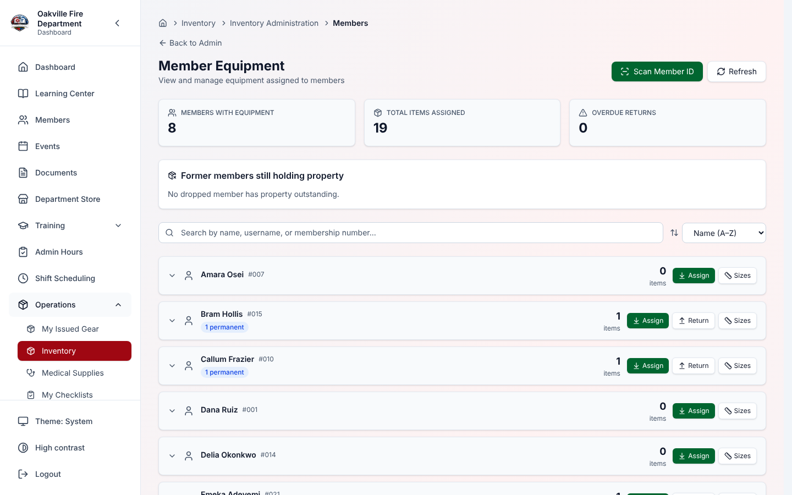

### Scanning a Member's ID Card

Instead of searching by name, scan the member's ID card:

1. Select **Scan Member ID** at the top of the page.
2. Your camera opens.
3. Point it at the QR code or barcode on the member's card.
4. The member is selected and their gear loads.

This is useful on a phone at a handout, when you have many members to process.

> **Tip.** The scanner reads the member's **badge code**. The Logbook issues one
> for every member, and only a card printed from the Member ID Card feature
> carries it. A hand-made QR code selects nobody, and the scan only finds
> members of your own department. Older cards that carry a membership number
> still scan until an administrator turns off **Accept old badges** (see
> [Badge Codes](./01-membership.md#badge-codes)). If a scan fails, search by
> name.

If your department uses NFC ID cards, the **Scan Member ID** window also offers
**Or tap their ID card**. See
[Identifying a member by their ID card](#identifying-a-member-by-their-id-card).

---

## My Issued Gear

**My Issued Gear** is every member's own page. It says what it is for: "The
department equipment you are responsible for, and your requests for more."

At the top are three tiles:

| Tile                 | What it counts                                                          |
| -------------------- | ----------------------------------------------------------------------- |
| **Issued to me**     | Gear you hold: assignments and issued stock                             |
| **Temporary loans**  | Items lent to you with a due date                                       |
| **Pending requests** | Your gear requests not yet decided, and return notices not yet received |

Below them:

- **Issued to Me** lists everything you hold, newest first. Each row shows
  what its record carries: serial number, asset tag and condition for a tracked
  item; quantity and size for issued stock. Each has **Notify quartermaster of
  return**.
- **Active Temporary Loans** is its own list, because a due date is something
  you must act on. Overdue loans are marked.
- **My Requests** shows your gear requests with their status: Awaiting review,
  Approved, Declined or Issued. The quartermaster's note appears under a
  request ("Quartermaster: …").
- **Request Equipment** and **My Sizes** are at the top.

Empty sections explain themselves. "Nothing has been issued to you yet." is
followed by how gear arrives and a link to the Learning Center's **Your Issued
Gear** walkthrough.

The gear widget on your dashboard uses the same counts and words as this page.

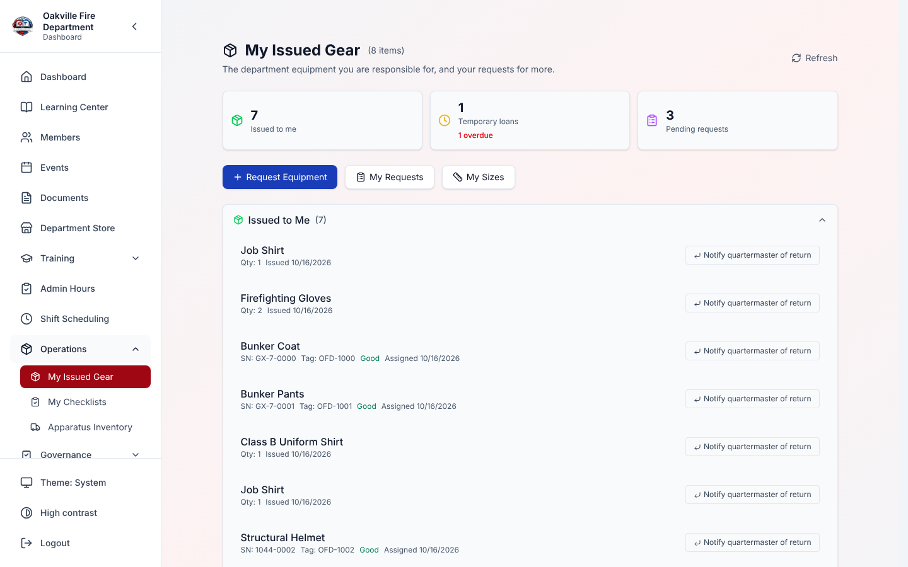

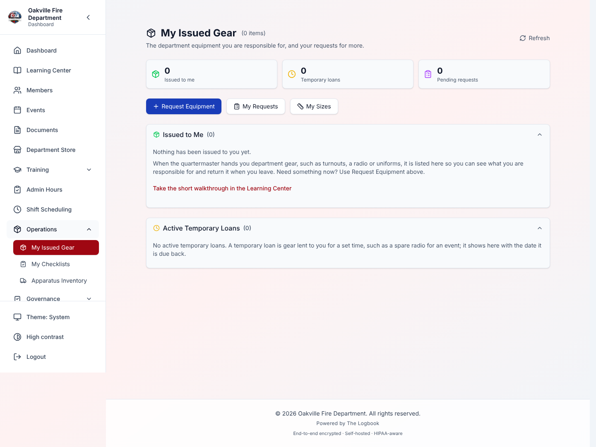

---

## Gear Requests

Members ask for gear through **Request Equipment** on **My Issued Gear**.
Quartermasters review the requests and hand the gear out.

### Submitting a Request

1. Go to **My Issued Gear** and select **Request Equipment**.
2. Find the item. The form opens on your department's gear, with the real
   category names as filters. Search also matches category and product-group
   names, so typing "shirt" finds a garment filed as "Long Sleeve".
   - Each product is one row, however many sizes it comes in. Ten radios read
     as "Portable Radio — 7 on hand", not ten separate lines.
   - Gear the department does not list at all can be described in your own
     words in the free-text box.
3. Choose a size. The size step starts from **your size on file** (marked "from
   your profile"), and your fit preference (such as Women's) is preselected. Any
   other size the department stocks is one tap away.
4. For counted items, enter how many (1 to 99).
5. Under **How long do you need it?**, choose **Temporary — I expect to return
   it** or **Ongoing — I need it as regular assigned gear**. This is a guide;
   the quartermaster decides how it is issued.
6. Optionally fill in **Reason** (for example worn out, doesn't fit, new
   member). It helps the quartermaster decide.
7. Select **Submit Request**. You see "Request sent to the quartermaster for
   review".

Gear restricted to certain ranks or positions is not shown to members who
cannot request it.

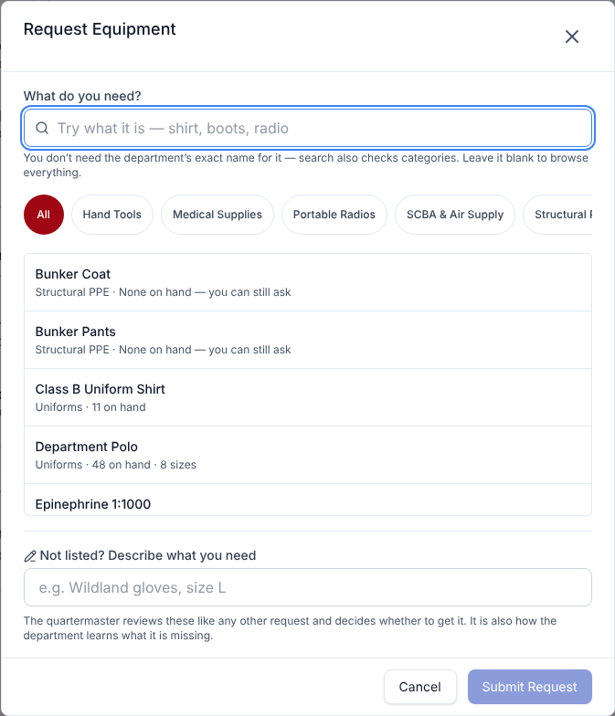

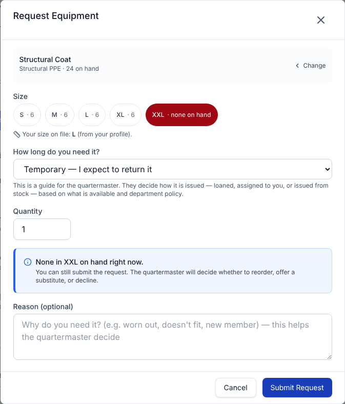

#### When your size is not on the shelf

You can still ask. Each size button tells you what to expect:

| Situation                        | The size reads   | The notice says                                                                                                                                           |
| -------------------------------- | ---------------- | --------------------------------------------------------------------------------------------------------------------------------------------------------- |
| The department never stocks it   | **not stocked**  | "The department doesn't stock this item in _size_." The quartermaster "will review it and decide whether to order it, offer a different size, or decline" |
| Stocked, but none left           | **none on hand** | "None in _size_ on hand right now." The quartermaster "will decide whether to reorder, offer a substitute, or decline"                                    |
| Counted item, you asked for more | (number on hand) | "Only _n_ on hand in _size_." The quartermaster "will decide how many to issue and whether to order the rest"                                             |

Your own size is offered even when nothing is stocked in it. The request keeps
the size you asked for, so the quartermaster knows exactly what you wanted.

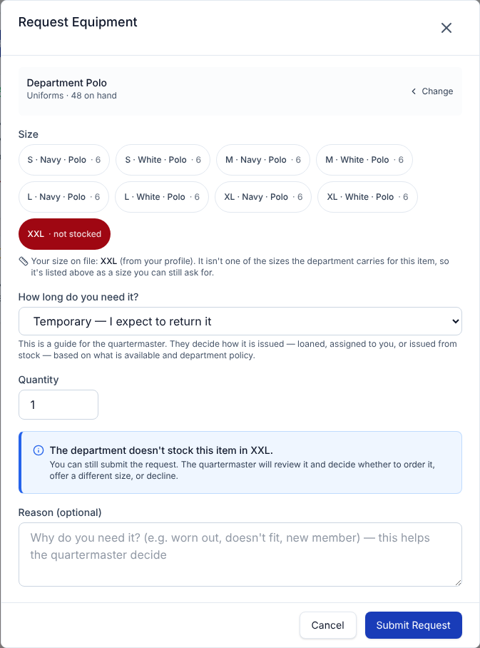

### Reviewing Requests (Admin)

Needs the **Manage gear, uniforms and equipment** permission.

1. Go to **Inventory Administration → Gear Requests**. The page opens on
   **Awaiting review**. Switch **Filter by status** to **All** to see every
   request.
2. Select **Review** on a request. The window shows **Member asked for:**, the
   size (and says so if it is not a size you stock), how the item is tracked
   ("Tracked individually" or "Issued from bulk stock") and how many are on
   hand.
3. Optionally type **Review Notes**. They are shown to the member on their
   request, for example why it was declined or when to expect it.
4. Choose one:
   - **Decline**
   - **Approve for later fulfillment**
   - **Approve & fulfill now**. When it is greyed out, hovering it explains:
     _"Nothing matching is on hand to issue right now — approve it and fulfil
     later"_.

Members and quartermasters see the same status words:

| Status              | Meaning                            |
| ------------------- | ---------------------------------- |
| **Awaiting review** | Not yet decided                    |
| **Approved**        | Approved, waiting to be handed out |
| **Declined**        | Turned down                        |
| **Issued**          | Handed out. This is final          |

### Equipment Request Fulfillment

Once a request is **Approved**, a quartermaster can **Fulfill** it. This turns
the request into an actual issuance, loan or assignment in one step.

1. Select **Fulfill** on the approved request.
2. Choose how it goes out:
   - **Checkout — returnable individual item** (a temporary loan)
   - **Assignment — assigned individual gear**
   - **Issuance — pool-tracked stock** (checked against the member's
     allowance unless you override it)

   For a pool item the window opens on **Issuance**.

3. Choose the item to issue from. The list offers every item of the variant the
   member asked for (same product, size, colour and style), so what you can
   fulfil from matches what the member was shown. The list is worked out across
   your whole catalog. When it is shortened for display, it says so.
4. Confirm.

The request then shows **Issued** and a line saying how and when, for example
"Fulfilled via issuance on 8/11/2026". The line does not name who fulfilled it
or link to the record created. To trace it, find the issuance or loan by member
and date.

Only **Approved** requests can be fulfilled, so the same request cannot be
handed out twice by accident.

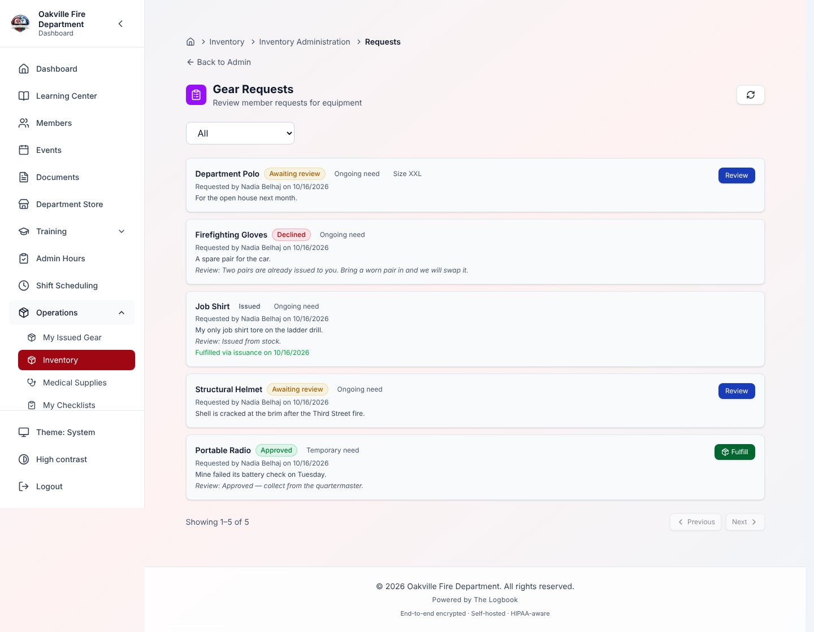

### What the member is told

When you approve, decline or issue a request, the member gets:

- A bell notice linking to **My Issued Gear**.
- A web push, if push is set up.
- An email titled "_Your equipment request was approved / declined / issued:
  item_", including anything you typed in **Review Notes**.

**Approve & fulfill now** sends one notice, when the item is issued. Text
messages are never sent; this is an administrative notice.

- A department can switch the notice off entirely (bell, push and email) with
  an **Equipment Request Update** rule under **Notifications → Notification
  Rules**. With no rule, it is on.
- A member can turn off just the email under **My Account → Notifications**
  (**Equipment and inventory updates**), unless the department has made that
  email required. The bell notice still arrives.
- The email's wording is the **Equipment Request Update** template, under
  **Communications → Email Templates → Inventory & Property**.

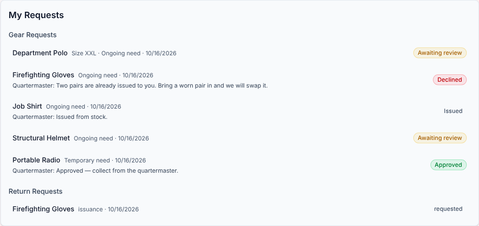

---

## Issuance Allowances

Needs the **Manage gear, uniforms and equipment** permission.

An **issuance allowance** limits how many units of a category a member may
receive in a period. For example, "3 job shirts per year per firefighter".

### Creating an Allowance

1. Go to **Inventory Administration → Issuance Allowances**.
2. Select **New Allowance**.
3. Fill in the form:
   - **Category** (required). It cannot be changed when you edit the allowance.
   - **Applies To**: a position, or **All members**.
   - **Max Quantity** (required): a whole number, 0 or more.
   - **Period**: **Per Year** (resets on 1 January), **Per Career** (lifetime
     total) or **One Time**.
4. Save. Use the pencil and bin icons on a row to edit or delete it.

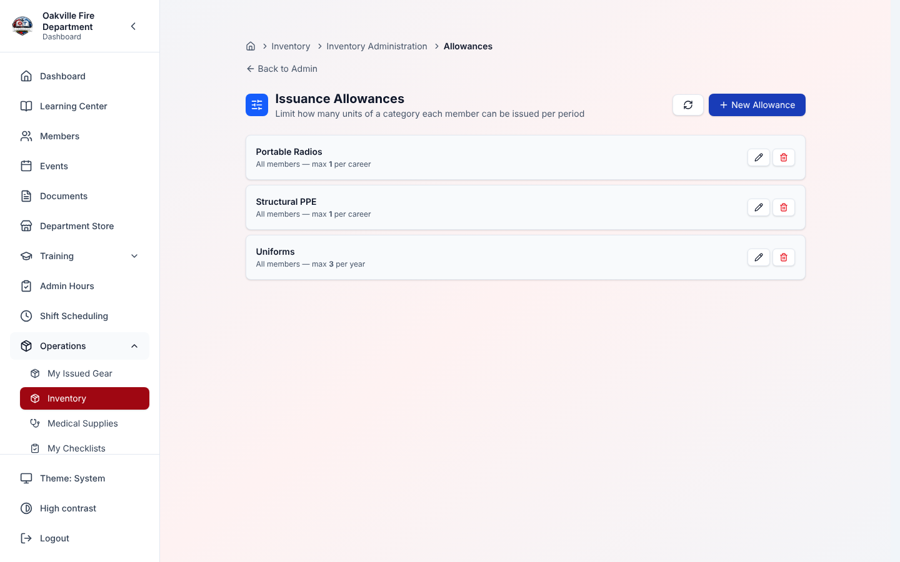

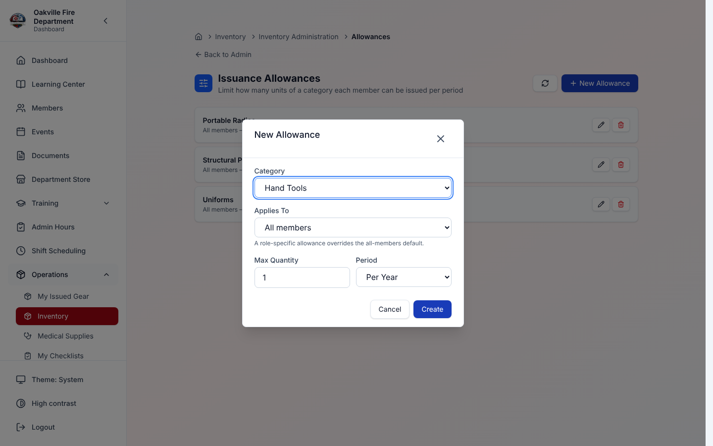

### How Allowances Are Enforced

When you issue a **pool** item, The Logbook checks the member's remaining
allowance for that category. Only pool items in the category count.

- The member's **highest-ranking position** decides which allowance applies. A
  position-specific allowance wins over the all-members one.
- **Per Year** counts issuances since 1 January. **Per Career** and **One
  Time** count everything ever issued.
- A category with **no** allowance is unlimited. The issue window says "No
  issuance allowance is set for this category."
- The window checks the allowance as soon as you pick the member. If the
  quantity would go over, it says so and shows the **Override allowance**
  checkbox. **Issue** stays off until you lower the quantity or tick the box.
- A quantity above what is on hand is refused ("Only _n_ on hand."). On a
  return, a quantity above what the member holds is refused ("Only _n_
  issued.").
- The list of current issuances names each holder. A member who has left reads
  "Former member".

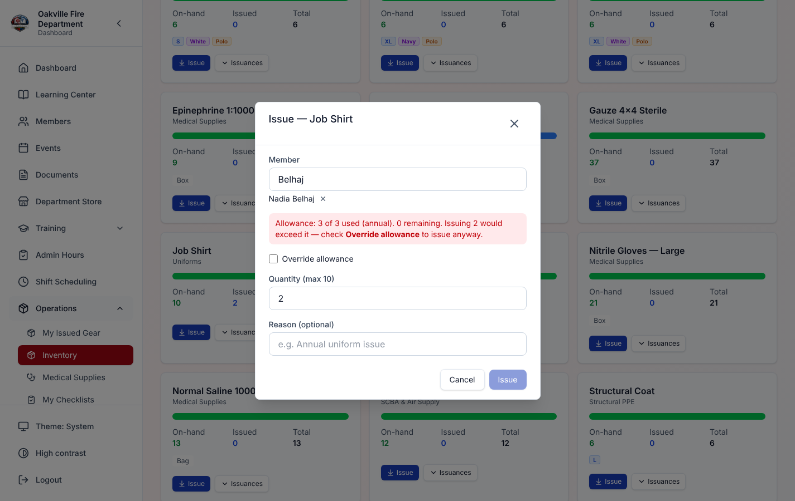

### Allowance Edge Cases

| What happens                       | What it means                                               |
| ---------------------------------- | ----------------------------------------------------------- |
| The category has no allowance      | Unlimited. Issuing is never blocked                         |
| The member holds several positions | The highest-ranking position decides                        |
| The allowance is 0                 | The member cannot receive that category without an override |
| You tick **Override allowance**    | The limit is skipped; the issuance is recorded normally     |

---

## Reorder Requests

When stock runs low, a reorder request tracks the purchase from request to
delivery.

### Setting Reorder Points

Needs the **Manage gear, uniforms and equipment** permission.

1. Open a pool item's edit form.
2. Set the **Reorder Point**: the stock level at which you want a warning.
3. Save.

When the stock drops to or below the reorder point, the item appears in
**Waiting for action** and in the daily low-stock email.

### Creating a Reorder Request

Needs the **Manage gear, uniforms and equipment** permission.

1. Go to **Inventory Administration → Reorder Requests**.
2. Select **New Request**. The **New Reorder Request** window opens.
3. Under **Inventory item**, search for and pick the item the order restocks.
   The item name fills in from it if you have not typed one. **Quick fill from
   low stock** offers the items that are running low.
4. Enter the quantity and any notes.
5. Submit.

**Link the item.** Stock can only be received against a linked item. You can
save a request without one, and link it later with **Edit** while it is pending
or approved, or when you receive it. Once stock has arrived against a request,
its linked item cannot be changed.

### Reorder Request Workflow

| Status                 | Meaning                                                                              |
| ---------------------- | ------------------------------------------------------------------------------------ |
| **Pending**            | Submitted, waiting for approval                                                      |
| **Approved**           | Approved by a supervisor                                                             |
| **Ordered**            | Ordered from the vendor (vendor, order reference and expected delivery are recorded) |
| **Partially received** | Some of the order has arrived                                                        |
| **Received**           | Everything has arrived and the stock count is updated                                |
| **Cancelled**          | Withdrawn before it arrived                                                          |

Each change of status is recorded with who made it, when, and any notes.

**Receiving** a delivery adds the units to the item's stock straight away, so
they can be issued at once.

- **An order that was never linked.** **Receive stock** on a request with no
  linked item opens with an **Inventory item** search first. Pick the item the
  delivery goes onto, then enter the quantity, storage place and unit cost as
  usual. Until you pick an item, the other fields stay hidden and the button
  stays off. The request stays linked to that item.
- **Editing an order that has started arriving.** **Edit** can still change the
  quantity, vendor details and notes. It refuses a **Quantity requested** lower
  than what has already arrived ("Quantity requested cannot be lower than the 6
  already received"). To stop waiting for the rest, cancel the remainder
  instead.
- **Restocked another way.** If stock comes back through a return rather than
  the reorder, the request stays open. Close or cancel it yourself.

---

## Low Stock Alerts

Pool items with a reorder point warn you when stock is low.

**On the administration page.** **Waiting for action** on **Inventory
Administration** lists each low-stock category with what is on hand and its
reorder level. The **Reorder Requests** card shows how many there are. The same
list also flags maintenance that is due or overdue, overdue loans and overdue
deliveries.

### Low stock emails

Once a day, each department's low-stock items are emailed as a table. The email
says the items are **at or below** the reorder point. Each row shows the item
with its category under it, the current quantity and the reorder point. For an
item kept in dated lots, the quantity counts in-date lots only, and says so.

- Each person gets only the rows they may see. Gear rows go to officers who
  manage gear; medical rows to those who manage medical supplies. Someone with
  both gets one complete email.
- Every one of those officers also gets a bell notice, **Low stock — _N_
  item(s) at or below reorder point**, linking to the same list. An officer who
  turned off their quartermaster duty emails gets the bell notice and no email.
  While it is unread, the next day's run updates it rather than adding another.
- When the email lists gear or uniform rows it ends with **View low-stock gear
  and uniforms**. The link opens **Inventory Items** already narrowed to items at
  or below their reorder point, with a notice **Showing only items at or below
  their reorder point** and a **Show all items** button to lift it. Medical rows
  link to the **Low stock** tab of Medical Supplies instead, and an officer who
  sees only one kind gets only that link.
- Low-stock alerts are **email only**. No text message is sent, because
  reordering is a business-hours decision made from an item table a text
  cannot hold.

### Other inventory alert emails

Each of these also leaves a bell notice for every officer it goes to, so an
officer who turned off quartermaster duty emails is still told. The shelf-audit
digest, the NFPA retirement alert and **Supplies to Replace** update an unread
notice rather than adding another each time. A reorder request filed
automatically after a swap does the same, pointing an officer who manages gear
at the reorder queue and a medical-only officer at Medical Supplies.

| Email                                                      | What it shows                                                                                                                                       |
| ---------------------------------------------------------- | --------------------------------------------------------------------------------------------------------------------------------------------------- |
| **NFPA 1851 retirement** (weekly)                          | Items **approaching or past** their retirement date, with a past-due count when there is one. The serial number or asset tag is under the item name |
| **Property return reminder** and **member dropped** notice | Two columns, **Item** and **Value**, with condition, serial number and asset tag as grey lines under the item. A missing value is left out          |
| **Supplies to Replace** (weekly)                           | Supplies expiring on the apparatus, with a **Status** column. See [Shifts & Scheduling](./03-scheduling.md#alerts)                                  |

---

## Dated Stock Lots and Receiving

Consumables such as gauze, saline, medications and batteries are not one flat
count. They arrive in batches with expiration dates. Which batch a unit came
from matters when something is recalled or about to expire.

A **lot** is one dated batch: a lot number, an expiration date, a quantity and
the date it was received.

### Where "on hand" comes from

An item's on-hand figure comes from one of two places:

| Item                  | On-hand figure                    |
| --------------------- | --------------------------------- |
| Has lots              | The total of its **in-date** lots |
| Has no lots           | The item's own **Quantity**       |
| Has lots, all expired | **Zero**                          |

**Expired stock counts as nothing.** An equipment-check swap refuses it anyway,
so counting it would hide the shortage you most need to order for.

The item list labels this figure **"in-date lots"** so it is not mistaken for a
pool count. The spreadsheet export has it in its own **Ready Lot Stock** column.
The low-stock email uses the same figure and says where it came from.

For an item kept in lots, the item's own **Quantity** is not used: receiving a
lot does not change it, and a swap takes stock from the lot only. That is why
the two numbers can disagree. The lot figure is the one that counts.

### Receiving a delivery

Needs the **Manage gear, uniforms and equipment** permission.

1. Go to the item list.
2. Select **Receive Stock**.
3. Add one line per item in the delivery: **item**, **lot number**,
   **expiration** and **quantity**.
4. Set the **received date** once, for the whole delivery.
5. Review and submit.

**The whole delivery is saved, or none of it is.** If any line has a problem,
nothing is saved and the errors are shown against those lines. A half-saved
delivery would be worse: you could not tell which lines landed, and entering it
again would count some twice.

### Adding many catalog items at once

Needs the **Manage gear, uniforms and equipment** permission.

1. Go to the item list.
2. Select **Add Several**.
3. Paste or type one item per line. A name alone is enough. Add `| quantity |
unit` after it to set those too.
4. Choose a **category** and a **tracking** type for the whole list. They apply
   to every line, so paste one kind of thing at a time. **Counted** suits
   anything a checklist counts: a bracket holds four gauze, not gauze #7.
5. Check the preview and submit.

The preview shows what each line was read as (name, quantity, unit), with a
dash where a line gave none. It does **not** mark names you already have. Those
are skipped, not refused, and named in the message after you submit. So you can
paste a list again after it grows, and only the new lines are added. As with
receiving, if any line has a problem, nothing is saved.

**Import CSV**, beside these buttons, is the third way in. See
[CSV Import](#csv-import).

### Which trucks carry this item

Open any item's **Stock Lots** tab. Below the lots on the shelf is **Deployed
on apparatus**: the checklist positions this item fills, the apparatus and
compartment of each, what that truck carries right now, and the soonest
expiration aboard.

Use this to work a **recall**: you are holding the item and need to know which
rigs to visit. For the opposite question ("what is expiring on my trucks?"), use
**Inventory Administration → Expiring on Apparatus**. See
[Shifts & Scheduling → Supply Tracking](./03-scheduling.md#supply-tracking-keeping-the-truck-and-the-shelf-in-step).

### Stock Lot Edge Cases

| What happens                                               | What it means                                                                                                                                              |
| ---------------------------------------------------------- | ---------------------------------------------------------------------------------------------------------------------------------------------------------- |
| A lot passes its expiration date                           | It stops counting toward on hand, is flagged in the list, and an equipment-check swap refuses it                                                           |
| Every lot of an item has expired                           | On hand reads **zero**                                                                                                                                     |
| An item has no lots                                        | Nothing changes. It reports its pool figures                                                                                                               |
| A swap uses up a lot                                       | The lot is removed. What went onto the truck keeps its own copy of the lot number and expiration                                                           |
| A lot is deleted while some of it is on an apparatus       | The truck's record keeps its lot number and expiration                                                                                                     |
| One line of **Receive Stock** has a problem                | **Nothing is saved.** Fix the line and submit the whole delivery again                                                                                     |
| An **Add Several** line names an item you already have     | It is skipped and named. The rest are created                                                                                                              |
| A lot has no expiration date                               | It counts toward on hand and is used **last**                                                                                                              |
| You open **On hand** or **Quantity** on a lot-stocked item | The box is replaced by the lot figure ("_N_ from stock lots — adjust by receiving a delivery or editing the item's lots"). Saving the form leaves it alone |

---

## CSV Import

You can add many items at once from a spreadsheet saved as a CSV file.

### Importing Items

Needs the **Manage gear, uniforms and equipment** permission.

1. Go to **Inventory Administration → Import**, or select **Import CSV** on the
   item list.
2. Select **Download CSV Template** to see the expected columns, with example
   rows.
3. Fill in your items. Only **Name** is required. The template's other columns
   are Category, Item Type, Serial Number, Asset Tag, Status, Condition,
   Tracking Type, Quantity, Manufacturer, Model Number, Purchase Date, Purchase
   Price, Purchase Order, Vendor, Warranty Expiration, Storage Location,
   Station, Size, Color, Description, Notes and **Also Called** (other names
   for the item, separated by semicolons or commas; see
   [When the checklist and the catalog use different names](#when-the-checklist-and-the-catalog-use-different-names)).
   The template's example rows include common medical supplies (no
   medications).
4. Select **Choose a CSV file** and pick your file. (The box does not take
   dragged files.)
5. Check the preview of the first rows.
6. Select **Import**. The result says how many were imported, and lists any
   rows that were skipped and why.

A value with a comma in it must be in quotes, for example
`"Gauze Pads, 4x4 Sterile"`. It is then read as one value.

### Validation

| What happens                                                       | What it means                                                                                                                      |
| ------------------------------------------------------------------ | ---------------------------------------------------------------------------------------------------------------------------------- |
| A row has no name                                                  | The row is skipped                                                                                                                 |
| A serial number is already in your catalog or the file             | The row is skipped                                                                                                                 |
| A pool item has no quantity                                        | The row is skipped                                                                                                                 |
| Quantity or purchase price is negative                             | The row is skipped                                                                                                                 |
| The category name does not match one you have                      | The item is imported **without a category**, and the result warns you                                                              |
| An item is imported without a category                             | It is treated as gear, not as a medical supply                                                                                     |
| **Also Called** has more than 10 names, or one over 100 characters | The row is skipped and reported. The names are not shortened                                                                       |
| The **Vendor** names a supplier you do not have on file            | The item is imported with the name as plain text. The result lists such names so you can attach them later on the **Vendors** page |
| One supplier is spelled several ways (`Gals`, `gals`)              | It is listed **once**                                                                                                              |
| A row that was skipped named an unknown supplier                   | That name is **not** listed                                                                                                        |
| The name matches a supplier you switched off                       | The item is linked to that supplier                                                                                                |
| The file is very large                                             | It is refused. Split it into smaller files                                                                                         |

> **Tip.** Start with a small test import (5 to 10 items) before a large one.

---

## Storage Areas

Storage areas are the racks, shelves, bins and cabinets inside each room. Open
them from **Inventory Administration → Storage Areas**. Areas can sit inside
each other: a rack holds shelves, a shelf holds boxes.

### Viewing items in a storage area

Select an area to expand it. Its items appear in a panel with their name,
serial number, status and condition. Select an item to open its page. An area
with no items says "No items found in this area." Areas with nothing inside them
have no expand toggle.

### Deleting a storage area

**Delete** waits until the area is empty. The dialog refuses while:

- the area holds items ("Move them to another storage area first."), or
- other areas sit inside it ("Move or delete those first.").

This stops items being left with no place, and stops nested areas being cut
off.

### Finding a shelf by its label

Storage areas carry barcodes too (`SA-000001` and so on). **Scan shelf label**
reads a shelf's code from the camera or a handheld scanner and jumps to that
area, opening the areas above it and its item list. The page address then
points at that area, so you can bookmark or share it.

Shelf codes are read here and by **Put away** and **Check contents** below. The
assign and return scanner recognises them too: scanning a shelf label there adds
nothing to the list. It says, for example, "SA-0007 is the label for the storage
area Glove shelf, not an item". Officers who can manage inventory get **Open
storage area**, which jumps to it here. Only an exact, whole label matches, so a
partial code never pulls shelves into item results.

### Putting items away by scanning

Needs the **Manage gear, uniforms and equipment** permission.

**Put away** on **Storage Areas** files a batch of items onto one shelf:

1. Scan the shelf's label. Or open the shelf first, and it is already chosen.
2. Scan each item going onto it. Each one is looked up and added to the list.
   An unknown code or a repeat is refused with a reason.
3. Select **File _N_ items on …**. Items assigned or lent to a member, or
   recorded as lost, stolen or retired, stay where they are and are listed with
   the reason.

You cannot change the shelf while items are waiting to be filed. File or clear
them first, so it is always clear which shelf they were scanned for.

If you picked the shelf on screen rather than scanning it, the result offers
**Print shelf label**, so next time you can start with a scan. A shelf with no
barcode yet gets one when its label prints.

### Checking a bag, box or bin

Needs the **Manage gear, uniforms and equipment** permission.

A bag, box or bin is a storage area, so its label is a storage-area label.
**Check contents** on **Storage Areas** compares what is inside with what the
records say:

1. Scan the container's label (or open it first). Everything filed on it, and
   on areas inside it such as a bag's pockets, is loaded.
2. Scan everything inside. The panel counts **_N_ of _M_ found** and lists what
   has **not been scanned yet**, with the pocket each should be in.
3. An item recorded somewhere else is listed under **Doesn't belong here**,
   with where it is recorded. **File it here** moves it into this container,
   with the same rules as **Put away**.

Items assigned or lent to a member are not counted as missing. If one is
scanned inside anyway, it is listed under **Here, but the record disagrees** so
you can correct the record. Checking alone changes nothing.

### Shelf, rack and bin labels

Needs the **Manage gear, uniforms and equipment** permission.

Labels for storage areas print from **Storage Areas**:

- **Print _N_ labels** at the top prints a label for every area in view: the
  chosen facility or room, or your search results.
- The printer icon on a row prints just that one.

The **Print Storage Area Labels** page works like the other label pages: PDF,
**Print in browser**, a registered label printer, QR codes, and **Start at
label** for a partly used sheet. Each label shows the area's name and where it
is ("_Station 1 › Rack A_"), and carries its barcode. An area with no barcode
yet gets one when it prints.

---

## Barcode and QR Scanning

Scanning happens **inside** the assign and return windows. It is not a lookup
screen of its own: you choose the person and what you are doing first, then
scan.

1. Go to **Inventory Administration → Members**, or select **Assign to Member**
   at the top of **Inventory Administration**.
2. Select **Assign** or **Return** for the member.
3. Select **Start Camera** and hold the barcode or QR code up to it. Each
   successful read adds the item to the list.
4. Repeat for every item, then confirm the whole batch.

If a code matches more than one item (for example, the same serial number in
two categories), all matches are shown. The same code scanned again within 3
seconds is ignored, so one item is not added twice.

> **Tip.** On a desktop, a USB barcode scanner types the code into the search
> box, the same as typing a name, serial number or asset tag by hand. If
> scanning fails, check that the barcode is clean and well lit. The message
> tells you whether the item was not found or the network failed.

### When the camera does not work

The scanner names the camera problem, because each one is fixed differently:

| Problem                                  | What to do                                     |
| ---------------------------------------- | ---------------------------------------------- |
| Camera permission was refused            | Allow the camera in your browser settings      |
| The device has no camera                 | Type the code or use a USB scanner             |
| Another app is using the camera          | Close that app and try again                   |
| The page is not on a secure (HTTPS) link | Ask your administrator; the camera needs HTTPS |

- Camera messages stay on screen until you act on them.
- **The typing box always works**, so a failed camera slows you down rather
  than stopping you. To try again, select the same scan button.
- On a desktop with only a front-facing webcam, the scanner uses that camera
  when there is no rear one.

The exact messages, and a picture of the refused-camera banner, are in
[Mobile & PWA](./10-mobile-pwa.md).

---

## NFC Tags

NFC tags are small stickers or fobs that a phone reads by touch. When a tag is
linked to an item or a shelf, a tap finds exactly that item: no camera, no
lighting and no lining up a barcode. **NFC tags are off until an administrator
turns them on.**

The full setup guide covers which tags to buy, which phones can do what,
tagging shelves and troubleshooting:
[Inventory NFC Tags](../../wiki/Inventory-NFC-Tags.md).

> **Which phones?** Linking tags and tapping inside The Logbook need **Chrome on
> Android**, with the site opened over **HTTPS** (a secure link). An iPhone
> cannot read tags inside The Logbook, but tapping a tag that has a written link
> opens the item straight from the home screen.

### Turning NFC tags on

Needs the **Full settings and admin management** or **Update organization
settings** permission.

1. Go to **Inventory Administration → NFC Tags**.
2. Tick **Use NFC tags for inventory items**. It saves straight away.

Turning it off hides the NFC buttons and stops tags working, but keeps every
link. Turning it back on restores them.

### Linking a tag to an item

1. Open the item. The **NFC Tags** card is on the item page while NFC is on,
   for officers who can manage inventory.
2. Optionally type **where the tag is on the item** (for example "Inside left
   cuff").
3. Select **Write a link to a blank tag**, then hold a blank tag flat against
   the back of the phone until it confirms.
   - For a tag that cannot be written, select **Read a tag's serial** instead.
   - At a desk, type the serial, or tap the tag on a USB reader with the cursor
     in the box, then select **Link serial**.

An item can have several tags, but a tag belongs to one item or shelf. **Mark
lost** takes a missing tag out of use until you select **Mark found**.
**Unlink** frees a tag for reuse.

> **Tip.** Prefer **Write a link**. A written tag works on any phone, iPhones
> included. It stops working the moment you unlink it, because the link names
> the tag, not the item.

### Tapping items in the scanner

In **Distribute** or **Return** for a member, select **Tap NFC** next to
**Start Camera**, then tap each item's tag. Each tap adds that item to the list,
like a scanned barcode. Select **Stop NFC** when done; closing the window also
stops it.

### Putting items away by tap

Tag your shelves first: on **Storage Areas**, edit a shelf and link a tag in its
**NFC Tags** card, the same way as an item.

1. Go to **Inventory Administration → Put Away by NFC** (or **Put Away by NFC**
   on **Storage Areas**) and select **Start tapping tags**.
2. Work in either order:
   - **Shelf first:** tap the shelf, then every item going onto it. The shelf
     stays open until you tap another shelf or select **Close shelf**.
   - **Item first:** tap one item, then its shelf. That one item moves. The
     next item waits for its own shelf.
3. Each move is listed under **Put away this session**.

Put-away follows the same rules as scanning with **Put away**. An item that is
assigned or lent to a member, lost, stolen or retired is refused, and the
message says why. Without an Android phone, choose the shelf from **Or pick a
shelf** and type item serials in the box.

### Last Seen

The item page lists the item's recent NFC taps under **Last Seen (NFC)**: who
tapped it, and where it was put away. Only quartermaster taps are recorded. A
member opening a tag from their own phone leaves no record.

### Auditing a shelf

Needs the **Manage gear, uniforms and equipment** permission.

1. Go to **Inventory Administration → Shelf Audit** and select **Start tapping
   tags**.
2. Tap the shelf's tag, or choose it from **Or pick a shelf**.
3. Tap every item on the shelf. Each appears in the list once, however many
   times it is read. Remove a mistaken one with its **×**.
4. Select **Finish audit**.

The result has three lists:

- **Missing**: recorded on this shelf but not tapped. **Nothing is marked
  lost.** Look for them, then update each item yourself if it really is gone.
- **Unexpected**: tapped here but recorded somewhere else. Tick the ones that
  belong here and select **Move selected onto** the shelf. An item assigned or
  lent to a member is not moved, and the page says why.
- **Found**: recorded here and tapped.

Items assigned or lent to a member, lost, stolen or retired are not expected on
a shelf, so they are never reported missing. **Recent audits** lists past
audits; **View** opens one.

> **Tip.** Audit one shelf or bin at a time. An audit covers exactly the area you
> tapped, not the bins inside it.

### Scheduling shelf audits

Needs the **Manage gear, uniforms and equipment** permission.

1. On **Storage Areas**, edit the shelf, bin or cabinet.
2. Under **Shelf audit schedule**, choose **Weekly**, **Monthly**,
   **Quarterly** or **Yearly**. It saves straight away.

**Shelf Audit** then lists the area under **Audit schedule**, with when it was
last audited and when it is next due. **Audit now** starts an audit of it. Each
area is due one week, month, quarter or year after its last saved audit, or
straight away if it has never been audited.

While any scheduled area is overdue, quartermasters get one reminder email a
week listing them.

### Tagging many items at once

Needs the **Manage gear, uniforms and equipment** permission.

1. Go to **Inventory Administration → Tag Items in Bulk**. It lists items with
   no working tag. Type in **Which items** and select **Find items** to narrow
   the list.
2. Choose **Write links** (a blank tag for each item) or **Read serials**.
3. With **Write links**, select **Write a tag for** the item shown and hold a
   blank tag to the phone. With **Read serials**, select **Start reading
   tags**, then tap each item's tag in turn.
4. The page moves to the next item after each link. **Skip this item** passes
   one over.

If NFC is off, the page says an administrator can turn it on under **NFC
Tags**. Managing inventory alone does not open that setting.

### NFC Tag Register _(2026-10-25)_

**Inventory Administration → NFC Tag Register** (`/inventory/admin/nfc/tags`)
lists every tag your department has linked, whether it is on an item, a storage
area or an equipment-check compartment. Each row shows what the tag names and,
for item tags, the last time staff tapped it. It needs **Manage gear, uniforms
and equipment** and NFC tracking turned on.

- **Mark lost** or **Mark found**, for one tag or a ticked selection.
- **Move** a tag onto another target of the same kind (an item tag to another
  item). Use it when a tag was stuck on the wrong thing.
- **Unlink** removes the tag from what it names, after a confirmation.
- **Download** saves the filtered list as a CSV.

People who manage equipment checklists (**Manage equipment check templates**)
can open the register too, but see only compartment tags. They cannot list item
or shelf tags, and a selection of those is refused rather than changed. The
same goes for the quartermaster in the other direction: managing inventory now
covers compartment tags as well.

> **Screenshot to create:** NFC Tag Register with a row selected.

### Identifying a member by their ID card

If your department issues NFC ID cards (**Settings → Integrations → NFC ID
Cards**), the **Scan Member ID** window on the inventory screens also shows
**Or tap their ID card**. Select it and hold the member's card to the phone. A
card marked lost, or one belonging to an inactive member, is refused with the
reason.

### Self-service kiosk

Opening the kiosk needs the **Open self-service checkout kiosk mode**
permission. No position has it until your department gives it. Members need
only their ID card.

**For quartermasters:** edit each category of loaner gear on **Categories**,
turn on **Allow self-checkout at the kiosk**, and set a **Kiosk loan period
(days)** if loans should be due back. Then open **Inventory Administration →
Self-Service Kiosk** on a tablet and select **Start kiosk**.

**For members:**

1. Tap your ID card on the tablet.
2. Tap the item's tag, then **Borrow it**. If you are bringing it back, answer
   whether it is damaged.
3. Tap **Done** when you are finished.

The kiosk says in plain words why it will not lend something (for example, "Ask
a quartermaster" for restricted gear). It forgets you after a minute without a
tap. The next member can tap their own card while it is still greeting the last
one. A suspended card reads "This card is suspended. Ask an officer."

### Tapping without signal

Put-away and shelf audits keep working without signal. Open the screen first,
then keep tapping.

- **Put-away:** taps are sent in order when signal returns, and a message says
  what moved. After that, tap the shelf again.
- **Shelf audit:** select **Finish audit** as usual. Without signal it is kept
  on the phone and saved later. Finish an audit before closing the screen; an
  unfinished one is not kept.

### Apparatus compartment tags

Tagging compartments needs the **Create and edit equipment check templates**
permission. Tapping during a check needs **Submit equipment checks on shifts**.

**To tag a truck:** open the checklist in the builder, choose **NFC tags** on a
compartment's **⋯** menu, and link a tag. Stick it on that compartment. For an
item to be answered by a tap, give the item its own tag and link its checklist
row to the inventory item.

**During a check** (Chrome on Android):

1. Select **Tap NFC tags**.
2. Tap a compartment's tag to jump to it.
3. Tap an item's tag. An unanswered pass/fail row is marked passed. A count,
   reading or date is brought on screen for you to finish by hand. A tap never
   changes an answer already given.

Loading a vehicle preset or importing a checklist replaces its compartments and
deletes their tags. Link them again afterwards.

### The NFC Tag Register

**Inventory Administration → NFC Tag Register** lists every NFC tag the
department has linked, in one place: tags on items, on storage areas and on
equipment-check compartments. Each row shows what the tag names, its label, its
status and, for an item tag, when a quartermaster last tapped it.

**Who can open it:**

| Permission                                    | What they see and change                                  |
| --------------------------------------------- | --------------------------------------------------------- |
| **Manage gear, uniforms and equipment**       | Every tag: items, storage areas and compartments          |
| **Create and edit equipment check templates** | Compartment tags only. Item and shelf tags are not listed |

Filter by kind (**Everything**, items, **Storage areas** or **Compartments**),
by status (**Active and lost**, **Active** or **Lost**), or search. Then:

- **Mark lost** / **Mark found** on one tag, or tick several and use the bar
  that appears above the list.
- **Move** a tag onto another target **of the same kind**: an item tag to
  another item, a compartment tag to another compartment. **Move tag …1234**
  opens a search for the new target. To put a tag on something of a different
  kind, unlink it and link it again there.
- **Unlink** a tag. The register asks **Unlink this NFC tag?** first.
- **CSV** downloads the register as filtered.

Moves and lost/found changes are recorded in the audit log.

> **Changed with this page:** the **Manage gear, uniforms and equipment**
> permission can now also relabel, mark lost or found, move and unlink
> **compartment** tags, alongside checklist builders. A checklist builder still
> cannot change item or shelf tags.

The page only appears while NFC tags are turned on.

<!-- Screenshot needed: The NFC Tag Register as a quartermaster: item and shelf tags with their status and last tap, one tag marked Lost -->

<!-- Screenshot needed: The Move tag dialog from the NFC Tag Register, searching for another item to move an item tag onto -->

### Items not seen

Needs the **Manage gear, uniforms and equipment** permission.

**Inventory Administration → Items Not Seen** lists items nobody has handled in
30, 90, 180 (the default) or 365 days. "Handled" means an NFC tap by a
quartermaster, an assignment or return, a loan or check-in, or an issuance or
its return. Editing the item's record does not count.

Items never handled at all are listed first as **Never**. That includes items
added today, because being added is not being handled. Filter by **Category**,
and use **Download CSV** for the full list.

This report works whether or not NFC tags are turned on.

---

## Label Printing

Print barcode labels to stick on equipment.

### Generating Labels

Needs the **Manage gear, uniforms and equipment** permission.

1. Open the **Print Barcode Labels** page one of five ways (see
   [Choosing which items to label](#choosing-which-items-to-label)):
   - On the item list, select **Print Labels** beside **Export**. Choose
     **This list** for every item your filters match, **Items that need a
     label**, or **Choose by category or location**. **This list** is not
     offered while the low-stock filter is on, because the print page cannot
     narrow to it.
   - Tick items on the item list and select **Print Selected** in the bar that
     appears. Or tick one, then **Select all _N_ matching** to take every item
     your filters match.
   - Open a single item and select **Print Barcode**.
   - Use the **Barcode labels** card at the end of the setup steps.
   - Open the print page with nothing selected and choose a category, location
     or storage area.
2. Select **Settings** and choose a **Label Size**. The sizes are cards, not a
   list:
   - **Dymo 30252**, **30256**, **30334** and **30336**: the four common Dymo
     label rolls. Dymo 30252 is the default.
   - **Rollo 4" x 6"** and **Rollo / Thermal 2" x 1"**: roll-fed thermal
     printers.
   - **Thermal 1" x 1"**: square asset tags.
   - **Letter Paper (Grid)**: Avery 5160, 30 labels per 8.5 × 11 inch sheet.
   - **Custom size**: type the exact width (0.5 to 8 inches) and height (0.5 to
     11 inches) for any other sticker printer or label.
3. Choose a **Barcode Style**:
   - **Code 128** (the default): the striped barcode any handheld laser scanner
     reads.
   - **QR code**: square, so a long code fits on a small tag. On a 1-inch square
     tag a striped barcode holding a full item code does not fit; a QR code
     does. Phone cameras read it as well as 2D scanners. A QR code has no text
     line of its own, so the value is printed under it.
4. Optionally set **Copies per item** and choose **What Prints on the Label**.
   - The code always prints.
   - **Item name**, **Asset tag** and **Serial number** print unless you switch
     them off. Leaving the name off gives a small tag's height to the code. The
     asset tag or serial number is left off anyway when it repeats the code.
   - _(2026-10-27)_ A long item name wraps onto a second line in the preview
     and the browser print, and only then ends in "…", so "Golf Shirt — XXL —
     Unisex Short Sleeve" and its long-sleeve twin no longer print the same.
     Label text prints in a plain sans-serif font (Arial or Helvetica), which a
     thermal printer reproduces more cleanly at small sizes than a serif font.
   - **Location**, **Storage area** (the shelf's full path, such as `Supply
Room > Rack A > Shelf 2`), **Category**, **Size** and **Condition** print
     on one extra line, in the order you pick them, space permitting.
   - For thermal sizes, there is an **Auto-rotate for roll-fed** switch (see
     [Connecting a Sticker / Label Printer](#connecting-a-sticker--label-printer)).
5. Print one of three ways:
   - **PDF** (best for sticker and thermal printers): downloads a PDF sized to
     the exact label. Open it and print with your label printer selected.
   - **Print Labels**: prints through your browser's print window, after the
     **Before you print** checklist (see
     [Before you print](#before-you-print-2026-10-27)). Browser prints of Code 128
     barcodes used to come out as solid black boxes; the bars now print on a white
     background. **Print** stays available after you change **Copies per item**;
     it used to stay disabled until the page was reloaded. _(2026-10-28)_
   - **Print to _printer name_**: appears when your department has registered a
     network label printer. The labels go straight to it. See
     [Direct printing to a network label printer](#direct-printing-to-a-network-label-printer).
6. Answer **Did the labels print correctly?** See
   [Knowing which items still need a label](#knowing-which-items-still-need-a-label).

Your label size, barcode style and what prints are remembered for your position
and for this part of The Logbook. See
[Connecting a Sticker / Label Printer](#connecting-a-sticker--label-printer).

_(2026-10-29)_ The preview now sits directly under the controls instead of a screen below them, so a change to size or copies is visible without scrolling.

> **Saved setups for the department.** Above the printer controls, **Save
> setup…** stores the current label size, barcode style, what prints, copies
> per item and network printer under a name, for example _Rollo 2×1, QR_. Pick
> it from **Saved setup** to apply all of it at once. Setups are shared across
> the department, so anyone who prints inventory labels sees the same list on
> any computer. You can save up to 20. Saving under an existing name replaces
> it, and **Delete setup** removes it for everyone.

> **When an edit makes a label out of date.** Editing an item that has a
> confirmed label shows a banner on the item page with a **Print label**
> button. If the edit changed the code the label carries, the old label no
> longer scans to the item and should be replaced. The item also goes back on
> the "needs a label" list. If the edit changed only printed text (name, asset
> tag or serial number), the old label still scans but reads wrong.

> **Reusing a partly used Avery sheet.** With **Letter Paper (Grid)** chosen, a
> **Start at label** box (1 to 30) appears above the printer controls. Set it
> to the first label still on the sheet, counting left to right along each row.
> The places before it are left blank in the preview, the browser print and the
> PDF, so the sheet can go back in the printer. It applies to the sheet in the
> printer now: it goes back to 1 when you move to the next part of a large
> print. Roll printers have no places, so the box is not shown for them. The
> same box is on the label pages for apparatus, facilities, members and storage
> areas.

### Before you print _(2026-10-27)_

A web page cannot choose the printer's paper. The printer feeds whatever stock
its driver's paper size setting names, so a Rollo left on its 4" x 6"
default prints a 2" x 1" job scaled onto the wrong size. So when you print
through the browser, a **Before you print** window first names the settings to
use in the print dialog, for the label size you chose:

1. **Printer**: your label printer.
2. **Paper size**: the label size by name, such as 2" x 1" for a roll, or
   Letter (8.5" x 11") for an Avery sheet. For a roll it adds where to find it
   (under "More settings"), and what to do if that size is not listed: add it
   once in the printer driver's own preferences, then reopen the page.
3. **Margins**: None for a roll, Default for a sheet.
4. **Scale**: 100%, not "Fit to page", or barcodes may not scan.

Select **Open print dialog** to carry on, or **Back** to change something
first. Tick **Don't show again for _size_ on this computer** once that printer
is set up: the checklist is skipped for that size in this browser only, and
still shows for any other size, including each custom size. When no network
printer is registered, the window also points to **Settings → Label
Printers**, where an administrator can register one and skip the print dialog
altogether.

The checklist is not shown for **PDF**, **Print to _printer name_**, or on a
phone or tablet, where printing always downloads the PDF.

The same checklist runs on the shared label page used for apparatus, facility,
member and storage-area labels. _(2026-10-28)_

### Choosing which items to label

**Select every matching item from the list.** Filter the item list the way you
want (a category, a location, **Needs a Label**), tick any one row, and the bar
that appears offers **Select all _N_ matching**. That takes every item the
filters match, not just the rows loaded on screen. The bar then reads **All _N_
matching selected**. Select **Print Selected**. Unticking any row turns the
selection back into an ordinary hand-picked set.

- **Selecting holds at most 500 items**, because the same selection also drives
  bulk status changes. Above that, the bar offers **Print labels for all _N_
  matching** instead. It opens the print page by filter for up to 5,000 items
  and prints them in parts of 500 labels, one after another.
- A selection made this way is carried to the print page as your filters, not
  as a list of items, so the page survives a refresh.

**Or open the print page with nothing selected.** It opens **Print barcode
labels**:

1. Pick a **Category**, a **Location** (including **Unassigned**) and a
   **Storage area**.
2. Optionally tick **Only items that still need a label**.
3. The page counts the match as you go ("_N_ items match.").
4. Select **Prepare _N_ labels**.

Over 500 items, it says how many parts the run will print in. Over 5,000, the
button stays off until you narrow it.

### Knowing which items still need a label

Every item records **when its label was printed**, and the list can filter on
it.

**How an item gets marked.** After you select **Print Labels** or download the
**PDF**, the page asks:

> **Did the labels print correctly?** Confirming takes these items off the
> "needs a label" list.
> [ **Mark _N_ items as labelled** ] [ **Not yet** ]

Nothing is recorded until you confirm. A print window you cancelled, a jam, or
a PDF you never opened should not mark anything. **Not yet** just closes the
question. It is never asked after **Download Test Label**.

**Where it shows:**

- The item's **Basic Info** card has a **Label Printed** line: the date the
  label was confirmed and, for officers who manage inventory, who confirmed it
  ("_20 Sep 2026 by Jane Smith_"). Otherwise it reads **Needs a label**. It shows
  the latest confirmation.
- The item's **History** tab lists every confirmed print: who, when, and the
  code that label carried. A reprint after a barcode change shows both labels.
- The item list has a label filter: **Any Label Status**, **Needs a Label**,
  **Label Printed**. The same filter carries into **Export**.
- The print page's picker has **Only items that still need a label**.
- Above the item list, a line counts them ("_14 items need a label._") with
  **Show them** (applies the filter) and **Print their labels** (opens the print
  page on that filter). **Not now** hides it until the page is reloaded. It
  disappears on its own once every item is labelled.

**The mark clears itself when the label goes out of date.** A label carries one
value: the item's **barcode**; or its **asset tag** if it has no barcode; or
its **serial number** if it has neither. When that value changes (by an edit, an
import, or the barcode the PDF fills in for an item that had none), the item
goes back to **Needs a label**. Changing a value the label does not carry leaves
the mark alone.

**Items labelled before this feature start as "Needs a label".** If your stock
is already labelled, you can catch the records up without wasting labels:

1. Filter to **Needs a Label** and select all matching (or use the picker).
2. Select **Print Labels**.
3. **Cancel** the browser's print window.
4. Answer **Mark _N_ items as labelled**.

The question appears as soon as the print window opens, whether or not anything
printed. So only confirm it when the labels really are on the gear. You can do
up to 500 items at a time.

### Labels in other parts of The Logbook

Label printing works the same way in other modules. Each has its own print
page:

| Module                  | What the label shows                    | Where to start                           |
| ----------------------- | --------------------------------------- | ---------------------------------------- |
| **Inventory**           | Item name, barcode, serial or asset tag | **Print Labels** on the item list        |
| **Apparatus**           | Unit number, asset tag, apparatus type  | **Print Label** on a row                 |
| **Facilities**          | Facility name and number                | **Print Labels** at the top              |
| **Members**             | Member name and membership number       | **Print Badges** for selected members    |
| **Prospective members** | Applicant name and a short record code  | **Print Badges** for selected applicants |

An applicant label carries only a short code made from the applicant's record.
It cannot open or withdraw their application.

The shared label pages for these modules also offer four **Zebra** sizes
(2" x 1", 3" x 1", 4" x 2" and 4" x 6"). Their print buttons read **PDF** and
**Print in browser**, and the settings panel has **Download test label**.
**Print in browser** shows the same
[Before you print](#before-you-print-2026-10-27) checklist _(2026-10-27)_, and names wrap
onto two lines there too. A size you have ticked **Don't show again** for
stays skipped on every label page in that browser.

### Connecting a Sticker / Label Printer

Both the PDF and the browser print make barcodes at **actual size**. The key to
a barcode that scans is to avoid any scaling.

1. Install your label printer's driver and load the labels.
2. Pick the matching size, or choose **Custom size** and type the label's real
   size. **Your choice is remembered for your position and for this part of
   The Logbook.** It is saved to your highest-ranking position, so whoever holds
   that role gets the same printer setting on any computer. Teams with
   different printers each keep their own: the quartermaster's Rollo for
   inventory, the apparatus team's printer, and so on. Until you have printed
   once, the page starts on Dymo 30252.
3. Select **Download Test Label**. It gives a one-label PDF so you can check
   alignment and direction before printing a batch. It does not send anything
   to a printer.
4. When printing, choose the label printer, set **Scale** to **100%** (turn off
   "Fit to page" or "Shrink to fit"), set margins to **None**, and set the
   paper size to the label size. The **Before you print** checklist names
   these for the size you chose. A Rollo finds the gap between labels on its
   own, but its driver's paper size must still match the label.

> **Rollo and other roll-fed printers.** Two Rollo sizes are built in: **Rollo
> 4" x 6"** (portrait shipping labels) and **Rollo / Thermal 2" x 1"** (small
> asset labels). Any other Rollo roll works through **Custom size**. Use the
> **PDF**: it makes each label at the exact size, already turned for the
> printer's feed direction.

> **Auto-rotate.** Rollo, Brother and other thermal printers feed labels
> narrow edge first. For landscape labels, leave **Auto-rotate for roll-fed**
> on so the PDF reads correctly. Dymo drivers turn labels themselves, so Dymo
> sizes start with auto-rotate **off**.

**Settings** at the top right opens the panel these steps refer to. Below the
size cards are the label printer (when one is set up), copies per item, what
prints on the label, and the direction settings.

### Direct printing to a network label printer

Every path above ends in a print window, and a print window is where barcodes
go wrong. A scale left at "Fit to page" shrinks the bars a little. The label
still _looks_ right, and the scanner refuses it. Direct printing removes that
step: The Logbook sends the label to the printer in the printer's own language,
at the exact size.

**You need** a label printer on the department network that accepts direct
("raw") printing, usually on port 9100. Two printer languages work:

- **ZPL**: Zebra's language, and the one to pick for a Zebra. **Many other
  printers speak it too**: TSC, Godex, Honeywell (PC42/PC43), Citizen and SATO
  all have a ZPL mode. If yours does, turn it on in the printer's own settings
  and register the printer here as ZPL.
- **ESC/POS**: the language receipt printers speak, such as Epson TM, Star, and
  the 58mm or 80mm printers many stations already have at the watch desk.
  Several take **linerless label rolls**, which makes them good asset-tag
  printers.

The language you pick decides the sizes offered (a receipt printer is offered
paper widths instead), how labels are drawn, and how status is checked. That is
why a printer running a ZPL mode is registered as ZPL.

> **Important: The Logbook's server talks to the printer, not your browser.** A
> printer you can reach from your laptop may be out of reach from the computer
> running The Logbook. If a printer answers from a desk but fails from The
> Logbook, check that the **server** can reach it.
>
> **The server's operator must also allow the printer's address.** Direct
> printing is switched off until whoever runs the server lists the allowed
> printer addresses in the server's settings. A department administrator cannot
> do this from the screen; that is deliberate, so registering a printer cannot
> make the server connect anywhere it likes. A printer outside the allowed list
> is refused before any connection, with _"… does not resolve to an
> operator-approved label-printer network."_ If every printer you register
> reports that, talk to your server operator. The port must be one of the
> direct-printing ports: 9100 to 9109, or 6101.

**Setting one up.** Go to **Organization Settings → Label Printers**. This
needs the **Full settings and admin management** permission.

1. Select **Add a printer** and give it a name people will recognise
   ("Quartermaster Zebra"). The optional **Location** shows next to the name
   when someone picks a printer.
2. Enter the printer's **Hostname or IP address**. Leave the **Port** at 9100
   unless the printer's own settings say otherwise.
3. Set the **Resolution** to match the printer: 203 dpi on most desktop
   printers, 300 dpi on high-resolution ones. This matters; the wrong value
   prints labels at the wrong size. Receipt printers do not ask.
4. Set **Label stock loaded** to the labels actually in the printer. For a
   receipt printer this is **Paper width** instead (58mm or 80mm), because
   receipt paper has no label length.
5. Optionally set a **Darkness adjustment** (−30 to 30). Leave it blank to keep
   the printer's own setting; raise it if bars print faint.
6. Before saving, select **Test connection**. The printer is asked to identify
   itself, so you find out straight away whether that address really is a
   label printer. If it reports its resolution, **Resolution** is set from it.
7. Save, then select **Send test label**. A label with the printer's name and a
   test barcode confirms three things at once: The Logbook reached the printer,
   the label size is right, and the code scans.

The first printer you add becomes the default. With more than one, select
**Make default** on the one most people should get.

**Check status** asks a saved printer what it is and whether it can print. This
matters: a network connection succeeds even when a printer is out of labels, or
when something else has taken its address. So "connected" alone is not good
news. Each printer's status shows on its own line. A healthy printer reads in
green as model, resolution and firmware, for example **"ZD421 · 203 dpi ·
V93.21.01Z"**, with any warnings after a dash. A printer that accepts the
connection but answers nothing is called out as such.

Faults are split into **errors** (the printer cannot print now) and
**warnings** (it can, but someone should act soon):

| Reported                                | Kind    | What to do                         |
| --------------------------------------- | ------- | ---------------------------------- |
| Out of labels / Out of paper            | Error   | Load labels or paper               |
| Out of ribbon                           | Error   | Load ribbon                        |
| Printhead open / Cover is open          | Error   | Close and latch it                 |
| Cutter fault                            | Error   | Clear the cutter                   |
| Printhead over temperature              | Error   | Let it cool; check for a stuck job |
| Unrecoverable fault                     | Error   | Turn the printer off and on        |
| Labels nearly out / Paper is nearly out | Warning | Load a roll before the next shift  |
| Media needs calibrating                 | Warning | Run the printer's calibration      |
| Printhead needs cleaning / replacing    | Warning | Clean it; replace if lines persist |

- **"Labels nearly out" does not stop a print.** It is reported so a roll gets
  loaded between shifts, not in the middle of one.
- A fault The Logbook has no name for is still shown, as "Printer reports an
  error".
- The same check runs after every direct print, so a job sent to a printer out
  of labels reports **out of labels** instead of a success message.
- Some older printers do not answer the status question. **Check status** says
  fault reporting is not available. After a direct print to such a printer, the
  page says "This printer does not report its status, so delivery could not be
  confirmed. Check the labels."

**Printing to it.** Any label page shows **Print to _printer name_** (or
**Print to network printer** before one is chosen) beside the PDF and print
buttons. It sends the records listed, at the size chosen on the page, with the
number of copies you set. After a send, the page says how many labels went and
any fault or warning the printer reported.

- **Print to _printer_** stays off, with the reason beside it, until the run
  can be sent: no printer chosen, a size that is not a thermal size, a size that
  does not match the printer's labels, or an item with no barcode yet ("download
  the PDF once to assign them").
- If the page's label size differs from the labels the printer is registered
  with, the settings panel says so and offers **Match printer**. Take it: the
  printer cannot tell that the labels in it are not the size you asked for.
- Sending to a **receipt** printer ignores the size chosen on the page. Its
  labels are whatever roll is loaded, and the settings panel says so.

> **Why sizes still matter.** Direct printing does not shrink anything to fit.
> An oversized layout simply prints past the edge of the label.

> **Sheet sizes are not offered.** _Letter Paper (Grid)_ is an Avery sheet of 30
> labels and means nothing on a roll. Choosing it turns off direct printing.

> **Receipt printers and long barcodes.** 58mm paper holds about 12 characters
> of striped barcode at a width a scanner can read; 80mm holds about 21. That is
> tight for a full item code, so on receipt paper (especially 58mm) choose **QR
> code**. The page reports the problem rather than printing an unreadable
> barcode.

> **A receipt printer prints more than labels.** Once registered, it also
> prints the **shift roster** and **apparatus check sheets**. See
> [Printing Station Documents](./03-scheduling.md#printing-station-documents).

> **If the label is refused as too small.** A barcode has a minimum readable
> width, and a long value on a small label can go below it. The page reports
> this rather than printing a code nobody can scan. Use a larger label, or drop
> the extra info line.

---

## Maintenance Tracking

Keep track of inspections, repairs and other work on equipment.

### Viewing Maintenance Due

On **Inventory Administration**, the **Maintenance** card shows how many items
are due. **Waiting for action** lists each item whose maintenance is due or
overdue, with **Open item**.

### Creating a Maintenance Record

You can record work in two places:

- **Inventory Administration → Maintenance**, for any item.
- An item's **Inspections** tab, with **+ Add Record**.

Both open the **Log Maintenance** window. Choose one of four actions. The line
under the form says what the action does to the item's status:

| Action                               | Effect on the item                                                                 |
| ------------------------------------ | ---------------------------------------------------------------------------------- |
| **Schedule maintenance**             | "This will schedule work without changing the item status."                        |
| **Open repair**                      | "This will mark the item out of service."                                          |
| **Record inspection**, passed        | "This records the inspection without changing the item's status."                  |
| **Record inspection**, failed        | "This will mark the item out of service."                                          |
| **Record inspection**, no result yet | "Choose pass or fail. A failed inspection marks the item out of service."          |
| **Complete work**                    | "The item will remain out of service until you deliberately return it to service." |

The completion date starts at today's date in your department's time zone.
Select **Save Record** to save.

### Complete work closes the open record

**Complete work** finishes a repair or scheduled job that is already open:

- **One open record:** the form says "This completes the open repair (due …)".
  Saving marks that record complete. Its task description is kept. What you
  type under **Performed Work** is added to its notes as "Work performed: …",
  with the technician, condition, cost and next due date you enter.
- **Several open records:** an **Open record being completed** list shows them,
  with the earliest selected. Pick the one you actually finished; the others
  stay open.
- **No open records:** the work is saved as a new, completed record.

Open **inspections** are never offered here, because **Complete work** records
no pass or fail. Use **Record inspection** for those.

The item stays out of service until you choose **Return to service**. If you
recorded its condition as poor, damaged or out of service, it cannot be returned
to service until a later inspection records a safe condition.

### Record inspection closes the scheduled inspection

**Record inspection** works the same way for inspections scheduled with
**Schedule maintenance**:

- **One scheduled inspection:** the form says "This closes the scheduled
  inspection (due …)". Saving marks it complete with the pass or fail and the
  date you enter. Its task description is kept. What you type under **Task
  Description** is added to its notes as "Inspection notes: …".
- **Several scheduled inspections:** a **Scheduled inspection being recorded**
  list shows them, with the earliest selected. The others stay open.
- **None scheduled:** a new, completed inspection is saved.

Recording an inspection sets the item's **last inspection** to the completion
date and works out **next inspection due** from the inspection interval. A
**Fail** marks the item out of service.

For both actions, **Save Record** waits until the open records have loaded. If
they cannot load, close the form and try again, rather than saving a duplicate.

### Only an inspection moves the inspection schedule

An item with an inspection interval carries two dates: **last inspection** and
**next inspection due**. Only an inspection record changes them, including the
NFPA routine, advanced and independent inspections. A repair, cleaning,
decontamination or test is added to the item's history and leaves the
inspection schedule alone.

So a coat inspected in April and repaired in August is still due for its next
inspection in April, as the standard requires.

---

## Write-Off Requests

A write-off takes an item that is lost, stolen, damaged beyond repair or
obsolete out of active inventory, after an officer approves it.

### Where write-off requests come from

There is no write-off button on an item's page. A write-off request is raised
when you receive returned gear and choose **Write-off review** as the safety
follow-up (see
[When a member says they are bringing gear back](#when-a-member-says-they-are-bringing-gear-back)).
This is offered for tracked items only.

### Reviewing Write-Off Requests (Admin)

Needs the **Manage gear, uniforms and equipment** permission.

1. Go to **Inventory Administration → Write-Offs**. The page is headed
   **Write-Off Requests**.
2. Select a request to review it: the item, the reason and the description.
3. Type review notes. **They are required** before either button works.
4. If the item is still held by someone, or is worth more than your
   department's review limit, tick the box that acknowledges this.
5. Approve or select **Deny**. The approve button says what will happen:
   **Approve and mark lost**, **Approve and mark stolen**, or **Approve and
   retire item**.

---

## Departure Clearance

When a member is **dropped** (voluntarily or not) while holding department
property, The Logbook opens a **departure clearance**. It lists everything they
hold so each item can be accounted for.

The **property return report** created when a member is dropped is a separate
document. See
[Membership > Member Status Management](./01-membership.md#member-status-management).

### Creating a Clearance

Needs the **Manage gear, uniforms and equipment** permission. There is no
button to start a clearance by hand.

1. Drop the member while they hold department property. The clearance is
   created with one line for each assignment, temporary loan and pool issuance
   they hold.
2. On **Inventory Administration**, **Waiting for action** shows "Unresolved
   departure clearance · _member_ · _n_ outstanding". Select **Review**.
3. The clearance shows the totals (items, resolved, **Outstanding**, **Value
   outstanding**) and every line, with how it was held and what has happened to
   it.
4. Select **Resolve** on a line and choose what happened:
   - **Returned**: handed back in usable condition. Choose the **Condition**.
   - **Returned damaged**: handed back damaged. The condition starts at
     Damaged.
   - **Written off**: lost or not coming back.
   - **Waived**: the department does not need it back.

   Add notes if useful, and select **Resolve**. **Returned** and **Returned
   damaged** record the return on the item for you (it is unassigned, checked
   in or returned to stock). Do not also return it on **Members**.

5. When every line is resolved, add any **Closing notes** and select
   **Complete clearance**. If the department has decided the rest will not come
   back, select **Close incomplete** instead. The confirmation says how many
   items and how much value stay unresolved; **Keep it open** backs out.

> **Important.** **Written off** and **Waived** close the line on the clearance
> but do **not** change the item. It still shows as held by the former member,
> who stays on the **Former members still holding property** list and keeps
> getting return reminders. Update the item itself as well, for example by
> unassigning it and setting its status to Lost.

> **What if I return the gear on the Members page instead?** The gear goes back,
> but the clearance line stays open. Resolve each line on the clearance instead;
> it performs the return for you.

> **What if the member retired?** A clearance starts only when a member is
> dropped. Changing a member to **Retired** does not open one.

### Clearance Lifecycle

| Status                | Meaning                                       |
| --------------------- | --------------------------------------------- |
| **Open**              | Created; no lines resolved yet                |
| **In progress**       | Some lines resolved, others still outstanding |
| **Completed**         | Every line resolved                           |
| **Closed incomplete** | Closed with some lines still outstanding      |

### Property return reminders

Every day, The Logbook checks each department for dropped members who still
hold property. It emails the member, with a copy to the officers your
department notifies, at **30** and **90** days after the drop.

Each run sends a member **at most one** reminder: the latest one they are due,
if it has not gone already. An earlier reminder that was missed is skipped, not
sent late.

The reminders are based on what the member still holds (assignments and loans),
not on the clearance. A member stops getting them once no assigned or loaned
item is left on their record.

---

## NFPA 1851/1852 Compliance Tracking

A category can have **NFPA tracking** switched on (for example PPE or SCBA).
Its items then get the lifecycle dates, ensemble grouping, inspection records
and exposure log that NFPA 1851 and 1852 call for.

### Enabling NFPA Tracking

Needs the **Manage gear, uniforms and equipment** permission.

1. Go to **Inventory Administration → Categories**.
2. Edit the category (for example "PPE" or "SCBA").
3. Switch on **NFPA Tracking Enabled**.
4. Save.

### Item Detail — NFPA Tabs

An item in an NFPA-tracked category has these extra tabs on its page:

| Tab                 | What it holds                                                                          |
| ------------------- | -------------------------------------------------------------------------------------- |
| **NFPA Compliance** | Lifecycle dates, retirement details, ensemble and SCBA details, contamination          |
| **Inspections**     | Inspection and repair history with pass or fail (if the category requires maintenance) |
| **Exposures**       | Hazardous exposures (fire, hazmat, bloodborne pathogen) and cleaning                   |

### Lifecycle Dates (NFPA 1851 §10.1.2)

NFPA 1851 requires tracking:

- **Manufacture date**: the 10-year retirement clock starts here.
- **First in-service date**: when the item was put into use.
- **Expected Retirement**: the date the item must be retired. You enter it.

Officers who manage gear get a weekly email listing items within 180 days of
their retirement date, and any already past it.

### Ensemble Tracking

PPE parts (coat, pants, helmet, gloves, boots, hood) can be grouped into an
**ensemble** with a shared ensemble ID and a role for each part. This tracks
the complete protective ensemble, as NFPA 1851 requires.

### Exposure Logging (NFPA 1851 §6.2)

After a fire, hazmat or bloodborne pathogen event, log the exposure against each
affected PPE item with **+ Add Exposure**. The Logbook records:

- The exposure type and date
- The incident number
- Whether cleaning (decontamination) is needed, and whether it is done

### SCBA Fields (NFPA 1852)

For SCBA, extra fields track:

- Cylinder manufacture and expiration dates
- Hydrostatic test dates and due dates
- Flow test dates and due dates

---

## Impact Planner

The **Impact Planner** (**Inventory Administration → Impact Planner**) helps
you plan a new issue. It works out who needs the item, in which sizes, what you
must buy, and what it will cost. Then it can create the orders and issue the
stock for you.

Needs the **Manage gear, uniforms and equipment** permission.

### How to Use the Impact Planner

1. Go to **Inventory Administration → Impact Planner**.
2. **Choose the members** with the filters: status, rank, station, membership
   type and position.
3. **Choose the item category**, for example "Job Shirts" or "Turnout Coats".
4. **Choose a size field**: Shirt, Pant, Jacket, Boot, Glove or Hat.
5. Optionally choose a stock category to subtract current stock, or leave it on
   **— Don't subtract current stock —**.
6. Select **Analyze**.

### Reading the Analysis Results

- **Summary cards**: members analysed, members who already have the item,
  members who need it, members needing a replacement, and members with no size
  on file.
- **Size breakdown**: for each size, the number of members, how many need the
  item, the stock on hand (if you chose a stock category), the shortfall, and
  the unit and estimated cost.
- **Totals**: the number to buy and the estimated cost, shown as two badges
  beside the panel heading.
- **Member list**: each member's name, rank, station and size, and whether they
  need the item, need a replacement, or are over their allowance.

### Taking Action from the Analysis

You can take up to four actions from the results. Three of them appear only
when the analysis gives them something to act on.

#### Create Reorder Requests

**Create reorder requests** sits under the size breakdown. It appears only when
you chose to subtract current stock **and** there is a shortfall.

- It creates one reorder request for each size that is short.
- Each request carries the vendor, urgency, unit cost and a note.
- They all start as **Pending**, waiting for approval.

There is **no confirmation step**. The button creates the requests, then
changes to "Created _N_ reorder requests" with a **Review reorders** link. The
panel above it is your preview: each size with what is needed, what is on hand,
what to buy and the cost.

#### Issue On-Hand Stock

**Issue on-hand stock** appears only when at least one needed size has stock on
hand.

- It issues one unit to each member from matching pool stock, by their size.
- It skips members with no size on file, no matching stock, or over their
  allowance.
- It **does** ask you to confirm first, warning who will be skipped.
- Afterwards the button changes to "Issued to _N_ members, _M_ skipped", with
  the first five reasons for skipping.

#### Request Sizes from Members

**Request sizes** appears in a banner above the results, only when someone in
the analysis has no size on file.

- It sends those members an in-app notice asking them to add their sizes on
  **My Issued Gear**.
- Once they have, run the analysis again.
- The banner then reads "Requested from _N_", so you can see it has been done.

#### Export the Summary

**CSV** and **PDF**, at the top of the member list, export the analysis.

- The PDF includes your department name, the date, every filter you used, and
  the size breakdown.
- Email and phone columns are included only if your department's contact
  settings allow it.
- Useful for budget meetings and purchasing paperwork.

### Saving Plans for Reuse

1. Run an analysis with the filters you want.
2. Select **Save current filters as a plan**, type a **Plan name**, and save.
3. The plan appears under **Saved plans** next time.
4. Load a saved plan to run the same analysis without setting the filters
   again. You can update or delete plans from the same place.

Good uses: an annual uniform refresh, a seasonal PPE cycle, new-recruit kits,
or one station's handout.

### Replacement-Aware Analysis

Choose a related category under **Already has item in category**, then tick
**Count worn or expired items as needing replacement**. With that on:

1. Each member's items in that category are checked for condition and, for
   NFPA gear, retirement date. Without NFPA tracking, condition alone is used.
2. Members whose items are all worn out or expired are marked as needing a
   replacement.
3. The number to buy includes them.
4. The **Existing** column shows one of three badges:

| Badge          | Colour | Meaning                                                       |
| -------------- | ------ | ------------------------------------------------------------- |
| **Has item**   | Green  | Holds at least one usable item in the category                |
| **Replace**    | Amber  | Holds items in the category, but every one is worn or expired |
| **Needs item** | Purple | Holds nothing in the category                                 |

Hovering **Has item** or **Replace** lists the items. A **"_N_ to replace"**
chip appears beside the member list heading. Members needing a replacement count
toward **Need the item** in the summary cards, not toward **Already have one**,
because you must buy for them.

### Allowance-Aware Warnings

Once a size field and a stock category are chosen, you can tick **Warn when
members are over their issuance allowance**. Then:

1. The allowance for the chosen category is checked for each member.
2. Members at or over their limit get an "over allowance" badge.
3. **Issue on-hand stock** skips them.
4. The summary shows how many are over their allowance.

### Impact Planner Edge Cases

| What happens                                  | What it means                                                              |
| --------------------------------------------- | -------------------------------------------------------------------------- |
| A member has no size on file                  | Counted as "Unknown"; skipped by issuing and by reorder requests           |
| Stock runs out while issuing                  | What is available is issued; the rest are skipped with "No matching stock" |
| No size is short                              | No reorder requests are created                                            |
| Contact details are hidden in your department | Email and phone are left out of the PDF                                    |
| Sizes have different costs                    | The average unit cost is used for the estimate                             |
| Two people issue from the same plan at once   | Stock is tracked per size, so nothing is issued twice                      |

---

## Inventory Admin Hub

The **Inventory Administration** page links to every inventory tool. It is
described as "Gear, uniforms and EMS supplies — stock, issuance, and what needs
a decision today".

**Who can open it:** officers with the **Manage gear, uniforms and equipment**,
**Create and edit equipment check templates** or **Manage the store catalog, order windows, orders, and payments**
permission, in departments with the Inventory module on. Each page checks its
own permission, so you see only the pages you can open. If none are open to
you, the page says "Nothing here for your role".

### Layout

The page is laid out like **Training Administration**. From top to bottom:

1. **The header.** **Assign to Member** opens a member picker and then the
   **Distribute Items** window (see [Item Distribution](#item-distribution)).
   On the Overview, **Refresh inventory counts** reloads the figures.
2. **Four headline figures.** Three you can choose (the built-in ones are
   **Items tracked**, **Issued to members** and **Out for repair**). The fourth
   is always the number of items needing attention. Choosing the figures is
   covered in [Administration & Reports](./08-admin-reports.md).
3. **Seven area cards.** Select one to see its pages in the strip below it. A
   red number on a card or a page is work waiting there.
4. **The page strip**, and a line naming the page you are on and what it is
   for. A page marked with an arrow (↗) opens on its own, without this header:
   the kiosk, the NFC scanning tools, Storage Areas, Print Labels, Import, Temporary Loans,
   EMS Supplies and the store's own console.

The header stays at the top of every administration page, so you move between
pages with the area cards and the strip rather than going back to the hub.

| Area                       | Pages                                                                                              |
| -------------------------- | -------------------------------------------------------------------------------------------------- |
| **Overview**               | Dashboard, Headline Metrics                                                                        |
| **Catalog**                | All Items, Pool Items, Categories, Variant Groups, Storage Areas, Vendors, Print Labels            |
| **Issuance & Members**     | Members, Temporary Loans, Gear Kits, Issuance Allowances, Impact Planner                           |
| **Requests & Approvals**   | Gear Requests, Return Requests, Reorder Requests, Write-Offs, Charges                              |
| **Readiness & Compliance** | Maintenance, Equipment Checklists, Check Reports, Expiring on Apparatus, Items Not Seen            |
| **Department Store**       | Store Overview, Store Catalog, Store Orders, Store Payments                                        |
| **Setup & Tools**          | Setup Guide, Import, Put Away by NFC, Shelf Audit, Self-Service Kiosk, Tag Items in Bulk, NFC Tags |

An area with no pages you can open is not shown. **Headline Metrics**, where
you choose the three headline figures, is offered only to officers who can
manage inventory.

The **Overview** dashboard shows:

1. **Waiting for action** (officers who can manage inventory). One list of work
   waiting on you, most urgent first: overdue deliveries, gear requests,
   pending returns, pending write-offs, low-stock items, maintenance due,
   overdue loans and unresolved departure clearances. Each row has an action,
   such as **Review**, **Receive**, **Check in** or **Open item**. When it is
   empty it reads "Nothing is waiting for action. All inventory work is up to date."
2. **Finish inventory setup**, until rooms, storage areas, categories and items
   all exist (see [First-Run Setup](#first-run-setup)).
3. **Supply lines**: three large cards for the stock a department appoints
   somebody to run. **PPE & Turnout Gear** and **Uniforms** open the item list
   filtered to that type, with its item count; **EMS Supplies** opens Medical
   Supplies, with the number expiring soon.

The red numbers count:

| Page                 | Count                                 |
| -------------------- | ------------------------------------- |
| **Temporary Loans**  | Overdue loans                         |
| **Maintenance**      | Items due for maintenance             |
| **Gear Requests**    | Requests awaiting review              |
| **Return Requests**  | Return notices waiting to be received |
| **Write-Offs**       | Write-offs awaiting a decision        |
| **Reorder Requests** | Items running low                     |

### Who sees which pages

A page appears only if you hold the permission it needs. Three
cases surprise people:

- **Managing inventory does not include the checklist permissions.** The
  standard **Quartermaster** position can build checklists (**Create and edit
  equipment check templates**), so it sees **Equipment Checklists**. It does
  not see **Check Reports** unless you also give it **View equipment check
  templates and results**.
- **EMS Supplies** needs **View medical supplies** and the Medical Supplies
  module.
- **Department Store** pages need **Manage the store catalog, order windows, orders, and payments** and the Storefront
  module. **NFC Tags** needs a department-settings permission. **Self-Service
  Kiosk** needs its own kiosk permission.

### Edge Cases

- With no items yet, the figures read zero but every card still works.
- If one of the page's figures fails to load (for example, station Wi-Fi shows a
  sign-in page instead), the page stays up. A banner names what did not
  respond: "Some inventory services did not respond (…). This queue may be
  incomplete."

---

## Equipment Checklists

Equipment checklists belong to **Inventory**. A checklist is a list of
inventory items: each position points at an item in this catalog, and the stock
aboard a truck comes from the same shelves.

Crews still start checks from the shift. **Check In** and the shift detail
panel offer **Start checklist**, and closing out a shift still refuses while
end-of-shift checks are outstanding. How a crew runs a check is described in
[Shifts & Scheduling → Equipment Checks](./03-scheduling.md#equipment-checks).
This section covers building checklists, the settings, and the fleet views.

### One header across Operations

_(2026-10-18)_ **My Checklists** and **Apparatus Inventory** are crew pages. An
administrative member no longer gets them in the side nav, top nav or section
strip just because the default member position carries the inventory view and
check-submit grants; they need a grant a position is given on purpose
(`inventory.check_view`, `check_manage` or `manage` for My Checklists;
`inventory.check_view` for Apparatus Inventory). An Apparatus Manager's access is
unchanged.

Every Operations page (My Issued Gear, Inventory, Medical Supplies, My
Checklists, Fleet Readiness, Apparatus Inventory, Apparatus and Facilities) now
opens with the same title row: icon, title, a one-line description and the page's
actions on the right. Under it, a strip of **Operations sections** links to the
other pages you may open. The strip is made of links, not tabs, so each section
has its own address you can bookmark, and it shows only what your permissions
allow. On a page below a section, such as one apparatus, the strip shows a trail
in Operations' terms. The side and top navigation draw from the same list, so
the three can no longer offer different sections.

### Phone layouts for the apparatus screens

- **One apparatus** on a phone: back arrow, unit name and readiness on one row,
  the recent-check strip at full width, and four equal tabs pinned under the
  header. Each recent check has an **In my checklists** link that opens your
  checklists with that shift on top. A failing item appears once ("Found on 2
  checks, last Oct 12 by J. Smith", with a 2× badge) instead of once per check.
- **Expiring on Apparatus** (the supply worklist) on a phone: one **back** link
  instead of a two-line trail, and the counts are filter chips: **All**, **Needs
  restock**, **Used or short**, **Expired**. Tap the active chip to clear it. An
  item shows its rig, compartment, expiry and lot, the ready count, and full-size
  **Add** and **Manage** buttons; ready lots open behind a toggle. **By
  apparatus** puts a heading per rig. **Add stock** opens a sheet with Quantity
  and Lot side by side and the amount on the truck now above them.

### Where checklists live

| Screen                    | Where to find it                                     | Who can open it                                                            |
| ------------------------- | ---------------------------------------------------- | -------------------------------------------------------------------------- |
| **Fleet Readiness**       | Operations menu                                      | View equipment check results, or manage schedules                          |
| **My Checklists**         | Operations menu                                      | Every member                                                               |
| **Check log**             | From Fleet Readiness or My Checklists                | Submit checks, view check results, or manage schedules                     |
| **One apparatus**         | Select a rig on Fleet Readiness                      | View equipment check results, or manage schedules                          |
| **Apparatus Inventory**   | Operations menu                                      | Submit checks, view check results, or view gear                            |
| **Checklist console**     | **Inventory Administration → Equipment Checklists**  | **Create and edit equipment check templates**                              |
| **Template builder**      | From the checklist console                           | **Create and edit equipment check templates**                              |
| **Catalog Links**         | From the checklist console                           | **Create and edit equipment check templates**                              |
| **Check Reports**         | **Inventory Administration → Check Reports**         | **View equipment check templates and results**                             |
| **Expiring on Apparatus** | **Inventory Administration → Expiring on Apparatus** | View equipment check results, or manage gear                               |
| **Checklist settings**    | From the checklist console                           | **Full settings and admin management** or **Update organization settings** |

The checklist console links to **Fleet readiness** and **Check log** too.

Checklists need the Inventory module. If an administrator switches Inventory
off, the checklist entries disappear rather than showing errors.

### Checklist permissions

| Permission (as shown on Role Management)       | What it allows                  |
| ---------------------------------------------- | ------------------------------- |
| **View equipment check templates and results** | Fleet views, check log, reports |
| **Create and edit equipment check templates**  | Build and change checklists     |
| **Submit equipment checks on shifts**          | Run a check                     |

The standard **Quartermaster** position can build checklists, because it
manages the stock they are made of. Reading results stays with **View equipment
check templates and results**, which you can add to the Quartermaster if you
want.

> **Important: check any custom position with all inventory permissions.** A
> position given every inventory permission at once (an "inventory, all"
> grant) also gets all three checklist permissions, so it can build and submit
> checklists. No standard position or rank has such a grant, so this only
> affects positions your department built itself, usually a quartermaster. If
> that is wider than you want, replace it with the specific inventory
> permissions you mean.

### Checklist Settings

**Inventory Administration → Equipment Checklists → Checklist settings** holds
four settings that decide when crews are prompted. It needs the **Full settings
and admin management** or **Update organization settings** permission. Being
able to build checklists does not open it.

**When crews are prompted:**

| Setting                       | Default | What it does                                                     |
| ----------------------------- | ------- | ---------------------------------------------------------------- |
| **Start-of-shift checklists** | On      | Members are prompted to run their checks when their shift begins |
| **End-of-shift checklists**   | On      | Members are reminded to run their checks before their shift ends |

Turning one off stops the prompt and its reminders. It deletes nothing:
completed checks stay, and anyone can still open the checklists directly.

**When members can check in:**

| Setting                    | Default  | Range         | What it does                                |
| -------------------------- | -------- | ------------- | ------------------------------------------- |
| **Opens before the start** | 2 hours  | 0 to 24 hours | How early a member may check in for a shift |
| **Closes after the end**   | 12 hours | 0 to 72 hours | How late a member may still check in        |

Outside this window the **Check In** button is off and says why. Widen it if
your crews are held over on long call-backs. A shift that has been closed out
is always shut, whatever this says.

Each control saves on its own, straight away: switches when you select them,
number boxes when you click away or press Enter. There is no Save button.
Clearing a number box and leaving it empty puts back the saved value. A number
outside the range is changed to the nearest allowed value.

### Building a checklist

Build checklists in the **Template builder**, from the checklist console.

- **Editing a published checklist takes it off every shift.** Saving changes
  unpublishes it. A banner reads "**Crews can't see this checklist right
  now.** Editing it took it off every shift it was on. Publish it to put it
  back." with **Publish now**. Leaving while it is unpublished asks first:
  **Leave this checklist unpublished?**, with **Stay here** and **Leave
  unpublished**.
- **It says which vehicles a checklist reaches**: "Used on …". When it reaches
  none, it warns: "Not tied to a vehicle — crews will only see it on shifts
  whose shift template names it." with **Choose a vehicle**. Publishing such a
  checklist reads **Ready to publish · not tied to a vehicle**.
- **The vehicle-type list** follows the apparatus types the Apparatus module
  defines, plus your fleet's own custom types and any value already saved.
- **Specific Apparatus** offers only units from the Apparatus module. A
  department that set its units up only in the setup wizard should assign
  checklists **by type**.
- **Seat names are words**, such as "Driver/Operator" and "Paramedic".
- **Item search covers gear and medical supplies together**, medical first with
  a badge. Each half is shown only if you may read it and its module is on.
- **Create in Medical Supplies** (with a category list) is offered to officers
  who manage medical supplies or gear. It refuses a name already filed as gear,
  and is not offered when part of the search failed.
- **A position can create the item it links to.** Type a name with no match in
  **Linked Inventory Item**, and officers who can manage inventory are offered
  to add it to the catalog and link it in one step. The new item carries only
  the name. The position's required quantity and minimum stay with that
  position; they never become a department-wide reorder point, because one item
  (gauze, say) is stocked in many places, each counted on its own.
- After pasting a list into a saved location, the builder offers **Match to
  catalog**.
- **Clone checklist** (on the list, or **Tools → Clone checklist** in the
  builder) asks **which apparatus to copy onto**. Only full Apparatus-module
  units are offered. The copy is named "_apparatus_ - _template_" and starts
  switched off, which the window says.

### Catalog Links

**Where:** **Equipment Checklists → Catalog Links**. **Needs:** **Create and
edit equipment check templates**.

The per-checklist match tool asks "which catalog item is 4x4 gauze?" once per
rig. **Catalog Links** asks it once for the whole department. It lists every
unlinked checklist line across active and draft checklists, grouped by name,
with catalog suggestions. Names with a likely match come first; the rest
(usually tasks) come last.

1. Exact matches are ticked for you. **Likely** ones wait for you to confirm.
2. For any name, search the gear and medical catalog and pick the item.
3. Select **Link _N_ positions**. Every position carrying that line is linked,
   all or nothing, and each affected checklist's change log records it.

**Link matches automatically** links every unlinked line, on every checklist,
whose best catalog match is exact or strong and clearly better than the
runner-up. Strong matches include "also called" names. A tie is skipped:
"Oxygen Mask" scores the same against the adult and the pediatric mask, so
either link would be a guess. Weak and unmatched names stay on the report.

- The confirmation asks first; it only adds links.
- Afterwards the page lists each linked name with the checklists it landed on.
  Strong matches are marked **check this**.
- **Undo** on a name clears those links, but only where the line still points at
  the item the pass chose. A link you made by hand since is kept.

If someone else linked a line after you opened the page, your choice does not
overwrite theirs. The page lists those lines (line, checklist, compartment,
their item and yours) with a link into each checklist. The list stays until you
dismiss it, even after a reload.

### When the checklist and the catalog use different names

A checklist is typed by hand, so "4 x 4 gauze" on the rig rarely matches "Gauze
Pads, 4x4 Sterile" in the catalog, and "BVM" never matches "Bag Valve Mask". The
item picker and **Catalog Links** allow for this:

- **Near matches are shown after exact ones.** Plurals ("pad" and "pads"),
  spacing ("4 x 4" and "4x4") and small spelling differences all count. Exact
  matches stay at the top.
- **Sizes and ages must match exactly.** A word with a number in it must be the
  same ("4x4" never offers "4x8"; "Size 3" never offers "Size 4"), and Adult
  never matches Pediatric.
- **Only an exact match is ticked for you.** Anything less certain is offered
  and waits for you to confirm it.
- **Also called.** On the item form for gear and for medical supplies, **Also
  called** takes up to 10 other names for the item, separated by commas ("BVM,
  Ambu bag"). The picker and Catalog Links search these names too, and say when
  a suggestion came from one. A match through another name is never ticked for
  you, because two items can share a nickname.

<!-- Screenshots needed: the item form with the Also called field; the picker showing a "matched through" suggestion (queued in SCREENSHOT_CURRENCY.md). -->

### Doing a check

- **A failed item needs a note.** A **Fail** or **Out of service** the member
  chose (not one a count, reading or expiry date already explains) must say
  what is wrong before **Submit**. The note button reads **Note required**, the
  box asks "What's wrong with it? (required)", and submitting without it says
  "Add a note to each failed item saying what's wrong." and moves to the note.
  The same rule applies to checks sent any other way, such as an older offline
  copy; they are refused with the items named.
- **Only Submit is pinned** to the bottom of the screen.
- **Pass and Fail are grouped under the item's name** and say which is chosen,
  so the answer does not depend on colour. The count box is named, for example
  "SCBA quantity found".
- **A check already filed says so.** **My Checklists** shows **Submitted for
  this shift** instead of **Open checklist**. One "Equipment check submitted"
  message appears. With nothing due it reads "Nothing to check right now. When
  one of your shifts has an equipment checklist, it will show up here. If you
  expected one, ask your shift officer."
- **A member's own check log links back to My checklists.**

> **Swapping stock during a check.** A crew member without permission to manage
> gear can swap stock onto the truck only within limits: the lot being replaced
> must actually be on the item, and the quantity cannot exceed what it
> replaces. Officers who manage gear are not limited.

### Fleet views and reports

- **Fleet Readiness and My Checklists agree** on whether a check is done.
- A rig a published checklist applies to shows **No checks yet** until one is
  filed.
- **A check that took an item out of service counts** as both expected and
  completed, in the log and the fleet rate.
- **The failure log's total counts each failure once.**
- **A new checklist is owed from when it was created.** A shift already over
  when the checklist was created owes nothing. A shift still under way at that
  moment does, because the crew can still do it. A shift with no recorded end
  owes it from the checklist's creation day. Changing a checklist's apparatus or
  type does not restart this.
- **Check Reports counts what was expected.** Each unit under **Apparatus
  Compliance** reads "_n_ of _m_ expected" and, when any were skipped,
  **Missed: _n_**. The **Missed checks** tile totals them, and the CSV and PDF
  carry both. An expected check is one per shift per checklist that applies to
  the unit, the same count the fleet board and check log use. A day the rig was
  out of service, or a check not yet due, is not expected.
- **Per-truck reports work for units set up in onboarding** as well as units in
  the Apparatus module. The report reads the unit from the check's shift.
- **A check filed ahead of its shift shows at once.** A crew that checks the rig
  the evening before a morning shift sees it on the fleet board and in the
  check log straight away. A failed item puts the rig in **Needs attention**
  that evening. The board shows it as a column after today. Only a shift with a
  check already filed is pulled forward, up to a week ahead.

---

## Medical Supplies

Medical supplies (EMS stock) have their own page, **Medical Supplies**, reached
from the **EMS Supplies** card on **Inventory Administration**. They are kept
off the main item list.

- The **Below reorder point** figure at the top counts every active medical
  item that has a reorder point and is at or below it, however large the
  catalog. An item with no reorder point is never counted as low: the reorder
  point is your department's own floor for that item.
- Creating or editing a medical category or item, and retiring an item, are
  recorded in the audit log, with who made the change.
- Officers who manage medical supplies retire medical items from this page.

### Stock on the apparatus counts too

A medical supply's **ready stock is the shelf plus the trucks**. Units aboard an
apparatus count from their in-date lots, else the last count, else the position's
target (shown as uncounted). **Low stock**, the daily alert email and automatic
reorder all read that one figure, so a supply that is plentiful on the rigs and
empty on the shelf is no longer flagged, and a rig that runs short lowers the
total. Gear is unchanged: it is still judged on the shelf alone.

- On the list, **On hand** reads "+12 on trucks (1 uncounted position)". The low
  flag comes from the server, so the page and the email agree.
- **Next expiry** takes the soonest of the shelf and the trucks, expired units
  included, and says where ("Medic 1 > Jump Bag", or the storage path).
- The **Expiring** tab lists truck stock beside shelf lots, and the tiles split
  them ("3 shelf · 2 on trucks").
- Auto-reorder is also checked after a daily check, a **report used** and a
  recount, because usage on a truck is what lowers the total.
- The **Not yet counted** tab lists every truck position still running on its
  target because nobody has counted it, each linked to that truck's inventory.
  The tab shows how many supplies wait on a count, and the list can be filtered
  to them.

  <!-- Screenshot needed: The Not yet counted tab of Medical Supplies, each uncounted truck position linked to that truck's inventory -->

- The list (and its CSV export) can be sorted by **Next expiry**, shelf and
  trucks together; supplies with no date sort last. The supply export adds
  On Apparatus, Uncounted Positions, Next Expiry and Next Expiry Where columns
  at the end, and the lot export lists lots aboard the trucks beside the shelf
  lots. The import ignores the added columns.
- The **Expiring** tab's **Look ahead** offers 30, 60 or 90 days. The tiles,
  the list and the Next expiry colouring follow it. It is not saved between
  visits, and the weekly email keeps 30 days.

**Kept on apparatus only.** Some equipment has no spare in a stock room: a LUCAS
device or a cardiac monitor lives on the ambulance. Tick **Kept on apparatus
only** on the supply's form. Its shelf counts as zero, the list reads "N on M
apparatus" in place of a shelf count, the **Where it is** dialog shows where it
is carried with no stock-lot controls, and it is left out of **Receive delivery**.
Old shelf lots left from before you ticked it are hidden from the Expiring list
and tiles, not deleted; unticking brings them back. The CSV import and export
carry the setting as a **Kept on Apparatus Only** column (Yes or No; any other
value is refused rather than guessed).

### Deleting a medical supply category

Officers with **Manage medical supplies** can delete a category on the Medical
Supplies categories page.

- **If the category still holds supplies,** the dialog says how many, and asks
  which other medical category should take them (retired supplies included)
  before it deletes. Only medical categories are offered.
- **A category with subcategories cannot be deleted.** Move or delete the
  subcategories first.
- **The supplies' low-stock levels follow their new category.**

### Finding and tidying supplies

- **Summary tiles are buttons.** **Low stock** opens the list filtered to the
  supplies the tile counted. **Expiring** and **Expired** open the expiring tab.
  **Supply items** clears the filter.
- **Sort** the table by item name, category, on-hand stock or reorder point.
  Sorting covers every page, not only the one on screen. Blank categories and
  reorder points sort last.
- **Next expiry** shows the soonest stocked lot's date, in colour only when it
  is inside the expiring window.
- **Size** (for example adult or pediatric) is a field on the supply form and
  shows beside the name, so two masks no longer look like duplicates.
- **Reorder at** and the low flag treat an empty reorder point as unset, not as
  zero: the page shows a dash.
- **Retire several at once.** Officers who manage medical supplies tick supplies
  (on a phone, **Select all on this page**) and retire them together. One that
  is checked out or assigned is reported and left ticked; the rest are retired.
- **Lots.** The **Lots** button on a supply row opens its dated lots. Everyone
  who can view medical supplies can read them; managers can add, edit and delete.
- **A category's supplies.** Open a category on the categories page to list its
  supplies and their stock. Cards say how many active supplies they hold.
- **Import / export** is the button that was labelled for import alone.

### Where a supply is kept

The supply form files a supply under a **room** and a **storage area** (from
**Inventory → Storage Areas**). Picking an area sets its room; changing the room
drops an area that belongs to another one. The old free text stays as a
**storage note**. A supply in a retired area keeps it.

- The **Where** column reads **Room > Cabinet > Shelf**, shows the note only when
  it says something more, and shows the apparatus carrying the supply, read from
  the checklists with their compartments (**Medic 1 > Main Compartment > Jump
  Bag**). Two places show per row; **+N more** opens the supply's dialog.
- **Location filter.** Choose a room (every area in it) or an area (every area
  nested under it). The CSV export applies the same filter.
- The supply dialog opens on **Where it is**: the storage path, and each
  apparatus and compartment carrying it, with the count aboard against the
  target and the soonest expiry.
- On upgrade, each existing supply is filed under the one active storage area
  whose name matches its old text. A supply with no single match is left alone.

### Recalling a lot

**Who can do this:** officers who manage medical supplies (or gear). Anyone who
can view medical supplies can look a lot up.

A manufacturer's recall names a **lot number**, so a recall is recorded against
a supply and its lot number, not one box on a shelf. It reaches every unit with
that number: lots on the shelf, units already on an apparatus, and any later
delivery of the same lot.

1. On **Medical Supplies**, open the **Expiring** tab.
2. Under **Find a lot**, type the lot number from the recall notice and select
   **Find**. It searches the shelves and every apparatus checklist, in date or
   not.

   <!-- Screenshot needed: Find a lot on the Medical Supplies Expiring tab, with a lot found on the shelf and its Recall lot button -->

3. Select **Recall lot _number_ of _supply_**. Add a reason if you like (for
   example the manufacturer's notice number) and select **Recall lot**.

   <!-- Screenshot needed: The Recall this lot dialog with a reason typed and the Recall lot button -->

**While a lot is recalled:**

- **It is not stock.** Recalled units stop counting toward on hand, Low stock,
  the low-stock email, automatic reorder and the truck figures. A recall can
  therefore drop a supply into Low stock and start a reorder. That is intended.
- **It cannot go on a truck.** An equipment-check swap refuses it, and it is
  not offered as replacement stock.
- **It is listed to pull.** The Expiring tab lists every recalled unit, shelf
  and truck, **first**, whatever its date, marked **Recalled**.

The **Recalled lots** panel on the same tab lists each active recall and how
many units are **Still to pull**. When the recall is over, select **Lift
recall**. A note is required (**Why is it lifted?**). Recording and lifting a
recall are both written to the audit log. The same lot cannot be recalled twice
at once.

A lot with no lot number cannot be recalled.

<!-- Screenshot needed: The Recalled lots panel on the Expiring tab, with the recalled saline lot, how many are still to pull, and Lift recall -->

---

## Realistic Example: Departure Clearance for a Departing Member

This walkthrough follows a departure clearance from start to finish, when a
member leaves and must return his equipment.

### Background

**FF Tom Garcia** is leaving **Hillside Fire Department** after 25 years,
because he is moving out of state. Quartermaster **Lt. Rachel Park** needs to
account for everything assigned to him.

FF Garcia holds:

| Item                  | Type       | Serial / Asset Tag | Condition |
| --------------------- | ---------- | ------------------ | --------- |
| Turnout Coat          | Individual | PPE-2019-042       | Good      |
| Turnout Pants         | Individual | PPE-2019-043       | Good      |
| Portable Radio        | Individual | RAD-0187           | Good      |
| Leather Helmet        | Individual | HLM-0092           | Fair      |
| Pager                 | Individual | PGR-0341           | Good      |
| Station Boots         | Individual | — (no tag)         | Poor      |
| Work Gloves (3 pairs) | Pool       | —                  | —         |

---

### Step 1: The Clearance Opens

1. The membership officer changes FF Garcia's status to **Dropped
   (Voluntary)**. Because he still holds gear, The Logbook creates a property
   return report and a departure clearance.
2. On **Inventory Administration**, Lt. Park selects **Review** on
   "Unresolved departure clearance · Tom Garcia · 7 outstanding".
3. The clearance lists all 7 items he holds. Its status is **Open**.

---

### Step 2: Processing Returns

FF Garcia brings his gear to the station. Lt. Park resolves each line with
**Resolve**:

**Turnout Coat (PPE-2019-042)** and **Turnout Pants (PPE-2019-043):**

- **Returned**, condition **Fair** after years of use.
- Each is unassigned from FF Garcia and goes back to stock.

**Portable Radio (RAD-0187):**

- **Returned**, condition **Good**. Ready to assign to someone else.

**Leather Helmet (HLM-0092):**

- **Returned damaged**: the face shield is cracked.
- Note: "Face shield cracked, suspension worn. Needs inspection before
  reissue."
- The helmet goes back with condition **Damaged**, into maintenance.

**Pager (PGR-0341):**

- FF Garcia says it was lost on a wildland deployment six months ago.
- **Written off**, with the note: "Lost during Willow Creek deployment, August 2025. Incident report #WC-2025-087."
- Written off does not change the pager's own record. Lt. Park opens the pager,
  unassigns it, and sets its status to **Lost**.

**Station Boots:**

- Worn out after 5 years.
- **Written off**, with the note "Worn out, scheduled for disposal."
- Written off leaves the boots assigned to FF Garcia, and **Retire** refuses an
  assigned item. So Lt. Park opens the boots, selects **Unassign**, then
  selects **Retire** on the boots' row in the item list.

**Work Gloves (3 pairs, pool item):**

- He returns 2 pairs; 1 pair was used up.
- A clearance line takes one decision, so Lt. Park returns the 2 pairs on
  **Inventory Administration → Members** first, then resolves the line as
  **Waived**, with the note "2 of 3 pairs returned; 1 used up." The used-up
  pair stays recorded as issued to him. Issued stock does not count toward
  return reminders or the former-members list.

As lines are resolved, the status moves to **In progress**.

---

### Step 3: Completing the Clearance

Every line is now resolved:

| Item           | Resolved as      | Notes                               |
| -------------- | ---------------- | ----------------------------------- |
| Turnout Coat   | Returned (Fair)  |                                     |
| Turnout Pants  | Returned (Fair)  |                                     |
| Portable Radio | Returned (Good)  |                                     |
| Leather Helmet | Returned damaged | Face shield cracked                 |
| Pager          | Written off      | Lost during Willow Creek deployment |
| Station Boots  | Written off      | Scheduled for disposal              |
| Work Gloves    | Waived           | 2 of 3 pairs returned; 1 used up    |

Lt. Park selects **Complete clearance**. The status changes to **Completed**,
and the completion is recorded in the audit log.

Because no assigned or loaned item is left on FF Garcia's record, he drops off
the **Former
members still holding property** panel at the top of **Member Equipment** (and
on **Members Admin → Member Management**), and no more return reminders go to
him.

> **Tip.** If FF Garcia could not be reached and some items would never come
> back, Lt. Park could select **Close incomplete** instead. The confirmation
> says how many items and how much value stay unresolved, and the clearance
> shows **Closed incomplete**.

---

## Realistic Example: NFPA 1851 PPE Lifecycle Tracking

This walkthrough follows a set of turnout gear through its life with the NFPA
1851 features: from arrival, through inspection and exposure, to retirement.

### Background

**Westbrook Fire District** has NFPA tracking switched on for its "PPE" and
"SCBA" categories. Safety Officer **Capt. Elena Torres** runs the compliance
program.

New turnout gear arrives for **FF David Park**:

- Globe ATHLETIX turnout coat (made January 2026)
- Globe ATHLETIX turnout pants (made January 2026)

---

### Step 1: Adding Items with NFPA Data

Capt. Torres goes to the item list and selects **Add Item** for each piece.

**Turnout Coat:**

| Field                          | Value                         |
| ------------------------------ | ----------------------------- |
| **Name**                       | Turnout Coat — Globe ATHLETIX |
| **Category**                   | PPE (NFPA tracking on)        |
| **Serial Number**              | GA-2026-00451                 |
| **Asset Tag**                  | PPE-2026-101                  |
| **Condition**                  | Excellent                     |
| **Inspection Interval (days)** | 365                           |

On the **NFPA Compliance** tab:

| Field                     | Value                                                     |
| ------------------------- | --------------------------------------------------------- |
| **Manufacture Date**      | January 15, 2026                                          |
| **First In-Service Date** | March 1, 2026                                             |
| **Expected Retirement**   | January 15, 2036 (she enters manufacture date + 10 years) |
| **Ensemble ID**           | ENS-PARK-001                                              |
| **Ensemble Role**         | Coat                                                      |

She does the same for the pants, with the same ensemble ID and the role
**Pants**.

---

### Step 2: Routine Inspection (Year 1)

Six months later, Capt. Torres does an advanced cleaning and inspection, as
NFPA 1851 §6.3 requires.

She opens the coat's page, goes to the **Inspections** tab and selects **+ Add
Record**. She chooses **Record inspection**:

| Field                   | Value                                                                                                                   |
| ----------------------- | ----------------------------------------------------------------------------------------------------------------------- |
| **Result**              | Pass                                                                                                                    |
| **Completion date**     | September 15, 2026                                                                                                      |
| **Technician / Vendor** | Capt. Elena Torres                                                                                                      |
| **Task Description**    | All seams intact. Moisture barrier tested — no leaks. Reflective trim in good condition. Thermal liner shows no damage. |

The inspection is added to the item's history. The next inspection due date is
worked out from the coat's own **Inspection Interval (days)**: 365 days after
the completion date. The interval is set on each item, not on the category.

---

### Step 3: Logging a Fire Exposure

On November 3, FF Park works a structure fire. His turnout gear must be
recorded as exposed, as NFPA 1851 §6.2 requires.

Capt. Torres opens the coat's **Exposures** tab and selects **+ Add
Exposure**:

| Field                         | Value             |
| ----------------------------- | ----------------- |
| **Exposure Type**             | Fire (structural) |
| **Date**                      | November 3, 2026  |
| **Incident Number**           | INC-2026-0892     |
| **Decontamination Required**  | Yes               |
| **Decontamination Completed** | No (pending)      |

She does the same for the pants. Both now show that cleaning is pending.

After the gear is professionally cleaned, she updates each exposure:

| Field                         | Value                     |
| ----------------------------- | ------------------------- |
| **Decontamination Completed** | Yes                       |
| **Decontamination Date**      | November 8, 2026          |
| **Decontamination Method**    | Professional ISP cleaning |

The pending warning clears.

---

### Step 4: Approaching Retirement (Year 9)

In July 2035, the coat comes within 180 days of its retirement date (January
15, 2036). From then on, the weekly NFPA retirement email to the officers who
manage gear lists the coat, so Capt. Torres can plan its replacement.

### Lifecycle Summary

Over the coat's 10-year life, The Logbook recorded:

| Data point             | Count                                                 |
| ---------------------- | ----------------------------------------------------- |
| Routine inspections    | 10 (yearly)                                           |
| Fire exposures         | 14                                                    |
| Hazmat exposures       | 2                                                     |
| Decontamination events | 16                                                    |
| Repairs                | 3 (reflective trim replacement, zipper repair, patch) |
| Condition changes      | Excellent → Good (Year 3) → Fair (Year 7)             |

The whole history is in one place for audits, insurance claims and NFPA
reporting, instead of a paper log taped inside the locker.

---

## Inventory System Edge Cases

These are things The Logbook does automatically. They can surprise you if you
do not know them.

### Item Creation & Updates

| What happens                            | What it means                                                                                                                                                                                                |
| --------------------------------------- | ------------------------------------------------------------------------------------------------------------------------------------------------------------------------------------------------------------ |
| You add an item without a barcode       | It gets the next barcode number for your department (`INV-000001`, `INV-000002`, …)                                                                                                                          |
| You add an item without a current value | The current value is set to the purchase price. If you later change the purchase price without entering a current value, the current value follows it. Enter a current value yourself to record depreciation |
| You set an item's status to retired     | Its condition is set to retired too                                                                                                                                                                          |
| Two people change the same item at once | The changes are applied one after the other, never mixed                                                                                                                                                     |
| A name is only spaces                   | Refused. Names are trimmed. A blank serial, asset tag or barcode is stored as empty, so two blank items do not clash                                                                                         |
| An asset tag or barcode is already used | Refused, naming the identifier that clashes. A serial number is checked against retired items too                                                                                                            |
| A number is too large for its field     | Refused, naming the field                                                                                                                                                                                    |
| You change the tracking type            | Refused while the item is assigned or has stock issued. Return it first                                                                                                                                      |
| A category is given itself as parent    | Refused, and so is any category below it                                                                                                                                                                     |

### Returns & Unassignment

| What happens                                     | What it means                                           |
| ------------------------------------------------ | ------------------------------------------------------- |
| An item comes back poor or damaged               | Its status becomes **In Maintenance**, not Available    |
| A member returns fewer pool units than they hold | The issuance stays open until every unit is back        |
| A pool item's price changes after it was issued  | The cost recorded at issue is kept for any charge later |

### Label Generation

| What happens                                                              | What it means                                                                                                                     |
| ------------------------------------------------------------------------- | --------------------------------------------------------------------------------------------------------------------------------- |
| None of the chosen items has a barcode, asset tag or serial number        | "No valid items found for label generation." An item needs one of these to have a label                                           |
| A code contains accented letters                                          | Those letters are left out of the printed barcode                                                                                 |
| A custom label is very small                                              | Bars below the minimum readable width may not scan. Use a larger label                                                            |
| More than 500 items are picked one by one                                 | Refused before anything prints: "A maximum of 500 inventory items can be printed in one batch. Select fewer items and try again." |
| More than 500 items match your filters                                    | The run prints in parts of at most 500 labels each. Print and confirm each part in turn                                           |
| More than 5,000 items match your filters                                  | Refused before anything prints: "_N_ items match. One print run can hold up to 5,000 — narrow the filters and try again."         |
| The filters match no active items                                         | "No active items match these filters.", with **Choose different items** back to the picker                                        |
| An item marked as labelled has its barcode changed                        | It goes back to **Needs a label**; the label on the gear no longer matches                                                        |
| An item with no barcode, asset tag or serial number is marked as labelled | It is skipped; it has nothing to print, so it is never marked                                                                     |

### Notifications

| What happens                                                          | What it means                                       |
| --------------------------------------------------------------------- | --------------------------------------------------- |
| A notice about an assignment, issue or return fails to send           | The inventory change still goes through             |
| Gear is issued and returned before the member's change email goes out | The two cancel out, and no email is sent about them |

---

## Troubleshooting

| Problem                                                               | What to do                                                                                                                                                                                                         |
| --------------------------------------------------------------------- | ------------------------------------------------------------------------------------------------------------------------------------------------------------------------------------------------------------------ |
| I cannot see Inventory                                                | The module can be switched off. Ask your administrator to turn it on under **Settings → Modules**. Members see **My Issued Gear**; the full item list needs the **Manage gear, uniforms and equipment** permission |
| CSV import fails                                                      | Download the template and check your columns. Only **Name** is required. Serial numbers must be unique                                                                                                             |
| Item not found when scanning                                          | Check that the code matches the item's barcode, serial number or asset tag. "Not found" means no match; a network message means a connection problem                                                               |
| The camera button is missing or the camera fails                      | Allow the camera in your browser settings. Close other apps using it. On a desktop, the scanner uses the front webcam if there is no rear camera. You can always type the code                                     |
| A scan is ignored                                                     | The same code scanned again within 3 seconds is ignored. Wait, or scan a different item                                                                                                                            |
| "Already assigned" when assigning                                     | A tracked item can be held by one member at a time. Return or unassign it first, or confirm a custody transfer                                                                                                     |
| One item fails in a batch return                                      | Each item is handled on its own; the others went through. The item may have been reassigned meanwhile                                                                                                              |
| A departure clearance has no lines                                    | The member held nothing when they were dropped                                                                                                                                                                     |
| A dropped member still gets reminders after the clearance is complete | Some items are still on their record. Lines resolved as **Written off** or **Waived** do not change the item; update the item itself                                                                               |
| "Duplicate barcode"                                                   | Barcodes and asset tags must be unique within your department                                                                                                                                                      |
| A pool return fails                                                   | Check that the issuance exists and has not already been returned. The count cannot go below zero                                                                                                                   |
| The label PDF does not appear                                         | Make sure the print page has items: tick items, use **Select all _N_ matching**, or choose a category or location in the picker. Each item needs a barcode, asset tag or serial number                             |
| A thermal label prints blank or without a barcode                     | Use Chrome or Edge. Check the paper size in the print window matches the label. For a large batch, the **PDF** is more reliable than **Print Labels**                                                              |
| An item still says "Needs a label" after printing                     | The print is recorded only when you answer **Mark _N_ items as labelled**. Changing the code the label carries also clears the mark, on purpose                                                                    |
| Low-stock email not arriving                                          | Check the item has a **Reorder Point** (pool items only) and that stock is at or below it. The alert is email only, and your administrator must have email set up                                                  |
| A kit issue stopped part way                                          | A required part could not be issued. Parts before it were issued; check the member's gear, fix the problem, and issue the rest by hand                                                                             |
| Sizes are not preselected on a request                                | The member has no sizes on file. They can add them under **My Sizes**                                                                                                                                              |
| An item page says "Item not found"                                    | The item may have been deleted, or the link is wrong                                                                                                                                                               |
| The location filter shows nothing                                     | Check that storage areas are set up in rooms. Items with no place are under **no location at all**                                                                                                                 |
| A size variant's stock does not match the total                       | Each size keeps its own count. The total is the sum of all sizes. Check the **Stock Matrix** on **Variant Groups**                                                                                                 |
| Labels print sideways on a thermal printer                            | Turn on **Auto-rotate for roll-fed**, and use the **PDF**                                                                                                                                                          |

---

## If You Learned an Older Version

If you are following older notes, an older recording or an SOP, these things
have moved, been renamed or work differently.

### Renamed or moved

- **The area is called Inventory.** Older screens and notes said "Gear &
  Uniforms", "Gear Admin" or "Gear & Uniforms Administration". The hub is
  **Inventory Administration**. Gear screens keep the quartermaster's words: My
  Issued Gear, Gear Requests, Gear Kits. No link or bookmark broke.
- **The hub's cards are grouped differently.** The old three headline cards
  (Items, Members, Checkouts) and the groups "Inventory Management", "Requests &
  Workflows" and "Tools" are gone. The hub opens on three supply lines, then
  Catalog, Issuance & Members, Requests & Approvals, Readiness & Compliance,
  Department Store, and Setup & Tools. There is no "Import / Export" card: the
  card is **Import**, and **Export** is a button on the item list. There is no
  Label Printing card; print from the item list.
- **The Department Store console is inside Inventory Administration.** Old
  bookmarks to the store's admin page are forwarded there.
- **Equipment checklists are part of Inventory**, not Shift Scheduling. Old
  scheduling equipment-check addresses open the dashboard instead. See
  [Shifts & Scheduling → Equipment Checks](./03-scheduling.md#equipment-checks).
- **Checklist settings moved** from Scheduling settings to **Equipment
  Checklists → Checklist settings**. The values carried over.
- **Checklist permissions were renamed** from "equipment check" to inventory
  check permissions. Every position kept exactly the authority it had.
- **"Batch Checkout" is Item Distribution**, and "Checkouts" is **Temporary
  Loans**. A few screens still say **Active Checkouts**.
- **My Issued Gear is one list.** "Permanent Assignments" and "Issued Items"
  are now one **Issued to Me** section, and the tiles read **Issued to me**,
  **Temporary loans** and **Pending requests**. The dashboard widget uses the
  same words.
- **Gear request statuses** read **Awaiting review**, **Approved**,
  **Declined** and **Issued** (they were Pending, Approved, Denied and
  Fulfilled). The review button is **Decline**, not "Deny".
- **The members page** is headed **Member Equipment**.
- **The browser-print button on shared label pages** reads **Print in
  browser**, and the test button reads **Download test label**.

### Works differently

- **Members do not browse the item list.** It needs the permission to manage
  gear. Members see their own gear and ask for more on **My Issued Gear**.
- **A member's assigned gear is private.** Only the member and gear officers see
  it on a profile. The dashboard's department-wide inventory tiles are shown
  only to officers who manage gear or settings. If those tiles "disappeared"
  for most members, that is why.
- **Gear requests have no request-type or priority fields.** Members choose an
  item, a size and how long they need it.
- **Review notes reach the member**, and members are notified of the outcome.
- **Write-offs are not requested from an item page.** They come from receiving
  returned gear with **Write-off review**.
- **Retiring a member does not start a departure clearance.** Only dropping a
  member does.
- **Generating sizes and styles** works on any new item, and re-running it adds
  only missing sizes to the existing group. Styles are garment details (sleeve,
  fit, neckline, closure), not "Regular, Long, Short".
- **Kits do not pick sizes** from size preferences.
- **Only an inspection moves an item's inspection dates.** Older versions also
  moved them when any repair was completed. Gear whose inspection date already
  slid keeps the date it holds, because The Logbook cannot tell a slipped date
  from one entered on purpose. If your department completed repairs against
  gear on an inspection interval, check the last inspection dates against your
  paper records.
- **Receiving a reorder adds the stock straight away.** If you used to
  re-count after every delivery, you can stop.
- **Property return reminders are sent.** The 30- and 90-day reminder emails to
  dropped members were once never sent. The first daily run after an upgrade
  sends one reminder to every dropped member still holding property past 30
  days. Record any gear already handed back first.
- **Items labelled before label tracking existed** all start as **Needs a
  label**. See [Knowing which items still need a label](#knowing-which-items-still-need-a-label)
  to catch the records up.
- **Barcode numbers** are in order (`INV-000001` …). Items created before this
  were given new numbers once, so labels printed before then may no longer
  scan.
- **Applicant labels printed before the change** carried a code that opened the
  applicant's status page. Destroy any such labels.
- **Items with a negative quantity or price**, imported by an older version, had
  those values set to 0 on upgrade. Check their counts.
- **The "Transfer is immediate" checkbox is gone.** Transfers always took effect
  immediately.

---

**Previous:** [Events & Meetings](./04-events-meetings.md) | **Next:** [Apparatus & Facilities](./06-apparatus-facilities.md)
