# Apparatus & Facilities

The Apparatus part of The Logbook keeps a record of each department vehicle:
its status, maintenance, fuel, equipment, drivers and NFPA tests. The
Facilities part keeps the same kind of record for your stations and buildings:
rooms, building systems, maintenance, inspections, utilities and projects.

## Lesson at a Glance

|                     |                                                                                                            |
| ------------------- | ---------------------------------------------------------------------------------------------------------- |
| **Who this is for** | Officers, drivers and staff who look after the fleet, and the people who look after the stations           |
| **What you need**   | A position that lets you view apparatus, or view facilities. Regular members do not have either by default |
| **Essential path**  | Apparatus users: about 20 minutes. Facility managers: about 30 minutes                                     |
| **Full guide**      | About 90 minutes                                                                                           |
| **Last verified**   | 2026-10-14                                                                                                 |
| **Owner**           | Your department's apparatus officer and facilities manager                                                 |

**Apparatus users:** read [Apparatus Overview](#apparatus-overview) through
[Fuel and Mileage Logs](#fuel-and-mileage-logs).

**Facility managers:** read [Facilities Overview](#facilities-overview) through
[Inspections](#inspections).

---

## Table of Contents

### Apparatus

1. [Apparatus Overview](#apparatus-overview)
2. [Viewing Apparatus Details](#viewing-apparatus-details)
3. [Maintenance Scheduling](#maintenance-scheduling)
4. [Fuel and Mileage Logs](#fuel-and-mileage-logs)
5. [Equipment Tracking](#equipment-tracking)
6. [NFPA Compliance](#nfpa-compliance)
7. [Operators and EVOC Levels](#operators-and-evoc-levels)
8. [Equipment Checks on Apparatus](#equipment-checks-on-apparatus)

### Facilities

9. [Facilities Overview](#facilities-overview)
10. [Check-In QR Codes](#check-in-qr-codes)
11. [Facility Details](#facility-details)
12. [Facility Files](#facility-files)
13. [Facility Maintenance](#facility-maintenance)
14. [Inspections](#inspections)
15. [Building Systems and Utilities](#building-systems-and-utilities)
16. [Capital Projects](#capital-projects)
17. [Facility Settings](#facility-settings)

### Worked Examples and Help

18. [Realistic Example: Annual Pump Test and Maintenance for Engine 3](#realistic-example-annual-pump-test-and-maintenance-for-engine-3)
19. [Realistic Example: Managing a Facility Inspection Cycle](#realistic-example-managing-a-facility-inspection-cycle)
20. [Troubleshooting](#troubleshooting)
21. [If You Learned an Older Version](#if-you-learned-an-older-version)

---

## Apparatus Overview

Select **Apparatus** in the menu to see your department's fleet.

**Who can open it.** The Apparatus pages are the fleet's maintenance and
compliance record. You need the permission **View apparatus and fleet
information** (or **Full apparatus and fleet management**). Officers, chiefs,
administrators, the Engineer rank and some staff positions (such as the
quartermaster and safety officer) have it. A regular member does not, and does
not see **Apparatus** in the menu. If your department wants members to see the
fleet, an administrator adds that permission to the Member position.

**The fleet list.** Tiles across the top count **Total Fleet**, **In
Service**, **Out of Service**, **In Maintenance**, **Reserve** and
**Maintenance Due**. The table below shows, for each vehicle:

- **Unit** (unit number and name)
- **Type**, such as Engine, Ladder/Aerial, Rescue or Ambulance
- **Vehicle** (year, make and model)
- **Status**
- **Min Crew**, **Mileage** and **Hours**
- **Actions**: view, edit, print a label, and a wrench that opens the unit's
  **Maintenance** tab

The statuses your department starts with are **In Service**, **Out of
Service**, **In Maintenance**, **Reserve**, **On Order**, **Sold** and
**Disposed**. To take a vehicle out of the fleet for good, use **Archive** on
its page (see below).

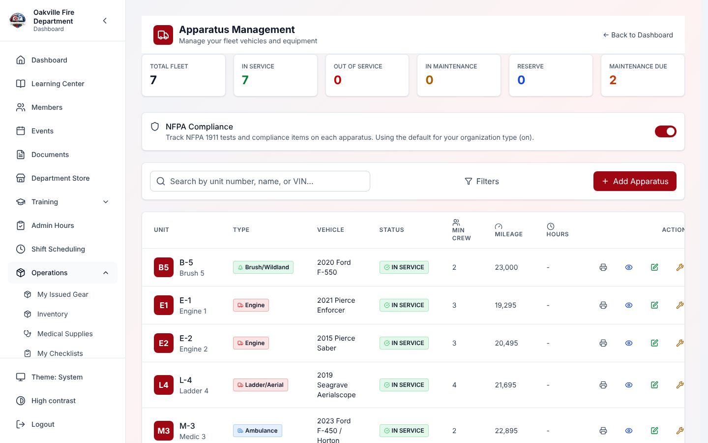

**Badges.** Each type and status badge has an icon and a tint in the status
colour. The badge text uses the theme's main text colour so it stays readable.
A type with no icon set shows its badge without one.

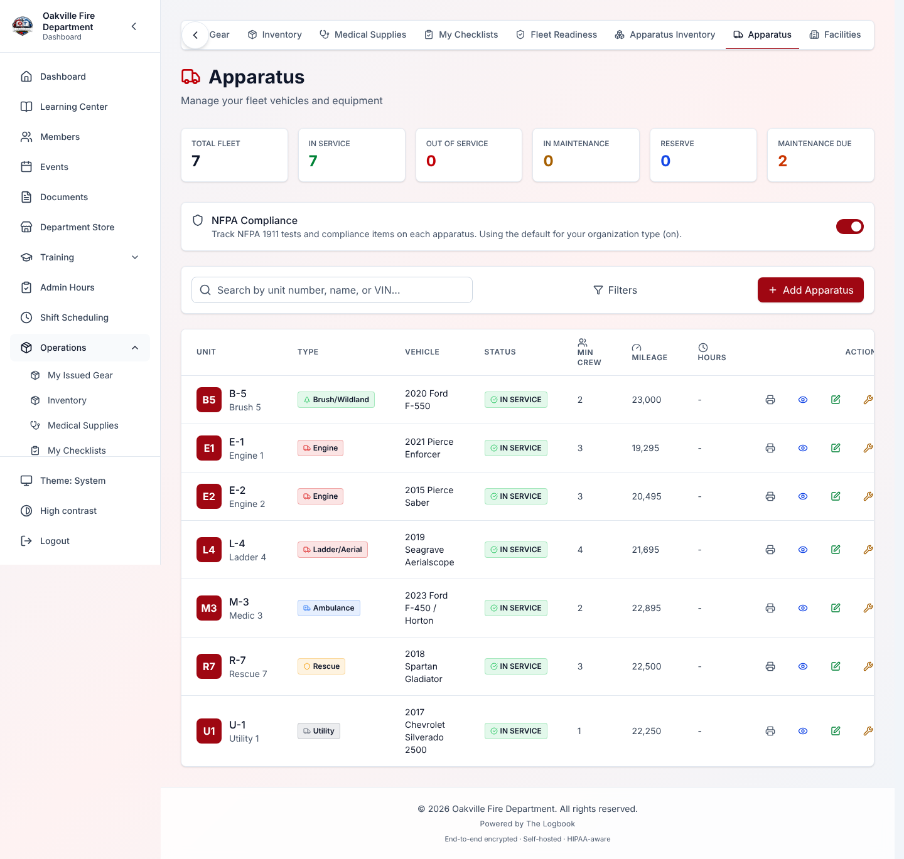

**An empty fleet.** With no vehicles yet, the list reads **No apparatus yet**.
It explains that each record keeps a vehicle's status, maintenance, fuel,
drivers and expiration dates in one place, and that its crew seats fill in on
new shifts. A search or filter that matches nothing reads **No Apparatus
Found** instead.

<!-- Screenshot needed: the empty fleet list (**No apparatus yet**) and the Add
Apparatus form with the intro line, the NFPA help text and the **CNG** fuel
option. See `SCREENSHOT_CURRENCY.md`, _Queued by the October 7 – 8
documentation pass_.
-->

> **Hint:** If your department does not use the full Apparatus module, you
> see a simpler **Apparatus & Vehicles** page instead. It is a short list of
> vehicles for shift scheduling, and every member can open it.

### Adding and Editing an Apparatus

Officers who can create apparatus records select **Add Apparatus**. To change
one, open it and select **Edit**.

- **Only the fields marked \* are needed to start.** The form says so.
  Everything else can be filled in later with **Edit**.
- **Status and reason.** Some statuses need a reason. **Out of Service** does,
  out of the box. When you pick one, fill in **Reason** (for example "Pump seal
  leaking, at the shop"). The reason shows next to the status on the vehicle's
  page.
- **Fuel Type** stays empty until somebody picks one. Compressed natural gas
  reads **CNG**.
- **NFPA tracking is chosen per vehicle.** The **Enable NFPA compliance
  tracking** box is off for each new unit, even when the department tracks
  NFPA. Ticking it adds an **NFPA** tab for NFPA 1911 tests such as the annual
  pump test. Leave it off for vehicles NFPA 1911 does not cover. The box only
  appears if your department tracks NFPA (see [NFPA Compliance](#nfpa-compliance)).
- **Expiration Dates** holds the registration, inspection, insurance and
  warranty dates. The same card shows on the vehicle's **Overview**.
- **Emptying a field clears it.** If you empty a text, date or number field and
  save, the old value is removed. Four fields cannot be emptied: unit number,
  type, status and minimum staffing.
- The save button reads **Add Apparatus**, or **Save Changes** when editing.

**Archiving.** There is no archive button on a list row. Archiving asks how
the vehicle left the fleet (**Sold**, **Traded in**, **Donated** or
**Scrapped**), so use **Archive** on the vehicle's own page.

On a phone, the vehicle page's header wraps so **Edit** and **Archive** stay
on screen. Each list row's buttons are named for the unit, such as "Edit E1"
or "Print label for E1", for screen-reader users.

### Crew Seats

The form's **Crew Positions / Seats** list sets who rides the unit, in riding
order. New shifts on this apparatus start with these seats. Each seat is a
picker, not free text. It offers the built-in crew positions plus your
department's own scheduling positions, and each option names the ranks that can
fill it. **Add Seat** adds another. Pick the same position more than once for
repeated seats.

The help line reads: "List seats in riding order. Each option shows the ranks
that can fill it. Repeat a position for each seat of that kind. New shifts on
this apparatus start with these seats."

A seat holding a name that matches no current position still shows its old
value, with **(legacy position)** after it, so nothing is lost when you open
the form. Choosing a current position replaces it.

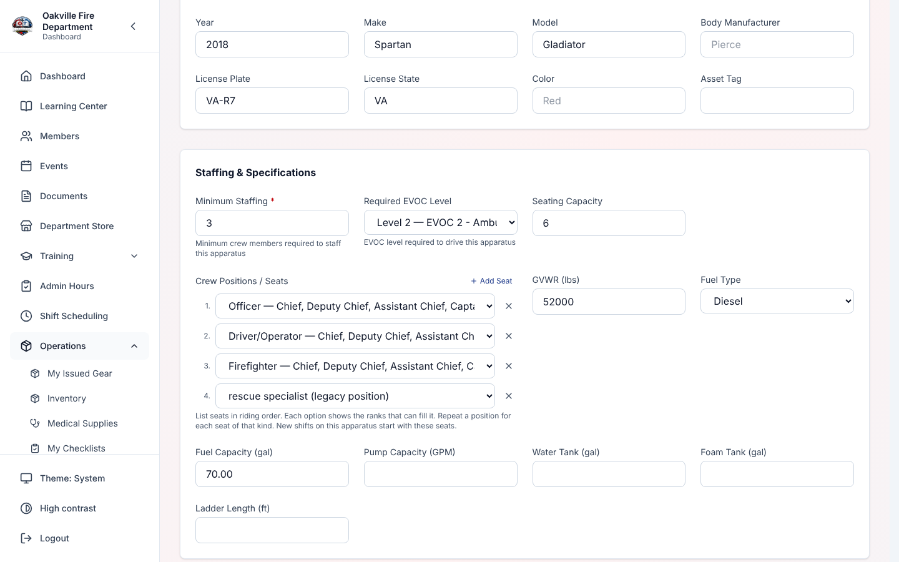

_Each closed control names the ranks eligible for that seat. The open option
list is not pictured, because your phone or computer draws it, not the page._

### Printing Apparatus Labels

Each row has a **Print label** button (printer icon). It opens the label print
page for that unit. Choose a label size, including a sticker or thermal
printer (Dymo, Rollo, or a custom size), then download a PDF or print.

- The barcode holds the vehicle's **asset tag**, or its unit number if there
  is no asset tag.
- Your printer choice is remembered for your **position**. Whoever prints
  apparatus labels gets the same printer on any computer. It is separate from
  the printer chosen for inventory or other labels.

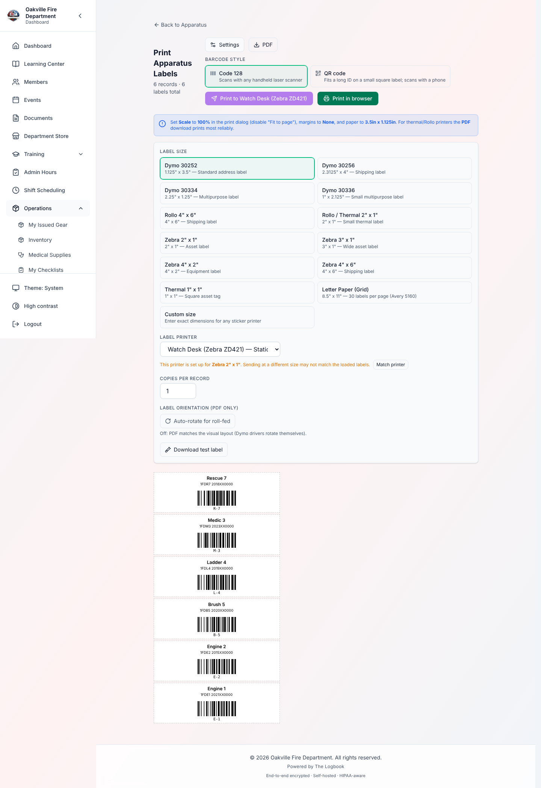

---

## Viewing Apparatus Details

Select any vehicle to open its page. The header shows the unit, its type and
status badges, and the status reason if there is one. The tabs are:

| Tab             | What it holds                                                                                                       |
| --------------- | ------------------------------------------------------------------------------------------------------------------- |
| **Overview**    | Vehicle Details, Specifications, Financial Information, Quick Stats (mileage and hours), Expiration Dates and Notes |
| **Maintenance** | Service done and service coming up                                                                                  |
| **Fuel Logs**   | Fill-ups, with gallons, cost and mileage                                                                            |
| **Operators**   | Members recorded as drivers of this vehicle, with their EVOC level                                                  |
| **Equipment**   | What the vehicle carries                                                                                            |
| **Documents**   | Photos and documents, such as registration and insurance papers                                                     |
| **NFPA**        | NFPA tests and compliance items. Only for vehicles with NFPA tracking turned on                                     |

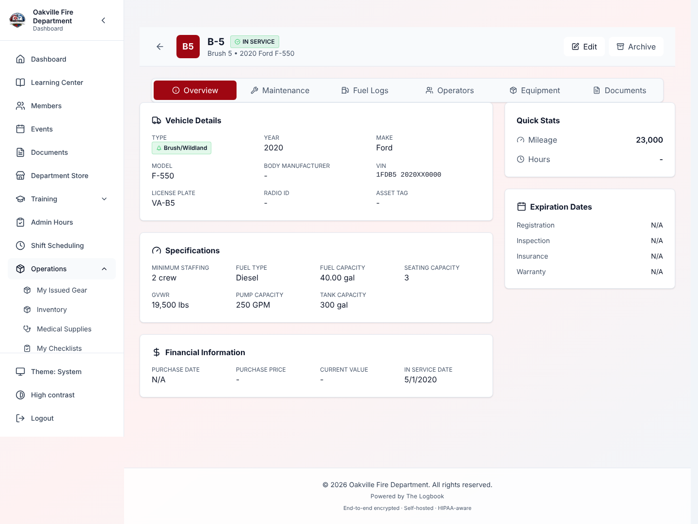

### Why a Rig Shows Deficiency

A **Deficiency** badge appears beside the status when an equipment check on
the vehicle finds a problem. It shows on the list row and on the vehicle's
page.

- The vehicle page says when the problem was found.
- **Only a passing check clears it.** Logging the repair does not.
- If you can view equipment check results, the page has a **See what was
  found →** link. It opens the failures in **Check Reports**, from the date of
  the problem.

**Putting a shift on a rig.** **Create Shift** and the shift panel's apparatus
picker list every vehicle in the Apparatus module. A shift template that names
a rig keeps it. A shift with no rig gets no equipment checklist.

> **Screenshot needed:** a vehicle page showing the Deficiency explanation and
> the Failures link; the edit form with the **Reason** field; Create Shift with
> the apparatus picker.

---

## Maintenance Scheduling

Each vehicle's **Maintenance** tab tracks service done and service coming up.

### Viewing Maintenance

The tab lists every record with its maintenance type, its date and a badge:

- **Completed**, with the date it was done
- **Pending**, with its due date
- **Overdue**, when the due date has passed

The fleet list's **Maintenance Due** tile counts open records whose due date
is close or past.

### Logging Maintenance

You need one of these permissions: **Log and manage maintenance records**,
**Edit apparatus records**, or **Full apparatus and fleet management**.
Deleting a record needs full apparatus management.

1. Open the vehicle's page.
2. Select the **Maintenance** tab.
3. Select **Add Record**.
4. Choose the **Maintenance Type**, such as Oil Change, Pump Test or Brake
   Inspection. Your department can add its own types.
5. Fill in the dates and details: description, work performed, findings,
   performed by, vendor, cost, invoice number, and mileage and engine hours at
   service.
6. Select **Add Record** (**Save Changes** when editing).

**Which date to use.** The form explains it:

- For work already done, tick **Mark as completed** and set the **Completed
  Date**.
- For upcoming work, leave it unticked and set a **Due Date**. It then counts
  toward **Maintenance Due** on the fleet page as the date gets close.
- The **Next Due** fields (date, mileage, hours) are kept on the record only.
  They do **not** add the next service to Maintenance Due. For that, add a
  separate record with a Due Date.

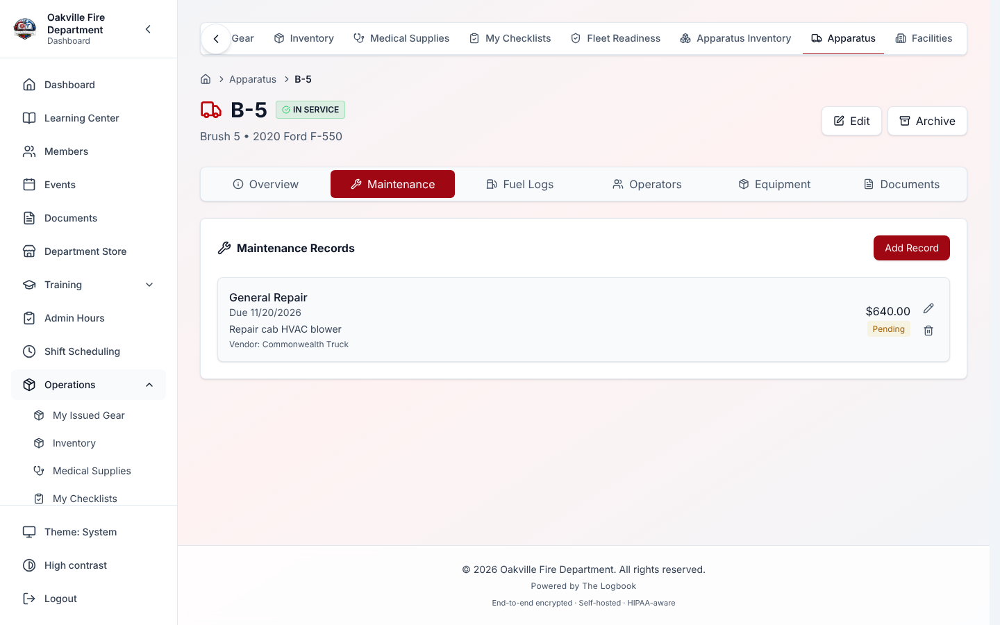

---

## Fuel and Mileage Logs

Record each fill-up on the vehicle's **Fuel Logs** tab. You need the same
permissions as for logging maintenance.

1. Open the vehicle's page.
2. Select the **Fuel Logs** tab.
3. Select **Add Fuel Log**.
4. Fill in **Date** and **Fuel Type**, and **Gallons** (more than 0). You can
   also add **Price / Gallon**, **Total Cost**, **Mileage at Fill**, **Engine
   Hours at Fill**, **Full tank fill-up**, the fuel station and notes.
5. Select **Add Fuel Log**.

If you enter gallons and price per gallon, The Logbook fills in the total cost
for you. If you enter the mileage or engine hours, the vehicle's current
mileage or hours update to match.

The tab's table shows **Date**, **Fuel Type**, **Gallons**, **Price/Gal**,
**Cost**, **Mileage** and **Full Tank**. The Logbook does not work out miles
per gallon.

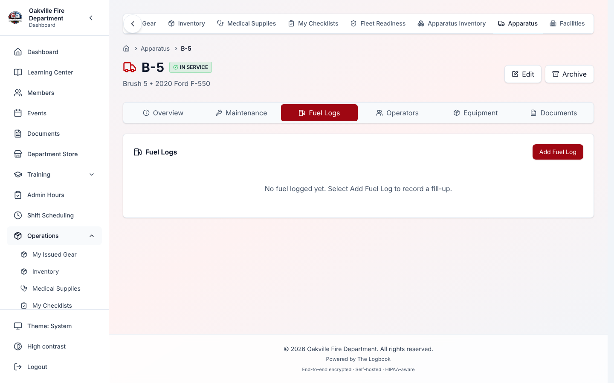

---

## Equipment Tracking

The **Equipment** tab lists what the vehicle carries: tools, medical supplies,
SCBA and so on. Officers who can edit apparatus records can add and edit
items. Removing one needs full apparatus management.

1. Open the vehicle's page.
2. Select the **Equipment** tab.
3. Select **Add Equipment**.
4. Fill in **Name** and, if you like, quantity, description, location on the
   apparatus, serial number, asset tag and notes. Tick **Required**,
   **Mounted** or **Present** as they apply.

Each item shows its quantity, where it sits on the vehicle, and badges for
**Required**, **Mounted** and **Present** (or **Missing**).

> **Important.** This list is not the crew's shift check. It records what the
> vehicle carries. Crews check equipment from an equipment checklist, which is
> built separately. Members who can create and edit equipment check templates
> see a **Build equipment checklists →** link on the tab.

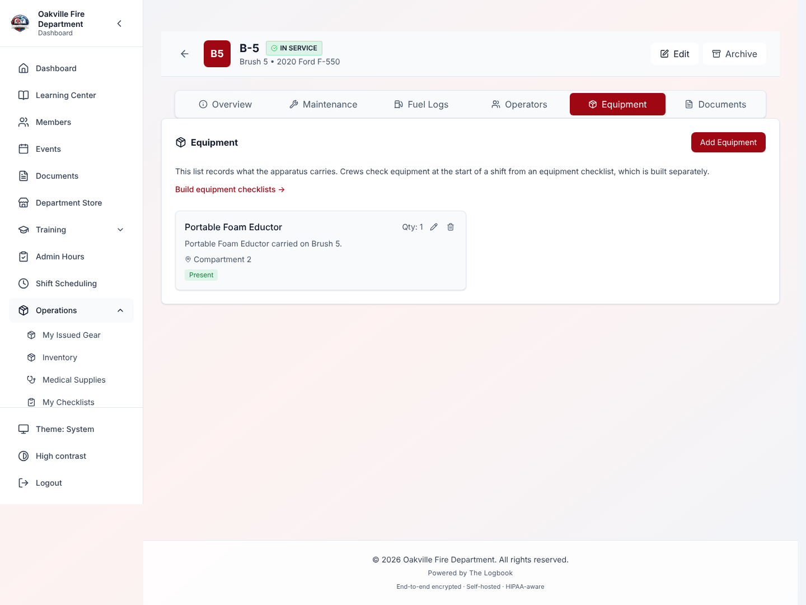

---

## NFPA Compliance

Whether your department tracks NFPA apparatus compliance is one
department-wide switch. Until an administrator sets it, it follows your
organization type: **on** for fire departments and combined fire/EMS
departments, **off** for EMS-only agencies.

**Turning it on or off.** You need **Full settings and admin management**. On
the **Apparatus** page, use the **NFPA Compliance** switch above the fleet
list. The card says whether the organization-type default or an
administrator's choice is in force.

Turning it off hides the NFPA tab and the per-vehicle checkbox, and The
Logbook refuses NFPA changes. Nothing is deleted. Turning it back on brings
every record back.

With the switch on, tick **Enable NFPA compliance tracking** on a vehicle's
edit form. Its page then gains an **NFPA** tab with two lists:

- **Required NFPA Tests.** Every maintenance type marked as NFPA-required that
  applies to this kind of vehicle. Each shows the last test, the next due date
  and a status: _Current_, _Due soon_ (within 30 days), _Overdue_, _Scheduled_
  or _No record yet_. The next due date is the one written on the last test.
  If there is none, it is a booked test's due date. Failing that, it is the
  type's usual interval counted from the last test. You record tests on the
  **Maintenance** tab; the NFPA tab reads them from there.
- **Compliance Items.** A list your department keeps by hand, one row per
  standard and section (for example NFPA 1911, NFPA 1962 hose, NFPA 1932
  ground ladders). Each has a status (**Pending**, **Compliant**, **Not
  compliant** or **Exempt**), a last-checked date and a next-due date. An item
  whose next-due date has passed reads _Overdue_, whatever its status says.

Officers who can edit apparatus records can add and edit compliance items with
**Add Item**. Removing one needs full apparatus management.

---

## Operators and EVOC Levels

The Emergency Vehicle Operations Course (EVOC) certifies a member to drive
apparatus.

### Apparatus Operators

Each vehicle's **Operators** tab lists the members recorded as its drivers,
with their EVOC level and certification dates.

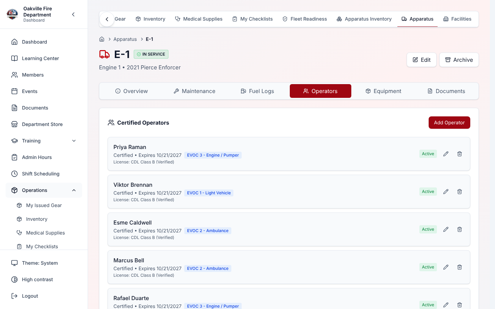

To add one, select **Add Operator** and pick the **Member** from the list. Add
their **EVOC Certification Level**, certification and expiry dates, license
details, any restrictions and notes. Adding, editing or removing operators
needs full apparatus management.

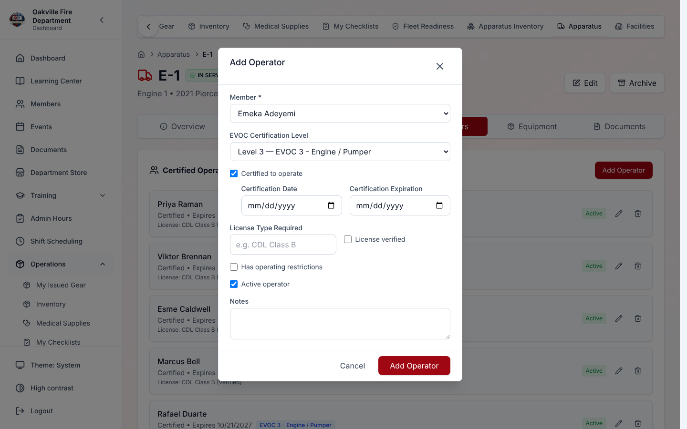

### EVOC Levels

The EVOC levels are your department's own list, in order. They are not a fixed
set. Officers with full apparatus management set them up under **Members
Settings → EVOC Levels**.

A member's level is not on their profile. It is on their **operator record for
each vehicle**, on that vehicle's Operators tab.

### Required EVOC Level on a Vehicle

Each vehicle can name the lowest EVOC level needed to drive it:

1. Open the vehicle and select **Edit**.
2. Set **Required EVOC Level**. The field appears only once your department has
   EVOC levels. Choose **No EVOC requirement** to remove it.
3. Save.

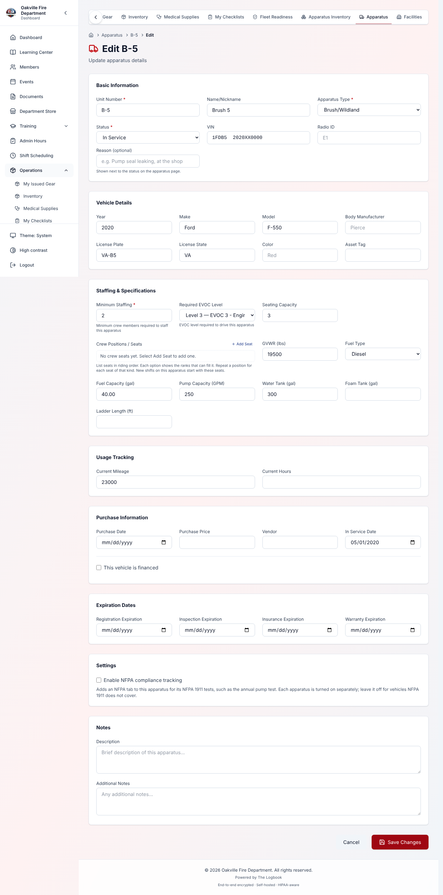

**What happens on the schedule.** When someone is put in the driver seat of a
shift on this vehicle, The Logbook takes the member's highest level from their
operator records that are active, certified and not expired on the shift's
date. It compares that with the vehicle's requirement.

- If the member falls short, they are **blocked** from the driver seat. A
  chief can approve a time-limited exception.
- If your department turns off **Enforce EVOC for drivers** in the scheduling
  settings, the assignment goes ahead with a warning instead.

For the full workflow, including how to request and approve an exception, see
[Shifts & Scheduling → EVOC Certification and Driver Seats](./03-scheduling.md#evoc-certification-and-driver-seats).

| What if …?                                             | What happens                                      |
| ------------------------------------------------------ | ------------------------------------------------- |
| The vehicle has no required level                      | Nobody is checked                                 |
| The shift has no vehicle                               | Nobody is checked                                 |
| The member has no operator record on that vehicle      | They have no level to compare, so they fall short |
| The member's operator record is expired or uncertified | It does not count. Only current records are used  |
| The certification expires before the shift date        | It does not count for that shift                  |

---

## Equipment Checks on Apparatus

Equipment checks are structured checklists that crews run on a vehicle, often
at the start of a shift. They are part of Inventory. For building checklists,
running checks and the reports, see
[Inventory → Equipment Checklists](./05-inventory.md#equipment-checklists).

What matters on the Apparatus side:

- **Deficiency.** When any item on a check fails, the vehicle gets a
  **Deficiency** badge. See [Why a Rig Shows Deficiency](#why-a-rig-shows-deficiency).
- **Clearing it.** The badge clears only when a later check on the vehicle
  passes. A check left incomplete neither sets nor clears it.
- **Who hears about a failure.** Failed items send an in-app notice to the
  shift officer and to any positions your department chose. Email can be
  turned on as well. The member who did the check is not notified.
- **Check reports** are in **Inventory Admin → Check Reports**, and a
  vehicle's page links to its failures.
- **Simple vehicle list.** Departments using the simpler **Apparatus &
  Vehicles** list get no Deficiency badge.

**Checks without a shift.** A crew can check any vehicle at any time, with no
shift: open **Operations → My Checklists** and select **Unscheduled
checklist**. **Operations → Fleet Readiness** shows each vehicle's last check
and what it owes, but does not start checks. See
[Shifts & Scheduling → Standalone Equipment Checks](./03-scheduling.md#standalone-equipment-checks).

**What the truck is carrying.** Separate from checks, a vehicle has a standing
view of its tracked supplies, the lots and expiry dates aboard, and the stock
on the shelf behind it. A crew can record what they used as they use it. See
[Shifts & Scheduling → Supply Tracking](./03-scheduling.md#supply-tracking-keeping-the-truck-and-the-shelf-in-step)
and, for the shelf side,
[Inventory → Dated Stock Lots and Receiving](./05-inventory.md#dated-stock-lots-and-receiving).

| What if …?                                             | What happens                                                                                                                                    |
| ------------------------------------------------------ | ----------------------------------------------------------------------------------------------------------------------------------------------- |
| No checklist is assigned to the vehicle or its type    | No checklist appears for shifts on that vehicle                                                                                                 |
| One item fails                                         | The whole vehicle is marked Deficient                                                                                                           |
| An item is past its expiry date, or below its quantity | It fails, whatever the crew marked                                                                                                              |
| Not every item was answered                            | The check is **incomplete**, not failed. Reports show the two separately                                                                        |
| A crew member marks an item Fail or Out of service     | They must add a note saying what is wrong before submitting. A fail already explained by a count, a reading or an expiry date does not need one |
| Which checklist a shift gets                           | A shift template that names checklists wins. Otherwise, checklists for that exact vehicle are used, then checklists for its vehicle type        |
| Your department uses the simpler vehicle list          | The checklist builder offers only Apparatus-module units under **Specific Apparatus**, so assign checklists by type                             |
| A check is run on a vehicle that is Out of Service     | It is allowed and saved as normal                                                                                                               |
| A photo will not upload on a check                     | Photos must be JPEG, PNG or WebP, 5 MB or smaller, and at most 3 per item                                                                       |

---

## Facilities Overview

Select **Facilities** in the menu. You need **View facilities and buildings**
(or **Full facility management**).

**Who has it by default.** Facilities is a workspace for leadership and the
people who look after buildings: the President, Vice President, Treasurer,
Secretary, Quartermaster, Safety Officer, Training Officer and Facilities
Manager positions, and administrators. Regular members and line officers do
not have it. An administrator can add it to any position.

The Facilities pages are:

| Page                  | What it shows                                                                   |
| --------------------- | ------------------------------------------------------------------------------- |
| **Facilities**        | The dashboard: summary tiles, work that needs attention, and every facility     |
| **Facility page**     | One facility, with a side menu of its sections                                  |
| **Maintenance**       | Maintenance records across all facilities                                       |
| **Inspections**       | Inspections across all facilities                                               |
| **Facility Settings** | The department's facility types, statuses and maintenance types (managers only) |

### Dashboard

The dashboard shows:

- **Tiles:** **Total Facilities**, **Operational**, **Overdue Maintenance** and
  **Upcoming Inspections**
- **Panels:** the overdue maintenance and upcoming inspections themselves, and
  **Recent Maintenance Completions**
- **All Facilities:** a card for each facility with its name, type, address
  and status, and a search box

The header has **Add Facility** (for officers who can create facility
records), **Print Labels**, and **Facility Settings** (for full facility
managers). With no facilities yet, the list reads "No facilities yet. Select
Add Facility to add one."

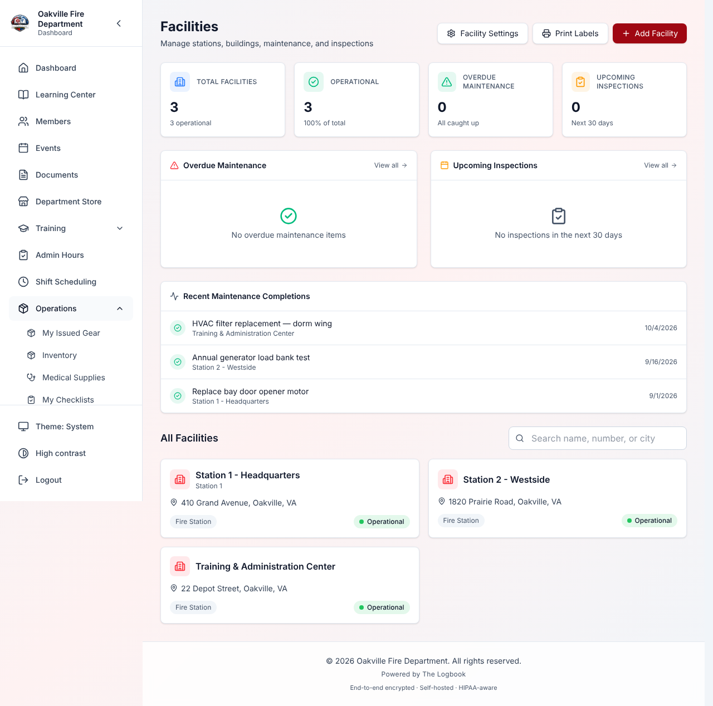

> **Hint:** If your department does not use the Facilities module, you see a
> simpler **Locations** page instead. It holds stations and rooms for events
> and meetings.

<!-- Screenshot needed:
_[Plain member (no locations.\* or settings permissions), /locations, department with at least one station holding a room. Stations and rooms listed, with no QR toggle, kiosk URL, Add Station, Add Room, edit, delete, Change or Run Setup Wizard control. Do not capture a kiosk URL or display code.]_
-->

### Printing Facility Labels

**Print Labels** in the Facilities header prints a barcode label for each
facility shown on the dashboard. It opens the label print page, where you pick
a label size and download a PDF or print. The barcode holds the **facility
number**. The printer you choose is remembered for your position.

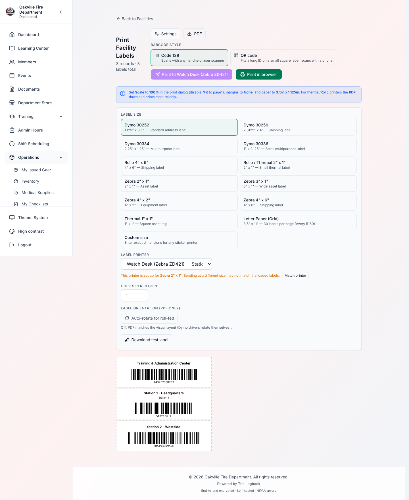

---

## Check-In QR Codes

Every station and room gets a kiosk **display code** when it is created. Its
QR code opens the room's kiosk display, a public screen for event check-in.

The **Check-In QR Codes** page collects every code in one printable list,
grouped by station or facility, with a search box. To open it, use:

- the **Check-In QR Codes** button on the Locations page,
- the link in a facility's **Rooms** section, or
- the command palette (Ctrl+K, or Cmd+K on a Mac) and search "QR".

When your department uses Scheduling, the page also lists a **shift check-in
code** for each vehicle. It is a permanent QR code: when scanned, it finds that
vehicle's current shift. One printed card on the dashboard covers every shift.

**Print layouts:**

- **Cut-out cards:** a compact sheet. Print, cut out and post each code.
- **Room signs:** one full page per code, for a door or a dashboard.

Each card offers **Copy URL** and **Download PNG** (for your own signs). Rooms
in a facility's **Rooms** section also have a QR button to view one room's
code in place. Any shift's detail panel also shows its vehicle's card.

**Who can open the page.** Your department must use the Facilities module, and
you need one of these permissions:

- **Manage all locations**
- **Full facility management**
- **View apparatus and fleet information**
- **Write NFC check-in tags for rooms**
- **Write NFC shift check-in tags for apparatus**

Room kiosk codes are shown only to people with **Manage all locations**,
**Edit locations** or **Full facility management**. Someone who opens the page
with only the apparatus permission sees the vehicle cards and no room cards.

Every code belongs to your department. A room code opens only that room's
kiosk. A vehicle code finds a shift only for a member of the department that
owns the vehicle.

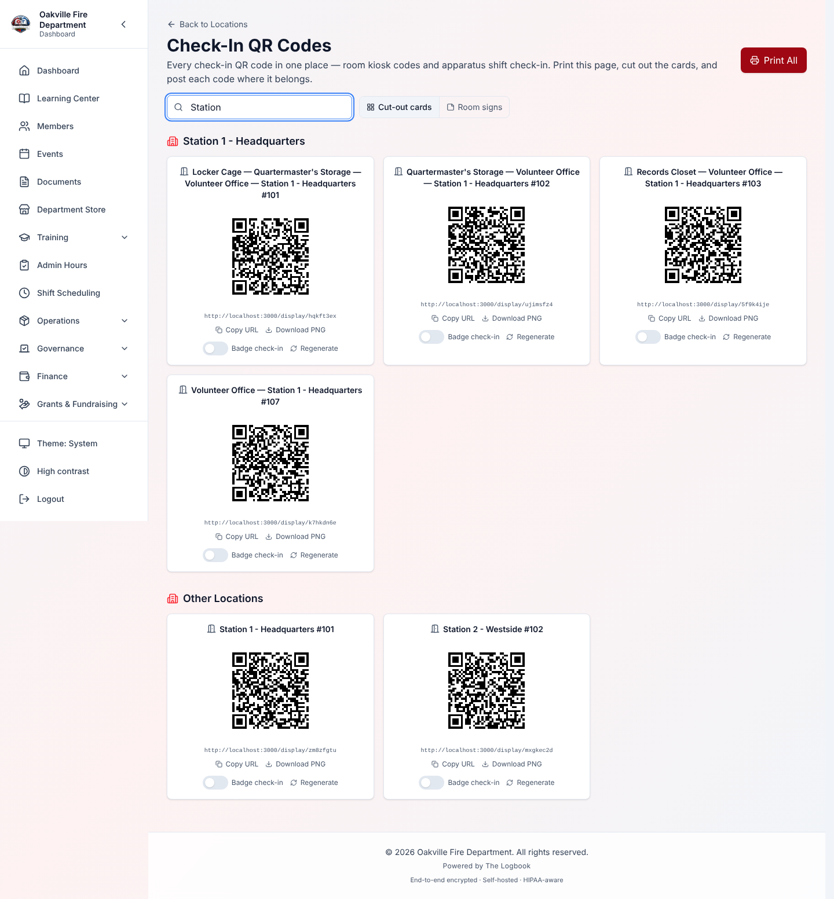

### Regenerating a Code

People with **Edit locations** or **Manage all locations** also see
**Regenerate**. Use it if a printed code leaks or goes missing. A new code is
issued and the old one stops working straight away. Reprint the posted code
and update any kiosk tablets afterwards. Every regeneration is recorded in the
audit log.

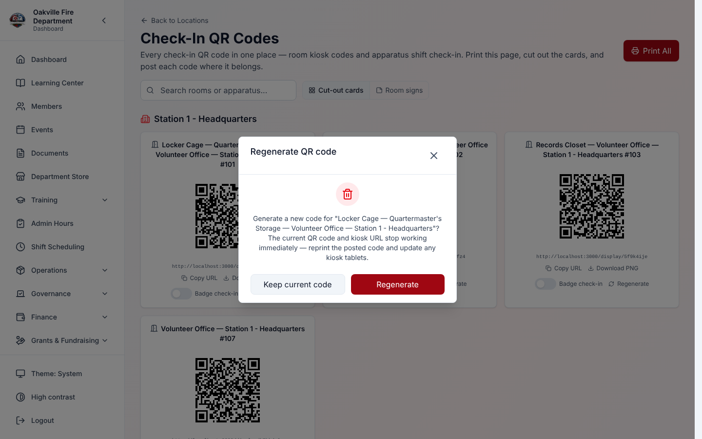

### Writing NFC Tags for the Fleet

This page is where you write a box of NFC (near-field communication) tags for
the whole fleet in one sitting. Each vehicle card has a **Write NFC tag**
button beside Copy URL, Download PNG and Regenerate. Tap it, hold a blank tag
to the phone, and move to the next card.

**Who may write which tag.** Your department decides, by position:

| Tag                                   | Permission                                      | Given by default to                                                                |
| ------------------------------------- | ----------------------------------------------- | ---------------------------------------------------------------------------------- |
| Vehicle (this page and a shift panel) | **Write NFC shift check-in tags for apparatus** | President, Vice President, Chief, Deputy Chief, Assistant Chief, Apparatus Officer |
| Room door tag (below)                 | **Write NFC check-in tags for rooms**           | The same leadership, and the Facilities Manager                                    |

An administrator can move these on the positions screen. They decide only who
is **offered** the button. The tag holds no secret. Without the permission, the
vehicle card and the shift panel show the QR code with no **Write NFC tag**
button.

**Only on Chrome for Android, over a secure (https) connection.** Elsewhere the
button does not appear at all: not on an iPhone, not on a computer, and not
on a department server reached by a plain "http" address. A desktop card shows
only Copy URL, Download PNG and Regenerate. Print the QR code instead in those
places.

**From a shift.** A shift's detail panel can write the same tag for someone
with the vehicle permission. It writes the vehicle's check-in code, not the
shift's. Filling the roster is not the same job as fitting out the rig, so a
roster officer without the permission sees the QR code only.

**Write the vehicle tag, not a shift tag.** The vehicle code finds the shift
when it is tapped, so one sticker on the dashboard serves every shift for the
life of the truck. A tag tied to one shift is useless once that shift ends.

**What a tap finds:**

1. the vehicle's shift running right now; if none,
2. a shift that ended in the last two hours (a late check-in); if none,
3. the next shift coming up.

Cancelled and closed-out shifts are skipped. On a truck with a day and a night
crew, a tap at 2000 lands on the night shift.

The member lands on a page naming the unit, the date and the hours, so they
can see which shift they matched before confirming. **Tell members to read
it.** That page is the only thing between a wrong match and an hour logged to
the wrong shift.

> **A write that fails says so.** You get an error message, not silence. A
> silent failure would look like a working tag, and the first person to find
> out would be a member tapping a dead sticker at 0600.

### Room Door Tags

A room card's **Write NFC tag** writes a link that names the room, not its
kiosk. The kiosk display code is never written to a tag: it is a public
check-in code and must not sit on a sticker in a hallway.

A member who taps a room tag signs in as usual. They land on a page that looks
at what is open for check-in in that room right now:

- **One event:** they go straight to that event's self check-in. Attendance is
  recorded exactly as from its QR code.
- **Several:** "Which event are you here for?" lists them, rather than
  guessing.
- **None:** "Nothing to check in to", with **Check again**.

<!-- Screenshot needed:
_[Signed in as a member, open `/locations/<room id>/check-in` for a room with two events in their check-in window → the "Which event are you here for?" page listing both events.]_
-->

Someone who can write room tags but is not shown kiosk codes (the Vice
President, by default) sees a **Room NFC Tags** list instead of the room
cards. It reads "Write a tag for a room's door. Tapping it checks a member into
whatever event is open in that room."

If the room was deleted after its tag was written, the tag answers "This tag
points at a room that no longer exists. Let an officer know so it can be
rewritten."

### Badge Check-In at a Room's Kiosk

**Badge check-in** is a separate switch on each room card. It is off for every
room until someone who can write room tags turns it on. It is offered only
while the NFC ID Cards connection is set up.

With it on, the room's kiosk display reads member ID cards (by tapping on an
Android tablet, or with a USB reader). It checks the member in to the event
open there, or out if they are already in, with nobody signed in at the kiosk.

- Turning it on asks first: "Turn it on only where a card reader is mounted
  beside the display."
- The kiosk shows only a first name and last initial.
- A copied card works at an unattended kiosk. Your department accepts that
  risk when it turns the switch on.

For setup, see
[Member ID Cards](../../wiki/Member-ID-Cards.md#tapping-in-at-a-room-kiosk-2026-10-03).

---

## Facility Details

Select a facility on the dashboard to open its page. A side menu lists its
sections:

| Section                | What it holds                                                                                                                                                       |
| ---------------------- | ------------------------------------------------------------------------------------------------------------------------------------------------------------------- |
| **Overview**           | Name, number, type, status, address, phone, email, fax, county and year founded                                                                                     |
| **Rooms**              | Each room's type, floor, capacity and NFPA 1500/1585 zone (hot, transition, cold or unclassified). Rooms can sit inside other rooms (see below)                     |
| **Building Systems**   | HVAC, electrical, plumbing, fire suppression and fire-station systems such as exhaust extraction, cascade air, decontamination, bay doors, alerting and shore power |
| **Maintenance**        | Maintenance records and work orders                                                                                                                                 |
| **Inspections**        | Inspection records, with the inspector, result, findings and corrective actions                                                                                     |
| **Utilities**          | Utility accounts and their readings                                                                                                                                 |
| **Emergency Contacts** | Contacts for the building, with phone, role and priority. A contact needs a name; the company is optional (for example, the facility's own on-call staff)           |
| **Access Keys**        | Keys, fobs, codes and cards, and who each is assigned to                                                                                                            |
| **Shutoff Locations**  | Where the water, gas, electrical and other shutoffs are, and on which floor                                                                                         |
| **Capital Projects**   | Building improvement projects                                                                                                                                       |
| **Insurance**          | Insurance policies, with carrier, policy number, coverage and expiration date                                                                                       |
| **Occupants**          | Organizations or units housed in the facility                                                                                                                       |
| **Compliance**         | Compliance checklists for NFPA, OSHA, ADA, building and fire code, and other standards                                                                              |
| **Files**              | Photos and documents for the facility. See [Facility Files](#facility-files)                                                                                        |

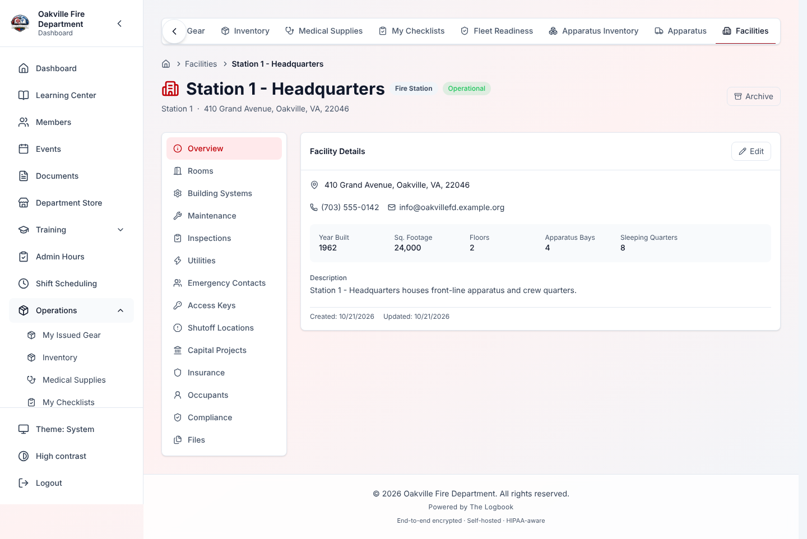

**Sensitive sections.** **Utilities**, **Access Keys**, **Capital Projects**,
**Insurance** and **Occupants** hold door codes, account numbers, budgets and
lease terms. You see them only with one of:

- **View sensitive facility data (access codes, utility accounts, insurance,
  budgets, occupants)**, which reads them without changing anything (given to
  the chief ranks, Vice President and Treasurer by default),
- **Edit facility records**, or
- **Full facility management**.

Adding or changing them needs **Edit facility records** or **Full facility
management** (or **Create new facility records** to add one).

**Email addresses are checked.** The add-facility form and the Overview edit
form refuse an email that is not one: "Enter an email address like
office@example.org."

**Rooms and event locations.** A facility created during setup is linked to an
event location, so it appears in the event location picker. Each room you add
gets its own linked location too. Deleting a room also deletes its linked
location. If events are booked in that room, the delete fails.

### Nesting Rooms Inside Rooms

A room can sit inside another room in the same facility. For example, the
quartermaster's storage inside the volunteer office, or a closet inside the
training room.

**How to nest a room:**

1. Open the facility's **Rooms** section. The list is a tree: sub-rooms are
   indented under the room that holds them, and each room shows how many
   sub-rooms it has.
2. Either select **Add a room inside this one** on a room's row (it fills in
   the container for you), or open any room's form and choose a container in
   **Located Inside**.
3. Select **Save Room** (**Save Changes** when editing).

The room's event location takes the full path as its name, for example
"Quartermaster's Storage — Volunteer Office — Station 1". That way it cannot be
confused with a storage room elsewhere in the building, wherever locations
appear: the event location picker, QR check-in and kiosk displays.

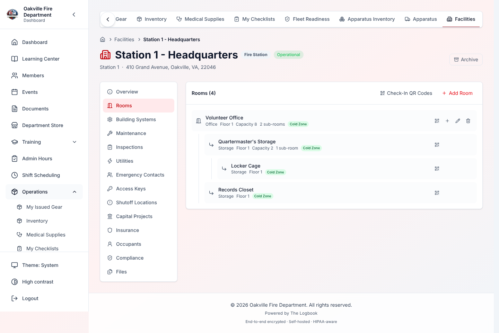

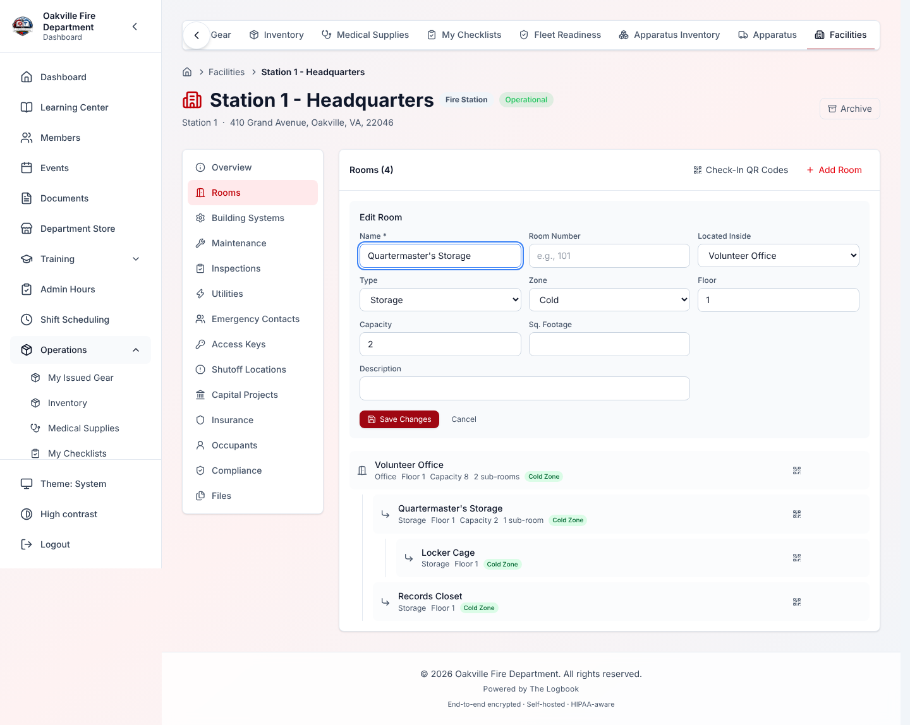

**In the event and training forms.** The location pickers list a nested room
by its full path, and the event form shows that path under the chosen room.

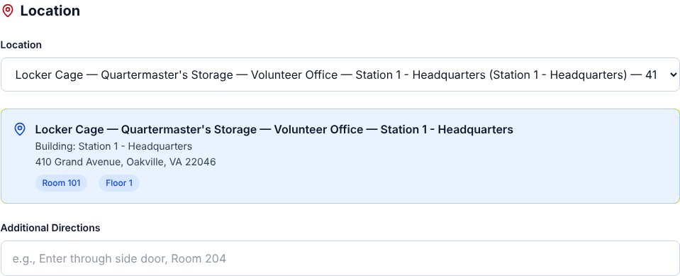

The list is not indented on purpose. Each option spells out its whole path,
such as "Locker Cage — Quartermaster's Storage — Volunteer Office — Station 1 -
Headquarters". The picker is drawn by your phone or browser, so phones and
screen readers read the same words, and a path in the text survives where
indentation cannot. After you choose, the form confirms the building, the
address, and the room's own number and floor. In a department whose rooms are
all in one facility, the event form's list shows each room's own name only,
since the rest of the path would repeat on every line. The confirmation below
it still shows the full path.

**Rules and what-ifs:**

- **The container must be a room in the same facility.** You cannot nest
  across buildings. Moving a room to another facility takes its sub-rooms with
  it, and their locations are renamed for the new building.
- **No circles, and five levels at most.** A room cannot go inside itself or
  inside one of its own sub-rooms. The picker hides those choices. A top-level
  room is level 1.
- **Deleting a container does not delete what is inside it.** Its sub-rooms
  move up a level, onto the deleted room's own container (or to the top). The
  delete confirmation says so first. Their kiosk codes and stored inventory
  are kept.
- **Emptying a field clears it.** Emptying floor, capacity or description and
  saving removes the old value. If a save is refused (a bad container, or too
  deep), the message says why.
- **A room whose container has gone** (for example, removed by someone else at
  the same moment) shows at the top level of the list, not nowhere.

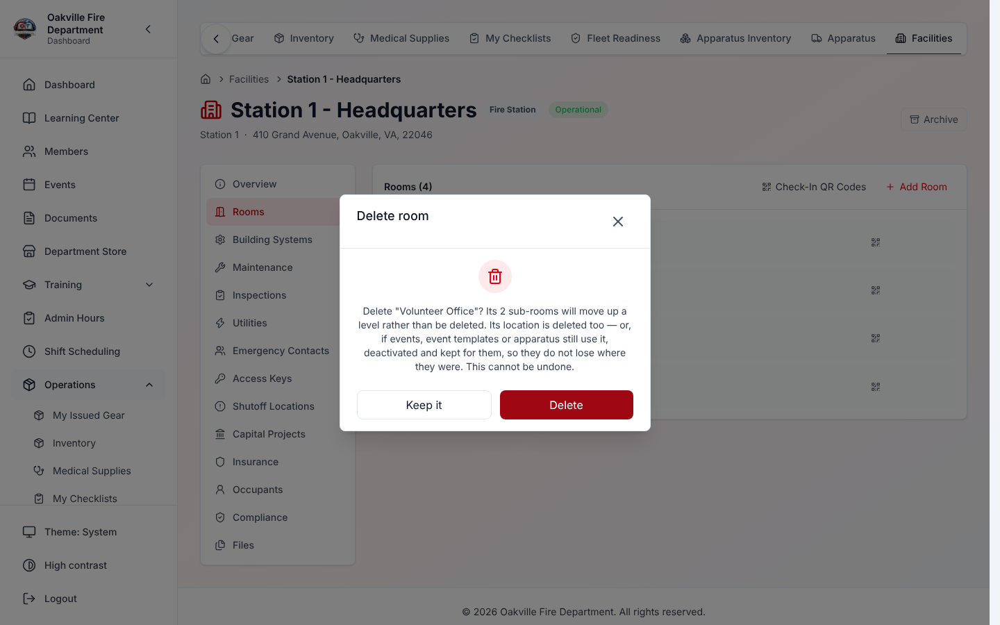

---

## Facility Files

A facility's **Files** section keeps its photos and documents. They are stored
in the **Documents** area of The Logbook, in a folder for each facility.

**Uploading.** Select **Upload a photo or document** (up to 25 MB). A photo is
filed into the facility's **Photos** folder. Any other document is filed into
its **Facility Documents** folder. The photo or document is uploaded and
attached in one step, so facility permission alone is enough: you no longer need
**Manage documents and folders** as well. If the attach fails, the stored file is
removed rather than left behind.

**Who can open which folder:**

| Folder                                                                 | Who can open it                                                                       |
| ---------------------------------------------------------------------- | ------------------------------------------------------------------------------------- |
| **Facility Files**, and each facility's own folder                     | Anyone with any facilities permission                                                 |
| **Photos**, **Maintenance Records**, **Inspection Reports**            | Anyone with any facilities permission                                                 |
| **Blueprints & Permits**, **Insurance & Leases**, **Capital Projects** | Only people who can see sensitive facility data, edit facility records or manage them |
| **Facility Documents**                                                 | Only people who can see sensitive facility data, edit facility records or manage them |

- **Floor plans stay restricted.** Blueprints & Permits is in the restricted
  group on purpose.
- **Adding, moving or deleting** in any of these folders needs **Edit facility
  records** or **Full facility management**.
- On the **Files** section, the documents list is shown only to people who can
  see sensitive facility data. Photos are shown to everyone who can open the
  facility.
- Anything filed straight into **Photos**, **Maintenance Records** or
  **Inspection Reports** can be read by every facilities position. Keep
  sensitive papers in the restricted folders.
- A folder your department made inside this tree keeps its own restrictions.
- If two officers open a new facility's Files section at the same moment, they
  share one set of folders.

---

## Facility Maintenance

The **Maintenance** section of a facility, and the department-wide
**Maintenance** page, list maintenance records and work orders. Each row says
when it is due, in words as well as an icon:

- **Overdue · due 10/1/2026**
- **Due 10/1/2026**
- **Completed 10/1/2026**

You can filter by **All**, **Pending**, **Completed** or **Overdue**. Officers
who can log maintenance can mark an open record done with **Mark completed**.

The maintenance types offered are your department's own list, set up in
[Facility Settings](#facility-settings).

### Creating a Maintenance Record

1. Open the facility's **Maintenance** section, or the department-wide
   **Maintenance** page.
2. Select **New Record**. The dialog opens over the middle of the screen.
3. On the department-wide page, choose the **Facility**.
4. Fill in **Description** and **Maintenance Type** (both required). If you
   leave out the type, the form stops you before saving.
5. Add the **Scheduled Date** or **Due Date**, and if you like **Performed
   By**, **Vendor**, **Cost**, **Work Order #** and notes.
6. Select **Create Record** (**Save Changes** when editing).

If a save is refused, the message gives the reason.

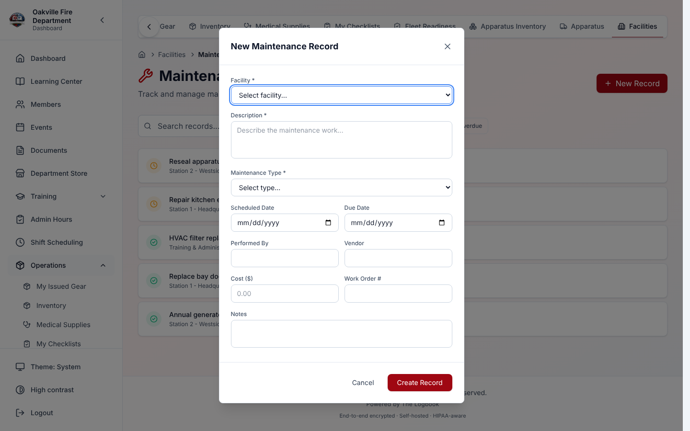

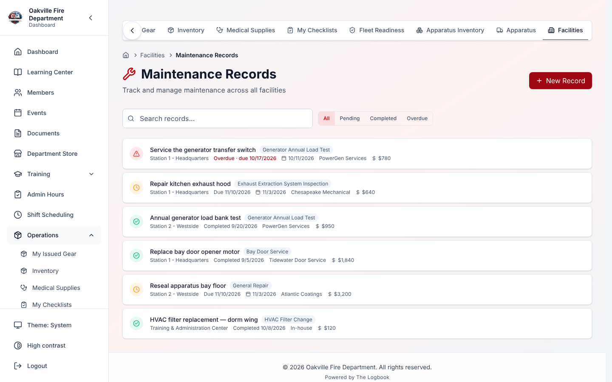

_[Screenshot needed: the New Record dialog on a facility page with Maintenance Type marked required; and the maintenance list with Overdue · due and Completed rows. REPLACE the maintenance shots in this section.]_

---

## Inspections

The **Inspections** section of a facility, and the department-wide
**Inspections** page, track inspections. The types are **Fire**, **Building
Code**, **Health**, **ADA**, **Environmental**, **Insurance**, **Routine** and
**Other**. You can filter by **All**, **Passed**, **Failed** or **Pending**.

### Recording an Inspection

1. Open the facility's **Inspections** section, or the department-wide
   **Inspections** page.
2. Select **New Inspection**. The dialog opens over the middle of the screen.
3. Fill in **Title**, **Type**, **Result** (**Pending**, **Passed** or
   **Failed**) and **Inspection Date**.
4. Add the **Next Inspection Date**, **Inspector Name** and **Inspector
   Organization** (the inspector's agency).
5. Record the **Description**, **Findings**, **Corrective Actions** and
   **Corrective Action Deadline**.
6. Select **Create Inspection** (**Save Changes** when editing).

To keep the inspector's report, upload it on the facility's
[Files](#facility-files) section.

Every facility dialog's save button names what it saves: **Create Record**,
**Create Inspection**, **Save Room**, **Save System**, **Save Contact**. When
editing, it reads **Save Changes**.

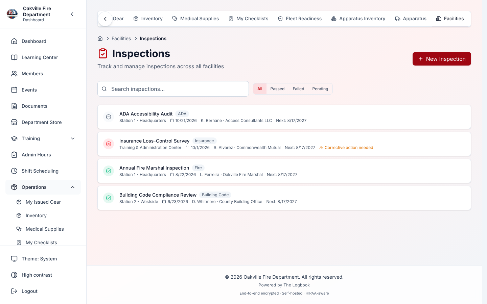

> **Important.** The Logbook does not send reminders for facility inspections.
> Watch **Upcoming Inspections** on the Facilities dashboard.

---

## Building Systems and Utilities

### Systems

The **Building Systems** section tracks each major system in a facility, such
as HVAC units, fire suppression, the fire alarm, electrical, plumbing,
security, the generator and fire-station systems like exhaust extraction or
bay doors.

For each system you can record its **Name** (required), **Type**,
**Condition** (Excellent, Good, Fair, Poor or Critical), manufacturer, model
and serial numbers, **Install Date**, **Warranty Expiration**, **Test
Frequency (days)** and notes.

### Utilities

The **Utilities** section is one of the sensitive sections.

1. Open the facility's **Utilities** section.
2. Add a utility account: **Utility type** (electric, gas, water, sewer,
   internet, phone, trash or other), **Provider**, and the account and meter
   numbers.
3. On an account, select **Add reading** and enter the reading date, the bill
   amount and the usage.

Each account lists its twelve most recent readings, newest first. **Add
reading** is shown to officers who can edit the facility.

---

## Capital Projects

The **Capital Projects** section tracks building improvement projects. It is
one of the sensitive sections. Each project has:

- **Project name** and **Project type** (both required), such as Renovation,
  Repair, Upgrade or ADA Compliance
- **Status**: Planning, Approved, Bidding, In Progress, On Hold, Completed or
  Cancelled. A new project starts at Planning
- **Estimated budget**
- **Start date**

---

## Facility Settings

**Facility Settings** holds the department's own lists for the Facilities
forms. It needs **Full facility management**. Open it from the **Facility
Settings** button on the Facilities dashboard.

The page reads "Choose the types and statuses offered on facility and
maintenance record forms." It has three lists:

- **Facility Types**, offered when creating or editing a facility
- **Facility Statuses**, offered when creating or editing a facility
- **Maintenance Types**, offered when logging a maintenance record

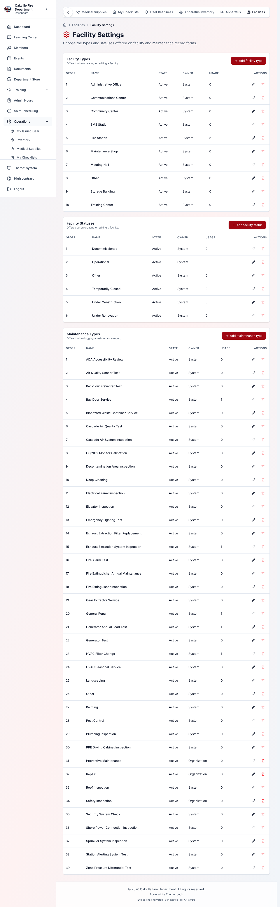

Some types and statuses come built in, such as the "Fire Station" type and the
"Operational" status. They are protected:

| What you try                                     | What you see                                                                  |
| ------------------------------------------------ | ----------------------------------------------------------------------------- |
| Change a built-in facility type                  | "Cannot modify system facility types"                                         |
| Delete a built-in facility type                  | "Cannot delete system facility types"                                         |
| Delete a facility type that facilities still use | "Cannot delete type. N facilities use this type." Move those facilities first |
| Change a built-in facility status                | "Cannot modify system facility statuses"                                      |
| Delete a built-in facility status                | "Cannot delete system facility statuses"                                      |
| Archive a facility that is already archived      | "Facility is already archived"                                                |
| Restore a facility that is not archived          | "Facility is not archived"                                                    |

If the built-in types and statuses are ever missing, The Logbook adds them
back the next time someone opens Facilities.

---

## Realistic Example: Annual Pump Test and Maintenance for Engine 3

This walkthrough records a major annual service on a vehicle, from the fuel
stop to returning it to service.

### Background

**Clearwater Fire Department** runs three engines. **Driver/Operator Chris
Jennings** keeps the apparatus maintenance records. **Engine 3** is due for its
annual pump test and service under NFPA 1911, and has NFPA tracking turned on.

Engine 3 details:

- **Unit:** Engine 3
- **Year/Make/Model:** 2019 Pierce Enforcer
- **VIN:** 4P1CD01H4KA001234
- **Current Mileage:** 28,120 miles
- **Status:** In Service
- **Station:** Station 2

---

### Step 1: Logging the Fuel Stop Before Service

Before taking Engine 3 to the shop, D/O Jennings fills it up. He opens
**Apparatus → Engine 3 → Fuel Logs** and selects **Add Fuel Log**:

| Field               | Value           |
| ------------------- | --------------- |
| **Date**            | March 10, 2026  |
| **Fuel Type**       | Diesel          |
| **Gallons**         | 42.5            |
| **Price / Gallon**  | 3.50            |
| **Mileage at Fill** | 28,450          |
| **Full tank**       | Ticked          |
| **Station Name**    | Shell — Main St |

The Logbook fills in **Total Cost** as $148.75, and Engine 3's current mileage
becomes 28,450.

---

### Step 2: Changing Status to Out of Service

D/O Jennings marks Engine 3 **Out of Service** while it is at the shop:

1. Opens **Apparatus → Engine 3** and selects **Edit**.
2. Sets **Status** to **Out of Service**.
3. Fills in **Reason**: "Annual pump test and service — Apex Fire Equipment".
   The form will not save without it.
4. Selects **Save Changes**.

Engine 3's page shows **Out of Service** with the reason beside it, and
the fleet list counts it under **Out of Service**.

---

### Step 3: Recording the Pump Test

Apex Fire Equipment completes the pump test. D/O Jennings opens **Apparatus →
Engine 3 → Maintenance**, selects **Add Record**, and ticks **Mark as
completed**:

| Field                  | Value                                                                                                                                                                                    |
| ---------------------- | ---------------------------------------------------------------------------------------------------------------------------------------------------------------------------------------- |
| **Maintenance Type**   | Pump Test                                                                                                                                                                                |
| **Completed Date**     | March 12, 2026                                                                                                                                                                           |
| **Vendor**             | Apex Fire Equipment                                                                                                                                                                      |
| **Cost**               | $1,850.00                                                                                                                                                                                |
| **Description**        | Annual service pump test per NFPA 1911                                                                                                                                                   |
| **Findings**           | All flows within spec. Pump rated at 1,500 GPM, tested at 1,520 GPM (101%). Pressure governor tested and calibrated. Primer achieved prime in 8 seconds. Relief valve tested at 200 PSI. |
| **Mileage at Service** | 28,465                                                                                                                                                                                   |

He uploads the pump test certificate on the **Documents** tab.

---

### Step 4: Recording Additional Service Items

Apex also did routine maintenance. D/O Jennings adds two more completed
records:

**Oil and filter change:**

| Field                | Value                                                                                    |
| -------------------- | ---------------------------------------------------------------------------------------- |
| **Maintenance Type** | Oil Change                                                                               |
| **Completed Date**   | March 12, 2026                                                                           |
| **Cost**             | $285.00                                                                                  |
| **Work Performed**   | Full synthetic 15W-40, 12 quarts. Oil filter, fuel filters (2), and air filter replaced. |
| **Next Due Mileage** | 30,000                                                                                   |
| **Next Due Date**    | March 12, 2027                                                                           |

**Brake inspection:**

| Field                | Value                                                                                                                               |
| -------------------- | ----------------------------------------------------------------------------------------------------------------------------------- |
| **Maintenance Type** | Brake Inspection                                                                                                                    |
| **Completed Date**   | March 12, 2026                                                                                                                      |
| **Cost**             | $0 (included in annual service)                                                                                                     |
| **Findings**         | Front pads at 60%, rear pads at 45%. No replacement needed. All brake lines inspected — no leaks. Parking brake tested and holding. |

The **Next Due** fields stay on the record. To have next year's oil change
count toward **Maintenance Due**, he adds a separate record for it, unticked,
with a **Due Date** of March 12, 2027.

---

### Step 5: Checking NFPA Compliance

D/O Jennings opens **Apparatus → Engine 3 → NFPA**.

Under **Required NFPA Tests**, the pump test already shows **Current**, with
the last test on March 12, 2026. He does not enter it twice: the NFPA tab
reads it from the Maintenance tab.

Under **Compliance Items**, he updates the items the department keeps by hand
(**Add Item**, or the edit button on a row):

| Standard  | Section           | Status    | Last checked    | Next due        |
| --------- | ----------------- | --------- | --------------- | --------------- |
| NFPA 1911 | Aerial            | Exempt    | —               | —               |
| NFPA 1932 | Ground ladders    | Compliant | January 8, 2026 | January 8, 2027 |
| NFPA 1901 | General condition | Compliant | March 12, 2026  | March 12, 2027  |

For the aerial item, he explains in **Why exempt** that Engine 3 has no aerial
device.

---

### Step 6: Returning to Service

Engine 3 is back from the shop. D/O Jennings opens it, selects **Edit**, and:

1. Sets **Status** back to **In Service**. He clears the old reason.
2. Sets **Current Mileage** to 28,470 (the drive back from the shop).
3. Selects **Save Changes**.

The fleet list counts Engine 3 under **In Service** again.

---

## Realistic Example: Managing a Facility Inspection Cycle

This walkthrough tracks a station's annual inspection: recording the findings,
fixing the problems, and checking the building systems.

### Background

**Station 1** of **Maplewood Fire Department** is due for its annual fire code
inspection. Facilities Manager **Lt. Jim Walsh** looks after inspections and
maintenance for all three stations.

Station 1 details:

- **Type:** Fire Station
- **Built:** 1998 (28 years old)
- **Bays:** 3 apparatus bays
- **Living Quarters:** Yes (6 beds)
- **Systems:** HVAC (2 units), fire suppression (wet sprinkler), generator
  (Generac 48kW)

---

### Step 1: Recording the Annual Fire Code Inspection

The county fire marshal inspects on April 5. Lt. Walsh opens **Facilities →
Station 1 → Inspections** and selects **New Inspection**:

| Field                          | Value                                      |
| ------------------------------ | ------------------------------------------ |
| **Title**                      | Annual fire code inspection 2026           |
| **Type**                       | Fire                                       |
| **Result**                     | Pending (until the two problems are fixed) |
| **Inspection Date**            | April 5, 2026                              |
| **Next Inspection Date**       | April 5, 2027                              |
| **Inspector Name**             | Inspector Daniels                          |
| **Inspector Organization**     | County Fire Marshal                        |
| **Corrective Action Deadline** | May 5, 2026                                |

He writes the inspector's findings in **Findings**:

| Item                     | Result         | Details                                                                                |
| ------------------------ | -------------- | -------------------------------------------------------------------------------------- |
| Sprinkler system         | Pass           | All heads clear, FDC accessible, inspection tag current                                |
| Fire extinguishers       | Pass           | All units inspected, tags current                                                      |
| Emergency lighting       | **Deficiency** | Battery backup on bay 2 exit sign failed — unit not illuminating on battery test       |
| Smoke/CO detectors       | Pass           | All units tested and working                                                           |
| Electrical panels        | **Deficiency** | Panel C in mechanical room has obstructed clearance (36" required, storage within 24") |
| Kitchen hood suppression | Pass           | Ansul system inspected, nozzles clear                                                  |

In **Corrective Actions** he notes the two problems that must be fixed within
30 days. He uploads the inspector's report on the **Files** section, where it
is filed into the restricted **Facility Documents** folder.

---

### Step 2: Creating Follow-Up Work Orders

For each problem, Lt. Walsh selects **New Record** in **Facilities → Station 1
→ Maintenance**:

**Work order 1 — Exit sign replacement:**

| Field                | Value                                                                                                                                                 |
| -------------------- | ----------------------------------------------------------------------------------------------------------------------------------------------------- |
| **Description**      | Replace battery backup exit sign above bay 2 personnel door. Failed battery test during fire code inspection (April 5). Must be fixed within 30 days. |
| **Maintenance Type** | Electrical (from the department's list)                                                                                                               |
| **Due Date**         | May 5, 2026                                                                                                                                           |
| **Performed By**     | Lt. Walsh                                                                                                                                             |
| **Work Order #**     | WO-2026-014                                                                                                                                           |

**Work order 2 — Clear the panel C obstruction:**

| Field                | Value                                                                                                                                         |
| -------------------- | --------------------------------------------------------------------------------------------------------------------------------------------- |
| **Description**      | Remove storage blocking the 36-inch clearance in front of electrical panel C in the mechanical room. Cited in fire code inspection (April 5). |
| **Maintenance Type** | General / Safety (from the department's list)                                                                                                 |
| **Due Date**         | April 12, 2026                                                                                                                                |
| **Performed By**     | A Platoon (next shift)                                                                                                                        |

Both show on the dashboard under **Overdue Maintenance** if their due dates
pass.

---

### Step 3: Completing the Repairs

**Panel clearance (April 8):** A Platoon moves the stored items. Lt. Walsh
selects **Mark completed** on the work order and adds a note: "Storage
relocated to supply closet B. 36-inch clearance restored. Photo taken for
records." He uploads the photo on **Files**.

**Exit sign (April 15):** Lt. Walsh installs a new battery backup exit sign. He
marks that work order completed and notes: "Installed Lithonia LHQM LED exit
sign. Battery test confirmed — 90-minute runtime."

When the fire marshal signs off, he edits the inspection and sets **Result**
to **Passed**.

---

### Step 4: Recording the Building Systems Check

While fixing the problems, Lt. Walsh also does the quarterly building systems
check. In **Facilities → Station 1 → Building Systems**, he edits each system:

| System                        | Condition | Notes                                                                       |
| ----------------------------- | --------- | --------------------------------------------------------------------------- |
| HVAC Unit 1 (bays)            | Good      | April 8: filter replaced. Refrigerant levels normal.                        |
| HVAC Unit 2 (living quarters) | Good      | April 8: filter replaced. Thermostat calibrated.                            |
| Generator (Generac 48kW)      | Good      | Weekly auto-test running. Last full-load test: Feb 2026. Next due Aug 2026. |
| Fire Suppression (sprinkler)  | Excellent | April 5: fire marshal inspection — all clear.                               |
| Kitchen Hood (Ansul)          | Good      | April 5: fire marshal inspection. Annual service due October 2026.          |

---

### Step 5: Logging Utility Readings

Lt. Walsh records April's readings under **Facilities → Station 1 →
Utilities**, with **Add reading** on each account:

| Utility     | Usage      | Bill amount |
| ----------- | ---------- | ----------- |
| Electric    | 4,850 kWh  | $582.00     |
| Natural Gas | 180 therms | $234.00     |
| Water       | 6,200 gal  | $48.00      |
| Internet    | —          | $89.99      |

Each account keeps its last twelve readings, newest first. Comparing them
month to month helps spot problems: a jump in water use could mean a leak.

---

## Troubleshooting

| Problem                                                | What to do                                                                                                                                                                                     |
| ------------------------------------------------------ | ---------------------------------------------------------------------------------------------------------------------------------------------------------------------------------------------- |
| I cannot see **Apparatus** in the menu                 | You need **View apparatus and fleet information**. Ask an administrator. If your department does not use the module, look for **Apparatus & Vehicles** instead                                 |
| I cannot change a vehicle's status                     | You need **Edit apparatus records** or **Full apparatus and fleet management**. Change the status with **Edit**. **Out of Service** needs a **Reason**                                         |
| The vehicle's mileage looks wrong                      | A fuel log with **Mileage at Fill** sets the current mileage, so a mistyped fill-up changes it. Correct it with **Edit → Current Mileage**                                                     |
| The Deficiency badge will not clear                    | A later equipment check on the vehicle must pass. Logging the repair does not clear it, and an incomplete check does not either                                                                |
| An equipment checklist does not appear for a shift     | Check that the checklist is assigned to the shift's vehicle (or its type), and that the shift has a vehicle                                                                                    |
| A photo will not upload on an equipment check          | Photos must be JPEG, PNG or WebP, 5 MB or smaller, and at most 3 per item                                                                                                                      |
| **Required EVOC Level** is missing from the form       | Your department has no EVOC levels yet. Set them up under **Members Settings → EVOC Levels**                                                                                                   |
| A driver cannot be assigned                            | Their EVOC level is below the vehicle's requirement on the shift date. See [Operators and EVOC Levels](#operators-and-evoc-levels)                                                             |
| There is no **NFPA** tab on a vehicle                  | Your department's NFPA switch is off, or **Enable NFPA compliance tracking** is not ticked on that vehicle                                                                                     |
| I cannot see **Facilities** in the menu                | You need **View facilities and buildings**. If your department does not use the module, an administrator turns it on in **Organization Settings → Modules**. You may see **Locations** instead |
| A facility's Utilities or Insurance section is missing | Those are sensitive sections. You need permission to view sensitive facility data, edit facility records or manage facilities                                                                  |
| An inspection is past due but nobody was told          | The Logbook sends no reminders for facility inspections. Watch **Upcoming Inspections** on the dashboard                                                                                       |
| A room is missing from a facility                      | The Rooms list is a tree. A room inside another room is indented under its container. Check the container's sub-room count                                                                     |
| I cannot pick a room as **Located Inside**             | The picker leaves out the room's own sub-rooms, rooms in other facilities, and any choice that would go past five levels                                                                       |
| I deleted a room and its sub-rooms "moved"             | That is how it works. Sub-rooms move up a level instead of being deleted, and keep their kiosk codes and stored inventory                                                                      |
| I cannot delete a room                                 | Events may be booked in it. Move those events to another location first                                                                                                                        |
| A facility file upload is refused                      | Uploading also needs **Manage documents and folders**                                                                                                                                          |
| A room's QR code is not on the Check-In QR Codes page  | Room codes are shown only to people who can manage or edit locations, or manage facilities                                                                                                     |
| There is no **Write NFC tag** button                   | It appears only in Chrome on Android over a secure connection, and only for people with the matching tag-writing permission                                                                    |

---

**Previous:** [Inventory Management](./05-inventory.md) | **Next:** [Documents & Forms](./07-documents-forms.md)

---

## If You Learned an Older Version

If you are following older notes, an older recording or an SOP, these things
have moved, been renamed or work differently.

### Renamed or moved

- **Apparatus form buttons** read **Add Apparatus** and **Save Changes** (not
  Create Apparatus / Update Apparatus). The dates card is **Expiration Dates**
  (not Important Dates), on both the form and the Overview.
- **The fleet tile** reads **Maintenance Due** (not Maint. Due).
- **Facility buttons** are **New Record** and **New Inspection** (not Add
  Maintenance / Add Inspection). The Facilities header button is **Print
  Labels** (not Print Page Labels).
- **New Record** and **New Inspection** on a facility's page open over the
  middle of the screen, not inside the section's card.
- **Equipment checks are part of Inventory**, not Scheduling.
- **EVOC levels** are set under **Members Settings → EVOC Levels**.

### Works differently now

- **There is no "Retired" status.** Archive a vehicle instead.
- **The Logbook does not work out miles per gallon.** Older notes said it did.
- **EVOC blocks an uncertified driver** unless a chief approves an exception
  or the department turns off **Enforce EVOC for drivers**. EVOC levels are
  your department's own list, not a fixed Basic / Intermediate / Advanced.
- **Emptying a field on the apparatus form clears it.** It used to keep the
  old value while saying **Apparatus updated**.
- **Fuel Type does not default to Diesel.** Check gasoline and electric units
  that may have been saved as diesel.
- **The Deficiency badge** is explained on the vehicle page, with a link to
  what the check found.
- **Shifts can be put on Apparatus-module vehicles.** If your department uses
  the full module, shifts created earlier may have no vehicle, so their
  checklists never came due.
- **Writing NFC tags needs a permission**, on a position. Room cards also have
  **Write NFC tag**, which writes a room check-in link, never the kiosk code.
- **The Facilities workspace** was removed from the regular member position
  and the line officer positions. If your line officers need it, add **View
  facilities and buildings** to their position.
- **Facility maintenance** has no priority, and inspections have no
  "Conditional Pass" result.

### Things to check if your department has used The Logbook for a while

- **Facility files uploaded before the folders were restricted** may still be
  readable by everyone who can open Documents. Re-attach or re-file insurance
  policies, leases, capital project files and inspection papers.
- **Files moved during an upgrade.** Files that sat loose in a facility's
  folder went to its **Photos** or **Facility Documents** folder, or to a
  **Restricted Facility Files** folder when no facility could be found.
  Anything a restricted-only person filed straight into **Photos**,
  **Maintenance Records** or **Inspection Reports** is readable by every
  facilities position. Move it if it is sensitive.
- **Duplicate records.** Saving a maintenance record or an operator once
  showed an error even though it was saved. If people retried, delete the
  extra rows.
- **A required EVOC level** once broke the fleet list. If your department gave
  up on setting one, it works.
