# Documents, Forms & Communications

This guide covers four parts of The Logbook:

- **Documents** — the department's file library: SOPs, policies and other
  shared files.
- **Forms** — build your own forms, share them, and collect the answers.
- **Communications** — notifications, department messages and suggestion
  boxes.
- **External integrations** — connecting The Logbook to other services.

## Lesson at a Glance

|                     |                                                                                                     |
| ------------------- | --------------------------------------------------------------------------------------------------- |
| **Who this is for** | Every member, for documents, messages, notifications and suggestions. Officers, for setting them up |
| **What you need**   | A Logbook account. Setup tasks need the permissions named in each section                           |
| **Essential path**  | Members: about 20 minutes. Officers: about 90 minutes                                               |
| **Full guide**      | About 2 hours                                                                                       |
| **Last verified**   | 2026-10-14                                                                                          |
| **Owner**           | Your department's secretary or communications officer                                               |

**Members:** read [Documents Overview](#documents-overview),
[Department Messages](#department-messages) (the parts on receiving and
acknowledging), [Member notification controls](#member-notification-controls)
and [Suggestion Boxes](#suggestion-boxes).

**Officers:** add the sections for the tools you look after.

---

## Table of Contents

### Documents

1. [Documents Overview](#documents-overview)
2. [Folders and Organization](#folders-and-organization)
3. [Uploading and Managing Documents](#uploading-and-managing-documents)

### Custom Forms

4. [Forms Overview](#forms-overview)
5. [Building a Form](#building-a-form)
6. [Publishing and Sharing Forms](#publishing-and-sharing-forms)
7. [Viewing Submissions](#viewing-submissions)

### Communications

8. [Notification Rules & Logs](#notification-rules--logs)
9. [Department Messages](#department-messages)
10. [Suggestion Boxes](#suggestion-boxes)
11. [External Integrations](#external-integrations)

### Worked Examples

12. [Realistic Example: Building a Vehicle Pre-Trip Inspection Form](#realistic-example-building-a-vehicle-pre-trip-inspection-form)
13. [Troubleshooting](#troubleshooting)
14. [If You Learned an Older Version](#if-you-learned-an-older-version)

---

## Documents Overview

Select **Documents** in the menu. The page is called **Documents & Files**. It
shows:

- **Totals** across the top: **Total Documents**, **Folders**, **Total Size**
  and **Added This Month**.
- **Folders** as cards. Open one to see its subfolders and documents. The
  breadcrumb, or **All Folders**, takes you back up.
- An **All Documents** card, which lists every document you can see, including
  ones with no folder.
- **Grid view** and **List view** buttons.
- **Search**. From **All Documents** it searches every document; inside a
  folder it searches that folder. At the top level, open a folder (or All
  Documents) first.

Long lists show 1 to _n_ of the total, with **Load more** for the rest.

**Empty pages say which case you are in:**

| Message                         | Means                                                               |
| ------------------------------- | ------------------------------------------------------------------- |
| **No Matching Documents**       | Your search found nothing                                           |
| **No Documents in This Folder** | The folder is empty                                                 |
| **No Documents Yet**            | All Documents is empty                                              |
| **Start Your Document Library** | The department has no folders yet (shown only to document managers) |

The "upload a file" and "create a folder" prompts show only to people who can
do those things. Everyone else just sees that a folder is empty. If your
permission to upload, create folders or delete is taken away while one of
those windows is open, the window closes.

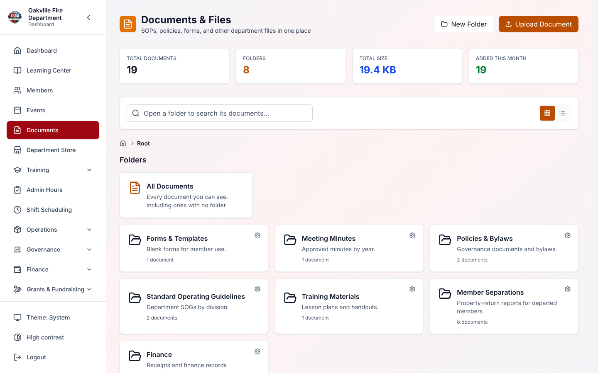

---

## Folders and Organization

Documents are kept in folders. The Logbook creates some folders itself, and
document managers can add more.

### Built-in folders

Each built-in folder opens to the people who use that part of The Logbook, not
to document managers in general. Only a full administrator sees every folder.

| Folder                                                                                      | Who can open it                                                                                                                                  |
| ------------------------------------------------------------------------------------------- | ------------------------------------------------------------------------------------------------------------------------------------------------ |
| Meeting Minutes, SOPs & Procedures, Policies, Forms & Templates, Reports, General Documents | Everyone who can view documents                                                                                                                  |
| Training Materials                                                                          | Members who can view or manage training                                                                                                          |
| Event Attachments                                                                           | Members who can view, edit or manage events                                                                                                      |
| Apparatus Files                                                                             | Members who can view, edit or manage apparatus. Photos and documents are uploaded on the vehicle's page                                          |
| Facility Files                                                                              | Members who can see sensitive facility details, or edit or manage facilities                                                                     |
| Finance (and Receipts)                                                                      | Members who can view, manage or approve finance. A member opens their own receipt from the request itself                                        |
| Member Separations                                                                          | Officers who can manage members. Property-return reports are filed here, because each names a departed member, the reason and their home address |
| Member Files                                                                                | Each member sees only their own folder                                                                                                           |

A built-in folder keeps its name and place and cannot be deleted, because the
part of The Logbook that made it files into it. You can still change its
description and who can open it, but its built-in access always applies too.

A folder card marked **Document managers only** opens only to officers who can
manage documents. One marked **Specific roles only** opens only to members in
the positions chosen for it.

### Creating Folders

**Who can do this:** roles that can manage documents and folders.

1. Open the folder the new one should sit in, or stay at the top level.
2. Select **New Folder** at the top of the page.
3. The window shows the **Location** it will be created in — **Root** at the
   top level. Enter the **Folder Name** and, if you like, a **Description**.
4. Under **Who can open it**, choose who may open the folder (see below).
5. Select **Create Folder**.

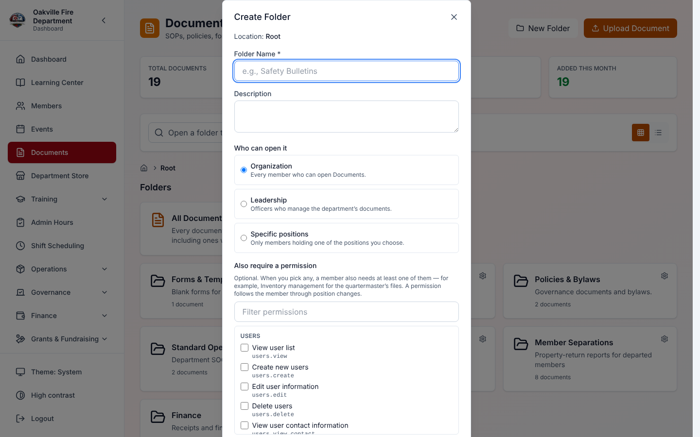

### Who can open it

| Choice                 | Who can open the folder                            |
| ---------------------- | -------------------------------------------------- |
| **Organization**       | Every member who can open Documents                |
| **Leadership**         | Officers who manage the department's documents     |
| **Specific positions** | Only members holding one of the positions you tick |

- With **Specific positions**, **Save** waits until you tick at least one.
- **Also require a permission** is optional. If you pick any permissions, a
  member also needs at least one of them. For example, pick Inventory
  management for the quartermaster's files. A permission follows the member
  if they change position.

### Managing a Folder

**Who can do this:** roles that can manage documents and folders.

Each folder card has a **Manage folder** (gear) button. It opens the folder's
settings:

- **Name** and **Description**.
- **Who can open it**, as above. A personal folder under Member Files is not
  offered these choices: only its member and full administrators can open it.
- **Move** — browse to the folder it should sit in (or **Top level**), select
  **Move here**, then **Save**. **Undo** cancels the move. A folder cannot be
  moved inside itself.
- **Delete folder…** — asks first, naming what goes with it: the documents in
  it and how many subfolders, with everything inside them. The files are
  deleted too, and it cannot be undone. **Delete folder and contents**
  confirms; **Keep it** backs out.

**A folder only administrators could open is confirmed first.** Creating a
folder, changing who can open it, or moving it could leave a folder no active
member except a full administrator can open. For example: a Specific positions
folder whose only position nobody holds, or a move under a leadership-only
folder. The window then asks **Only full administrators could open this
folder**, with **Go back and change it** and **Save for administrators only**.
A department made up only of administrators, such as a new installation, is
not asked.

**Full administrators are emailed a weekly list.** A folder can become
administrator-only without anyone choosing it (auto-archive, a tier change).
Once a week, while any such folder exists, each active full administrator gets
an email listing every one, the same list the Documents page shows. If sending
fails it retries the next day. The email is the optional **Document folder
access** kind; a department can make it required under notification settings.

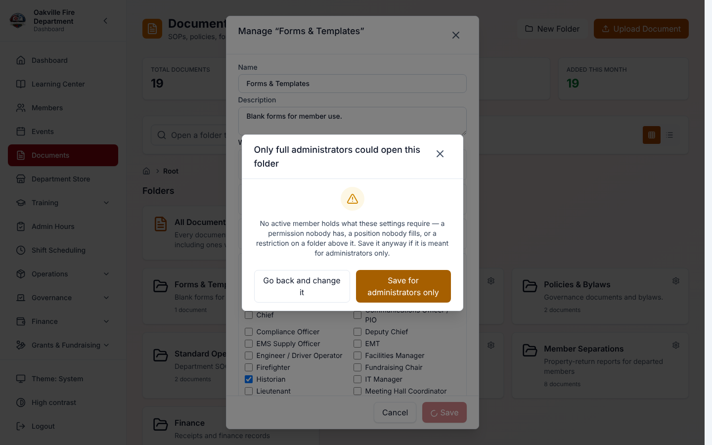

---

## Uploading and Managing Documents

### Uploading Files

**Who can do this:** roles that can manage documents and folders.

1. Select **Upload Document** at the top of the page.
2. In the box headed **Choose the file to upload**, select **Choose File** and
   pick the file. You cannot drag a file onto the box.
3. Optionally fill in **Document Name** (the file name is used if you leave it
   blank) and **Description**.
4. Choose the **Folder**. **General Documents (default)** files it into
   General Documents. The folder you have open is offered as **(current)**.
5. Select **Upload**.

**What you can upload:** PDF, Word, Excel, PowerPoint, text, CSV, images (JPEG,
PNG, GIF, WebP) and ZIP files, up to **50 MB** each. The Logbook checks what
the file really is, not just its name.

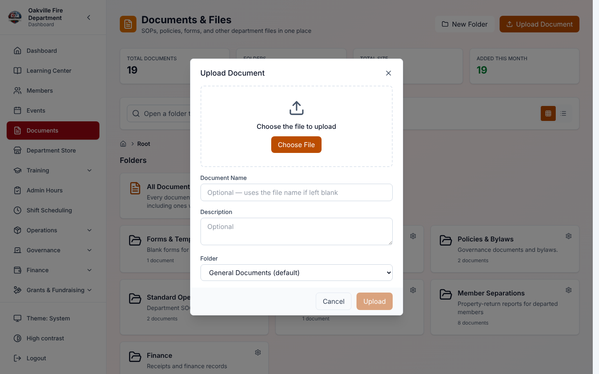

### Document Actions

- **Download** — save the file to your device.
- **Delete** — permanently deletes the document and its file, after a
  **Delete Document** confirmation that says it cannot be undone. Only roles
  that can manage documents see it.

There is no move or rename. To file a document somewhere else, upload it again
into the right folder and delete the old copy.

> **Tip.** Events, training sessions and meetings can also have documents
> attached on their own pages. Those are filed into the matching built-in
> folder.

---

## Forms Overview

**Where to find it:** **Administration → Forms & Comms → Forms**. You need a
role that can create, edit and manage forms, and the Forms module must be on.

Custom forms collect structured answers, for example:

- incident reports;
- equipment inspections;
- membership interest from the public;
- surveys and feedback;
- event requests from the community.

The page has three tabs:

| Tab                   | What it holds                                        |
| --------------------- | ---------------------------------------------------- |
| **Forms**             | Every form in the department, not only yours         |
| **Starter Templates** | Ready-made forms to copy                             |
| **Submissions**       | Pick a form to see its **Responses** and **Results** |

Each form card shows its status (for example **Published**), its category, and
whether it is **Public** or **Accepting submissions**.

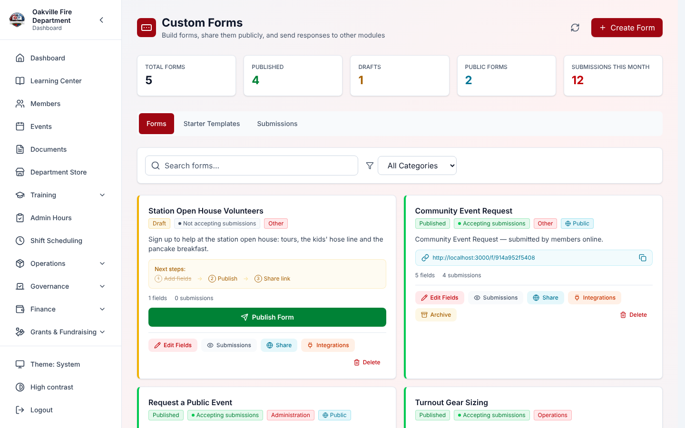

> **Important — members fill in forms through the form's link.** There is no
> page where members browse forms. To have members fill in a form, turn on
> **Public Access** and share the link (see
> [Publishing and Sharing Forms](#publishing-and-sharing-forms)). Leave
> **Allow submissions without signing in** off and only signed-in members can
> send it.

---

## Building a Form

**Who can do this:** roles that can create, edit and manage forms.

### Creating a New Form

1. Select **Create Form**.
2. Fill in:
   - **Form Name** (required).
   - **Category**: **Safety**, **Operations**, **Administration** or
     **Training**.
   - **Description**.
   - **Public Form** — tick to let anyone open the form from a public link.
     Whether submitting needs a sign-in is set later under **Share**.
   - **One submission per person** — see
     [One submission per person](#one-submission-per-person).
3. Select **Create Form**. The form opens in the editor, as a draft.

The editor has four tabs: **Form Builder**, **Preview & Submit**,
**Submissions** and **Results**.

### Adding Fields

Select **Add Field**, choose a type, and fill in its settings. The field types
are:

| Field type         | What it is                                     |
| ------------------ | ---------------------------------------------- |
| **Text**           | One line of text                               |
| **Text Area**      | Several lines of text                          |
| **Email**          | An email address, checked for the right format |
| **Phone**          | A phone number                                 |
| **Number**         | A number                                       |
| **Date**           | A date picker                                  |
| **Time**           | A time picker                                  |
| **Date & Time**    | Date and time together                         |
| **Dropdown**       | Pick one from a list                           |
| **Multi-Select**   | Pick several from a list                       |
| **Checkboxes**     | Tick any number of options                     |
| **Radio Buttons**  | Pick one, with all options showing             |
| **Member Lookup**  | Search for and pick a member                   |
| **Section Header** | A heading that divides the form                |
| **File Upload**    | Attach a file                                  |
| **Signature**      | Sign with a finger or mouse                    |

For each field you can set:

- the label and help text;
- whether it is required;
- a placeholder and a default value;
- the width (**Full Width**, **Half Width** or **One Third**);
- limits: minimum and maximum length, a **Validation Pattern** (such as a US
  ZIP code), or minimum and maximum values;
- the options, for dropdowns, multi-selects, checkboxes and radio buttons;
- **Conditional Visibility** — show the field only when another question has a
  certain answer;
- **Sensitive** — keep the answers encrypted and restricted (see below).
- **Pre-fill from applicant (follow-up forms)** _(2026-10-29)_ — pick a detail
  from the applicant's record, such as **Phone** or **Street address**, or
  leave it on Don't pre-fill. It only matters when a prospective-members
  **Follow-up Form** stage sends the form. The field then opens with what the
  record holds, and a changed answer updates the record. The builder shows a
  "Pre-fills: …" badge on the field. A field cannot be both **Sensitive** and
  pre-filled: each setting is unavailable while the other is on. See
  [Prospective Members → Follow-up Forms](./15-prospective-members.md#follow-up-forms-2026-10-29).

### Sensitive fields _(2026-10-26)_

Some questions need more protection than the rest of the form: criminal
history, driving record or medical history, for example. Tick **Sensitive**
under **Required** in the field's settings, then select **Update Field** (or
**Add Field**). The field shows a **Sensitive** badge in the builder. A
duplicated field stays sensitive.

**Who can read the answers.** Only members who can manage forms
(**forms.manage**) **and** hold **sensitive_answers.view** see answers to
sensitive fields, with a lock icon beside each question. No position has
**sensitive_answers.view** by default; out of the box only the IT Manager's
full access includes it. Managing forms does not include it either. To let,
say, your membership committee read these answers, an administrator adds it to
their position (see
[Managing Permissions](./08-admin-reports.md#managing-permissions)). Each time
someone opens submissions with these answers shown, it is recorded in the
audit log.

**What everyone else sees.** A member who can manage forms but lacks the
permission sees the other answers, and the note _"Restricted: this submission
has answers to sensitive questions, which you do not have permission to
view."_ The **Results** tab leaves sensitive questions out for them.

**Limits.**

- **Export CSV** never includes sensitive answers, whoever downloads it.
- **Integrations** never receive them. If a form that feeds another module
  (for example **Membership Interest**) has a sensitive field, publishing it
  warns that the module receives none of those answers. On a **Membership
  Interest** form, marking the name or email field sensitive means no
  prospective member is created.
- **The person filling in the form** sees the note _"This answer is stored
  encrypted and is visible only to authorized staff."_ under the question.
  This includes a public or embedded form. They are not shown their answer
  back after submitting.
- **Marking an existing field sensitive** encrypts the answers already
  received. It does not reach copies an integration already made, such as a
  prospective member created from the form earlier. Mark fields sensitive
  before you publish.
- **You cannot un-mark it** once any answer is stored this way, because that
  would turn encrypted answers back into plain text.

### Conditional visibility (branching)

Under **Conditional Visibility**, choose **Show when this field...** and the
question it depends on, then the condition:

- **Equals** or **Does not equal** a value;
- **Contains** a value;
- **Is answered (not empty)** or **Is not answered (empty)**;
- **Is at least** or **Is at most** a number.

How branching behaves:

- **A hidden question is not required.** A required question counts only while
  it is showing. So an applicant who chose "Administrative" is never asked for
  their EMT experience.
- **Answers to hidden questions are thrown away** when the form is sent. If
  someone picked EMT, typed their experience, then switched to Administrative,
  the EMT answer is not saved.
- **Branching follows every level.** A question that depends on a hidden
  question is hidden too, and not required.
- **"Contains" on checkboxes or a multi-select matches a whole option.**
  "Contains EMT" does not open for someone who ticked only "AEMT". On a text
  question it matches part of the answer.
- **A rule needs a value**, and one left over from a different question is
  dropped.
- **A question cannot depend on itself** or on one of its own follow-ups. The
  editor does not offer those questions.
- **Deleting a question asks first.** The confirmation names any follow-ups
  that depend on it, and says they will be shown to everyone instead.

These rules apply the same way in the preview, on the public page and when The
Logbook saves the answers.

### Form Builder Features

- **Reorder fields** by dragging them, or with the up and down arrows.
- **Duplicate** a field with its copy button. The copy keeps its condition and
  number limits.
- **Badges** on each field show **Required**, **Conditional**, its width, and
  **Needs setup** when something is missing (for example, a dropdown with no
  options). Select the field to fix it.

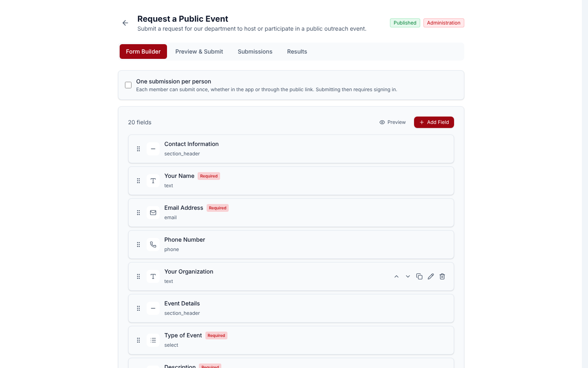

### Form Templates

The **Starter Templates** tab has ready-made forms:

- Incident Report
- Membership Interest Form
- Equipment Inspection
- Equipment Assignment
- Apparatus Check-off
- Member Feedback Survey
- Community Event Request

Select **Use Template** to create a form from one, then change it as you need.
Some templates are marked **Public**, and some say where they send responses
(for example "Sends responses to Membership").

---

> **Deleting a form that has submissions archives it** instead, so the
> submissions are kept. A form with none is deleted. The confirmation and toast
> say which happened.

## Publishing and Sharing Forms

A form takes submissions only once it is **published**. On a draft form's
card, select **Publish Form**. Other buttons on a form's card are **Edit
Fields**, **Submissions**, **Share**, **Integrations**, **Archive** and
**Delete**.

### Internal Forms

A form without public access can be filled in only from its own editor
(**Preview & Submit**), by people who can manage forms. To collect answers
from members, use public access with sign-in required, below.

### Public Forms

Anyone with a public form's link can **open** it. Whether they can **send** it
without signing in is a separate choice, and **a new form needs a signed-in
member until you change it**.

1. On the form's card, select **Share** to open the **Share Form** window.
2. Switch on **Public Access**. The form gets a **Public URL** and a **QR
   Code**. Select **Download PNG** or **Download SVG** to print the code.
3. Tick **Allow submissions without signing in** if people outside the
   department should be able to send it. Leave it off to accept answers from
   signed-in members only. The window then says "Anyone with the link can view
   this form; submitting requires signing in".
4. **Publish** the form. Until then, the public link does not work, and the
   window says "Publish this form to turn on its public link."
5. Share the link or QR code, then select **Done**. Answers sent through the
   public link show a **globe icon** in your submissions list.

**Visitors are told before they start.** If a form needs a signed-in member
and the visitor is not signed in, the page shows **Sign in to submit this
form** above the questions. Its **Sign in** button brings them back to the
form afterwards.

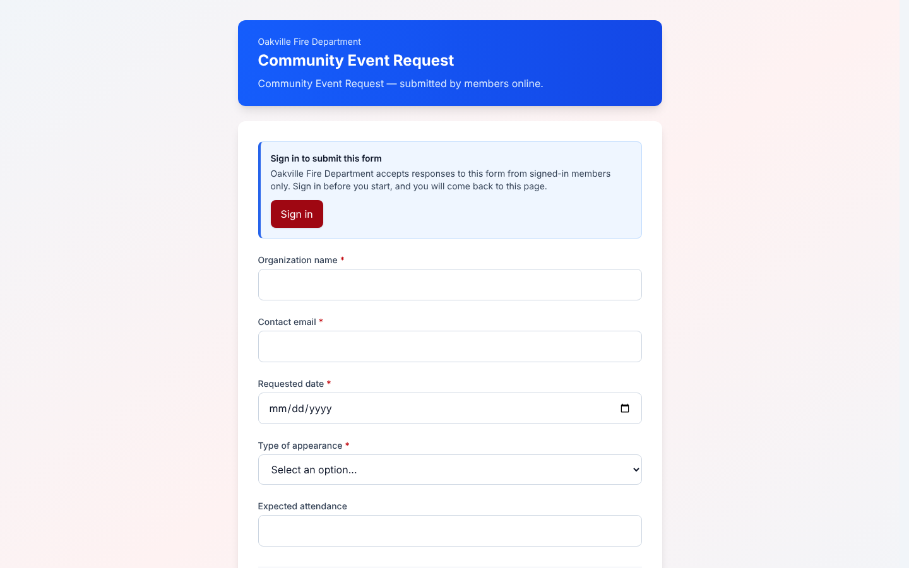

> **What if publishing warns me?** A public form that files event requests
> does nothing if the department has turned off accepting public requests in
> Events settings. **Publish** then asks "Publish this form?", with **Publish
> anyway** and **Not yet**. You see the warning even without access to Events
> settings. A form with no such problem publishes straight away.

### Embedding a form on your website _(2026-10-25)_

If your department already has a website, a public form can sit **inside one
of its pages** instead of sending visitors to The Logbook. Two switches are
needed, at two levels:

1. **Once, for the department** — someone with access to Organization Settings
   opens **Settings → Forms** and lists your website, one address per line,
   such as `https://www.oakvillefire.org`. Use `https://` and leave off any page
   path such as `/apply`. Only the sites listed here can show your forms.
2. **For each form** — in the form's **Share** window, with **Public Access**
   on, tick **Allow embedding on your website**. The window shows the **Embed
   code** and which sites it works on. Select **Copy embed code** and paste it
   into the page on your website, where your web host's editor accepts HTML.

The embedded form shows its title and questions only; your website already
carries the department's name and logo. It grows to fit as visitors answer.

- **A form that needs a signed-in member cannot be sent from inside your
  website.** Signing in cannot happen inside another site's page, so the
  embedded form offers **Open the form to sign in**, which opens it in a new
  tab. Embedding suits forms with **Allow submissions without signing in**
  ticked.
- **"Your department has not listed its website yet"** in the Share window
  means step 1 is missing. Until it is done the form will not show anywhere.
- **The form shows a blank box on your website.** Check that the address in
  Settings → Forms matches the one in your browser's address bar exactly,
  including `www.` and `https://`. If whoever runs your server put another
  reverse proxy in front of The Logbook, it may be adding its own "do not
  frame" header; see the deployment guide.
- **The same limits apply.** The daily limit, robot checks and one submission
  per person work exactly as they do on the public link.

### One submission per person

Tick **One submission per person** when creating a form, or at the top of the
editor's **Form Builder** tab, to let each member answer once.

- The limit holds everywhere a member can send the form. A second attempt is
  refused with _"You have already submitted this form"_, even if two arrive at
  the same moment.
- Leave it off for anything members fill in again and again, such as a shift
  report.
- Such a form always needs a signed-in member, because that is the only way to
  tell who has answered. Its **Allow submissions without signing in** box is
  greyed out, with the reason under it.

### Daily limit on public forms

Each public form accepts a limited number of submissions a day: **500**, unless
whoever runs your server changes it.

- Only accepted submissions count. One turned away for a missing answer or a
  too-long value, or caught as a robot, does not use up the allowance. So a
  flood of junk cannot lock real people out.
- Once the limit is reached, visitors see _"This form is not accepting further
  submissions today."_

**Event officers do not need the Forms page.** **Manage Events → Settings →
Public Form** lists only the forms connected to event requests, for officers
who can manage events. See
[Events & Meetings → Public Request Form](./04-events-meetings.md#public-request-form).

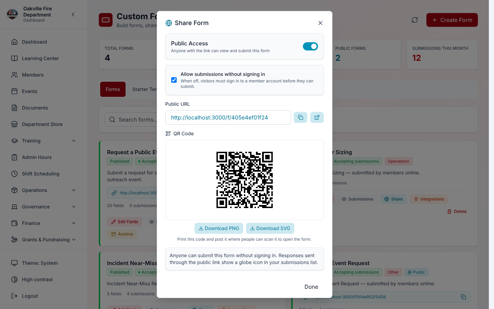

> **Tip.** Public forms suit community feedback, mutual aid incident reports,
> and application forms linked from your department's public portal.

---

## Viewing Submissions

1. Open the **Submissions** tab and choose the form (or select
   **Submissions** on its card).
2. **Responses** lists submissions, newest first, 20 to a page. Each shows who
   sent it (or **Anonymous**) and when. Select one to see every answer.
3. **Export CSV** downloads the submissions on the page you are looking at,
   with the time, the sender and every answer except answers to
   [sensitive fields](#sensitive-fields-2026-10-26), which are never exported.
4. **Delete** removes a single submission.
5. Answers to [sensitive fields](#sensitive-fields-2026-10-26) appear under a
   lock icon for members who may read them; anyone else sees the _Restricted_
   note instead.

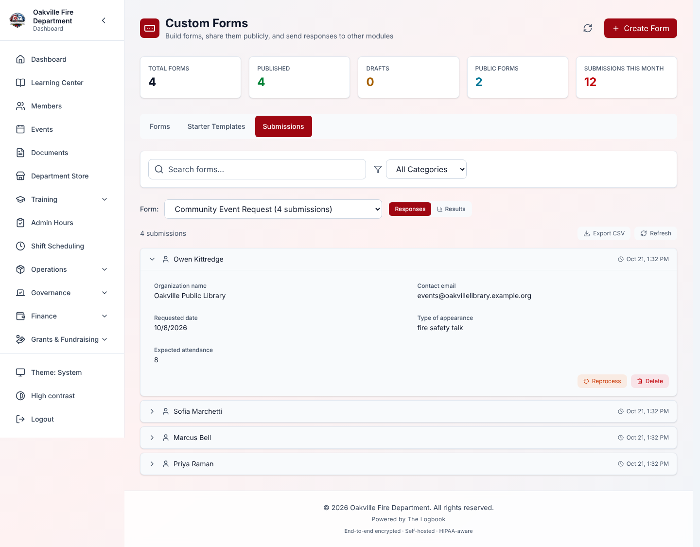

> **What if I need every submission in one file?** **Export CSV** saves the
> current page only (up to 20). Export each page with **Next**, or use the
> **Results** summary.

### Survey Results Panel

The **Results** tab adds up the answers across all submissions:

- charts of how often each option was chosen, for dropdowns, radio buttons and
  checkboxes;
- counts and figures for text and number questions;
- **Export Summary** to download the summary.

Use it for feedback surveys, polls and any form where the pattern matters more
than single answers.

### Sending answers to other modules

A form can pass each submission to another part of The Logbook. On the form's
card, select **Integrations**:

| Target Module  | What it can do                                        |
| -------------- | ----------------------------------------------------- |
| **Membership** | **Membership Interest** — create a prospective member |
| **Inventory**  | **Equipment Assignment**                              |
| **Events**     | **Event Registration** or **Event Request**           |

Choose the target and type, match each form field to the field it fills, then
select **Add Integration**. The window shows how many submissions
**Succeeded** and **Failed**.

On the **Responses** list, each submission shows **Synced** or **Failed**.
Open one to see **Integration Results**, and select **Reprocess** to try a
failed one again.

---

## Notification Rules & Logs

Select **Notifications** in the menu. The page holds your own notifications
and, for officers, the department's notification rules.

### Four tabs

| Tab                    | What it is for                                                                                                        | Who sees it                              |
| ---------------------- | --------------------------------------------------------------------------------------------------------------------- | ---------------------------------------- |
| **My Notifications**   | Your in-app inbox, with an unread count, a **Show read** switch and **Mark all as read**. Pinned ones stay at the top | Everyone                                 |
| **Notification Rules** | Switch a built-in notification off for the whole department                                                           | Roles that can view notifications        |
| **Email Templates**    | A link to change the wording of the emails                                                                            | Administrators with full settings access |
| **Send Log**           | Your own delivery history, email and in-app, with **All**, **Email** and **In-App** filters                           | Everyone                                 |

**Notifications of the same kind stack.** Two or more in-app notifications of
one kind fold into one row, such as "5 attendance validations". The row shows
the newest one's subject as **Latest:** and an **unread** count.

- Select the row to open it. Each notification inside keeps its own link and
  read state.
- **Mark all read** on the row clears the whole kind, including ones not yet
  loaded.
- A pinned notification never stacks.
- On the dashboard's **My Updates** card, a stack is one row that opens this
  inbox.

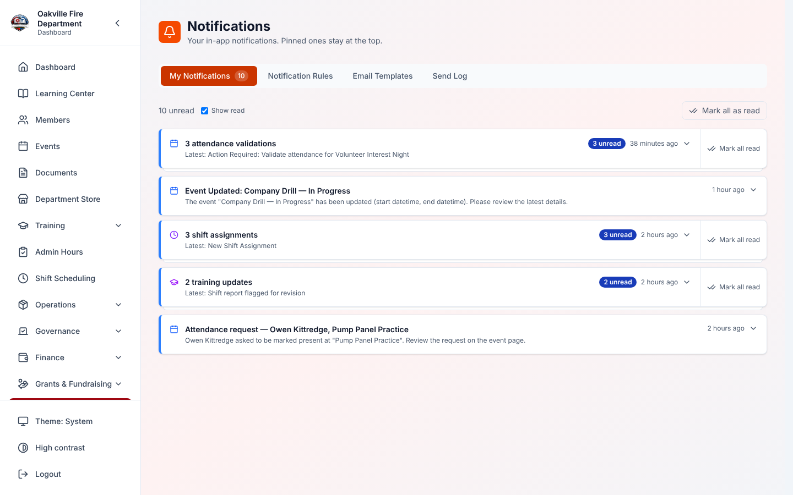

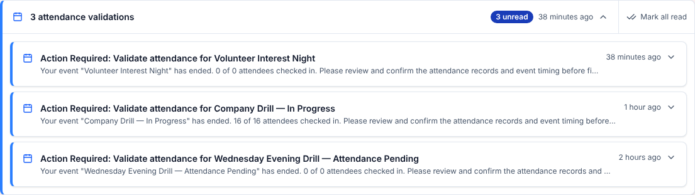

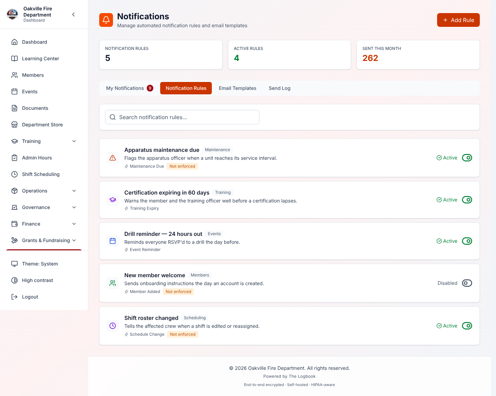

### Notification Rules

**Every notification already goes out with its built-in settings.** A rule is
how you switch one off. It stops for the whole department only when **every**
rule for its trigger is switched off. With no rules at all, nothing is off.
Members choose their own email and text preferences separately (see
[Member notification controls](#member-notification-controls)).

The cards at the top count **Notification Rules**, **Active Rules** and
notifications **Sent This Month**.

The trigger list offers only the notifications a rule can actually switch off:

| Trigger                      | What switching it off stops                                                                                                                   |
| ---------------------------- | --------------------------------------------------------------------------------------------------------------------------------------------- |
| **Event Reminder**           | Reminders before scheduled events                                                                                                             |
| **Training Expiry**          | Certification expiration alerts, when the training module has them switched on                                                                |
| **Suggestion Submitted**     | Notices telling a suggestion box's reviewers, and anyone the box notifies, that a submission arrived. Replies and status updates still go out |
| **Equipment Request Update** | The notice telling a member the quartermaster approved, declined or issued their equipment request. Its status still shows on My Equipment    |

A rule made earlier for another trigger, such as Schedule Change or Form
Submitted, is still listed, badged **Not enforced**: switching it does
nothing.

With no rules, the tab says automated notifications already go out with their
default settings.

### Creating a Rule

1. Open **Notifications → Notification Rules**.
2. Select **Add Rule**.
3. Enter a **Rule Name** and choose the **Trigger Event**. The window explains
   what the trigger does and which category it is filed under.
4. Add a **Description** if you like.
5. Select **Create Rule**.

Each rule has its own on/off switch. A switched-off rule keeps its settings.

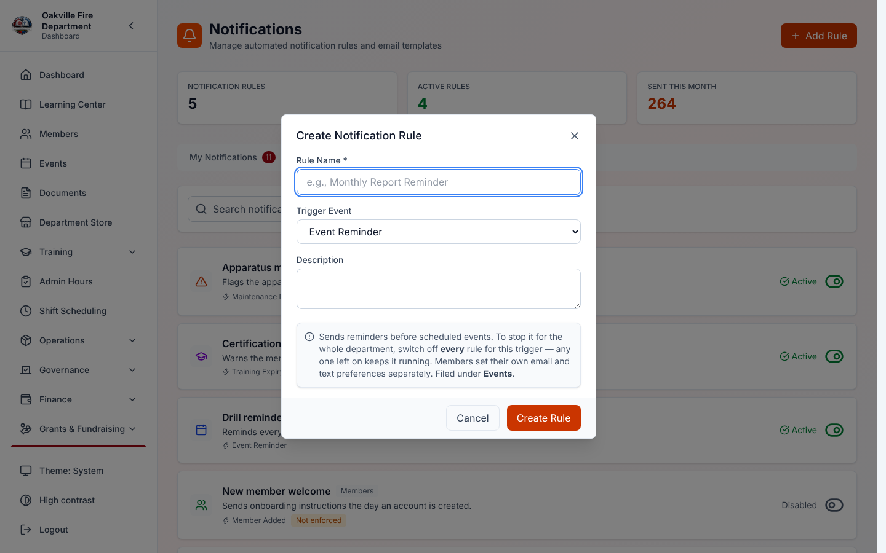

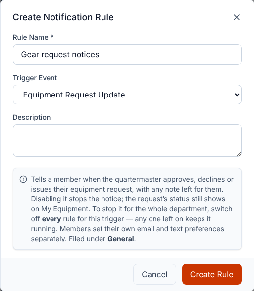

### Changing or deleting a rule _(2026-10-25)_

Members who manage notifications see an edit (pencil) and a delete (bin) icon on
each rule's row. Either can switch a notification back **on** or **off** for
the whole department: a trigger with no rules sends as normal, and one with
rules sends while any of them is on.

- **Edit** opens **Edit Notification Rule** with the same fields. Select
  **Save Changes**. If changing the **Trigger Event** would switch a
  notification on or off for the whole department — the rule stops counting
  toward its old trigger and starts counting toward the new one — a warning in
  the window says which, before you save.
- **Delete** asks **Delete this rule?**. When the rule is the one keeping a
  notification switched off, or the last one switched on for its trigger, the
  window says what deleting it changes and suggests editing or switching the
  rule instead. Select **Delete rule**, or **Keep it** to leave it as it is.

### Send Log

The **Send Log** tab shows **your own** delivery history — the email and in-app
notifications sent to you. Every member can open it. It lists:

- the date and time;
- the subject and message;
- the channel (Email or In-App);
- the delivery status — hover over a failed one to see why.

Use the **All**, **Email** and **In-App** filters, and **Mark all as read** to
clear unread notifications.

The department-wide view of every member's deliveries, for checking mail is
getting through, needs a role that can manage notification rules.

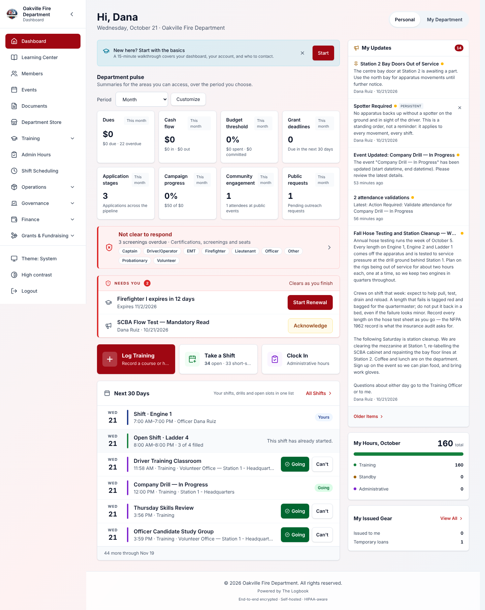

### Notifications on the dashboard

The dashboard's **My Updates** card shows your unread notifications and
department messages in one list, five at a time. **Older Items** opens the
full inbox — see
[Administration & Reports → Dashboard Notification Management](./08-admin-reports.md#dashboard-notification-management).
You mark notifications read on the **My Notifications** tab. Only a persistent
department message has a clear button on the dashboard, and only for officers
who manage messages.

### What if …?

| What happened               | What it means                                                   |
| --------------------------- | --------------------------------------------------------------- |
| You open the Send Log       | It shows All channels unless you filter                         |
| You select Mark all as read | Only unread notifications change                                |
| Two rules share a trigger   | Allowed. The notification stops only when both are switched off |
| A rule is switched off      | It keeps its settings and history                               |

---

## Department Messages

Department messages are announcements from leadership to the whole department
or a chosen group.

- **Members** read them under **Messages** in the menu (the megaphone), on the
  **dashboard** — in **My Updates**, or **Needs you** while a message waits
  for your acknowledgment — and in the notification **bell**. Anyone signed in
  can read the messages sent to them.
- **Officers** write and manage them at **Administration → Forms & Comms →
  Messages**. This needs a role that can manage notification rules.

### Posting a message

1. Open **Administration → Forms & Comms → Messages** and select **New
   message**.
2. Enter a **title** and the **message**. Web addresses you type become links.
3. Set the **priority**: **Normal**, **Important** or **Urgent**. It decides the
   styling and how far the message is pushed out (see below).
4. Choose the **audience**:
   - **Everyone** — the whole department.
   - **By role** — one or more roles, such as Probationary Members.
   - **By status** — member statuses, such as Active or Leave.
   - **Specific members** — people you pick from a searchable list.
5. If you like, tick **Pin to top**, **Keep in inbox after it is read** or
   **Require acknowledgment**. Set **Expires (optional)** and **Schedule for
   later (optional)** if needed.
6. Select **Post message** — or **Schedule message** if you set a later time.

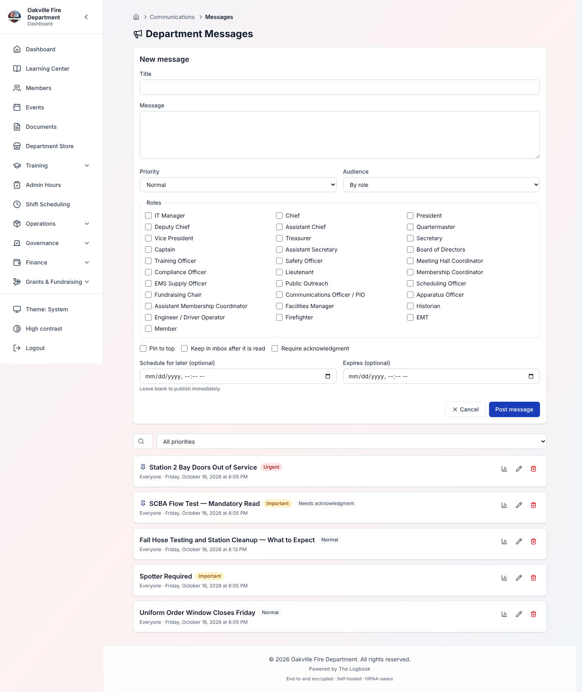

### How members receive a message

Every member in the audience gets the message **in the app** (dashboard, inbox
and bell) **and by email**, at every priority. **Urgent** messages also go by
**text message**:

| Priority or setting     | In the app | Email | Text |
| ----------------------- | :--------: | :---: | :--: |
| Normal                  |     ✅     |  ✅   |  —   |
| Important               |     ✅     |  ✅   |  —   |
| Requires acknowledgment |     ✅     |  ✅   |  —   |
| Urgent                  |     ✅     |  ✅   |  ✅  |

- The dashboard card shows what still needs you: unread messages, messages you
  have not acknowledged, and persistent notices. Once dealt with, a message
  leaves the card on your next visit — never while you are reading it. The
  full history stays on the **Messages** page.
- A member cannot opt out of a department message email: the department must
  be able to show the member was told. Important and urgent emails start with
  **[IMPORTANT]** or **[URGENT]**.
- The author is not notified about their own message.

**Email is tried, and retried when it does not go out:**

- **No address on file:** the member is skipped.
- **Hourly limit:** a department sends at most 30 message emails an hour. A
  held-back email is queued and sent once the hour has room.
- **Delivery failures:** a send the email service refuses, or cannot be
  reached for, is retried five times — 5, 10, 20, 40 and 80 minutes apart.
  After that it is marked failed.

The **acknowledgment report** shows each member's email (and text) when it has
not simply gone out: _"Email not sent yet, trying again …"_ while a retry is
waiting, and _"Email failed — …"_ in red once the retries are used up. Follow
up a failed one by hand.

> **Important.** Treat the in-app inbox and the acknowledgment report — not the
> email — as the record that a member was told. For anything urgent, use
> **Require acknowledgment** and check the report.

**Texts are sent only when all of these are true:**

- the department has text messaging set up;
- the member has a mobile number on file;
- the member has given **express consent to texts** (US TCPA rules — a member
  never asked counts as _not_ consenting);
- the member's own **Urgent Text Messages** setting is on.

A member who gets no text still gets the email.

### Opening a message

Each message has its own page, opened from the inbox or the dashboard. A link
to it works: paste it into an email or chat and the reader lands on that
message. The breadcrumb leads back to **Messages**. Opening the page marks the
message read, and a message needing acknowledgment shows its **Acknowledge**
button there.

Only members the message was sent to can open it. Anyone else — or anyone
opening a message that has expired or been removed — sees **Message
unavailable**, with a way back to the inbox.

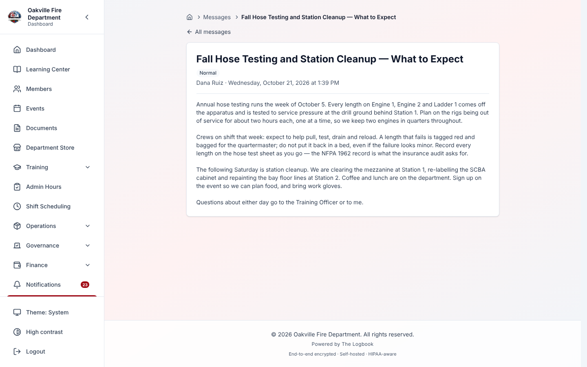

### Requiring acknowledgment

Tick **Require acknowledgment** for messages members must confirm they have
read, such as an SOP change.

- The member sees an **Acknowledge** button. The message counts as new until
  they select it — just opening it is not enough.
- Officers open the **acknowledgment report** (the bar-chart button on a
  message). It shows **X of Y acknowledged / read** and lists exactly who still
  owes an acknowledgment.
- Acknowledgments are recorded in the audit log as evidence.

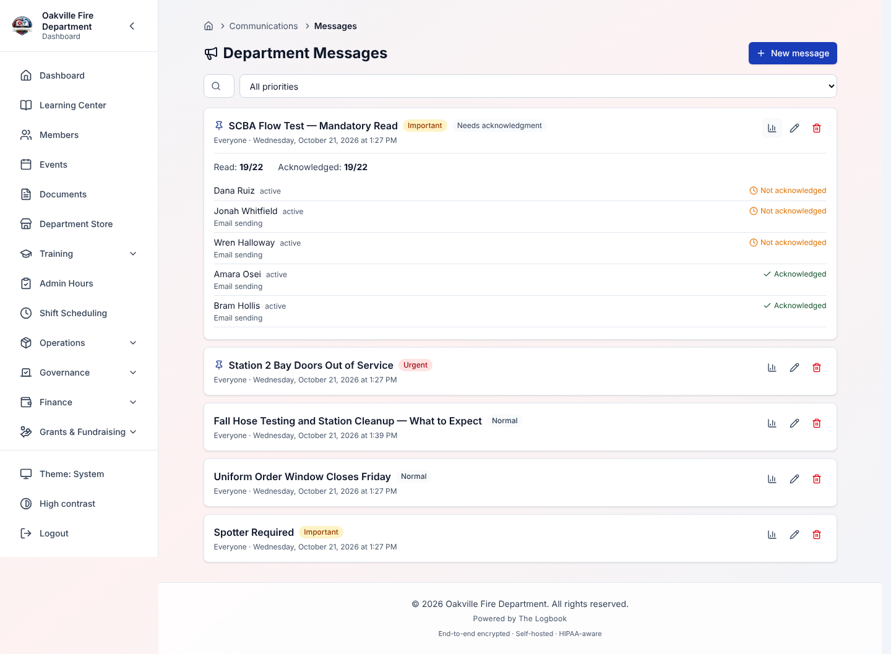

### Scheduling a message

Set **Schedule for later** to a future time to post the message then, instead
of now. Until then members cannot see it, and the officers' list shows a
**Scheduled · (time)** badge. The Logbook checks about every 15 minutes, so it
goes out within 15 minutes of the time you set, with the same emails and texts
as an immediate post. Leave the box empty to post now.

> **What if I want to reschedule?** You can change the time on a message that
> has not gone out yet. A message already posted cannot be moved to a later
> time, because that would send it again.

### Editing and managing messages

- **Edit** — the pencil button reopens the form. Fix the title, text, audience,
  settings or expiry in place. Saving does **not** send it again.
- **Search and filter** — the officers' list has a search box and a priority
  filter, and pages through long histories.
- **Delete** — the bin button removes the message from members' view. The
  read and acknowledgment records are kept as evidence.

### Persistent messages

When **Keep in inbox after it is read** is ticked:

- The message shows a **Persistent** badge on the dashboard.
- It stays on members' dashboard and inbox even after they read it, and
  messages already read never push it off the dashboard card. Pin it too, to
  keep it above newer unread messages.
- Only officers who can manage messages see the ✕ button that removes it.

Use it for standing notices, such as "SCBA annual inspection mandatory by March
31 — contact Lt. Smith to schedule".

### Member notification controls

Members choose how they are reached under **Settings → Notifications**:

- **Email Notifications** — the main switch for the emails a member may turn
  off. Off stops all of them at once.
- **Emails you can turn off** — one switch for each optional email: **Event
  reminders**, **Off the waitlist** (a place opened on an event you were
  waitlisted for), **Event changes and cancellations** (an event you said
  Going or Maybe to was cancelled or moved), **Training and certification reminders**, **Shift
  notices**, **Equipment and inventory updates**, **Store announcements**,
  **Volunteer calls**, **Election notices** and **Suggestion box**. Members
  with an officer role also see the emails for their duties (events,
  scheduling, training, elections, quartermaster, membership and store). The
  notice still appears in the bell either way.
- **Always emailed to you** — the emails nobody can turn off: account and
  security, election ballots, **department messages**, leaving-the-department
  notices, store receipts, skills test results and overdue equipment. Any
  optional email the department has made required is listed here too.
- **Urgent Text Messages** — get a text for urgent messages. It needs a mobile
  number on file, text messaging set up by the department, **and** your express
  consent under **My Account → Privacy → Privacy Choices**. Turning texts off,
  or never consenting, never stops the email.

The in-app notification always arrives, whatever these settings say.

#### Which emails are required — Member Emails & Texts

**Administration → Forms & Comms → Member Emails & Texts** lists every email
The Logbook sends to members and officers, under **Always sent** and
**Members can turn off**, and the alerts that may also go by text under **Text
messages**. Emails to applicants, event requesters and addresses typed in by
hand are not on it. Administrators, and officers who can manage notification
rules, can open it.

Administrators with full settings access, or who can update organization
settings, can switch on **Require for every member** for an optional email.
Members then see it under **Always emailed to you**, and it is sent whatever
their own switches say. It works one way only: an email The Logbook itself
requires cannot be made optional. Each change is recorded in the audit log.

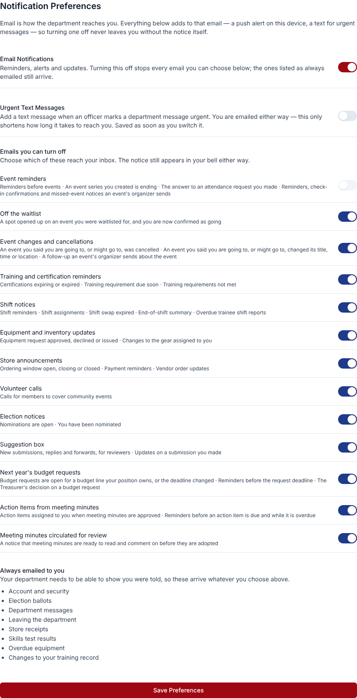

### What if …?

| What happened                                    | What it means                                                                                            |
| ------------------------------------------------ | -------------------------------------------------------------------------------------------------------- |
| A message targets certain roles                  | Only members holding one of those roles see it                                                           |
| A targeted role is renamed                       | The message still reaches that role                                                                      |
| A member marks everything read                   | Persistent messages stay. Only an officer can clear them                                                 |
| An acknowledgment message is deleted             | Members no longer see it, but the read and acknowledgment records are kept                               |
| A sent message is edited                         | The change is saved in place. It is **not** sent again                                                   |
| An urgent message, with no text messaging set up | Still delivered in the app and by email. The text is skipped                                             |
| Very many urgent or acknowledgment messages      | Emails and texts are limited per department to prevent runaway sending. The in-app notice always arrives |
| Sending is retried                               | Each member gets the email (and any text) once                                                           |
| A send to a member fails                         | It is recorded as failed, never as delivered                                                             |

---

## Suggestion Boxes

A department can run any number of **suggestion boxes** — "Training ideas",
"Station 2 facilities", a complaints box. Each has its own reviewers and its
own rules about anonymity. Members send suggestions from one place, reviewers
work through each box, and an anonymous sender can still talk with reviewers
without ever being identified.

| Who                       | Where                                                       | Needs                                                        |
| ------------------------- | ----------------------------------------------------------- | ------------------------------------------------------------ |
| Every member              | **Suggestions** in the menu (after **Messages**)            | Signed in                                                    |
| A box's reviewers         | The **Review** tab on the same page — only reviewers see it | Being named as a box's reviewer, or forwarded one suggestion |
| Whoever sets up the boxes | **Administration → Forms & Comms → Suggestion Boxes**       | A role that can create and configure suggestion boxes        |

**Setting up boxes and reading them are separate on purpose.** Setting up
boxes lets you create them and choose their reviewers. It does **not** let you
read what anyone sent — only a box's own reviewers can. That makes a
complaints box possible even when the administrators might be what someone is
complaining about. The Fire Chief, Deputy Chief, Assistant Chief, President
and Communications Officer positions can set up boxes unless your department
changes that.

**Every department starts with a Compliance box.** Members see it described as
"Report a compliance concern: a policy, safety, training-record or regulatory
issue. Reviewed by the Compliance Officer." The sender chooses whether to stay
anonymous, and follow-up is allowed.

- Its reviewer is the **Compliance Officer** position, which starts with nobody
  in it.
- **The box is open from day one, so reports sent before you appoint a
  Compliance Officer wait unread.** Fill that position promptly. Whoever holds
  it sees everything the box has received.
- It asks a required **What kind of concern is this?** (policy or procedure,
  safety, training record, regulatory or legal, other). Choosing safety adds
  **Is anyone at immediate risk?**, whose help text says the box is not
  watched around the clock. Neither answer sends the report anywhere else.
- A department that already had a box named Compliance keeps its own. If no
  Compliance Officer position exists, the box starts closed, because an open
  box needs a reviewer.

### Setting up a box

**Who can do this:** roles that can create and configure suggestion boxes.

1. Open **Administration → Forms & Comms → Suggestion Boxes** and select **New
   box**.
2. Give it a **Name** (unique in your department) and a **Description (shown
   to members)**. Say what the box is for and who reads it.
3. Add any **Questions** to ask first (see
   [Asking questions first](#asking-questions-first-and-sending-answers-to-another-box)).
4. Choose its **Anonymity**:
   - **Submitter chooses** — the member ticks **Submit anonymously** or not.
   - **Always anonymous** — no submission to this box ever records who sent it.
   - **Always named** — every submission carries the member's name.
5. Tick **Allow follow-up** if reviewers and senders should be able to reply to
   each other and the sender should see the outcome. Leave it off for a one-way
   box: reviewers read everything but do not reply or report a status.
6. Tick **Public idea board** to let reviewers share ideas with everyone (see
   [The idea board](#the-idea-board)).
7. Pick the reviewers: any mix of **Reviewer positions** (whoever holds that
   position) and **Reviewer members**. An open box needs at least one. They
   are the only people who will ever read it, so choose with care — a
   complaints box reviewed by the people most likely to be complained about
   will not be used.
8. Optionally, under **Also notify**, name people who should be told when
   something arrives (see [Reviewing submissions](#reviewing-submissions)).
9. Leave **Accepting submissions** ticked, and select **Save box**.

To close a box, untick **Accepting submissions**. Its reviewers can still read
what it holds.

To remove a box, select **Delete** on it:

- **A box that never received a submission** is deleted once you confirm.
- **A box with submissions** says how many it holds and offers **Archive
  instead**, which closes it and keeps everything. Deleting it removes every
  submission, screenshot and reply in it, cannot be undone, and asks you to
  type the box's name before **Delete permanently** works.

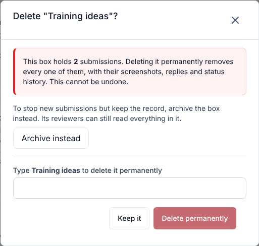

### Asking questions first, and sending answers to another box

A box can ask its own **Questions** before the title and details. In the box's
settings, the **Questions** section sits right under **Description**. Add one
question at a time: its wording, an **Answer type**, optional help text, and
whether it is required. Reorder with the arrows.

**Answer types** include text, choices, a **Rating** (1 to 5, shown to
reviewers as "4 / 5"), a **Time** (24-hour, kept as typed), **Pick a member**
and **Pick a vehicle**.

- The member and vehicle lists come from your own department. The name is
  saved with the answer, so reviewers can still read it after the member
  leaves or the vehicle is retired.
- A department with no vehicles on file skips vehicle questions rather than
  blocking the form.

**Show only after this question.** A follow-up question can appear only when
an earlier answer matches a rule: **is**, **is not**, **includes**, **is
answered**, **is not answered**, or — for a rating or number — **at least** or
**at most** a value. Removing a question warns you how many follow-ups depend
on it.

**Where an option sends the submission.** On a dropdown or single-choice
question, each option can send the submission to another box. The default is
**Keep in this box**. Only the other box's reviewers and watchers are told,
and only they can read it. They see the answers with their question wording.

Rules that protect the sender:

- A route must stay inside your department and cannot point at the same box.
- A box that **requires anonymity** cannot send to a box that refuses it.
  Anonymity holds wherever an answer sends the submission.
- A route to a **closed** box is ignored, and the submission stays where it was
  sent.
- Deleting a box removes routes that point at it.

**What the member sees.** A box with questions shows them first, on a step of
their own, with a **Continue** button. Title, details and screenshots follow on
a second step, with a **Back** button that keeps your answers. The answers
decide where the submission goes and whether it can be anonymous, so you see
that before writing anything. A box with no questions keeps its single page.

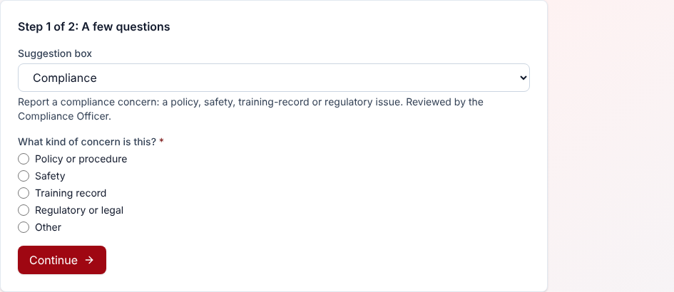

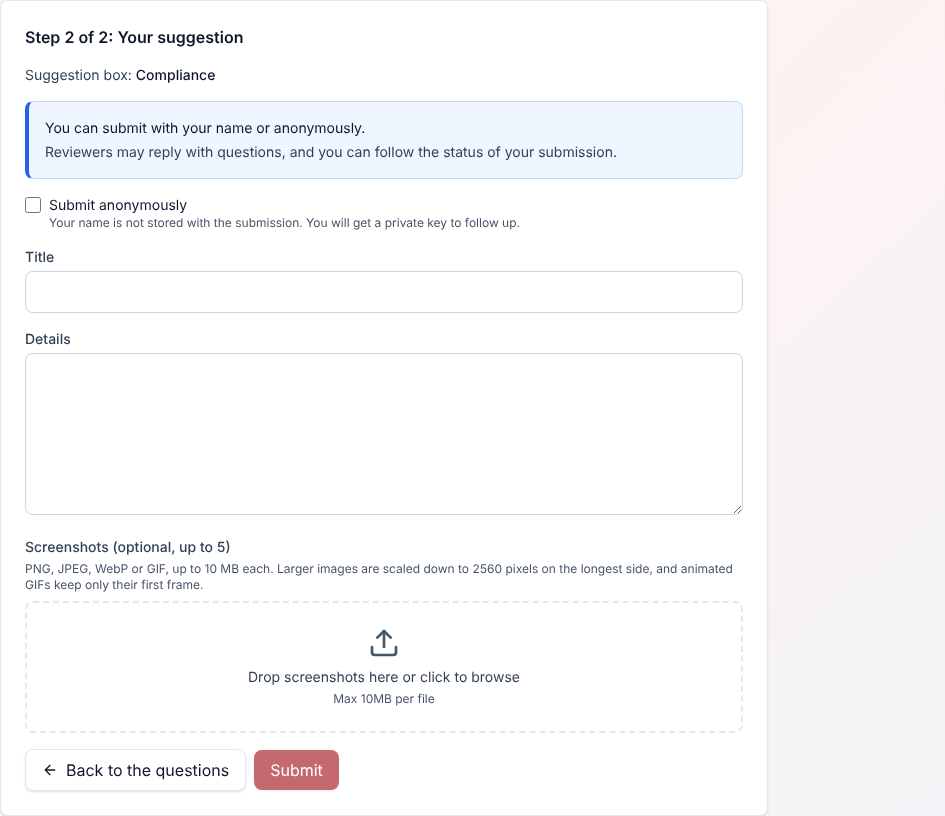

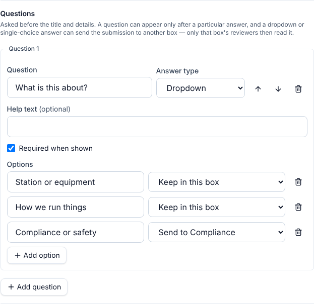

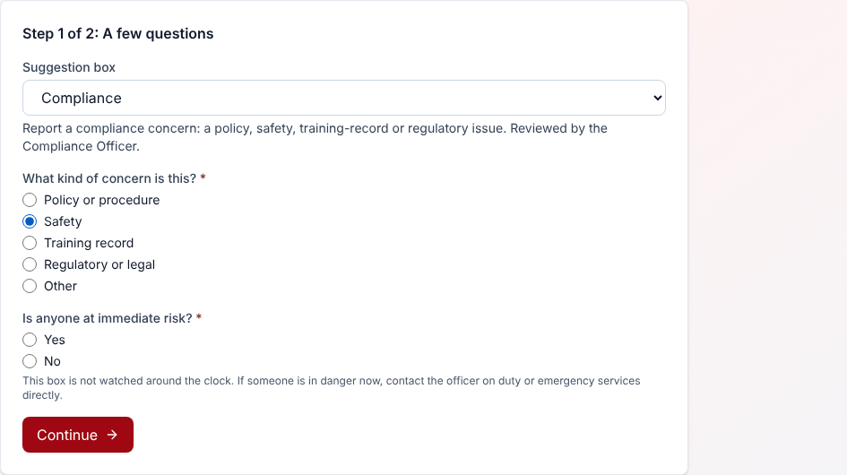

### Submitting a suggestion (every member)

1. Open **Suggestions** from the menu. The **Submit** tab is first.
2. Pick the **Suggestion box**. Its description appears underneath, with
   whether your name will be recorded and whether reviewers will reply.
3. Answer any questions and select **Continue**.
4. Enter a **Title** and the **Details**. Optionally attach up to **five
   screenshots**: PNG, JPEG, WebP or GIF, up to 10 MB each. Larger images are
   shrunk to 2560 pixels on the longest side, and animated GIFs keep only
   their first frame.
5. If the box lets you choose, tick **Submit anonymously**.
6. Select **Submit** (or **Submit anonymously**).

Named submissions appear under **My submissions**, where you can follow the
status and reply if the box allows follow-up. In a follow-up box, **Status
history** shows when your submission arrived, each status it has moved
through, and any response the reviewers wrote for you. An anonymous submission
shows the same history when you open it with its follow-up key.

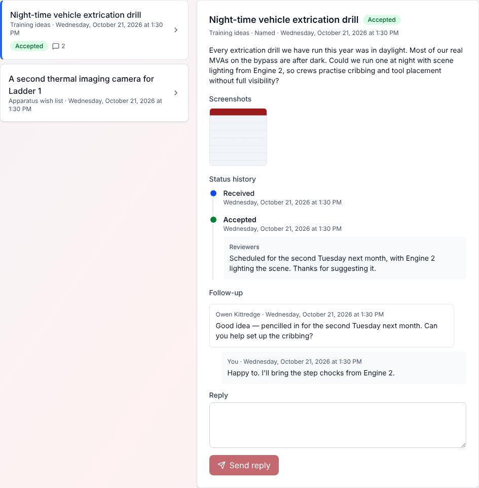

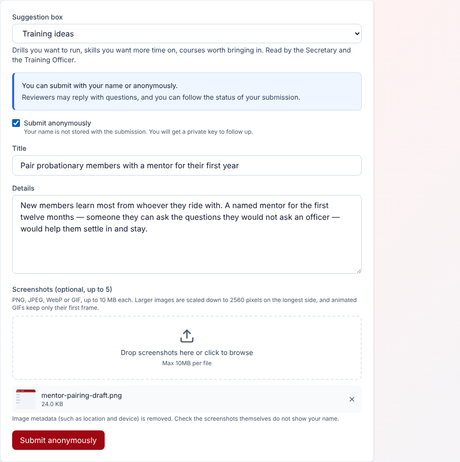

### What "anonymous" means here

It is built into what is saved, not just hidden on screen:

- **No name is saved.** The submission has no author, and nothing in the audit
  log says who sent it. **Reviewers cannot find out, and neither can an
  administrator.**
- **Only the day is kept**, not the time. So "sent at 23:47, when only one
  person was on shift" cannot be worked out.
- **Screenshots are re-saved**, which removes location, device and other
  hidden details, and their file names are thrown away. What is _visible_ in a
  screenshot is not changed — **if your name is on the screen you captured, it
  is in the screenshot.** The form reminds you.

**Following up anonymously uses a key.** In a follow-up box, an anonymous
submission gives you a **follow-up key**, once:

> **Save your follow-up key.** Your submission was sent anonymously. This key is
> the only way to see replies and respond. It is shown once and cannot be
> recovered — nobody, including the reviewers, can look it up for you.

Select **Copy**, keep it somewhere private, then select **I saved it**. Later,
open **Follow up with a key**, paste it and select **Open submission**. You see
the status and replies and can answer — still without your name. **A lost key
cannot be replaced**: the submission stays, but nobody can reconnect you to
it.

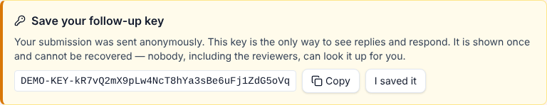

> **What anonymity does not cover.** Someone with access to the **server
> itself** — its stored data and mail records — could match the time a
> submission arrived with who was signed in then. The Logbook does not show
> this to anyone using it, but it is no protection against the people who run
> the server. The Logbook's own web logs leave out sending and following up,
> and a failed submission is not filed under your name. But a separate system
> your department runs in front of The Logbook may log visits unless it is set
> up the same way — ask whoever runs your server. The full list is in
> [Known Limitations](../KNOWN_LIMITATIONS.md). If that matters for your
> report, raise it with leadership another way.

### The idea board

Some boxes have an **Idea board** tab on the Suggestions page. It shows ideas
the box's reviewers chose to share with everyone, written up in their own
words. It never shows the original submission, its screenshots or who sent it.

- Select the arrow on an idea to vote for it; select it again to take your
  vote back.
- Sort by **Top** (most votes) or **New**, and filter by status.
- When reviewers have responded to an idea, their latest response is shown
  with it.

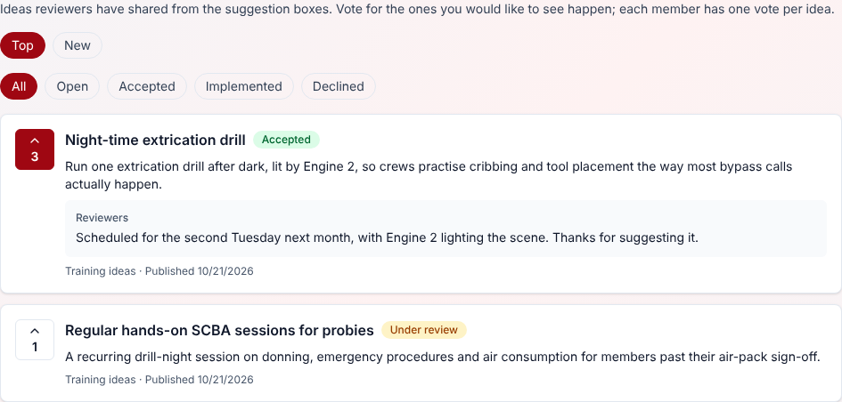

Reviewers of a box with **Public idea board** on see an **Idea board** section
when they open a submission:

- **Publish to the board** asks for a title and summary in your own words.
  Write it without names or anything that identifies the sender.
- **Edit published copy** changes it, and **Take off the board** removes it.
  Its votes are kept if you publish it again.
- While an idea is published, your latest response to the sender shows on the
  board too.

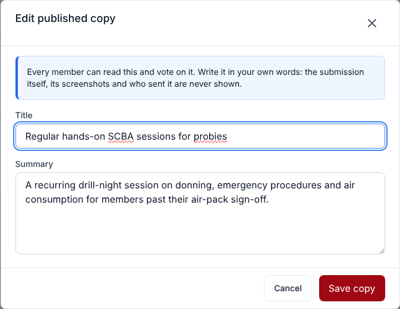

### Reviewing submissions

Reviewers see a **Review** tab on the Suggestions page, with a count of open
items. Filter by **Box** and by **Status**. The default, **Open**, means New
or Under review.

Open a submission to:

- set its **Disposition**: **New**, **Under review**, **Accepted**,
  **Implemented**, **Declined** or **Duplicate**. In a follow-up box, a named
  sender is told when it changes (by email too, unless they turned
  suggestion-box emails off);
- write a **Response to the submitter**, in a follow-up box. It appears on the
  sender's **Status history** under "Reviewers", never with your name, and they
  are told you responded. Each response is a new step;
- keep an **Internal note (reviewers only)**, never shown to the sender;
- reply in the **Follow-up** thread, if the box allows it. An anonymous sender
  appears as **Anonymous submitter**.

**Notices to reviewers.** Reviewers get an in-app notification (and a push
notification, where your department has them on) and an email when a
submission or a sender's reply arrives. **Neither includes the submission's
content, only a link.** Members can turn the email off — **Suggestion box**
under Settings → Notifications — unless the department has made it required.
The in-app notice always arrives. A department can turn the new-submission
notices off with a **Suggestion Submitted** rule under **Notifications →
Notification Rules**; replies and status changes still go out.

**Telling someone about new submissions without letting them read them.**
**Also notify** in a box's settings names positions or members who are told
when something arrives. They cannot open it: their notice says which box
received a submission and that its reviewers have it, nothing more. Use it for
someone who needs to know a box is being used — such as a chief who wants to
know the Compliance box has something in it — without making them a reviewer.
The reviewers' email can be edited under **Communications → Email Templates →
Suggestion Boxes → Suggestion Submitted**.

**Forwarding one suggestion.** A box's reviewer can select **Forward** and
choose members or positions.

- They can read **that suggestion only** — its screenshots and thread — set
  its disposition, keep the note and reply. They see nothing else in the box
  and cannot forward it on.
- They are emailed a link and see a **Forwarded to you** badge.
- Reviewers see who it was forwarded to and can **Withdraw** a forward.
- An anonymous sender stays anonymous when forwarded.
- Forwards and withdrawals are recorded in the audit log.

![Suggestions → Review with an anonymous submission open: the list on the left, and on the right the Disposition set to Under review, the Response to the submitter and internal note fields, the Status history from Received to Under review, the Idea board section with its published copy and the Edit published copy and Take off the board buttons, the Forwarded to list naming the Training Officer position and a member, and the follow-up thread with the reviewer's question and the anonymous submitter's reply](./images/07-17-suggestion-review.png)

The person it was forwarded to finds it on their own **Review** tab, even if
they review no box. Only suggestions forwarded to them appear there, each
marked **Forwarded to you**. Instead of **Forward**, they see a note that only
the box's reviewers can forward it.

**On a phone**, the list and the open submission stack instead of sitting side
by side. Tap a submission and the page scrolls to it; scroll back up for the
list. Two tabs take shorter names — **Mine** for My submissions and **Follow
up** for Follow up with a key — so they usually all fit.

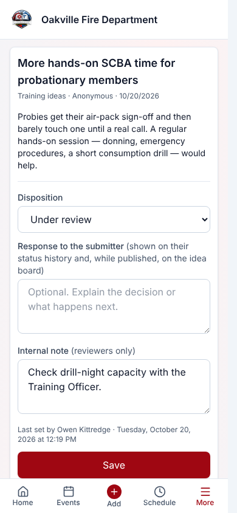

### What if …?

| What happened                                                     | What it means                                                                             |
| ----------------------------------------------------------------- | ----------------------------------------------------------------------------------------- |
| You can set up boxes but are not a reviewer                       | You see no **Review** tab. That is on purpose                                             |
| A reviewer position changes hands                                 | The new holder reviews; the previous one no longer does                                   |
| An anonymous submission was made before follow-up was switched on | It has no key, so its sender cannot read replies. Reviewers are told so on the submission |
| Follow-up is off                                                  | Senders see no status and no replies. Reviewers can still set a disposition and a note    |
| The Communications module is switched off                         | Suggestion boxes still work                                                               |
| More than five screenshots, or a file that is not an image        | Refused, with a message naming the limit                                                  |
| A Compliance box you changed                                      | Keeps your version. Only an unedited Compliance box got the two built-in questions        |

---

## External Integrations

**Where to find it:** **Administration → Forms & Comms → Integrations**. You
need full settings access, and the Integrations module must be on.

External integrations connect The Logbook to other services. They are
different from a form's **Integrations** button, which sends form answers to
another part of The Logbook (see
[Sending answers to other modules](#sending-answers-to-other-modules)).

### Available Integrations

Integrations you can connect today include:

| Integration                                                       | What it does                                          |
| ----------------------------------------------------------------- | ----------------------------------------------------- |
| **iCalendar (ICS)**                                               | A subscribe link to the department's published events |
| **Slack**, **Discord**, **Microsoft Teams**                       | Post the department's notifications to a channel      |
| **Salesforce**, **Documenso**, **Cal.com**, **PayPal** and others | See guide 16                                          |

Integrations marked **Coming Soon** — among them **CSV Import/Export**,
**Google Calendar** and **Microsoft Outlook** — cannot be connected yet. They have no **Connect** button.

The full list, with what each one does, is in
[Integrations → Integration Catalog](./16-integrations.md#integration-catalog).

### Setting Up an Integration

1. Open **Integrations**.
2. Find the integration and select **Connect**.
3. Fill in what it asks for. A messaging integration asks for a **Webhook
   URL** from your Slack, Discord or Teams channel; others ask you to sign in
   to the service or enter its details.
4. Use **Test** on the card to check the connection, and the integration's
   **Details** page to see whether recent messages went through.

> **Important — you cannot choose which notifications post.** A messaging
> integration posts every notification the department sends. There is no
> setting to pick events or triggers.

See [Integrations → Connecting an Integration](./16-integrations.md#connecting-an-integration)
for step-by-step instructions for each service.

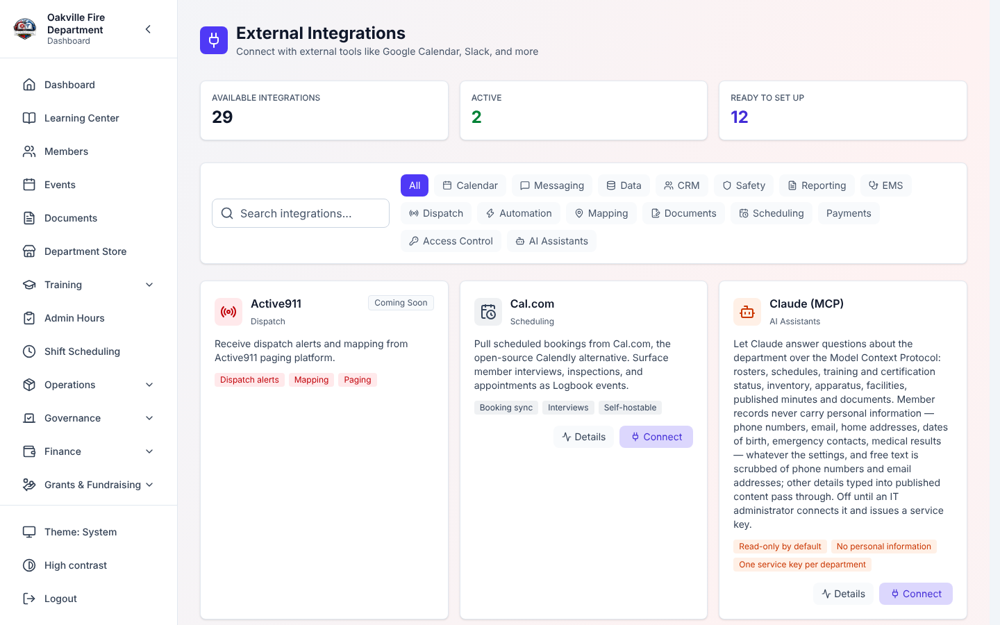

---

## Realistic Example: Building a Vehicle Pre-Trip Inspection Form

This walkthrough builds a form from scratch, publishes it and reviews the
first answers.

### Background

**Safety Officer Capt. Linda Zhao** at **Brookfield Fire Department** wants to
replace the paper pre-trip checklist clipped in each bay. Drivers should fill
it in on a phone or the station tablet.

The paper form has:

- the date and the apparatus;
- the driver's name;
- a list of inspection points (lights, tires, fluids and so on);
- the mileage;
- an overall condition;
- notes on problems;
- the driver's signature.

---

### Step 1: Creating the Form

Capt. Zhao opens **Administration → Forms & Comms → Forms** and selects
**Create Form**.

| Field           | Value                                                                                                           |
| --------------- | --------------------------------------------------------------------------------------------------------------- |
| **Form Name**   | Daily Apparatus Pre-Trip Inspection                                                                             |
| **Category**    | Operations                                                                                                      |
| **Description** | Complete this form before taking any apparatus out of quarters. Report all deficiencies to the on-duty officer. |

She leaves **Public Form** and **One submission per person** unticked for now,
and selects **Create Form**.

---

### Step 2: Adding Fields

She selects **Add Field** for each one. The driver's name does not need a
field: each submission records who sent it.

**Section 1 — Header:**

| #   | Field type         | Label              | Required | Settings                                                                     |
| --- | ------------------ | ------------------ | -------- | ---------------------------------------------------------------------------- |
| 1   | **Section Header** | Inspection Details | —        | —                                                                            |
| 2   | **Date**           | Inspection Date    | Yes      | —                                                                            |
| 3   | **Dropdown**       | Apparatus          | Yes      | Options: Engine 1, Engine 2, Ladder 1, Rescue 1, Squad 3, Chief 1, Utility 1 |

**Section 2 — Exterior:**

| #   | Field type         | Label                      | Required | Settings                                                                                                                                                              |
| --- | ------------------ | -------------------------- | -------- | --------------------------------------------------------------------------------------------------------------------------------------------------------------------- |
| 4   | **Section Header** | Exterior Inspection        | —        | —                                                                                                                                                                     |
| 5   | **Checkboxes**     | Tick each item that passed | No       | Options: Headlights / taillights / turn signals; Emergency lights and siren; Tires — tread, inflation, no damage; Body and compartment doors; Mirrors; Fuel above 3/4 |

**Section 3 — Engine and fluids:**

| #   | Field type         | Label                      | Required | Settings                                                                                                    |
| --- | ------------------ | -------------------------- | -------- | ----------------------------------------------------------------------------------------------------------- |
| 6   | **Section Header** | Engine & Fluids            | —        | —                                                                                                           |
| 7   | **Checkboxes**     | Tick each item that passed | No       | Options: Engine oil; Coolant; Transmission fluid; Power steering fluid; Battery connections clean and tight |
| 8   | **Number**         | Current Mileage            | Yes      | Min Value: 0                                                                                                |

**Section 4 — Equipment and cab:**

| #   | Field type         | Label                      | Required | Settings                                                                                                             |
| --- | ------------------ | -------------------------- | -------- | -------------------------------------------------------------------------------------------------------------------- |
| 9   | **Section Header** | Equipment & Cab            | —        | —                                                                                                                    |
| 10  | **Checkboxes**     | Tick each item that passed | No       | Options: SCBA bottles full and secured; Portable radio charged; First aid kit stocked; Hand tools secured; Cab clean |

**Section 5 — Summary:**

| #   | Field type         | Label                | Required | Settings                                                                                                                                                                |
| --- | ------------------ | -------------------- | -------- | ----------------------------------------------------------------------------------------------------------------------------------------------------------------------- |
| 11  | **Section Header** | Overall Assessment   | —        | —                                                                                                                                                                       |
| 12  | **Radio Buttons**  | Overall Condition    | Yes      | Options: Ready for Service, Minor Issues (note below), Out of Service (notify officer immediately)                                                                      |
| 13  | **Text Area**      | Deficiencies / Notes | Yes      | Help text: "Describe any issues found during inspection. Include location and severity." Conditional Visibility: Overall Condition **Does not equal** Ready for Service |
| 14  | **Signature**      | Driver Signature     | Yes      | —                                                                                                                                                                       |

> **Tip.** The condition on field 13 keeps the form short for routine checks.
> Drivers only see the notes box when something is wrong. Because a hidden
> question is not required, making it required forces a note only when the
> truck is not ready.

---

### Step 3: Publishing and Sharing

1. On the form's card, she selects **Share** and switches on **Public Access**.
   She leaves **Allow submissions without signing in** off, so only signed-in
   members can send it.
2. She selects **Publish Form**.
3. She downloads the **QR Code** as a PNG and tapes a copy in each bay.

---

### Step 4: First Submission

The next morning, **D/O Mike Torres** scans the QR code with the station
tablet, which is signed in to The Logbook. He fills it in for Engine 1:

- ticks every exterior, engine and equipment item;
- mileage: 28,523;
- Overall Condition: **Minor Issues**;
- the notes box appears, and he types: _"Rear passenger-side turn signal bulb
  is out. Replacement bulb needed — have one in station supply. Will replace
  after shift."_;
- signs with his finger;
- selects **Submit**.

A form with no integration sends nobody a notice when it is submitted.
Capt. Zhao checks the
**Responses** list each morning, sees the turn signal note, and tells the
on-duty officer.

---

### Step 5: Reviewing Submissions Over Time

After two weeks, Capt. Zhao opens the **Submissions** tab and picks the
pre-trip form. The **Responses** list shows each inspection with who sent it
and when; she opens the ones marked Minor Issues.

On the **Results** tab, the Overall Condition chart shows how often each truck
reported a problem. She selects **Export CSV** on each page of **Responses**
for the monthly operations report.

> **Tip.** Over time, the data shows patterns. If Engine 2 keeps reporting
> Minor Issues, that points to a maintenance trend worth looking into. Review
> the results by apparatus each quarter to spot chronic problems.

---

## Troubleshooting

| Problem                                                      | What to do                                                                                                                                                                                                              |
| ------------------------------------------------------------ | ----------------------------------------------------------------------------------------------------------------------------------------------------------------------------------------------------------------------- |
| You cannot upload a document                                 | Files must be PDF, Word, Excel, PowerPoint, text, CSV, an image or ZIP, up to 50 MB. You need a role that can manage documents                                                                                          |
| A folder you expect is missing                               | Built-in folders open only to members of that part of The Logbook. A restricted folder opens only to the people chosen for it                                                                                           |
| A form is not accepting submissions                          | Make sure it is published (**Publish Form** on its card). Drafts take no submissions                                                                                                                                    |
| A public form's link does not work                           | Check **Public Access** is on under **Share**, and that the form is published                                                                                                                                           |
| Visitors see **Sign in to submit this form**                 | The form needs a signed-in member, as every new form does. If outsiders should send it, open **Share** and tick **Allow submissions without signing in**. A one-submission-per-person form cannot be opened up this way |
| Members cannot find a form to fill in                        | There is no forms list for members. Turn on **Public Access** and share the link                                                                                                                                        |
| Forms is not in the menu                                     | You need a role that can create, edit and manage forms, and the Forms module must be on                                                                                                                                 |
| A form's answers do not reach another module                 | Open the submission's **Integration Results**. Check the target module is on and the fields are matched, then select **Reprocess**                                                                                      |
| A form cannot be deleted                                     | It is used by a prospective-member pipeline stage. Remove it from the stage first (**Pipeline Settings** → edit the stage), then delete the form                                                                        |
| A pipeline form submission does not move the applicant on    | In **Pipeline Settings**, edit the form stage and tick **Auto-advance when form is submitted**                                                                                                                          |
| A pipeline email does not go out when a form is sent         | The email is sent when the applicant moves to an automated email stage, not when the form is sent. Check the pipeline has that stage after the form stage                                                               |
| "Required field … is missing" on a question nobody could see | Check the question's condition. A condition The Logbook cannot read counts as **showing**, so the question stays required                                                                                               |
| A robot fills in a public form                               | A hidden trap field catches most robots. They get an ordinary thank-you, and nothing is saved                                                                                                                           |
| You are not getting email notifications                      | In **Settings → Notifications**, **Email Notifications** must be on, and the email's own switch too (required emails always arrive). Check your address and spam folder                                                 |
| A Slack, Discord or Teams channel gets no posts              | Check the webhook URL and that the channel exists. Use **Test**, and the integration's **Details** page                                                                                                                 |
| Calendar events do not appear                                | Check the calendar integration is connected. Some calendar apps take up to 24 hours to refresh a feed                                                                                                                   |
| A rule's switch makes no difference                          | It is badged **Not enforced**: no notification reads that trigger. Or another rule for the same trigger is still on                                                                                                     |

---

## If You Learned an Older Version

If you are following older notes or an SOP, these things have moved, been
renamed or work differently.

- **Documents shows folders as cards**, not a folder tree beside a file list.
  You move back up with the breadcrumb.
- **New folders are created where you are.** There is no parent-folder picker;
  the window names the **Location**. You choose who can open the folder as you
  create it.
- **Documents has no Move or Rename**, and the upload box has no drag and drop.
- **The upload's folder default is General Documents.**
- **The Forms page's first tab is Forms**, not My Forms.
- **Forms created before public sign-in could be switched off still require a
  sign-in.** Open **Share** on each one meant for the public and tick **Allow
  submissions without signing in**.
- **Answers to hidden questions are no longer kept.** Submissions saved before
  that may still hold them; your administrator has a one-off clean-up (see the
  [upgrade notes](../UPGRADING.md)). Records other features already built from
  those submissions keep what they copied.
- **Notification rules list four triggers.** Rules made earlier for other
  triggers show **Not enforced**.
- **The dashboard has no Clear All button** and no ✕ on each notification.
  Mark them read on **My Notifications**.
- **"Persistent" is now "Keep in inbox after it is read"** on the message form.
- **Settings → Notifications** replaced the separate Event Reminders and
  Training Reminders switches with one switch per email. Choices made with the
  old switches still count.
- **External integrations:** CSV Export is not available, and there is no step
  to choose which events post to a channel.

---

**Previous:** [Apparatus & Facilities](./06-apparatus-facilities.md) | **Next:** [Administration & Reports](./08-admin-reports.md)
