# Administration, Reports & Settings

This guide is for the officers who run The Logbook for the department: the
first setup, department settings, modules, roles, reports, email, the audit
log and the other administration screens.

## Lesson at a Glance

|                     |                                                                                                      |
| ------------------- | ---------------------------------------------------------------------------------------------------- |
| **Who this is for** | Officers who set up and run The Logbook: the IT Manager, the Chief, and officers given admin screens |
| **What you need**   | A position that opens the screen you need. Most of this guide needs full settings access             |
| **Essential path**  | About 60 minutes for a new administrator                                                             |
| **Full guide**      | About 3 hours                                                                                        |
| **Last verified**   | 2026-10-14                                                                                           |
| **Owner**           | Your department's IT Manager                                                                         |

**New administrators:** read [Department Setup Checklist](#department-setup-checklist),
[Organization Settings](#organization-settings),
[Module Management](#module-management) and
[Role and Permission Management](#role-and-permission-management) first.

**Officers who run reports:** read [Reports](#reports) and the
[annual training example](#realistic-example-generating-the-annual-training-summary-report).

**Whoever looks after email:** read [Email Settings](#email-settings) and
[Email Templates](#email-templates).

**About permissions in this guide.** What you can open depends on the
positions you hold. Where a screen needs a particular permission, this guide
names it the way the **Role Management** screen lists it — for example
**settings.manage** ("Full settings and admin management"). The
[Glossary](./GLOSSARY.md) explains _position_, _rank_ and _module_.

---

## Table of Contents

1. [Department Setup Checklist](#department-setup-checklist)
2. [Organization Settings](#organization-settings)
3. [Module Management](#module-management)
4. [Role and Permission Management](#role-and-permission-management)
5. [Administration Hubs](#administration-hubs)
6. [Reports](#reports)
7. [The Dashboard for Administrators](#the-dashboard-for-administrators)
8. [QR Code Analytics](#qr-code-analytics)
9. [Public Portal Configuration](#public-portal-configuration)
10. [Integrations](#integrations)
11. [Admin Hours](#admin-hours)
12. [Notifications and Department Messages](#notifications-and-department-messages)
13. [Email Settings](#email-settings)
14. [Email Templates](#email-templates)
15. [Audit Log](#audit-log)
16. [Error Monitoring](#error-monitoring)
17. [Privacy, Retention & Data Rights](#privacy-retention--data-rights)
18. [Security and Compliance](#security-and-compliance)
19. [Scheduled Tasks](#scheduled-tasks)
20. [Governance: Legal Documents](#governance-legal-documents)
21. [Governance: Organizational Chart](#governance-organizational-chart)
22. [Testing Checklist Module](#testing-checklist-module)
23. [Compliance Requirements Configuration](#compliance-requirements-configuration)
24. [Medical Screening and Equipment Checks](#medical-screening-and-equipment-checks)
25. [Realistic Example: Generating the Annual Training Summary Report](#realistic-example-generating-the-annual-training-summary-report)
26. [Realistic Example: First-Time Department Setup](#realistic-example-first-time-department-setup)
27. [Troubleshooting](#troubleshooting)
28. [If You Learned an Older Version](#if-you-learned-an-older-version)

---

## Department Setup Checklist

**Who can open it:** officers with **settings.manage**.

Open **Administration > Department Setup**. The page lists the steps that get
a new department running, with a progress bar and a link from each step to the
screen that does it.

Every department sees these steps:

- **Add Department Members**
- **Review Roles & Permissions**
- **Set Up Apparatus & Vehicles**
- **Set Up Stations & Locations**
- **Review Organization Settings**
- **Review Enabled Modules**
- **Get Members Signed In**
- **Upload SOPs & Policies**
- **Schedule Your First Event**
- **Enable Multi-Factor Authentication**

More steps appear for the modules you have turned on — for example **Create
Shift Templates**, **Set Up Training Courses & Requirements**, **Add Training
Requirements**, **Set Up Inventory Categories**, **Create Custom Forms**,
**Configure & Verify Email Delivery**, **Configure Prospective Members
Pipeline** and **Set Up Integrations**.

Most steps tick themselves once the work is done (for example, once members
exist). The two "Review" steps for organization settings and modules have a
**Mark as reviewed** button instead; select it again (**Mark as not reviewed**)
to reopen the step. When every step is done the page reads **All done** —
"Every step is complete. Come back here any time to review your setup."

The shift-templates step opens **Scheduling Admin → Planning → Templates**,
and the email step opens **Settings → Email**.

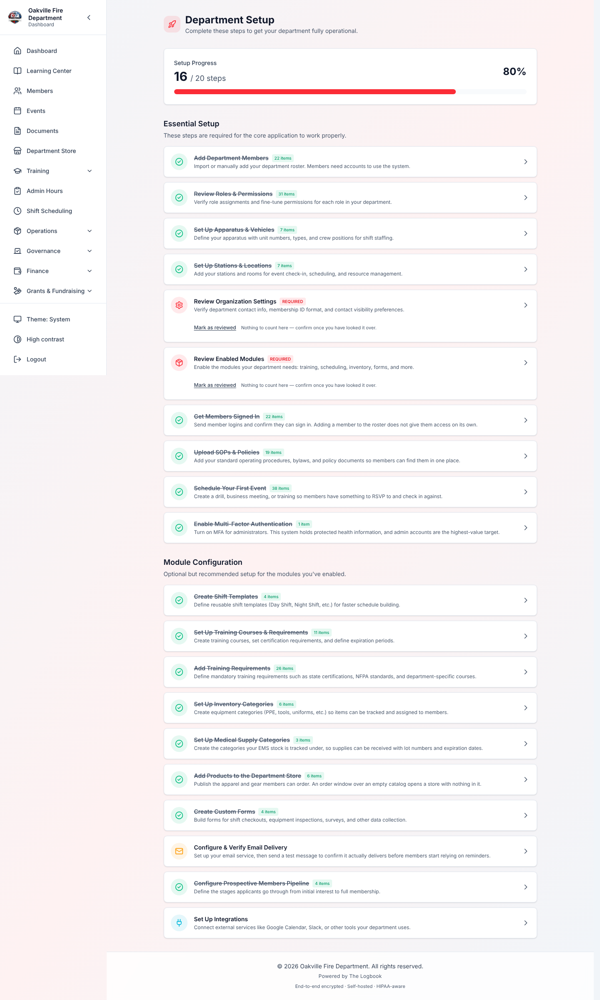

> **Tip.** The checklist stays available after setup. Use it to check that
> nothing was missed.

### What the department type decides

The department type you choose during setup decides which ranks and positions
are created:

- Every type gets the same officer ladder and administrative positions.
- A fire department or a combined fire and EMS department also gets
  Firefighter, Engineer and EMT.
- An EMS-only department gets no Firefighter rank or position. It gets EMT, and
  the Engineer rung is labelled **Driver / Operator**.

The EMT rank and position carry the same everyday member permissions as
Firefighter, so an EMT-only member can use the app on day one.

### The installation wizard

Before anyone can sign in, the one-time **installation wizard** creates the
department, its first administrator (the System Owner), and optionally its
stations, apparatus and IT contacts. The Department Setup Checklist comes
after it.

The wizard opens on **Setup Prerequisites**. It collects nothing. It lists what
setup will ask for, split into what is required and what can be skipped — such
as email server details, a sign-in provider's secret and a file-storage key —
so you can gather them first.

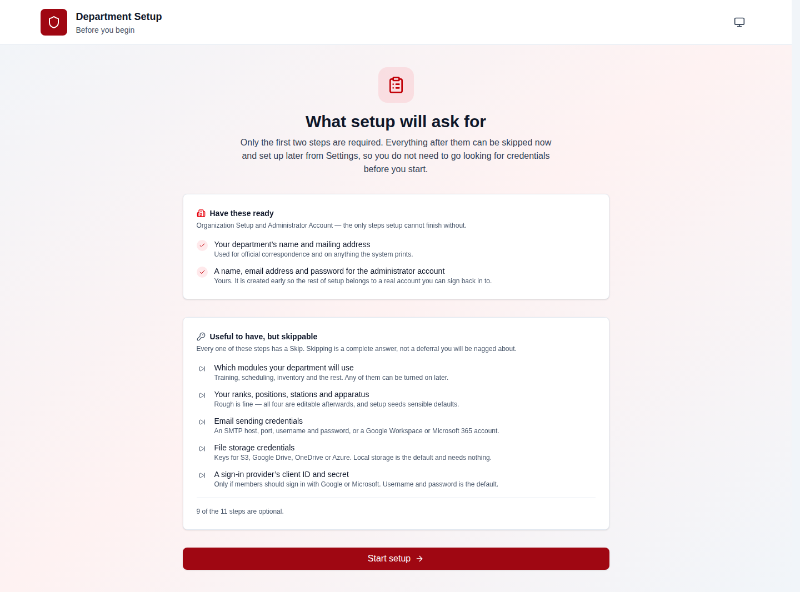

Eleven steps follow. **Only the first two are required.** The progress strip
marks the optional ones from the start.

| #   | Step                  | Required?    |
| --- | --------------------- | ------------ |
| 1   | Organization Setup    | **Required** |
| 2   | Administrator Account | **Required** |
| 3   | Modules               | Optional     |
| 4   | Ranks & Positions     | Optional     |
| 5   | Stations              | Optional     |
| 6   | Apparatus             | Optional     |
| 7   | IT & Backup Contacts  | Optional     |
| 8   | Email                 | Optional     |
| 9   | File Storage          | Optional     |
| 10  | Sign-In Method        | Optional     |
| 11  | Navigation Layout     | Optional     |

The order is deliberate:

1. **Who you are** comes second, so everything after it belongs to a real,
   signed-in account.
2. **What the department uses** comes next — modules, ranks, stations,
   apparatus.
3. **Outside services** come last — email, file storage, sign-in. These are the
   steps that send you off to find passwords, and every one can be skipped.

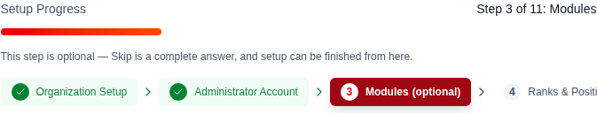

#### Three settings worth answering during setup

**How you number members (step 1).** Automatic numbering only numbers members
created **after** it is switched on. The wizard creates your administrator in
step 2 and your IT team in step 7. If you switch numbering on later, those
first accounts have no number, and a roster import starts at the number they
should have had.

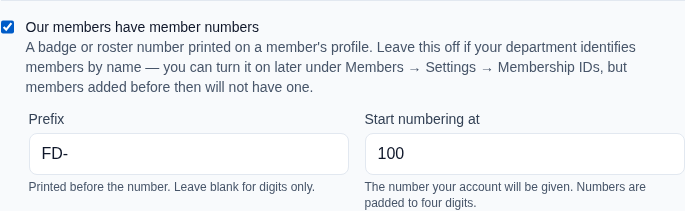

**Your rank ladder (step 4).** Rename ranks to your own words, reorder them,
remove ranks you do not have, add your own, and set which shift seats each rank
can fill — including a seat your department invented.

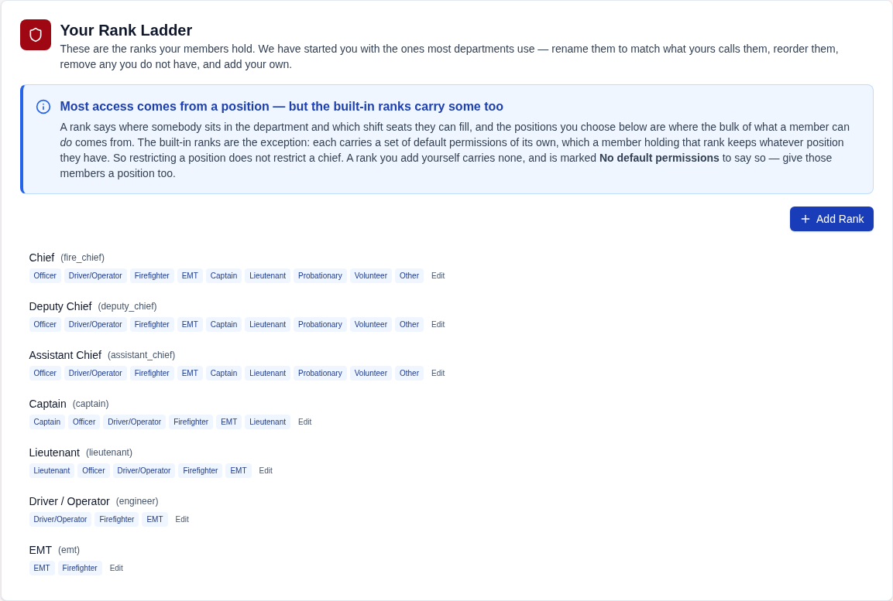

**Your membership tier ladder (step 4).** This is the same editor as **Members
Administration → Settings → Membership Tiers**.

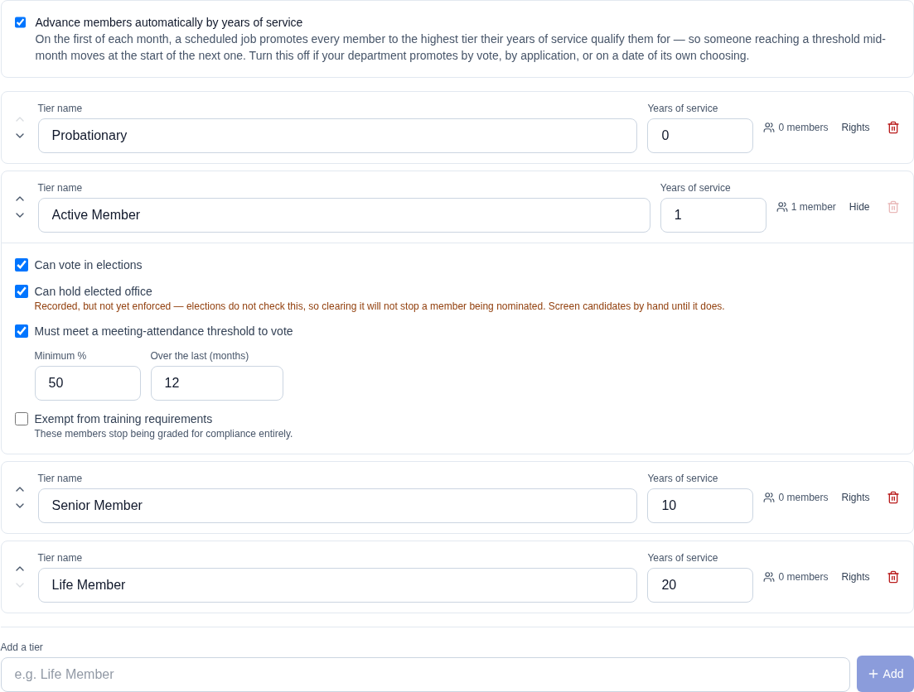

Step 4's position permissions **show rows only for the modules you turned on in
step 3**. That is why Modules comes first. **Show all modules** shows the rest.
Every box grants a real permission, and unticking one on a built-in position
removes it.

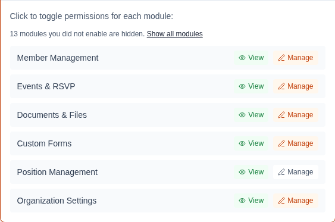

> **What step 4 will not save.**
>
> - A built-in position keeps the rank order the system gives it.
> - A custom position you add is always ranked below the IT Manager (the
>   System Owner's position).
> - A custom position cannot use the name of a built-in one — "Fire Chief" when
>   Chief exists, or "Member" — because it would take that position over. Tick
>   the built-in position instead, or choose a different name.
>
> A refused save names the position, and nothing from that save is stored.

**Testing an email server (step 8).** When you test **SMTP (any provider)** and
no mail server answers — a wrong address, a closed port, a server that does not
exist, or something that is not a mail server — the wizard gives one message:
_Could not reach an SMTP server with these settings_, with the port and
encryption to check. It does not say which it was, because during setup the
test could be pointed at any address on your network. The exact cause is in the
server's log. Once a mail server answers, a wrong password or an encryption
mismatch is reported in detail. After setup, **Settings → Email → Test
Connection** gives detailed messages.


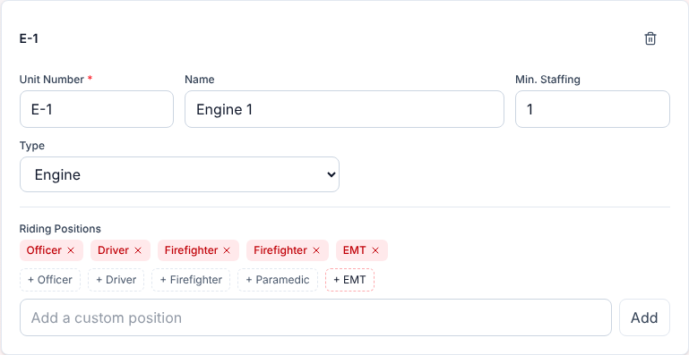

#### Run the wizard in one tab

The wizard works in the browser tab that started it. Your typed answers are
saved as you go, so if you leave, the form comes back filled in.

| What you do                                            | What happens                                                                                                   |
| ------------------------------------------------------ | -------------------------------------------------------------------------------------------------------------- |
| Finish the wizard in one tab without closing it        | The normal path                                                                                                |
| Open the wizard in a **second tab** to check something | That tab starts its own session, and the step you were on in the first tab will refuse to save                 |
| **Close the browser** partway through and come back    | You can carry on. Once the administrator account exists, **only that account may carry on**                    |
| Leave it for **more than 30 minutes**                  | You can carry on. Reopening the wizard starts a fresh session with your saved answers                          |
| Keep setup open for **more than 24 hours**             | You can carry on. A session ends 24 hours after it began, however active it is. Refresh the page to pick it up |
| See "Onboarding has already been completed"            | Your session has not expired. A department already exists: sign in instead of starting setup                   |
| See "you are not the System Owner"                     | Setup got as far as creating the administrator account. Sign in as that account and carry on                   |

> **Why only the administrator may carry on.** Before step 2 creates the
> administrator account, anyone who reaches the wizard can carry on — there is
> no account yet to sign in with. After step 2, only that System Owner can, so a
> half-finished install cannot be taken over by whoever finds it. If accounts
> exist but none of them is the System Owner, setup refuses to continue rather
> than promoting someone at random.

Practically: gather the department's address, station list, apparatus list
and the first administrator's details _before_ you begin. One sitting is
calmer, and the Setup Prerequisites screen lists what to have ready. But
stepping away to find an email password does not cost you the install.

---

## Organization Settings

**Who can open it:** officers with **settings.manage**.

Open **Administration > Organization Settings > Organization**. These are
department-wide settings.

> **Note.** These are not your own account settings. Each member manages their
> own profile, password and preferences at **My Account**.

The screen has these sections: **General** (Profile, Contact, Addresses),
**Modules**, **Email**, **Department Email**, **Storage**, **Label Printers**
and **Authentication** (Sign-in, MFA Policy). MFA Policy also holds the
**Allow passkeys** switch _(2026-10-26)_; see
[Using a passkey](./00-getting-started.md#using-a-passkey-for-two-step-sign-in-2026-10-26).

> **MFA Policy is a floor, not the whole rule.** Members holding administration
> or health-record permissions must use two-step sign-in even when the policy is
> off for everyone else, with a 14-day grace period that starts the first time
> the server sees them without it (`MFA_GRACE_DAYS`). Before upgrading, make sure
> the IT manager has saved their recovery codes. Sensitive actions (log exports,
> role and position changes, security and integration settings, administrator
> resets, deleting a member) also ask for a fresh second-step check (an
> authenticator code or a passkey), valid 10 minutes (`STEPUP_WINDOW_MINUTES`).
> Anything calling those endpoints directly must `POST /auth/step-up` first or
> receives `403 LB-AUTH-013`. Details:
> [`UPGRADING.md`](../UPGRADING.md) and the Security-Authentication wiki page.

### How settings screens are laid out

Every settings screen — Organization, Events, Scheduling, Elections, My
Account, Email Templates and the others — works the same way:

- A **list of sections** down the side on a computer, and a **strip of tabs**
  you scroll sideways on a phone.
- The section you are in is part of the page address, so a link opens on the
  right section.
- **Save** and **Reset** appear only on sections they actually save.

### General Settings

The **Profile**, **Contact** and **Addresses** sections hold:

- **Department Name** and **Slug** (the short name used in links)
- **Department Type** and **Identifiers** (FDID, State ID)
- **Timezone** — the department's clock. See
  [The department's timezone is the clock](#the-departments-timezone-is-the-clock).
- **Contact information** (phone, fax, email, website)
- **Mailing and physical addresses**, with a **Same as mailing address** option
- **Logo** — upload one, or **Remove logo** (shown only while a logo is set)
- **Navigation Layout** (under **Profile**) — **Left sidebar**, the default, or
  **Top bar**

**Navigation Layout** applies to every member from their next page load.
Nobody chooses their own. The top bar holds one entry per menu group, so the
more modules a department has on, the wider the screen needs to be. Groups that
do not fit on a member's screen move under **More** at the right.

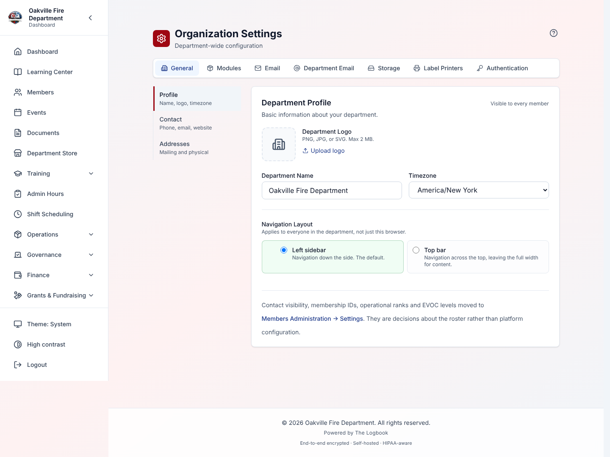

**Profile fields save as you type, and stop at their limit.** Each name,
contact and address field stops accepting characters at the longest value the
department record can hold. Two values are kept as an **unsaved draft with a
message** instead of being saved:

- an empty department name;
- a badly formed email address. That address prints in every email footer, so
  a typo would go out on every notice.

A blank email address is allowed; it clears the field. The **Footers** tab on
Email Templates uses the same limits for its department contact card.

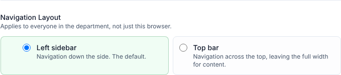

### The department's timezone is the clock

**Check one setting: Settings → Organization → Profile → Timezone.**

The department's timezone decides much more than how a page looks. The Logbook
uses it for:

| Area                          | What uses the department's date and time                                                                                                                                                                                                                                                                                                                                                                                               |
| ----------------------------- | -------------------------------------------------------------------------------------------------------------------------------------------------------------------------------------------------------------------------------------------------------------------------------------------------------------------------------------------------------------------------------------------------------------------------------------- |
| **Emails**                    | Every time printed in an email (event requests, inventory and property-return notices, the membership pipeline, store windows, training reminders) and date-only fields such as a due date. An email has no browser to convert the time for the reader, so this is the only conversion it gets                                                                                                                                         |
| **PDFs**                      | Equipment check PDFs print local dates and times. The impact-plan PDF's "generated" stamp names its timezone                                                                                                                                                                                                                                                                                                                           |
| **Spreadsheet (CSV) exports** | Admin hours (Date, Clock In, Clock Out), the Finance QuickBooks export's Date, the equipment-check compliance and failure exports, the store orders export and the inventory last-seen export (labelled with the timezone). The skills-testing export stays in UTC on purpose, for its auditors                                                                                                                                        |
| **"Today"**                   | Certification and retirement alerts, expiring-supplies emails, the whole training compliance engine (matrix, dashboard percentage, member status, My Training), program deadlines and recertification, qualifications and driver certification for shift sign-up, equipment checks and stock expiry, apparatus and facility maintenance due dates, scheduling, medical screening, grants, meetings, documents, forms and the dashboard |
| **Dates cut from a time**     | A training record created from an evening event, monthly event counts, report dates, cohort end dates, donor first and last donation dates, and a member's last day of service all fall on the department's day                                                                                                                                                                                                                        |

**If no timezone is set** (or it is invalid), The Logbook uses
**America/New_York** — the default scheduling has always used, so no shift
times move. **Reports are the exception:** with no timezone set, a report's date
range is read in UTC.

> **What if an old training record shows the next day's date?** Training
> records created from an evening session before the department clock was used
> everywhere may be filed under the next day. They were deliberately left as
> they are, because changing them would change past compliance results. The
> Logbook still matches them to their event, so nothing is duplicated. An
> officer can correct a single record's date where it matters.

The year in order and request numbers (for example "ORD-2026-…") still follows
UTC, so it can differ on the evening of December 31. See
[Known Limitations](../KNOWN_LIMITATIONS.md#today-is-the-departments-date--what-still-reads-utc-2026-09-26).

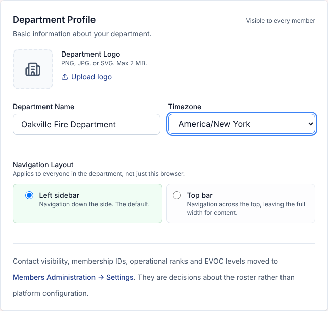

### Contact Info Visibility

This setting lives with the roster, at **Members > Administration > Settings >
Contact Visibility**.

**Who can change it:** officers with **settings.manage**,
**settings.manage_contact_visibility** ("Manage contact info visibility") or
**organization.update_settings** ("Update organization settings"). Managing
members alone is not enough. An officer who runs the roster but holds none of
these can see the setting and is told who can change it.

The setting controls which contact fields members can see:

- Turn **email**, **phone** and **mobile** on or off.
- Members see only the fields you turn on, on every screen that shows a member
  — the roster and the profile page alike.
- Officers who manage members always see every field, whatever this setting
  says. Members always see their own record in full.

Some fields have no switch:

| Field                                 | Who can see it                                                                                                     |
| ------------------------------------- | ------------------------------------------------------------------------------------------------------------------ |
| Home address, personal email          | Officers who manage members only — never ordinary members                                                          |
| **Date of birth, emergency contacts** | Officers who manage members, and the member themselves. There is deliberately no setting that shows them to others |

Emergency contacts are hidden because they name people outside the department —
a member's spouse or parent, with their phone number — who never agreed to
appear in it. When leadership opens those fields, it is recorded in the audit
log.

### Membership ID Settings

This lives at **Members > Administration > Settings > Membership IDs**.

**Who can change it:** officers with **settings.edit** ("Edit settings") or
**organization.update_settings** ("Update organization settings").

Here you:

- turn automatic membership numbers on or off;
- set the number format (a prefix and a number pattern);
- see and manage the next number to be given out.


### The rest of Members Administration → Settings

Contact Visibility and Membership IDs are two of **five** sections on one
screen at **Members → Administration → Settings**. The other three:

| Section               | What it sets                                              | Who can save it                                         |
| --------------------- | --------------------------------------------------------- | ------------------------------------------------------- |
| **Operational Ranks** | The rank ladder, and which shift seats each rank may fill | Officers with **settings.manage** or who manage members |
| **Membership Tiers**  | The membership ladder, and what each tier gives           | Officers who manage members                             |
| **EVOC Levels**       | The driver certification ladder                           | Officers with **apparatus.manage** (apparatus managers) |

Each section has its own page address, so you can send an officer straight to
the one they need.


> **Important.** Opening the screen needs permission to manage members, but
> that does not save every section. Contact Visibility and Membership IDs need
> a settings permission. **EVOC Levels** needs permission to manage apparatus,
> because those levels belong to the Apparatus module. An officer who can only
> manage members can open all five sections and save **two**: Operational Ranks
> and Membership Tiers.

**Operational Ranks** is the ladder itself. Rename a rank to your own words,
reorder it, remove ranks you do not have, add your own, and set which shift
seats each rank may fill — including a seat your department invented.

Renaming a custom rank's **code** moves every place that stored the old one:
members, org-chart seats, a training requirement's required ranks and inventory
impact-plan rank filters, in one step, with an audit entry naming both codes.
Historical records (rank at completion, audit data) keep what was recorded. A
**built-in** rank (Chief, Captain, Firefighter and the rest of the seeded
ladder) keeps its code, because its default permissions are tied to it: the
code field is read-only, and you rename it by changing its display name.

> A rank says where someone sits and which seats they can fill. What they can
> **do** comes from their position. A rank you add yourself is marked **No
> default permissions** for that reason: those members need a position too.

**The rank list is the department's vocabulary.** Once your department has any
ranks, only those ranks can be given to members — through the member form, a
spreadsheet import or converting an applicant. A built-in rank such as
"firefighter" that you deleted during setup is refused. Members who already
hold such a rank keep it, but to give it to someone new, add it back in this
editor first.

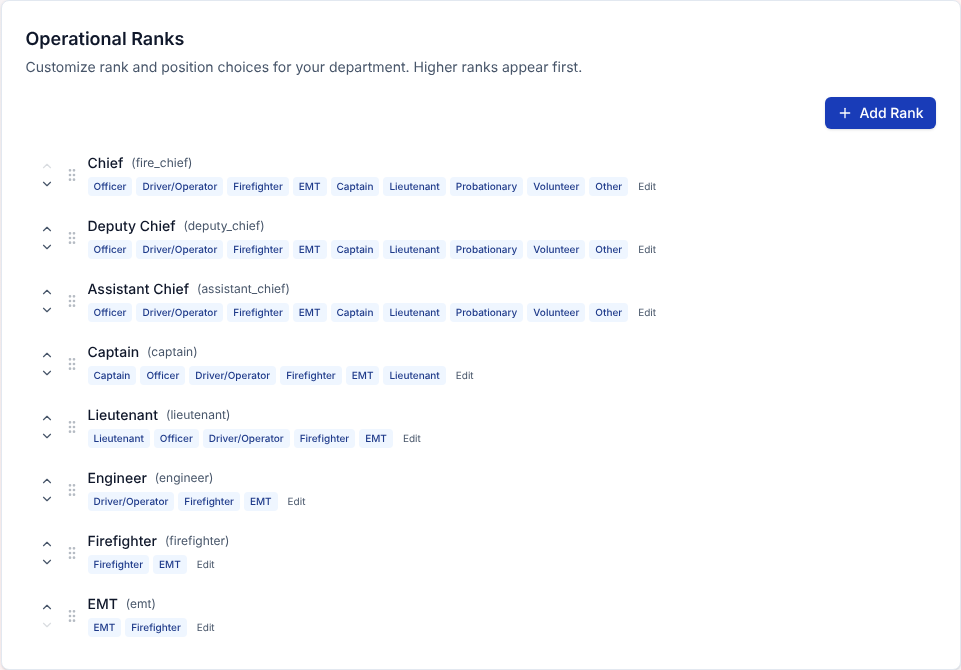

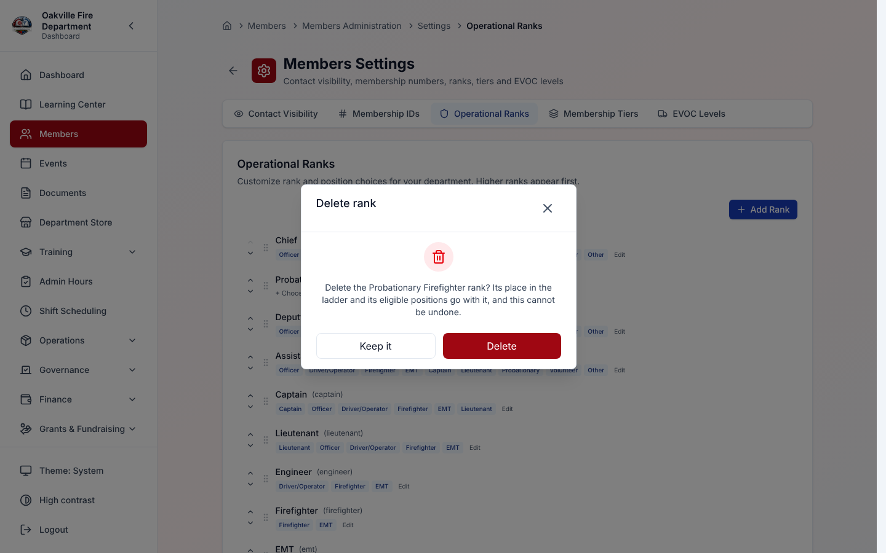

**Membership Tiers** is the progression ladder — the stages a member moves
through and what each one gives:

- whether they can vote;
- whether they may hold elected office;
- whether a meeting-attendance threshold applies before they may vote;
- whether they are excused from training.

Automatic advancement is **on by default**, and a monthly job acts on it. Turn
it off if your department promotes by vote, by application, or on its own
date.

> **Important: check this against your bylaws.** Membership tiers decide who
> can vote in elections. A department that leaves the built-in arrangement in
> place usually finds this out at its first election.

It is the same editor the setup wizard shows at step 4, so a department that
set its ladder during setup sees its own answers here.

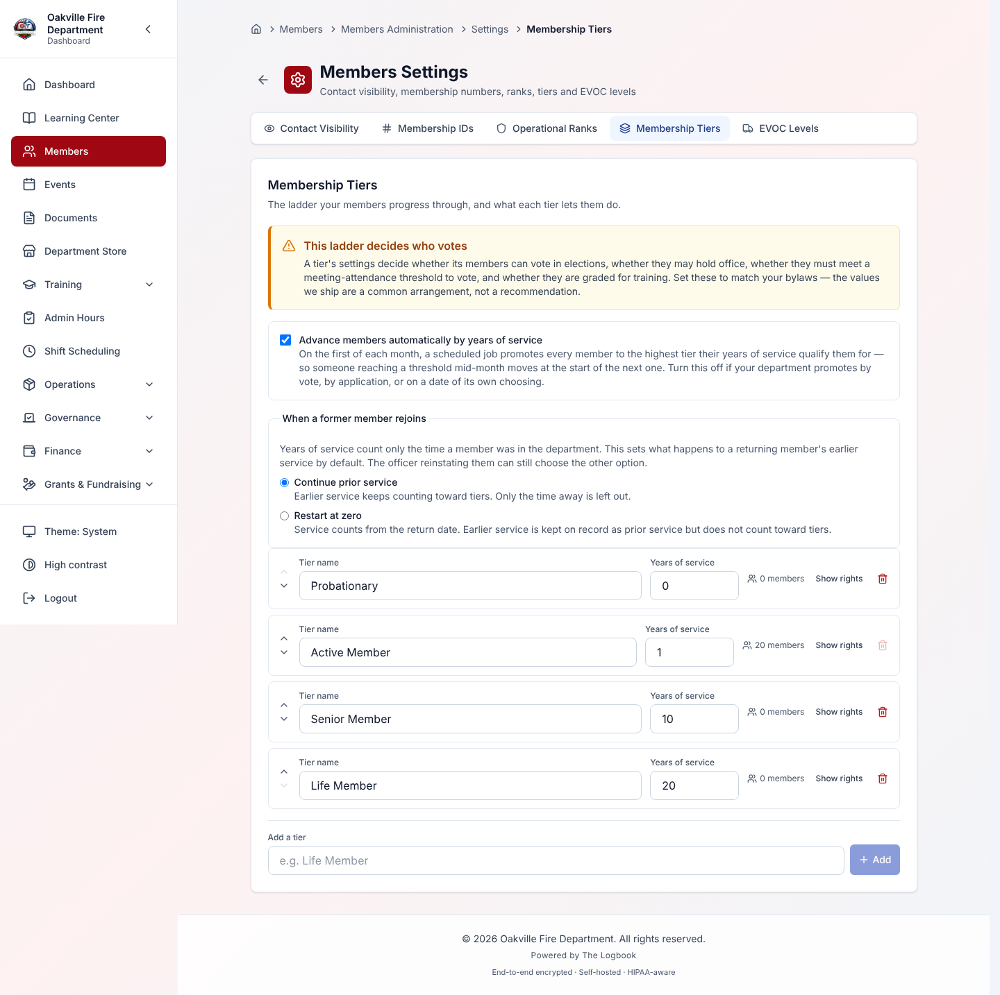

---

### Label Printers

**Settings → Label Printers** registers the department's network barcode label
printers. Once one is registered, every label page in the app — inventory,
apparatus, facilities, members, applicants — gains a **Send to Printer**
button. It prints without a print dialog, so nothing can resize a barcode and
stop it scanning.

Two kinds of printer are supported:

- **ZPL** printers: Zebra, and the many other brands with a Zebra emulation
  mode (TSC, Godex, Honeywell, Citizen, SATO). Turn emulation on at the printer
  and they work with no other change.
- **ESC/POS** printers: receipt-style printers such as the Epson TM and Star
  units often found at watch desks. Loaded with linerless label roll, they print
  asset tags well.

Each printer records its network address, resolution, and the label stock
loaded in it.

- **Test connection** checks an address before you save it. The printer is
  asked to identify itself, and its resolution fills in.
- **Check status** asks a saved printer whether it can print now, and reports
  problems such as out of labels or the printhead open. This check also runs
  after every direct print, so a job sent to an empty printer says so instead
  of reporting success.

Printers are shared by the whole department. The _label size_ and _barcode
style_ each person prefers are saved per position.

Full walkthrough: [Direct printing to a network label
printer](./05-inventory.md#direct-printing-to-a-network-label-printer).

---

## Module Management

**Who can change modules:** officers with **settings.manage**.

Open **Administration > Organization Settings > Organization** and choose
**Modules**. Modules are in two groups, each with its own page. Every row has
an **Enable** or **Disable** button and an **Enabled** / **Disabled** label.

**Core modules are always on and are not listed:** Members, Events and
Documents. The Standard Modules page says so: "Members, Events and Documents
are core and always active."

### Standard Modules (on by default)

These are on for every new department. Turn off any you do not use.

- Training & Certification
- Inventory Management
- Scheduling
- Apparatus Management
- Meeting Minutes
- Reports & Analytics
- Email Notifications
- Custom Forms
- External Integrations
- Facilities Management
- Prospective Members
- Public Information

### Additional Modules (off by default)

Turn these on when your department needs them:

- Communications
- Elections & Voting
- Mobile App Access
- Incidents & Reports
- HR & Payroll
- Grants & Fundraising
- Department Store
- Finance
- Medical Screening
- Medical Supplies
- Testing Checklist

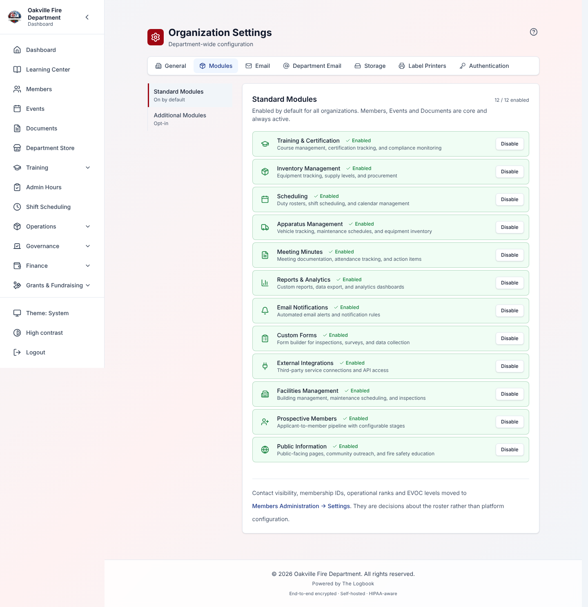

> **Tip.** Turning a module off hides it from the menus and stops its pages
> from opening. It does not delete any data. Turn it back on and everything
> entered before is there again.

---

## Role and Permission Management

**Who can open it:** officers with **positions.manage_permissions** ("Manage
position permissions").

Open **Administration > Organization Settings > Role Management** — "Create
custom roles and choose what each role can do".

### Understanding Roles

The Logbook gives access through **positions** (the screen calls them roles):

- A member can hold **several positions** (for example, Treasurer and Safety
  Officer).
- Each position grants a set of **permissions**.
- The **IT Manager** position has full access to everything.
- Every member holds the **Member** position, which carries the everyday access
  they need.

A member's **rank** (Captain, Firefighter …) says where they sit and which
shift seats they can fill. Some ranks come with matching positions, but
permissions always come from positions.

### Default Positions

Setup creates 31 built-in positions (fewer for an EMS-only department; see
[What the department type decides](#what-the-department-type-decides)). You can
edit them, and add your own. The full list, with each position's description
and permissions, is on the **Role Management** screen.

| Group                    | Positions                                                                                                                                                                                                                                                                                                           |
| ------------------------ | ------------------------------------------------------------------------------------------------------------------------------------------------------------------------------------------------------------------------------------------------------------------------------------------------------------------- |
| **Operational ladder**   | Chief, Deputy Chief, Assistant Chief, Captain, Lieutenant, Engineer / Driver Operator, Firefighter, EMT                                                                                                                                                                                                             |
| **System**               | IT Manager (the System Owner, with full access), Member (held by everyone)                                                                                                                                                                                                                                          |
| **Leadership and board** | President, Vice President, Treasurer, Secretary, Assistant Secretary, Board of Directors                                                                                                                                                                                                                            |
| **Officer roles**        | Quartermaster, EMS Supply Officer, Apparatus Officer, Facilities Manager, Safety Officer, Compliance Officer, Training Officer, Scheduling Officer, Membership Coordinator, Assistant Membership Coordinator, Communications Officer / PIO, Public Outreach, Fundraising Chair, Historian, Meeting Hall Coordinator |

### Managing Permissions

1. Select a position to see its permissions. Each permission shows its name
   (for example **members.view**) with a short description under it.
2. Tick or untick permissions.
3. Save. If the save is refused, the reason appears inside the dialog.

> **Two safeguards stop a department locking itself out.**
>
> - **You can only edit a position at or below your own access.** If a position
>   holds a permission you do not have — for example, only the IT Manager has
>   full access — you cannot edit its permissions. This stops another
>   administrator weakening or emptying the System Owner's position. Ask the IT
>   Manager, or anyone whose own access covers that position.
> - **You cannot remove the last administrator.** A change that would leave no
>   active member able to manage members is refused. Give another position
>   permission to manage members first, then try again.

> **Position names must be different.** A new or renamed position cannot use a
> name another position already has. Capital letters and spaces at either end
> do not make a name different. If two positions already share a name, they
> are marked **Same name as another position**, with the internal name shown
> underneath. Rename one of them.

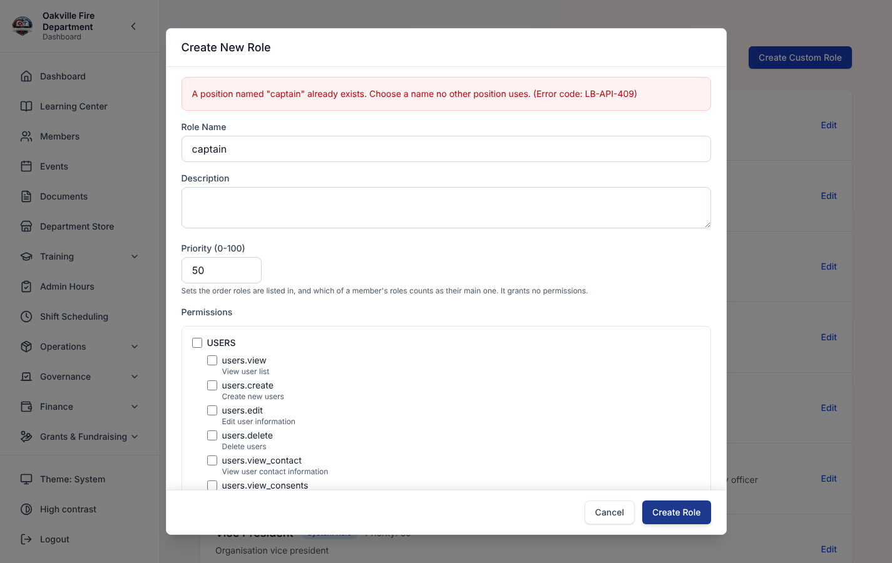

> **Changing the Member position asks first.** Every member holds the
> **Member** position, so adding or removing one of its permissions changes what
> the whole department can do at once. Saving such a change opens a
> confirmation that names the permissions being added or removed and how many
> members hold the position (**Apply to 42 members** / **Keep editing**).
> Renaming it or changing its description does not ask.

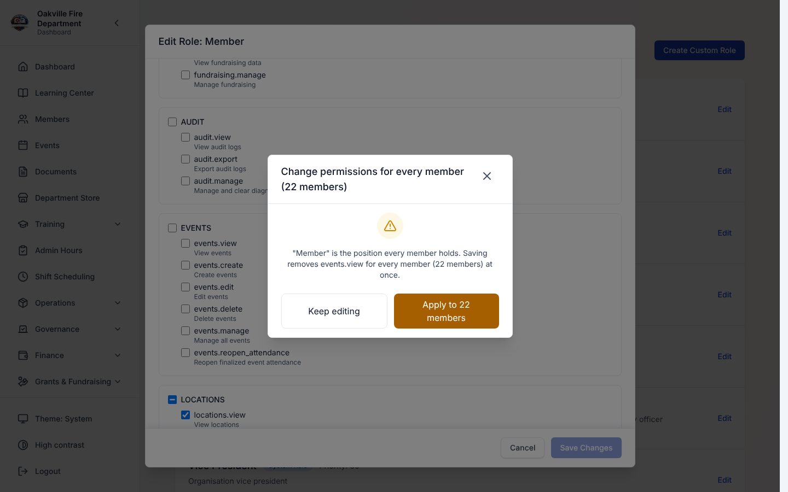

> **Positions with "all of a module" access.** A position can hold access to
> everything (the IT Manager), or everything in one module — the kind of grant
> the setup wizard's **Manage** checkbox gives. These positions save normally.
> If a save is refused, the message names up to five of the permissions it
> objected to. You still cannot give out, or edit a position holding, a
> permission you do not hold yourself.

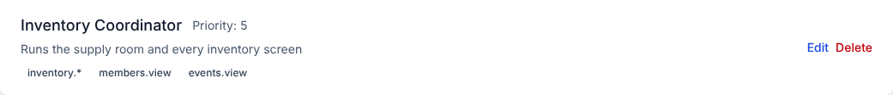

> **A permission means exactly what it says.** Permission to _manage_ something
> does not include permission to _view_ it. A position gets exactly the
> permissions ticked on it; "all of a module" covers everything in that module;
> full access covers everything. Screens a manager needs to read accept the
> manage permission too, but on a position you build yourself, tick both if its
> holder should read and manage.

> **Department-wide shift-report totals** (Scheduling → **Shift Reports**,
> **Department** view) need **training.view_analytics** ("View department-wide
> shift report analytics"). It is given to the Chief, Deputy Chief and
> Assistant Chief ranks and the President and Training Officer positions.
> Captains and lieutenants see only their own reports under **Written by me**.
> Permission to manage training does not show department totals on its own.
> Tick it on any position you build that should.

> **Reports are not for every member.** **reports.view** ("View and generate
> reports") opens department-wide reporting — every member's hours, training
> and roster data — and the Administration section with it. No everyday member
> position has it. If your department wants its members to have Reports, add it
> to the right positions here.

Permissions are grouped by area — members, training, scheduling, events,
elections, inventory, apparatus, facilities, documents, forms, reports,
settings, analytics and others. A position given everything in an area holds
that area's full set.

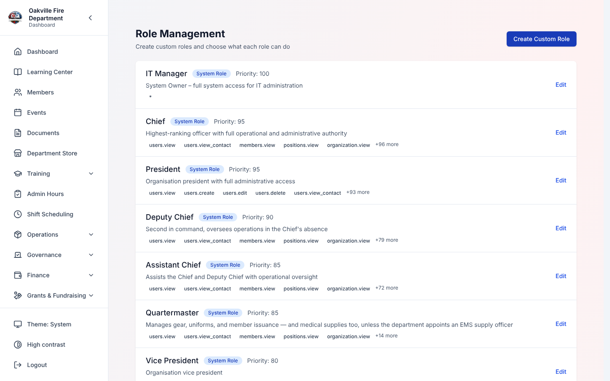

### Assigning Positions to Members

1. Open **Administration > Members > Member Management**.
2. On the member's row, select **Manage Positions**.
3. Tick or untick positions ("Select the positions to assign to this member").
4. Select **Save Changes**.

If a change is refused, the message gives the real reason — for example, that
the position carries more access than you hold.

> **The Member position stays on.** Every current member holds **Member**. Its
> box stays ticked and cannot be removed. It can only be removed from
> an archived member.

> **Ranks are not positions.** The list leaves out Chief, Captain,
> Firefighter and the other ranks; a rank is set from the member's profile
> and carries its own access. A member given one of those positions before
> this version still sees it in the list, marked **Rank**, so it can be
> unticked.

> **What if a member's menus have not changed after you changed their
> positions?** The Logbook applies new permissions at once, but the member's
> screen may still show old buttons and menu items until they reload the page.

---

## Administration Hubs

The **Members**, **Training**, **Events**, **Inventory** and **Scheduling**
administration pages, and the **Department Store** admin page, all open the
same way:

1. A header naming the module.
2. A row of **headline metrics**.
3. A **Needs attention** list — the things someone has to act on.
4. The module's sections, shown as cards, underneath.

### Choosing the metrics

The metrics row shows four numbers. Three are the department's choice. **The
fourth is always the count the Needs attention list is about**, so a page can
never hide the number its own list is measuring.

| Page      | Built-in three                                   |
| --------- | ------------------------------------------------ |
| Members   | Active, Probationary, Inactive                   |
| Training  | Compliance, Hours this quarter, Active programs  |
| Inventory | Items tracked, Issued to members, Out for repair |
| Events    | Upcoming, RSVPs this week, Check-ins logged      |

Scheduling's metrics include **To close out**, **Short-staffed**, **Hours this
month**, **Shifts ahead** and **Requests waiting**. On Inventory and Scheduling
the metrics are set on the **Headline Metrics** tab.

There are two levels of choice: a **department default** everyone sees, and,
if the department allows it, each officer's **personal** choice. Turn personal
choices off and every administrator sees the same numbers. A department that
changes nothing keeps the built-in metrics.

On a phone the metrics row shows the two metrics set for **phone**, and leaves
out the attention count when the list above already shows it.

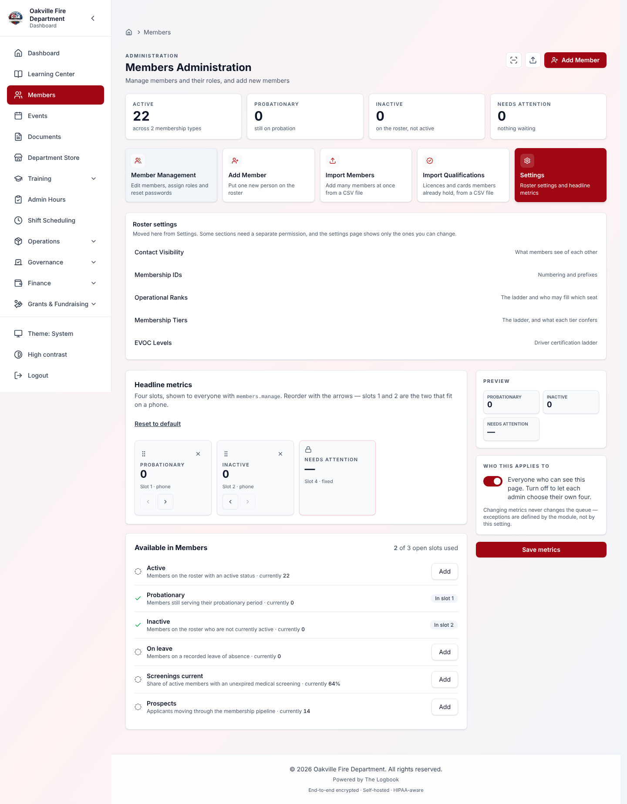

> **What if a metric says "unknown"?** A number that cannot be worked out shows
> as unknown. The rest of the page still works.

### Sections are cards

Each section is a card that says what it holds (for example "Payments that need
matching by hand"), not just a name. A card with a red count uses the same
numbers as the **Needs attention** list, so the two never disagree. Training's
many pages are grouped into seven areas: Overview, Records, Curriculum,
Evaluations, Program Management, Compliance Reporting, and Settings & Data.

On a phone the cards become one row of chips that scrolls sideways, with the
chosen section's description under it. A fade and a round arrow on an edge mean
there is more that way; tap the arrow to move along.

Pages that appear only as a tab inside a hub do not repeat a back link, a second
large title or (on Members) a second **Add Member** button. Screen readers still
land on each tab's heading.

**Search finds hub sections.** Open the command palette and type: every
Training, Events, Members and Store section you are allowed to see is offered.

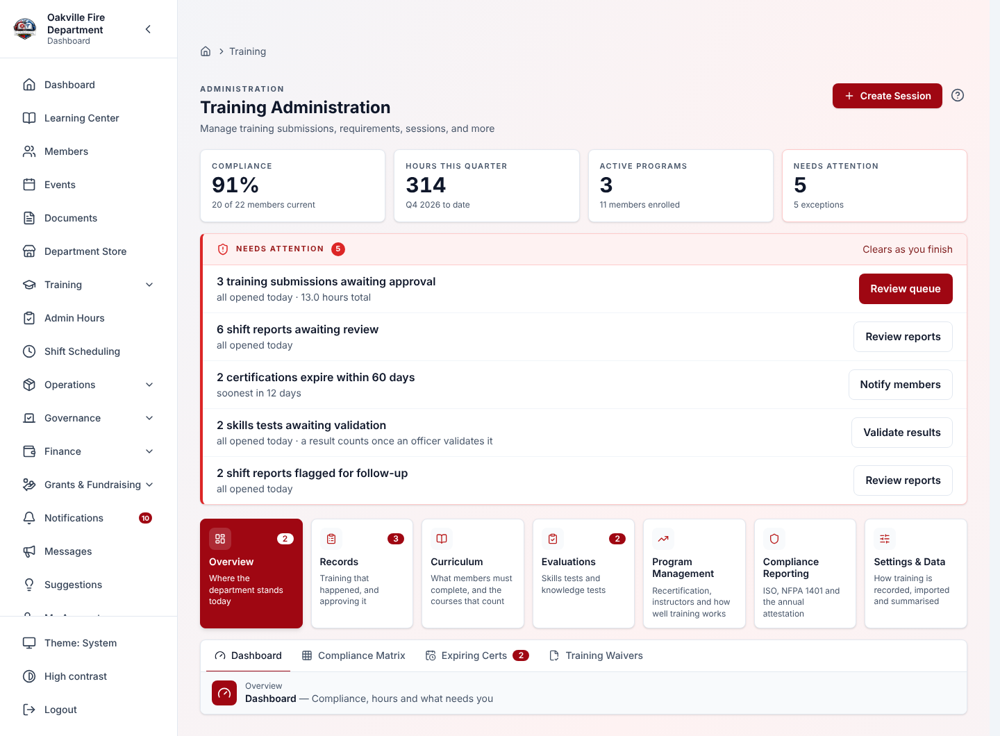

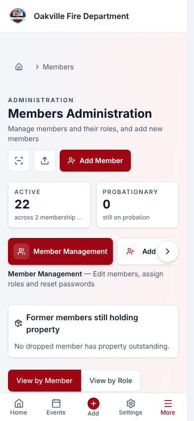

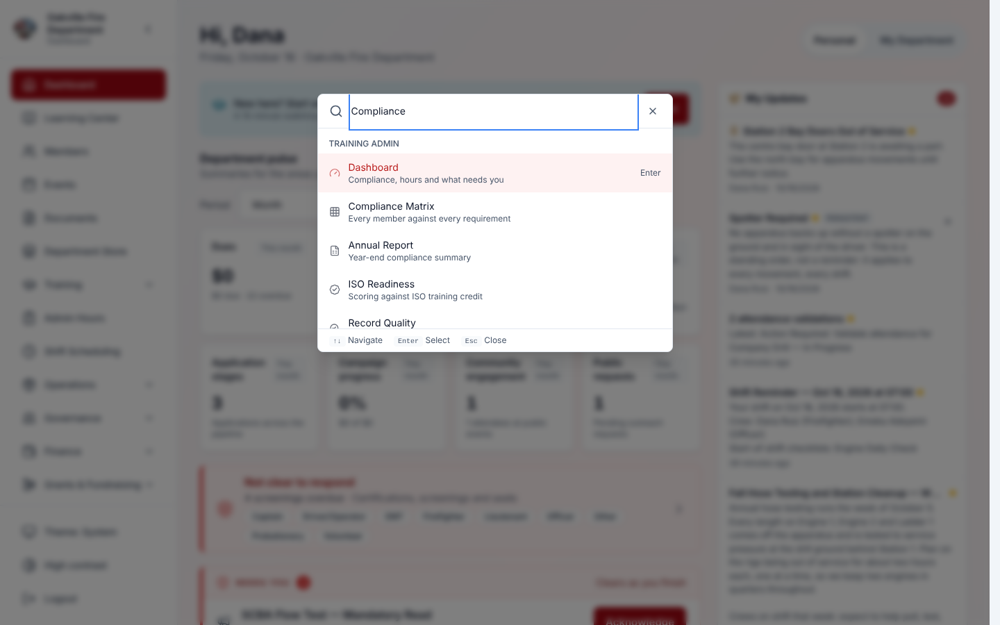

### Who can see the Needs attention list

The list names people, so it needs the module's own manage permission, not a
general administrator permission:

| Page      | Needs                           | Also needs                                                                                          |
| --------- | ------------------------------- | --------------------------------------------------------------------------------------------------- |
| Members   | Permission to manage members    | **medical_screening.view** ("View member medical screenings") for the list and the screening metric |
| Training  | Permission to manage training   | The Training module turned on                                                                       |
| Inventory | Permission to manage inventory  | The Inventory module turned on                                                                      |
| Events    | Permission to manage all events | —                                                                                                   |

**Medical screening is health information.** An officer who manages members but
cannot view medical screenings sees the screening metric read **unknown** and
an empty list. The metric does not disappear, because a missing number makes
people hunt for it. If officers report that number as broken, check who has
**medical_screening.view**.

The Members screening count counts a member and screening type only where
nothing current covers it, so a member who renewed is not counted as lapsed.

Needs attention also shows:

- **Training:** skills tests waiting for an officer to validate them (opens
  **Skills Test Records** on **Needs Validation**), and shift reports waiting
  for review or flagged.
- **Events:** members' "I was there" requests from across the department (opens
  **All events**).
- **Store:** order windows still open more than an hour after they were meant
  to close.

### Scheduling Admin

**Scheduling Admin** sits beside Training Admin and Inventory Admin in the
Administration section. **One permission runs it all:** **scheduling.manage**
("Manage schedules") opens the hub, every page behind it and its menu rows. It
also opens the Administration section itself, so a scheduling officer with no
other admin access still sees the section. That does not widen what anyone can
do inside it — each card and page still checks its own permission.

Scheduling's numbers count what officers expect:

- **Short-staffed** matches each **required** seat against someone qualified
  for it. A three-seat truck with one person on it is short; a shift needing an
  officer and a driver but carrying two firefighters is short. Optional seats
  are not counted.
- A shift is counted as staffed only by assigned and confirmed members, not
  pending ones.
- **To close out** treats a shift with no set end as running until the
  department's open-ended allowance has passed, and dates how overdue it is
  from then.
- **Hours this month** counts this month only.

### Inventory Admin

The Inventory Admin hub links to the equipment-check console and the department
store. It opens for officers who manage inventory, who create and edit
equipment check templates (**inventory.check_manage**), or who manage the store.
Each card still checks its own permission. The **Inventory Admin** menu row
shows for the first two; store managers use their own **Store Admin** row.

### Breadcrumbs

Each hub, and the pages beneath it, shows a breadcrumb trail above the heading
— for example "⌂ > Finance > Expenses".

- **On a hub, the trail stops at the parent.** It does not repeat the page's own
  heading.
- **A crumb you cannot open is plain text, not a link** — either because there
  is no page at that level, or because you do not have permission for it.
- **The record itself is not a crumb.** On a detail page the trail ends at the
  list it came from (for example _Applications_ on a grant application), and the
  record's name is the heading beneath.

Pages without a trail have a **Back to …** link instead. Back links always go
to the parent page, not to wherever you came from, so they work the same from an
emailed link or a bookmark.

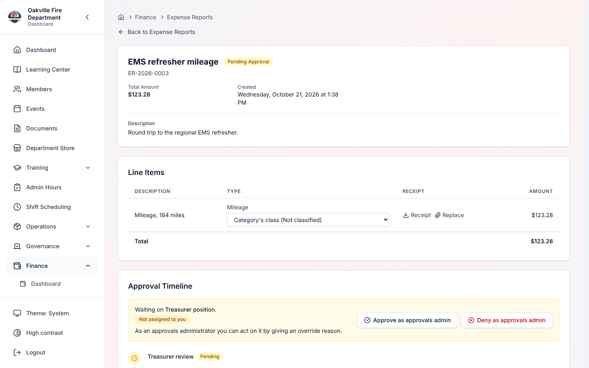

---

## Reports

**Who can open it:** officers with **reports.view** ("View and generate
reports"), with the **Reports & Analytics** module turned on.

Open **Administration > Reports**. The page reads "Run department reports and
export them to CSV or PDF".

### Available Report Types

Each card says what the report contains. Cards marked **Date Range** cover the
reporting period set at the top of the page; the others show things as they are
now.

| Report                                  | Category   | Date Range | What it contains                                                                                                                                            |
| --------------------------------------- | ---------- | ---------- | ----------------------------------------------------------------------------------------------------------------------------------------------------------- |
| **Member Roster**                       | Member     |            | Every member, active and inactive, with email, rank, station, and roles                                                                                     |
| **Training & Program Progress Summary** | Training   | ✓          | Training hours and course completion by member and course, and training-program progress by requirement — not requirement compliance                        |
| **Event Attendance**                    | Events     | ✓          | RSVPs and attendance for each event in the reporting period                                                                                                 |
| **Training Progress**                   | Training   |            | Each member's progress through their training programs and requirements                                                                                     |
| **Annual Training Report**              | Training   | ✓          | Training hours, shift experience, calls, and performance ratings for each active member                                                                     |
| **Admin Hours Report**                  | Admin      | ✓          | Administrative hours logged by members, broken down by category                                                                                             |
| **Department Overview**                 | Compliance | ✓          | Department totals for members, training, events, and open action items                                                                                      |
| **Certification Expiration**            | Compliance |            | Every member's certifications and expiration dates, flagging expired and expiring ones                                                                      |
| **Program Requirement Progress**        | Compliance |            | Each member's progress on training requirements through their training programs, with outstanding items and upcoming deadlines — not requirement compliance |
| **Fleet / Apparatus Status**            | Operations |            | Vehicle status, inspection due dates, mileage, and open work orders                                                                                         |
| **Inventory Status**                    | Operations |            | Stock levels, assigned equipment, and low-stock alerts                                                                                                      |
| **Incident / Call Volume**              | Operations | ✓          | Call volume trends, incident type breakdown, and peak activity                                                                                              |
| **Pipeline Overview**                   | Member     | ✓          | Applicants in the prospective member pipeline, by stage, year, and referral source                                                                          |

> **Important: two reports measure training-program progress, not
> compliance.** **Program Requirement Progress** and the **Program Progress by
> Requirement** tab of the **Training & Program Progress Summary** count a
> requirement as met when the member's **training-program enrollment** marked
> it complete. The **Training dashboard** and the **compliance matrix** answer
> a different question: they look at the member's training records in each
> requirement's time window. The two can disagree — and for a department that
> does not run its annual requirements through training programs, they will.
> **For requirement compliance, use the Training dashboard** or the
> [compliance matrix](./02-training.md#compliance-matrix).

On **Program Requirement Progress** the groups read **All Requirements Met**,
**Some Met** and **None Met**; the percentage column is **Program Progress**;
and the overdue column is **Outstanding**.

The summary's **Program Progress by Requirement** tab leaves out members a
requirement does not apply to — including someone who joined before the
requirement's cut-off date, or who is still inside its catch-up period.

**Training Progress** is about training programs, not applicants. With no
enrollments it reads "No training program enrollments found." The
certification and apparatus reports show **Days Left**, and the apparatus
report shows **Open Work Orders**.

### Generating a Report

1. Filter the cards by category: **All Reports**, **Member**, **Training**,
   **Events**, **Admin**, **Compliance** or **Operations**.
2. For a **Date Range** report, set the reporting period with a preset (**This
   Year**, **Last Year**, **This Quarter**, **Last Quarter**, **Last 90 Days**,
   **Last 30 Days**) or **Custom**.
3. Select **Generate Report** on a card. Selecting the card itself does nothing.
4. The report opens on screen:
   - **CSV** downloads it for a spreadsheet;
   - **Print / PDF** prints it, or saves it as a PDF;
   - **Compare** shows the previous period of the same length beside it.

**"Today" in a report is the department's date.** The certification report's
expiring and expired flags, apparatus inspection due dates and the call-volume
year-to-date all follow the department's clock. A custom range is read the same
way: "June 1 to June 15" means from midnight on June 1 to the end of June 15 on
the department's clock, in every report and in the grant and fundraising
reports. A department with no timezone set reads its ranges in UTC.

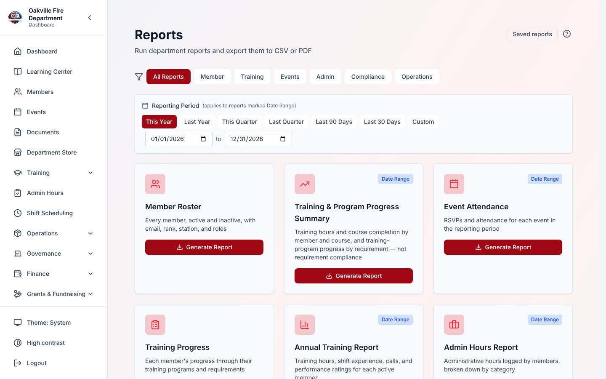

> **Tip.** Run important reports, such as the annual training report, at the
> end of each year and keep a copy for your records. Use
> [saved reports](#saved-and-scheduled-reports) for the ones you run often.

### Saved and Scheduled Reports

**Who can use it:** **reports.view** to see and run saved reports;
**reports.manage** ("Create, edit, and delete saved reports") to save,
schedule, edit or delete them.

Open **Reports > Saved reports**. Each saved report shows its report, its
reporting period, its schedule, the date of the next email and when it last
ran.

- **Run** opens the report on the Reports page with the saved settings, like
  **Generate Report**. A saved report of a type your permissions do not cover is
  listed but has no **Run** button.
- **New saved report** / **Edit**: give it a name, choose the report (only
  reports you can run are offered) and a **Reporting period** — _Last 30 days_,
  _Previous month_, _Previous quarter_, _Year to date_ or _Previous year_. The
  period is worked out on the day the report runs, so a monthly email always
  covers the month just ended.
- Tick **Email this report on a schedule** and choose:
  - **Daily**;
  - **Weekly**, and the day;
  - **Monthly** or **Quarterly**, and the day of the month (29–31 fall on a
    shorter month's last day; quarterly sends in January, April, July and
    October);
  - up to 25 email addresses.
- **Delete** asks first, and stops the schedule.

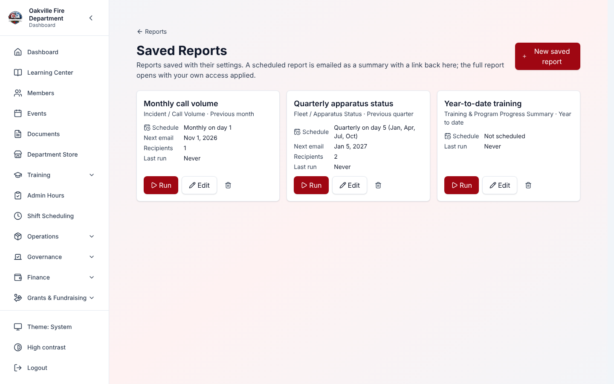

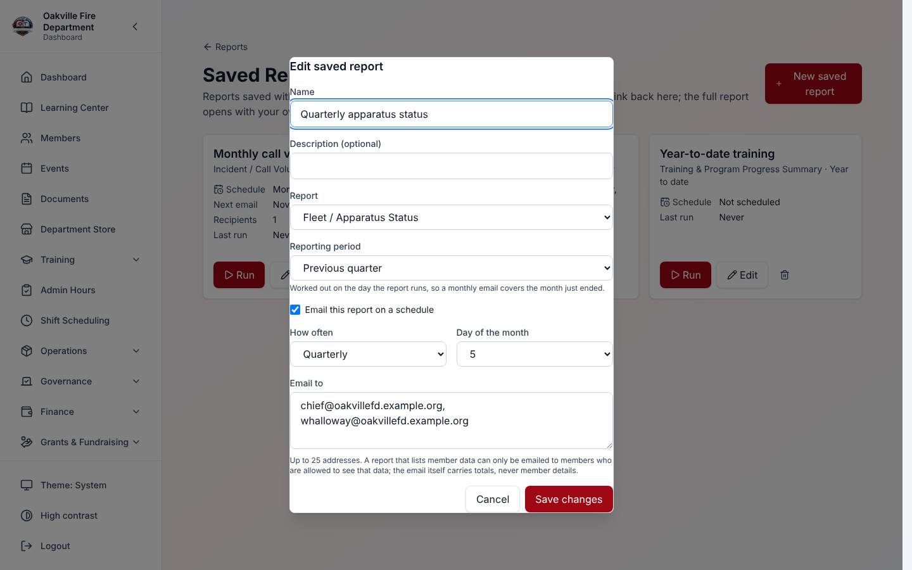

**If an email fails** _(2026-10-25)_, the next daily run sends it again; a
scheduled report is only marked as sent once the mail is accepted. A report that
can never send (its owner lost access, no allowed recipient) is settled rather
than retried. A compliance report that was stored but never emailed goes out on a
rerun the same day. When you email a compliance report by hand and nothing goes
out, the dialog now says why (nobody reached, or no recipient) instead of a
generic "Failed to email report".

**What the email contains:** a summary — the report's totals and figures and an
**Open saved reports** link. It never contains a list of members. The full
report opens in the app, where the reader's own access applies.

**Reports that list member data can only be emailed to members allowed to see
that data.** The roster, the applicant pipeline, the training reports and the
admin-hours report each need the permission that protects the same records
(viewing members, viewing prospective members, managing training, managing
admin hours). Every recipient must be an active member who holds it. An outside
address, or a member without it, is refused when you save, and the refused
addresses are named. Other reports (fleet, inventory, events, call volume, the
department overview) may go to outside addresses; each such send is recorded in
the audit log.

> **What if the scheduled emails stop?** If the person who scheduled a
> member-data report later loses the permission it needs, its emails stop until
> someone who holds it saves the schedule again. A recipient who loses the
> permission is left off the next email.

### Pipeline Overview Report

The **Pipeline Overview** report shows how many applicants are at each stage of
the membership process. You can group stages together for the report.

**To set up stage groups:**

1. Open **Administration > Members > Pipeline Settings**.
2. Pick the pipeline, then scroll to **Report Stage Groups**.
3. Select **Add Group**. Type the group's name straight into its name field.
4. Use **+ Add a stage to this group…** to add stages. This list appears only
   while some stage is still ungrouped, and it offers only ungrouped stages, so
   a stage can never be in two groups.
5. Select **Save**. Nothing is stored until you do.

Each stage in a group has its own **Remove**, which returns it to the ungrouped
pool. The bin icon beside a group's name removes the whole group.

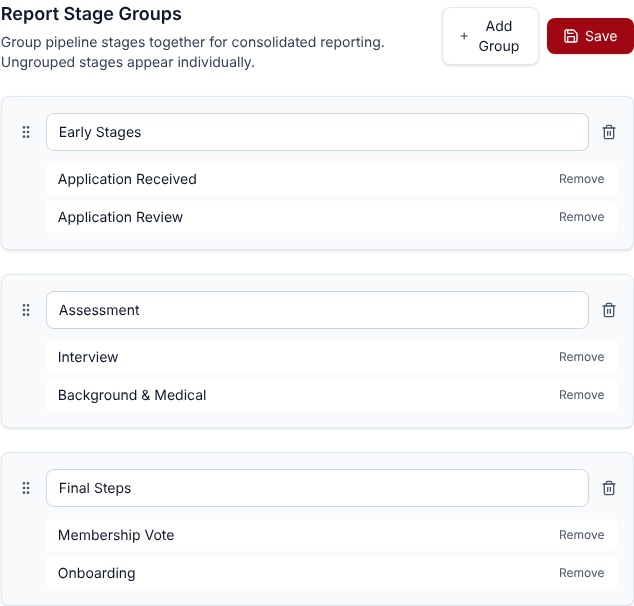

Groups with no applicants still appear in the report. Ungrouped stages appear on
their own.

---

## The Dashboard for Administrators

The dashboard is described for everyone in
[Getting Started](./00-getting-started.md). This section covers the parts that
depend on administrator permissions.

### Department pulse

The dashboard's **My Department** view has a **Department pulse** section —
"Summaries for the areas you can access, over the period you choose." Its
period picker is the **Reporting period**.

**Each part of Department pulse checks its own permission**, so what you see
depends on your positions. A section you cannot see is not broken; your
positions do not reach it.

When assigning positions, note that **full settings access is not money
access**:

- money totals (dues, cash flow, budget, grants) need **finance.manage**
  ("Manage budgets, fiscal years, categories, and process payments");
- fundraising needs **fundraising.view** ("View fundraising data");
- outreach needs permission to manage all events.

Asset cards show counts and links only — never facility codes, accounts,
budgets or leases.

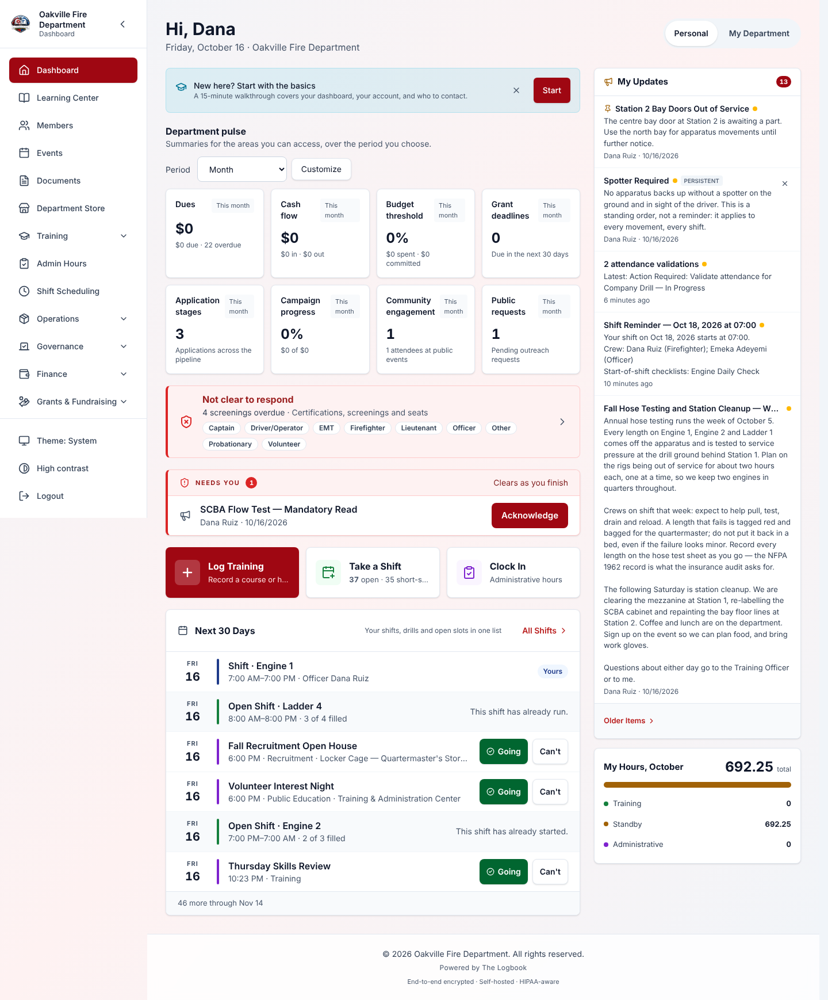

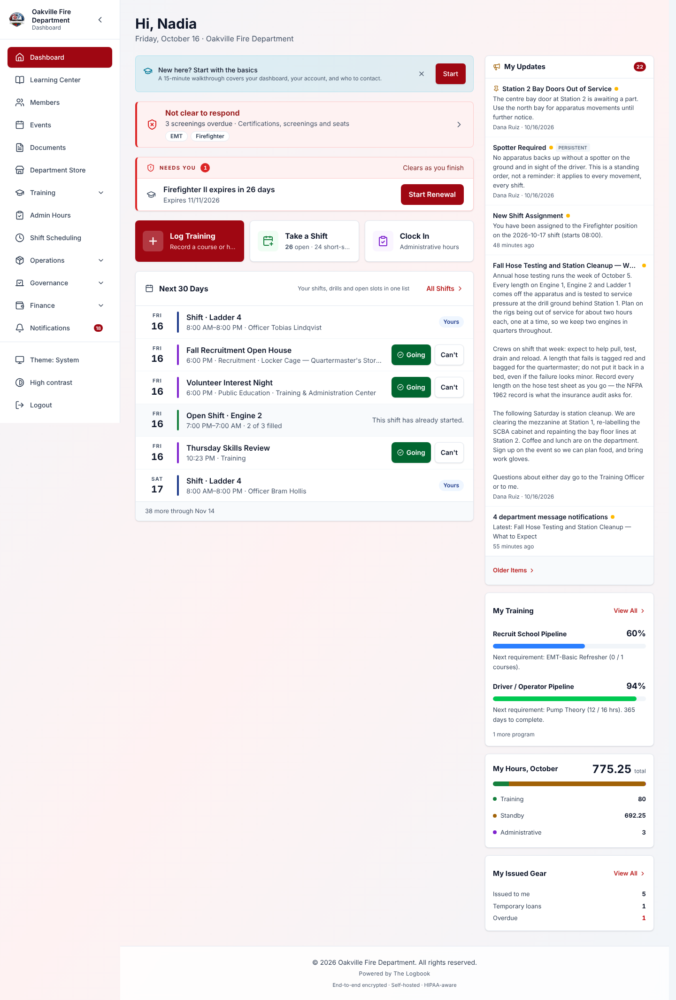

Read the two pictures together. The member's dashboard has no empty Department
pulse — the section is simply not there. An empty money card would tell a
member the department holds finance information they are not trusted with.

Each of the three blocks (money, fundraising, outreach) is checked on its own
permission and its own module. The section disappears only when **all three**
are empty. A member without finance access but with fundraising or events
access still sees Department pulse, without the money cards.

#### Customizing Department pulse

**Customize** (top right of the section) lets you choose which cards show,
their order, their titles and the period the section opens on. There are two
levels:

- **Save for me** keeps the layout for you only. **Use department layout** (or
  **Use built-in layout** when the department has no default) removes it.
- **Save as department default** (shown only to those who may set it) is what
  everyone without their own layout sees. **Clear department default** removes
  it.

A layout only arranges cards. The Logbook still decides which cards you may
see, so saving a card you do not have access to shows you nothing new. If you
hide every card, the section says "All cards are hidden. Choose Customize to
show some."

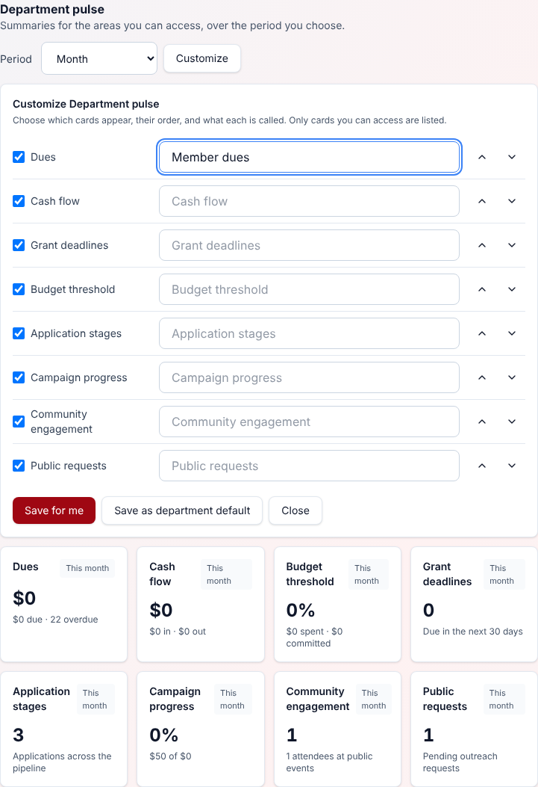

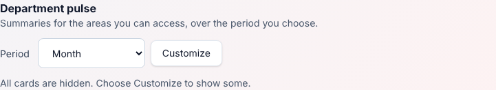

### Scheduling Operations tiles

Officers with **scheduling.manage**, with the Scheduling module on, see a
**Scheduling Operations** group on the **My Department** view. It has seven
tiles: Today's Staffing, Future Coverage Gaps, Open Slots, Pending Changes,
Incomplete Closeouts, Workload Balance and Special Operations.

Each tile opens the schedule **already filtered to what it counted**. Each keeps
its own time range and filters, saved per person.

### My Hours and the Next 30 Days list

- **My Hours** on the dashboard is always your own hours, even if you can manage
  everyone's admin hours. A member with no administrative time this month sees
  **0**. The month follows the department's clock.
- The **Next 30 Days** list shows your shifts, events and drills for the coming
  month. **All Shifts** opens the month view.

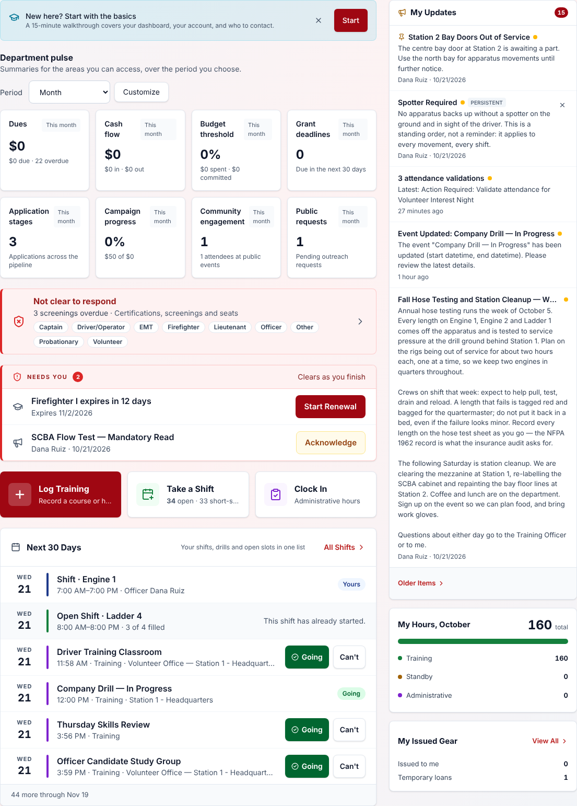

Notifications and department messages on the dashboard are covered under
[Notifications and Department Messages](#notifications-and-department-messages).

---

## QR Code Analytics

**Who can open it:** officers with **analytics.view** ("View analytics and
dashboards"). The menu entry sits under **Administration > Organization
Settings**, which also needs **settings.manage**. Officers who manage events
can open the same charts from the **QR Code Analytics** tab in Events
administration.

**QR Code Analytics** shows how members check in to events by scanning a QR
code — "Check-in scans across all events". Opened from an event, it shows that
event only. It shows:

- **Total Scans**, **Successful Check-Ins**, **Success Rate** and **Avg Time to
  Check-In**;
- **Device Breakdown** — the kinds of device used to scan;
- **Error Breakdown** — why scans failed ("No scan errors recorded" when none
  did);
- **Activity by Hour** — scans by hour of the day;
- **Check-In Trends (Last 24 Hours)**.

**Export Data** downloads the figures as a file.

It does not show member, training or event attendance figures. For those, use
[Reports](#reports) and Department pulse.

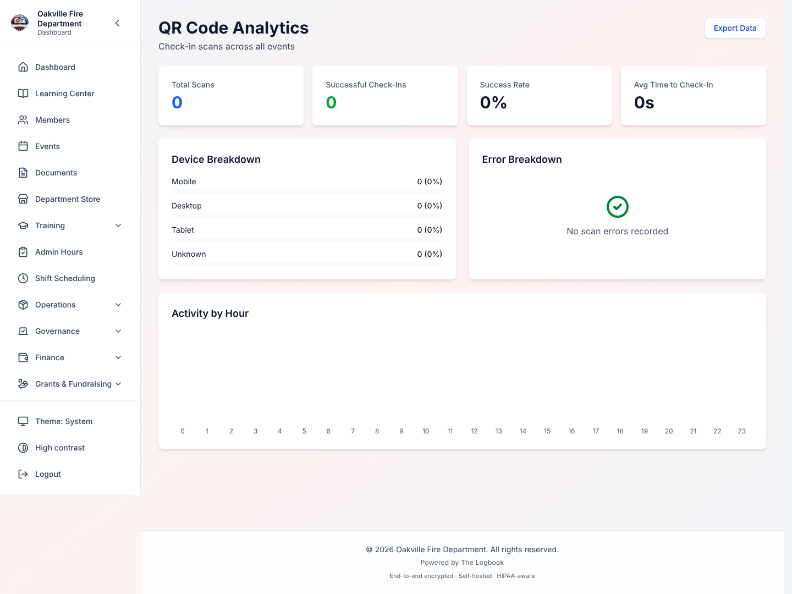

---

## Public Portal Configuration

**Who can use it:** officers with **settings.manage**, with the **Public
Information** module turned on.

Open **Administration > Organization Settings > Public Portal**. It controls
what your department's own website can read from The Logbook — public education
events, department information and statistics.

### Configuration Options

**Enable Portal** / **Disable Portal** is in the page header. Below it are five
tabs:

- **Configuration** — **Rate Limiting**: the hourly limit for every key that
  does not set its own. Which websites may read the portal from a browser is
  set by whoever runs the server.
- **API Keys** — "Websites and apps use these keys to read your public data."
  A new key is shown once (**API Key Created**). Revoking a key cuts off
  whatever uses it immediately.
- **Access Logs** — every request to the portal, refused ones included, newest
  first. A request using one of **your** keys that has been revoked or has
  expired is listed as refused ("Revoked API key", "Expired API key"). A
  request with a key that belongs to no department — a guess, a typo, a key
  from another system — is recorded where only the server's operator can see
  it. It still counts towards the suspicious-activity check, so a run of failed
  keys from one address is flagged.
- **Statistics** — traffic over the last 24 hours and 7 days, error rate,
  rate-limit hits and suspicious requests. An **Attention Required** banner
  appears when one crosses its limit. With no traffic the error rate reads "—",
  "No requests in 24h".
- **Data Control** — which fields the portal shares. Every field is listed and
  off until you turn it on. Fields holding personal information carry a **PII**
  badge.
  The three statistics that used to come back empty now carry figures
  _(2026-10-28)_: stations counts the Fire Station facilities that are not
  archived, calls counts calls in call tracking since 1 January, and volunteer
  hours totals this calendar year's approved admin hours, completed training and
  shift and event attendance, each hour counted once. Both yearly figures follow
  the department's time zone.

**Nothing is shared until all three are done:** the portal enabled, a key
created, and the fields turned on under Data Control.

Only officers with **settings.manage** can change any of it.

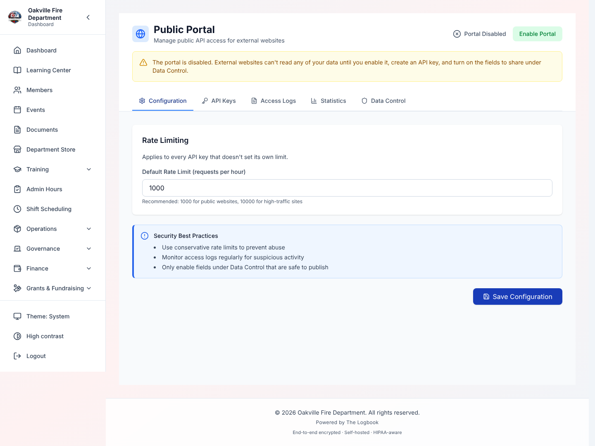

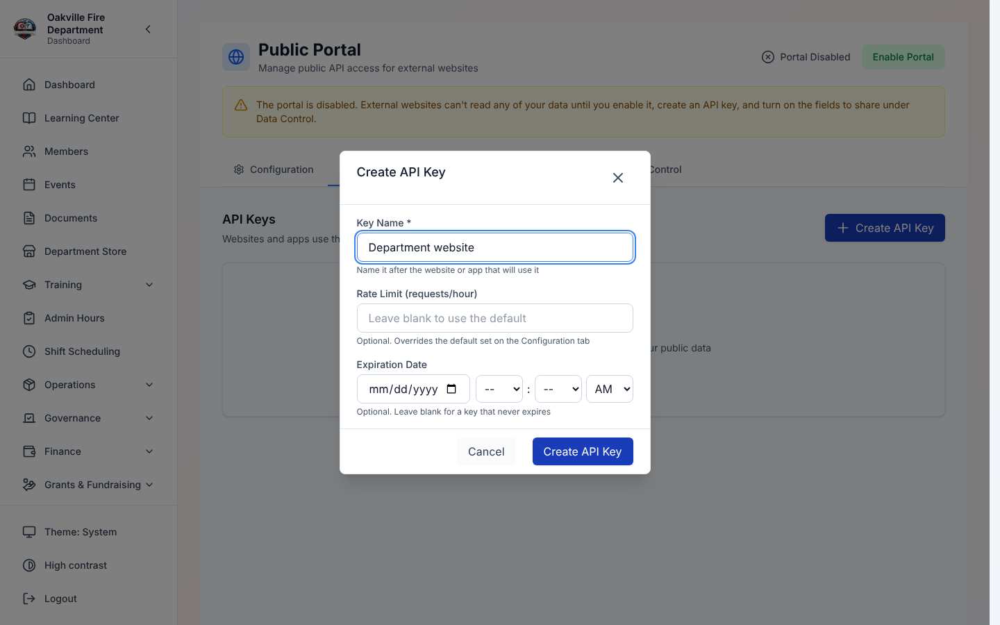

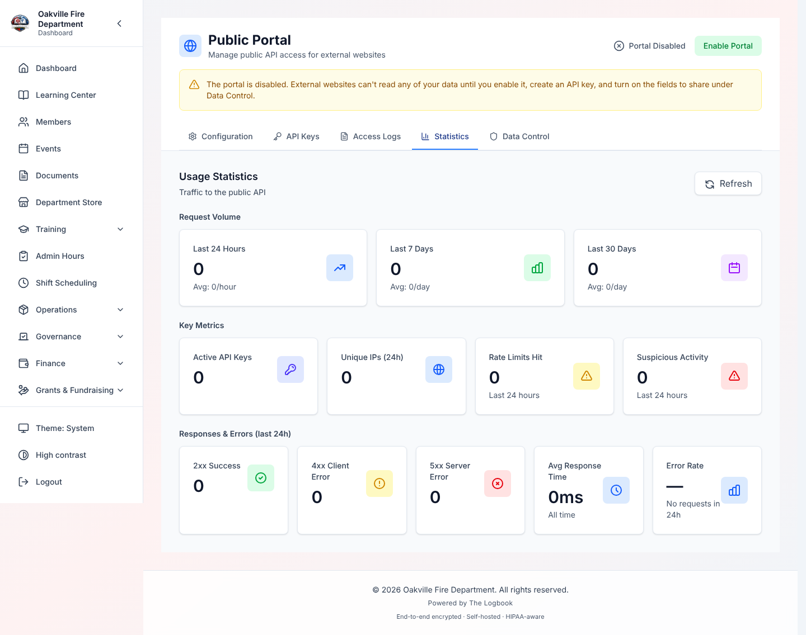

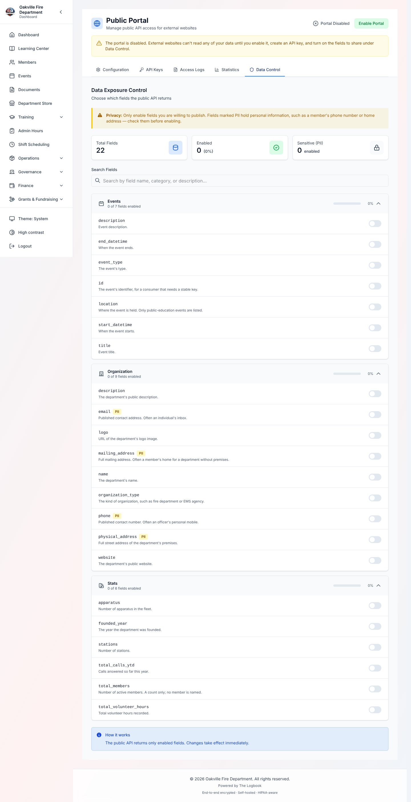

---

## Integrations

**Who can open it:** officers with **settings.manage**, with the **External
Integrations** module turned on.

Open **Administration > Forms & Comms > Integrations** to connect The Logbook
to other systems. Each integration is covered in
[Integrations](./16-integrations.md).

The **Salesforce CRM** card connects The Logbook to a Salesforce account to
sync members, training records and events. You choose the sync direction and
which kinds of record sync; how fields match up is fixed. Setup, sign-in
options, syncing and what happens on errors are in
[Integrations → Salesforce CRM](./16-integrations.md#salesforce-crm).

---

## Admin Hours

Admin hours are the time members log for administrative work — meetings,
paperwork, station duties — by clocking in and out against a category.

### My Admin Hours

Every member's **My Admin Hours** page shows **their own hours only** — even
for officers who can manage everyone's hours. It has:

- **A reporting period** — this month, last 30 days, this year, all time. It
  sets both the totals **and** the entry list, so the two always cover the same
  dates. It starts on **This month**. "This year" means January 1 to today.
- **Three totals:** approved, awaiting review, and logged this period, with the
  number of entries under each.
- **My requirements**, where the department has set requirements for the
  member's profile. Each category shows its required hours for its own period
  ("this quarter" or "this year"), marked **On track**, **At risk** or
  **Behind**, with the hours still needed and the date the period ends. Only
  approved hours count.
- **A ranked list of categories** with bars showing each one's share, and one
  line naming the categories with nothing logged in the period.
- **A message that says what to do** when nothing is logged yet.

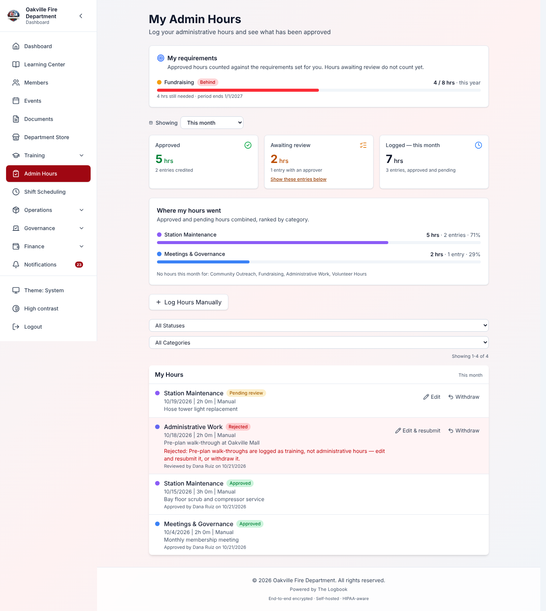

**NFC tags.** A category's QR code page (from the QR link on the
**Categories** tab) can also write that link to a blank NFC tag or sticker. A
member taps the tag with a phone to open that category's clock-in — no camera
needed. With the app already open, **Tap Tag** in the My Admin Hours header
reads a tag directly. Both need Chrome on Android on a secure (https) address.
Elsewhere, a line says which of the two is missing, **Tap Tag** does not
appear, and the QR code still works.

### The Admin Hours summary

**Who can open it:** officers with **admin_hours.manage** ("Manage admin hours
categories, approve/reject entries, view all members").

Open **Administration > Admin Hours** and choose the **Summary** tab. It totals
the whole department's completed sessions, grouped by each entry's current
category.

The **Reporting period** is All time (the default), Last 30 days, **This
calendar year** or a custom range. The dates it covers are shown beside the
heading. **This calendar year** runs from January 1 to today, not the last 365
days.

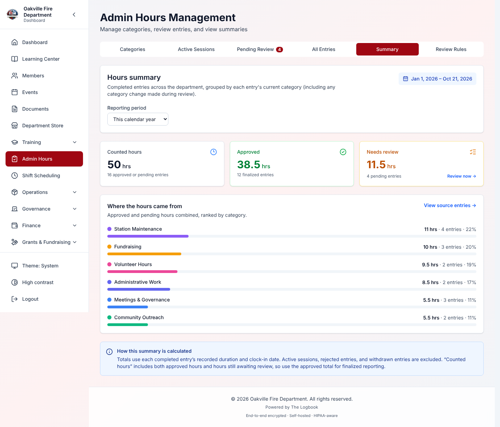

- **Counted hours** includes approved hours and hours still awaiting review. Use
  **Approved** for final reporting. When entries are waiting, **Review now**
  under **Needs review** opens the **Pending Review** tab.
- **Where the hours came from** ranks categories by hours logged, with each
  one's share. Active sessions, rejected entries and deleted entries are left
  out.
- **Category limits are set elsewhere.** **Auto-approve under (hours)** and
  **Max hours per session** are set on each category in the **Categories** tab.

> **What if a member forgets to clock out?** A session that runs past its
> category's **Max hours per session** is closed for the member. Every 30
> minutes, The Logbook caps a forgotten clock-in at the limit, sets it to
> **Pending Review** and notes "Auto-closed: exceeded _N_h session limit" on the
> entry. Each one is recorded in the audit log — the member, the entry, the
> capped times, and whether the regular check or an officer's **Close Stale
> Sessions** (Categories tab) closed it — so a disputed session can be looked
> up.

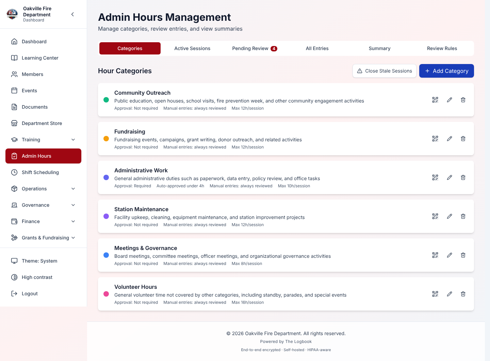

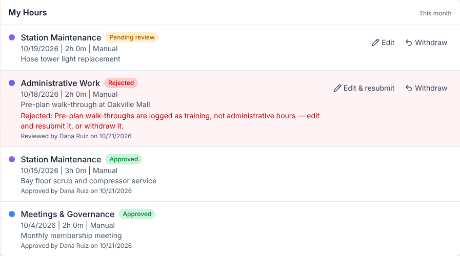

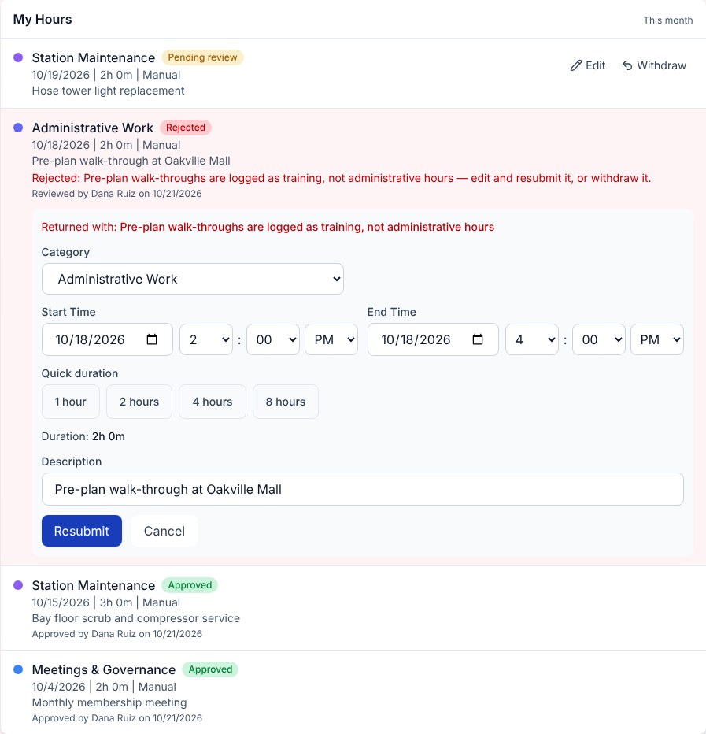

### Admin Hours review rules

**Where:** **Admin Hours → Review Rules** tab. **Who:** officers who manage
admin hours can read them; changing them needs **settings.manage**.

Two department-wide rules decide how approvals work:

- **Let an approver approve their own entries.** Off by default: an officer's
  own entry must be approved by someone else, and bulk approval skips it. A
  department with only one officer who reviews admin hours can turn it on. A
  self-approved entry still records who approved it.
- **Send a corrected event entry back for review when it grows by more than
  _N_ percent** (default **25**). When a reopened event's check-out time is
  corrected, attendance hours already approved are updated in place. If the
  correction makes an entry longer than the threshold allows, and its category
  would not have approved the new length automatically, the entry goes back to
  **Pending Review**. `0` sends back any increase at all.

Only a settings administrator can change these, because the first rule relaxes
a check on the very people who review admin hours.

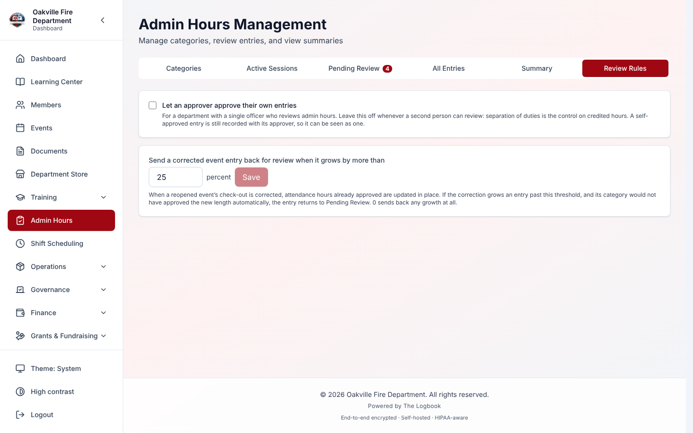

> **What if a clock-in or entry is refused?**
>
> | Message or problem                       | What it means / what to do                                                                                                  |
> | ---------------------------------------- | --------------------------------------------------------------------------------------------------------------------------- |
> | "Already clocked in"                     | You have an open session in this category. Clock out first                                                                  |
> | Clock-in refused for an "active session" | You have an open session in another category. Only one clock-in at a time is allowed. Clock out of it first                 |
> | Category "no longer active"              | An administrator turned the category off. You cannot clock in to it. Ask your administrator                                 |
> | Manual entry refused                     | The clock-out must be after the clock-in, the clock-in cannot be in the future, and the session must be at least one minute |
> | Rejecting an entry                       | A reason is required                                                                                                        |

---

## Notifications and Department Messages

### Dashboard Notification Management

The dashboard's **My Updates** panel puts your notifications and department
messages in one list. An amber dot marks each unread row, and the header counts
them. Opening a row marks it read and takes you to what it is about — the
notification's own screen, or the message's own page.

The list holds unread items only, in this order:

1. **pinned** department messages;
2. **persistent** department messages;
3. everything else, newest first.

Five rows show. **Older Items** at the foot opens the full notifications inbox,
where you can mark everything read. Two or more notifications of the same kind
— a weekend's attendance validations, say — show as one row ("5 attendance
validations", with the newest as **Latest:**). It opens the inbox, where the
group expands. See
[Notification Rules & Logs → Four tabs](./07-documents-forms.md#four-tabs).

Pinning and persistence do different jobs:

- **Pinning** sorts a message to the top, so a pinned notice stays above newer
  notifications instead of being pushed off the five rows. A pinned message
  that is not persistent still drops off once the member has read it.
- **Persistence** keeps a message in the list after it has been read. It stays
  until a manager clears it with the ✕ beside it, which takes it down for
  everyone. The ✕ appears only on persistent messages, and only for officers
  who manage notification rules or hold **settings.manage**. Ordinary members
  cannot clear a persistent message.

A message that needs acknowledging is not in this list while it waits. It sits
in the dashboard's **Needs you** panel with an **Acknowledge** button.

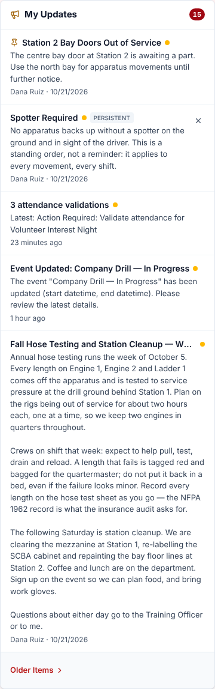

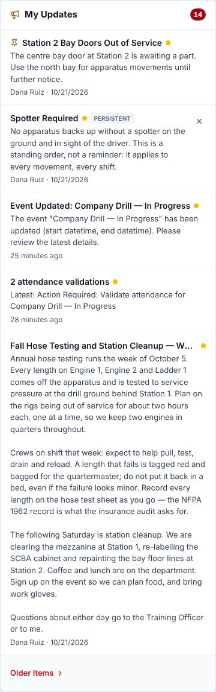

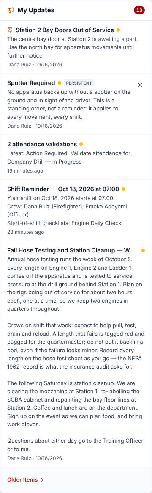

### Department Messages

Officers who manage notification rules (**notifications.manage**) post
department announcements from **Administration > Forms & Comms > Messages**.
Messages can be escalated by email or text message according to priority, can
require acknowledgement with a report of who has not acknowledged, can be
scheduled, and can be edited after posting.

1. Open **Messages** and select **New message**.
2. Enter the title and body, and set the priority and audience. _(2026-10-18)_ An audience of **By status → Probationary** or **Retired** now matches a member on either their membership status or their account status, so a new member added as a probationary member is included without an admin changing the account status. Active, Leave and Inactive still match the account status only.
3. Optionally tick **Keep in inbox after it is read** (persistent) or **Require
   acknowledgment**, or set a send time.
4. Members see it in the app, and **every message is also emailed**. A member
   cannot turn that email off. An urgent message also goes by text message
   where texting is set up.

For acknowledgement reports, scheduling, choosing the audience and members'
own notification settings, see
[Documents, Forms & Communications → Department Messages](./07-documents-forms.md#department-messages).

### The notifications inbox

The bell in the top bar and the **Notifications** link in the side menu show
how many notifications you have not read. The count updates on its own while
the tab is open, pauses while the tab is hidden, and refreshes as soon as you
come back.

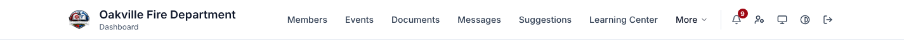

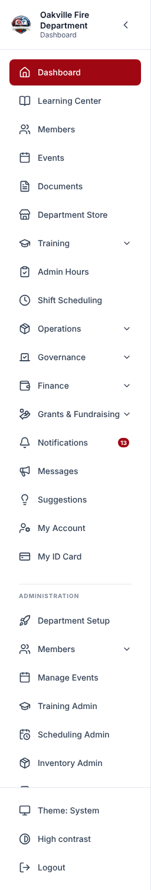

The **My Notifications** tab of the Notifications page is your inbox:

- **Show read**, a checkbox beside the unread count, ticked by default.
  Untick it to see unread notifications only.
- **Mark all as read**, top right, appears only while something is unread.
- **Load more**, at the foot of the list, loads the next 20. It disappears once
  everything is on screen.

Read notifications are shown in muted text without the coloured left edge.
Unread ones keep both.

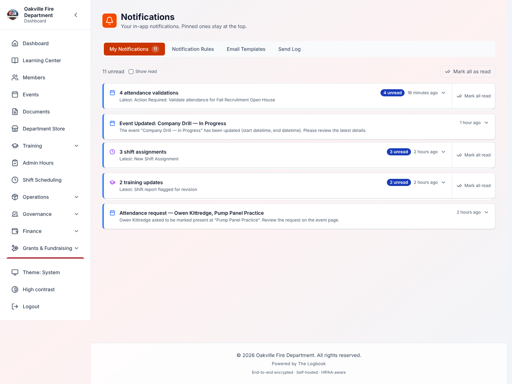


### Notification Channel Filter

The **Send Log** tab lists **your own** deliveries — emails and in-app
notifications sent to you. Its **channel filter** narrows the list:

| Filter | Shows                                |
| ------ | ------------------------------------ |
| All    | Every delivery, whatever the channel |
| Email  | Only emails                          |
| In-App | Only in-app notifications (the bell) |

Text messages are not recorded in the Send Log, so there is no text-message
filter.

Each row shows the subject, channel, send time and a delivery status: a green
tick for delivered, or a red mark with the error when you point at it. An
in-app notification counts as delivered as soon as it is created, because the
notification is what the member reads.


### Linking Someone to a Tab

The Notifications page has four tabs, and each has its own link, so you can send
a colleague straight to one:

| Tab                    | Who sees it                                                                |
| ---------------------- | -------------------------------------------------------------------------- |
| **My Notifications**   | Everyone                                                                   |
| **Notification Rules** | Officers who can view notification rules                                   |
| **Email Templates**    | Officers with **settings.manage**. It points to the Email Templates screen |
| **Send Log**           | Everyone (each member sees their own deliveries)                           |

A link to a tab you do not have permission for opens a tab you can see instead.

---

## Email Settings

**Who can open it:** officers with **settings.manage**.

Open **Administration > Organization Settings > Organization** and choose
**Email**. For the email server and domain side of things (SPF, DKIM, DMARC),
see the [Email Deliverability Guide](../EMAIL_DELIVERABILITY.md).

### The email link address

**Changing it needs:** **system.manage_link_domain** ("Change the address links
in outgoing email use"). Only the IT Manager has it by default, through full
access.

The Email section opens with the **Email link address** card. This is the
address every emailed link — password resets, ballots, approvals, reminders —
starts with, for the whole installation. The line under it says where the
address comes from:

- **Set by the FRONTEND_URL setting** — the server's own configuration;
- **Picked automatically from ALLOWED_ORIGINS** — because the server's own
  setting was left at an address only the server itself can open;
- **Set on this screen by an IT administrator**.

A **red** warning means the address only works on the server itself. **Amber**
warnings mean it does not use https, it only works inside the station's
network, or it differs from the address you are using. Check the card once
after an upgrade.

**To change it:**

1. Type a new address under **Change address**, or select **Use the address I'm
   on now**.
2. Select **Save**.
3. Confirm with **Change address** (or back out with **Keep current address**).

It takes effect without a restart. It must be one of the addresses the server
already accepts, listed under the field; anything else is refused with the
reason. **Go back to the server setting** removes the saved address. Emails
already sent keep the old address, so re-send ballots and ask members to request
a new password reset.

Everyone else sees the card read-only. **Changing it on the server instead**
explains how to change it on Docker, Unraid and AWS.

| What happens                                   | Result                                                               |
| ---------------------------------------------- | -------------------------------------------------------------------- |
| A department other than the server's own saves | Refused. Only the department the server was set up for can change it |
| A saved address the server no longer serves    | Ignored. Links use the server's own address                          |
| Any change                                     | Recorded in the audit log                                            |


### Choosing an email platform

Under **Email Platform**, choose one of five buttons:

| Platform                | What it is                                                                               |
| ----------------------- | ---------------------------------------------------------------------------------------- |
| **Gmail**               | Sends through Google with an app password                                                |
| **Microsoft 365**       | Sends through Microsoft, with an app registration or an app password                     |
| **SMTP (any provider)** | Any mail server you can name — your own, or a provider such as Yahoo, iCloud or SendGrid |
| **Cloudflare**          | Sends through Cloudflare's email service                                                 |
| **Not configured**      | Records that email has not been set up. It cannot send anything                          |

**Test Connection** signs in to the provider with what is on the form, without
saving it. To send a real test message, use **Send Test to Me** in the email
template editor; it uses whatever platform is saved here.


#### Gmail and Microsoft 365

**Gmail** and **Microsoft 365** with **App Password** need only the From
address and an app password. The server address, port and encryption come from a
fixed preset that both sending and **Test Connection** use.

Three things stop **Gmail** from sending without anything in The Logbook
changing. The form lists them too:

- **Send from a dedicated account**, such as `notifications@yourdepartment.org`,
  not a member's own. A personal account stops sending when its owner leaves
  and the account is suspended.
- **Changing that account's password revokes all of its App Passwords.** Email
  stops until a new App Password is entered here. Run **Test Connection** after
  any password change.
- **On your own domain, turn on DKIM** in the Google Admin console (**Apps →
  Google Workspace → Gmail → Authenticate email**) and publish SPF and DMARC
  records. Without them, Gmail, Outlook and Yahoo may send department mail to
  spam or reject it.

**Gmail** on Google Workspace also offers **Service account**, which a
password change does not affect. Choosing it needs **admin.access** (the Fire
Chief, President and IT Manager positions hold it by default); anyone else sees
the option disabled. It sends through the Gmail API instead of signing in to
`smtp.gmail.com`:

1. In Google Cloud, enable the **Gmail API**, create a service account and
   download a JSON key for it.
2. On the form, choose **Service account** and upload the key. The form shows
   the key's **client ID**.
3. In the Google Admin console, open **Security → API controls → Domain-wide
   delegation**, add that client ID, and authorize only the scope
   `https://www.googleapis.com/auth/gmail.send`.
4. Use an active user in your Workspace domain as the account email address,
   save, and select **Test Connection**. It checks that Google will let the key
   send as that address, and sends nothing.

The key can send as anyone in the domain; Google cannot limit it to one
mailbox. Keep it in a Google Cloud project used only for this. Changing the
account email address later clears the saved key, so upload it again.

**Microsoft 365** also offers **App registration (OAuth)**. It asks for the
directory (tenant) ID, application (client) ID and client secret. In Microsoft,
the app registration needs the **SMTP.SendAsApp** application permission and
**SendAs** rights on the sending mailbox. If Microsoft refuses the sign-in, The
Logbook reports it as a mailbox permission problem rather than wrong details,
because the two are fixed in different places. Choosing Microsoft 365 fresh
selects OAuth; a setup already using an app password keeps it.

> **Important: Microsoft is retiring app passwords for sending mail.** They
> keep working through December 2026. After that they are off by default for
> existing Microsoft accounts and unavailable to new ones, and they are removed
> in the second half of 2027. Plan the move to **App registration (OAuth)**
> before then.


_The success message in this picture is simulated. The demo department has no
Microsoft 365 account, so the test was answered with the message a real app
password test returns when it succeeds, **SMTP connection successful**.
Everything else is the real screen, and nothing on it was saved._

**Gmail** and **Microsoft 365** each limit how many messages one account sends
in a day. Ballot emails go out as one batch. If the account reaches its daily
limit partway through, The Logbook stops there instead of trying every
remaining member, and the send reports the members not yet emailed as failed.
If the provider only asks it to wait, The Logbook tries that message once more
before counting it as failed.

#### SMTP (any provider) and the quick-fill presets

Choosing **SMTP (any provider)** offers a list of providers: **Yahoo, iCloud,
Zoho, Fastmail, AOL, GMX, SendGrid, Amazon SES, Mailgun, Postmark, Brevo** and
**Mailjet**. Picking one fills in the server address, port and encryption that
provider publishes, and says what its username and password fields expect. You
can still edit all three.

**Most of them want an app password, not your account password.** You create
one in the provider's own security settings once two-step sign-in is on. This is
the most common reason a correct server and port still fail to sign in.

The provider list is a one-time helper, not a saved setting. It goes back to
_Choose a provider…_ as soon as it has filled the fields, and the line naming
your provider sits underneath it.

> **Proton Mail Bridge is not on the list on purpose.** It uses a self-signed
> certificate on the local machine, which The Logbook will not trust, so it
> cannot connect.


#### Cloudflare

Choose **Cloudflare**, then enter:

- **Account ID** — the 32-character code (letters a–f and digits) from your
  Cloudflare dashboard, not the account name;
- **API Token** — a Cloudflare email token with permission to send.

Save, then use **Test Connection**. Sending through Cloudflare retries after a
short wait when Cloudflare is busy or slow, and spreads large sends out so
Cloudflare does not turn them away. A failure is recorded in Message History
with the error. Cloudflare sends carry the same one-click unsubscribe
information as other platforms, which Gmail and Yahoo require for bulk mail.

If the server has a department-wide Cloudflare account set up, it is used only
by departments that have not set up their own email.

### An email section that cannot send is refused

**Read this if your department's email has ever gone quiet for no reason you
could find.**

When your department's email section is **turned on**, The Logbook sends only
through it. It does not fall back to the server's own email settings behind it.
So a section that is turned on but cannot send stops **all** email — even email
that the server's own settings could deliver.

To prevent that, Save refuses a section that is turned on but cannot work, and
names what is missing on the screen:

| What you try to save                                             | What happens                                         |
| ---------------------------------------------------------------- | ---------------------------------------------------- |
| Cloudflare turned on, with no Account ID or API Token            | Refused, naming the missing field                    |
| A Cloudflare Account ID that is not 32 characters of 0–9 and a–f | Refused, with the expected format                    |
| **Not configured** chosen, with email turned on                  | Refused — this choice cannot send                    |
| The section **turned off**                                       | Sending goes back to the server's own email settings |

**If email stops, check here first.** Open **Settings → Email** and either
complete the section or **turn it off**. Turning it off hands sending back to the
server's own configuration.

---

## Email Templates

**Who can open it:** officers with **settings.manage**.

Open **Administration > Forms & Comms > Email Templates**. The screen has five
tabs: **Templates**, **Footers**, **Officers**, **Scheduled** (messages queued
to send later) and **History** (what has been sent, and to whom).

### The email design

Every email uses one design:

- the department's logo and name centred at the top, on a light grey page;
- a **solid tab** in the notice's accent colour naming its category on the
  left, and on the right the one piece of urgency it carries — a deadline or
  time limit such as "Due March 16";
- the title on a card tinted with the accent colour, sometimes with the key
  facts in it;
- the white message card, with any extra cards under it;
- a centred footer.

Buttons run the width of the card. Apple Mail and Outlook.com show a dark
version when the reader's device is in dark mode. Every email uses the
built-in style; a template cannot carry its own.

Three settings on each template shape it:

- **Layout** — **Notice** (text, a details panel and a button), **Receipt** (a
  wide table of items) or **Digest** (a run of headings and lists).
- **Header accent** — one of a fixed set of colours, used for the tab, the
  tinted title card and the button. Changing only the colour does not count as
  editing the template.
- **Status chip** — the category the tab names, shown in capitals. Leave it
  empty and the tab is a plain band of colour.

### The Templates tab

On a wide screen the **Templates** tab is three columns: the template list, the
editor, and a live preview, so you see a change as you type. On a narrower
screen the editor and preview stack, with an **Edit** / **Preview** strip to
switch between them.

**The template list:**

- **Search** filters as you type, by template name and type. With no matches it
  reads "No matching templates".
- Templates are grouped into **categories** you can open and close, each with a
  count: **Members & Accounts**, **Prospective Members**, **Events &
  Scheduling**, **Training & Certifications**, **Elections & Voting**,
  **Inventory & Property**, **Suggestion Boxes**, **Department Store** and
  **Other**. Searching opens every group, and the group holding the template
  you are editing stays open.
- **Prospective Members** holds the emails applicants receive — **Application
  Step Completed**, **Application Status Link**, **Application Going
  Inactive**, **Application Withdrawn**, **Duplicate Application Notice**,
  **Application Follow-up Form**, **Application Contact Details Changed** and
  **Application Follow-up Form Reminder** _(2026-10-29)_ — and the
  coordinators' **Prospect Inactivity Warning** and **Application Follow-up
  Form Submitted** _(2026-10-29)_.
  _(2026-10-26)_ When
  each is sent, and its variables, is in
  [Prospective Members → Emails to Applicants](./15-prospective-members.md#emails-to-applicants).
- Each entry says whether your department has changed it and how much it is
  used — for example "Edited · sent 1,204 times" or "Default · never sent",
  counted from your department's Message History.
- **All**, **Active**, **Off** and **Edited** filter the list. **Edited** shows
  only templates you have changed.


**Off means off** _(2026-10-27)_. Switching a template **Off** stops that email
from being sent at all; before this release it only fell back to the built-in
wording and the email kept going out. The editor says what Off does. Seven
emails cannot be switched off, because their recipient could not get the
content any other way: **Password Reset**, **IT Password Notification**,
**Welcome**, **Ballot Notification**, **Application Status Link**, and
_(2026-10-29)_ **Application Follow-up Form** and **Application Contact
Details Changed** (their switch is disabled). A department that never opened Email Templates keeps every
email. Operators: check the **Off** filter before upgrading
([`UPGRADING.md`](../UPGRADING.md)).

Five templates that used to be stored but never used are now sent, in your
wording: **Cert Expiration** (it now says "expires today" or "tomorrow" rather
than "0 days left"), **Post-Event Validation**, **Post-Shift Validation**,
**Member Archived** and **Prospect Inactivity Warning**. A new **Application
Going Inactive** template carries the applicant notice
([guide 15](./15-prospective-members.md#inactivity-timeout)). The **Member
Dropped** email now includes the template's attachments (a return form), which
it ignored before.

A blue note above the list reads "Every email uses the current design,
including templates your department had edited — there is nothing to adopt." It
points to **Previous version** for wording the redesign replaced, and explains
that **Reset** replaces a template's wording with the default.

**If the email link address only works at the station**, a warning at the top
of Email Templates says that links and the logo in these emails will not open
for members reading elsewhere, with a link to **Change the email link address**.
See [The email link address](#the-email-link-address) and
[Email Deliverability → Links inside emails](../EMAIL_DELIVERABILITY.md#links-inside-emails-2026-09-24).

### Editing a template

- **Ctrl+S** (or **Cmd+S** on a Mac) saves, from the editor or the subject line.
  Pressing it with no changes does nothing.
- **Discard** appears when you have unsaved changes. It puts the editor back to
  the last saved version.


#### Reset to Default

1. Open the template.
2. Select **Reset** in the template's header. The dialog is titled "Reset to
   Default".
3. Confirm.

The subject, message, plain-text version, closing footer, layout, header accent
and status chip go back to the built-in defaults. Your CC and BCC recipients
are **kept**. You cannot undo a reset. A template with no built-in default
cannot be reset.


#### Previous version (wording from before the redesign)

When every template moved to the current design, each template's earlier
wording was saved first, including templates your department had edited. To
bring your wording back:

1. Select the template on the **Templates** tab. A template with saved wording
   shows a **Previous version (before the redesign)** panel above the editor.
2. **Show the old wording** to read it, or **Load this wording** to put the old
   subject, message and plain-text version into the editor in the current
   design. If you have unsaved edits it asks first (**Load previous version** /
   **Keep editing**).
3. Check the preview, then **Save** to keep it or **Discard** to drop it.

The old header, colours and style are not brought back. A template created
after the redesign has no panel. See
[Upgrading](../UPGRADING.md#every-email-template-is-reset-to-the-new-design-2026-09-27).


### Send Test Email

1. Open the template. **Send Test to Me** is under the preview.
2. Select **Send Test to Me**.
3. The Logbook sends what you are looking at — including unsaved changes — to
   **your own** address. You cannot choose another recipient.
4. Check your inbox: the layout, the links and the footer.

**A test reads like the real email:**

- **Links** point at your own installation, on the page the real notice uses.
- **The footer** carries your department's phone, address and other contact
  details, or leaves out what you have not set.
- **The greeting names you.** Names that belong to someone else — the member a
  notice is about, a person who sent a request — stay as sample names.
- **Dates** are set around today on your department's calendar, written the way
  the real notice writes them.
- **Your department's next real record** fills the event reminder (the next
  event that is not cancelled or a draft), the series-end reminder, and the
  shift reminder, assignment and decline notices (the next shift, with its
  apparatus). If there is none, sample values are used.
- **Attachments** on the template are attached.

The preview uses the same values. Anything you type into the preview's
**Sample data** fields wins. The two small icons beside **Refresh** switch the
preview between computer and phone width. The event reminder opens with a
**date tile** — month over day — beside its title.

Sending needs working email settings. If they are not set up, or wrong, the
button reports the failure and the reason instead of claiming success.


### Email footers

Each template ends with a footer chosen from a **library your department edits
once**. Three footers are built in, so you can speak differently to different
readers:

| Footer              | Who it is for                                                                                                                                                                     |
| ------------------- | --------------------------------------------------------------------------------------------------------------------------------------------------------------------------------- |
| **Internal**        | Members. The everyday "This is an automated message from …" close. **This is the default.** Replies go to the department's own contact email                                      |
| **Public**          | People outside the department. It **invites a reply** and carries the mailing address, which mail to the public is expected to have. Event requesters and applicants get this one |
| **Official notice** | Notices on the record: separations, property return, election results. It also carries lines such as "Please retain this email for your records"                                  |

You can rename, reword, add and delete footers. Each footer has its own lines
and switches for **Phone**, **Email**, **Website** and **Mailing address**.
Beside each switch the editor shows the value it would print, or "Not set, so it
will not appear". A footer line can use template variables.

**Department contact details.** A card above the footer list edits the phone,
email, website and mailing address the footers print. They are your department's
own details — the same ones as on Organization Settings — so a change here
changes them everywhere, and clearing a field clears it. Changing them needs
**settings.manage**; with only **organization.update_settings** the card is
read-only.

**To edit footers** (needs **settings.manage** or
**organization.update_settings**):

1. Go to **Email Templates**.
2. Open the **Footers** tab.
3. Edit a footer, or add one.
4. Mark one as the department default.
5. Save. The whole library saves together.


**To give a template a particular footer**, open the template and choose it in
**Closes with**. The hint under the control is the chosen footer's own
description.


**Closes with always takes effect.** The footer goes wherever the message has
the `{{footer_html}}` variable. If the message does not have it — for example,
one your department rewrote — the footer is added at the end of the message
card, and the plain-text version gets the text footer. If you rewrote a
template to close its own way, remove your own closing, or put
`{{footer_html}}` where you want the footer.

| What if …?                                    | What happens                                                                                       |
| --------------------------------------------- | -------------------------------------------------------------------------------------------------- |
| A template has no footer chosen               | It uses **the default**. Change the default and every such template follows at once                |
| You delete a footer that templates were using | Those templates use the **default** — never no footer at all                                       |
| You are about to delete a footer              | The screen tells you **how many templates use it**                                                 |
| Your department never opened the Footers tab  | The built-in footers are created the first time it is opened, and emails already use the right one |
| No contact details are set                    | Those lines are left out rather than showing sample text                                           |

### Variables you can use in templates

Variables are placeholders in double braces that are replaced when the email is
sent. The **Available Variables** list in the editor shows every variable for
the template you have open, in one list, and the preview fills them with sample
data. A misspelled variable comes out empty.

Department details available in **every template and footer line** include:

| Variable                                                          | What it is for                                                                                                        |
| ----------------------------------------------------------------- | --------------------------------------------------------------------------------------------------------------------- |
| `{{organization_website}}`                                        | The department's website from settings                                                                                |
| `{{login_url}}`                                                   | A direct link to The Logbook's sign-in page                                                                           |
| `{{organization_tax_id}}`                                         | The tax ID (EIN), which a nonprofit asking for money is expected to state                                             |
| `{{organization_identifier}}` `{{organization_identifier_label}}` | Whichever of FDID, state ID or department ID your department chose, **and its name** — so a notice reads "FDID 12345" |
| `{{organization_founded_year}}` `{{organization_county}}`         | For a "Serving Fairfax County since 1923" line                                                                        |
| `{{organization_fax}}`                                            | Still expected on official letters by some agencies                                                                   |
| `{{organization_description}}` `{{organization_type}}`            | The department's description and type                                                                                 |

Addresses outside the US keep their country line. "USA" is left off US
addresses.


### Signing notices with an officer's name

A notice sent by a clerk — or by an automatic nightly job — can carry the name
of the officer it should come from. For each office, four variables work in
any template:

```
{{president_name}}       {{president_title}}
{{president_email}}      {{president_phone}}
```

The offices are: **President, Vice President, Chief, Deputy Chief, Assistant
Chief, Secretary, Assistant Secretary, Treasurer, Safety Officer, Training
Officer, Quartermaster, Compliance Officer** and **EMS Supply Officer** (for
example `{{compliance_officer_name}}`). Officer variables have their own panel
under the variable list, because they work in every template.

**Who holds an office** is worked out in this order:

1. **A name typed in on the office** by an administrator (name, title, email,
   phone).
2. **The member linked to the office.** The details follow that member's
   profile, so a new phone number flows through without editing a template.
3. **Automatic detection** from members holding the matching position. With
   nobody assigned, Compliance Officer is found from the built-in Compliance
   Officer position.

> **Tip.** A department that never opens the **Officers** tab still signs its
> notices correctly, because of step 3. Visit the tab only if automatic
> detection gets it wrong or an office has no matching position.

The names refresh when an office is edited, when the **Officers** tab is
opened, and **every night** — which catches a change to the member behind an
office.


See [Department Officers](../DEPARTMENT_OFFICERS.md) for the full list of
variables.

### Department Store templates

If your department uses the **Department Store** module, ten more templates
appear, all named **Store —**. They are the store's emails: order confirmations,
status changes, payment receipts and reminders, the new-order alert to store
managers, and four order-window announcements. You edit them like any other
template.

**Each store notice has an on/off switch** in **Store → Admin → Settings →
Notifications**. Editing a template does not switch its notice on. If you reword
one and nobody receives it, check the switch. Nine switches cover ten
templates: the cancellation notice has its own template but shares the "status
changes" switch, so "your order is ready" and "your order is cancelled" can be
worded differently but are turned on and off together.

**Some parts arrive as a variable.** An ordered-items table and pay buttons
cannot be typed into a template, so the store fills them in:

| Variable                  | What appears there                                                                         |
| ------------------------- | ------------------------------------------------------------------------------------------ |
| `{{items_table_html}}`    | The ordered items with sizes, embroidery text and prices                                   |
| `{{payment_block_html}}`  | Balance due, a pay button for each method the department accepts, and payment instructions |
| `{{receipt_footer_html}}` | The receipt footer from the store settings                                                 |
| `{{window_extra_html}}`   | Whatever that notice adds — a closing time, a vendor, a delivery date                      |

**Removing one removes that part of the email.** Take `{{payment_block_html}}`
out of the confirmation and members are no longer told how to pay.

**Until you edit one, nothing changes.** A department that never opens these
keeps receiving the wording the store has always sent. The store's own
**Preview** and **Send this to me** buttons (in its Settings → Notifications)
show whichever version is in use, so edit here, then check there.

| What if …?                                                  | What happens                                                                                                           |
| ----------------------------------------------------------- | ---------------------------------------------------------------------------------------------------------------------- |
| You reworded a template, but its switch is off              | Nothing is sent. The switch decides, not the template                                                                  |
| You delete a store template                                 | The store uses its built-in wording. Next time the page loads, the template is recreated from the **built-in default** |
| You set a store template to inactive                        | The store uses its built-in wording, and your edit is kept. This is the undoable way to go back                        |
| You leave the subject blank                                 | The built-in subject is used                                                                                           |
| You edit the message but leave the plain-text version blank | The built-in plain-text version is used, so text-only email readers get the old wording. Edit both or neither          |
| You want to schedule a store email by hand                  | Not offered. Each one needs a specific order                                                                           |
| You edit a template while a send is running                 | The change applies from the next send                                                                                  |
| The store module is off                                     | The ten templates still exist and can be edited, but nothing sends them                                                |

---

## Audit Log

**Who can open it:** officers with **audit.view** ("View audit logs").

Open **Administration > Organization Settings > Audit Log**. It lists the
department's administrative and security events. Every entry is added to a
chain that shows if any entry is later changed or removed.

### What the audit log records

The log records significant actions, including:

- member changes — creation, status changes, position changes;
- training record changes;
- document uploads (with the file name, type and size) and deletions;
- settings changes;
- sign-ins and sign-outs;
- medical screening requirements and records being created, changed or
  deleted;
- the membership pipeline — pipelines created or deleted, applicants created,
  advanced or transferred;
- department messages created or deleted;
- shift completion reports created, updated, reviewed, acknowledged by the
  trainee, or submitted in bulk;
- leadership opening members' emergency contacts or date of birth;
- forgotten admin-hours sessions closed automatically;
- scheduled report emails sent to outside addresses;
- changes to the email link address and the retention schedule.

### Reading the log

1. Open **Audit Log**. Cards at the top show **Total events** and the number of
   **Critical**, **Warnings** and **Info** entries.
2. Narrow the list:
   - Type in the search box ("Search username or event type"), then press
     **Enter** or select **Apply**. While the box holds a search you have not
     applied, a note reads "Not applied yet — press Enter or Apply to search."
   - **Severity** and **Category** take effect as soon as you change them.
   - **Reset** clears the filters.
3. Select a row to open it and see the full details of the event — for example
   the report, the review status, the member affected, and the old and new
   values.
4. Use the page controls at the bottom to see older entries, and choose how
   many rows show on a page.

The columns are **When** (in your timezone), **Severity** (Info, Warning or
Critical), **Event** (the technical name of the event, such as
"shift_report_reviewed"), **Category**, **User** and **IP**.


**Example:** to see shift report activity, search for `shift_report`.


> **Note: what the log shows.** It shows every event recorded for your
> department. That includes events with no member behind them — a kiosk guest
> sign-in, or an automatic job — shown with **system** in italics in the User
> column. It never shows another department's events, or events that belong to
> the whole installation rather than a department.

> **What else to watch for.** In production, The Logbook watches signed-in
> activity. A session whose network address changes within 5 minutes of its last
> use, and a single export over 50 MB (or more than 250 MB of exports by one
> member in 24 hours), are recorded at **Critical** severity. The Logbook only
> records these; it does not block them.

---

## Error Monitoring

**Who can open it:** officers with **settings.manage**.

Open **Administration > Organization Settings > Error Monitor**. It lists
failures members ran into, so you can investigate "the site is broken for Dave"
without asking Dave.

The page shows:

- **Total Errors**, and the three most common error types;
- a filter by error type (**All Errors** or one type);
- **Export Errors**, to download the list;
- **Clear All**, for officers with **audit.manage** ("Manage and clear diagnostic
  error logs").

Each row shows the **Timestamp**, **Error Type**, **Source**, **Message** (what
the member was told, beside the technical message), **Page & Action** and
**Error ID**. Repeats are counted (for example "×3"), not hidden. Open
**Details** for the request that failed (method, address and result), the member
affected, the number of occurrences and, for server failures, the server's
technical trace.


### What reaches this page

| Source             | What is recorded                                                                                                       |
| ------------------ | ---------------------------------------------------------------------------------------------------------------------- |
| **Server**         | Every failure on the server's side                                                                                     |
| **Client**         | Requests that failed in the member's browser — server failures, lost connections, timeouts, and "not allowed" refusals |
| **Client**         | Unexpected errors in the page itself                                                                                   |
| **Client**         | Pages that failed to load after an update, as their own error type                                                     |
| **Scheduled task** | A failed automatic job for your department — reminders, reports, syncs and so on — with the job's name                 |

Not recorded, on purpose: expired sign-ins, pages not found, and forms
refused because something was filled in wrong. They are routine and would bury
the real failures. A failure in one department's scheduled job does not stop the
others.

> **A page that failed to load after an update** means a new version was
> installed while a member had The Logbook open. The member reloads and it is
> gone. It has its own type so you can tell it from a real fault.

> **One failure often shows as two rows** — one from the server, with the
> technical detail, and one from the member's browser, with the member and the
> page. Neither is a duplicate. The **Source** column tells them apart.

### The reports are reliable

The failures most worth knowing about can block their own delivery — a report
about a network outage has to travel over the network that is down. So:

- Reports are **queued and retried** (four attempts), one at a time.
- They are **sent when the page is hidden**, so a member who hits an error and
  closes the tab still reports it.
- Errors **before sign-in** are held and sent at the next sign-in.
- **Nothing is dropped silently.** If too many reports arrive at once, a row
  says how many were held back — "20 reports plus 340 suppressed", not a quiet
  minute.

### Privacy and how long errors are kept

- **Personal details are removed in the browser before an error is sent** —
  email addresses, phone numbers, Social Security numbers and sign-in codes.
- **Errors are kept 180 days by default** (30 days at least).
- **Each member can send up to 120 error reports a minute.** The limit is per
  member, not per network address, because members at a station share one
  address.

Some background jobs still report only to the server's own log. See
[Known Limitations](../KNOWN_LIMITATIONS.md#error-monitoring-coverage-2026-08-07).

---

## Privacy, Retention & Data Rights

The full walkthrough, including what members see, is in
[Privacy & Your Data](./17-privacy-data-rights.md). This is the administrator's
summary.

### Records Retention Schedules

How long each kind of record is kept is a department decision, because legal
retention rules for fire-service records vary by state.

| Record class                                             | Default      | Shortest allowed |
| -------------------------------------------------------- | ------------ | ---------------- |
| Message history (email and text delivery records)        | 90 days      | 30 days          |
| Notification logs                                        | Keep forever | 30 days          |
| Form submissions (may hold applicants' personal details) | Keep forever | 90 days          |

A daily job applies the schedule, and every change to it is recorded in the
audit log. There is no screen for changing the schedule in The Logbook; ask
whoever runs your server. A value below the shortest allowed is refused, so a
typo such as `3` for `30` cannot wipe records.

> **Note.** **Documents and meeting minutes are never deleted automatically.**
> They are official records. Disposing of them is a decision for a person under
> your own records schedule.

### Anonymizing a Departed Member

**Who can do it:** officers who manage members.

Once a member has been dropped or archived and their departure clearance is
complete, **Anonymize** on their profile removes their personal information
while keeping the history the department needs.

| Removed                                                                                                                                                                                                                                                        | Kept                                                                                                                                                                                         | Never touched                      |
| -------------------------------------------------------------------------------------------------------------------------------------------------------------------------------------------------------------------------------------------------------------- | -------------------------------------------------------------------------------------------------------------------------------------------------------------------------------------------- | ---------------------------------- |
| Name, contact details, address, date of birth, photo, emergency contacts, sign-in details, body measurements, medical screening details, free-text reasons on leaves and waivers, and the original application with its interview notes and uploaded documents | Training completions and certifications, attendance and service hours, property and clearance records, dues, and medical screening _status and dates_, so past compliance can still be shown | The audit log and election records |

> **Important.** Anonymizing **cannot be undone**. It is refused for active
> members, for your own account, and for a member already anonymized. Encourage
> departing members to download their own data first.

> **What if a backup from before an anonymization is restored?** The personal
> details come back with it. Anonymize the member again after restoring.

### Audit Log Retention

Audit entries are kept for **seven years**. Once a week, older entries are saved
to compressed archive files and then removed from the live log.

> **Important.** After that, the archive files are the only copy of your oldest
> audit history. Make sure they are backed up. The production backup service
> includes them.

A department that uses a security monitoring system can also have audit entries
copied off the server as they happen. The chain shows tampering, but only a copy
kept elsewhere survives everything being deleted. Ask whoever runs your server.

---

## Security and Compliance

Most of the controls in this section are set by **whoever runs the server**,
not on a screen in The Logbook. They are described here so you know what
members will meet. The operator's reference is
[Configuration → Security](../../wiki/Configuration-Security.md).

### Sessions and passwords

- Sign-ins end after a period of inactivity, and members are then signed out.
- Changing a password signs that member out everywhere else.
- Passwords must be at least 12 characters by default, and recent passwords
  cannot be reused.
- **Account lockout:** 5 wrong passwords in a row lock the account for 15
  minutes by default. A successful sign-in or a password reset clears the count.
- **Known-breached passwords** can be refused (off by default). Only a small,
  scrambled part of the password is ever checked against the outside breach
  list. If that list cannot be reached, the password change goes through —
  the other rules still apply.

### The weekly security report

Every department gets a weekly email of **counts**: security alerts by severity
and type, application errors by type, and whether the audit log's tamper-check
chain verified. It links to **Security Alerts** and the **Audit Log** and names
no member, username or event. A quiet week sends a short all-clear, so a missing
email means the scheduler or mail is broken, not that the week was calm.

- **On by default, Monday 07:00** on the department's clock. Change the day and
  hour, or turn it off, under **Organization Settings → Authentication →
  Security Report**, then **Save**. A department that has never saved the page
  still receives it.
- **Who gets it:** active members who hold the **IT Manager** position. If no one
  does, active full administrators receive it, and the page says so and shows how
  many people it goes to and when it last went. It is a required email, so a
  recipient cannot switch it off in their own preferences.
- **It needs the scheduler.** A server that does not run scheduled tasks sends
  nothing. After an upgrade the first report waits for the next scheduled day and
  hour.


### Too many sign-in attempts

Sign-in, registration, password reset and staying signed in are each limited to
a few attempts in a short time from one place. When a member hits the limit,
the sign-in screen counts down the real wait: "Too many failed attempts. Try
again in N seconds." A password-reset link that hits the limit says **Too Many
Attempts** with the wait in minutes.

> **Tip: a member says they are locked out.** There are two separate locks:
>
> - the attempt limit, which ends on its own after the countdown;
> - the account lockout above, which ends after its time, or at once when you
>   reset the member's password.

Three more protections:

- **Lockout messages do not say "locked" by default.** A locked account gets
  "Incorrect username or password", the same as a wrong password, because
  "this account is locked" would confirm the account exists. Expect members to
  report "my password stopped working". The server can be set to name the lock
  instead.
- **Failed sign-ins from one address are counted across all accounts** (on by
  default): 50 in an hour blocks that address for 15 minutes. This catches one
  password tried against many accounts, which account lockout does not. A
  completed sign-in from the address resets its count, but never lifts a block
  already in force.
- **A "prove you are human" check** (off by default) can be required on Forgot
  Password, public forms and public event requests. If the check's provider
  cannot be reached, the form is **refused**.

> **What if several members at one station are refused at sign-in?** The
> attempt limits count by network address, and members at a station often share
> one. Ask them to wait for the countdown.

### Sign-in: what if …?

| What happened                                            | What it means / what to do                                                                                                                                        |
| -------------------------------------------------------- | ----------------------------------------------------------------------------------------------------------------------------------------------------------------- |
| A member asked for two password resets within 30 minutes | The second shows the same success message but no email is sent. This hides whether the account exists. Reset links last 30 minutes                                |
| You reset a member's password with "force change"        | They may see a password-expiry warning at their next sign-in, before the change-password form. It goes away once they change it                                   |
| A member has several tabs open when their sign-in renews | Two tabs renewing at the same moment can sign the member out of all tabs. Closing extra tabs avoids it                                                            |
| A member was deleted                                     | Their next action is refused and they are signed out                                                                                                              |
| The Logbook was briefly unavailable                      | Members who refreshed a page during the outage are signed out and sign in again afterwards                                                                        |
| A member signs in on many devices                        | There is no limit. More than three at once is flagged for review but not blocked                                                                                  |
| Emailed links open "localhost" or will not load          | The email link address is wrong. See [The email link address](#the-email-link-address). Links already sent keep the old address, so re-send anything still needed |

### Who can read a shift completion report

A shift completion report can be opened only by the trainee it is about, the
officer who filed it, and officers who manage training. A trainee sees only the
parts the department lets trainees see, and never the reviewer's notes.

### IP Security

**IP Security** controls which network addresses can reach The Logbook.

- **Members** can ask for an exception for their own address on **My IP
  Exceptions** with **New Request**: the address, a use case, how many days
  (1–90) and details. Someone else must approve it: the member the exception is
  for, and the officer who filed it, are refused, so a one-administrator
  department grants the permission to a second member.
- **Officers with security.manage** ("Manage IP security and access controls")
  or **settings.manage** approve or reject requests on the **Pending Requests**
  tab, revoke exceptions, and block countries.

The blocked-countries list says: "Countries blocked in the server's
BLOCKED_COUNTRIES setting are not listed." Those are set by whoever runs the
server and apply to the whole installation.

There is no menu entry for these pages. Ask your administrator for the link.


---

## Scheduled Tasks

The Logbook runs regular jobs on its own. Examples:

| Task                                  | What it does                                                                                                                                                          |
| ------------------------------------- | --------------------------------------------------------------------------------------------------------------------------------------------------------------------- |
| **Process Certification Alerts**      | Sends notices about certifications about to expire                                                                                                                    |
| **Advance Membership Tiers**          | Moves eligible members up a tier, where automatic advancement is on                                                                                                   |
| **Process Property Return Reminders** | Sends overdue property-return emails                                                                                                                                  |
| **Detect Struggling Members**         | Flags members behind on training                                                                                                                                      |
| **Mark Overdue Checkouts**            | Flags inventory checkouts past their return date                                                                                                                      |
| **Send Event Reminders**              | Sends event reminders to members who replied to an event                                                                                                              |
| **Clean Up Sessions**                 | Removes expired sign-ins                                                                                                                                              |
| **Process Scheduled Emails**          | Sends the membership pipeline's automatic emails (checks every minute)                                                                                                |
| **Generate Compliance Reports**       | Produces the scheduled compliance reports                                                                                                                             |
| **Self-Report Attachment Retention**  | Daily: deletes approved or rejected self-reported certificate files older than the department's retention period, where one is set (see [Training](./02-training.md)) |

Others send start-of-shift reminders, clean up old notifications, send overdue
inventory notices, create equipment-check reminders, extend recurring event
series, reset training-program recertifications (daily), expire overdue
training-program enrollments (daily, notifying the member and their training
officers), and send training-program deadline warnings (weekly, on each
program's own schedule).

**There is no Scheduled Tasks page for a department.** The tasks run across
every department on the installation, so starting one by hand is for the
installation's owner only. A department controls what a task does for it
through that feature's own settings — for example, the automatic tier
advancement switch — not by turning the task off.

One department's failure does not stop the others. A task that fails for one
department (a database rollback, a bad integration) is recorded for that
department and the task carries on with the rest, including Salesforce
auto-sync, which now continues past the integration that failed.

> **What if a task seems not to have run?** After the server restarts, a task
> may take one cycle to run again. A failed run for your department appears on
> the [Error Monitor](#error-monitoring) as **Scheduled task**. Running a task
> twice does not send the same notice twice.

---

## Governance: Legal Documents

**Where:** **Governance → Legal Documents**.
**Who:** officers with **legal.propose** ("View legal documents and propose
revisions") or **legal.publish** ("Publish legal document revisions to the
public pages"), or **settings.manage**.

Your department's public **Privacy** and **Terms** pages do not have to carry
the platform's built-in wording. You can write your own. This matters because
record-keeping rules, volunteer and career status, and state law all differ,
and general wording does not describe what your department actually does with
member information.


The two documents are tabs on one screen.

### Drafting and publishing are separate permissions

| You hold            | You can                                                      | You cannot  |
| ------------------- | ------------------------------------------------------------ | ----------- |
| **legal.propose**   | Read both documents; draft, edit and discard your own drafts | **Publish** |
| **legal.publish**   | All of that, plus publish and go back to the built-in text   | —           |
| **settings.manage** | Open the screen and publish                                  | —           |

This gives you "the secretary drafts, an officer approves" inside The Logbook.
A department that does not want two steps gives one person **settings.manage**.


In the editor, everyone gets **Save draft** and **Cancel**, publishers
included. The difference shows on the saved draft: its writer gets **Edit** and
**Discard**, and only a publisher gets **Publish**. A publisher can edit any
draft. Publishing asks first: "Everyone who visits (page) sees this text
immediately. The version published now is archived, not deleted."


### What gets recorded

- **A change note is required** on every revision — the bylaw, SOP, law or
  legal advice behind the wording — so someone in two years can see why.
- **"Last updated" is free text** and is shown exactly as typed: "March 3,
  2026", "FY26-Q1" and "Adopted at the 3/3/26 business meeting" all work.
  Leave it empty and that document shows no date; the other document keeps its
  own.
- **Old versions are archived, never deleted.** A records request may ask what
  your notice said on the day a member joined.
- **Removing the member who wrote a revision does not remove the revision.**
  Their name is cleared; the wording stays, because it is a department record.

### Legal documents: what if …?

- **A draft is not public.** Nothing changes on the public pages until someone
  publishes.
- **One version is live at a time** for each document.
- **Revert to the built-in text** restores the platform wording. It needs
  permission to publish.
- **There is no approval queue.** Saving a draft notifies nobody. Reviewing
  before publishing is something your department does, not something The
  Logbook enforces.
- **Long lists show ten at a time.** **Proposed revisions** and **Published
  history** each show the newest ten. The heading counts every proposal. Below
  the list, "Showing 10 of _N_" sits beside **Load more proposals** (or **Load
  more versions**). Publishing, editing or discarding goes back to the first
  ten.
- **Ten open drafts per person, per document.** You can have at most ten drafts
  open for the privacy notice and ten for the terms. An eleventh is refused:
  "You already have 10 open proposals for … Publish or withdraw one first."
  Other officers' drafts do not count against you.


---

## Governance: Organizational Chart

**Where:** **Governance → Org Chart**. **Reading:** every signed-in member.
**Editing:** officers with **orgchart.manage** ("Maintain the department
organizational chart") or **settings.manage**.

The chart shows your department's chain of command as a tree. You can read it as
an **outline** or as a **diagram** — the same chart, two ways.

**Every member can read it**, because its purpose is to let any member find who
is in charge of an area without asking around. Without editing permission, the
page simply has no edit controls.

### A seat holds more than one person

A box on the chart is a **seat**, and a seat holds however many people fill it.
A department with two deputy chiefs puts both in one box.

### A holder does not have to be a member

A seat can name someone with no Logbook account — your town attorney, a
mutual-aid liaison, the county fire marshal. Type the name and it appears.
Nothing else about that person is stored, and they get no access.

### Linking a seat to a position

Linking a seat to a position or rank **fills its holders in from the people
who currently hold it**, so you do not retype a list you already keep.

> **Important: unlinking keeps only the people you typed.** People who appeared
> because of the link are not stored on the seat, so they disappear when you
> remove the link. **A seat whose holders all came from its link becomes empty
> when you unlink it.** Type the names in first if you want to keep them.

The link is a shortcut, not what the box means. Most departments' charts and
permission set-ups do not match, and the chart must be able to show what is
actually true.

### It starts empty

Nothing is guessed from your positions, ranks or members. A guessed chart is one
nobody recognises, and fixing it takes longer than drawing it. Start with your
top seat and work down.


---

## Testing Checklist Module

**Module:** Testing Checklist (an Additional Module, **off by default**).
**Who:** officers with **settings.manage**.

The **Testing Home** lists every page in The Logbook, with the permission each
page needs, so you can walk through them before going live. Turn it on in
**Settings → Modules → Additional Modules → Testing Checklist**; it then appears
as **Testing Home** under **Organization Settings**. It is not offered during
first-time setup: it is for checking an installation, not a decision to make
while setting one up.

While the module is off, its menu entry, its page and its saved marks are all
unavailable. Marks are kept and come back when it is turned on.


### Runs

A **run** is one named pass through the app — for example "Pre-launch, build
1.4".

- **Starting a new run archives the one before it.** The old marks can still be
  read and exported from the run picker, so you can show what the second pass
  fixed.
- **The first mark starts a run on its own.**
- **Marks record the version they were made on.** After an update, marks made
  on an earlier version are flagged, and **Needs re-test** shows just those.

### Every mark is checked against what should happen

Each page knows whether the account doing the testing should be allowed in:

- **A refusal that was expected counts as a check passed.**
- **A page that opened for an account that should have been refused is
  flagged** where you marked it, counted in the header, and listed in the
  printed report as a **permissions defect**.

This separates "this page is broken" from "this page is visible to the wrong
people".

### Getting results out

- **CSV** of every mark
- **Permission matrix** — page by tester, for whoever signs off
- **Printable report** — coverage, failures with their notes, permission
  mismatches, and coverage by area. Save it as a PDF
- **Markdown**

### Keyboard marking

`j` / `k` move between boxes, `p` / `f` / `b` mark the selected one (pass, fail,
blocked), and `n` jumps to the next page with no mark.


---

## Compliance Requirements Configuration

**Who can open it:** officers with **settings.manage** or **compliance.manage**
("Manage compliance records"), with the Training module turned on. Generating a
report on demand also needs permission to manage training.

Open **Training Admin → Compliance Reporting** and select **Configure**. The page
has four tabs: **Thresholds**, **Profiles**, **Auto Reports** and **Report
History**. For how compliance is worked out and shown to members, see
[Training → Compliance Matrix](./02-training.md#compliance-matrix).

### Configuring Thresholds

1. Choose a **threshold type**:
   - **Percentage** — a member is compliant if they meet a set percentage of
     their requirements;
   - **All Required** — a member must meet every requirement.
2. Set the **compliant threshold** (default 100%) and the **at-risk threshold**
   (default 75%).
3. Choose the **Evaluation Period**: whether this month, still in progress,
   counts. See [Training → Evaluation Period](./02-training.md#evaluation-period-current-vs-prior-month).
4. Select **Save Configuration**.

The **Status Preview** under the fields restates the three bands in the numbers
you entered ("Compliant: ≥ 100% · At Risk: 75% – 99% · Non-Compliant: < 75%").
Check it before you save.

**Grace Period (days)** is on this tab but is **not in effect yet**. The screen
says so: the value is saved, but nothing uses it, so a deadline is not extended
by it.

**Notifications** on the same tab are sent by email once a day:

- **Notify members when they become non-compliant** — a notice listing the
  requirements they have not met.
- **Reminder Days Before Deadline** — for example `30, 14, 7`. A member who has
  not yet met a requirement is emailed that many days before its deadline.
  Leave it empty to send no reminders.

Members are judged the way the Training dashboard judges them. A member who has
turned off training reminders in their own email settings is not sent these.
Details are in
[Training → Compliance Emails to Members](./02-training.md#compliance-emails-to-members).


### Creating Compliance Profiles

Profiles let different groups be held to different standards.

> **Important: save the thresholds first.** Profiles are refused until the
> thresholds have been saved once. The tab says "Save the compliance thresholds
> first before creating profiles". The Thresholds tab _looks_ set up before
> then, because it shows the built-in numbers. Open Thresholds, select **Save
> Configuration**, then come back.

1. Select **Add Profile**.
2. Fill in:
   - **Name** — for example "Line Officers" or "Probationary Members";
   - **Priority** — when a member matches more than one profile, the highest
     priority applies;
   - **Description**;
   - **Applies to Membership Types**;
   - optional **threshold overrides** for this group;
   - **Required Training Requirements** — what must be met;
   - **Optional/Tracked Requirements** — tracked, but not needed for
     compliance;
   - **Required Admin Hours** — admin-hours categories and the hours required.
3. Save.

How a profile grades the members it matches:

- **The required requirements you tick are the whole list.** A profile with
  none ticked grades its members against nothing, so they count as compliant. It
  does not fall back to every requirement.
- **Threshold overrides work on their own.** A profile whose only change is a
  stricter or gentler threshold still applies it.

**Clearing a field and saving clears it.** This applies to the report
recipients, the reminder days, a profile's description, its threshold
overrides, and its membership-type and requirement choices.

> **Requirements are picked by name, and names can repeat.** A department
> running the same requirement under several programs has several entries with
> the same name, and the picker shows only the name. Rename the duplicates if
> it matters which one a profile uses.


### Automated Reporting

On **Auto Reports**:

1. Set the **report frequency**: **Disabled**, **Monthly**, **Quarterly** or
   **Yearly**.
2. Add the **email recipients**.
3. Set the **day of the month** the report is produced.

### Generating Reports On-Demand

On **Report History**, the form takes a **type** (monthly or yearly), a
**year**, a **month** and an **Email report** switch. A field for extra
recipients appears once the switch is on. Generated reports are listed beneath
it with their period, when they were produced, how long it took, and the
headline compliance figure.

If **Email report** is on and the email does not go out, the report is still
saved and listed, and the message reads _"Report generated, but it was not
emailed. Check the recipients and the email settings."_ Fix the cause, then
select the send icon (**Email report**) on the report's row to send it. If the
report is refused, the message gives the reason. If the server fails, it reads
_"Could not generate the report: the server hit a problem on its end."_ and
asks you to try again.


> **What a monthly report counts.** Training hours, admin hours, exercises,
> course evaluations and record completeness are the month's. Each member's
> standing is the one the compliance screen would have shown on the month's
> last day, counting only training finished by then. So for an annual
> requirement it is the progress made so far that year, and a member who met it
> in March is still compliant in July. A month still in progress is graded as of
> today. ISO readiness stays a figure for the whole year.

> **0% compliant is not necessarily a fault.** With the compliant threshold at
> 100% — the default — a member missing one requirement counts as
> non-compliant. A department that has not adjusted its thresholds or built
> profiles may read 0%. The **At Risk** band separates "nearly there" from
> "nowhere near".

---

## Medical Screening and Equipment Checks

These have their own guides. This section says where to look.

### Medical Screening

The **Medical Screening** module (an Additional Module, off by default) tracks
physicals, medical clearances, drug screening, vision and hearing tests,
fitness assessments and psychological evaluations for members and applicants.
Turn it on in **Settings → Modules → Additional Modules**. It appears under
**Administration > Members > Medical Screening** for officers with
**medical_screening.view** ("View member medical screenings"); recording and
setting requirements needs **medical_screening.manage**.


> **Important: two requirement settings are not enforced yet.** On a screening
> requirement, **Applies to Roles** and the **grace period** are saved but not
> used. The form says so under each field. Every requirement applies to every
> active member and applicant, and a screening is non-compliant the day after it
> expires.

Full instructions:

- [Creating Requirements](./13-medical-screening.md#creating-requirements)
- [Recording a Screening](./13-medical-screening.md#recording-a-screening)
- [Compliance Dashboard](./13-medical-screening.md#compliance-dashboard)

### Equipment check templates

Equipment checklists are built and managed in Inventory. The template builder
has a **preview** that draws the check form inside a phone frame, the way a crew
will see it. Its inputs work, so you can walk through the form, but nothing is
submitted. On a wide screen the preview sits beside the builder under **What the
crew sees**, with a **Before publishing** tab listing what still stops the
template being published. On a narrower screen, **Preview** is in the **Tools**
menu.


**Check Reports** (equipment check results) needs **inventory.check_view**
("View equipment check templates and results") and the Inventory module, and
shows results once at least one check has been submitted.

Full instructions:
[Inventory → Equipment Checklists](./05-inventory.md#equipment-checklists).

---

## Realistic Example: Generating the Annual Training Summary Report

This example shows the year-end training figures many departments give their
board, insurer or state fire marshal's office.

### Background

**Chief Barbara Owens** of **Pinecrest Volunteer Fire Company** needs the 2025
training figures for the January board meeting and for the county fire
coordinator. She needs each member's training hours, who met the department's
training requirements, which certifications are about to expire, and a file she
can send to the county.

---

### Step 1: Generating the Report

Chief Owens opens **Administration > Reports**.

1. She selects the **Training** filter.
2. She sets the reporting period to **Last Year** (January 1 – December 31,
   2025).
3. On the **Annual Training Report** card she selects **Generate Report**.

The report opens on screen.

---

### Step 2: Understanding the Report Output

At the top are four totals: **Total Hours**, **Avg Hours/Member**,
**Completions** and **Calls Responded**. Below them is one row per active
member:

| Member        | Rank         | Training Hours | Courses Completed | Shift Hours | Shifts Completed | Calls Responded | Avg Rating |
| ------------- | ------------ | -------------- | ----------------- | ----------- | ---------------- | --------------- | ---------- |
| Adams, John   | Captain      | 78.5           | 9                 | 412         | 34               | 88              | 4.6        |
| Brooks, Sarah | Lieutenant   | 64.0           | 7                 | 380         | 31               | 75              | 4.4        |
| Evans, Tom    | Probationary | 88.0           | 11                | 210         | 18               | 40              | 3.9        |
| Foster, Amy   | Firefighter  | 28.0           | 3                 | 150         | 12               | 22              | 4.1        |
| Harris, Ken   | Firefighter  | 31.0           | 4                 | 175         | 15               | 30              | 4.0        |
| ...           | ...          | ...            | ...               | ...         | ...              | ...             | ...        |

This report counts hours and activity. It does not say who met each
requirement. For that, she checks two more places:

- **The Training dashboard and the
  [compliance matrix](./02-training.md#compliance-matrix)** show each member's
  standing against the department's requirements, including leaves of absence
  and waivers. She sees that Foster and Harris are short of the 36-hour annual
  minimum.
- **The Certification Expiration report** lists every certification and flags
  the ones expiring soon. She sees that Brooks's CPR certification expires in
  March.

---

### Step 3: Exporting for the County

On the Annual Training Report she selects **CSV**. The download opens in Excel
or Google Sheets with the same columns as the screen, ready to attach to the
county's submission. **Print / PDF** gives her a copy for the board packet.

---

### Step 4: Following Up

1. **Foster and Harris** — she sends a department message (**Administration >
   Forms & Comms > Messages**) reminding them of the minimum and asking them to
   plan make-up training in the first quarter.
2. **Brooks** — she notes to follow up in February about CPR renewal.
3. She saves the Annual Training Report as a **saved report** with the period
   **Previous year**, so next January it runs with one select.

> **Tip.** Check the compliance matrix every quarter, not just at year end.
> Members who are behind at the six-month mark still have time to catch up.

---

## Realistic Example: First-Time Department Setup

This example follows a new department from the installation wizard to ready to
use.

### Background

**IT Manager Steve Park** is setting up The Logbook for **Valley Creek Fire
Protection District**: 45 members, 2 stations, 5 apparatus, and a combination
career and volunteer model.

---

### Step 1: Department Profile

Steve runs the installation wizard. In step 1 he enters:

| Field                | Value                                         |
| -------------------- | --------------------------------------------- |
| **Department Name**  | Valley Creek Fire Protection District         |
| **Department Type**  | Fire/EMS Combined                             |
| **FDID**             | 29-4521                                       |
| **State ID**         | MO-VCFPD                                      |
| **Timezone**         | America/Chicago                               |
| **Phone**            | (555) 867-5309                                |
| **Email**            | admin@valleycreekfire.org                     |
| **Physical Address** | 100 Fire Station Road, Valley Creek, MO 63001 |

He turns on automatic member numbering before going further, so his own account
gets a number. In step 2 he creates his administrator account, which holds the
**IT Manager** position (full access). After the wizard he signs in and uploads
the department logo (a 512×512 PNG) in **Organization Settings**.

---

### Step 2: Configure Roles

Steve reviews the built-in positions in **Role Management**:

- **Chief** — confirms it already has **settings.manage**, because the Chief
  wants to reach the settings directly.
- **Training Officer** — confirms it can manage training.
- **Quartermaster** — confirms it can manage inventory, and adds
  **apparatus.manage** because in this district the quartermaster also looks
  after the apparatus.
- **Secretary** — confirms it can manage events and elections.
- **Member** — checks the everyday permissions every member gets.

---

### Step 3: Import Members

Rather than adding 45 members one at a time, Steve uses the spreadsheet import:

1. He downloads the template.
2. He fills it in from the district's existing spreadsheet. Only `firstName`,
   `lastName` and `email` are required, so he keeps the columns he has data for
   and deletes the rest:

```csv
firstName,lastName,email,username,primaryPhone,rank,station,membershipNumber,joinDate
John,Adams,jadams@email.com,jadams,(555)111-0001,Captain,Station 1,VCF-001,2008-06-15
Sarah,Brooks,sbrooks@email.com,sbrooks,(555)111-0002,Lieutenant,Station 1,VCF-002,2012-03-20
David,Carter,dcarter@email.com,dcarter,(555)111-0003,Firefighter,Station 1,VCF-003,2018-09-01
...
```

3. He uploads it. It is accepted, with a note listing the optional columns he
   left out.
4. He checks the preview of the first five rows, then confirms the import.
5. One row fails — a mistyped email turned out to match another member's. The
   results name the row number. Steve fixes that row and uploads it on its own.
6. He ticks **Send welcome emails now**, which is **off** by default for an
   import. All 45 members are emailed a temporary password as their record is
   created. Left off, the roster loads quietly and he would set passwords later
   with **Reset Password** in Member Management. If email is not set up yet, the
   box is unavailable and says so — a welcome email that cannot be sent would
   leave 45 accounts with passwords nobody knows. **Add Member** likewise
   requires **Set initial password** when email is off.

> **Tip.** Steve leaves `membershipNumber` blank for three new recruits who have
> no number yet; The Logbook gives them one. He also deletes the `role` column:
> the district's role names do not match the positions he set up, and a name
> that does not match fails the row.

---

### Step 4: Check the Modules

Steve opens **Organization Settings → Modules**:

| Module                   | Group      | Action                                               |
| ------------------------ | ---------- | ---------------------------------------------------- |
| Training & Certification | Standard   | Leaves on (the state requires training records)      |
| Facilities Management    | Standard   | Leaves on (2 stations to manage)                     |
| Prospective Members      | Standard   | Leaves on (active recruiting)                        |
| Incidents & Reports      | Additional | Leaves off (the county's own system holds incidents) |
| HR & Payroll             | Additional | Leaves off (county HR handles it)                    |
| Grants & Fundraising     | Additional | Leaves off for now                                   |

He selects **Mark as reviewed** on the **Review Enabled Modules** step of the
Department Setup Checklist. Turning a module on or off changes the menus
straight away.

---

### Step 5: Stations and Apparatus

He entered both stations and the fleet in the wizard (steps 5 and 6). He checks
them in **Facilities** and **Apparatus**:

| Station        | Address               |
| -------------- | --------------------- |
| Station 1 (HQ) | 100 Fire Station Road |
| Station 2      | 2850 Valley Pike      |

| Unit     | Type    | Year | Make/Model       | Station   |
| -------- | ------- | ---- | ---------------- | --------- |
| Engine 1 | Engine  | 2020 | Pierce Enforcer  | Station 1 |
| Engine 2 | Engine  | 2015 | Pierce Saber     | Station 2 |
| Ladder 1 | Ladder  | 2018 | Pierce Ascendant | Station 1 |
| Rescue 1 | Rescue  | 2021 | Horton 623       | Station 1 |
| Chief 1  | Command | 2023 | Ford Explorer    | Station 1 |

---

### Step 6: Set Up Training Requirements

With the Training Officer, Steve adds the state's training requirements in
Training Admin (see [Training](./02-training.md)):

| Requirement                | What it asks for        | How often           |
| -------------------------- | ----------------------- | ------------------- |
| Annual Training Minimum    | 36 hours                | Every calendar year |
| Probationary Training      | 72 hours                | Every calendar year |
| SCBA Fit Test              | A current certification | Every year          |
| CPR/AED Certification      | A current certification | Every two years     |
| Hazmat Awareness Refresher | A completed course      | Every calendar year |

---

### Step 7: Verify and Go Live

Steve works through the rest of the checklist:

- **Notifications** — he opens the **Notification Rules** tab of
  Notifications. Every notification already goes out with its built-in
  settings, and a rule only switches one off, so he adds none.
- **Email** — he sets up the department's email in **Settings → Email**,
  selects **Test Connection**, then sends himself a test from Email Templates.
- **Shift templates** — in **Scheduling Admin → Planning → Templates** he builds
  the templates for the 24/48 rotation.
- **Documents** — he checks the folders and adds "Mutual Aid Agreements" and
  "Budget".

The checklist reads **All done**. Steve finished in one afternoon; the
spreadsheet import did most of the data entry.

> **Tip.** The Department Setup Checklist stays available. Come back to it
> whenever the department's needs change.

---

## Troubleshooting

| Problem                                                | What to do                                                                                                                                                                                                                                                             |
| ------------------------------------------------------ | ---------------------------------------------------------------------------------------------------------------------------------------------------------------------------------------------------------------------------------------------------------------------- |
| Cannot open Organization Settings                      | You need **settings.manage**. Only the IT Manager and some officer positions have it by default                                                                                                                                                                        |
| The Administration section is missing from the menu    | None of your positions gives an administration permission. Ask your IT Manager                                                                                                                                                                                         |
| A module will not turn on or off                       | Refresh the page and try again, and read any message that appears                                                                                                                                                                                                      |
| A module's pages are missing                           | Turn the module on in **Settings → Modules**. Check both **Standard Modules** and **Additional Modules**                                                                                                                                                               |
| A report shows no data                                 | Check that the reporting period covers the dates you want. Some reports need records to exist first (training records, event attendance)                                                                                                                               |
| A report's figures do not match the Training dashboard | **Program Requirement Progress** and the summary's **Program Progress by Requirement** tab measure training-program progress, not compliance. Use the Training dashboard for compliance                                                                                |
| The Reports menu is missing                            | You need **reports.view**, and the **Reports & Analytics** module must be on                                                                                                                                                                                           |
| Cannot assign a position to a member                   | You need permission to manage members, and you cannot give a position that carries more access than you hold                                                                                                                                                           |
| A role change is refused                               | The message names the reason. You cannot edit a position holding access you do not have, or remove the last position that can manage members                                                                                                                           |
| Email Templates is missing                             | It is under **Administration > Forms & Comms > Email Templates** and needs **settings.manage**                                                                                                                                                                         |
| **Send Test to Me** fails                              | The department's email settings are missing or wrong. The message gives the reason. Check **Settings → Email** and use **Test Connection**                                                                                                                             |
| Emails stopped going out                               | **First check Settings → Email** for a section that is turned on but incomplete: when turned on, it is the only route email takes. Complete it or turn it off. For Gmail or Microsoft 365, choose that platform, enter an app password, and select **Test Connection** |
| Emailed links open "localhost" or will not load        | Check the [email link address](#the-email-link-address)                                                                                                                                                                                                                |
| The Error Monitor shows many errors                    | Some are routine. Look for repeats (the occurrence count) and for **Server** and **Scheduled task** rows first                                                                                                                                                         |
| A scheduled task did not run                           | Tasks may take one cycle to run again after a restart. Look for a **Scheduled task** row on the Error Monitor                                                                                                                                                          |
| The public portal returns nothing                      | Check all three: the portal is enabled, a key has been created and is not revoked, and the fields are turned on under **Data Control**                                                                                                                                 |
| A compliance report fails                              | Read the error in the report list. Save the thresholds once first; for an emailed report, check the email settings                                                                                                                                                     |
| Compliance profiles cannot be created                  | Save the compliance thresholds once first                                                                                                                                                                                                                              |
| Medical Screening is missing                           | Turn it on in **Settings → Modules → Additional Modules**. You need **medical_screening.view**                                                                                                                                                                         |
| Equipment Check Reports are missing                    | You need **inventory.check_view** ("View equipment check templates and results") and the Inventory module. At least one check must have been submitted                                                                                                                 |
| A dialog will not close                                | Dialogs close with **Escape** or their close button (✕), not by selecting outside them. This stops a stray tap from throwing away what you typed                                                                                                                       |
| Times show in the wrong timezone                       | Check **Settings → Organization → Profile → Timezone**                                                                                                                                                                                                                 |
| A scheduling admin bookmark opens the dashboard        | Scheduling setup pages are under **Administration > Scheduling Admin**. Open them from there and update the bookmark                                                                                                                                                   |

---

## If You Learned an Older Version

If you are following older notes, an older recording or an SOP, these things
have moved, been renamed or work differently.

### Renamed or moved

- **Contact Visibility and Membership IDs** are under **Members →
  Administration → Settings**, not Organization Settings. Old links still arrive
  at them.
- **Scheduling setup** — settings, templates, patterns, reports, platoons and
  qualifications — is under **Administration → Scheduling Admin**. Old addresses
  for those pages open the dashboard instead of an error. Open them from the menu
  and update the link.
- **"Analytics"** in Organization Settings is **QR Code Analytics**. It shows
  QR check-in figures only.
- **Email platform buttons:** **Self-Hosted SMTP** is **SMTP (any provider)**,
  and **Other** is **Not configured**. Older pictures show the old names.
- **Report names:** _Compliance Status_ is **Program Requirement Progress**;
  _Training Summary_ is **Training & Program Progress Summary**. Columns read
  **Days Left** (not Days Until) and **Open Work Orders** (not Open WOs).
- **Legal documents:** the button is **Publish** (not Publish to members).
- **Department messages:** the "Persistent" option reads **Keep in inbox after
  it is read**.
- **User Settings** is **My Account**. The phone bottom bar's **Settings** tab
  opens My Account, not Organization Settings.
- **Dashboard:** the seven-day list is **Next 30 Days**, and its button is
  **All Shifts** (not Full Schedule). The old dashboard Notifications panel
  (per-card ✕ and Clear All) is now **My Updates**; mark notifications read in
  the inbox.
- **Inventory and Scheduling hubs:** their Settings tab is **Headline
  Metrics**.
- **Testing Home** is the **Testing Checklist** module, off by default.

### Works differently now

- **Every email template uses the current design, including ones your
  department edited.** Earlier wording is in each template's **Previous version**
  panel. There is no **CSS Styles** box. If anyone pressed **Reset** expecting to
  "adopt" the design, the old wording is still in that panel.
- **Footers come from one library.** The line "Please do not reply to this
  email." was removed from saved footers; replies go to the department's own
  contact email. "A copy has been placed in your member file" and "Please retain
  this email for your records" are in the notices that need them or the
  **Official notice** footer. **Closes with** now adds the footer even to a
  message without the footer variable — check templates you rewrote.
- **Store emails** have their own templates; a cancellation is recorded in
  Message History separately from other status changes.
- **Reports were removed from everyday member positions.** If your department
  meant its members to have Reports, add **reports.view** back on the positions
  screen.
- **Several built-in grants moved.** Upgrades took **compliance.view** off the
  Member position; **notifications.view** off the basic member and junior-rank
  positions; and **facilities.view** off ordinary members and then operational
  officers (line officers lose Facilities unless you add it back). New:
  **training.configure** (the training member-visibility panel only — every other
  training setting still needs permission to manage training) and
  **users.view_consents** for the Historian and PIO (the photo-use consent list).
  Nothing re-adds the removed grants. Administrative members no longer have a
  rank; see [Membership Management](./01-membership.md#member-class-and-member-status).
- **The members screening metric and attention list need
  medical_screening.view.** Officers without it see **unknown**.
- **Settings that did nothing were removed:** Public Portal **Allowed Origins**
  and **Caching**, the Elections **Defaults** section, and the Scheduling
  **Require assignment confirmation** switch.
- **Public Portal changes need settings.manage.** In older versions any signed-in
  member could create or revoke portal keys and change which member fields were
  shared. If your department used the portal then, review **Access Logs** and the
  key list.
- **The department timezone is used everywhere** — emails, PDFs, exports and
  "today". Check the setting once.
- **An email section that is turned on but cannot send is refused.** If your
  department's email went quiet in an older version, an incomplete section may
  have been the cause; complete it or turn it off.
- **Departments using Cloudflare** could not send ballot emails in older
  versions; they now send.
- **The Send Log shows each member their own deliveries**, not the whole
  department's.
- **My Admin Hours** showed department-wide totals to admin-hours managers in
  older versions. It always shows your own hours now.
- **Testing Checklist marks kept in the browser** by very old versions were
  never brought into the server. Export a run in progress before upgrading from
  such a version.

### Things to check if your department has used The Logbook for a while

- **Re-export any event attendance file you kept** from an older version. Names
  with a comma ("Smith, John") split across two columns.
- **IP Security exceptions approved in older versions** may have lost a shorter
  duration or the notes. Check what was stored.
- **Monthly compliance reports generated before October 4, 2026** hold the whole
  year's figures under the month's name.
- **Program Progress by Requirement** percentages may have risen where you use
  catch-up periods, because members a requirement does not apply to are left
  out.
- **A saved report scheduled before the Saved reports page existed** sends its
  first email on its next scheduled date.
- **Pictures of right-aligned tables, email previews and settings screens** in
  your own training materials may show older layouts.

---

**Previous:** [Documents & Forms](./07-documents-forms.md) | **Next:** [Skills Testing & Psychomotor Evaluations](./09-skills-testing.md)
