# Skills Testing & Psychomotor Evaluations

Skills Testing replaces paper skill sheets. An examiner scores each step on a
phone, tablet or computer. The Logbook keeps the time, flags critical steps and
works out the pass or fail. Every result is kept, with the examiner, the
candidate, the marks and the time.

Skills Testing is part of the Training module. A passing test can complete a
requirement in a training program.

> **Skills Testing is one of two practical-skills systems.** A department
> chooses **Skills Testing** or **Shift report sign-offs** under **Training
> Administration > Settings & Data > Practical Skills**. Skills Testing is the
> default. If your department chose sign-offs, the Skills Testing screens in
> this guide are hidden and no new test can be started; a test already under
> way can still be finished. Nothing is deleted, and members keep their past
> results on My Training. See
> [02 — Training](./02-training.md#a-department-runs-one-practical-skills-system).

---

## Table of Contents

1. [Overview](#overview)
2. [Skill Sheet Templates](#skill-sheet-templates)
3. [Creating a Template](#creating-a-template)
4. [Publishing Templates](#publishing-templates)
5. [Administering a Skills Test](#administering-a-skills-test)
6. [Scoring & Critical Criteria](#scoring--critical-criteria)
7. [Completing a Test](#completing-a-test)
8. [Officer Validation](#officer-validation)
9. [Viewing Results](#viewing-results)
10. [Skills Testing Summary Dashboard](#skills-testing-summary-dashboard)
11. [Realistic Example: NREMT Trauma Assessment](#realistic-example-nremt-trauma-assessment)
12. [Practice Mode](#practice-mode)
13. [Who Sees a Result — Disclosure Settings](#who-sees-a-result--disclosure-settings)
14. [Withdrawing a Result — Void, Cancel, Delete](#withdrawing-a-result--void-cancel-delete)
15. [Printing: the blank sheet and the completed scorecard](#printing-the-blank-sheet-and-the-completed-scorecard)
16. [Attempt Limits](#attempt-limits)
17. [Permissions](#permissions)
18. [Integration with Training Compliance](#integration-with-training-compliance)
19. [Troubleshooting](#troubleshooting)
20. [If You Learned an Older Version](#if-you-learned-an-older-version)

---

## Overview

Fire departments and EMS agencies run hands-on skills checks for
certification, recertification and in-house proficiency. These follow standard
skill sheets, such as those from the National Registry of Emergency Medical
Technicians (NREMT). An examiner watches a candidate do a procedure and scores
each step.

Skills Testing gives you:

- **Reusable templates** built from skill sheets (NREMT, NFPA or your own)
- **Live scoring**, step by step, with section totals
- **Critical steps** that fail the test on their own
- **A clock**, with an optional time limit
- **An automatic pass or fail** from the passing mark and the critical steps
- **A full record** of every test: examiner, candidate, marks and times

**Where to find it:**

| Who                                  | Where                                                                                                                                              |
| ------------------------------------ | -------------------------------------------------------------------------------------------------------------------------------------------------- |
| Every member                         | **Training > Skills Testing**. Two tabs: **Available Tests** (tap one to start it) and **My Results**                                              |
| Officers who manage training records | **Training Admin > Evaluations**. **Skills Test Templates** holds the skill sheets and the summary cards; **Skills Test Records** holds every test |

Your own results also appear on **My Training**, in the **Skills Tests**
section.

---

## Skill Sheet Templates

A template is a blank skill sheet, kept for reuse. Each one has:

- **Settings** — name, category, description, passing mark, time limit
- **Sections** — groups of related steps, in order (for example "Scene
  Size-Up", "Primary Survey")
- **Steps (criteria)** inside each section — each with a type, and marked
  **Critical** if it must pass

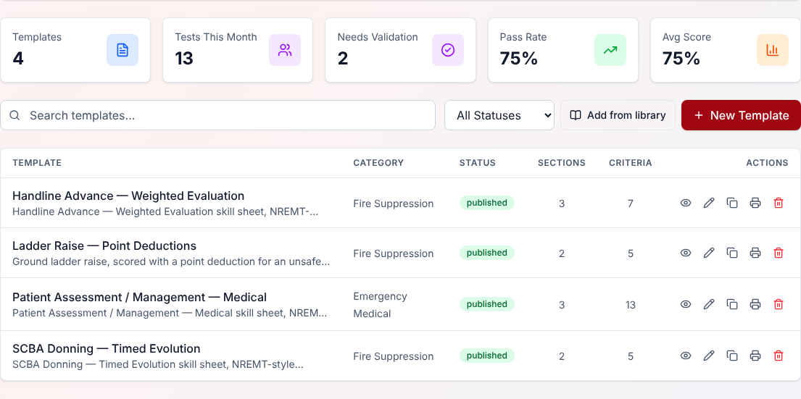

### Template Statuses

| Status        | What it means                                                                                         |
| ------------- | ----------------------------------------------------------------------------------------------------- |
| **Draft**     | Being built. It cannot be used for a test yet                                                         |
| **Published** | Ready. Examiners can start tests from it                                                              |
| **Archived**  | Retired. Old results still show it, but no new test can start from it, and it can no longer be edited |

---

## Creating a Template

**Who can do this:** officers with the **Manage training records** permission.

Go to **Training Admin > Evaluations > Skills Test Templates** and select
**New Template**. (On a phone the button reads **New**.)

> **Tip.** **Add from library** next to it copies a ready-made starter sheet,
> which you can then edit.

### Step 1: Template Metadata

Fill in the **Template Settings**:

| Field                                                   | What it does                                                                                                                                          | Example                                                |
| ------------------------------------------------------- | ----------------------------------------------------------------------------------------------------------------------------------------------------- | ------------------------------------------------------ |
| **Template Name**                                       | The name of the skill sheet. Required                                                                                                                 | "Patient Assessment/Management — Trauma"               |
| **Category**                                            | Free text, used for sorting and searching                                                                                                             | "EMS"                                                  |
| **Visibility**                                          | Who can see the sheet: **All Members**, **Officers Only** or **Assigned Members Only**. Officers always see it                                        | All Members                                            |
| **Linked Training Requirement (optional)**              | A program requirement that passing this test completes. See [below](#linking-a-template-to-a-training-requirement)                                    | "Recruit Academy — Phase 3: Trauma Assessment"         |
| **Description**                                         | Purpose and scope                                                                                                                                     | "NREMT psychomotor exam for trauma patient assessment" |
| **Global Time Limit (minutes)**                         | Optional time limit for the whole test                                                                                                                | 10                                                     |
| **Passing Percentage (%)**                              | The lowest score that passes (0–100)                                                                                                                  | 70                                                     |
| **Valid for (months)**                                  | Optional, 1–120. How long a pass stays valid, from the day of the test. Leave blank if it never expires                                               | 24                                                     |
| **Tags (comma-separated)**                              | Optional labels                                                                                                                                       | "NFPA 1001, Probationary"                              |
| **Require all critical criteria to pass**               | When ticked, any failed critical step fails the test, whatever the score                                                                              | Ticked                                                 |
| **Count Pass/Fail steps toward the overall percentage** | When ticked, each Pass / Fail step is worth points (1 unless you set a number). See [What the percentage is made of](#what-the-percentage-is-made-of) | Ticked                                                 |

The **Result Disclosure** group in the same panel sets who sees results from
this sheet. See
[Overriding it on a single template](#overriding-it-on-a-single-template).

**How "Valid for (months)" shows up for the member.** The skill appears in the
member's **Upcoming Expirations & Due Dates** list on My Training about six
months before it lapses. It reads **Skills test expires** with the date, and
**Skills test expired** afterwards.

- Only a passing, validated, official test counts. Practice runs never count.
- The newest pass for that skill is the one used. Passing again moves the date.
- A result the department does not show the member (see
  [Who Sees a Result](#who-sees-a-result--disclosure-settings)) is not listed.
- Changing the number of months also applies to tests already passed.

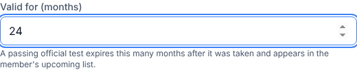

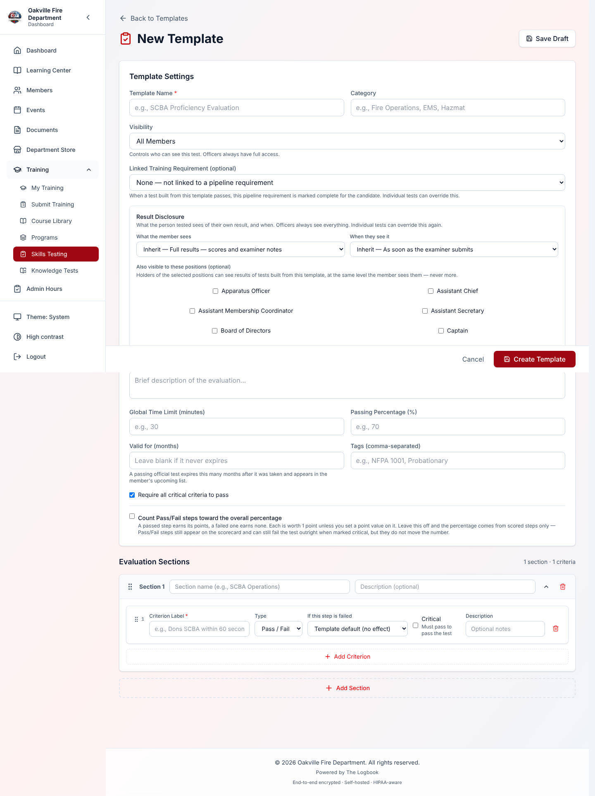

### Step 2: Define Sections and Criteria

Add sections, then add steps (criteria) inside each section.

**Adding a section:**

1. Select **Add Section** under **Evaluation Sections**.
2. Type the section name (for example "Scene Size-Up").
3. Add a description if you want one.

**Adding a step to a section:**

1. Inside the section, select **Add Criterion**.
2. Type the step (for example "Determines scene/situation safety").
3. Choose its **Type**. There are five:

   | Type              | What it is                                                         |
   | ----------------- | ------------------------------------------------------------------ |
   | **Pass / Fail**   | One tap. The digital tick box. This is the default                 |
   | **Numeric Score** | Scored out of a maximum. It always counts toward the percentage    |
   | **Timed Task**    | A stopwatch on the step itself, with its own **Time Limit (sec)**  |
   | **Checklist**     | Several items ticked off inside one step                           |
   | **Statement**     | Text the examiner reads aloud. It marks itself and is never scored |

4. On a **Numeric Score** step, set **Max Points**. This is how you weight a
   step: a step worth 20 moves the percentage twice as far as one worth 10. A
   Numeric Score step with no **Max Points** cannot be saved.
5. On a **Pass / Fail**, **Checklist** or **Timed Task** step, choose what a
   failure costs under **If this step is failed**:
   - **Recorded only — no effect on the score.** The mark shows on the
     scorecard and changes nothing.
   - **Worth points — earned by passing.** Adds points (1 unless you type a
     number) to the points available. A fail earns none of them.
   - **Deducts points — taken off if failed.** Takes points (1 unless you type
     a number) off the total. The points available stay the same. A step left
     unscored is not charged.

   Left alone, a Pass / Fail step follows the template setting **Count
   Pass/Fail steps toward the overall percentage**. Checklist and Timed Task
   steps are recorded only.

6. Tick **Critical** (_Must pass to pass the test_) if failing the step should
   fail the test. That happens when **Require all critical criteria to pass**
   is ticked on the template.

**"If this step is failed" and "Critical" answer different questions.** The
first decides what a failure costs. The second decides whether it ends the
test. A step can take points off without being critical, so a candidate can
lose points on it and still pass.

**Passing Points (critical Numeric Score steps only).** A critical Numeric
Score step also has **Passing Points**: the score the candidate must reach on
that step. The field only shows on critical steps, because a step that is not
critical cannot fail the test on its own. **Passing Points** cannot be higher
than **Max Points**. If you untick **Critical**, the number you typed is kept,
hidden, and comes back if you tick **Critical** again.

> **What if a step deducts points but nothing earns any?** The template will
> not save. There is no total for the deduction to come off. Give at least one
> step a point value first.

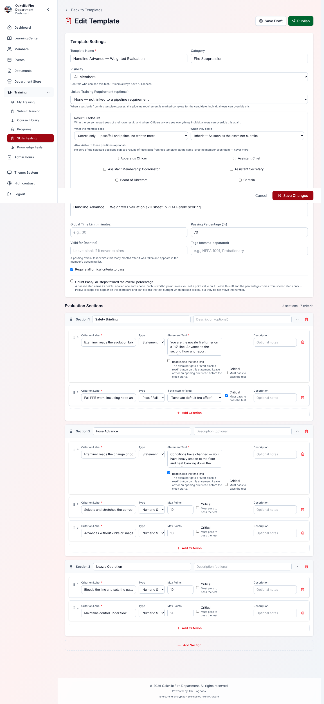

> **Hint:** Critical steps are the digital version of the "Critical Criteria"
> box at the bottom of an NREMT skill sheet. If a candidate fails one, the
> result is a FAIL whatever their points. A step that is not critical and was
> never marked shows as **Not scored**, not as a fail.

### Step 3: Save as Draft

Select **Save Draft** at the top, or **Create Template** at the bottom. The
template is saved as a draft. You can keep editing a draft at any time. Once
it is saved, a **Publish** button appears next to **Save Draft**.

### Linking a Template to a Training Requirement

Use **Linked Training Requirement (optional)** to connect the template to a
requirement in a training program. Then **passing a test from this template
completes that requirement** for the candidate, in their program. Nobody has to
record it separately.

- The link is on the **template**, so it applies to every test from it. An
  officer starting a test can point that one test at a different requirement
  (see [Setting Up a Test Session](#setting-up-a-test-session)).
- Leave it on **None** for sheets used only for practice or informal checks.

See [Training Pipelines](./02-training.md#training-pipelines) for how
requirements and phases fit into a program.

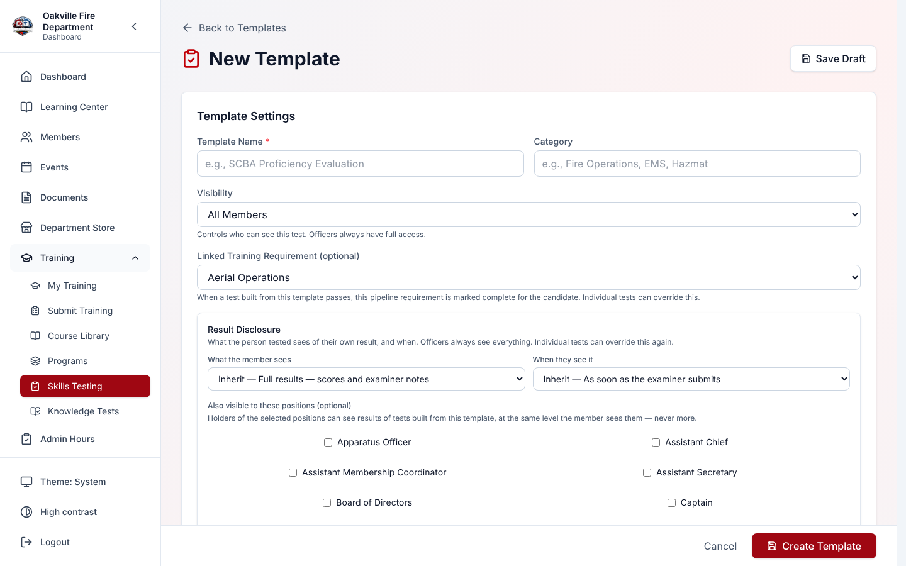

---

## Publishing Templates

When a template is ready:

1. Open the template. Its page is the builder, whether it is a draft or
   already published.
2. Select **Publish**, then **Publish** again in the confirmation. You can also
   publish a draft from the **Publish** icon on its row in the templates list.
3. The Logbook checks that the template has at least one section with at least
   one step.
4. Once published, examiners can start tests from it.

**Editing a published template.** You can still edit it. Every save of a
published template raises the version number by one, whether or not the
sections, steps or scoring changed. Every test keeps a copy of the sheet it was
taken against, so editing never changes a test already run (see
[A completed scorecard is frozen](#a-completed-scorecard-is-frozen)).

**Duplicating a template.** Select **Duplicate** on any template. You get a
draft copy with " (Copy)" added to its name. Use it to make a variant, such as
an NREMT sheet adapted to your department.

**Archiving a template.** Select **Archive** on its row. It stops appearing
when starting a test, but it is not deleted. Old tests keep their scorecards,
and the **Archived** filter still finds it.

---

## Administering a Skills Test

**Who can do this:** any member. You are the examiner of any test you start.

### Who can run a test

**Any member can run an official skills test.** In most departments a senior
member often holds the clipboard. What a member cannot do is decide that the
result stands. That is a separate step: **validation** by a training officer.
See [Officer Validation](#officer-validation).

Writing templates is still for officers only.

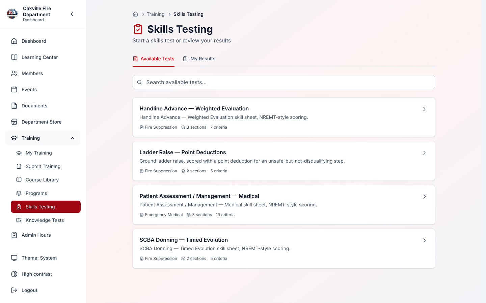

### Setting Up a Test Session

Start from either place:

- **Training > Skills Testing > Available Tests** — tap a test. The **Start
  Skill Test** page opens with that sheet already chosen.
- **Training Admin > Evaluations > Skills Test Records** — select **Start
  Test** (officers).

Then, on **Start Skill Test**:

1. **Select Template** — choose a published sheet. Search by name or
   category.
2. **Test Mode** — choose **Official Evaluation** or **Practice Run**. Officers
   start on Official; other members start on Practice. A member running an
   official test is told it will not count until a training officer validates
   it.
3. **Select Candidates** — **type at least two characters of a name** and pick
   from the results. See [Finding a candidate](#finding-a-candidate). You can
   add several candidates. One test is created for each, you start with the
   first, and the rest wait in the records list. **You cannot pick yourself
   for an official test** — see [Separation of Duties](#separation-of-duties).
4. **Counts Toward Requirement (optional)** — officers only, official tests
   only. If the template is linked to a requirement, it is used by default.
   You can point this test at a **different requirement** instead, for
   example when the same skill counts in another phase or program.
5. **Notes (optional).**
6. Select **Begin Evaluation** (or **Begin Practice**, or **Start N
   Evaluations** for several candidates).

The test is created with you as the **examiner**, and the scoring screen
opens.

### Finding a candidate

The candidate box is a **name search**, not a list of everyone in the
department.

| What you'll notice                                      | Why                                                                                                     |
| ------------------------------------------------------- | ------------------------------------------------------------------------------------------------------- |
| Nothing appears until you type 2 characters             | On purpose there is no way to list the whole roster. You can confirm a name you know; you cannot browse |
| Only the first 15 matches show                          | The list says **Showing the first 15 matches — type more of the name**. Type more rather than scrolling |
| You can type first name, surname, or both               | Matching uses the full name, so "john s" finds John Smith. A surname on its own works too               |
| Only active members appear                              | Inactive and deleted accounts are left out                                                              |
| A member's **practice** test starts with their own name | Drilling alone takes one tap — your name is filled in for you                                           |
| Some members cannot use the search                      | It needs the **View training records** or **Manage training records** permission                        |

The search shows **only a name** — no phone number, email or address. That is
why every member can use it without opening the member directory.

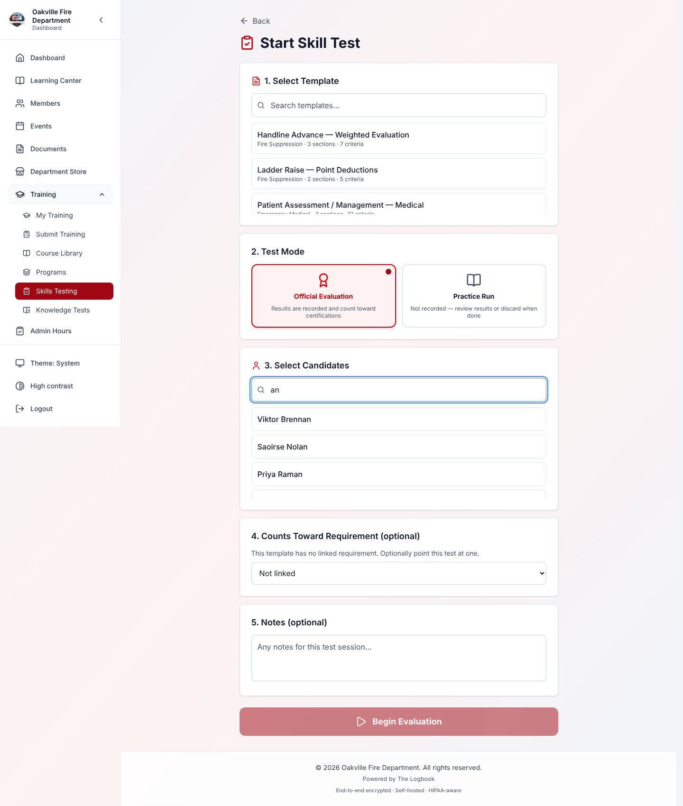

### Separation of Duties

The examiner and the candidate on an **official** test must be different
people. A passing test can complete a training requirement and count toward
certification, so nobody can examine themselves. The Logbook refuses to create
such a test, and the Start Skill Test page says **You can't examine yourself on
an official evaluation — someone else has to hold the clipboard.** Even an
officer cannot score or complete an official test in which they are the
candidate.

**Practice mode is exempt.** Practice runs are never recorded against you, so
you can practise on yourself freely.

The rule holds after the test too. An officer cannot validate, **Void result**
or **Send back to examiner** on a test in which they are the candidate. The
message reads _"You cannot validate your own skills test"_ (or _void_, or
_return_). Another officer has to act on it.

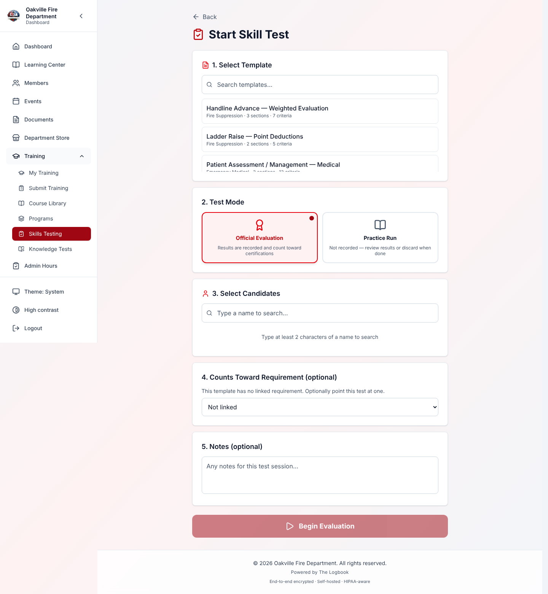

### Test Statuses

| Status          | What it means                                                                                                          |
| --------------- | ---------------------------------------------------------------------------------------------------------------------- |
| **draft**       | Created, but scoring has not started                                                                                   |
| **in progress** | The candidate is being evaluated                                                                                       |
| **completed**   | Finished and scored                                                                                                    |
| **cancelled**   | Closed out before it finished, with **Cancel**. Any partial marks are kept                                             |
| **voided**      | A completed official result an officer withdrew. See [Withdrawing a Result](#withdrawing-a-result--void-cancel-delete) |

### Your scoring saves itself

While a test is in progress, the scoring screen **saves on its own**. A locked
phone or a closed tab does not lose your marks. The **Save** button still works
if you want to save by hand.

> **What if two people edit one test?** Neither one's work is silently thrown
> away. If someone else saved the test after you opened it, your save is
> refused and autosave stops. The screen says _Someone else changed this test.
> Your scoring is not being saved._ and offers **Reload current results**. The
> Logbook only retries on its own when the retry cannot overwrite another
> examiner's marks.

### Scoring with no signal

A test you have opened on your phone keeps working when the signal drops. Your
scoring is saved **on the device** and sent when the signal comes back. You
don't have to do anything.

- A banner says so while there is no signal. The save status reads **Saved on
  this device**.
- **Open the test once with signal** before going somewhere without it. The
  phone keeps a copy of unfinished tests _you_ are examining. A test never
  opened on the device cannot be opened offline.
- **You can start a test with no signal.** Opening **Start Skill Test** with
  signal keeps the published sheets on the device. With no signal, the page
  offers those sheets and the members you have examined on this device. The
  test is created when the phone reconnects, and then its scoring is sent. If
  the sheet was edited in the meantime, the test is refused. You are told, and
  the scoring stays on the device. A test started offline is dated by when it
  reached The Logbook.
- **Submitting with no signal** shows **Submitted on this device**. The test is
  scored when the phone reconnects. There is no result on the phone until
  then.
- Saves made offline are combined. An hour without signal sends one update,
  and the submission is always sent last.
- **If The Logbook refuses it** — the test was voided or completed elsewhere,
  or someone else changed it — you get a message naming the test and the
  candidate. A red banner on the test gives the reason. The scoring stays on
  the device until **you** choose **Discard from this device**. It is never
  thrown away on its own.
- **Signing out asks first.** If evaluations are still waiting to be sent,
  **Sign Out** tries to send them. If it cannot, it warns you and offers **Stay
  signed in**. Signing out anyway deletes them from the device, so the next
  person on a shared station cannot read them. The automatic sign-out after
  you are idle cannot ask. Do not leave a phone with unsent evaluations alone
  until it has signal.

### The timer records what you measured

The examiner's stopwatch reading is what gets recorded. A test begun at 09:00
and finished after lunch records the time you actually measured, not the hours
in between.

- The test clock starts on your first real action: recording a mark, or moving
  to another section. Starting a step's stopwatch also starts the test clock.
- A step's stopwatch reading is kept when you move on, whether or not you
  pressed stop.
- Reopening a test in progress **picks the timer up where it was**. It does
  not restart at 00:00.
- The time from start to finish is used only if a test has no measured time.

### Coming back to an interrupted test

Reopening a test in progress **opens at the first section with blank steps**.

In **Skills Test Records**, an unfinished test says **Resume** (or
**Start** if scoring has not begun) and opens on the scoring screen. A
finished test opens on its scorecard. A cancelled test says neither. It is
closed, and opening it shows its scorecard.

A resumed test shows **Resumed evaluation** above the scoring. The clock
carried on from the last save, so the recorded time is not an exact stopwatch
reading. Its printed scorecard says **Timing not verified**. The Logbook counts
every pickup itself, so resuming on another device does not hide it.


### A cancelled test is read-only

A cancelled test cannot be scored or finished. Opening it shows its marks
read-only and says plainly that **nothing was decided** — no pass and no fail.
It counts toward nothing on the candidate's record and uses none of their
attempts.

To cancel, use the cancel icon on the row in **Skills Test Records**. A dialog
asks for an optional reason.

---

## Scoring & Critical Criteria

During the test, the examiner scores each step as the candidate does it.

### The scoring screen

The screen is built for someone standing outdoors, in gloves, watching the
candidate rather than the screen.

- **The candidate's name is at the top.** Check you have the right person
  before you start.
- **Section chips across the top** show each section's state. A finished
  section is green. Tap a chip to jump to it.
- **A "N of M steps scored" count and a save-status line** answer "am I
  finished?" and "did that save?" at a glance.
- **The bottom bar has Prev, Next and Finish.** On the last section, **Next**
  is gone and **Finish & Review** becomes the main button.
- **Moving to another section takes you to its top.**

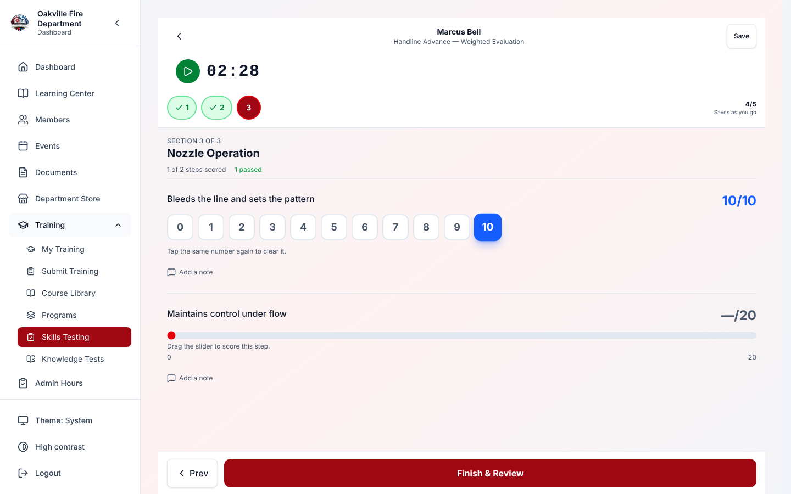

### Recording a mark

Each type of step is marked differently, and each mark can be **undone**:

| Step type         | How you mark it                                                          | To clear it               |
| ----------------- | ------------------------------------------------------------------------ | ------------------------- |
| **Pass / Fail**   | Tap Pass or Fail                                                         | Tap the same one again    |
| **Numeric Score** | Tap the number (10 points or fewer), or drag the slider (more than 10)   | Tap the same number again |
| **Checklist**     | Tick the items the candidate did, or tap **Candidate did none of these** | **Clear this step**       |
| **Statement**     | Marks itself — nothing to do                                             | n/a                       |
| **Timed Task**    | Start and stop the stopwatch                                             | Run it again              |

> **Why clearing matters.** On a critical step, a mis-tapped **0** and a
> deliberate **0** score the same but mean very different things. Tap the same
> value again to clear a mistake.

> **"Candidate did none of these" is not the same as a blank step.** It
> records that the candidate did none of the items. A blank step means nobody
> has judged it yet.

**Add note** sits under each step. A note explains a mark to whoever reads the
scorecard weeks later.

### Running Score

As you score, the screen shows:

- **Section score** — points earned out of the points available in each
  section
- **Overall score** — points earned out of the points available across the
  whole sheet
- **Percentage** — updated as you go. It is based on points, not on how many
  steps passed

> **A blank step reads "—/N" in plain type, not a red "0/N".** A red zero would
> look like a fail you never recorded.

### What the percentage is made of

**Not every type of step counts toward the percentage:**

| Step type         | Counts toward the percentage?                              |
| ----------------- | ---------------------------------------------------------- |
| **Numeric Score** | Yes — earns 0 up to its **Max Points**                     |
| **Pass / Fail**   | **Only if the step, or the template, says so** (see below) |
| **Checklist**     | Only if its **If this step is failed** setting says so     |
| **Timed Task**    | Only if its **If this step is failed** setting says so     |
| **Statement**     | No — read aloud, marks itself, never scored                |

So a sheet can show, say, **86%** while some Pass / Fail questions on it were
failed. Those steps still appear on the scorecard, and a **critical** one still
fails the test outright.

Two things make this readable:

- **The scorecard shows its working.** A breakdown panel above the sections
  gives each section's points, the passing mark used, and any critical step
  that decided the result on its own. It **flags any section that added
  nothing** to the percentage. Both the officer's and the candidate's result
  pages show it.
- **Pass / Fail steps can carry points.** Tick **Count Pass/Fail steps toward
  the overall percentage** on the template, or set a step to **Worth points**.
  A passed step earns its points (1 unless you set a number). A failed one
  earns none.

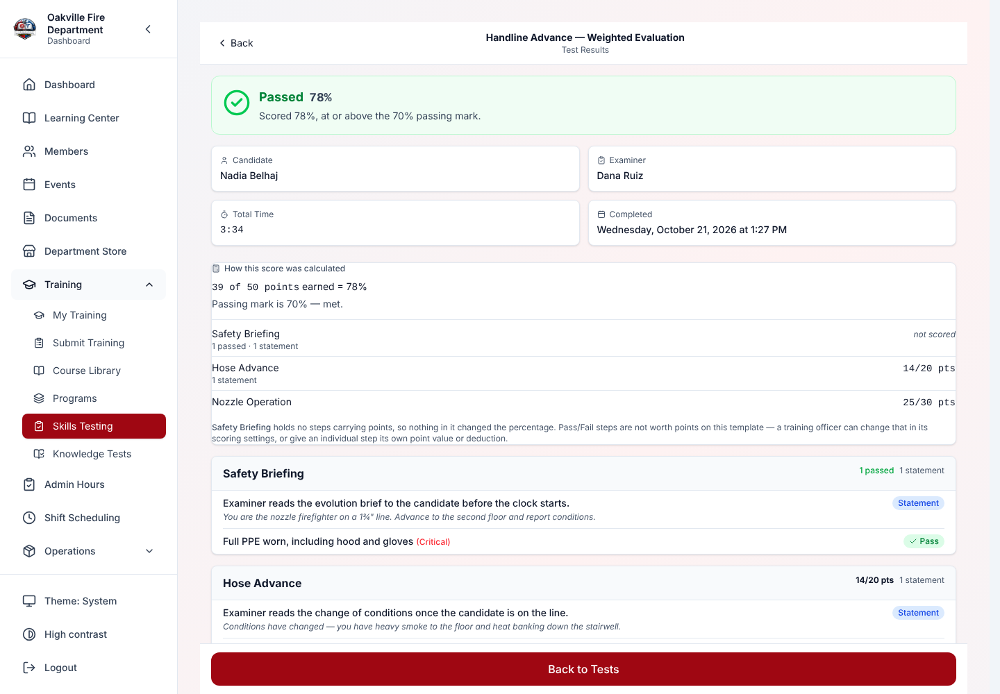

> **Changing the template never re-scores an old result.** Each test keeps the
> rules it was created under. Only new tests follow a change.

> **Checklist and Timed Task steps are recorded only, unless you choose
> otherwise.** Their **If this step is failed** setting can make them worth
> points or take points off. That is judged on the step's overall pass or fail.
> A checklist earns nothing for part of its items. If either must decide the
> result, make it **Critical**.

#### A failed step that costs points without ending the test

A step set to **Deducts points — taken off if failed** costs a fixed number of
points when the examiner records a fail. It ends the test only if it is also
**Critical**.

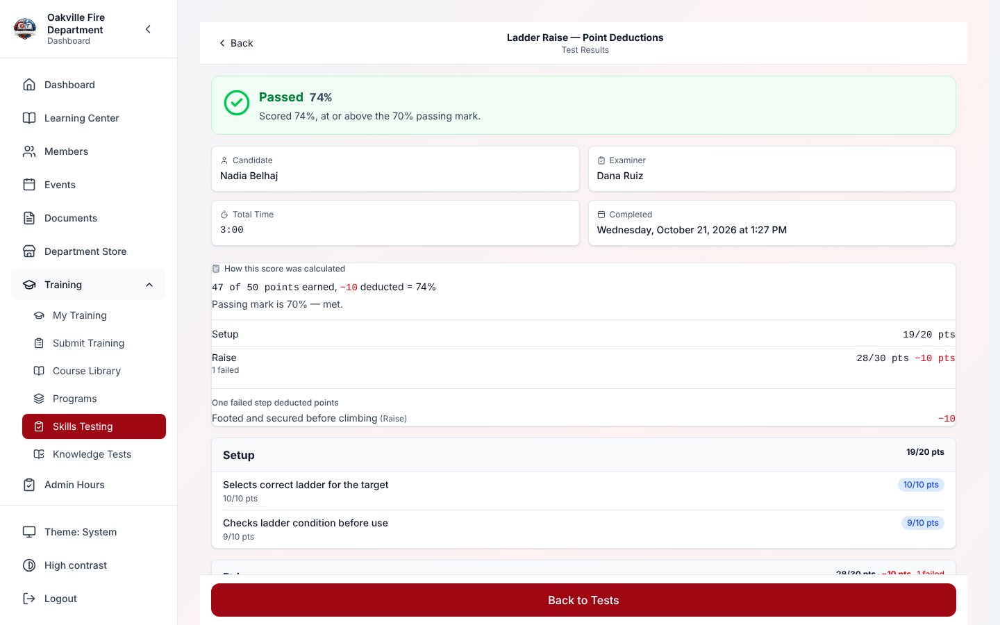

The candidate above lost ten points on one failed step and still passed at
74%, because that step is not critical. The first line of **How this score was
calculated** reads as a subtraction: **47 of 50 points earned, −10 deducted =
74%**. The pass mark is stated under it, and the step that cost the points is
named at the bottom. The "earned" figure is before the deduction, so someone
adding up the marks on the sheet also gets 47.

- **A deducting step does not add to the points available.** The sheet above
  is out of 50 whether or not it lists that step. A candidate who does it
  right gets the same percentage as on a sheet without it. Only the mistake
  costs anything.
- **A step left blank is never charged.** A deduction is a judgement about
  what the candidate did. An examiner who never marked the step made no
  judgement. (A blank _critical_ step is different, and counts as a critical
  failure.)
- **Deductions can take the total below zero, but the percentage stops at
  0%.** Each deduction is still listed in full.

If the sheet has no steps that earn points, there is nothing to take points
off. The panel says so: _The N deducted points did not affect this score. No
step on this template earns points, so there is no total to subtract from. A
training officer should give the scored steps a point value._

### A statement that is read on the clock

Statements mark themselves as soon as they appear, so on their own they do
**not** start the clock. Opening a test that starts with a statement does not
start timing before the candidate is in position.

Some sheets read the opening statement as a brief _before_ the clock. Others
read it _inside_ the time limit ("your time starts now"). For those, tick
**Read inside the time limit** on the statement in the template:

| Setting           | What the examiner sees                          | Effect                                    |
| ----------------- | ----------------------------------------------- | ----------------------------------------- |
| **Off** (default) | The read-aloud box alone                        | Read off the clock; nothing starts timing |
| **On**            | A **"Start clock & read"** button under the box | Tapping it starts the clock               |

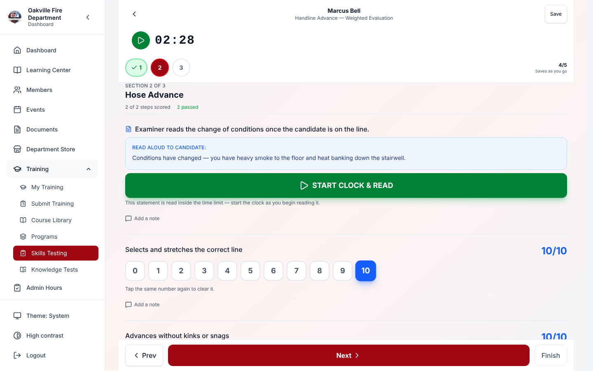

After the tap the button is replaced by _"This statement is inside the time
limit. The clock is running."_

> **It is a button, not an automatic start.** You may open a test to have it
> ready and read the prompt minutes later, once the candidate is in position.
> Starting the clock as the screen opened would time the wait. Tapping the
> button also undoes a manual pause, the same as pressing play.

> **Statements never count as scored steps.** They are left out of every
> count, so a section never reads "3 of 3" with a real step still blank.

### Critical Criteria

If **Require all critical criteria to pass** is ticked on the template:

- Any **critical** step that is not passed means an **automatic FAIL**.
- This is true even if the percentage is above the passing mark.
- A critical step left blank counts the same as a fail.

A critical step is labelled **(Critical)**. Where the template requires all of
them, the section header says so: "Steps marked (Critical) must pass. Leaving
one unscored counts the same as a fail."

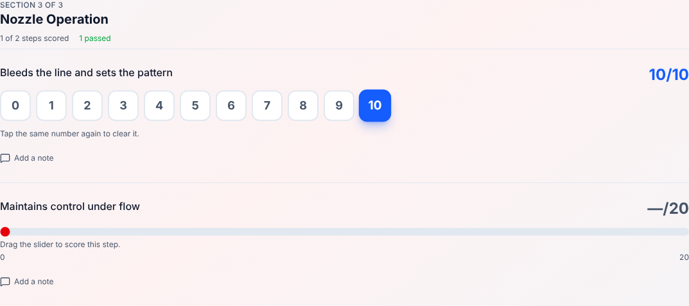

A blank step reads **"—/20"**, not "0/20". The dash means nobody has judged
it; a zero is a judgement. The section count includes only steps that can be
scored ("1 of 2 steps scored"), so statements never pad it.

---

## Completing a Test

When the candidate has finished:

1. Select **Finish & Review** (or **Finish** on an earlier section).

   > **What if some steps are still blank?** A dialog, **Some steps have no
   > result**, gives the count and offers **Keep scoring** or **Review them**.
   > A test cannot be submitted until every step has a result. The review
   > screen lists the blank steps by name. A step that is not critical can be
   > recorded as **Not observed**, with a reason; it neither earns nor costs the
   > candidate anything. A critical step cannot be marked Not observed. Where
   > the template requires all critical steps and a blank one is critical, the
   > dialog says an unscored critical step scores the same as a fail — which
   > is what happens.

   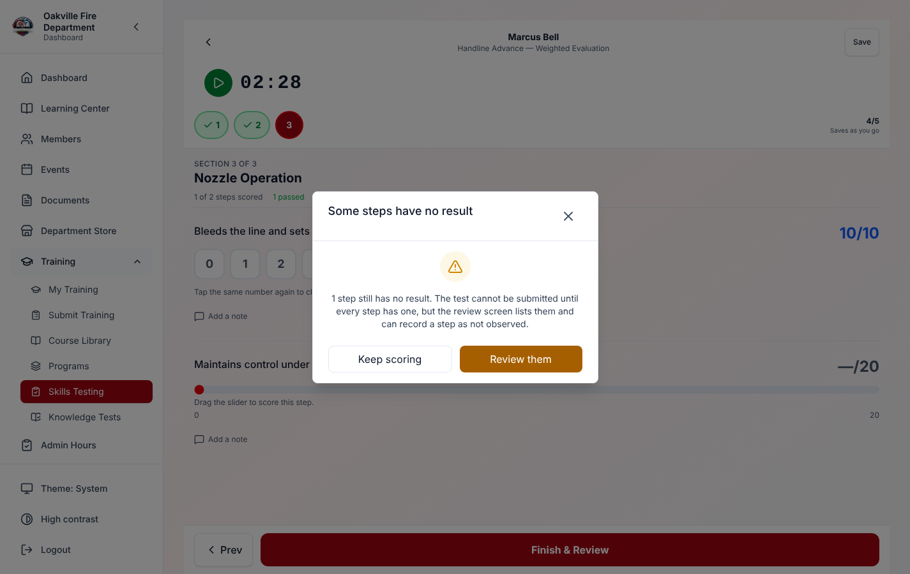

   > **The clock keeps running while the dialog is open.** If you go back to
   > score the last step, the candidate is still being evaluated. Stopping the
   > clock would under-record a test whose time limit may itself be the
   > criterion.

2. On the **review screen** you can:
   - Check each section's steps and marks
   - Add **section notes** with feedback for a specific area
   - Check the scoring before you submit
3. Select **Submit Test**, then **Submit** in **Submit this test?**. Once
   submitted, the marks and notes cannot be changed. (A practice run has
   **View Results** instead.)
4. The Logbook works out:
   - **The score** — points earned out of points available, as a percentage
   - **The critical check** — whether every critical step passed (if
     required)
   - **The time** — the clock reading
   - **Pass or fail** — from the passing mark and the critical steps

### Result Determination

A candidate **passes** if both are true:

1. Their percentage is at or above the template's **Passing Percentage**.
2. If **Require all critical criteria to pass** is ticked, every critical step
   passed.

A candidate **fails** if either is true:

1. Their percentage is below the passing mark.
2. A critical step was not passed (when **Require all critical criteria to
   pass** is ticked).

If nothing on the sheet carries points (for example every step is Pass / Fail
and **Count Pass/Fail steps toward the overall percentage** is off, which is how
a new template starts), the test has no percentage. The scorecard says so, the
passing mark cannot fail the test, and the result rests on the critical steps
alone.

The result screen leads with the outcome and the percentage. It then shows the
candidate, the examiner, the time and the arithmetic — for example **"24 of 50
points earned = 48%. Passing mark is 70% — not met."** A passing scorecard is
shown in [What the percentage is made of](#what-the-percentage-is-made-of);
this is the other outcome:

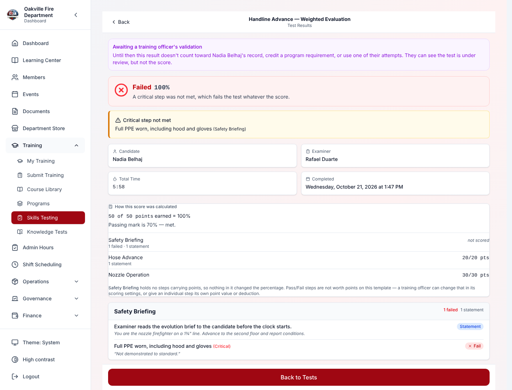

**When a critical step decided it, the screen says so separately:** "A critical
step was not met, which fails the test whatever the score." A **Critical step
not met** box names the step and its section. It appears whether or not the
percentage also fell short, so you never have to work out which rule applied.

Below that, every section is listed with its points, and each step with its
mark and any note — for example "Hood not deployed before entry."

### Effect on Training Pipeline Progress

When an **official** test linked to a training requirement ends in a **PASS**,
The Logbook **completes that requirement on the candidate's active program
enrollment**. The link can come from the template or from an officer's choice
when starting the test. This moves the candidate along their program, and can
complete a phase.

- A **FAIL** does not change program progress.
- **Practice** passes never count (see [Practice Mode](#practice-mode)).
- **A pass from a test run by a member who is not a training officer counts
  only once an officer validates it.** See the next section.

See [Training Pipelines](./02-training.md#training-pipelines) for how a
completed requirement moves a program forward.

---

## Officer Validation

Any member can run a test, so somebody has to decide that a member-run result
stands. That is a training officer, and the step is called **validation**.

### What "awaiting validation" means

When a member without the **Manage training records** permission completes an
**official** test, the result is saved and scored. But it is a **submission,
not a record**. Until an officer validates it:

| It does not…                                             | It does…                                                |
| -------------------------------------------------------- | ------------------------------------------------------- |
| Complete the linked training requirement                 | Keep every mark, note and the time                      |
| Use up one of the candidate's attempts                   | Appear in the officer's review queue                    |
| Count toward the department's pass rate or average score | Show on the candidate's list as **Awaiting validation** |
| Show the candidate whether they passed                   | Keep the examiner's name and the date and time          |

The outcome is held back from the candidate on purpose. No officer has agreed
that the result stands, so showing a PASS or FAIL would claim something nobody
has decided.

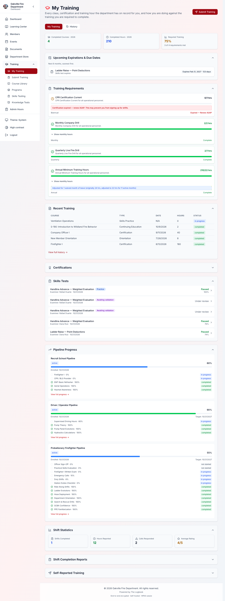

### If you are a training officer

**A test you complete yourself is validated in the same step.** You are the
authority validation exists to get, so there is no queue of your own tests.

To work through tests other members ran:

1. Go to **Training Admin > Evaluations > Skills Test Records**, or select the
   **Needs Validation** card on **Skills Test Templates**.
2. Set the status filter to **Needs Validation**. A **Needs validation** badge
   also marks these rows in the full list.
3. Open a result and read the scorecard — every step, the notes and the time.
   A banner at the top says the result does not count yet.
4. Under **Officer actions** at the bottom of the scorecard, choose:
   - **Accept result** — validates it.
   - **Send back to examiner** — for a result that needs correcting rather
     than rejecting. You must give a reason of at least 10 characters. The
     test reopens for the examiner with every mark intact, so they can fix it
     and submit again. Nothing is recorded against the candidate, and they are
     not told.
   - **Void result** — rejects it. See below.

From the list you can also validate a row with its validate icon, or tick
several rows and select **Accept** to validate them together.

Each action says what it will do to _this_ test before you take it — whether
the candidate is told, and whether they will see your notes or only the
scores. That sentence follows the disclosure settings in force for the test
(the test's own, then the template's, then the department default). Read it
even on a skill you test often: a template can differ from the department, and
one test can differ from its template. See
[Who Sees a Result](#who-sees-a-result--disclosure-settings).

**Accepting is when the result becomes real:** the requirement is completed if
it passed, one attempt is used, the department figures move, and the candidate
can see the outcome under the disclosure rules.

**Void is the way to reject.** There is no separate "reject" button. Voiding
keeps the submission and records why it was refused, rather than deleting an
evaluation someone actually sat. You must give a reason of at least 10
characters, and the candidate can read it.

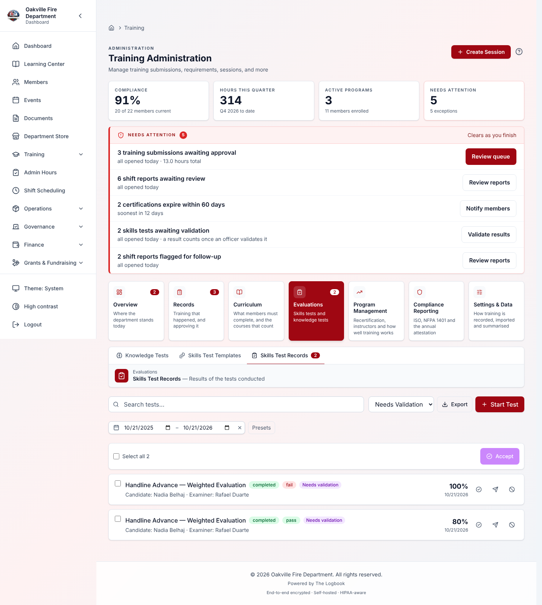

### Edge cases

| What happens                                                  | Result                                                                                                                                             |
| ------------------------------------------------------------- | -------------------------------------------------------------------------------------------------------------------------------------------------- |
| **You are the candidate on a test you are asked to validate** | Refused. Otherwise a peer could "examine" you and you could sign off your own pass                                                                 |
| **You validate a result twice**                               | Nothing happens the second time. The result is unchanged                                                                                           |
| **You try to validate a practice run**                        | Refused — practice is never recorded, so there is nothing to validate                                                                              |
| **You try to validate a voided result**                       | Refused                                                                                                                                            |
| **You try to validate a test still in progress**              | Refused — only a completed test has a result to validate                                                                                           |
| **You try to send back a result already accepted**            | Refused. Void it instead, which gives back the requirement and the attempt                                                                         |
| **The officer who validated a result later leaves**           | The result stays validated                                                                                                                         |
| **A member examines themselves on an official test**          | Refused — see [Separation of Duties](#separation-of-duties)                                                                                        |
| **The candidate reaches their attempt limit**                 | An attempt is used at **validation**, not at completion. A submission never validated never costs a chance — see [Attempt Limits](#attempt-limits) |

---

## Viewing Results

### Individual Test Results

Go to **Training Admin > Evaluations > Skills Test Records** and select a
completed test to see:

- The candidate and the examiner
- The template name
- The score and the pass or fail
- Each section's breakdown
- The time taken
- When it was completed

### Test History

**Skills Test Records** can be filtered by:

- **Status** — In Progress, Completed, Cancelled, Voided, or **Needs
  Validation** (the review queue)
- **Search** — a template, candidate or examiner name
- **Date range** — when the test was completed, or when it was opened if it is
  not finished. The tab opens on the **last twelve months**. Clear the range to
  see every test. The **Needs Validation** card opens the queue with no date
  range, so every result awaiting sign-off is listed however old it is.

Records come a page at a time — 25 by default, with a **Per page** choice and
page buttons under the list. Search covers every page, not just the one on
screen. **My Results** on the member's Skills Testing page, and the skills list
on **My Training**, page the same way.

**Export** downloads what the tab is showing — the same status, search and
date range — as a spreadsheet file (CSV) with one row per scored step. It needs
a date range of **a year or less**. With no range, or a longer one, the button
is greyed out and the line under the date picker says why. For a longer
period, export one year at a time. Export is for officers only.

### What the member sees

**My Training** has a **Skills Tests** section. It lists the member's own
official and practice results, and each one opens a read-only page.

What appears there follows the department's disclosure settings — see
[Who Sees a Result](#who-sees-a-result--disclosure-settings). A result the
department does not share is simply not listed.

Each row shows the template name, the examiner and the date, with the outcome
on the right — **Passed** or **Failed**. Practice runs carry a **Practice**
badge, and voided results a **Voided** badge (reading **Withdrawn**). A test
waiting on an officer carries **Awaiting validation** and reads **Under
review** instead of an outcome. A member may know a test happened before they
are told how it went.


> **What if a failed test reads 100%?** That is correct. The percentage
> measures **scored** steps only. A plain Pass / Fail step carries no points
> unless the template counts it, and Checklist and Timed Task steps carry none
> unless set to. So a candidate can take full marks on every scored step, miss
> a critical Pass / Fail step (in the picture above, full PPE), and fail at
> 100%. The badge tells you whether they passed; the percentage tells you how
> they scored. The scorecard names the step that failed them.

### A completed scorecard is frozen

Every test keeps a copy of the template it was scored against, taken when the
test was created. Editing a published template afterwards only changes future
tests. Inserting or deleting a step, or raising the passing mark, never moves
a recorded mark or turns a recorded pass into a fail.

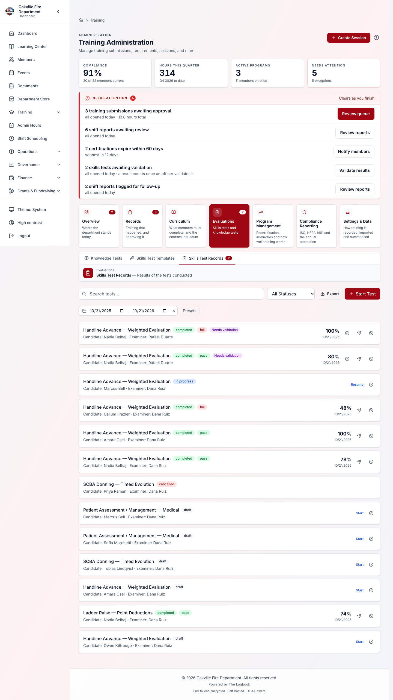

---

## Skills Testing Summary Dashboard

The summary is the row of cards across the top of **Training Admin >
Evaluations > Skills Test Templates**. Only officers who can manage training
records reach this page.

| Card                 | What it shows                                                                                                   |
| -------------------- | --------------------------------------------------------------------------------------------------------------- |
| **Templates**        | How many templates you have, not counting archived ones                                                         |
| **Tests This Month** | Official tests created this calendar month. Practice runs and **voided** results are left out                   |
| **Needs Validation** | Official results waiting for an officer's sign-off. Always shown, even at 0. Select it to open the review queue |
| **Pass Rate**        | The share of **validated**, completed official tests that passed                                                |
| **Avg Score**        | The average percentage across **validated**, completed official tests                                           |

> **"—" means there is nothing to measure yet.** **Pass Rate** and **Avg
> Score** show "—" when there is no figure: no validated test yet, or (for the
> score) nothing tested carried points.

> **Pass rate and average score count only validated results.** A member-run
> result nobody has signed off is not yet the department's finding, and an
> officer may still reject it. Expect these two figures to lag the test count
> while there is a review queue.

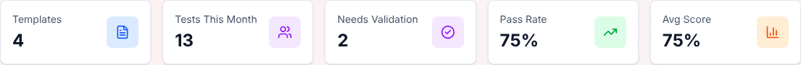

---

## Realistic Example: NREMT Trauma Assessment

This walkthrough follows one skills test from template to result, using an
NREMT "Patient Assessment/Management — Trauma" skill sheet.

### Background

**Springfield Fire-Rescue** is running quarterly EMT recertification skills
checks. Training Officer **Lt. Maria Santos** needs to set up the NREMT Trauma
Assessment sheet and evaluate EMT **Firefighter Jake Thompson**.

---

### Part 1: Creating the Template

Lt. Santos goes to **Training Admin > Evaluations > Skills Test Templates** and
selects **New Template**.

**Template settings:**

- **Template Name:** Patient Assessment/Management — Trauma
- **Category:** EMS
- **Description:** NREMT psychomotor evaluation for trauma patient assessment
  and management. Candidate must demonstrate a systematic approach to
  assessing and managing a trauma patient, including scene size-up, primary
  survey, secondary assessment, and reassessment.
- **Passing Percentage (%):** 70
- **Require all critical criteria to pass:** ticked
- **Count Pass/Fail steps toward the overall percentage:** ticked, so each
  Pass / Fail step is worth 1 point
- **Global Time Limit (minutes):** 10

Every step below is a **Pass / Fail** step. "Critical" means the **Critical**
box is ticked.

**Section 1: Scene Size-Up**

| #   | Criterion                                            | Critical |
| --- | ---------------------------------------------------- | -------- |
| 1   | Takes or verbalizes appropriate PPE precautions      | Yes      |
| 2   | Determines the scene/situation is safe               | Yes      |
| 3   | Determines the mechanism of injury/nature of illness | No       |
| 4   | Determines the number of patients                    | No       |
| 5   | Requests additional EMS assistance if necessary      | No       |
| 6   | Considers stabilization of the spine                 | Yes      |

**Section 2: Primary Survey / Resuscitation**

| #   | Criterion                                                                 | Critical |
| --- | ------------------------------------------------------------------------- | -------- |
| 1   | Verbalizes general impression of the patient                              | No       |
| 2   | Determines responsiveness/level of consciousness (AVPU)                   | No       |
| 3   | Determines chief complaint/apparent life threats                          | No       |
| 4   | Assesses airway and breathing — assessment and corrective interventions   | Yes      |
| 5   | Assesses circulation — bleeding, pulse, skin (color/temperature/moisture) | Yes      |
| 6   | Identifies patient priority and makes transport decision                  | No       |

**Section 3: History Taking**

| #   | Criterion                                              | Critical |
| --- | ------------------------------------------------------ | -------- |
| 1   | Obtains baseline vital signs (BP, pulse, respirations) | No       |
| 2   | Attempts to obtain SAMPLE history                      | No       |

**Section 4: Secondary Assessment**

| #   | Criterion                                                          | Critical |
| --- | ------------------------------------------------------------------ | -------- |
| 1   | Inspects and palpates head, neck, and cervical spine               | No       |
| 2   | Inspects and palpates chest                                        | No       |
| 3   | Inspects and palpates abdomen                                      | No       |
| 4   | Inspects and palpates pelvis                                       | No       |
| 5   | Inspects and palpates lower extremities (pulses, motor, sensation) | No       |
| 6   | Inspects and palpates upper extremities (pulses, motor, sensation) | No       |
| 7   | Inspects and palpates posterior (log roll technique)               | No       |
| 8   | Manages secondary injuries and wounds appropriately                | No       |

**Section 5: Reassessment**

| #   | Criterion                                        | Critical |
| --- | ------------------------------------------------ | -------- |
| 1   | Demonstrates ongoing reassessment of vital signs | No       |
| 2   | Verbalizes continued treatment and monitoring    | No       |

**Totals:** 5 sections, 24 steps (5 critical)

Lt. Santos selects **Create Template**, reviews the draft, and selects
**Publish**. The template is version 1 and ready to use.

---

### Part 2: Administering the Test

On evaluation day, Lt. Santos opens **Training Admin > Evaluations > Skills
Test Records** and selects **Start Test**.

1. **Select Template:** "Patient Assessment/Management — Trauma"
2. **Test Mode:** **Official Evaluation**
3. **Select Candidates:** types "thom" and picks "Jake Thompson"
4. Selects **Begin Evaluation**

The scoring screen opens. Lt. Santos reads the scenario aloud:

> _"You are dispatched to a single-vehicle motorcycle accident. Upon arrival,
> you find a 28-year-old male lying supine on the roadway. He is conscious and
> complaining of pain to his left leg. A bystander tells you the patient was
> traveling approximately 30 mph when he lost control. The patient is wearing
> a helmet."_

Lt. Santos starts the timer and FF Thompson begins.

---

### Part 3: Scoring the Evaluation

As FF Thompson works, Lt. Santos marks each step Pass or Fail ([x] = Pass,
[ ] = Fail):

**Scene Size-Up (6/6):**

- [x] Takes or verbalizes appropriate PPE precautions _(Critical)_
- [x] Determines the scene/situation is safe _(Critical)_
- [x] Determines the mechanism of injury/nature of illness
- [x] Determines the number of patients
- [x] Requests additional EMS assistance if necessary
- [x] Considers stabilization of the spine _(Critical)_

**Primary Survey / Resuscitation (5/6):**

- [x] Verbalizes general impression of the patient
- [x] Determines responsiveness/level of consciousness (AVPU)
- [x] Determines chief complaint/apparent life threats
- [x] Assesses airway and breathing _(Critical)_
- [x] Assesses circulation — bleeding, pulse, skin _(Critical)_
- [ ] Identifies patient priority and makes transport decision _(Fail —
      forgot to verbalize transport priority)_

**History Taking (2/2):**

- [x] Obtains baseline vital signs
- [x] Attempts to obtain SAMPLE history

**Secondary Assessment (7/8):**

- [x] Inspects and palpates head, neck, and cervical spine
- [x] Inspects and palpates chest
- [x] Inspects and palpates abdomen
- [x] Inspects and palpates pelvis
- [x] Inspects and palpates lower extremities
- [x] Inspects and palpates upper extremities
- [x] Inspects and palpates posterior
- [ ] Manages secondary injuries and wounds appropriately _(Fail — did not
      splint the injured leg)_

**Reassessment (1/2):**

- [x] Demonstrates ongoing reassessment of vital signs
- [ ] Verbalizes continued treatment and monitoring _(Fail — did not
      verbalize ongoing care plan)_

---

### Part 4: Results

Lt. Santos selects **Finish & Review**, checks the marks, and selects **Submit
Test**. The Logbook works out:

| Measure                   | Value                |
| ------------------------- | -------------------- |
| **Points earned**         | 21 / 24              |
| **Percentage**            | 87.5%                |
| **Passing mark**          | 70%                  |
| **Passing mark met**      | Yes                  |
| **Critical steps passed** | 5 / 5                |
| **Time**                  | 7 minutes 42 seconds |
| **Result**                | **PASS**             |

**Failed steps:**

1. Primary Survey #6 — did not verbalize the transport priority decision
2. Secondary Assessment #8 — did not splint the injured leg
3. Reassessment #2 — did not verbalize the ongoing care plan

**Section breakdown:**

| Section                        | Score | Percentage |
| ------------------------------ | ----- | ---------- |
| Scene Size-Up                  | 6/6   | 100%       |
| Primary Survey / Resuscitation | 5/6   | 83.3%      |
| History Taking                 | 2/2   | 100%       |
| Secondary Assessment           | 7/8   | 87.5%      |
| Reassessment                   | 1/2   | 50%        |

FF Thompson passed with 87.5%. Every critical step passed, and the score is
above the 70% passing mark. The failed steps are on the scorecard for
follow-up training. Lt. Santos is a training officer, so the result is
validated in the same step.

---

### Example of a FAIL Scenario

Suppose FF Thompson had also failed to assess the airway — a **critical** step
in the Primary Survey:

| Measure                   | Value                                  |
| ------------------------- | -------------------------------------- |
| **Points earned**         | 20 / 24                                |
| **Percentage**            | 83.3%                                  |
| **Passing mark**          | 70%                                    |
| **Passing mark met**      | Yes                                    |
| **Critical steps passed** | 4 / 5                                  |
| **Result**                | **FAIL — a critical step was not met** |

83.3% is above the 70% mark, but the candidate fails. **Require all critical
criteria to pass** is ticked, and one critical step failed. This matches real
NREMT rules.

---

## Practice Mode

A **Practice Run** is for training. It never touches official records or
compliance.

1. On **Start Skill Test**, choose **Practice Run** under **Test Mode**.
   Members start on Practice; officers start on Official.
2. The test is marked **Practice** throughout.
3. A practice run does **not** count toward any requirement or certification.
   It never uses an attempt and never needs validation.
4. When the practice run is finished, you can:
   - **Email Results to Candidate** — officers only. Sends the results for
     self-study, following the disclosure rules
   - **Retake** — start a new run with the same sheet and candidate
   - **Discard** — delete the practice run

> **Tip.** Practice mode suits study sessions, skills labs, and letting
> candidates check themselves before an official evaluation.

### A practice attempt belongs to the member

| Question                   | Answer                                                                    |
| -------------------------- | ------------------------------------------------------------------------- |
| **Who can run one**        | **Any member**, on themselves or on a peer                                |
| **Who can see the result** | The candidate, on **My Training → Skills Tests**, as well as the examiner |
| **Who can delete it**      | The candidate, the examiner, **or** an officer                            |
| **How long it is kept**    | **One year** by default, then deleted automatically                       |

Practice runs are never held back by a release setting (see below). They are
the candidate's own drill notes, not the department's evaluation record.

> **What if a template is "Officers Only"?** It stays officers-only in
> practice too. Starting a practice run follows the same visibility rule as
> opening the template, so a member cannot see a restricted sheet that way.

---

## Who Sees a Result — Disclosure Settings

Showing the candidate the whole scorecard is right for a routine drill. It is
wrong for, say, a promotional evaluation. Examiner notes are often frank
working notes for the training file ("hesitant, needed two prompts"), not
feedback written for the member.

So disclosure is three separate questions. The first two have a department
default, which a template can override, and a single test can override again.
The third is set on the template or the test.

### What the member sees — Results disclosure

| Setting                                                  | The candidate sees                                   |
| -------------------------------------------------------- | ---------------------------------------------------- |
| **Full results — scores and examiner notes** _(default)_ | Every mark, every point, every written note          |
| **Scores only — pass/fail and points, no written notes** | Every mark and point — **all written notes removed** |
| **Nothing — results are never shown to the member**      | The result does not appear for them at all           |

### When they see it — Release

| Setting                                         | What happens                                                  |
| ----------------------------------------------- | ------------------------------------------------------------- |
| **As soon as the examiner submits** _(default)_ | The result is visible once it is decided                      |
| **Only after an officer releases the result**   | The finished result stays hidden until an officer releases it |

Use a release for an evaluation you want a chief to read first, or a failure
you would rather deliver in person. Shift reports use the same idea.

### Who else can see it

- **Named viewers** — add a preceptor or field training officer (FTO) to one
  test.
- **Positions** — on a template, tick positions (for example Training Officer
  or Company Officer) whose holders may read results from that sheet.

> **A viewer never sees more than the candidate does.** If the candidate sees
> scores only, a named preceptor also sees scores only.

#### Naming a viewer on one test

Open the test as an officer and use the **Viewers** panel. Search for the
member, add them, and they can read that one result. The panel appears on
official tests only.

**This is per test, not per template, on purpose.** The link is to the person
being tested, not to the skill. A trainee's FTO changes over time, and a
template-wide grant would also open _other_ candidates' results.

| What happens                            | Result                                                                        |
| --------------------------------------- | ----------------------------------------------------------------------------- |
| Trying to add the **candidate**         | They are not in the picker. They already see the result as the settings allow |
| Trying to add the **examiner**          | Also not in the picker. They always see what they recorded                    |
| Adding someone to a **withheld** result | They see exactly what the candidate sees — for **Nothing**, nothing at all    |
| Removing a viewer                       | Takes effect at once. The result disappears from their list                   |

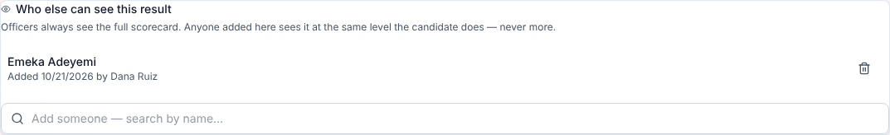

### Setting the department default

Open **Training → My Training** and, as an officer, the **Member Visibility
Settings** tab. This is the same editor that controls what members see of the
rest of their training. The **Skills-Test Results** group has two dropdowns:

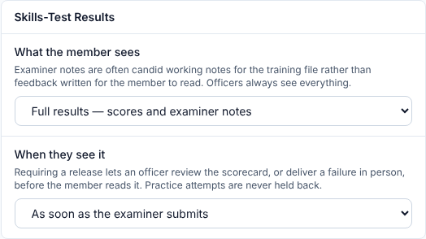

- **What the member sees** — the three choices above. The help text explains
  that examiner notes are often working notes for the training file.
- **When they see it** — the two release choices. The help text explains that
  a release lets an officer review the scorecard, or deliver a failure in
  person, first. Practice runs are never held back.

**When they see it** is hidden when **What the member sees** is **Nothing**,
since there is nothing to time.

### Overriding it on a single template

The template builder has a **Result Disclosure** group. One skill sheet can
differ from the department default without changing it for everyone. A
promotional evaluation can hide notes while routine drills stay fully open.

Each dropdown starts on **Inherit**, and the Inherit choice **says what it
means**. For example: _"Inherit — Scores only — pass/fail and points, no written
notes"_, read from your department's settings. You can see what leaving it
alone does without opening another page.

| Field                                          | Choices                                                                                 |
| ---------------------------------------------- | --------------------------------------------------------------------------------------- |
| **What the member sees**                       | Inherit, or one of the three disclosure choices                                         |
| **When they see it**                           | Inherit, or one of the two release choices. **Hidden** when the member sees **Nothing** |
| **Also visible to these positions (optional)** | A tick list of your department's positions. **Not shown** if you have none              |

Setting a dropdown back to **Inherit** really clears the override. It does not
keep the last value in place.

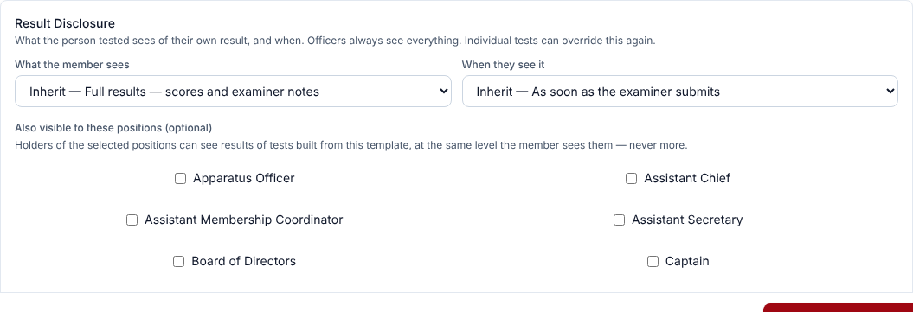

Here is the same group with both dropdowns set on the sheet: **Scores only** and
**Only after an officer releases the result**. A member who takes a test from
this sheet sees nothing of it until an officer releases it. After the release
they see pass or fail and the points, but none of the examiner's written notes.

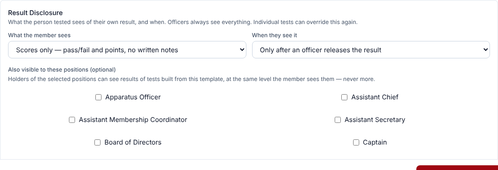

### Releasing a withheld result

In **Skills Test Records**, a completed official result that has not been
released has a release icon next to the void icon. It appears on any
unreleased result, whatever the release setting. Releasing twice does nothing,
and a result the member may never see is refused, so you do not need to check
the setting first.


In the row above the result is already accepted, so there is no validate icon.
The paper plane is the release icon, and the circle with a line through it is
the void icon.

On the result itself, **Release to candidate** appears under **Officer
actions** only where it is a real step: the result is held for release, and the
member is allowed to see it. Until the result is accepted, the button is
greyed out — there is no decided outcome to release yet.

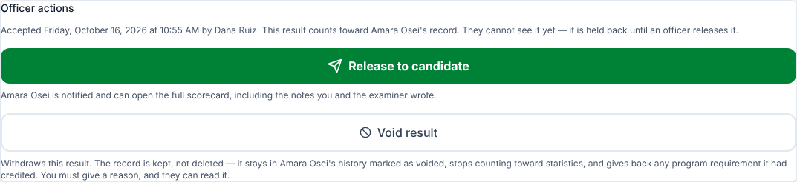

### The member is told when a result becomes theirs to read

When a result becomes visible to the candidate, they get an in-app
notification linking to it. That depends on the disclosure rules, not on which
button an officer pressed:

| What happens                                                | Is the member notified?                                      |
| ----------------------------------------------------------- | ------------------------------------------------------------ |
| An officer completes a test (validated in the same step)    | Yes, under "As soon as the examiner submits"                 |
| An officer accepts a member-run result                      | Yes, under "As soon as the examiner submits"                 |
| A result is accepted under "Only after an officer releases" | No — it counts, but they cannot read it yet                  |
| That result is later released                               | Yes                                                          |
| A result is accepted where the member sees **Nothing**      | No. Announcing a result they may not read would give it away |
| A member ran the test and nobody has validated it yet       | No. There is no decided outcome to tell them about           |
| An official result they could see is **voided**             | Yes, with the reason                                         |
| A result they could never see is voided                     | No                                                           |
| Any practice run                                            | No — practice is the member's own drill note                 |

Under **Scores only**, the notification says examiner notes are not included,
so nobody goes looking for notes that were held back on purpose.

### Edge cases worth knowing

- **A withheld result looks _absent_, not _forbidden_.** It is left out of the
  member's list, and opening it directly says "not found". A "you may not view
  this" message would announce "you were evaluated and may not know how it
  went", which is worse than silence.
- **An empty list does not always mean "none taken".** The member's empty list
  says _Results your department doesn't share won't appear here_, without
  claiming anything is being held back.
- **Emailing results follows the same settings**, worked out for the
  _recipient_, not the officer sending it. **Email Results to Candidate** is
  not a way around a decision to hide or trim a result.

---

## Withdrawing a Result — Void, Cancel, Delete

Three different things can go wrong with a test, and each has its own action.
**Skills Test Records** offers the one that fits on each official test's row. It
does not list practice runs: a practice run is deleted from the candidate's own
**My Training > Skills Tests** page, or with **Discard** on the examiner's
screen. **Void result** is also under **Officer actions** on the result page,
which is usually where you find that a result should not stand.

| Action     | Use it for                                            | What happens                                                                                                                                                                                                                   |
| ---------- | ----------------------------------------------------- | ------------------------------------------------------------------------------------------------------------------------------------------------------------------------------------------------------------------------------ |
| **Delete** | A **practice** run                                    | The record is removed. Done from the candidate's result page, or as **Discard** on the examiner's screen, not from the Records list                                                                                            |
| **Void**   | A completed **official** result that should not stand | The record is **kept**, with your reason (at least 10 characters) and your name. It drops out of the totals, pass rate and average score, and **any requirement the pass completed is given back**. The member sees the reason |
| **Cancel** | A test **abandoned part-way**, never scored           | Any partial marks are kept and the test is closed out. No reason is required                                                                                                                                                   |

Choosing **Void result** opens a dialog that names the candidate and the test
and asks for the reason. The confirm button stays greyed out until the reason
is at least 10 characters, and the member can read what you write.

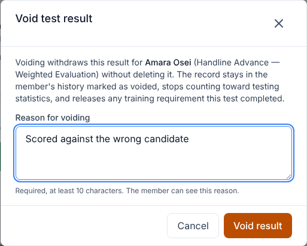

The void icon on a row in **Skill Test Records** opens the same dialog, so you
can withdraw a result without opening it first.


> **An official result cannot be deleted.** A scored evaluation is a record of
> what an examiner saw. It is withdrawn, not erased. Void is the action, and
> the reason and the officer are part of the record.

> **Cancel is not void.** An unscored test has no result to withdraw and
> nothing to give back, so it needs neither.

The cancel icon on an unfinished test's row in **Skill Test Records** opens a
dialog that names the candidate and the test and says what will happen: anything
already scored is kept, and no result is recorded. The reason is optional. **Keep
it open** leaves the test as it was.

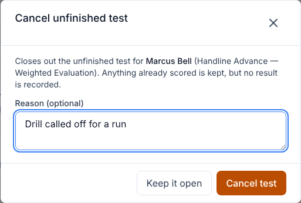

**Send back to examiner** is the fourth option, for a result still awaiting
validation that needs correcting. See
[If you are a training officer](#if-you-are-a-training-officer).

---

## Printing: the blank sheet and the completed scorecard

There are two print views — the two halves of the same sheet. Both open in a
**new tab** and bring up the browser's print dialog, so you stay on the page
you were working on.

| View                    | Where to start                                                                 | What it is                                                                                                              |
| ----------------------- | ------------------------------------------------------------------------------ | ----------------------------------------------------------------------------------------------------------------------- |
| **Blank skill sheet**   | **Skills Test Templates** → the **Print blank sheet** icon on a template's row | Your own sheet as a paper form: marking boxes, candidate and examiner fields, signature lines                           |
| **Completed scorecard** | **My Training → Skills Tests** → open a finished result → **Print**            | A finished evaluation on paper: the mark against each step, the arithmetic behind the percentage, and who signed it off |

### Why print at all

**The blank sheet is for places The Logbook cannot reach.** Skills checks
happen at a burn tower, in an apparatus bay or at a county training ground,
often with no signal. Printing _your own template_, rather than a generic form,
means what gets marked in the field matches what gets typed in afterwards.
Sections and steps are numbered exactly as on the scoring screen. Each type of
step prints the mark its on-screen control records, so one paper mark maps to
one field. Drafts can be printed too, which helps proofreading.

**The completed scorecard is for where a screen cannot go:** a candidate's
paper training file, or a state or ISO audit packet. Neither accepts an email.

### Who can print what

Both views are open to **any signed-in member**, on purpose.

- The **blank sheet** holds no member information. The templates list already
  applies each sheet's visibility rule, and the sheet itself is checked again
  when it loads.
- The **completed scorecard** is trimmed **before it reaches your browser**. An
  officer gets the full scorecard. A candidate under **Scores only** gets the
  marks without the examiner's notes. A result still awaiting validation
  arrives with **no outcome at all**. The page prints exactly what it was given.

> **Why printing is not restricted to officers.** Restricting it would stop a
> member printing a result they can already read on screen, while hiding
> nothing from anyone else. The disclosure settings control what is in the
> scorecard, before it leaves The Logbook. Printing cannot get around them.

### Edge cases

| What happens                                            | Result                                                                                                                                           |
| ------------------------------------------------------- | ------------------------------------------------------------------------------------------------------------------------------------------------ |
| Result still awaiting officer validation                | **Print** is not offered, and the print page refuses anyway. There is no outcome to print yet                                                    |
| Candidate under **Scores only** prints their own result | They get the marks and the arithmetic, without the examiner's notes — the same as on screen                                                      |
| Practice run                                            | Prints like any finished test. The page marks it **Practice attempt — not an official record**, so it cannot be filed as one                     |
| Template archived after a sheet was printed             | The paper sheet is still fine to copy from, but check its steps against the current template first — an archived template may have been replaced |
| Pop-up blocker                                          | A blocker can silently stop the new tab. If **Print** seems to do nothing, allow pop-ups for the site                                            |
| Printing with "Background graphics" on                  | Safe to leave on. The Logbook forces a white page when printing                                                                                  |

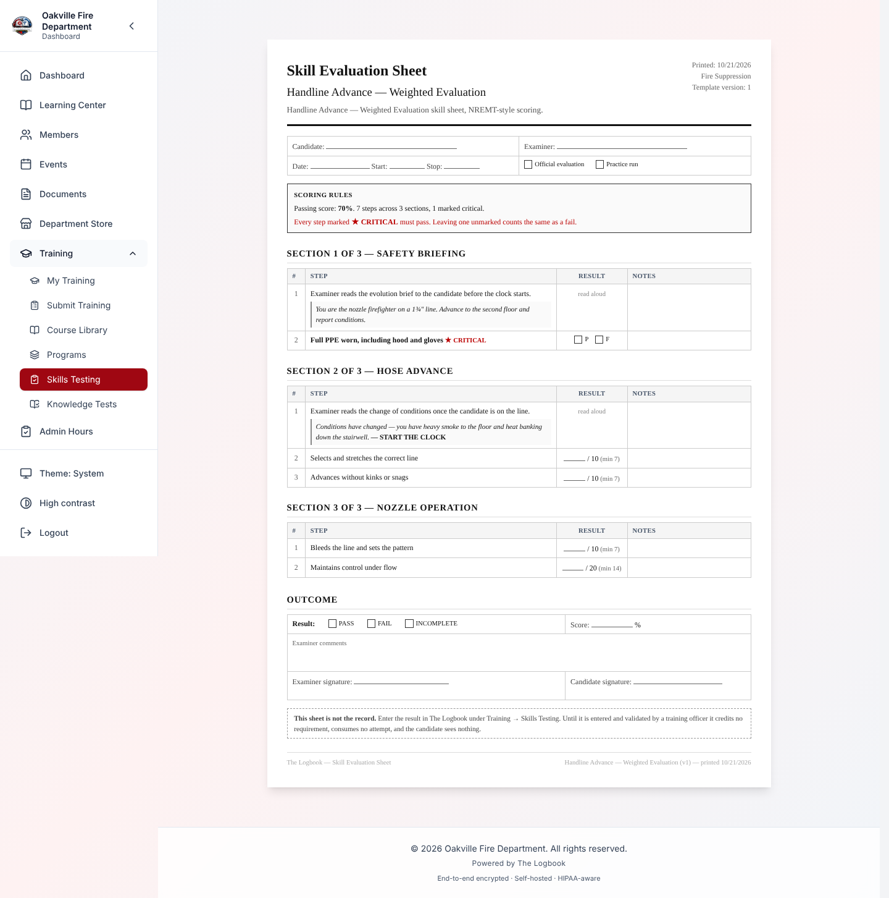

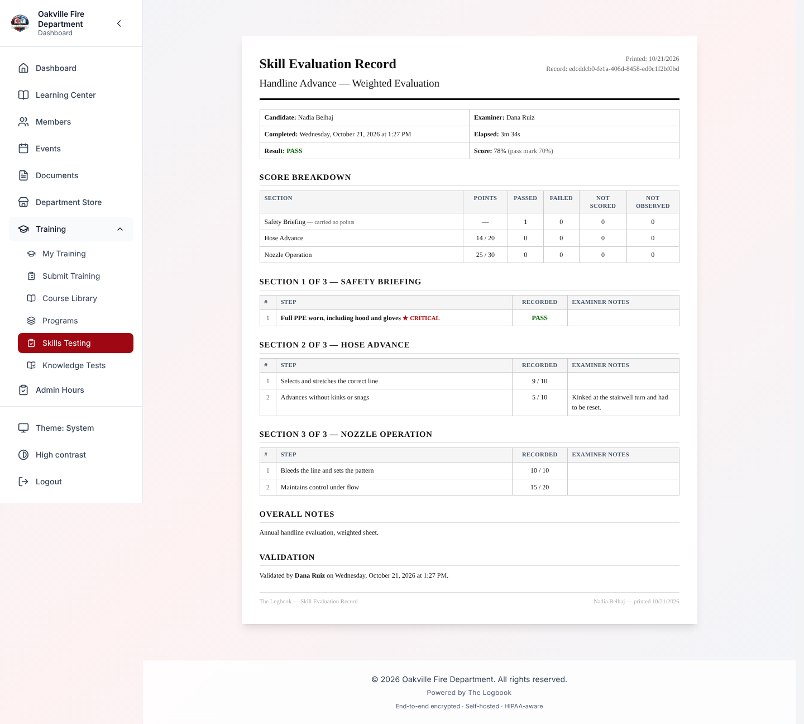

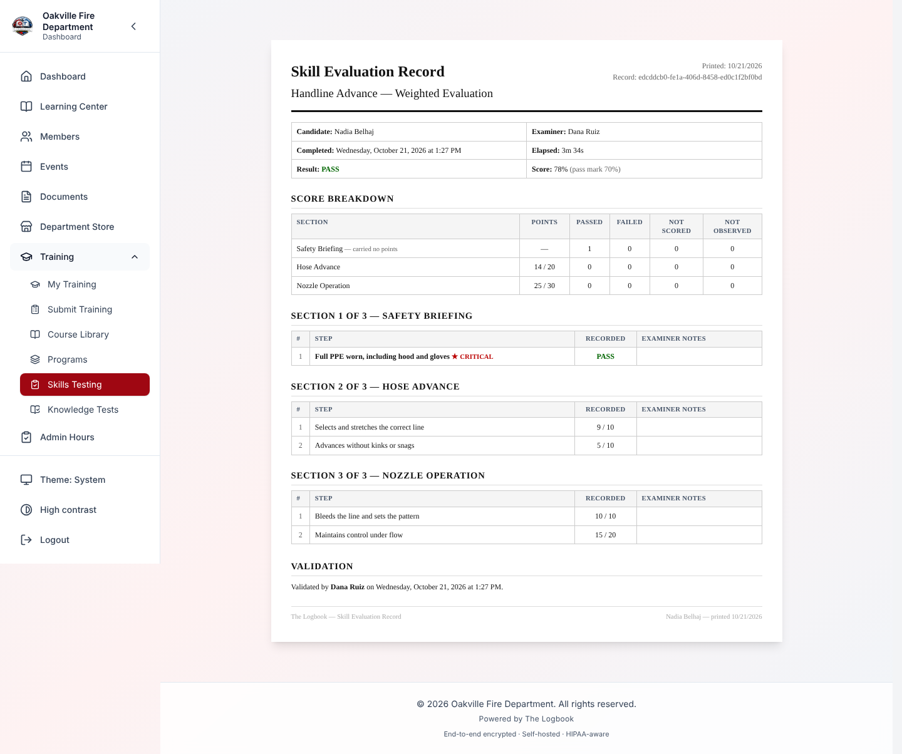

---

## Attempt Limits

A training requirement can limit how many attempts a candidate gets. If the
requirement a test is linked to has a limit, Skills Testing enforces it.

You are stopped in **two** places:

1. **When you create the test** — so you are told _before_ running an
   evaluation that could not count.
2. **When the result is accepted** — because several tests can be started
   before any is submitted, so the first check alone is not enough.

An attempt is used when a training officer **validates** the result, not when
the test is completed. A submission that is never validated never costs the
candidate a chance. The message reads _Maximum attempts (N) reached for this
requirement. Practice attempts are still available and are never recorded._

What counts as an attempt:

|                                                         | Uses an attempt?                          |
| ------------------------------------------------------- | ----------------------------------------- |
| A completed, **validated** official test — pass or fail | **Yes**                                   |
| A completed official test **awaiting validation**       | No — it is a submission, not yet a record |
| A **voided** result                                     | No — the department withdrew it           |
| A **practice** run                                      | No                                        |
| A test started but never completed                      | No                                        |

> **Recertification still works.** A requirement that is already completed,
> verified or waived has no limit, so testing a member again against it is
> always allowed.

---

## Permissions

"Officers" below means members whose position includes the **Manage training
records** permission.

| Action                                                    | Who can do it                                                                                        |
| --------------------------------------------------------- | ---------------------------------------------------------------------------------------------------- |
| Create, edit, publish, duplicate or archive templates     | Officers                                                                                             |
| Set a template's disclosure override                      | Officers                                                                                             |
| Run an **official** test                                  | Any member                                                                                           |
| Run a **practice** test                                   | Any member                                                                                           |
| Look up a candidate by name                               | Members with **View training records** or **Manage training records**                                |
| **Validate**, send back, **void** or **release** a result | Officers                                                                                             |
| Delete a **practice** run                                 | The candidate, the examiner, or an officer                                                           |
| Delete an **official** result                             | Nobody — use **Void**                                                                                |
| **Cancel** an unscored test                               | Officers, from Skill Test Records. The examiner can also cancel it until an officer has validated it |
| Add or remove a **named viewer**                          | Officers                                                                                             |
| Set the department disclosure defaults                    | Officers                                                                                             |
| Export test records                                       | Officers                                                                                             |
| See your own results                                      | Any member (your own only)                                                                           |
| See all results and the summary cards                     | Officers                                                                                             |

> **What if a member opens a test they are not part of?** They get **"not
> found"**, not "forbidden". Telling someone a record exists that they may not
> read is itself a disclosure.

---

## Integration with Training Compliance

Skills tests connect to the rest of training through **program requirements**:

- **Training Requirements.** A template can be linked to a requirement (see
  [Linking a Template to a Training Requirement](#linking-a-template-to-a-training-requirement)),
  and an officer can change the link for one test. When a candidate passes an
  official test from a linked template, and the result is validated, the
  requirement is completed on their active program enrollment.
- **Training Programs.** Link templates to the requirements in a program's
  phases — for example "Recruit Academy Phase 3 requires passing Trauma
  Assessment and Cardiac Arrest Management."
- **Expiry.** A template with **Valid for (months)** puts the skill on the
  member's **Upcoming Expirations & Due Dates** list on My Training.

A skills test does not create a training record and does not add training
hours.

### Integration with Shift Completion Reports

This applies **only to departments that chose Shift report sign-offs** under
**Practical Skills**.

| Your department runs             | What the shift report does with skills                                                                                                               |
| -------------------------------- | ---------------------------------------------------------------------------------------------------------------------------------------------------- |
| **Skills Testing** (the default) | The shift report form shows **no skills list**. Nothing a shift report holds about skills reaches competency or program progress                     |
| **Shift report sign-offs**       | The officer ticks the skills a member demonstrated, and can score each 1–5. Matching skills count toward the member's competency, as described below |

Under shift report sign-offs:

- On a shift completion report, the officer selects each skill the member
  demonstrated and can give it a score from 1 to 5. The labels for each score
  are set by the department; see
  [Scheduling → Score Labels](./03-scheduling.md#score-labels).
- When the report is **approved**, each demonstrated skill whose name matches
  a skill under **Training Admin > Evaluations > Skill Evaluations** is
  recorded as a sign-off for the member, with its score. The member's
  competency history and the competency view update.
- A skill with no matching name stays on the report but goes no further.

```
Shift report approved, with demonstrated skills
    ↓
Each skill name is matched against Skill Evaluations
    ↓
Matching skills → a sign-off is recorded, with the score
    ↓
The member's competency history updates
    ↓
The competency view shows the new scores
```

> **What if a skill name does not quite match?** Matching ignores capital
> letters but nothing else. "Pump operations" on a report matches a skill
> named "PUMP OPERATIONS", but not one named "Pump ops". In **Shift Reports
> settings → Apparatus Skills**, each skill has a green tag if it matches a
> Skill Evaluation and an amber one if it does not. See
> [Skill Evaluations](./02-training.md#skill-evaluations) in the
> training guide.

---

## Troubleshooting

| Problem                                                         | What to do                                                                                                                                                                                                                                                                                                         |
| --------------------------------------------------------------- | ------------------------------------------------------------------------------------------------------------------------------------------------------------------------------------------------------------------------------------------------------------------------------------------------------------------ |
| "Template must be published before it can be used for testing"  | Only published templates can be used. Open the template and select **Publish**                                                                                                                                                                                                                                     |
| Cannot publish a template                                       | It needs at least one section with at least one step. Add them and try again                                                                                                                                                                                                                                       |
| Can I edit a published template?                                | Yes. Each save of a published template raises the version number. Archived templates cannot be edited                                                                                                                                                                                                              |
| Cannot change a completed test                                  | Completed and cancelled tests are locked. An officer can **Send back to examiner** a member-run result still awaiting validation                                                                                                                                                                                   |
| Test shows FAIL but the score is above the passing mark         | Check whether **Require all critical criteria to pass** is ticked. If a critical step was not passed, the result is FAIL whatever the score                                                                                                                                                                        |
| Candidate doesn't appear in the search                          | Type at least **two characters** of their name — nothing shows before that, and there is no way to browse everyone. Only the first 15 matches appear, so type more of the name. The candidate must also be an **active** member; check their account status                                                        |
| The candidate search does not work for me                       | Looking up a candidate needs the **View training records** or **Manage training records** permission. Ask an administrator to add it to your position                                                                                                                                                              |
| A member ran a test but nothing shows on the candidate's record | Expected. An official test run by a member who is not a training officer is a **submission** until an officer validates it. Open **Training Admin > Evaluations > Skills Test Records**, set the status filter to **Needs Validation**, and accept, send back or void it                                           |
| "You cannot validate your own skills test"                      | Separation of duties. You cannot sign off your own evaluation, even when someone else examined you. Another officer has to validate it                                                                                                                                                                             |
| Validation is refused                                           | Practice runs are never recorded, so there is nothing to sign off. Voided results and tests still in progress are refused too: only a completed, official, unvoided test has a result to validate                                                                                                                  |
| Template is archived — can I still see old tests?               | Yes. Each test keeps a copy of the sheet it was taken against. Archived templates just can't be used for new tests                                                                                                                                                                                                 |
| The score looks wrong                                           | When the sheet has steps that carry points, the score is points earned ÷ points available × 100. Check each step's **Max Points**, its **If this step is failed** setting, and whether **Count Pass/Fail steps toward the overall percentage** is ticked. The breakdown panel on the scorecard shows the working   |
| Pass Rate or Avg Score shows —                                  | No official test has been validated yet. These figures count validated, completed tests only, so a queue of results awaiting sign-off leaves them at — until an officer validates one                                                                                                                              |
| Practice results showing in compliance                          | Practice runs never count toward compliance, requirements or statistics. They do not appear in **Skills Test Records**, so a test listed there is official. A practice run is deleted by the candidate (from their result page) or the examiner (**Discard**)                                                      |
| Cannot delete a test record                                     | **Official results cannot be deleted.** Use **Void**, which keeps the record with your reason and gives back any requirement the pass completed. Delete is only for practice runs                                                                                                                                  |
| "Maximum attempts (N) reached for this requirement"             | The linked requirement limits attempts and the candidate has used them. Validated official tests count, pass or fail; voided results and practice runs do not. If an attempt should not count, void it. A requirement already completed, verified or waived has no limit, so recertification testing is unaffected |
| "Someone else changed this test" / autosave has stopped         | Someone else saved the same test after you opened it. Select **Reload current results**, then re-enter anything you scored since. Autosave stops rather than retrying a save that cannot succeed                                                                                                                   |
| A member says their result is missing                           | Check the department setting (**My Training > Member Visibility Settings > Skills-Test Results**) and the template's override. If the member sees **Nothing**, or the result waits for a release that has not happened, they see no entry at all — this is by design. Release it from **Skills Test Records**      |
| The **Passing Points** field disappeared from a step            | It only shows on **critical** Numeric Score steps. Tick **Critical** to bring it back; the earlier value is still there                                                                                                                                                                                            |
| A statement step will not save                                  | Choose the **Statement** type and fill in its text. A statement with no text cannot be saved ("Statement text is required")                                                                                                                                                                                        |
| Can I score a test with no signal?                              | Yes, for a test opened on the device while it had signal — see [Scoring with no signal](#scoring-with-no-signal). The scoring is sent, and the test is scored, when the device reconnects                                                                                                                          |

---

## If You Learned an Older Version

If you are following older notes, an older recording or an SOP, these things
have moved, been renamed or work differently.

- **The officer screens moved.** Templates and test records are under
  **Training Admin > Evaluations**, as **Skills Test Templates** and **Skills
  Test Records**. There is no separate **Summary** tab: the summary is the row
  of cards on **Skills Test Templates**.
- **Skill Evaluations moved** from **Training Admin > Setup** to **Training
  Admin > Evaluations**.
- **Any member can run an official test.** Before, only officers could, so
  every official result from before that change already counts as validated
  by its examiner. Nothing from that time lands in the review queue. If old
  results do appear in the queue, report it rather than accepting them all.
- **Official results cannot be deleted.** Use **Void** instead.
- **Old elapsed times may look long.** Tests completed before the stopwatch
  reading was recorded show the time from when the test first went in progress
  to when it was submitted, so a test begun in the morning and submitted after
  lunch shows hours.
- **Old scorecards were frozen from the template as it stood then.** Tests
  completed before each test kept its own copy of the sheet were given a copy
  of the template at that time. What they were first scored against cannot be
  recovered, but it is what those tests already showed.
- **Passing Points only shows on critical steps.**
- **The Needs Validation card is always shown** to officers, next to Pass
  Rate, even when the queue is empty.
- **Pass Rate and Avg Score show "—", not 0%,** when there is nothing to
  measure.

---

**Previous:** [Administration & Reports](./08-admin-reports.md) | **Next:** [Mobile & PWA Usage](./10-mobile-pwa.md)
