# Mobile & PWA Usage

The Logbook works in any modern web browser. You can also install it on your
phone or tablet's home screen, so it opens like an app. There is no app store
download.

This guide covers installing the app, getting around on a phone, what works
without a signal, push notifications, scanning, and fixing common problems.

---

## Table of Contents

1. [What Is a PWA?](#what-is-a-pwa)
2. [Installing on iPhone / iPad (Safari)](#installing-on-iphone--ipad-safari)
3. [Installing on Android (Chrome)](#installing-on-android-chrome)
4. [Installing on Desktop (Chrome / Edge)](#installing-on-desktop-chrome--edge)
5. [The Installed App Experience](#the-installed-app-experience)
6. [Getting Around on a Phone](#getting-around-on-a-phone)
7. [How Screens Fit a Phone or Tablet](#how-screens-fit-a-phone-or-tablet)
8. [Keeping the App Up to Date](#keeping-the-app-up-to-date)
9. [Offline Behavior and Limitations](#offline-behavior-and-limitations)
10. [Push Notifications on Mobile](#push-notifications-on-mobile)
11. [Mobile-Optimized Features](#mobile-optimized-features)
12. [Tips for Mobile Use](#tips-for-mobile-use)
13. [Check Your Understanding](#check-your-understanding)
14. [Troubleshooting](#troubleshooting)
15. [Realistic Example](#realistic-example-mobile-workflow--event-check-in-equipment-scan--offline-queue)
16. [If You Learned an Older Version](#if-you-learned-an-older-version)

---

## What Is a PWA?

A [progressive web app (PWA)](./GLOSSARY.md) is a website you can install on
your device. Once installed, it behaves like an ordinary app:

| Feature                 | In the browser                  | Installed                                      |
| ----------------------- | ------------------------------- | ---------------------------------------------- |
| Open from home screen   | No (open browser, type address) | Yes (tap the icon)                             |
| Full screen             | No (browser toolbar visible)    | Yes (no browser toolbar)                       |
| Works without a signal  | Limited                         | Screens open, but information needs a signal   |
| Updates                 | Automatic                       | Automatic                                      |
| App store needed        | No                              | No                                             |

New versions download in the background. See
[Keeping the App Up to Date](#keeping-the-app-up-to-date).

---

## Installing on iPhone / iPad (Safari)

On an iPhone or iPad, only **Safari** can add The Logbook to the home screen.
Chrome, Firefox and other browsers on iOS cannot.

1. Open **Safari** and go to your department's Logbook address.
2. Sign in, to check the site loads correctly.
3. Select the **Share** button (a square with an upward arrow). It is at the
   bottom of the screen on an iPhone and at the top on an iPad.
4. Scroll down the share sheet and select **Add to Home Screen**.
5. The name defaults to "The Logbook". You can change it if you like.
6. Select **Add** in the upper-right corner.

The Logbook icon appears on your home screen. Selecting it opens the app full
screen, without the Safari toolbar.

> **Hint:** No "Add to Home Screen" in the share sheet? Make sure you are in
> Safari, not another browser. Also make sure you are on the real Logbook page,
> not a redirect or a sign-in page from a different site.

---

## Installing on Android (Chrome)

1. Open **Chrome** and go to your department's Logbook address.
2. Sign in, to check the site loads correctly.
3. Chrome may show a banner at the bottom offering to install the app. Select
   **Install**.
4. No banner? Select the **three-dot menu** (top right), then **Install app**
   or **Add to Home screen**.
5. Confirm by selecting **Install**.

The Logbook icon appears on your home screen and in your app drawer. It opens
full screen.

> **Hint:** Some Android phones can also install from Firefox or Samsung
> Internet. Look for "Install" or "Add to Home screen" in that browser's menu.

---

## Installing on Desktop (Chrome / Edge)

1. Open **Chrome** or **Edge** and go to your department's Logbook address.
2. Look for the **install icon** in the address bar (a monitor with a down
   arrow, or a "+").
3. Select it and confirm **Install**.
4. The app opens in its own window and appears with your other programs.

You can also use the browser menu: **three-dot menu > Install The Logbook**
(Chrome) or **Settings > Apps > Install this site as an app** (Edge).

---

## The Installed App Experience

Once installed, The Logbook runs on its own, outside the browser:

- **No browser toolbar.** The app uses the whole screen. The phone's status bar
  takes the app's dark red colour.
- **Its own window.** It shows as a separate app in your app switcher, not as a
  browser tab.
- **You stay signed in** between launches, within your department's sign-in
  time limit.
- **App icon.** Your department's logo, if one has been uploaded. Otherwise the
  standard Logbook icon. See
  [Your Department's Logo as the App Icon](#your-departments-logo-as-the-app-icon).
- **Shortcuts.** Press and hold the app icon for shortcuts to **My Schedule**,
  **Dashboard** and **Members**. This works on Android and some desktops.
- **Opens on your dashboard.** The app starts on your dashboard, not on a
  welcome page.
- **A launch screen on iPhone and iPad.** While the app starts, iOS shows a
  launch screen sized for your device, instead of a blank white flash.
- **Bottom bar on phones.** See
  [Getting Around on a Phone](#getting-around-on-a-phone).

### Your Department's Logo as the App Icon

When a member installs The Logbook, the icon is **your department's logo**. On
an iPhone the launch screen carries it too. The Logbook sizes the logo for
every icon shape a phone asks for. There is nothing to set up beyond uploading
the logo in **Organization Settings → General → Profile**.

Things worth knowing:

- **Anyone who installed earlier keeps the old icon.** A phone reads the icon
  once, when the app is installed. To get the logo, remove the app from the
  home screen and add it again. The same applies after you **change** the logo.
- **No logo uploaded means the standard Logbook icon.**
- **Only an uploaded logo is used.** A logo entered as a link to a picture
  elsewhere is not. The settings screen and the setup wizard both upload, so
  this only affects a logo added some other way.
- **On Android the logo can look smaller than you expect.** Android trims icons
  to a circle, rounded square or other shape chosen by the phone maker. The
  logo is fitted inside the area every one of those shapes keeps, on a solid
  background. Fitting it larger would cut the corners off a crest on some
  phones.

_An illustration, not a photo of a phone. Both icons are exactly what a phone
receives at install, made from a demo crest; the home screens around them are
drawn. On the right you can see the Android point above: the crest sits well
inside the circle._

---

## Getting Around on a Phone

On a phone, The Logbook has a **bar along the bottom of the screen**, within
reach of your thumb. On a tablet or computer (768 pixels wide or more) the bar
does not appear: the side or top menu is already on screen there.

### The Bottom Bar

From left to right, the bar holds five items:

| Item               | What it does                                                         |
| ------------------ | -------------------------------------------------------------------- |
| **Home**           | Opens your dashboard                                                 |
| A tab you choose   | See [Choosing Your Bottom-Bar Tabs](#choosing-your-bottom-bar-tabs)  |
| **Add** (round)    | Opens [Quick Add](#quick-add)                                        |
| A tab you choose   | See [Choosing Your Bottom-Bar Tabs](#choosing-your-bottom-bar-tabs)  |
| **More**           | Opens the full navigation menu                                       |

- Five items is the limit. More than that and the labels stop fitting on a
  small phone.
- The bar **hides while the on-screen keyboard is up**, so it never covers the
  field you are typing in.
- The bar **hides while a dialog, drawer or bottom sheet is open**, so it never
  covers a dialog's buttons. It comes back when the dialog closes.

### The Top Bar and the Menu

The bar at the top of a phone screen shows your department's logo and name.
Selecting it takes you to your dashboard. **There is no menu button in the top
bar.** To open the full navigation menu, select **More** on the bottom bar.
Tap outside the menu to close it.

<!-- Screenshot needed:
_[Administrator (long menu) at /dashboard in a 390×844 phone viewport: bottom-bar More tapped so the navigation drawer is open and not yet scrolled, with the bottom fade and the More pill with its arrow visible above the drawer footer.]_
-->

A long menu does not always look long on a phone, because phones hide
scrollbars until you scroll. When there are more items below, the bottom of
the menu fades and a small **More** button with a down arrow appears. Select it
to scroll the list down. On a computer the side menu has an ordinary
scrollbar instead.

<!-- Screenshot needed:
_[The navigation drawer open on a 390px phone as an officer, with items below the fold: the fade at the bottom edge and the floating **More** chevron.]_
-->

### Notification Badges on a Phone

The unread notification count is in a different place on a phone than on a
computer:

- **Computer:** the **Notifications** link in the side menu carries the count.
- **Phone:** the count is on the **Notifications** entry **inside the menu**.
  The top bar has no bell. Select **More** to see the count.
- The app stops checking for new notifications while it is in the background,
  to save battery.

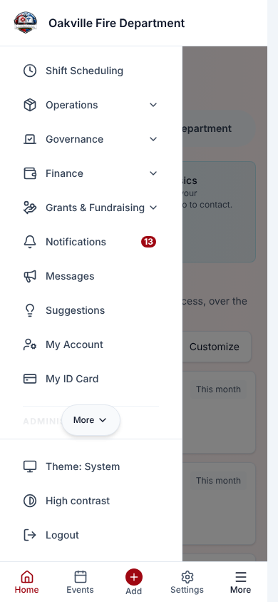

A member told to "watch for the red badge" will not see one on a phone until
they open the menu.

### Quick Add

The round **Add** button in the middle of the bottom bar opens a short list of
the things members log most. Each row opens the screen that already handles
that entry. Quick Add has no forms of its own.

| Row                      | Who sees it                                                  |
| ------------------------ | ------------------------------------------------------------ |
| **Log training hours**   | Everyone, when Training is turned on                         |
| **Start a rig check**    | Everyone, when Inventory is turned on                        |
| **Add an action item**   | Everyone                                                     |
| **Clock in**             | Everyone                                                     |
| **Check into a shift**   | Everyone, when Scheduling is turned on                       |
| **Scan a member ID**     | Members who can view the member list or manage members       |
| **Log a shift report**   | Officers who can manage training records                     |
| **Request equipment**    | Officers who can manage inventory                             |
| **Create an event**      | Officers who can manage all events                            |
| **Add a member**         | Officers who can manage member profiles                       |

A row only appears if you can actually open the page behind it. You never get
a row that leads to an "Access Denied" page.

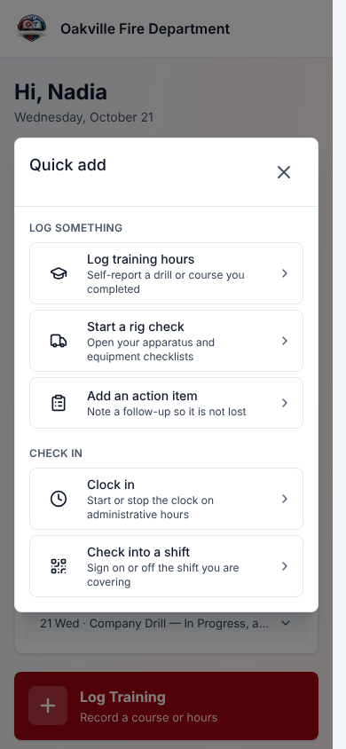

### Choosing Your Bottom-Bar Tabs

You choose the two tabs either side of **Add**:

1. Open **My Account → Appearance**.
2. Find **Phone navigation bar**.
3. Pick a tab in **Left of Add** and in **Right of Add**.

Your choice saves the moment you make it. It is _"Saved to your account, so
they follow you to every device."_ To go back to the standard tabs, select
**Use the default tabs**.

The lists offer only places you can open: Events, Store, Schedule, Training,
Members, Documents, Learning and Settings. They depend on which parts of The
Logbook your department has turned on and on your permissions. **Home** is
always first, so it is not in the lists.

- **Never chosen?** You get the standard tabs. A member gets **Events** and
  **Schedule**. An administrator (anyone who can manage all settings) gets
  **Events** and **Settings**. If your department has Scheduling turned off, a
  member gets a different tab in its place rather than a gap.
- **A tab you can no longer open** (its part of The Logbook turned off, or a
  permission removed) is replaced by the next standard tab. Your choice is
  kept, and comes back when you can open that tab again.
- **The Settings tab opens My Account**, your own settings. It does not open
  the department's Organization Settings. Officers who manage those reach them
  from **More**.

<!-- Screenshot needed:
_[My Account → Appearance on a 390px phone, scrolled to **Phone navigation bar**: the **Left of Add** and **Right of Add** selects (one set to Training), the **Use the default tabs** link, and the bottom bar beneath showing the chosen tab.]_
-->

---

## How Screens Fit a Phone or Tablet

### Controls Are Sized for a Fingertip

On a phone, and on any touch screen such as a tablet, every button, box and
link is at least **44 pixels** tall. That is the size a fingertip needs. A test
checks this, so a new control cannot be too small.

- **Text boxes, dropdowns and buttons are taller** on a phone or tablet.
- **Checkboxes look the same size**, but the area around them that responds to
  your thumb is bigger.
- **Small icon buttons are bigger.**

On a computer with a mouse, controls keep their desktop size. A mouse pointer
does not need the target a fingertip does.

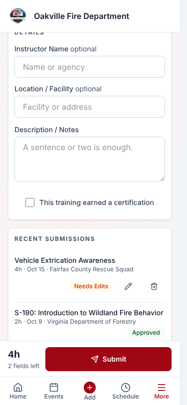

_The Submit Training form on a phone. Almost every control on it is 44 pixels
or taller. The two that are not — the drawn checkbox square and a hidden file
picker — each sit inside a label that takes the tap. The whole certification
row is one tap target, so selecting anywhere on it ticks the box. To check this
yourself, open the form on a phone and try it._

### Text Size on a Phone

On a phone, ordinary text is never smaller than **12 pixels**. That includes
the bottom-bar labels, the notification count and the "3 hours ago" times on
the dashboard.

A few dense, fixed-size layouts keep smaller text on purpose, because larger
text would break them: chart axis labels, the day cells in the shift-pattern
month grid, and the sample barcode on the label-print preview.

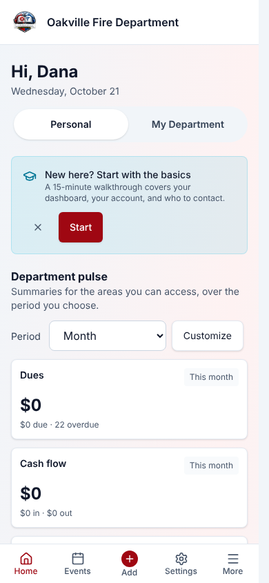

### Layouts on a Phone

Nothing in The Logbook should make you scroll sideways on a phone. Here is how
screens adapt:

- **Page headers** stack the title above the buttons.
- **Tab rows** scroll sideways inside themselves instead of wrapping onto two
  lines.
- **Two-column forms** become one column.
- **Long rows of badges or filters** wrap onto the next line.
- **Tables** (documents, training, audit and check-in, among others) turn into
  stacked cards. Every value keeps its column heading beside it, so you never
  need to remember a header row that has scrolled away.
- **Stat tiles** (Finance, Grants and the administration hubs) wrap their labels
  instead of cutting them off.
- **Date and time pickers** fit a narrow phone and show their values.
- **Dialogs** never grow taller than the screen. A tall dialog scrolls inside
  itself, so its buttons can always be reached. **Shift Details** opens as a
  window in the middle of the screen, inset from the edges on a phone.

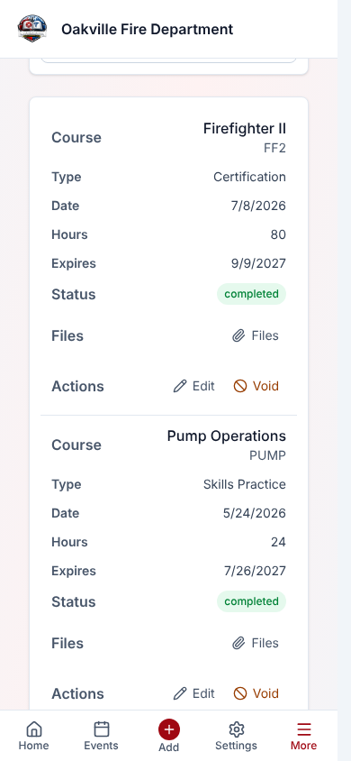

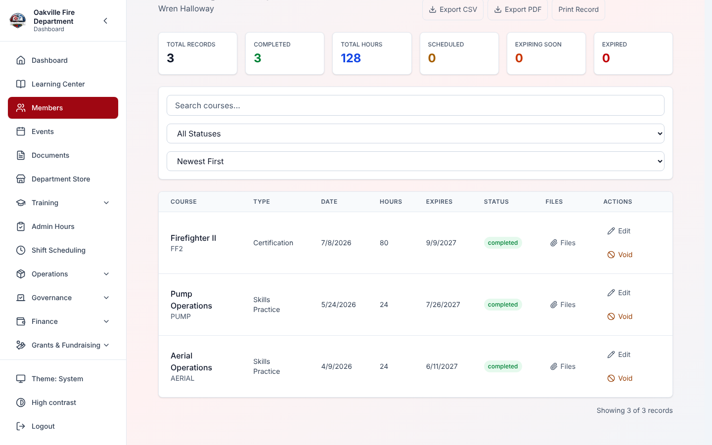

_The same page and the same three records, on a phone and at desktop width.
On the phone every value keeps the column heading that named it, and there is
nothing to scroll sideways._

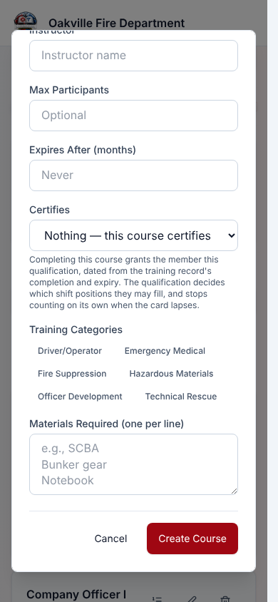

The dashboard stacks its panels into a single column:

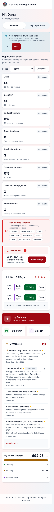

The inventory items list shows cards instead of table rows. On the inventory
items page, **officers who can manage inventory** also get a round floating
button in the bottom-right corner on a phone. It opens two actions: **Add Item**
and **Distribute Items**. Members without that permission do not see the
button.

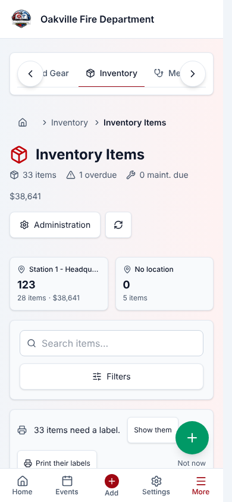

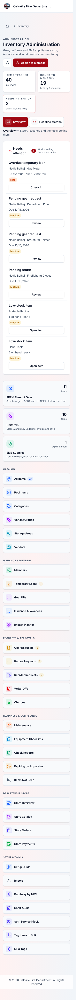

### Settings Screens on a Phone

Organization, Scheduling, Elections, Events, Email Templates, Checklist
Settings, My Account and the other settings screens share one layout:

- The **sections** run across the top as a row of buttons. On a phone the row
  scrolls sideways, and each button is 44 pixels tall. A keyboard can reach
  every one.
- A section's **pages** sit in a list on the left on a computer. On a phone the
  list becomes a sideways-scrolling row under the sections.
- The screen uses the same 16-pixel side margin as the rest of the app, so a
  long setting name has room. A **RECOMMENDED** badge wraps under its label.

### Administration Hubs on a Phone

The Members, Events, Training, Scheduling, Inventory and Store hubs sit on the
same page margin as every other page. On a phone, a hub's sections are a
**sideways-scrolling row of chips**, with the chosen section's description
beneath. A fade and a round arrow at an edge show there is more. Select the
arrow to move along. See _Administration hubs_ in
[08 — Admin & Reports](./08-admin-reports.md).

### The Checklist Builder on a Phone

The equipment-check template builder fits a phone:

- Only the back arrow, the template name, **Publish** and the to-fix badge stay
  pinned at the top. The status, **Details / Tools / Save** and the
  **Applies to** chips scroll away with the page.
- A row's menu opens as a titled sheet from the bottom of the screen.
- A location's header takes two lines.
- An empty location shows one full-width **Add items** button.

### The Schedule on a Phone

The Schedule tab is a **board** on a phone too: a grid of the month, a day
sheet that opens beneath it when you select a day, and a confirmation screen
for claiming a seat. A shift's chip says whether it still needs people, and one
button claims the first open seat you are cleared for. The day cells in the
grid are 44 pixels tall.

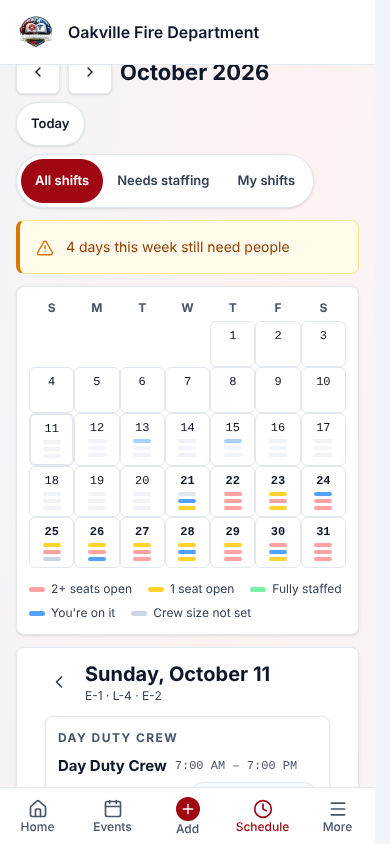

The chips, the claim button and the reasons it can be missing are described in
[The Schedule Board and Standing Shifts](./03-scheduling.md#the-schedule-board-and-standing-shifts).

### On a Tablet

- **Edit, delete and download buttons are always visible.** On a computer with
  a mouse, some of these appear only when you hover over a card. A tablet
  cannot hover, so on a touch screen they stay on screen.
- **Card lists fit their space.** With the side menu open, a list shows two
  roomy columns rather than three cramped ones.
- **Small buttons keep their icon beside the label.**
- **Names wrap** rather than being cut off.

### The Check-In Station on a Tablet

**Members → Check-In Station** is meant to be left running on a tablet by a
door. On Chrome for Android over a secure (HTTPS) address it reads ID cards
itself, using the tablet's [NFC](./GLOSSARY.md). With a USB card reader, it
listens to the **whole page** rather than one box. A tablet at a door loses
focus to the first stray tap, and a station that has quietly stopped reading
is worse than one that was never switched on.

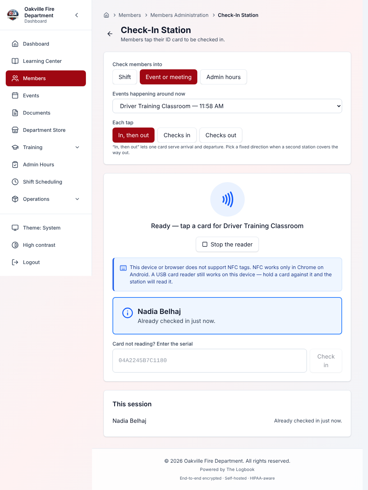

### Dark Mode on Public Pages

Pages people reach without signing in — a public form, the ballot voting page
and an applicant's status page — follow dark mode like the rest of the app.

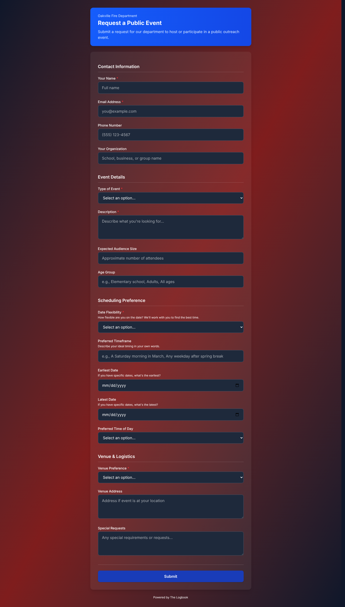

The dark background reaches the right edge of the window, including the strip
the browser keeps for a scrollbar. One exception comes from the browser: an
open dialog's dimmed backdrop cannot reach that strip. So on a **light** page
with a dialog open, that strip stays light beside the dimmed page.

Printed pages are always white, in light or dark mode, even with the browser's
**Background graphics** option switched on.

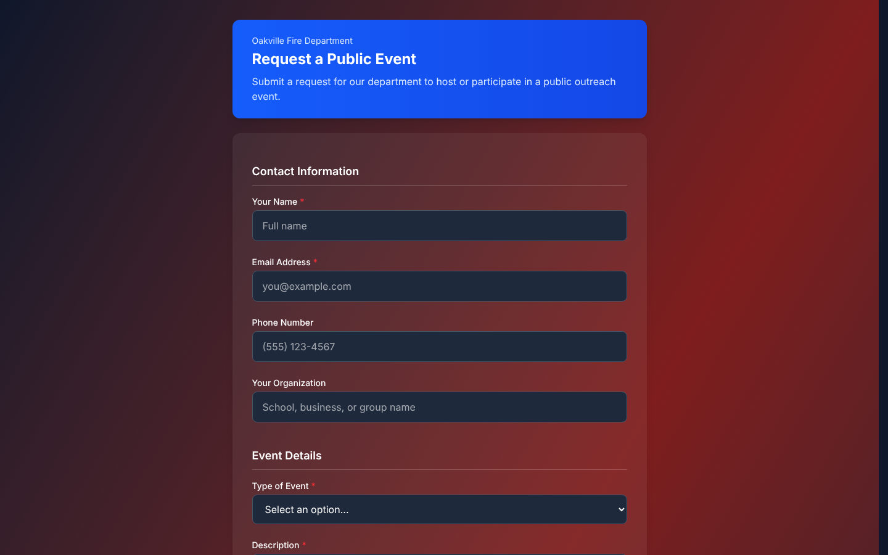

### Browser Tabs

Each browser tab shows the name of the page in it, so you can tell several
Logbook tabs apart. While a page loads, its tab reads **The Logbook**. It takes
the page's name once the page's heading appears.

---

## Keeping the App Up to Date

### Automatic Updates

The Logbook checks for a new version when you open it, when you come back to
it, and every few minutes while it is open. When it finds one:

1. The new version downloads in the background.
2. A blue bar says **"A new version of The Logbook is available."** On a phone
   the bar sits at the bottom of the screen, just above the bottom bar. On a
   tablet or computer it sits at the top.
3. Select **Reload now**. The app waits for the new version to be ready, then
   reloads **once** onto it.

Select the **X** on the bar to be reminded again in an hour.

If the device cannot install the update by itself, the bar says **"A new
version is available, but this device could not install it automatically."**
and offers **Force refresh**. See below.

If a page fails to load just after an update, the app recovers by itself
through the same single reload, rather than showing an error page.

> **Hint:** Think you are on an old version but see no bar? Use
> **My Account → App** (below) rather than guessing.

### Checking and Forcing an Update Yourself

An installed app has no address bar and no reload button. When a device is
stuck on an old version, **My Account → App** is the place to go. It shows:

- **Installed version.** The version this device is running, and when it was
  released. Read it out when you report a problem. It tells whoever is helping
  exactly which version you are seeing.
- **Check for updates.** Asks The Logbook whether a newer version has been
  released. If one has, the app updates and reloads onto it. If not, it says
  **"You're on the latest version."** That is useful too: it rules the app out.
- **Force refresh.** The last resort. It deletes every stored copy of the app on
  this device, then reloads it fresh. You confirm first, in a
  **"Force refresh this device?"** dialog.

Use **Force refresh** when:

- the app still looks out of date after an update, or
- it shows an old department name or logo. The device stores the department's
  branding the first time you open the app. If your department renames itself
  or changes its logo, a phone can keep showing the old one until you force a
  refresh.

**Force refresh needs a working connection.** It throws away this device's
offline copy of the app and downloads a new one. With no signal, you would be
left with neither. So the app checks first. If it cannot reach The Logbook, it
says **"Cannot reach the server — nothing was cleared."** and leaves the device
as it was. Get back in signal and try again.

The check really reaches The Logbook; it does not just ask the phone whether it
is connected. Station Wi-Fi with a sign-in page (a captive portal) looks
connected to the phone but answers every request with its own page.

Otherwise a force refresh is safe:

- **You stay signed in.** It is a refresh, not a sign-out.
- **Offline work is kept.** Anything saved offline but not yet sent is left
  alone. A force refresh never loses a shift report.
- **Push notifications keep working.** You do not have to turn them on again.

The only cost is speed: the next few screens load a little slower while the
app downloads them again.

---

## Offline Behavior and Limitations

The Logbook is built to work **online**. It stores its own screens on your
device so it opens quickly, but **the information on them needs a
connection**.

### What Works Offline

- **The app opens** and its screens, menus and layout appear, even with no
  connection.
- **Barcode scanning opens** on a device that starts with no signal, because
  scanning in a bay with no signal is a real job. Looking up what was scanned
  still needs a connection.
- **Seven things are saved on the device and sent later** instead of failing:
  equipment checks (with their photos), shift reports, training submissions,
  event RSVPs, skills-test evaluations, NFC put-aways and shelf audits. See
  [What Happens When You Lose Connection](#what-happens-when-you-lose-connection).

### What Requires a Connection

- **Everything that shows or changes information:** member lists, forms,
  check-ins, training records and so on.
- The Logbook **never stores member information on the device** for offline
  use. With no connection, a screen opens but shows nothing new.

Inside an open app or tab, The Logbook keeps what you just looked at for a
minute or so, so moving between screens does not reload everything. Anything
you save clears the related copies. Member-level information — profiles, the
roster, scheduling, individual training records, medical and emergency-contact
details, notifications and the like — is never kept this way and is always
loaded fresh. The short-term copy disappears when you close the tab, and when
anyone signs in or out.

This is deliberate, for accuracy and for the privacy of health information.
Showing old member information could lead to wrong records or privacy
problems.

### What Happens When You Lose Connection

- The app still responds; it just cannot load new information.
- Most actions that need a connection show an error such as "Network error" or
  "Unable to connect".
- **The seven offline items** (see above) are saved on the device instead. An
  equipment check shows **"Connection lost — check queued for sync"**. A
  training submission shows its usual receipt.
- **Open the menu to see what is waiting.** With no connection, the bottom of
  the menu shows **Offline · 2 pending** (or however many). Once you are back
  online with items still waiting, it shows **2 pending sync — retry**; select
  it to send them now.
- **Items send by themselves** when the device is back online. You then see
  **"Synced 2 pending items"** (or **"Synced 1 pending item"**). Equipment checks
  are sent from the equipment-check page and report **"Synced 2 queued
  check(s)"**, and skills-test evaluations **"Synced 1 skills evaluation"**.
- **Only real connection failures are saved for later.** If The Logbook
  **rejects** an equipment check — a missing answer, a permission you no longer
  have, a shift already checked — you see the real error straight away.
- **Something that keeps being rejected is not retried forever.** After five
  rejections it is deleted, and the app says so: **"1 pending item failed
  permanently and was discarded"**. For equipment checks it reads **"1 queued
  check(s) were rejected repeatedly and have been discarded"**. Re-enter the
  item by hand. Attempts that never reached The Logbook (a dropped signal) do not count
  towards the five.

> **Hint:** At an event with poor coverage, check in or RSVP before you arrive,
> while you still have signal. A QR code check-in reads the code on your phone,
> but the check-in itself needs a connection.

> **What if I attach a certificate while offline?** The training submission is
> saved for later, but the file is not. You see **"Saved offline — attach the
> certificate once you are back online."** Open the submission when you are
> back in signal and attach it then.

### Signing Out Clears Queued Work

Station computers are shared. Whoever is on duty signs in on the same browser,
and anything left on the device can be read by the next person. So **signing
out erases everything stored on the device**:

- queued equipment checks and their photos,
- queued shift reports,
- queued training submissions and RSVPs,
- saved shift-report drafts, and
- equipment checks you started but did not finish.

**If you have queued work, get back online and let it send before you sign
out.** Anything still waiting is deleted. The app tells you: if signing out
threw away unsent items, the sign-in page says how many, for example
_"2 unsent items were cleared from this device at sign-out to protect your
privacy on a shared computer. Re-enter them after signing back in."_

Only a real sign-out clears the device. Two things that might look like a
sign-out do **not**:

- **A weak or dropped connection** while the app loads your profile. Your
  drafts and queued work stay.
- **A wrong or expired two-factor sign-in code.** The app asks you to try the
  code again; it does not clear the device or send you back to the sign-in
  page.

On your own phone this rarely matters, because you stay signed in. It matters
on the shared terminal in the bay — exactly where someone is most likely to
sign out mid-shift.

### Queued Work Is Sent Only by the Member Who Saved It

Every queued equipment check, shift report, training submission, RSVP, NFC
put-away and shelf audit records **who saved it**. The app sends only the items
that belong to the member signed in. Another member's items stay on the device
and do not hold up yours. The pending count shows only your own.

Some older items may have no recorded owner. They are held, not sent, and a
yellow notice appears at the top of the app: _"3 offline items are on hold"_.
It explains that they were saved before the device recorded who saved them.
There are two buttons, each with a confirmation:

- **Send as me** (_"Send these as yours?"_) sends them under your name. Do this
  only if you saved them yourself. The device cannot tell; if another member
  saved them, their work is recorded as yours. Equipment checks and shift
  reports go the next time you open their page with a connection.
- **Discard** (_"Discard held items?"_) deletes them from the device for good.
  Whoever saved them is not told.
- **Keep on hold**, in either confirmation, leaves things as they are.

<!-- Screenshot needed:
_[Member signed in on a device with two or three held offline items (seed untagged entries in IndexedDB): the yellow "N offline items are on hold" notice at the top of the app with its Send as me and Discard buttons; a second frame with the "Send these as yours?" confirmation open. Do not confirm.]_
-->

---

## Push Notifications on Mobile

The Logbook reaches you three ways:

- **Email** is the main channel. You choose which emails you get in **My
  Account → Notifications**. Some always arrive.
- **In-app notifications** appear in The Logbook, with a count of unread ones.
- **Push notifications** reach your phone's **lock screen**, even when the app
  is closed. This is what an installed app is most useful for.

Push and in-app notices are added on top of email. Turning one off never leaves
you without the notice itself.

### Enabling Notifications

Open **My Account → Notifications**. The screen has:

| Setting                                | What it does                                                                                            |
| -------------------------------------- | ------------------------------------------------------------------------------------------------------- |
| **Push Notifications on This Device**  | Lock-screen alerts on this device. Only shown where push can work (see below)                           |
| **Email Notifications**                | Turns off every email you can choose below. The ones listed as always emailed still arrive              |
| **Urgent Text Messages**               | Adds a text when an officer marks a department message urgent. Needs a mobile number on the Account tab |
| **Emails you can turn off**            | One switch each, such as **Event reminders**, **Training and certification reminders** and **Shift notices** |
| **Always emailed to you**              | Emails the department must be able to show you received. You cannot turn these off                      |

Select **Save Preferences** to save the email choices. The push and text
switches save as soon as you change them.

> **Hint:** For anything time-sensitive, keep the emails on and add push. Email
> reaches you whether or not the app is open.

### Turning On Push

1. Open **My Account → Notifications**.
2. Switch on **Push Notifications on This Device**.
3. Accept your device's permission prompt.

**Every in-app notification is also pushed**: event reminders, training expiry,
schedule changes, apparatus maintenance due, election notices and the rest.
You do not turn it on per type.

**Push is per device, not per account.** If you use the app on your phone and on
the station tablet, turn it on in both, and you will be reached on both.

### Edge Cases Worth Knowing

- **iPhone/iPad: install the app first.** On iOS (16.4 and later), push only
  works for The Logbook added to the home screen. In Safari, **the switch does
  not appear at all**. That is expected. Install the app (see
  [Installing on iPhone / iPad](#installing-on-iphone--ipad-safari)), open it
  from your home screen, and look again.
- **No switch on any device?** Your department may not have push turned on. It
  is off until an administrator sets it up. The app hides the switch rather than
  offer something that would fail.
- **Uninstalling the app, or clearing the site's data, stops push.** The
  Logbook only finds out the next time a notification cannot be delivered. After
  re-installing, turn the switch on again.
- **A push failure never blocks what caused it.** If the push service is down,
  the notification is still recorded and still reaches you in the app and by
  email.

> **For administrators:** push is switched on in the server's configuration,
> with a set of push keys. See
> [Configuration-Environment](../../wiki/Configuration-Environment.md) and the
> IT guide. Creating new push keys means every member must turn push on again
> on every device.

---

## Mobile-Optimized Features

### QR Code Check-In (Events & Shifts)

1. An officer shows the event's QR code on a screen or printout.
2. Scan the QR code with your phone's camera app.
3. Your phone opens The Logbook's check-in page.
4. Select **Check In to This Event** (for a shift, **Check In**).
5. To check out of an event, scan the code again and select **Check Out of
   This Event**.

This is the most common thing members do on a phone.

### NFC Tag Check-In (Android Only)

Where your department has mounted an NFC tag, you can check in by holding your
phone near it. There is no camera involved, which helps in a dark bay or with
gloves on.

1. Hold the back of your phone against the tag.
2. Android opens The Logbook's check-in page.
3. Confirm on that page, as you would after scanning a QR code.

**If The Logbook is already open on screen, this does not happen.** Android
only passes a tag to the browser when the app is not in front. Use **Tap Tag**
instead. It is on the **Events** page (an NFC icon on a phone) and on **My
Admin Hours** (**Tap a tag to clock in**). Select it, then hold the phone to
the tag.

Tags can be set up for:

- **event check-in**,
- **room check-in** — checks you in to whichever event is open for check-in in
  that room,
- **admin hours clock-in**,
- **shift check-in** on an apparatus, and
- **inventory items**.

The page you land on is the ordinary check-in page, exactly as when you scan
the QR code.

**Check the shift named on that page before you confirm.** An apparatus tag
does not name a shift. When tapped, it picks:

1. the truck's shift that is running now, or else
2. one that ended in the last two hours (for a late check-in), or else
3. the next one to start.

Cancelled and closed-out shifts are never picked.

**This is Chrome on Android, over a secure (HTTPS) address, and nothing else.**

- An iPhone cannot do it. No iOS browser supports NFC tags.
- A computer cannot do it.
- A department using a plain `http://` address on its own network cannot do it.
  The browser only allows NFC on a secure address.

Where NFC is not available, the **Tap Tag** button does not appear. Use the QR
code instead.

**An unrecognized tag takes you nowhere.** The app only follows links back to
your own Logbook, and only to check-in pages it knows. A tag written by someone
else leaves the scan waiting, with a message.

### Member ID Scanning (Inventory)

For **officers who can manage inventory**:

1. Open **Inventory Admin → Members** (the **Member Equipment** page).
2. Select **Scan Member ID** (on a phone the button reads **Scan**).
3. Your camera turns on. Point it at the member's ID card.
4. The **Distribute Items** dialog opens for that member, ready for you to
   scan or search for the items you are handing out.

This is especially useful at equipment handouts, where you process many
members quickly.

To look someone up from their card outside inventory, use **Members → Scan
Member ID**. It opens the member's profile.

### Barcode Scanning (Inventory)

Item barcodes are scanned inside the **Distribute Items** and **Return Items**
dialogs, which officers open for a member:

1. In the dialog, select **Start Camera**.
2. Point the camera at the item's barcode or QR code. The item is added to the
   list.
3. Or type in the search box: **"Search by name, barcode, serial, or asset
   tag..."**.
4. For a handout, choose the **Intended duration**: **Ongoing assignment**,
   **Temporary assignment** or **Temporary loan**. The last two need an
   expected return date.
5. Select **Review** (for example **Review 2 Items**), then confirm.

Camera scanning works in Chrome, Edge, Firefox and Safari. On a computer with
only a front webcam, the scanner switches to it by itself. Hold the code up to
the webcam.

If the camera does not work on any device, the search box always works. A
failed camera slows the job down; it does not stop it.

> **Edge case:** On an iPhone or iPad, the camera only works on a secure
> (HTTPS) address. If your department uses a plain `http://` address on its own
> network, camera scanning will not work. Type the code in the search box
> instead.

### Camera Error Handling

When the camera fails, The Logbook tells you **which** problem you have,
because the fix differs:

| What went wrong              | What you are told                                                                                            |
| ---------------------------- | ------------------------------------------------------------------------------------------------------------ |
| Permission blocked           | "Camera access was blocked. Allow camera permission for this site in your browser settings, then try again." |
| No camera on the device      | "No camera was found on this device. Use a phone or tablet with a camera, or enter the code by hand."        |
| Camera held by another app   | "The camera is in use by another app. Close anything else using it, then try again."                         |
| Page not on a secure address | "Camera scanning requires a secure (HTTPS) connection. Open this page over HTTPS to scan."                   |

The difference between the first two matters. Only a blocked permission has
something to switch on, so a device with no camera is not sent to browser
settings to look for a switch that is not there.

The message stays on screen until you try again, so you have time to read it.

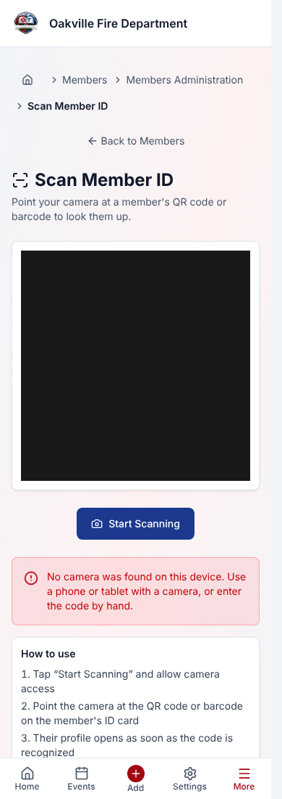

On the **Scan Member ID** page, the message replaces nothing. **Start
Scanning** stays where it was, so retrying is the same tap, and the "How to
use" steps stay underneath. There is no separate "Try Again" button and no
manual member lookup on that page. To find a member without a camera, use the
search on **Members**.

If you switch to another app in the middle of a scan, the scanner lets go of
the camera, and picks it up again when you come back.

### Form Submission

Forms work well on a phone:

- Signature fields take your finger.
- Date and time fields use your phone's own pickers.
- File uploads can use the camera or your photo library.
- Fields for user names, serial numbers, VINs and searches do not
  autocorrect or capitalize what you type.
- Buttons along the bottom of a screen, such as **Save** in an equipment check,
  sit above the on-screen keyboard rather than behind it.

### Event RSVP

RSVP straight from the events list: select **Going** or **Not Going** on the
event's card, without opening the event. To change your answer, select
**Change RSVP**.

### Pull to Refresh

Pull down from the top of a page to refresh it. Inside a dialog or panel that
scrolls, pulling down scrolls that panel instead, so you never lose what you
had open.

---

## Tips for Mobile Use

1. **Install the app.** The browser is fine, but the installed app is full
   screen, on your home screen and quicker to open.
2. **Turn the phone sideways for wide pages.** Compliance matrices and report
   tables are easier to read in landscape.
3. **Use search.** On a small screen, search is quicker than scrolling. The
   member list, inventory and course library all have a search box.
4. **Check in early.** If the event location has poor signal, check in while
   you still have one. The check-in time is the time The Logbook receives it.
5. **Signed out too often?** Your department sets how long you stay signed in.
   Ask your IT manager if it seems too short.
6. **Use My Account → App if things look wrong.** If the app seems stuck on an
   old version or looks broken, see
   [Checking and Forcing an Update Yourself](#checking-and-forcing-an-update-yourself).

---

## Check Your Understanding

1. You select Submit on a training record while offline. What proves that The
   Logbook eventually received it?
2. The camera permission is denied during a scan. What is the safe recovery
   path?
3. Why should you avoid assuming that every browser shows the same installation
   prompt?

Check your answers

1. The receipt and the pending count prove only that the device saved it. Wait
   for **"Synced … pending items"** after your connection returns. Then check
   that the record appears in Training with its **Pending Review** status (or
   approved, if your department approves automatically).
2. Allow camera access in the browser or phone settings and try again. If you
   cannot, use the search box in the inventory dialog, or the search on
   **Members**, instead of the camera. Do not work around it with an unapproved
   scanning app.
3. Installing is controlled partly by the phone and the browser. iOS, Android,
   Chrome, Safari and Firefox have different menus and prompts, so follow the
   steps for the device actually in use.

---

## Troubleshooting

| Problem                                                          | What to do                                                                                                                                                                                                                       |
| ---------------------------------------------------------------- | -------------------------------------------------------------------------------------------------------------------------------------------------------------------------------------------------------------------------------- |
| "Add to Home Screen" missing (iOS)                               | Use **Safari**. Other browsers on iOS cannot install apps. Also check you are on the real Logbook address, not a redirect page.                                                                                                  |
| "Add to Home Screen" missing (Android)                           | Use Chrome. Look in the three-dot menu for "Install app" or "Add to Home screen". Other browsers use different wording.                                                                                                          |
| Blank screen after installing                                    | Close the app completely and reopen it. If it persists, remove it from the home screen, clear the browser's stored data for the site, and install again.                                                                         |
| App stuck on an old version                                      | **My Account → App → Force refresh**. It reloads the app fresh while keeping you signed in, keeping unsent offline work and keeping push on. The same screen shows the version you are running, so you can confirm it worked. |
| Scanning a QR code does not open the installed app               | On iOS, the camera app opens QR links in Safari, not in the installed app. Check-in still works; it just opens in Safari.                                                                                                        |
| Member ID scan says "No member found"                            | The card must be one The Logbook issued. Older cards scan only while **Accept old badges** is on (on the ID card printing page). Otherwise, use the search on **Members**.                                                       |
| Camera does not turn on                                          | Allow camera access for the browser (or the app) in your phone's settings. On a computer, check no other program is using the webcam. The on-screen message names the problem; see [Camera Error Handling](#camera-error-handling). |
| Scanner tries the rear camera, shows an error, then works        | Expected on a computer: the scanner tries a rear camera first, then switches to the front webcam.                                                                                                                                |
| Signed out too often on a phone                                  | How long you stay signed in is set by whoever runs your department's server, not on a settings screen. Ask your IT manager.                                                                                                     |
| Notifications not appearing                                      | Check **My Account → Notifications**. For **lock-screen** alerts, see [Push Notifications on Mobile](#push-notifications-on-mobile): your department must have push on, you switch it on per device, and on iPhone/iPad the app must be installed first. |
| No "Push Notifications on This Device" switch                    | On iPhone/iPad: you are in Safari, not the installed app. Install it first. On any device: your department may not have push turned on.                                                                                         |
| Push stopped after reinstalling the app                          | Push belongs to that installation on that device. Switch it on again.                                                                                                                                                             |
| Push is on but nothing ever arrives                              | Ask your IT manager to check the department's push keys. Keys made the wrong way are accepted by the phone but rejected by the push service, so nothing arrives and nothing looks wrong.                                         |
| "Network error" on a page                                        | Everything that shows or changes information needs a connection. Check your Wi-Fi or mobile signal and try again.                                                                                                                |
| Offline work did not send                                        | Get back online, open **More**, and select **pending sync — retry**. Then check the result in Training, Events or wherever it belongs. Only seven kinds of item are saved offline; anything else must be re-entered.               |
| App icon disappeared from the home screen                        | Some phones remove app icons after a system update or storage clean-up. Install it again.                                                                                                                                        |
| Dark mode not as expected                                        | Choose **Light**, **Dark**, **System** or **High Contrast** in **My Account → Appearance**. **System** follows your phone's setting. The choice is stored on each device separately.                                            |
| No "new version" bar appears                                     | Open **My Account → App → Check for updates**. It answers the question directly, and reloads onto the new version if there is one.                                                                                              |
| A page looks wrong on a phone                                    | Use **My Account → App → Force refresh** to load the latest version. For wide tables, turn the phone sideways. If it still scrolls sideways, report the page.                                                                   |
| Sign-in page says "Too many failed attempts"                     | Wait for the countdown to finish before trying again.                                                                                                                                                                            |
| A page shows "could not load" or "Something went wrong"          | Often station Wi-Fi with a sign-in page, or a carrier page, answering instead of The Logbook. Get a proper connection and select retry. If it keeps happening, note the page and report it; your IT manager can see these failures on the **Error Monitor** page. |
| A button is hard to hit, or text is too small, on a phone        | Every control should be at least 44 pixels on a phone or tablet, and ordinary text at least 12 pixels. If you find one that is not, report it — it is a fault, not a known gap.                                                 |
| The camera preview froze after switching apps                    | The scanner releases the camera when you leave and resumes when you return. If it stays frozen, close and reopen the scanner, and report it.                                                                                    |

---

## Realistic Example: Mobile Workflow — Event Check-In, Equipment Scan & Offline Queue

Follow **FF Sarah Chen** using The Logbook on her phone during a busy training
day.

### Part 1: Event QR Check-In (Morning)

Sarah arrives at the station for "Q2 Hazmat Refresher". A QR code is posted on
the training room door. She points her phone's camera at it, and The Logbook's
check-in page opens. She selects **Check In to This Event**.

> **Edge case:** The QR code at Door B is water-damaged and will not scan.
> Sarah asks the event's officer, who opens the event in The Logbook, selects
> **Check In** and checks her in from the list.

> **Edge case:** Sarah uses an iPhone. The camera app opens the check-in page
> in Safari rather than the installed app. The check-in still works.

### Part 2: Equipment Handout (Mid-Morning)

During a break, Sarah needs a portable gas monitor. She goes to the
quartermaster, Lt. Ruiz.

Lt. Ruiz opens **Inventory Admin → Members** on his phone, selects **Scan**,
and scans Sarah's ID card. The **Distribute Items** dialog opens for Sarah. He
selects **Start Camera** and scans the barcode on the monitor: **MSA Altair
5X**, serial **INV-000234**. He chooses **Temporary loan**, sets today as the
expected return date, selects **Review 1 Item**, and confirms.

> **Edge case:** A sticker covers part of the barcode on a second monitor, and
> the camera cannot read it. Lt. Ruiz types `INV-000234` in the search box
> instead, and the item is found straight away.

Sarah can see the monitor's details on its item page. That page shows the
item's status and condition, with **Back**, **Print Barcode** and (for a
manager) **Edit**. It has no checkout button: items go out through the
**Distribute Items** dialog, as above.

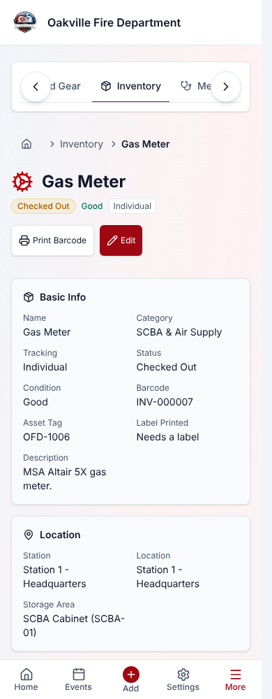

### Part 3: Offline Training Submission (Afternoon — No Signal)

The refresher ends at noon. Sarah drives to a rural training site for an
afternoon exercise. Her phone loses all signal.

After the exercise, Sarah opens **Training > Submit Training** and fills in the
form: course "Hazmat Refresher", 4 hours, today's date. She selects
**Submit**. The form shows its usual receipt; the submission is saved on the
phone, waiting to be sent.

Still offline, she opens **Events** and selects **Going** for next week's
"Q3 Ladder Operations Drill". That RSVP is saved on the phone too.

She selects **More**. The bottom of the menu reads **Offline · 2 pending**.

> **Edge case:** Sarah closes the app completely and reopens it 30 minutes
> later. The menu still reads **Offline · 2 pending**. Saved items are kept on
> the device, so closing the app does not lose them.

### Part 4: Back Online (Evening)

On the drive home her phone gets signal again. The Logbook sends both items by
itself and shows **"Synced 2 pending items"**.

Sarah checks: her training submission shows **Pending Review** in Training,
waiting for an officer. Her RSVP shows **Going** on the event.

> **Edge case:** Suppose The Logbook had rejected the training submission —
> for example, because of a problem with what was entered. The app tries again
> each time it reconnects. After five rejections it deletes the item and shows
> **"1 pending item failed permanently and was discarded"**. Sarah would then
> enter the training again by hand. Lost signal during a send does not count as
> a rejection.

---

## If You Learned an Older Version

If you are following older notes, an older recording or an SOP, these things
have moved, been renamed or work differently.

### Renamed or moved

- **There is no menu button (☰) in the top bar on a phone.** Use **More** on
  the bottom bar. Earlier versions had the button in the top-right, then the
  top-left corner.
- **The update and Force refresh screen is My Account → App**, not
  "Settings → App".
- **The bottom bar is Home, two tabs, Add and More.** Earlier bars had three
  configurable tabs and no **Add** button.
- **The Settings tab on the bottom bar opens My Account**, not Organization
  Settings.
- **Shift Details opens as a window in the middle of the screen**, not as a
  drawer from the right edge.
- **Settings screens** show their sections as a row across the top, scrolling
  sideways on a phone, not as a sidebar.
- **Selected tabs and filters are red**, and primary buttons are the app's red,
  on screens that used to show them in blue.

### Works differently now

- **Every screen opens offline after install**, not only the ones you visited
  while online. The information on them still needs a connection.
- **A rejected equipment check shows its real error.** Older versions reported
  it as queued, deleted the draft, and kept re-sending it.
- **Signing out also clears unfinished equipment-check drafts**, not only
  queued work.
- **Queued items record who saved them**, and are sent only for that member.
  Older items with no owner are held; see
  [Queued Work Is Sent Only by the Member Who Saved It](#queued-work-is-sent-only-by-the-member-who-saved-it).
- **The app updates in Brave** without clearing the browser's stored data by
  hand.
- **Controls on a touch tablet** are full fingertip size, and hover-only
  buttons stay visible there.

### Things to check if your department has used The Logbook for a while

- **Members who installed before the logo was uploaded** still have the old
  icon. They must remove the app and add it again.
- **A phone that has run for weeks without an update** may be on an old
  version. Older versions sometimes hid the update bar behind the top bar.
  Use **My Account → App → Check for updates**.
- **Push keys made with an older, broken set of instructions** are accepted by
  phones but never deliver. If push is on and nothing arrives, ask your IT
  manager to make new keys; every member then switches push on again.
- **Brave users** told to clear their browser data after every release no
  longer need to.

---

**Previous:** [Skills Testing & Psychomotor Evaluations](./09-skills-testing.md) | **Next:** Return to [Training Guide Index](./README.md)
