# Finance

The Finance module runs your department's money: budgets, purchase requests,
expense reports, check requests, cash advances, dues and approvals. It covers
everything from planning next year's budget to tracking what is spent, with
multi-step approval chains and a QuickBooks export for your accounting
software.

---

## Table of Contents

1. [Finance Overview](#finance-overview)
2. [Finance Dashboard](#finance-dashboard)
3. [Fiscal Years](#fiscal-years)
4. [Budget Categories](#budget-categories)
5. [Creating and Managing Budgets](#creating-and-managing-budgets)
6. [Approval Chains](#approval-chains)
7. [Purchase Requests](#purchase-requests)
8. [Expense Reports](#expense-reports)
9. [Check Requests](#check-requests)
10. [Cash Advances](#cash-advances)
11. [Dues & Assessments](#dues--assessments)
12. [Board Reports](#board-reports)
13. [QuickBooks Export](#quickbooks-export)
14. [Realistic Example: Annual Budget Cycle](#realistic-example-annual-budget-cycle)
15. [Troubleshooting](#troubleshooting)
16. [If You Learned an Older Version](#if-you-learned-an-older-version)

---

## Finance Overview

Finance is an optional module. Your department administrator turns it on in the
organization's module settings. Once it is on, **Finance** appears in the menu.

### Who Uses What

| Who                                     | What they do                                                                                      |
| --------------------------------------- | ------------------------------------------------------------------------------------------------- |
| **All members**                         | Raise, submit and track their own purchase requests, expense reports and check requests           |
| **Finance viewers**                     | See budgets, the finance dashboard, dues, and every member's purchase and check requests          |
| **Finance managers** (the Treasurer)    | Create and edit budgets, fiscal years and budget categories; mark payments; run dues; run exports |
| **Approvers**                           | Approve or deny purchase requests, expense reports and check requests                             |
| **Approvals administrators**            | Set up approval chains and their steps                                                            |
| **Budget reviewers** (President, Chief) | Adjust next year's budget requests during leadership review, and confirm budget amendments        |

The **Treasurer** position comes with all four officer finance permissions, so
a new department's Treasurer can build the approval chain and act on it. Nobody
can approve or pay their own request, whatever they hold.

Every member holds the permission to raise requests, which is what lets them
raise their own. A member who holds nothing else sees **Finance > My Purchase
Requests**, **My Expense Reports** and **My Check Requests** — only the
requests they raised, never anyone else's — and picks a budget line by its name
and, if they own the line or hold `finance.view` / `finance.manage`, the amount
left on it ("Training — $1,250.00 remaining"), without seeing the budget pages.
_(2026-10-18)_ Everyone else sees the line's name alone; the remaining amount is
no longer sent to them. An expense report or check request is routed only
through a chain set for its own type (a purchase-request chain never catches
them); with no chain for the type it waits in Pending Approval to be decided by
hand. Finance timestamps (Created, Updated) were corrected to UTC; see
`UPGRADING.md`. They can edit a request until they submit it and withdraw a
draft; once submitted, only the finance office can cancel it. A department that
does not want members raising requests removes that permission from the
**Member** position.

### Permissions

The Role Management screen describes the finance permissions like this. This
guide calls their holders by the short names in brackets.

| Permission as described on Role Management                                                | Called here             |
| ----------------------------------------------------------------------------------------- | ----------------------- |
| "Create, submit and track your own purchase requests, expense reports and check requests" | (every member)          |
| "View financial data and budgets"                                                         | finance viewer          |
| "Manage budgets, fiscal years, categories, and process payments"                          | finance manager         |
| "Approve purchase requests, expenses, and check requests"                                 | approver                |
| "Manage approval chains and routing configuration"                                        | approvals administrator |
| "Adjust next year's budget requests during leadership review"                             | budget reviewer         |

### Key Concepts

- **Fiscal Year** -- The accounting period your department uses for budgeting. All budgets, requests, and reports are tied to a fiscal year.
- **Budget Category** -- A classification for budget line items (e.g., "Apparatus Maintenance", "Training", "Uniforms"). Categories can have parent-child hierarchies and map to QuickBooks accounts.
- **Budget** (or budget line) -- An amount set aside for one category in one fiscal year. It tracks what is spent, committed and remaining.
- **Approval Chain** -- A configurable sequence of approval and notification steps that requests must pass through before they are approved. Different chains can apply to different request types and dollar thresholds.
- **Encumbrance** (shown as **Committed** or **Encumbered**) -- When a purchase request is approved, its estimated amount is reserved against the budget. This lowers what is left without counting as spent until the request is marked paid.

### Navigation

The **Finance** menu shows what you can use:

| Menu item              | Who sees it                                                            |
| ---------------------- | ---------------------------------------------------------------------- |
| **Dashboard**          | Finance viewers                                                        |
| **My Budgets**         | Anyone whose position owns a budget line                               |
| **Next year's budget** | Line owners while next year's budget is being planned                  |
| **Budget requests**    | Finance managers and budget reviewers                                  |
| **Purchase Requests**  | Everyone. Members who only raise requests see **My Purchase Requests** |
| **Expense Reports**    | Everyone. Anyone but a finance manager sees **My Expense Reports**     |
| **Check Requests**     | Everyone. Members who only raise requests see **My Check Requests**    |
| **Approvals**          | Approvers                                                              |

**Budgets**, **Settings** (fiscal years, categories and approval chains),
**Reports**, **Dues** and **QuickBooks Export** open from the dashboard's
**Quick Links**.

---

## Finance Dashboard

Open **Finance** to view the department-wide financial dashboard.

The dashboard provides a high-level summary of your department's financial health:

- **Budget Health** -- **Total Budgeted**, **Spent**, **Encumbered** and **Remaining**, and the percent used, across all budgets in the active fiscal year
- **Pending Approvals** -- How many requests across the department are waiting on an approval step. For an approver, the card opens the [Approvals](#approving-and-denying-requests) screen
- **Pending Purchase Requests**, **Pending Expense Reports** and **Pending Check Requests** -- how many of each are waiting for approval
- **Dues Collection** -- the percentage of expected dues collected

Below the cards, **Quick Links** open each area. For approvers, the list starts
with an **Approvals** link ("Approve or deny requests waiting on a step"). It is
hidden from everyone else, because the page behind it would only show them
Access Denied.

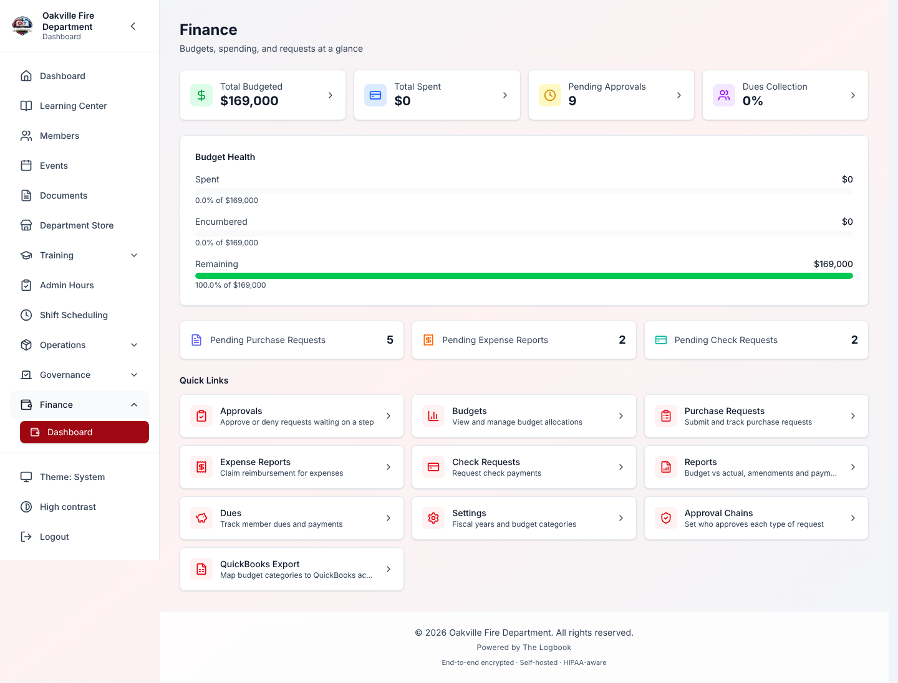

> **Hint:** The dashboard automatically scopes to the active fiscal year. If no fiscal year is active, the budget health section displays zeroes. Set up your fiscal year first (see [Fiscal Years](#fiscal-years)).

---

## Fiscal Years

**Required Permission:** finance manager

Open **Finance > Settings** to manage fiscal years.

A fiscal year defines the accounting period for your department. All budgets, purchase requests, expense reports, and check requests are tied to a fiscal year. Most fire departments use either a calendar year (January--December) or a government fiscal year (July--June or October--September).

### Fiscal Year Statuses

| Status     | Meaning                                                                                                                                                            |
| ---------- | ------------------------------------------------------------------------------------------------------------------------------------------------------------------ |
| **Draft**  | The fiscal year is being set up. Budgets can be created and edited freely. No requests can be submitted against it yet.                                            |
| **Active** | The fiscal year is open for business. Requests can be submitted, budgets track spending, and approval workflows run. Only one fiscal year can be active at a time. |
| **Closed** | The fiscal year is complete. No new requests can be submitted. Existing data is read-only for reporting purposes.                                                  |

### Creating a Fiscal Year

1. Open **Finance > Settings**.
2. Select **New Fiscal Year**.
3. Enter a **name** (for example, "FY 2026-2027").
4. Set the **start date** and **end date**.
5. Select **Create**.

The new fiscal year is created in **Draft** status.

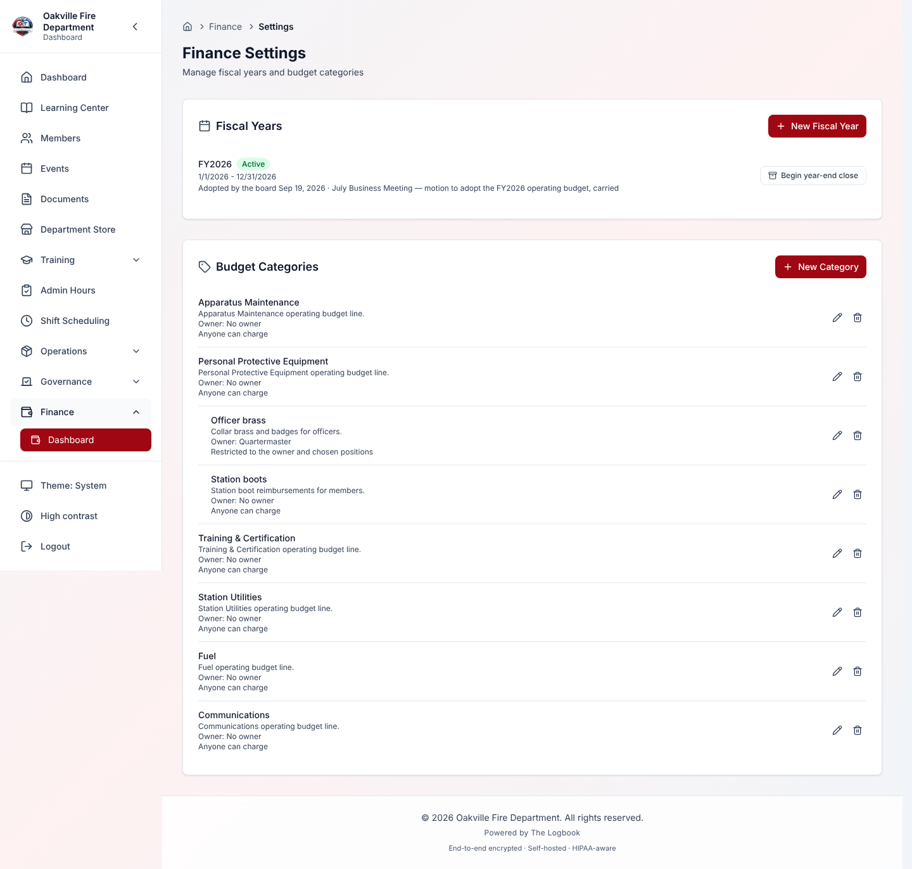

### Adopting and Starting a Fiscal Year

Adopting the budget and starting the year are separate steps. The board usually adopts next year's budget before the year begins; the year becomes spendable when you start it.

**Record the board's adoption:**

1. Move the draft year to **Board review** (see [Planning Next Year](#planning-next-year-treasurer), step 4).
2. Once the board has voted, select **Record adoption** on the year's row.
3. Enter the date the board adopted it (not in the future) and the motion or minutes reference, and optionally notes such as the vote count.
4. Select **Record adoption**.

The year's badge reads **Adopted** and its row shows _"Adopted by the board {date} · {reference}"_. Its budget is final from here: the stage can no longer be moved back.

**Start the year** on or after its start date:

1. Begin the current year's year-end close first (below) — only one year can be active, and starting a new one never closes the old one for you.
2. Select **Start the year** on the adopted draft and confirm.

The year becomes the current period for all financial operations, and each line owner is emailed the lines their position owns with the adopted amounts. Starting is refused before the year's start date, while another year is still active, or if the board's adoption has not been recorded.

### Closing and Locking a Fiscal Year

When the year ends, the Treasurer closes it in two steps. Once the end date has passed, a banner on **Finance > Settings** reminds you.

**1. Begin year-end close.** Select **Begin year-end close** on the active year and confirm. The year's badge reads **Closing**. From now on:

- No new purchase requests, expense reports or check requests can be raised or submitted against it.
- What was already submitted can still be approved, and what was approved can still be paid, issued, voided or cancelled.
- Budget amendments are still allowed.

If you began the close by mistake, **Reopen** makes it the active year again (as long as no other year has been started).

**2. Lock it.** Once everything is settled, select **Lock**. The dialog lists anything still open — submitted requests awaiting a decision, approved purchases or reports not yet paid, approved checks not yet issued — each linked so you can finish it. The lock stays disabled until the list is empty. Then enter your **reconciliation notes** (for example, _"Reconciled to the June 30 bank statement; reviewed by the audit committee"_) and select **Lock the year**.

A locked year's badge reads **Closed**, and its row shows _"Locked {date} · {notes}"_ with who locked it kept on record. A locked year cannot be reopened, nothing in it can be paid or changed, and its budget amounts are final. A line's notes, station and owner can still be edited. A draft year cannot be locked.

> **Hint:** Create and set up your new fiscal year (including budgets) in Draft status before the current one ends, and have the board adopt it. When the new year begins, begin the old year's close, then start the new one — the two can overlap, so last year's bills can still be paid while this year's spending starts.

### Planning Next Year (Treasurer)

Next year's budget is built in a **Draft** fiscal year. As a finance manager, open **Finance > Settings**; under a draft year you will find two controls.

**1. Start from last year.** Rather than adding every line by hand:

1. Under the draft year, pick the year to copy from in **Start from last year** (it defaults to the active year).
2. Select **Copy lines**, then **Copy lines** again in the confirmation.
3. The message tells you how many lines were copied and how many the draft already had (for example _"12 lines copied, 2 already there"_).

Each copy keeps the line's category, station, notes and its own owner position, and starts at the line's **current** budget (amendments included), with nothing spent. Treat that amount as a starting point and edit it. A category and station the draft already has is left alone, so running it again copies nothing new. **Lines on a category you have retired are not copied** _(2026-10-14)_; the confirmation message counts them as "retired". A sub-line still in use under a retired parent is copied, because only the line's own category is checked. Lines whose owner comes from their category keep getting it from the category.

**2. Set the request deadline.** Budget-line owners propose next year's amounts for their lines until this date:

1. Under the draft year, choose a date in **Request deadline**.
2. Select **Save deadline**. To remove it, select **Clear deadline**.

The year's row then reads _"Requests close {date}"_ with a **Requests open** or **Requests closed** badge. Requests stay open through the **end of that day in your department's time zone**. After it, owners can no longer make, change, submit or withdraw a request (they see _"The request deadline for {year} has passed."_); you can still enter or change them on their behalf. A deadline can only be set while the year is a draft.

**3. Decide the requests.** Each request is approved as asked, adjusted to a different amount (a note saying why is required), or declined (a note is required). Approving or adjusting writes the amount into the draft year's line — or, for a proposed new line, creates it. You can change a decision while the year is taking requests; once it moves on, and after it is adopted and started, decisions are final and the budget changes through amendments. See [Reviewing Budget Requests](#reviewing-budget-requests-treasurer) below.

**4. Move it through review to the board.** A draft year shows its stage on its row: **Taking requests**, **Leadership review** or **Board review**. Move it one stage at a time with the buttons beside it; each move asks you to confirm, and each can be undone with the **Back to…** button.

- **Start leadership review** closes the year to line owners whatever the deadline says, and to your own decisions. Senior leadership — the budget reviewers, typically the President and the Chief — opens **Finance > Budget requests** and uses **Change amount** on any request you approved or adjusted to set a different amount with a note. Their amount becomes the line's budget; your decision stays on record beside it. A leader cannot change a request for a line their own position owns, or one they submitted.
- **Send to the board** freezes everything while the board considers the budget.
- **Record adoption** (in board review) records the board's vote, and **Start the year** makes it active — see [Adopting and Starting a Fiscal Year](#adopting-and-starting-a-fiscal-year).

Moving back to **Taking requests** reopens the year to owners until the deadline. Deciding a request again then replaces any leadership change to it.

> **Hint:** A sensible order is: create the draft year, **Start from last year**, adjust the lines you already know, set the deadline, let owners request, decide, start leadership review, send it to the board, then record the board's adoption when it votes and start the year when it begins.

### Requesting Next Year's Budget (Line Owners)

If your position owns a budget line (see [Budget Owners](#budget-owners)), you propose what it needs next year. When the Treasurer sets a request deadline you get an email, _"Budget requests for {year} are open until {date}"_, and reminders 7 days and 1 day before the deadline while a line still has no submitted request.

1. Open **Finance > Next year's budget**. The entry appears once your position owns a line in next year's draft budget, or you have made a request.
2. The banner says _"Requests close {date}"_ (or _"No deadline set"_). After the deadline it reads _"Requests are closed"_ and everything on the page is read-only.
3. Each of your lines shows this year's **Budgeted** and **Spent** for comparison. Select **Request an amount**, enter the **Amount requested** and a **Justification**, and select **Save draft**.
4. Check the draft, then select **Submit**. The Treasurer is emailed. Until the deadline you can still **Edit** a submitted request, or **Withdraw** it back to a draft (you are asked to confirm). A draft can be deleted with **Delete draft**.
5. When the Treasurer decides, you are emailed and the card shows **Approved**, **Adjusted** (with the approved amount and the Treasurer's note) or **Declined** (with the note). A decided request can no longer be changed; after a decline you may **Request again** while requests are open.

**Proposing a new line.** If a line your position needs does not exist yet, select **Propose a new line**, choose the **Category**, optionally a **Station**, and **For your position** (only positions you hold are listed), then the amount and justification. Submit it the same way. If it is approved, the line is created and your position owns it.

> **Hint:** Your current lines and their spending are on **My Budgets**; next year's requests are on **Next year's budget**. You can turn the reminder emails off under your email preferences (_Next year's budget requests_), unless your department has made them required.

### Reviewing Budget Requests (Treasurer)

As a finance manager, open **Finance > Budget requests** (or **Review requests** on the draft year's row in **Finance > Settings**). You are emailed each time an owner submits a request (_"Budget request to review: {line} ({amount})"_).

1. Pick the draft **Fiscal year** if there is more than one. The page shows the deadline and whether owners can still change requests.
2. The **Status** filter starts on **Submitted** — the requests waiting for you — and each option shows its count. Choose **All** to see everything.
3. Each row shows the line, the owner position, who submitted it and when, this year's budgeted and spent, the amount requested, the amount approved and the status. The **Total** row adds up the requested, this-year-budgeted and approved amounts of the rows shown.
4. Select **Review** on a row to read the justification, then choose:
   - **Approve as requested** — the requested amount becomes the line's budget.
   - **Approve a different amount** — enter the **Amount approved** and a note saying why (required).
   - **Decline** — a note saying why is required. The line's amount is not changed.
5. Select **Record decision**. You cannot decide a request you submitted or one for a line your own position owns (a refusal with a message); a department with one finance manager grants **finance.manage** to a second member. The owner and the submitter are emailed, and the list refreshes. To change a decision while the year is still a draft, filter to its status and select **Change**.

If the decision is refused (for example, an amount below what the line has already spent or committed), the reason is shown and nothing is saved.

### Edge Cases

| Scenario                                               | Behavior                                                                                              |
| ------------------------------------------------------ | ----------------------------------------------------------------------------------------------------- |
| Starting a fiscal year when another is already active  | Not permitted -- begin the active year's year-end close first; starting a year never closes another   |
| Submitting a request with no active fiscal year        | The request form will not allow submission -- the fiscal year dropdown will be empty                  |
| Editing a locked fiscal year                           | Not permitted -- the system rejects modifications with "Fiscal year is locked and cannot be modified" |
| Setting a request deadline on an active or closed year | Not permitted -- "The request deadline can only be set while the fiscal year is a draft."             |
| Copying lines into an active year                      | Not permitted -- **Start from last year** only copies into a draft year that is not locked            |
| Deleting a fiscal year that has requests               | Not permitted                                                                                         |

---

## Budget Categories

**Required Permission:** finance manager

Open **Finance > Settings** to manage budget categories.

Budget categories organize your department's spending into logical groups. Categories support a parent-child hierarchy for detailed tracking (e.g., "Operations" as a parent with "Fuel", "Maintenance", and "Supplies" as children).

### Creating a Category

1. On the **Finance > Settings** page, find the **Budget Categories** section.
2. Select **New Category**.
3. Enter a **Name** (for example, "Training").
4. Optionally enter a **Description**.
5. Optionally choose a **Parent category** to nest this category under. **None
   (a top-level category)** keeps it at the top.
6. Optionally choose an **Owner position**. Budget lines in this category that
   have no owner of their own belong to it (see [Budget Owners](#budget-owners)).
7. Choose its **Expense classification** (see
   [Classifying Expenses](#classifying-expenses)).
8. Optionally enter a **QuickBooks account** to set up the export (see
   [QuickBooks Export](#quickbooks-export)).
9. Set **Who can charge these lines** (see below).
10. Select **Create Category**.

To change a category later, select the pencil beside it.

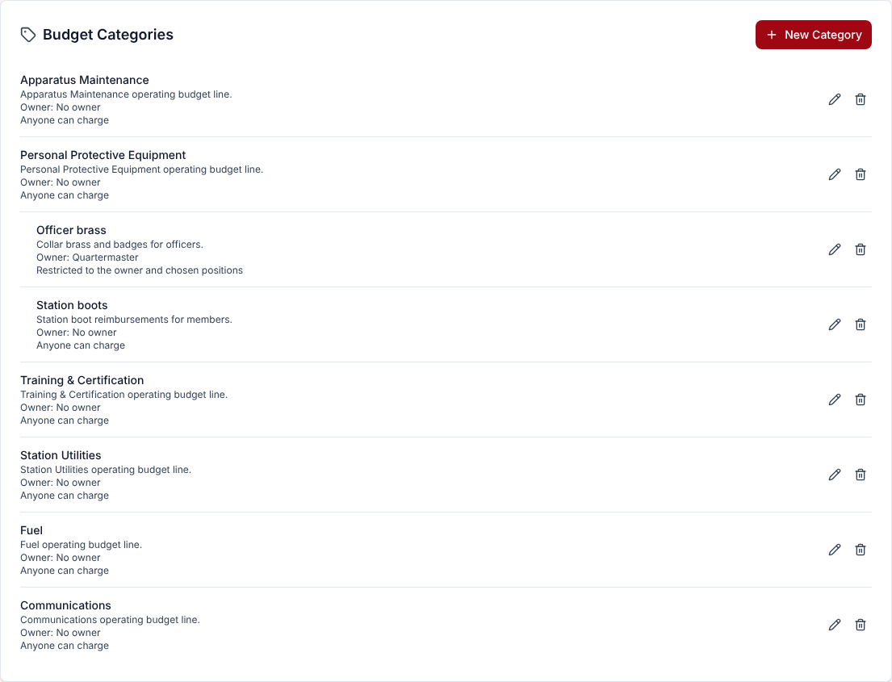

### Category Hierarchy

A category can sit under a parent, and a subcategory can have subcategories of its own. A parent groups its children. For example:

```
Operations (parent)
  ├── Fuel
  ├── Vehicle Maintenance
  └── Station Supplies
Training (parent)
  ├── Course Fees
  ├── Travel
  └── Materials
```

The settings list shows categories as a tree. A choice of parent that would
make a category its own ancestor is refused. The **Budgets** page groups
sub-lines under their top-level category, with a subtotal.

> **Hint:** Keep your categories in line with your chart of accounts in
> QuickBooks or your accounting system. The export is then simpler to set up,
> and your reports match across both.

### Who Can Charge a Category's Lines

A category can say who may pick its budget lines on a purchase request, check request or expense report. A Quartermaster category might hold an open **Boot reimbursement** line that everyone can use and an **Officer brass** line kept for the Quartermaster and the positions they choose.

In the category's settings, **Who can charge these lines** has three choices:

| Choice                                            | What it means                                                                                                                            |
| ------------------------------------------------- | ---------------------------------------------------------------------------------------------------------------------------------------- |
| Same as the parent category                       | The parent's rule, positions included. A top-level category left this way is open to everyone.                                           |
| **Anyone who submits requests**                   | Every member who can raise a request may pick the line.                                                                                  |
| **Only the owner and the positions chosen below** | The line's owner, the owner of its category (or of any category above it) and the positions ticked under **Also allow these positions**. |

Nobody else sees a restricted line in the request form's picker, and a request that names it anyway is refused. Lines in the picker are labelled with their category path (for example **Quartermaster › Officer brass**).

- **Finance managers** (the Treasurer) are not held to the rule and can charge any line.
- **A request already on a line stays editable** after the line is restricted; the rule applies to choosing the line.
- **A budget owner needs no Treasurer for this.** On **Finance > My Budgets**, **Who can charge your lines** lists the categories you own (or that sit under one you own). **Edit** opens **Who can charge** _category_ with the same choices. The Treasurer sets any category from **Finance > Settings**.

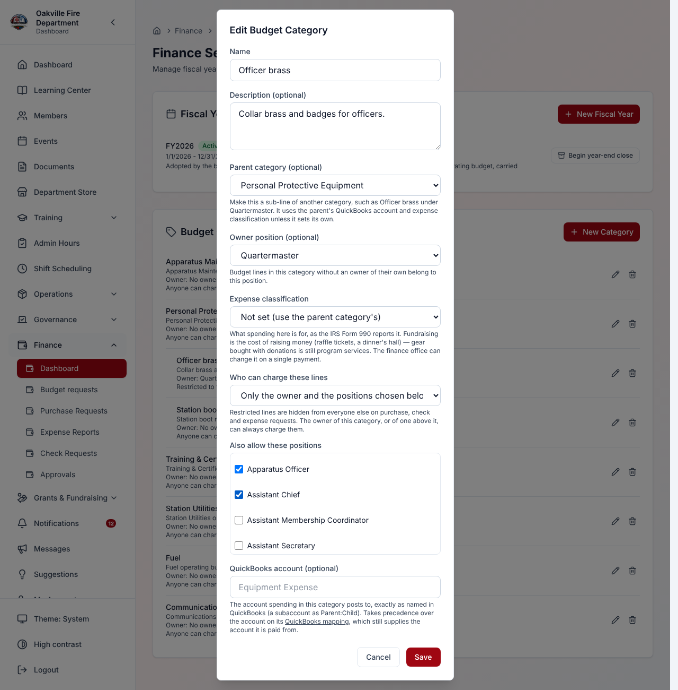

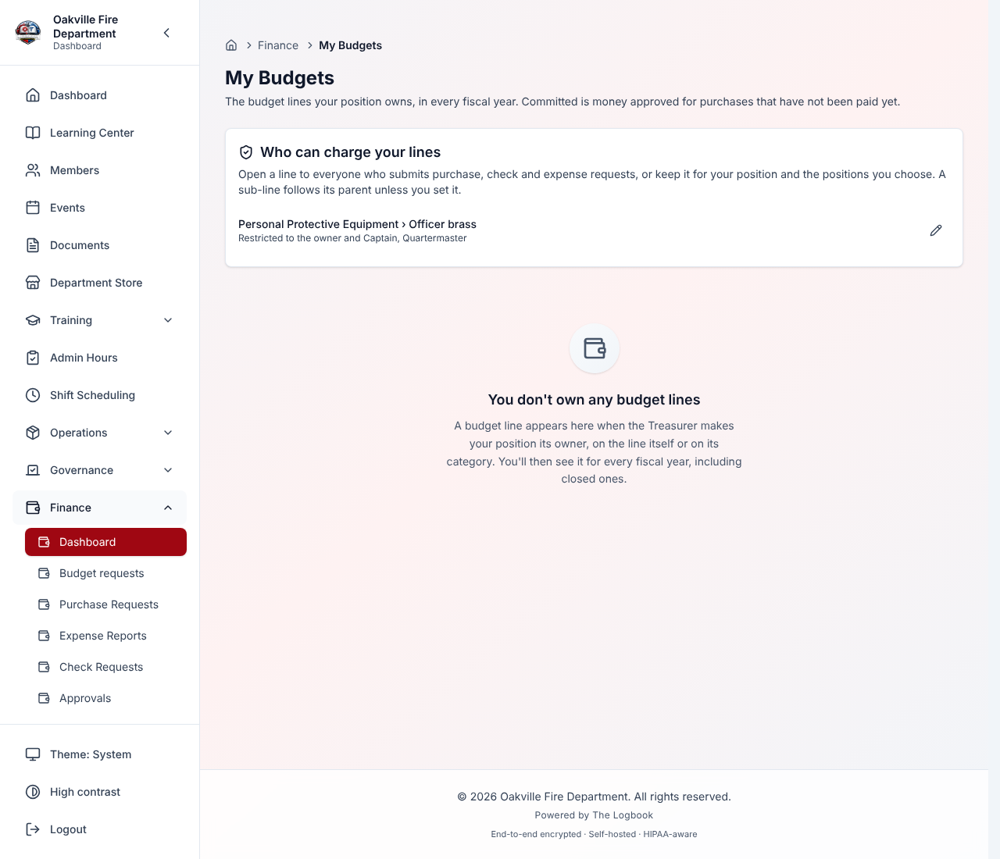

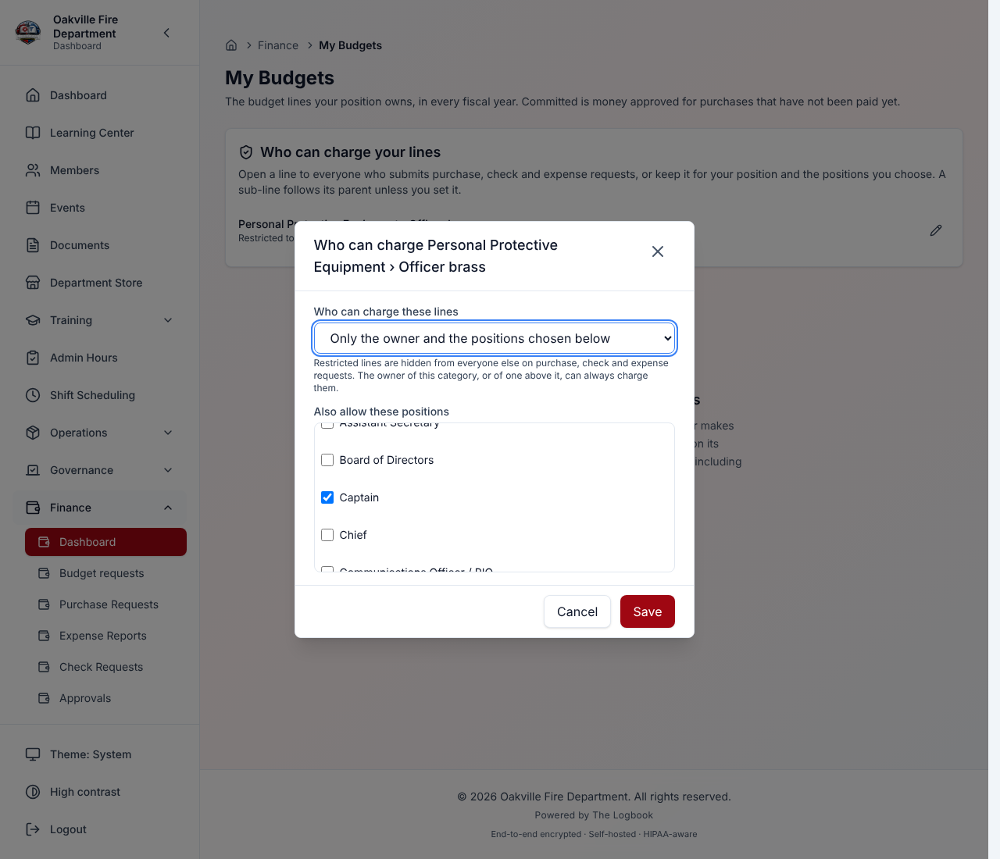

### Retiring a Category

To retire a category, delete it. A category that has budget lines, requests or
approval chains is **deactivated** instead of deleted: its budget lines in every
fiscal year are kept, and a category-specific approval chain stays specific
rather than becoming a catch-all. The confirmation and the toast say which
happened. A deactivated category is hidden from new-record pickers but still
resolves on existing rows. Its budget lines also **take no new charges**: a new
purchase request, check request or expense line on one is refused, and so is
moving a request onto one or submitting a draft that is on one. Requests already
submitted or approved finish normally, and their spending still shows in
reports. Deactivating a parent closes everything beneath it the same way: its
sub-categories are listed as **Inactive through** the parent, their lines take
no new charges, no new budget line or proposal can name them, and **Start from
last year** leaves their lines behind. Reactivating the parent reopens them. A
category nothing uses is deleted outright.

### Edge Cases

| Scenario                                  | Behavior                                                                                                                                      |
| ----------------------------------------- | --------------------------------------------------------------------------------------------------------------------------------------------- |
| Deleting a category with existing budgets | The category is deactivated, not deleted. Its budgets, requests and approval chains are kept; it no longer appears when you add a budget line |
| Category with no QuickBooks account       | The category can still be used for budgets; its export accounts can be set on **QuickBooks Export**                                           |
| A category as its own parent or ancestor  | Refused. Deleting a parent leaves its children as top-level categories                                                                        |

---

## Creating and Managing Budgets

**Required Permission:** finance manager

Open **Finance > Budgets** to view and manage department budgets.

A budget is a line item that allocates a specific dollar amount to a category within a fiscal year. Each budget tracks four key financial figures:

| Field                 | Description                                                                                         |
| --------------------- | --------------------------------------------------------------------------------------------------- |
| **Amount Budgeted**   | The total amount allocated to this budget line item                                                 |
| **Amount Spent**      | The total that has been paid out (from requests marked as Paid or checks marked as Issued)          |
| **Amount Encumbered** | The total reserved by approved but not-yet-paid purchase requests                                   |
| **Amount Remaining**  | Amount Budgeted less Amount Spent and Amount Encumbered -- what is still available for new requests |

**A budget's cap is hard.** Approving a purchase request (which encumbers its
estimate), marking a request or an expense-report line paid, or issuing a check
is refused with _Insufficient available budget_ when it would take Amount Spent
plus Amount Encumbered past Amount Budgeted. There is no override, finance
administrators included. Lowering Amount Budgeted below what is already spent
and encumbered is refused the same way. Two approvers acting at the same moment
cannot both squeeze under the cap — whichever acts second is refused.

Amounts are kept to the cent, with no rounding drift.

### Creating a Budget

1. Open **Finance > Budgets**.
2. Select **Add budget line** (shown only to finance managers).
3. Select the **fiscal year**. Only Draft and Active years are offered; a closed
   year is refused with _This fiscal year is closed_.
4. Select a **category**.
5. Optionally select a **station** to scope the line to one facility. Leave it
   on **Department-wide** for a line that belongs to no station. The station's
   name is what members see when they pick the line on a request.
6. Enter the **amount budgeted** (zero or greater). Once the year's budget has
   gone to the board — board review, adopted, active or closing — a new line
   must start at **zero**; add it, then record an amendment for its amount.
7. Optionally select an **owner position** — see
   [Budget Owners](#budget-owners). Left empty, the form says which owner the
   line takes from its category ("Uses the category's owner: Training
   Officer"), or "No owner" when the category has none.
8. Optionally add **notes**.
9. Select **Add budget line**. The list reloads with the new line.

### Editing a Budget

Open the line and select **Edit** (finance managers only). The amount, station,
owner position and notes can be changed; the fiscal year and category are fixed
once the line exists. Setting the station back to **Department-wide** or the
owner back to the category's clears the value. Lowering the amount below what
is already spent and encumbered is refused with _Insufficient available
budget_, and the dialog stays open with that message.

The amount can be edited directly only while next year's budget is still
**taking requests** or in **leadership review**. Once the budget goes before
the board, and in an active or closing year, the amount is shown read-only with
the hint _This budget has gone before the board. Change the amount with an
amendment, which another officer confirms._ — use **Add amendment** instead.
In a **locked** fiscal year the hint reads _This fiscal year is locked._ The
station, owner position and notes still save in every case.

When leadership has approved **extra money** for a line, record an amendment
instead of editing the amount (below) — the amendment keeps the record of who
approved it and why.

### Budget Amendments

An amendment records extra money approved for a budget line — by a board vote,
the Chief, the membership — and, once a **second officer confirms it**, raises
the line's budget by that amount. Only a finance manager can enter one.

1. Open the budget line from **Finance > Budgets**.
2. Select **Add amendment**.
3. Fill in:
   - **Amount added** — the extra money, more than zero.
   - **Reason** — what it is for.
   - **Approved by** — who approved it, for example _Board vote 10/7_.
   - **Approval date** — the day it was approved (defaults to today; it
     cannot be in the future).
4. Select **Record amendment**.

The amendment is saved as **Pending confirmation** and the line's budget does
not change yet; the page says how many amendments are awaiting confirmation and
that the figures do not include them. See
[Confirming an Amendment](#confirming-an-amendment) below. Once a line has
confirmed amendments its page shows the **Original budget**, the **Current budget** and **Amendments:
+$X (n)**, and the **Amendments** section lists each one with its approval
date, amount, who approved it, the reason, and who entered it and when. The
Budgets list marks the line _(amended)_.

- Amendments can be added in **draft**, **active** and **closed** fiscal years,
  but not in a **locked** one — the button is hidden there. Pending amendments
  hold a closing year open: the year cannot be locked until each one is
  confirmed or rejected.
- An amendment cannot be edited or removed afterwards; it is the record of what
  was approved. If one was entered by mistake, **reverse** it (below).
- A purchase or check request that was refused for lack of funds is **not**
  re-run when the budget goes up, and nobody is emailed. The member submits it
  again.

### Confirming an Amendment

An amendment (or a reversal, below) moves money only once a second officer
confirms it. A budget reviewer (whoever reviews the budget for leadership —
the President, for example) or a finance manager may confirm, **except whoever
entered it**.

1. Open the budget line. Amendments awaiting confirmation are marked
   **Pending confirmation**.
2. Check the amount and approval against the minutes or the approval itself.
3. Select **Confirm**, read the note — _This raises the line's budget by $X…_ —
   and select **Confirm amendment**. The budget changes at once and the
   amendment shows **Confirmed {date} by {name}**.
4. If it does not match what was approved, select **Reject** instead and give
   the reason. It stays on the list, struck through, with **Rejected {date} by
   {name}: {reason}**, and the budget does not change.

Whoever entered an amendment does not get **Confirm** on it, but gets
**Withdraw** — the same as Reject, for taking back one's own mistake. Nothing is
emailed when an amendment is waiting; tell the confirming officer, or they will
see it on the line and in the year's open items at year-end.

### Correcting a Mistaken Amendment

If a **confirmed** amendment was wrong — $2,500 typed for $250, or the wrong
line — reverse it (one still pending is simply rejected or withdrawn instead), then record the correct amendment if one is needed. A reversal is a
new entry with its own reason and approval; the original stays on the list.
Only a finance manager can do this.

1. Open the budget line from **Finance > Budgets**.
2. In the **Amendments** section, select **Reverse** on the amendment.
3. Read the note — _Once a second officer confirms it, this lowers the current
   budget by $X. The original amendment stays on record._ — and fill in:
   - **Reason** — what went wrong, for example _Entered $2,500 instead of
     $250_.
   - **Approved by** — who approved the correction.
   - **Approval date** — defaults to today; it cannot be in the future.
4. Select **Record reversal**.

The reversal is saved **pending**, like any amendment; until a second officer
confirms it the original reads **Reversal entered {date} by {name}, awaiting
confirmation** and the budget is unchanged. Once confirmed, the current budget
drops by the amendment's amount; the **Original budget** does not change. The
list then shows the reversal as **−$X · Reverses the {date} amendment of +$Y**,
and the original amendment struck through with **Reversed {date} by {name}**.
If the reversal is rejected instead, the original can be reversed again.

- The whole amendment is reversed — there is no partial reversal. To lower it
  from $2,500 to $250, reverse it and record a new $250 amendment.
- Only a confirmed amendment can be reversed.
- An amendment can be reversed only once, and a reversal cannot itself be
  reversed. If the money turns out to be needed after all, record a new
  amendment.
- Not available in a **locked** fiscal year (the button is hidden there); fine
  in draft, active and closed years.
- Refused with _Insufficient available budget_ if the lower budget would no
  longer cover what the line has already spent and committed — checked when it
  is entered and again when it is confirmed.
- Line owners see reversals on their line's page but cannot make one.

### Budget Owners

A budget line is owned by a **position**, not a person, so ownership follows
whoever holds the position — an election or a resignation needs no
reassignment.

- A **category** may name an owner position (set it in **Finance > Settings**
  when creating or editing the category).
- A **line** may name its own owner position, which overrides the category's.
- A line with no owner of its own **inherits** its category's. The Budgets list
  shows this as "Training Officer (from category)".
- A line with neither has **No owner**.

Ownership covers a line in every fiscal year, past ones included. Only a
finance manager sets amounts, owners and stations; owning a line never lets a
member change its amount.

### My Budgets (for budget-line owners)

If your position owns a budget line — say you are the Training Officer and
the Treasurer made that position the owner of the Training category — open
**Finance > My Budgets**. The menu shows the entry only once you own at least
one line; you do not need to be a finance viewer.

- Your lines are grouped by fiscal year: the current year first, then next
  year's draft, then closed years. You keep seeing a line in past years.
- Each line shows its category and station, the owner position ("(from
  category)" when the line inherits it), the current budget (and the original
  once amended), **Spent**, **Committed**, **Remaining** and a bar.
  **Committed** is money approved for purchases that have not been paid yet —
  the "encumbered" amount.
- Tap a line to open its detail page: the figures, its amendments and its
  **Transaction History**. You can read everything there but change nothing —
  the amount, owner, station and amendments stay with the Treasurer.
- No lines? A line appears once the Treasurer makes your position its owner,
  on the line or on its category.

Only lines you own open for you; a link to any other line answers "Budget not
found".

If your position owns a **category**, a **Who can charge your lines** card sits
below your lines. It lets you open a line to everyone who submits requests or
keep it for you and the positions you choose; see
[Who Can Charge a Category's Lines](#who-can-charge-a-categorys-lines).
It does not appear if you own no category.

### Viewing Budget Details

Select any budget in the list (or, as an owner, on **My Budgets**) to open its detail page. It shows:

- Budget amount and category
- Visual breakdown of spent, committed (encumbered), and remaining amounts (progress bar)
- **Transaction History** — newest first, 25 to a page: approved and paid
  purchase requests, issued checks (a voided check stays listed as
  "Reversed"), and paid expense-report items charged to this line, each with
  its date, number, vendor or payee, requester, status, amount and whether it
  is **Spent** or **Committed**. The Spent rows add up to the Spent figure
  above, and the Committed rows to the Committed figure
- Budget utilization percentage

> **The bar reads 0% until something is approved**, because spending and
> commitments count only from approval.
>
> **A department whose only approver is the Treasurer** cannot clear a request
> the Treasurer raised. Give a second officer approval rights, and give chains
> that must handle the Treasurer's own requests a second approver step.

### Budget Summary

The budget summary provides an aggregate view across all budgets in a fiscal year:

- **Total Budgeted** -- Sum of all budget line items
- **Total Spent** -- Sum of all paid amounts across all budgets
- **Total Encumbered** -- Sum of all approved-but-unpaid amounts
- **Total Remaining** -- Total Budgeted less Total Spent and Total Encumbered
- **Percent Used** -- Total Spent plus Total Encumbered, as a percentage of Total Budgeted, to two decimal places. It reads 0% when nothing is budgeted.

> **Hint:** Watch the **Remaining** column. A member can still submit a request
> against a line that is nearly empty, but approving it is refused with
> _Insufficient available budget_ if it would take the line past its amount.
> Add money with an amendment, or ask the member to charge another line.

### Edge Cases

| Scenario                                          | Behavior                                                                                                                                                                                                                 |
| ------------------------------------------------- | ------------------------------------------------------------------------------------------------------------------------------------------------------------------------------------------------------------------------ |
| Changing or amending an amount in a locked year   | Not permitted -- refused with "This fiscal year is locked. Budget amounts can no longer be changed or amended." Notes, station and owner still save                                                                      |
| Creating a budget in a closed fiscal year         | Not permitted -- fiscal year must be in Draft or Active status                                                                                                                                                           |
| Two budgets for the same category and fiscal year | Permitted -- useful when different stations have separate budgets for the same category. Requests are linked to a specific budget, not just a category                                                                   |
| Budget remaining would go negative                | Not permitted -- the approval, payment or check that would push spent plus encumbered past the amount budgeted is refused with _Insufficient available budget_. Releasing a commitment never takes Encumbered below zero |
| Deleting a budget with linked requests            | Not permitted -- the linked requests must be cancelled or reassigned first                                                                                                                                               |
| Budget summary with no budgets                    | Returns all zeroes and 0% utilization                                                                                                                                                                                    |

---

## Approval Chains

**Required Permission:** approvals administrator

Open **Finance > Settings > Approval Chains** to configure approval workflows.

Approval chains define the sequence of approvals and notifications that purchase requests, expense reports, and check requests must pass through. Each chain is a series of ordered steps that are executed sequentially when a request is submitted.

### How Approval Chains Work

When a member submits a request (purchase request, expense report, or check request), the system:

1. **Matches a chain** -- Finds the most specific approval chain for the request based on entity type, dollar amount, and budget category (see [Chain Resolution](#chain-resolution-specificity) below).
2. **Creates step records** -- Creates a pending record for each step in the matched chain. Steps below the auto-approve threshold are immediately marked as Auto-Approved.
3. **Processes steps in order** -- Each step must complete before the next one activates. Notification steps auto-advance after sending.
4. **Completes the chain** -- When all steps are complete, the request moves to Approved status and the appropriate budget action occurs (e.g., encumbrance for purchase requests).

### Separation of Duties

**You cannot approve a request you raised**, even as an approver. The Logbook
refuses the approval and tells you to route it to another approver.

This is the control every set of department bylaws puts on paying out money.
Security standards call it segregation of duties. Without it, a treasurer could
raise a check request and walk it through its own chain alone.

It applies to all three request types (purchase requests, expense reports,
check requests). Notes:

- **Denying your own request is still allowed.** Withdrawing something you
  submitted is not a conflict of interest.
- **Auto-approve thresholds are unaffected.** A department deciding that
  requests under a dollar amount need no review is a policy choice, and the
  chain records those steps as Auto-Approved without anyone acting.
- **An emailed approval link follows the same rule.** When an **Email** step's
  address is the requester's own, approving through the link is refused —
  _"This request's requester and this step's approver are the same person;
  self-approval is not allowed for this step."_ — unless the step has **Allow
  Self-Approval** on. Denying through it is allowed.
- **Small departments:** if only one person is an approver, that person's own
  requests cannot be approved. Grant the permission to a
  second officer — which is the point of the control, not a workaround.

### Chain Resolution (Specificity)

When multiple chains could apply to a request, the system selects the most specific match using a point-based scoring system:

| Criterion              | Points | Description                                                                                                                                                                         |
| ---------------------- | ------ | ----------------------------------------------------------------------------------------------------------------------------------------------------------------------------------- |
| **Category match**     | +4     | The chain is scoped to a specific budget category that matches the request's budget category. If the chain has a category set but it does not match, the chain is skipped entirely. |
| **Amount range match** | +2     | The chain has min/max amount thresholds and the request amount falls within the range. Chains where the amount falls outside the range are skipped.                                 |
| **Default chain**      | +1     | The chain is marked as the default for its request type.                                                                                                                            |

The chain with the highest score wins. If no chain matches at all (or the matching chain has no steps), the request goes straight to **Pending Approval** with no approval steps, and is decided by hand from its detail page — see [When No Approval Chain Applies](#when-no-approval-chain-applies).

### Chain Fields

| Field               | Description                                                                                 |
| ------------------- | ------------------------------------------------------------------------------------------- |
| **Name**            | A descriptive name for the chain (e.g., "Standard Purchase Approval")                       |
| **Description**     | Optional notes about when this chain applies                                                |
| **Applies To**      | Which request type this chain governs: Purchase Requests, Expense Reports or Check Requests |
| **Min Amount**      | The lowest dollar amount this chain applies to, included (leave blank for no minimum)       |
| **Max Amount**      | The highest dollar amount this chain applies to, included (leave blank for no maximum)      |
| **Budget Category** | Optionally restrict this chain to requests in a specific budget category                    |
| **Default chain**   | Whether this chain is the default fallback for its request type                             |
| **Active**          | Whether the chain is in use. Inactive chains are ignored for new requests                   |

### Creating an Approval Chain

1. Open **Finance > Settings > Approval Chains**.
2. Select **New Chain**.
3. Enter the chain **Name** and optional **Description**.
4. Choose what it **Applies To**: Purchase Requests, Expense Reports, or Check Requests.
5. Optionally choose a **Budget Category** (or leave **Any category**).
6. Optionally set **Min Amount ($)** and **Max Amount ($)**. Both are included in the range, the minimum cannot be above the maximum, and neither can be negative or more than $9,999,999,999.99. When an amount fits two chains (for example exactly $500.00 with one chain up to $500 and another from $500), it goes to the chain with the higher minimum.
7. Tick **Default chain (preferred when no more specific chain matches)** if this should be the fallback for its request type.
8. Select **Create Chain**.

A new chain has no steps. Until you add some, the chain card says _"No steps
yet. Requests routed to this chain get no approval steps."_ — and a request
routed to it is decided by hand from its detail page (see
[No chain applies](#when-no-approval-chain-applies)).

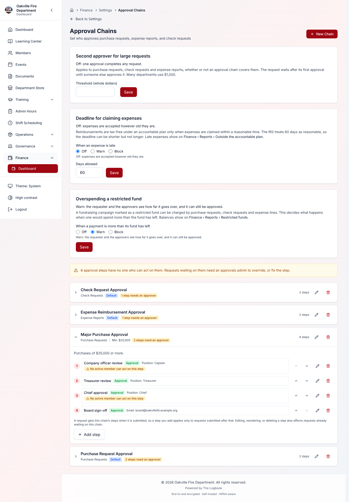

### Editing a Chain

The pencil in a chain's header opens **Edit chain**: **Name**, **Description**
and **Active** — _"Only active chains are used for newly submitted requests.
Turning a chain off does not change requests already going through it."_ Click
**Save chain**. What a chain applies to, its category, its amount range and its
default flag are set when it is created; to change those, create a new chain and
turn the old one off.

### Adding Steps to a Chain

Expand a chain and select **Add step**. The **Add step** dialog asks for:

| Field                            | Shown when           | What it does                                                                                                                                                                                             |
| -------------------------------- | -------------------- | -------------------------------------------------------------------------------------------------------------------------------------------------------------------------------------------------------- |
| **Step name**                    | Always               | e.g. "Treasurer review", "Chief approval"                                                                                                                                                                |
| **Step type**                    | Always               | **Approval** — _"The request waits here until someone approves or denies it."_ **Notification** — marked sent on the request's timeline and does not hold the request up. **It does not send an email.** |
| **Approver type**                | Approval steps       | **None**, **Position**, **Permission**, **Specific member** or **Email**                                                                                                                                 |
| _Approver value_                 | An approver type set | A list of positions, permissions or members to pick from (a text box if your account cannot load that list), or **Approver email** for the Email type                                                    |
| **Allow self-approval by email** | Email approvers only | Lets that address approve through the emailed link even when it is the requester's own email                                                                                                             |
| **Auto-approve under ($)**       | Approval steps       | _"A request for less than this amount is approved at this step automatically when it is submitted."_ Leave blank to always require approval                                                              |

Select **Add step**. A new step goes to the end of the chain; use the arrow
buttons beside it to **Move up** or **Move down**, the pencil to **Edit step**
(then **Save step**), and the trash icon to **Delete step**.

What the dialog says about approvers is the rule The Logbook applies:

- **Only the approver a step names can approve or deny it.** A **Position**
  step takes active members who hold that position; a
  **Permission** step takes active members granted that permission; a
  **Specific member** step takes that member; an **Email** step takes the
  member whose account email it is (or the outside approver, through the
  emailed link). A step with **None** takes any approver.
- **An approvals administrator can override.** An approvals administrator (the
  Treasurer, by default) can approve or deny
  a step that is not theirs by giving an **Override reason**, which goes to the
  audit log. An override never lets anyone approve their own request.
- **Only the Email type contacts anyone.** When a request reaches an Email
  step, that address is sent a link to approve or deny it (if email sending is
  set up). Position, Permission and Specific member steps send nothing — the
  request simply appears on the [Approvals](#approving-and-denying-requests)
  screen.
- **An emailed approval link stops working** if its step has since been changed
  away from an Email approver; the request then goes through the Approvals screen.
- **When an emailed link did not get through** _(2026-11-01)_. Under
  **Waiting on**, the Approvals screen says whether the approver's email went
  out: "Email sent", "Email could not be sent" or "Link expired". An approvals
  administrator can select **Re-send link**. The approver gets a new link by
  email, and the old link stops working. Nobody can view or copy the link,
  because it acts as that person's signature. The approver's page shows the
  request's title, amount and who asked for it.
- **Members approving in The Logbook can never approve their own request**,
  whatever **Allow self-approval by email** says; that box governs the emailed
  link only.

The dialog has no notification-email, email-template or required settings.
Nothing would act on them, so they are not offered.

**Only a step or chain no request has used can be deleted.** Every request
routed through a chain carries a record of each of its steps — who approved or
denied it, and their notes — and deleting the step or chain would erase those
records. So The Logbook refuses: _"This approval chain can't be deleted: 2
requests have been routed through it, and deleting it would erase their approval
history. Turn the chain off instead (edit it and clear Active) so nothing new is
routed through it."_ A step gets the same answer. A chain nobody has used yet,
or a step added since the chain was last used, deletes as normal.

To retire a chain, turn it off (**Edit chain**, untick **Active**); to change
who approves future requests, edit the step, or build a new chain and turn the
old one off. Every chain and step change — create, edit, delete — is recorded in
the audit log.

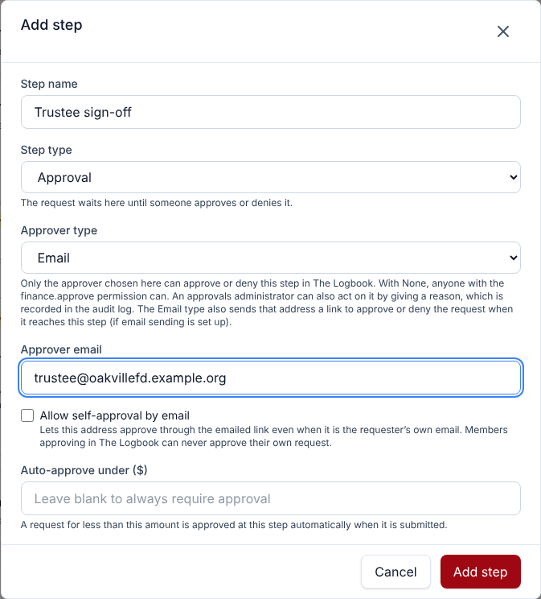

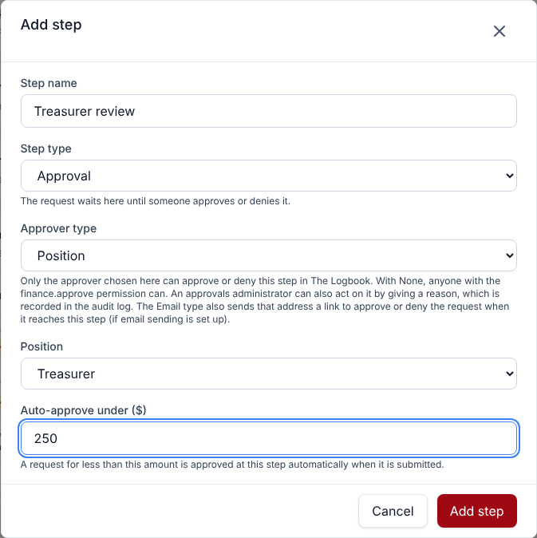

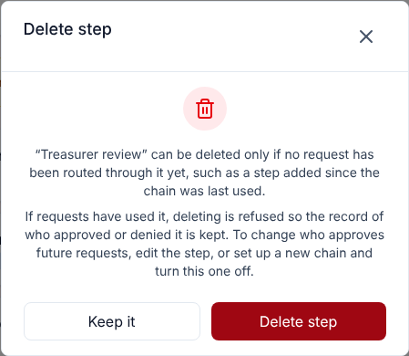

### Steps nobody can act on

Because only the named approver can act, a step whose approver has gone leaves
its requests stuck. The Approval Chains page checks every approval step and
puts an amber warning on any that nobody can act on, with how many requests are
waiting on it (_"3 requests waiting"_). The reason reads, for example, _"No
active member can act on this step"_, _"Not a valid email address"_ or that the
chosen position, member or permission does not exist. A banner at the top
counts the affected steps (_"1 approval step has no one who can act on it.
Requests waiting on it need an approvals admin to override, or fix the step."_).
The warnings refresh after every chain or step change. Fix the step, or have an
approvals administrator act on the waiting requests with an override reason in
the meantime. Saving a step also checks its approver: a position must exist, a
member must be active, a permission must be a real permission name, and an Email
step takes exactly one address.


### Previewing Chain Resolution

Members see it for themselves: the purchase request, expense report and check
request forms show **Who will approve this** as the amount and budget line are
filled in, and a draft shows it again beside **Submit for Approval**. It lists
the chain that will apply, who each step waits on, which steps the amount
approves automatically, and whether a second approver is needed. When no chain
applies it says a finance approver decides by hand.

There is no preview tool on the Approval Chains page itself. To check how a
chain you are configuring will route, start a request with the amount and
budget line in question and read the panel; nothing is sent until it is
submitted.

> **Hint:** Set up at least one default chain for each request type (Purchase Request, Expense Report, Check Request) before members begin submitting requests. Without a matching chain, a request waits in Pending Approval with no approval steps, and an approver has to decide it from its detail page.

### Example Chain Configuration

A typical fire department might configure these chains:

**Purchase Requests:**

- "Small Purchases" (up to $499.99): 1 step -- Captain Approval
- "Standard Purchases" ($500--$5,000): 2 steps -- Captain Approval, then Chief Approval
- "Large Purchases" (over $5,000): 3 steps -- Captain Approval, Chief Approval, then Board Notification
- "Training Purchases" (category: Training, any amount): 2 steps -- Training Officer Approval, then Chief Approval

**Expense Reports:**

- Default chain: 2 steps -- Supervisor Approval, then Treasurer Notification

**Check Requests:**

- Default chain: 2 steps -- Treasurer Approval, then Chief Approval

### Approval Step Statuses

As a request moves through its approval chain, each step has a status:

| Status            | Meaning                                                                                                   |
| ----------------- | --------------------------------------------------------------------------------------------------------- |
| **Pending**       | The step is active and awaiting action from its named approver (or an approvals administrator's override) |
| **Approved**      | The approver has approved the request at this step                                                        |
| **Denied**        | The approver has denied the request at this step (stops the entire chain)                                 |
| **Skipped**       | The step was skipped (not required or conditions not met)                                                 |
| **Auto-Approved** | The request amount was below the step's **Auto-approve under ($)** amount                                 |
| **Sent**          | For notification steps, the notification has been sent and the step auto-advanced                         |

### Edge Cases

| Scenario                                             | Behavior                                                                                                                                                         |
| ---------------------------------------------------- | ---------------------------------------------------------------------------------------------------------------------------------------------------------------- |
| No approval chain matches a submitted request        | The request moves to Pending Approval with no steps. An approver other than the requester approves or denies it from its detail page                             |
| Approver denies at step 2 of 3                       | The entire chain stops. The request is marked Denied with the denial reason. Remaining steps are not processed                                                   |
| The approver named on a step raised the request      | They cannot approve it in The Logbook. An approvals administrator acts on it with an override reason, or the step is changed                                     |
| Multiple members hold the "Captain" position         | Any one of them can approve the step -- the first to act decides it. Other approvers cannot, except an approvals administrator with an override reason           |
| Auto-approve threshold set to $200 on a $150 request | The step is automatically created with status Auto-Approved and the chain advances to the next step                                                              |
| Editing a chain after requests have been submitted   | Existing in-flight requests continue using the step records that were created at submission time. The edited chain applies only to newly submitted requests      |
| External email approver (Email type)                 | The approver receives an email with a private approval link, valid for 7 days. No Logbook account is needed. An expired link is refused                          |
| External approver uses the link a second time        | The link works once. Reopening it later reports **Approval not found**, and a second click at the same moment is refused rather than recording a second decision |
| Denial does not release encumbrance                  | By design -- denial happens during the approval flow (before the request reaches Approved status), so no encumbrance exists to release                           |

---

## Approving and Denying Requests

**Required Permission:** approver

### The Approvals screen

**Finance > Approvals**, also reached from the
dashboard's **Pending Approvals** card and its **Approvals** quick link, lists
the requests waiting on an approval step you can act on — one row per request,
showing **Request**, **Type**, **Requested by**, **Amount**, **Step**,
**Waiting on** and **Submitted**, with **Approve** and **Deny** buttons.

The page reads _"Requests waiting on you."_ and lists only the steps **you are
the named approver for**. A **Waiting on** column says who each step is assigned
to. If you are an approvals administrator you also see the steps assigned to other people,
marked **Not assigned to you**, with **Approve as approvals admin** and **Deny
as approvals admin** buttons: those open a dialog that names who the step is
assigned to and requires an **Override reason** (up to 2,000 characters,
_"Recorded in the audit log."_) as well as the usual notes. When nothing is
waiting on you the page says _"Nothing is waiting on you."_ The dashboard's
**Pending Approvals** count is unchanged and still counts every waiting request.

- **Approve** opens **Approve request** with an optional **Notes** box (_"Shown
  on the request's approval timeline."_). If more steps follow, the request
  moves to the next one.
- **Deny** opens **Deny request** and requires a **Reason**. Denying ends the
  request — no later steps run — and the reason is saved on the request.

If you raised the request yourself, the approval is refused with the
separation-of-duties message (see [Separation of Duties](#separation-of-duties)).


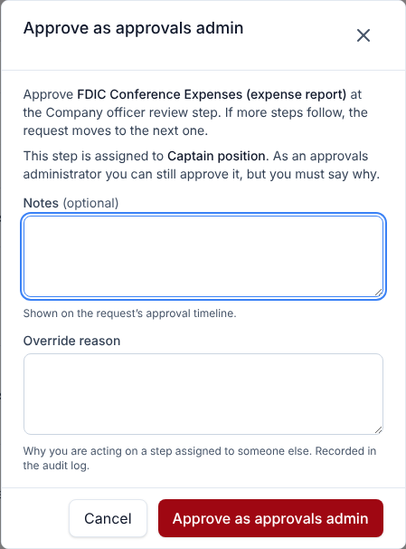

### On the request's own page

Each purchase request, expense report and check request detail page shows,
above its approval timeline, a panel that always says _"Waiting on **(who the
step is assigned to)**."_ for a pending approval step. If you are that approver
it adds _"You can approve or deny this step."_ with **Approve** and **Deny**
buttons. If you are an approvals administrator and the step is someone else's it
shows a **Not assigned to you** badge ( _"As an approvals administrator you can
act on it by giving an override reason."_ ) with **Approve as approvals admin**
and **Deny as approvals admin**. For anyone else it shows no buttons. A
notification step is never offered. The page reloads the request afterwards.

### When No Approval Chain Applies

A request submitted when no chain matches — or when the matching chain has no
steps — waits in **Pending Approval** with no approval steps. Its detail page
shows approvers a panel: _"No approval chain applies to this request. Approve or
deny it here."_

- **Approve** asks for an optional **Note** (_"Saved in the audit log."_) and
  marks the request approved — with the same budget effect as a completed
  chain, so a purchase request is encumbered and a budget cap still applies.
- **Deny** requires a **Reason** (_"The requester sees this reason."_) and
  marks it denied.
- **The requester cannot approve their own request** — the panel says _"You
  submitted this request, so someone else has to approve it. You can still
  deny it."_ and offers only **Deny**.

Both decisions are written to the audit log. The **Approvals** screen lists
these requests below the steps waiting on you, under _Waiting for a decision on
their own page_; open one to decide it.

### Large Requests Need Two Approvers

A department can require a **second approver** for large requests. At or above
the amount it sets, a purchase request, check request or expense report is
approved only once two different people have approved it.

- **Turning it on.** Open **Finance > Settings > Approval Chains**. The card
  _Second approver for large requests_ shows the rule. A settings administrator
  (the "Full settings and admin management" permission) enters a whole-dollar
  amount — many departments use
  $1,000 — and clicks **Save**, or clicks **Turn off**. Finance officers can
  read the rule but not change it, because it applies to them.
- **What happens.** The first approval — a chain step, or **Approve** on a
  request no chain applies to — does not complete the request. It stays
  **Pending Approval**, and its page shows _"This request needs a second
  approval from someone who has not approved it yet."_ Another approver opens
  it and selects **Approve**; that completes it. A chain approved
  by two different people completes as before.
- **Who can give the second approval.** Any approver except
  the person who submitted the request and anyone who has already approved it
  — they see only **Deny**. Approving the same request twice is refused.
- **Finding them.** Held requests are listed on the **Approvals** screen under
  _Waiting for a decision on their own page_, marked _A second approver_.
  Nobody is emailed when a request is waiting for its second approval.
- The budget is committed (encumbered) once, when the request is fully
  approved.

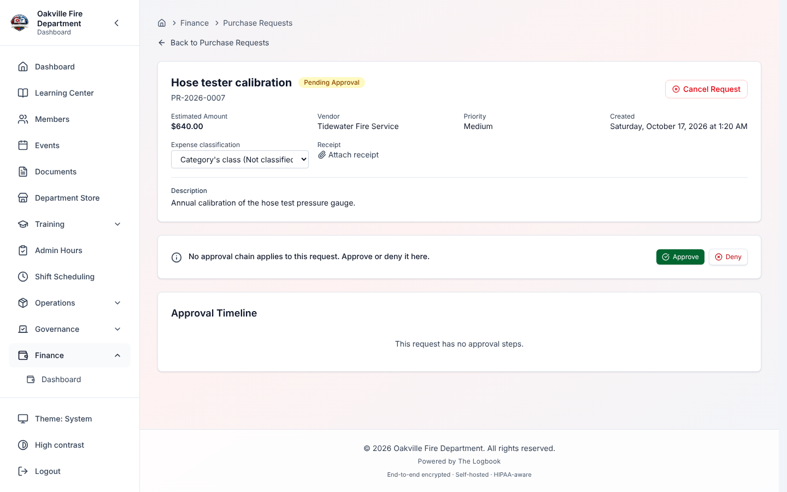

---

## Purchase Requests

Open **Finance > Purchase Requests** to view and manage purchase requests.

Purchase requests are used when a member needs to buy something for the department. The request goes through the configured approval chain before the purchase is authorized.

### Purchase Request Workflow

```
Draft → Submitted → Pending Approval → Approved → Ordered → Received → Paid
                          │
                        Denied
(Cancelled is possible at any point before Paid)
```

| Status               | Description                                                            | Budget Impact                                                                                   |
| -------------------- | ---------------------------------------------------------------------- | ----------------------------------------------------------------------------------------------- |
| **Draft**            | Request is being prepared by the member. Not yet visible to approvers. | None                                                                                            |
| **Submitted**        | Request has been submitted and is entering the approval chain.         | None                                                                                            |
| **Pending Approval** | Request is waiting for one or more approvers to act.                   | None                                                                                            |
| **Approved**         | All approval steps are complete. The purchase is authorized.           | **Estimated amount is encumbered** (reserved against the budget)                                |
| **Ordered**          | The item has been ordered from the vendor.                             | Encumbrance remains                                                                             |
| **Received**         | The item has been received by the department.                          | Encumbrance remains                                                                             |
| **Paid**             | Payment has been made to the vendor.                                   | **Encumbrance is released; actual amount (or estimated if no actual specified) moves to spent** |
| **Denied**           | An approver has denied the request.                                    | None (denial occurs before encumbrance)                                                         |
| **Cancelled**        | The requester or an officer has cancelled the request.                 | **Encumbrance is released** if the request had been approved, ordered, or received              |

### Request Numbers

Purchase request numbers are made automatically in the form **PR-YYYY-0001**. YYYY is the year the fiscal year starts, and the number counts up through the year (PR-2026-0001, PR-2026-0002…).

### Creating a Purchase Request

**Required Permission:** every member can raise one

1. Open **Finance > Purchase Requests**.
2. Select **New Purchase Request**.
3. Fill in the request details:

| Field                | Required | Description                                                           |
| -------------------- | -------- | --------------------------------------------------------------------- |
| **Title**            | Yes      | Brief description of what is being purchased (max 300 characters)     |
| **Fiscal Year**      | Yes      | The fiscal year to charge this purchase against                       |
| **Budget**           | No       | The specific budget line item (helps approvers see remaining balance) |
| **Estimated Amount** | Yes      | The expected total cost (must be greater than zero)                   |
| **Vendor**           | No       | The vendor or supplier name                                           |
| **Priority**         | Yes      | Low, Medium (default), High, or Urgent                                |
| **Description**      | No       | Detailed justification for the purchase                               |
| **Apparatus**        | No       | If the purchase is for a specific vehicle                             |
| **Facility**         | No       | If the purchase is for a specific fire station or facility            |
| **Notes**            | No       | Additional notes for approvers                                        |

4. The request is saved as a **Draft** on its own as you type, as soon as it has a title, a fiscal year and an amount above zero; the line under the form shows _"Draft saved at …"_. **Save Draft** saves the latest entries and opens the request, where you submit it for approval. **Close** leaves the form with the draft kept, and asks first only when what you have entered cannot be saved yet. **Discard draft** withdraws a saved draft. A draft you reopen from the list keeps saving as you edit; once a request is submitted, changes are saved with **Save Changes**.

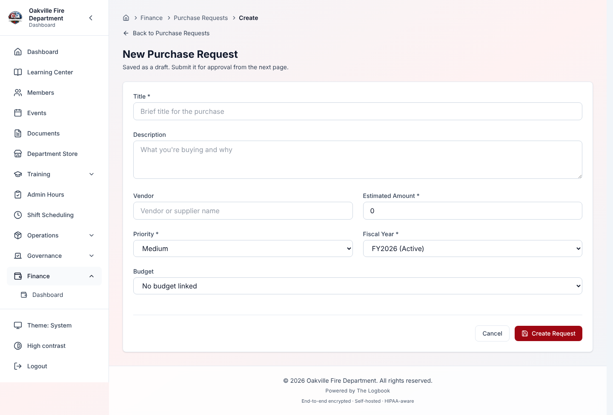

### Submitting a Purchase Request

Every new request starts as a draft:

1. Open **Finance > Purchase Requests** and find your draft (creating one takes you straight to it).
2. Open the request detail page. Its approval timeline reads _"Approval steps are added when you submit this request."_
3. Review the details and select **Submit for Approval**.

Once submitted, The Logbook finds the budget category from the chosen budget, matches an approval chain (see [Approval Chains](#approval-chains)) and adds its approval steps. The status changes to **Pending Approval**.

### Tracking a Purchase Request

Open a purchase request to see its detail page. It shows:

- Request number, title, and all submitted details
- Current status badge
- Approval chain progress -- each step with its status, assigned approver, action timestamp, and any notes
- Budget impact (estimated amount vs. budget remaining)

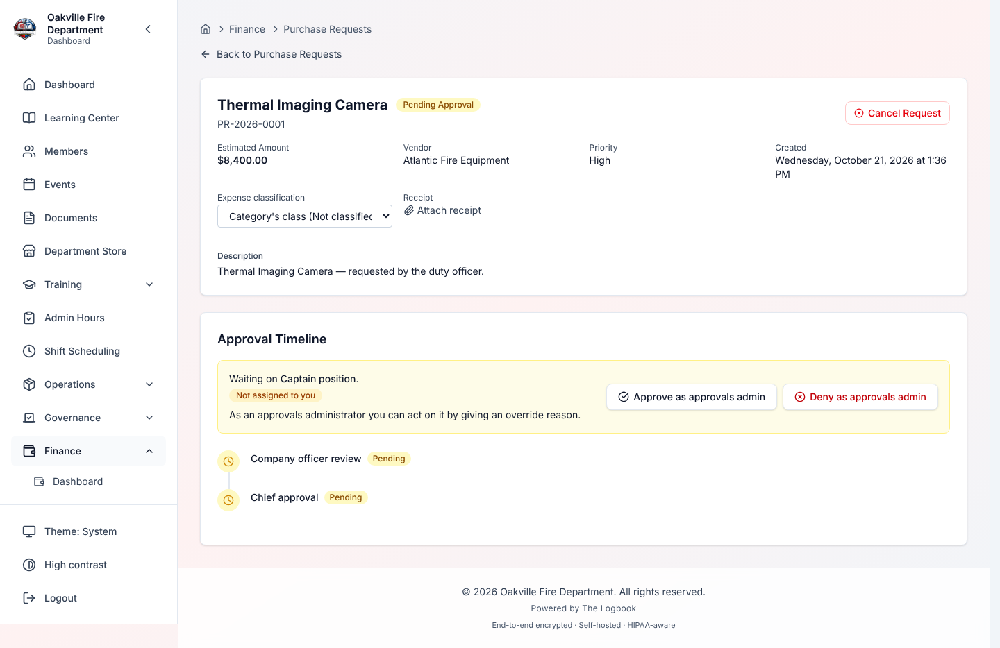

### Progressing a Purchase Request After Approval

**Required Permission:** finance manager

Once approved, officers can progress the request through the fulfillment stages:

1. Select **Mark as Ordered** when the item has been ordered from the vendor. The date and time are recorded.
2. Select **Mark as Received** when the item arrives at the department. The date and time are recorded.
3. Select **Mark as Paid** when payment has been made. At this point, you can optionally enter the **actual amount** paid (if it differs from the estimate). The actual amount is what gets recorded as spent against the budget.

> **Hint:** If the actual amount differs from the estimated amount, the budget adjusts automatically. For example, if $500 was encumbered but the actual payment was $475, only $475 moves to "spent" and the full $500 encumbrance is released (the $25 difference returns to the available balance). Payment can also be recorded directly from the Approved or Ordered status -- the Received step is optional.

### Paying Yourself Back for a Purchase

If you bought an approved item with your own money, claim it back from the request rather than starting an expense report from scratch:

1. Open your purchase request. It must be **Approved**, **Ordered** or **Received**.
2. Select **Request Reimbursement**.
3. Enter what you actually paid, the day you paid it, and where. Each field starts from the request's own figures.
4. Select **Start expense report**. A draft expense report opens, charged to the same budget line and carrying the request's receipt.
5. Check the line and its receipt, then select **Submit for Approval**.

The request now links to the report, and the report links back. Once the report is approved, the finance office pays you, usually by check (see [Paying a Report by Check](#paying-a-report-by-check)). When the report is paid, the request reads **Reimbursed**.

> **Hint:** Only the member who raised the request can claim it back, because the report pays whoever submits it. While a submitted report claims a purchase, the finance office cannot also mark it paid or cancel it. A denied claim frees the purchase, so you can start another.

### Editing and Cancelling

- **Editing:** A purchase request can only be edited while in **Draft** or **Submitted** status. Once it reaches Pending Approval, it cannot be modified.
- **Cancelling:** A request can be cancelled from any status except **Paid** or **Reimbursed**. If an approved, ordered, or received request is cancelled, the encumbrance is released back to the budget.

### Edge Cases

| Scenario                                                             | Behavior                                                                                                                                                           |
| -------------------------------------------------------------------- | ------------------------------------------------------------------------------------------------------------------------------------------------------------------ |
| Submitting without a budget selected                                 | The request enters the approval workflow but no encumbrance is tracked. Approvers should verify the funding source manually                                        |
| Actual amount exceeds estimated amount                               | Permitted up to what the budget has left once the estimate's encumbrance is released; beyond that, marking it paid is refused with _Insufficient available budget_ |
| Cancelling an approved request                                       | The committed amount is released back to the budget's available balance                                                                                            |
| Marking as paid from Approved status (skipping Ordered and Received) | Permitted -- the system allows direct transition from Approved to Paid                                                                                             |
| Request with no matching approval chain                              | The request moves to Pending Approval with no approval steps. An approver decides it from its detail page                                                          |
| Editing a submitted request                                          | Permitted while in Submitted status (before approval flow begins). Not permitted once in Pending Approval or later                                                 |
| Purchase request linked to an apparatus or facility                  | The linkage is informational -- it helps officers categorize spending by asset but does not affect the approval or budget logic                                    |

---

## Expense Reports

Open **Finance > Expense Reports** to view and manage expense reports.

Expense reports are used when a member has already incurred out-of-pocket expenses and needs reimbursement. Unlike purchase requests (which authorize future purchases), expense reports document past spending with itemized line items.

### Expense Report Workflow

```
Draft → Submitted → Pending Approval → Approved → Paid
                          │
                        Denied
(Cancelled is possible before approval)
```

| Status               | Description                                                       |
| -------------------- | ----------------------------------------------------------------- |
| **Draft**            | Report is being prepared. Line items can be added and edited.     |
| **Submitted**        | Report has been submitted into the approval chain.                |
| **Pending Approval** | Report is waiting for approver action.                            |
| **Approved**         | All approval steps are complete. The reimbursement is authorized. |
| **Paid**             | The member has been reimbursed. Payment method is recorded.       |
| **Denied**           | An approver has denied the report.                                |
| **Cancelled**        | The submitter has cancelled the report.                           |

### Report Numbers

Expense report numbers are made automatically in the form **ER-YYYY-0001**, where YYYY is the year the fiscal year starts.

### Creating an Expense Report

**Required Permission:** every member can raise one

1. Open **Finance > Expense Reports**.
2. Select **New Expense Report**.
3. Fill in the header:

| Field           | Required | Description                                                                                |
| --------------- | -------- | ------------------------------------------------------------------------------------------ |
| **Title**       | Yes      | Brief description of the expenses (e.g., "March Training Conference") (max 300 characters) |
| **Fiscal Year** | Yes      | The fiscal year these expenses fall within                                                 |
| **Description** | No       | Detailed explanation of the expenses                                                       |
| **Notes**       | No       | Additional notes for approvers                                                             |

4. Add **line items** for each expense (can be added during creation or separately while in Draft status):

| Field             | Required | Description                                              |
| ----------------- | -------- | -------------------------------------------------------- |
| **Description**   | Yes      | What the expense was for (max 500 characters)            |
| **Amount**        | Yes      | Dollar amount of the expense (must be greater than zero) |
| **Date Incurred** | Yes      | When the expense occurred                                |
| **Expense Type**  | Yes      | Category of expense (default: General; see table below)  |
| **Budget**        | No       | Which budget to charge this line item against            |
| **Merchant**      | No       | Where the purchase was made                              |

5. Select **Create Report**. The report is saved as a **Draft** and opens on its detail page. The total amount is automatically calculated as the sum of all line items.
6. **Attach a receipt to every line.** In the **Receipt** column, select **Attach receipt** on each line and choose the file — a PDF or a photo. **Replace** attaches a different file; the earlier one stays on record. For a mileage line, attach your trip log (dates, destinations, purpose and miles).
7. Select **Submit for Approval**. The button stays disabled, with _"Attach a receipt to … before submitting"_ beside it, until every line has a receipt.

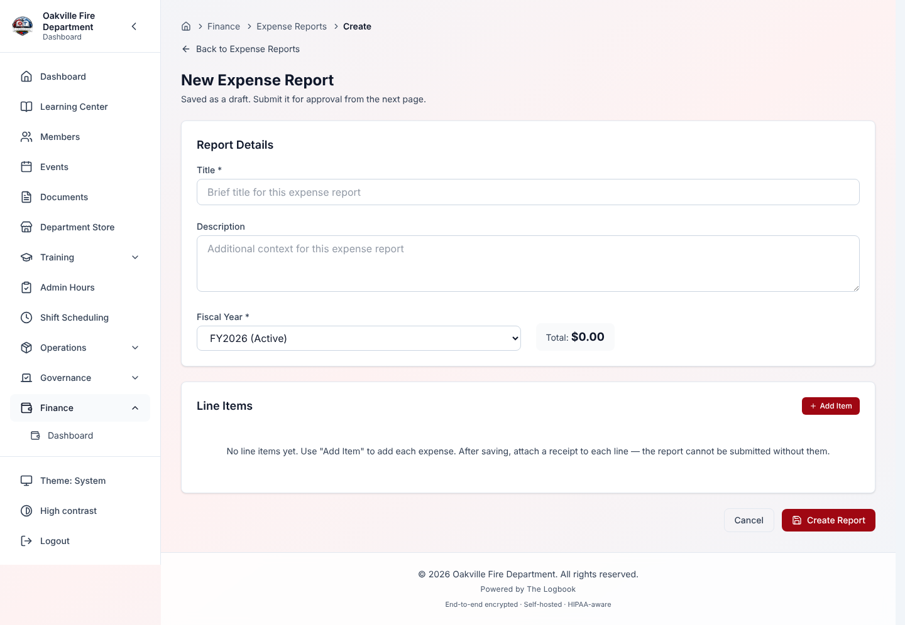

### Expense Types

Each line item on an expense report has an expense type that classifies the spending:

| Expense Type               | Description                                                 |
| -------------------------- | ----------------------------------------------------------- |
| **General**                | General department expenses not covered by other categories |
| **Uniform Reimbursement**  | Member uniform purchases or replacements                    |
| **PPE Replacement**        | Personal protective equipment replacement                   |
| **Boot Allowance**         | Boot purchase reimbursement                                 |
| **Training Reimbursement** | Training course fees, materials, or registration            |
| **Certification Fee**      | Professional certification or license renewal fees          |
| **Conference**             | Conference registration, materials, or related costs        |
| **Travel**                 | Travel expenses (fuel, tolls, parking, airfare)             |
| **Meals**                  | Meal expenses during department business or training        |
| **Mileage**                | Personal vehicle mileage reimbursement                      |
| **Equipment Purchase**     | Equipment purchased by the member for department use        |
| **Other**                  | Expenses that do not fit other categories                   |

### Correcting or Withdrawing a Draft Report

While an expense report is a **Draft**, its detail page lets you fix it before
anyone is asked to approve it:

- **Add line** adds another expense, with its own receipt.
- The **pencil** beside a line edits it (description, amount, date, type,
  merchant and fund); the **bin** removes it. The total is recalculated.
- **Withdraw Report** closes the draft for good. Use it for a report started by
  mistake; a reimbursement claimed from a purchase request can then be claimed
  again with the right amount.

Once submitted, the report cannot be changed or withdrawn by its member. The
finance office can **Cancel Report** while it is submitted, awaiting approval or
approved but not yet paid; any approval still outstanding is withdrawn. A
report a check is already paying is cancelled by first cancelling or voiding
that check.

### Submitting an Expense Report

Only **Draft** reports can be submitted. The total must be more than zero (at least one line with an amount), and **every line must have a receipt** — otherwise it is refused, naming the lines missing one. A member can still replace a receipt while the report is only submitted; once it is in approval, only the finance office can, and a replaced receipt stays on record. The approval chain is chosen by the request type, the total and the budget category of its lines.

### Tracking and Payment

Open an expense report to see its detail page. It shows:

- Report number, title, and total amount (sum of all line items)
- Current status with approval chain progress
- All line items with their individual details, and each line's receipt (select **Receipt** to download it)
- Payment status and method (once paid)

The report — receipts included — can be read by the member who submitted it, a finance manager, and its **approvers**: whoever its approval chain names, anyone who has already acted on one of its steps, an approvals administrator, and, for a report no chain applies to, any approver. Everyone else is told the report does not exist.

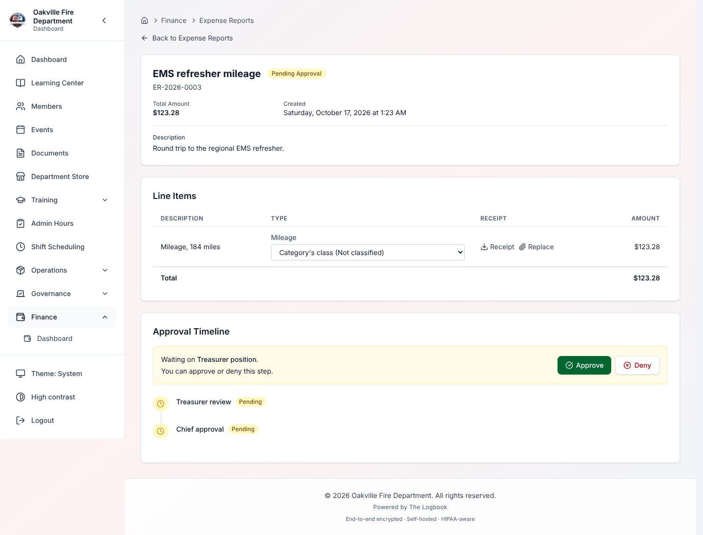

**Marking as Paid:**

**Required Permission:** finance manager

Once an expense report is approved:

1. Open the report detail page.
2. Select **Mark as Paid**.
3. Optionally enter the **payment method** (e.g., "check #1234", "direct deposit", "petty cash").
4. Confirm the payment.

Each line's amount is recorded as spent against the budget that line names.

> **Hint:** Receipts are required on every line, which is what an IRS accountable plan expects of a reimbursement.

### Paying a Report by Check

**Required Permission:** finance manager

To send the member a check rather than recording a payment made some other way:

1. Open the approved expense report.
2. Select **Pay by Check**.
3. Optionally enter a mailing address and a memo, then select **Request check**.

This creates a check request made out to the member's legal name, for what the report still owes them (the total, less anything a cash advance already covered). It goes through the department's check-request approval chain like any other check. Once it is approved, [issue it](#issuing-a-check) as usual; issuing it marks the report **Paid** with the check's number and date, and closes the purchase request the report claims back, if any.

While a check is paying a report, neither **Pay by Check** nor **Mark as Paid** is offered. If the check is denied, the report waits for payment again.

> **Hint:** A reimbursement check is not charged to a budget line itself; the report's lines are. In the payments register and the QuickBooks export, the report appears once, dated by the check and showing its number.

### The Deadline for Claiming Expenses

An accountable plan also expects expenses to be claimed promptly. The IRS treats **60 days** after the expense as a reasonable time; a reimbursement for an expense claimed later may have to be reported as taxable pay. Your department chooses what happens to a late line:

| Setting   | What happens to a line older than the deadline when the report is submitted                                                                                     |
| --------- | --------------------------------------------------------------------------------------------------------------------------------------------------------------- |
| **Off**   | Nothing. This is the default.                                                                                                                                   |
| **Warn**  | The report is submitted. The line is marked **Submitted late**, and every approver has to confirm they have reviewed the late lines before approving the report |
| **Block** | The report cannot be submitted. The message names the late lines.                                                                                               |

**Setting it up.** A settings administrator ("Full settings and admin management") opens **Finance > Settings > Approval Chains** and uses **Deadline for claiming expenses**: choose Off, Warn or Block, and the number of days (1 to 60 — a department can be stricter than the IRS, not looser). Finance officers see the setting but cannot change it, because it applies to them.

**Filling in the form.** When the deadline is on, the expense form warns you as soon as you enter a date older than it, before you save. The warning is advice: what counts is the day you submit the report.

**Approving.** On **Approvals**, a report with late lines shows **1 late line** (or however many). Approving it opens a second question — _"Approve late expenses?"_ — and **I've reviewed it, approve** records your confirmation. **Go back** approves nothing. An external approver approving from an emailed link ticks **I have reviewed the late expenses** instead. If a report's approval chain would finish without anyone confirming (for example, a chain of notification steps only), it waits under **Waiting for a decision on their own page** until an approver confirms and approves it.

**Afterwards.** The report's page lists which lines were late and when an approver confirmed them. **Finance > Reports > Outside the accountable plan** lists every late expense paid in a period — the member, the dates incurred and submitted, who confirmed it and the amount — with a CSV download, for whoever handles payroll or your tax filings.

### Edge Cases

| Scenario                                       | Behavior                                                                                                         |
| ---------------------------------------------- | ---------------------------------------------------------------------------------------------------------------- |
| Expense report with no line items              | Cannot be submitted -- the total must be more than zero                                                          |
| Line items spanning multiple budget categories | Each line item can reference a different budget. The total is the sum of all line items                          |
| Adding line items after submission             | Not permitted -- the report must be in Draft status to add line items                                            |
| Editing the report after submission            | Only permitted in Draft or Submitted status                                                                      |
| Receipt not attached to a line item            | The report cannot be submitted; the message names the lines missing one                                          |
| Line incurred longer ago than the deadline     | Depends on the department's setting: nothing (Off), marked and confirmed by approvers (Warn), or refused (Block) |
| Deadline changed after a report was submitted  | The report keeps the grading it got when it was submitted                                                        |
| Expense type does not match the budget         | Allowed -- the expense type only describes the spending. The budget is the one chosen on the line                |
| Multiple line items against the same budget    | All their amounts are added to that budget's spent total when the report is paid                                 |

---

## Check Requests

Open **Finance > Check Requests** to view and manage check requests.

Check requests are used when the department needs to issue a check to a payee -- for example, paying a vendor invoice, reimbursing a contractor, or making a recurring payment. Unlike purchase requests (which track the full procurement lifecycle) and expense reports (which reimburse members), check requests focus specifically on issuing a department check.

### Check Request Workflow

```
Draft → Submitted → Pending Approval → Approved → Issued
                          │                         │
                        Denied                    Voided
(Cancelled is possible before the check is issued)
```

| Status               | Description                                                                | Budget Impact                                              |
| -------------------- | -------------------------------------------------------------------------- | ---------------------------------------------------------- |
| **Draft**            | Request is being prepared.                                                 | None                                                       |
| **Submitted**        | Request has entered the approval chain.                                    | None                                                       |
| **Pending Approval** | Request is waiting for approver action.                                    | None                                                       |
| **Approved**         | All approval steps are complete. The check can be issued.                  | None                                                       |
| **Issued**           | The check has been written and issued. Check number and date are recorded. | **Amount is added to budget spent**                        |
| **Denied**           | An approver has denied the request.                                        | None                                                       |
| **Voided**           | An issued check has been voided (e.g., lost check, cancelled payment).     | **Spent amount is reversed** (subtracted, floored at zero) |
| **Cancelled**        | The requester has cancelled the request before issuance.                   | None                                                       |

### Request Numbers

Check request numbers are made automatically in the form **CK-YYYY-0001**, where YYYY is the year the fiscal year starts.

### Creating a Check Request

**Required Permission:** every member can raise one

1. Open **Finance > Check Requests**.
2. Select **New Check Request**.
3. Fill in the request details:

| Field             | Required | Description                                              |
| ----------------- | -------- | -------------------------------------------------------- |
| **Payee Name**    | Yes      | Who the check should be made out to (max 300 characters) |
| **Amount**        | Yes      | The check amount (must be greater than zero)             |
| **Fiscal Year**   | Yes      | The fiscal year to charge against                        |
| **Budget**        | No       | The specific budget line item                            |
| **Payee Address** | No       | Mailing address for the payee                            |
| **Memo**          | No       | Memo line for the check (max 500 characters)             |
| **Purpose**       | No       | Internal description of why the check is needed          |
| **Notes**         | No       | Additional notes for approvers                           |

4. Select **Create Check Request**. It is saved as a **Draft**; open it and select **Submit for Approval**.

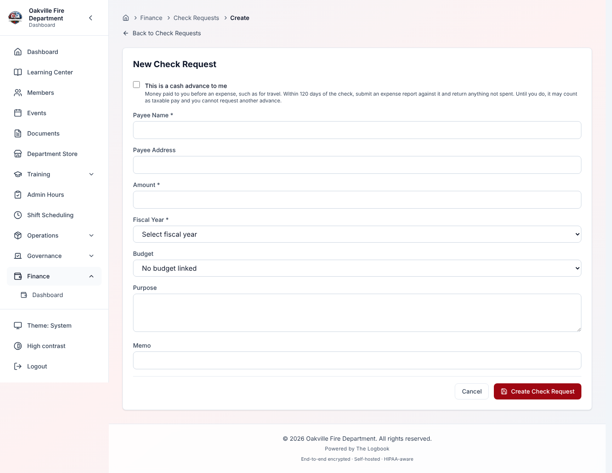

### Issuing a Check

**Required Permission:** finance manager

After a check request is approved:

1. Open the check request's detail page.
2. Select **Issue Check**.
3. Enter the **check number** from your physical check stock.
4. Confirm issuance.

The system records the check number and the issuance date. The check amount is added to the linked budget's spent total.

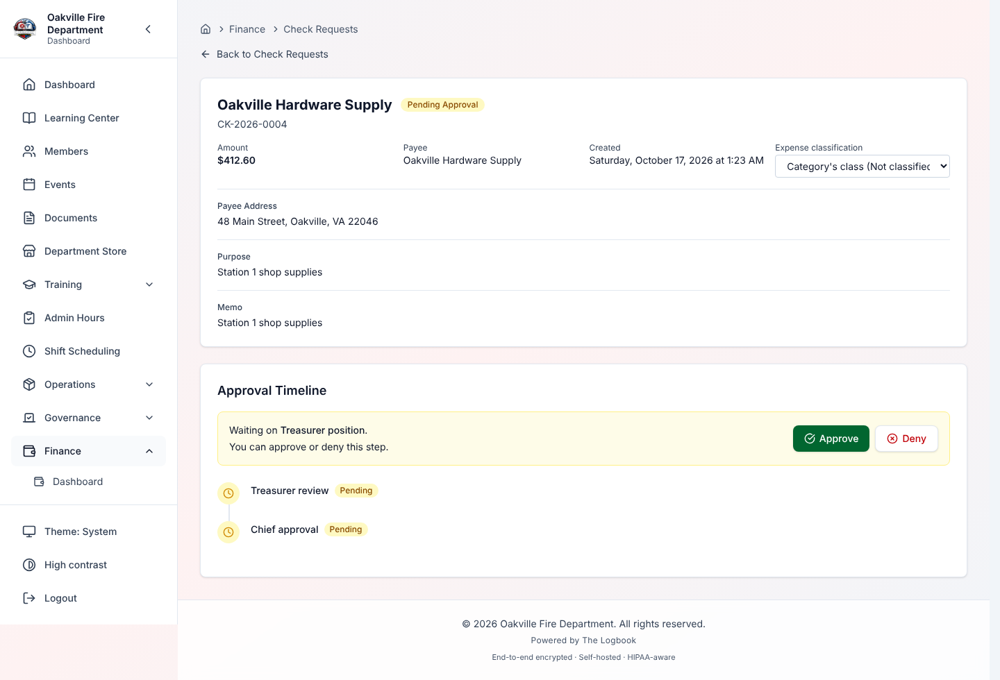

### Withdrawing or Cancelling a Check Request

A member can **Withdraw Request** while their check request is a draft. After it
is submitted, the finance office can **Cancel Request** at any point before the
check is issued; nothing has been paid, so nothing is reversed. An issued check
is **voided** instead (below).

### Voiding an Issued Check

> **Voiding a reimbursement check** puts its expense report back to **Approved**, takes its spending off the budget lines, and reopens the purchase request it claimed back, so the finance office can send another check. If the check had already gone to QuickBooks, the next export reverses exactly the entry it sent.

If a check needs to be voided after issuance (e.g., lost in the mail, payment cancelled):

1. Open the issued check request.
2. Select **Void Request**.
3. Confirm the void action.

The check status changes to **Voided**. The amount is taken off the budget's spent total (which never goes below zero).

> **Hint:** Voiding a check does not delete the record. The voided check remains in the system for audit trail purposes. If a replacement check is needed, create a new check request.

### Edge Cases

| Scenario                                        | Behavior                                                                                                               |
| ----------------------------------------------- | ---------------------------------------------------------------------------------------------------------------------- |
| Issuing a check without entering a check number | Not permitted -- the check number is required                                                                          |
| Voiding a check                                 | The budget spent amount is reduced by the check amount, floored at zero                                                |
| Duplicate check numbers                         | The system does not enforce unique check numbers -- it is the treasurer's responsibility to track physical check stock |
| Re-issuing a voided check                       | Create a new check request. The voided request remains as a historical record                                          |
| Check request with no budget selected           | The check can be issued, but no budget tracking occurs for the amount                                                  |
| Editing a check request after submission        | Only permitted in Draft or Submitted status                                                                            |

---

## Cash Advances

A cash advance is money the department gives a member **before** an expense — travel to a conference, a supply run — instead of reimbursing them afterwards. The IRS lets the department do this tax-free only if the member accounts for the money: receipts within 60 days of each expense, and anything not spent handed back within **120 days of the advance**. What is left after that may have to be reported as the member's wages.

### Asking for an Advance (members)

1. Go to **Finance › Check Requests** and select **New Check Request**.
2. Tick **This is a cash advance to me**. The payee is filled with your name, and the budget and fund disappear: an advance is not charged to a budget until you report what you spent.
3. Enter the amount, the fiscal year and the purpose, then **Create Check Request** and **Submit for Approval**.

It is approved and issued like any check. The Treasurer cannot issue a check to themselves; another officer does.

> **Hint:** You cannot submit a new advance while one of yours is **more than 120 days old and not fully accounted for**. The form warns you, naming it. Reimbursements and other requests are not affected.

### Accounting for an Advance (members)

When you have spent the money, create an expense report as usual and choose the advance under **Accounts for a cash advance** (it appears only when you have one open). Attach every receipt and submit.

- The report is taken off what you owe on the advance. If you spent **more** than the advance, the rest is reimbursed to you as usual.
- If you spent **less**, hand the rest back to the Treasurer, who records it.
- You can split an advance over several reports. Once it is fully accounted for, a further report against it is refused; submit it as an ordinary reimbursement.

The advance's own page (open the check request) shows **Accounting for this advance**: what was advanced, what your reports cover, what you returned, what is outstanding and the date it is due by.

### Recording Returned Cash (Treasurer)

1. Open the advance (its check request).
2. Select **Record returned cash**. The amount is filled with what is outstanding; change it if they returned less.
3. Choose the day, the method and any reference, then **Record return**.

The member who owes the advance cannot record their own return. A return entered by mistake can be removed with the bin icon until a QuickBooks export has included it.

**Finance › Reports › Cash advances** lists every advance not yet fully accounted for, who has it, when it is due and which are overdue, with a CSV.

### Edge Cases

| Scenario                                                     | Behavior                                                                              |
| ------------------------------------------------------------ | ------------------------------------------------------------------------------------- |
| An expense report against an advance is denied               | It stops counting; that part of the advance is owed again                             |
| A report waiting for approval                                | It already counts: submitting it is what accounts for the money                       |
| Returning more than is outstanding                           | Refused                                                                               |
| Voiding an advance a report or return already counts against | Refused. Void only an advance nothing has been recorded against                       |
| Changing which advance a report accounts for                 | Only while the report is a draft                                                      |
| An advance and the budget                                    | The budget is charged when the expense report is paid, not when the advance is issued |

---

## Dues & Assessments

**Required Permission:** finance viewer (to view), finance manager (to create schedules and manage payments)

Open **Finance > Dues** (from the dashboard's Quick Links) to manage member dues
and assessments: annual dues, quarterly assessments, equipment fees, or any
other recurring charge.

A finance manager gets **New schedule**, **Edit schedule**, **Generate dues**,
**Record payment**, **Waive**, **Reverse waiver** and each member's **Payment
history**. Members are listed by name. A finance viewer who is not a finance
manager sees the list (their own dues only) and the payment history, and none
of the buttons.

### Dues Schedules

A dues schedule defines the terms of a recurring fee:

| Field         | Description                                                                                    |
| ------------- | ---------------------------------------------------------------------------------------------- |
| **Name**      | Description of the dues (e.g., "Annual Membership Dues", "Q1 Assessment") (max 200 characters) |
| **Amount**    | The amount each member owes per period (must be greater than zero)                             |
| **Frequency** | How often dues are collected (see table below). A label: generation does not repeat on its own |
| **Due Date**  | When the period's payment is due                                                               |
| **Active**    | Whether the schedule is in use. Shown on Edit only; an inactive schedule cannot generate dues  |
| **Notes**     | Optional notes about the schedule                                                              |

> **No grace period, late fee or member filter.** None of these can be
> set. No late fee is ever charged. Dues with nothing paid show as Overdue the
> day after the due date; part-paid dues stay Partial. **Generate dues** bills
> every active member, whatever their member class or membership status
> _(2026-10-29)_.

### Frequencies

| Frequency       | Period                               |
| --------------- | ------------------------------------ |
| **Annual**      | Once per year                        |
| **Semi-Annual** | Twice per year (every 6 months)      |
| **Quarterly**   | Four times per year (every 3 months) |
| **Monthly**     | Every month                          |

### Creating a Dues Schedule

**Required Permission:** finance manager

1. Open **Finance > Dues**.
2. Select **New schedule**.
3. Enter the name, the amount per member, the frequency and the due date, and optionally notes.
4. Select **Create schedule**. The new schedule is selected; it has billed nobody yet.

To change a schedule, select it and select **Edit schedule**. Changes affect dues generated afterwards only; dues already generated keep their amount and due date. Untick **Active** to retire a schedule — it stays in the list, marked inactive, and can be reactivated.

### Generating Member Dues

After creating a schedule, you need to generate individual dues records for each member:

1. On the **Finance > Dues** page, select the dues schedule.
2. Select **Generate dues** and confirm.
3. The Logbook bills every active member who does not already have dues for
   this schedule. A member who already has them is skipped.
4. Each new record is **Pending**, for the schedule's full amount and due date.
5. A message reports how many members were billed — or that every active member already had dues for this schedule.

> **Hint:** Run **Generate dues** at the start of each dues period: at the start of the fiscal year for annual dues, at the start of each quarter for quarterly dues. Running it again never bills anyone twice.

### Member Dues Statuses

| Status      | Description                                                                                               |
| ----------- | --------------------------------------------------------------------------------------------------------- |
| **Pending** | Payment is expected but not yet received                                                                  |
| **Paid**    | The full amount has been received                                                                         |
| **Partial** | Some, but not all, of the amount has been received. The rest is tracked                                   |
| **Overdue** | The due date has passed with nothing paid (a daily check moves Pending to Overdue; Partial stays Partial) |
| **Waived**  | The dues have been waived by an officer (e.g., financial hardship, service credit)                        |
| **Exempt**  | The member is exempt from this dues schedule (e.g., Life members exempt from annual dues)                 |

_(2026-10-19)_ The **overdue dues** number on the dashboard's finance tile uses
the same rule as this page: Overdue records, plus Pending records past their due
date with nothing paid. A Partial record is not counted, because it shows as
Partial here. Before, the tile counted part-paid records too and read higher than
the list it links to.

### Recording Payments

**Required Permission:** finance manager

1. On the **Finance > Dues** page, find the member's dues record. **Record payment** is offered while the dues are Pending, Partial or Overdue.
2. Select **Record payment**. The amount is prefilled with what is still owed.
3. Adjust the **amount received** (must be greater than zero), and optionally choose a **method** and enter a **reference** (check number, receipt number) and **notes**.
4. Select **Record payment**.

If the amount is more than the member still owes, you are asked first. Confirming
records what is owed against the dues and the rest as a **donation** from the
member, under no campaign, in **Fundraising**. A donor record is created for the
member if they do not have one. If their dues are already paid, the whole amount
is the donation. Choose **Change the amount** to go back instead.

Every payment is recorded as its own entry in the member's payment history. The
amount paid shown on the dues record is the **sum of that history**, so if the
total reaches or exceeds the amount due the status changes to **Paid**, and if it
is between zero and the amount due it changes to **Partial**.

Two consequences worth knowing:

- **Entering a payment twice does not charge the member twice.** If you supply a
  transaction reference (check number, receipt number) and that reference has
  already been recorded against these dues, the second submission is ignored and
  the record is returned unchanged. A double-clicked Save, or a form resubmitted
  after a slow connection, is safe.
- **Cash with no reference is never treated as a duplicate.** Two $20 cash
  payments on the same evening are two payments. If you want the system to be
  able to spot a duplicate, give the payment a reference.

You do not need to re-enter the payment method or notes from an earlier
installment. Leaving them blank records this payment without them; the earlier
payment keeps what it said.

**You cannot record a payment against your own dues.** Settling dues is a money
movement, so — like waiving them — it needs a second person: another finance
manager records it, and yours is refused with a message saying so. This is a
same-person check only: any finance manager may record a payment for any other
member.

### Payment History

**Required Permission:** finance viewer

Click the history icon on a member's row to open **Payment history**: the full
list of payments received against those dues -- amount, method, reference, notes
and when it was received. (Which officer entered each payment is recorded, but
the dialog does not show it.) The dues record itself shows only the running total and the most recent
payment's detail, so the history is where you go to answer "what did they
actually pay, and when?"

This matters at audit time: the summary figure alone cannot show that a $100
balance was three separate installments, or which of them was the check that
bounced.

### Waiving Dues

**Required Permission:** finance manager

To waive a member's dues:

1. Find the member's dues record (it must still be owing).
2. Select **Waive**.
3. Enter a **reason** for the waiver (required).
4. Select **Waive dues**.

The record is marked **Waived**, with who waived it, when, and the reason. You cannot waive your own dues; the request is refused and the message says so.

Dues can be waived only once. If another officer waived them first, yours is
refused with "These dues are already waived." The first waiver keeps its
officer, date and reason. To record a different waiver, reverse the first one
and waive again.

Once dues are waived, **payments against them are refused.** They are not
owing, so recording money against them would quietly cancel the waiver and move
the waived amount into your collection figures.

### Reversing a Waiver

**Required Permission:** finance manager

If dues were waived by mistake -- or waived and then paid anyway -- reverse the
waiver before recording the payment:

1. Find the member's dues record (it shows **Reverse waiver** only while Waived).
2. Select **Reverse waiver**.
3. Enter a **reason** for the reversal (required).
4. Select **Reverse waiver**.

The record returns to whatever its payment history says: **Pending** if nothing
was ever paid, **Partial** or **Paid** if something was. The original waiver
reason is erased from the record, and neither it nor your reason for reversing
is copied into the audit log, which records only that the waiver was reversed
and the status it returned to. Free-text reasons may carry personal information
and must stay removable for privacy, which the permanent audit log is not.

### Dues Summary

The dues summary provides an overview of collection status across all members:

| Metric                | Description                                                              |
| --------------------- | ------------------------------------------------------------------------ |
| **Total Expected**    | What every member's dues add up to                                       |
| **Total Collected**   | What has been paid                                                       |
| **Total Outstanding** | Total Expected less Total Collected and Total Waived                     |
| **Total Waived**      | The amount of all waived dues                                            |
| **Collection Rate**   | Total Collected as a percentage of Total Expected, to two decimal places |
| **Members Paid**      | Count of members with Paid status                                        |
| **Members Overdue**   | Count of members with Overdue status                                     |
| **Members Waived**    | Count of members with Waived status                                      |

Selecting a schedule narrows the summary to that schedule.

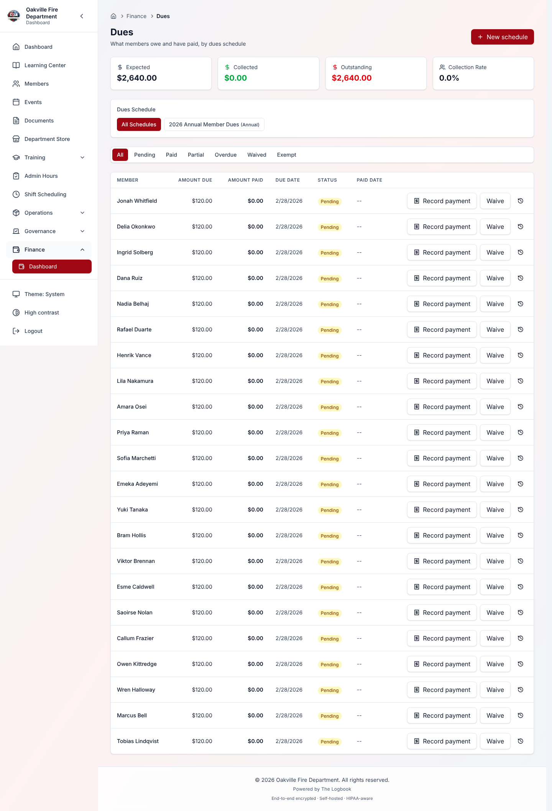

### Edge Cases

| Scenario                                                           | Behavior                                                                                                                                                  |
| ------------------------------------------------------------------ | --------------------------------------------------------------------------------------------------------------------------------------------------------- |
| Generating dues when records already exist                         | Only members without dues for that schedule are billed                                                                                                    |
| Member joins mid-period                                            | Their dues are not automatically generated. Run Generate Dues again -- the system will only create records for members who do not already have one        |
| Partial payment followed by additional payment                     | Both are kept as separate entries in the payment history. The amount paid is the sum of them. If the total reaches the amount due, status changes to Paid |
| The same payment entered twice with the same transaction reference | The second submission is ignored and the record returned unchanged -- the member is not charged twice                                                     |
| Two cash payments of the same amount, neither with a reference     | Both are recorded. Without a reference there is nothing to tell a duplicate from a genuine second payment, and dropping one would lose money              |
| A later payment entered without a method or notes                  | Recorded as-is. Earlier payments keep their own detail                                                                                                    |
| Payment recorded against waived or exempt dues                     | Refused with an explanatory error. Reverse the waiver first (see Reversing a Waiver)                                                                      |
| Waiver reversed                                                    | Status returns to whatever the payment history says -- Pending, Partial or Paid. The original waive reason is erased and not copied to the audit log      |
| Waiving dues that are already waived                               | Refused: "These dues are already waived." The first waiver's officer, date and reason stay. Reverse it first to record a new one                          |
| Partial payment followed by waiver                                 | The waiver sets the status to Waived. The amount already paid is not refunded -- this is an administrative decision                                       |
| Which members Generate Dues bills                                  | All active users in the organization. No member class or membership status filter is applied                                                              |
| Changing the dues amount on a schedule                             | Only affects dues generated afterwards. Existing dues keep their original amount                                                                          |
| Member status changes to inactive                                  | Existing dues records are not automatically waived or cancelled. An officer should manually waive them if appropriate                                     |
| Late fees                                                          | Not available -- nothing charges or records a late fee                                                                                                    |
| Dues summary with no records                                       | Returns zeroes for all metrics and 0% collection rate                                                                                                     |

---

## Board Reports

Open **Finance > Reports** (or the **Reports** quick link on the
dashboard). You need to be a finance viewer. Six reports sit on tabs across the top:

- **Budget vs actual** -- every budget line for a fiscal year: its original
  amount, confirmed amendments, the amended budget, what has been spent, what
  remains and the percent used, with totals.
- **Amendment log** -- every change to the adopted budget: when it was entered
  and by whom, the line, the amount, the reason, the approval it cites, and
  whether a second officer confirmed or rejected it.
- **Payments register** -- every payment made in a period: date, type, request
  number, payee, description, budget line and amount, with a total.
- **Functional expenses** -- a period's payments by what they were for:
  program services, management & general, and fundraising, each by budget
  category. See [Classifying Expenses](#classifying-expenses).
- **Restricted funds** -- each restricted fund's balance today: what donors
  gave, what has been spent or committed, and what is left. See
  [Restricted Funds](#restricted-funds).
- **Outside the accountable plan** -- every expense reimbursed in a period that
  was claimed after the department's deadline, with who confirmed it. See
  [The Deadline for Claiming Expenses](#the-deadline-for-claiming-expenses).

Each report has **Download CSV**, which opens in Excel or Google Sheets with
amounts as numbers, and **Print**, which prints just the report under a
heading saying what it covers. To get a PDF, choose _Save as PDF_ in the print
dialog.

### Running budget vs actual for a meeting

1. Pick the **Fiscal year** (the active year is chosen for you).
2. Set **Through** to the date the report should stand at -- for a monthly
   board meeting, usually the last day of the month. It starts on today.
3. Print it, or download the CSV for the packet.

**Spent** counts payments dated on or before that day, and a voided check
stops counting from the day it was voided. **Amendments** count from the day
they were confirmed. So a report through March 31, run in April, reads the
same as one run on March 31 would have.

**Committed** -- approved requests not yet paid -- appears only on a report
through today. The system does not record what was committed on an earlier
date, so a report for a past date leaves the column out rather than guess.

> **Hint:** If a line shows _"The line's running total reads …"_ under its
> name, the budget's spent total does not match the payments recorded against
> it -- usually because it was adjusted by hand, or holds spending from before
> payments were dated. The report uses the payments, so it agrees with the
> payments register.

### Reconciling the register with the bank

Set **From** and **To** to the statement period (at most 366 days) and compare
the register with the statement. A check voided in the period appears twice:
once on the day it was written, and again as a negative amount on the day it
was voided. The register's total for a period equals the change in **Spent**
on budget vs actual over the same period, for payments charged to that year's
budget lines.

### Edge Cases

| Situation                                         | Behavior                                                                                   |
| ------------------------------------------------- | ------------------------------------------------------------------------------------------ |
| Payment made late in the evening                  | Dated by your department's time zone, not the server's, so it lands on the day it was made |
| Amendment still awaiting a second officer         | Listed on the amendment log as _Awaiting confirmation_; not counted on budget vs actual    |
| Payment with no budget line                       | On the payments register, with no budget line shown; not on budget vs actual               |
| An expense report charged to several budget lines | One register row for the whole report, naming every line it was charged to                 |
| Register period longer than 366 days              | Refused with a message; run it in two parts                                                |

### Classifying Expenses

A nonprofit's annual return (IRS Form 990, Part IX) reports expenses by what
they were **for**, in three classes:

| Class                    | What belongs there                                                                     |
| ------------------------ | -------------------------------------------------------------------------------------- |
| **Program services**     | Running the department: gear, apparatus, training, fuel, community outreach            |
| **Management & general** | Running the organization: insurance, accounting, bank fees, the annual audit           |
| **Fundraising**          | The cost of raising money: raffle tickets, a mailer, the hall for a fundraising dinner |

Fundraising is what it **costs** to raise money, not what the money raised
buys. Turnout gear bought with donations is still program services.

**Setting it up.** On **Finance > Settings**, edit each budget category and
choose its **Expense classification**. A subcategory left _Not set_ takes its
parent category's class, so setting the top-level categories is usually
enough.

**One payment that differs.** On a purchase request or check request, or on a
line of an expense report, a finance manager can change the
classification for that payment alone — the gloves bought as raffle prizes
from the gear line, say. Choosing _Category's class_ puts it back. Finance
viewers see the class; members filing requests do not.

**The report.** **Functional expenses** lists a period's payments under each
class, then by budget category, with subtotals and a CSV. It counts the same
payments as the payments register, so the totals agree. Anything without a
class is listed as **Unclassified**, with a reminder above the table, rather
than guessed at.

### Restricted Funds

When donors give for a stated purpose -- new turnout gear, replacing Engine 2,
a community CPR program -- that money is **restricted**: it can be spent only
on that purpose, and no more than was given. In The Logbook a restricted fund
is a **fundraising campaign** marked as restricted.

**Making a campaign a restricted fund** (officers who can manage fundraising):
on **Grants & Fundraising > Campaigns**, tick **Restricted fund** when creating the
campaign and say what the donors are giving for, or use **Mark as restricted
fund** on an existing campaign's card. **Make unrestricted** undoes it, but
only while nothing is charged to the fund.

**Charging a payment to a fund:** the **Restricted fund** picker on the
purchase request, check request and expense report forms (on each expense
line) lists the department's open restricted funds with what each has left.
The requester picks it -- they know what the money is for. If the request is
more than the fund has left, the form says so before it is saved.

**What a fund has:**

| Figure                | What it counts                                                                                                         |
| --------------------- | ---------------------------------------------------------------------------------------------------------------------- |
| **Received**          | Completed donations to the campaign. Pending, failed, refunded and cancelled ones, and unpaid pledges, are not counted |
| **Spent**             | Purchases paid, checks issued (a voided check stops counting), expense lines on paid reports                           |
| **Committed**         | Approved and not yet paid                                                                                              |
| **Available**         | Received less spent and committed                                                                                      |
| **Awaiting approval** | Submitted and not yet decided -- shown, but not subtracted                                                             |

**When a payment is more than its fund has left**, the department's rule on
**Finance > Settings > Approval Chains** decides (a settings administrator
changes it):

- **Warn** (the default) -- the requester sees it on the form, and approvers
  see **Over fund by $…** on the Approvals screen and a warning on the
  request's page. It can still be approved.
- **Block** -- it cannot be approved, and a purchase cannot be paid for more
  than its estimate, until the fund has enough. The approver gets a message
  saying by how much it is over.
- **Off** -- funds are not checked.

> **Hint:** A fund's balance is worked out from the donations and payments
> themselves, every time, so it always agrees with them. If a donation is
> refunded, the fund's balance drops straight away -- and a payment already
> approved against it may now show the fund as **Overspent** on the report.

---

## QuickBooks Export

**Required Permission:** finance manager

The export produces a **QuickBooks Online journal-entry import file** (CSV). Each paid purchase request, issued check request and paid expense report becomes one balanced journal entry: a debit to the budget category's expense account and an equal credit to the account it was paid from.

### Account Mappings

Open **Finance › QuickBooks Export**. The **Budget categories** table shows, for every category, the account its spending posts to, the account it is paid from, and whether an export would accept it:

| Status                          | What to do                                                                                     |
| ------------------------------- | ---------------------------------------------------------------------------------------------- |
| **Ready**                       | Nothing — its spending exports                                                                 |
| **No account**                  | Add a mapping, or enter a **QuickBooks account** on the category in Finance Settings           |
| **No paid-from account**        | Add the account it is paid from to its mapping                                                 |
| **More than one mapping**       | Delete all but one of its mappings                                                             |
| **Payable/receivable account**  | Change it: QuickBooks can't import journal lines to Accounts Payable or Receivable (see below) |
| **Not in chart of accounts**    | Fix the spelling to match QuickBooks, or upload the chart again if you added the account since |
| **Account name not importable** | Rename the account so it doesn't start with `=`, `+`, `-` or `@`, in QuickBooks and here       |

Select **Add mapping** (or **Edit mapping**) on a category and enter:

- **QuickBooks account** — the expense account its spending posts to, spelled exactly as in your chart of accounts. Write a subaccount as `Parent:Child` (for example `Vehicle Expense:Fuel`); the subaccount name alone fails with "Line Account invalid".
- **Paid from account** — the bank or credit card account the money comes out of (for example `Operating Checking`).

A category's own **QuickBooks account** (set in its dialog on Finance Settings) takes precedence over its mapping's.

**Subcategories use their parent's accounts.** A subcategory with no account or mapping of its own posts where its parent does — map **Operations** once and **Turnout gear** under it exports too. The table shows where each account came from (**From Operations**). A subcategory can still name its own expense account; it then keeps its parent's paid-from account unless its own mapping gives one.

> **Accounts Payable and Accounts Receivable can't be used.** QuickBooks requires a vendor or customer on every journal line posting to those accounts, and the export carries none, so the import would fail. The mapping and category dialogs refuse them, and an older mapping that uses one shows **Payable/receivable account**. The check recognizes QuickBooks' standard names ("Accounts Payable (A/P)", "Accounts Receivable (A/R)"); if you renamed those accounts, the check can't tell, so don't use them.

### Checking Account Names Against QuickBooks

QuickBooks matches the file's accounts by name, so a misspelled or renamed account only fails once you import. Upload your chart of accounts and the export catches it first:

1. In QuickBooks Online, open **Reports › Account List** and export it to Excel (or CSV).
2. On **Finance › QuickBooks Export**, under **QuickBooks chart of accounts**, select **Upload chart of accounts** and choose that file.

Every category, dues schedule and cash-advance account is then checked against it, and any account the chart doesn't list shows **Not in chart of accounts**, naming the account. An export that would post to one is refused until it is fixed. Names must match exactly, capitals included. Upload the chart again whenever you add or rename an account in QuickBooks; **Remove chart** turns the check off.

### Dues Payments

Dues payments go to QuickBooks too: each one is an entry that puts the money in the account it was deposited to and credits an income account.

- Dues are **not exported until you set them up** — until then the export leaves them out. Set the department's **Default income account** and **Default deposited to** under **Dues** on **Finance › QuickBooks Export**.
- A schedule that should post elsewhere — a **Fines** schedule credited to its own income account, say — names its own in the **QuickBooks** part of its dialog on **Finance › Dues**. Whatever it leaves blank uses the default.
- The **Dues** table shows each schedule's accounts, whether they are its own or the default, and **Ready** when its payments can be exported. An export with payments from a schedule that is not ready is refused, naming the schedule.

In the file, a dues entry's Journal No starts with `DUES-`, its memo names the schedule, and its description names the member and how they paid.

### Cash Advances

A cash advance is money the member owes the department until they account for it, so QuickBooks keeps it on an asset account. Under **Cash advances** on **Finance › QuickBooks Export**, set the **Advances account** (create one in QuickBooks first, an _Other Current Asset_ such as **Employee Advances**) and **Paid from and returned to** (your bank account).

- The advance's check moves money from the bank to the advances account.
- The expense report that accounts for it charges its expense accounts as usual, but takes the money **from the advances account** up to the advance, and from the bank for anything reimbursed beyond it.
- Returned cash moves money from the advances account back to the bank (Journal No starting `ADVR-`).

The balance of the advances account in QuickBooks is then what members still owe, and should match the total on **Finance › Reports › Cash advances**. An export with an advance in it is refused until both accounts are set; a department that never uses advances does not need them.

### The File

| Column           | Contents                                                                                     |
| ---------------- | -------------------------------------------------------------------------------------------- |
| **Journal No**   | The request number (`PR-…`, `CR-…`, `ER-…`); every line of one entry shares it               |
| **Journal Date** | The payment or check date, MM/DD/YYYY, on the department's calendar                          |
| **Memo**         | The request's title, or the check's memo or purpose                                          |
| **Account Name** | The expense account (debit line) or the paid-from account (credit line)                      |
| **Debits**       | The amount, on the expense line                                                              |
| **Credits**      | The same amount, on the paid-from line                                                       |
| **Description**  | The vendor, payee (with check number), or merchant and description of an expense-report line |

An expense report is one entry with a debit and credit pair for each of its lines, each charged to that line's budget.

An export is **refused** — with a message naming what to fix, and no file — when any transaction in the period has no budget line, when a category it uses is not **Ready**, or when the file would reach **1,000 rows**, QuickBooks Online's import limit. Each transaction is two rows, so that is about 499 transactions; export a shorter period, then the rest.

### Running an Export

On **Finance › QuickBooks Export**, under **Run an export**:

1. Choose the **First day** and **Last day**. Last month is filled in for you. The days are your department's calendar days.
2. Select **Download QuickBooks file**. The file is named for the period, for example `quickbooks-journal_2026-09-01_2026-09-30.csv`.
3. If something blocks the export — a category with no account, a payment with no budget line — the reason appears under the button and no file is made. Fix it on the same page and run it again.

The run then appears under **Export history**.

**Each payment is sent once.** QuickBooks does not stop you importing the same entry twice, so the export keeps track instead:

- A payment a complete export has already carried is **left out** of later exports. Exporting September and then the whole quarter sends September's payments only once. The purchase request, expense report or check request page shows **Sent to QuickBooks** with the date.
- To send a period again — for example after deleting its entries in QuickBooks — tick **Include payments already sent to QuickBooks**; you are asked to confirm. Do not import the file over entries that are still in QuickBooks, or they will be doubled.
- If an export is interrupted before the whole file is produced, nothing is marked as sent; the next export carries those payments.
- Only one export runs at a time. A second one started while the first is still being prepared is refused; wait for it to finish.

**A voided check is reversed.** If a check was already sent to QuickBooks and is then voided, the next export covering the day it was voided carries a **reversing entry**: Journal No **`CR-…-V`**, dated the void day, putting the amount back into the account the check was drawn on and taking it out of the expense account the check was posted to. The check's page shows **Voided** and **Void sent to QuickBooks**. A check voided before it was ever sent appears in neither file.

### Importing into QuickBooks Online

Intuit's requirements for a journal-entry import. They are also listed at the bottom of **Finance › QuickBooks Export**:

1. **Create every account first.** Each account named in the file must already exist in your chart of accounts, spelled the same.
2. **Turn account numbers off** while you import (**Settings › Account and settings › Advanced › Chart of accounts**). The file uses account names. You can turn them back on afterwards.
3. **Turn off "Warn if duplicate journal number is used"** (**Settings › Account and settings › Advanced › Other preferences**). Each entry carries its request number, and with the warning on, an entry whose number already exists is not imported.
4. In QuickBooks, go to **Settings › Import data › Journal entries**, choose the file, and map its columns to QuickBooks' fields. Choose the **MM/DD/YYYY** date format.
5. Start the import, then compare the totals with the Finance dashboard.

> **Hint:** Journal entries do not appear on a vendor's record in QuickBooks, and may not be counted on its 1099 report. If you pay contractors who need a 1099, check QuickBooks' 1099 report against your payments before filing, or record those payments in QuickBooks as checks or expenses.

> **Dates are the department's day.** The **Journal Date** column uses the time
> zone in the organization's profile settings (Eastern time when none is set),
> so a payment recorded on an evening is booked on that day in QuickBooks.

### Export History

**Finance › QuickBooks Export** lists every export run under **Export history**, newest first, 25 at a time (**Show older exports** loads the next 25):

| Column            | Contents                                                                     |
| ----------------- | ---------------------------------------------------------------------------- |
| **Exported**      | When the export was run                                                      |
| **Period**        | The start and end dates of the exported period                               |
| **Transactions**  | How many transactions (an expense report counts once per line) were included |
| **Status**        | Whether the file was delivered whole (see below)                             |
| **By**            | The officer who ran it                                                       |
| **In QuickBooks** | Whether you marked the file as imported into QuickBooks, when, and by whom   |

| Status           | Meaning                                                                                                   |
| ---------------- | --------------------------------------------------------------------------------------------------------- |
| **Complete**     | The whole file was delivered                                                                              |
| **Interrupted**  | Some transactions reached the browser before an error or a closed tab stopped it. Do not import that file |
| **Failed**       | Nothing was delivered                                                                                     |
| **Not finished** | The log was opened but the download never reported an end. Run the period again                           |

**Mark each file as imported.** After importing a complete file into QuickBooks, select **Mark as imported** on its row (**Undo** reverses a mistake). If you later tick **Include payments already sent to QuickBooks** for a period that includes those payments, the export stops and tells you how many were in a file already imported. Choose **They were deleted, include them** only if you deleted those entries in QuickBooks first; otherwise choose **Leave them out**. A file you never mark is not protected this way.

> **Hint:** Export frequently (monthly or quarterly) rather than waiting for year-end. This makes reconciliation with QuickBooks easier and catches mapping issues early. Each export creates a log entry so you can track what has been exported and when.

### Edge Cases

| Scenario                                                     | Behavior                                                                                                                        |
| ------------------------------------------------------------ | ------------------------------------------------------------------------------------------------------------------------------- |
| No transactions in the selected date range                   | A file with only the header row. An export log is still created with record count 0                                             |
| Date range spanning multiple fiscal years                    | All matching transactions are included regardless of fiscal year boundaries                                                     |
| Expense report with multiple line items                      | One journal entry under the report number, with a debit and credit pair per line item                                           |
| Purchase request with actual amount different from estimated | The export uses the actual amount if set, otherwise falls back to the estimated amount                                          |
| Check request                                                | The Journal No is the request number; the check number appears in the Description, since the request number is unique per entry |
| A period with 500 or more transactions                       | Refused: the file would reach QuickBooks' 1,000-row limit. Export it in shorter periods                                         |

---

## Realistic Example: Annual Budget Cycle

This walkthrough follows a fictional fire department through a complete annual budget cycle, from setup through year-end reconciliation.

### Phase 1: Setting Up the New Fiscal Year (June)

The Falls Church Fire Department operates on a July 1 -- June 30 fiscal year. In June, the Treasurer sets up the next fiscal year:

1. **Create the fiscal year:** Open **Finance > Settings** and create "FY 2027" with start date July 1, 2026 and end date June 30, 2027. It starts in **Draft** status.

2. **Review budget categories:** Ensure the category list matches the department's chart of accounts. Open **Finance > Settings** and check the Budget Categories section:
   - Operations > Fuel
   - Operations > Vehicle Maintenance
   - Operations > Station Supplies
   - Training > Course Fees
   - Training > Travel
   - Equipment > PPE
   - Equipment > Tools
   - Administrative > Office Supplies

3. **Create budgets:** Open **Finance > Budgets** and create a budget for each category with the approved amounts from the annual budget meeting:
   - Fuel: $45,000
   - Vehicle Maintenance: $30,000
   - Training Course Fees: $15,000
   - PPE: $25,000
   - (and so on for each category)

4. **Configure approval chains:** Open **Finance > Settings > Approval Chains** and set up:
   - "Small Purchases" (Purchase Requests up to $499.99): 1 step -- Captain Approval
   - "Standard Purchases" (Purchase Requests $500--$2,500): 2 steps -- Captain Approval, then Chief Approval
   - "Large Purchases" (Purchase Requests over $2,500): 3 steps -- Captain Approval, Chief Approval, then Board Treasurer Notification
   - "Training Expenses" (Expense Reports, category: Training): 2 steps -- Training Officer Approval, then Chief Approval
   - "Standard Expense Reimbursement" (Expense Reports, default): 2 steps -- Captain Approval, then Treasurer Notification
   - "Check Issuance" (Check Requests, default): 2 steps -- Treasurer Approval, then Chief Approval

5. **Set up dues:** Create an "FY 2027 Annual Membership Dues" schedule -- $150 per member, annual, due August 1.

6. **Set up QuickBooks mappings:** Navigate to the export mappings and map each category to the corresponding QuickBooks account (e.g., "Fuel" to "6200 - Vehicle Fuel").

### Phase 2: Starting the New Year (July 1)

At the June board meeting the board adopts FY 2027, and the Treasurer clicks **Record adoption** on FY 2027 in **Finance > Settings** with the meeting date and motion number. On July 1, the Treasurer:

1. **Begins FY 2026's year-end close:** select **Begin year-end close** on FY 2026. Nothing new can be submitted against it, but its last bills can still be paid.
2. **Starts FY 2027:** select **Start the year** on FY 2027. It becomes active and each line owner is emailed their adopted amounts.
3. **Generates member dues:** Open **Finance > Dues**, find the annual dues schedule, and select **Generate Dues**. Every active member receives a Pending dues record for $150 due August 1.
4. **Checks the dashboard:** Open **Finance** and verify the dashboard shows the new fiscal year's budgets with $0 spent and $0 encumbered.

### Phase 3: Day-to-Day Operations (July--June)

**A captain needs a new set of hose couplings ($350):**

1. The captain opens **Finance > Purchase Requests** and selects **New Purchase Request**.
2. Fills in: Title "Hose Coupling Replacements", Budget "Equipment > Tools", Estimated Amount $350, Vendor "Fire Supply Co.", Priority "Medium".
3. Selects **Save Draft**, then **Submit for Approval** on the draft.
4. The $350 request matches the "Small Purchases" chain (up to $499.99) -- only Captain approval is needed.
5. The captain cannot approve their own request. A Position step sends no email, so the other captain sees it on **Finance > Approvals**.
6. The other captain approves it there. The request moves to **Approved** and $350 is **encumbered** against the Tools budget.
7. The captain orders the couplings, and the Treasurer selects **Mark as Ordered**.
8. When the couplings arrive, the Treasurer selects **Mark as Received**.
9. The Treasurer pays the invoice and selects **Mark as Paid** with actual amount $342.50.
10. The $350 encumbrance is released. $342.50 moves to **spent** in the Tools budget. The $7.50 difference returns to the available balance.

**A firefighter attended a conference and needs reimbursement ($979):**

1. The firefighter opens **Finance > My Expense Reports** and selects **New Expense Report**.
2. Creates report titled "FDIC Conference Expenses" and adds four line items:
   - Registration fee: $275 (type: Conference, budget: Training > Course Fees)
   - Hotel 3 nights: $450 (type: Travel, budget: Training > Travel)
   - Meals: $120 (type: Meals, budget: Training > Travel)
   - Mileage 200 miles at $0.67: $134 (type: Mileage, budget: Training > Travel)
3. Attaches a receipt to each line (the trip log for the mileage) and selects **Submit for Approval** (total: $979).
4. The report matches the "Training Expenses" chain -- Training Officer approves, then Chief approves.
5. The Treasurer selects **Mark as Paid** with payment method "Check #4521". Each line item's amount is added to its linked budget's spent total.

**The department needs to pay a vendor invoice ($2,340):**

1. The Treasurer opens **Finance > Check Requests** and selects **New Check Request**.
2. Creates a check request: Payee "ABC Uniform Co.", Amount $2,340, Purpose "New dress uniforms order", Budget "Equipment > PPE".
3. Submits the request. It matches the "Check Issuance" chain -- Treasurer approval, then Chief approval.
4. After both approve, a finance manager selects **Issue Check** and enters check number "4522". (The Treasurer raised this request, so the Treasurer cannot approve it; a second approver must.)
5. The $2,340 is recorded as spent against the PPE budget.

**Collecting annual dues (August):**

1. The Treasurer monitors the dues collection on **Finance > Dues**, filtering by the annual dues schedule.
2. As members pay, the Treasurer records each payment with the amount, payment method (cash, check, online), and transaction reference.
3. The day after August 1, unpaid dues turn **Overdue**. The Treasurer contacts those members.
4. For a member experiencing financial hardship, the Treasurer clicks **Waive** and enters "Financial hardship - board approved" as the reason.

### Phase 4: Monitoring (Throughout the Year)

The Treasurer regularly:

1. Checks the **Finance Dashboard** for budget health -- watching for categories approaching their limits.
2. Reviews **pending approvals** and processes them promptly.
3. Monitors **dues collection** -- following up with members who are overdue.
4. Runs **QuickBooks exports** monthly -- last month is filled in for you -- and imports the file into QuickBooks.

### Phase 5: Year-End Reconciliation (June–July)

1. Have the board adopt FY 2028 and record it (**Record adoption**).
2. On July 1, select **Begin year-end close** on FY 2027, then **Start the year** on FY 2028.
3. Finish FY 2027's open items: pay or cancel purchase requests, pay expense reports, and issue or cancel check requests. The **Lock** dialog lists whatever is still open.
4. Run a final QuickBooks export for the last month.
5. Review the budget summary on the dashboard for any discrepancies between The Logbook and QuickBooks.
6. Lock FY 2027: select **Lock**, enter the reconciliation notes, and select **Lock the year**. All FY 2027 data becomes read-only.

---

## Troubleshooting

| Issue                                                                 | Solution                                                                                                                                                                                                                                                                                                                                                        |
| --------------------------------------------------------------------- | --------------------------------------------------------------------------------------------------------------------------------------------------------------------------------------------------------------------------------------------------------------------------------------------------------------------------------------------------------------- |
| "Cannot see the Finance module"                                       | Finance is an optional module. Your department administrator must turn it on in the organization's module settings.                                                                                                                                                                                                                                             |
| "No fiscal years available when creating a request"                   | An active fiscal year must exist. Ask the Treasurer to create and start one in **Finance > Settings**.                                                                                                                                                                                                                                                          |
| "My request is Pending Approval with no approval steps"               | No approval chain matched it (based on request type, amount, and category), or the matching chain has no steps. An approver other than you can approve or deny it from its detail page. To route future requests, an approvals administrator sets up chains and their steps in **Finance > Settings > Approval Chains**.                                        |
| "I submitted a request but no one received the approval notification" | Only **Email** approver steps send anything. Position, Permission and Specific member steps notify nobody — the request appears on **Finance > Approvals** for the approvers the step names. If the department expects an email, use an Email step, and check that email sending is set up.                                                                     |
| "Insufficient available budget"                                       | The approval, payment or check would take the budget's spent plus encumbered past its amount budgeted, and the cap has no override. Raise the budget amount, or cancel or deny other requests against it.                                                                                                                                                       |
| "Cannot edit my purchase request"                                     | Purchase requests can only be edited in **Draft** or **Submitted** status. Once in Pending Approval or later, they cannot be modified. Cancel and re-create if changes are needed.                                                                                                                                                                              |
| "Dues show as Overdue immediately"                                    | Check the schedule's **due date**. There is no grace period: dues still unpaid the day after the due date turn Overdue. If the due date had passed when you generated them, edit the schedule's due date before generating.                                                                                                                                     |
| "QuickBooks export is missing some transactions"                      | The export only includes Purchase Requests with Paid status, Check Requests with Issued status, and Expense Reports with Paid status within the selected date range. Verify the transactions have reached the correct terminal status. Also check that account mappings are configured for all categories.                                                      |
| "Approval chain not matching the expected chain"                      | The most specific match wins -- see [Chain Resolution](#chain-resolution-specificity) for the scoring rules. There is no preview on the page; submit a test request and read its approval timeline.                                                                                                                                                             |
| "Cannot void an issued check"                                         | Voiding is only permitted for checks with **Issued** status. If the check has already been voided, it cannot be voided again.                                                                                                                                                                                                                                   |
| "Member dues not generated for a new member"                          | The **Generate Dues** action only creates records for members who do not already have a record for that schedule. If a member joined after the initial generation, run Generate Dues again -- it will create a record only for that member.                                                                                                                     |
| "Deleting a category removed its budgets"                             | That is what deleting does: a category's budgets in every fiscal year are deleted with it, and requests charged to them lose their budget. It cannot be undone. To retire a category and keep its history, leave it in place and stop adding lines to it.                                                                                                       |
| "Should I delete an old approval chain?"                              | Turn it off instead: **Edit chain**, untick **Active**. A chain any request has been routed through cannot be deleted, because that would erase those requests' approval history.                                                                                                                                                                               |
| "Encumbered amount not released after denial"                         | This is expected behavior. Denial happens during the approval flow, before the request reaches Approved status, so no encumbrance was ever created. The budget was never affected.                                                                                                                                                                              |
| "Late fee not applied"                                                | The Logbook does not charge late fees. If your department charges one, record it outside The Logbook.                                                                                                                                                                                                                                                           |
| "I need to change the amount on an approved purchase request"         | The estimated amount cannot be changed after the request leaves Draft/Submitted status. However, when marking the request as **Paid**, you can enter the **actual amount**, which is what gets recorded against the budget. The difference between estimated (encumbered) and actual (spent) is reconciled automatically.                                       |
| "External email approver link expired"                                | Emailed approval links are valid for 7 days. If the link has expired, the request must be handled through the system by an internal approver, or the approval chain can be modified to add a new step.                                                                                                                                                          |
| "Payment recorded but status still shows Partial"                     | Payments add up. The status changes to Paid only when the total paid reaches the amount due. Record another payment for the remaining balance to reach the full amount.                                                                                                                                                                                         |
| "How do I see what I need to approve?"                                | Open **Finance > Approvals**, or select the **Pending Approvals** card on the Finance Dashboard. It lists the steps waiting on you (an approvals administrator also sees everyone else's). Requests with no chain, and requests waiting for a second approver, are listed below them under _Waiting for a decision on their own page_. You must be an approver. |

---

## If You Learned an Older Version

If you are following older notes, an older recording or an SOP, these things
work differently from what they may say.

- **Buttons were renamed.** Request pages say **Submit for Approval**, **Cancel
  Request** and **Void Request** (not Submit, Cancel and Void). Budget pages say
  **Remaining** and "% used" (not Available and "% utilized"). The dues page is
  titled **Dues**. The purchase request's budget field is **Budget** (not
  Budget Category).
- **Approvers act on the Approvals screen.** At one time there was no screen
  for approving, and steps could not be added to a chain from the page. Both
  exist now. Only the approver a step names — or an approvals administrator
  with an override reason — can act on it.
- **Adopting and starting a year are separate steps**, and closing a year is
  two steps: **Begin year-end close**, then **Lock**.
- **Expense reports need a receipt on every line.** Older reports show _"No
  receipt"_ on their lines. Reports submitted before late-claim checks existed
  were never checked against the deadline.
- **Dues have no grace period or late fee.** Older notes may describe both.
  Neither is applied.
- **Categories cannot be switched off.** Older notes may say to deactivate a
  category; there is no such control.
- **Older QuickBooks exports may differ for evening payments.** Exports once
  used the server's date rather than the department's.
- **At one time nobody could approve anything**, because no position held
  approval rights. The Treasurer position now has them.

---

**Previous:** [Mobile & PWA Usage](./10-mobile-pwa.md) | **Next:** [Grants & Fundraising](./12-grants-fundraising.md)
