# Grants & Fundraising

The Grants & Fundraising module follows a fire department grant from start to
finish: finding the program, applying, the award, tracking spending, and the
reports the grantor asks for. It also handles fundraising: campaigns, donors,
donations, pledges and fundraising events.

---

## Table of Contents

1. [Grants & Fundraising Overview](#grants--fundraising-overview)
2. [Grants Dashboard](#grants-dashboard)
3. [Grant Opportunities Library](#grant-opportunities-library)
4. [Grant Applications](#grant-applications)
5. [Grant Application Pipeline](#grant-application-pipeline)
6. [Budget Items & Expenditure Tracking](#budget-items--expenditure-tracking)
7. [Compliance Tasks](#compliance-tasks)
8. [Application Notes & Activity](#application-notes--activity)
9. [Fundraising Campaigns](#fundraising-campaigns)
10. [Donor Management](#donor-management)
11. [Recording Donations](#recording-donations)
12. [Pledges](#pledges)
13. [Fundraising Events](#fundraising-events)
14. [Reports & Analytics](#reports--analytics)
15. [Realistic Example: Applying for an AFG Grant](#realistic-example-applying-for-an-afg-grant)
16. [Troubleshooting](#troubleshooting)
17. [If You Learned an Older Version](#if-you-learned-an-older-version)

---

## Grants & Fundraising Overview

Select **Grants & Fundraising** in the menu (the sidebar, or the top bar). Your
administrator must first turn the module on in the department's module
settings. Beneath it are **Dashboard**, **Opportunities**, **Applications**,
**Campaigns**, **Donors**, **Donations**, **Pledges**, **Events** and
**Reports**.

### Permissions

Two permissions control the module. The Role Management screen lists them as:

| Permission                | What it allows                                                                                                                              |
| ------------------------- | ------------------------------------------------------------------------------------------------------------------------------------------- |
| **View fundraising data** | Open every page: the dashboard, opportunities, applications, campaigns, donors, donations, pledges, events and reports                      |
| **Manage fundraising**    | Adding and changing opportunities, applications, budget items, expenditures, tasks, notes, campaigns, donors, donations, pledges and events |

The two permissions are separate. **Manage fundraising** does not include
viewing. An officer who has only **Manage fundraising** cannot open the
dashboard, the lists or the reports. Give officers who run fundraising **both**
permissions.

Members with view access only do not see the add and edit buttons — **New
Campaign**, **Add Donor**, **New Application**, **Add Budget Item**, **Record
Expenditure**, **Add Task**, **Add Note** and the rest. Those appear only for
officers who can manage fundraising.

---

## Grants Dashboard

**Dashboard** shows the figures at a glance:

- **Total Raised YTD** and **Total Raised (12mo)**
- **Active Campaigns** and **Total Donors**
- **Total Grant Funding**, **Active Grants** and **Pending Applications**
- **Outstanding Pledges**
- **Upcoming Deadlines** — grant deadlines in the next 90 days, with how many
  days are left
- **Compliance Tasks Due** — tasks due in the next 30 days
- **Recent Donations**
- **Grant Pipeline** — applications in each stage

Dates on the dashboard use the department's own date, from the time zone in the
organization's profile settings (Eastern time if none is set). So an evening
look at the dashboard does not count from tomorrow.

Selecting **Active Grants**, **Pending Applications** or **Total Grant Funding**
opens the application list filtered to the same applications the card counted.
**Outstanding Pledges** opens the Pledges list.

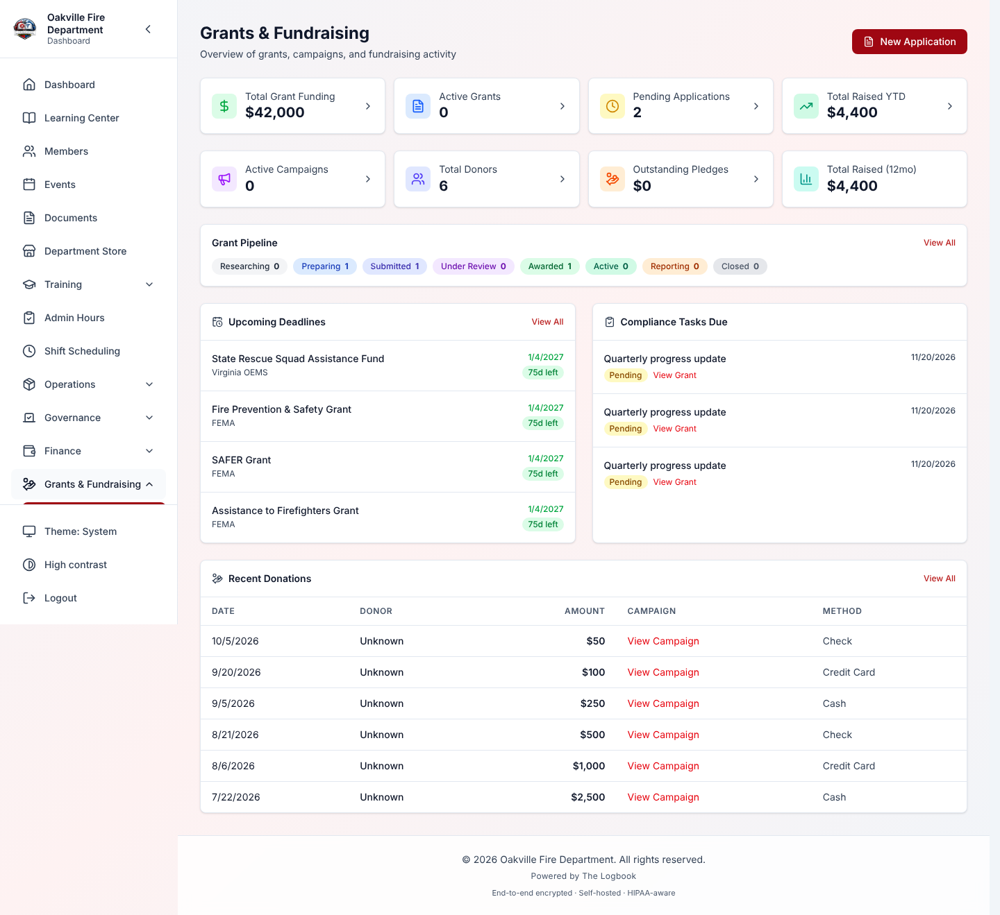

---

## Grant Opportunities Library

**Opportunities** — "Browse grant programs and start an application" — has two
parts:

- **Federal Programs:** reference cards for four well-known programs, with a
  short description of each:

  | Program                                                       | Agency                    | Category   |
  | ------------------------------------------------------------- | ------------------------- | ---------- |
  | Assistance to Firefighters Grant (**AFG**)                    | FEMA                      | Equipment  |
  | Staffing for Adequate Fire and Emergency Response (**SAFER**) | FEMA                      | Staffing   |
  | Fire Prevention & Safety (**FP&S**)                           | FEMA                      | Prevention |
  | Firehouse Subs Public Safety Foundation                       | Firehouse Subs Foundation | Equipment  |

- **All Opportunities:** the programs your department has added, with their
  award range, deadline and match requirement.

### Browsing Opportunities

1. Select **Grants & Fundraising → Opportunities**.
2. Filter by category: Equipment, Staffing, Training, Prevention, Facilities,
   Vehicles, Wellness, Community or Other.
3. Search by name or agency.
4. Check the deadline. Within 14 days it shows in red as "_n_d left"; within 30
   days, in amber. A past deadline reads **Expired**, and a program with no date
   reads **Rolling deadline**.
5. Select **Details** to see eligible uses, eligibility, match details and the
   application link.
6. Select **Start Application** to open a new application already linked to the
   program.

### Adding an Opportunity

**Required Permission:** Manage fundraising

1. Select **Add Opportunity**.
2. Enter the **Program name** — the only required field. As you know them, add
   the agency or funder, category, federal program code, description, eligible
   uses and who is eligible.
3. Enter the typical award range (smallest and largest). Tick **The department
   must contribute a local match** to give the match percentage and a note about
   it.
4. Choose the **Deadline**: Fixed date (the date is then required), Recurring
   (enter the next deadline if known) or Rolling (no date).
5. Add the application and program-information links (they must start with http
   or https) and any notes.
6. Select **Add opportunity**. You return to the library, where the new program
   is listed.

The form has no place for a required-documents list, tags or a recurring
schedule.

### Editing or Retiring an Opportunity

**Required Permission:** Manage fundraising

To correct a program, such as a mistyped deadline, select the pencil (**Edit**)
on its card. The same form opens as **Edit Grant Opportunity**. Change what you
need and select **Save changes**. A field you clear is saved empty.

When a program closes, select **Retire** on its card and confirm. A retired
program:

- leaves the library, so nobody can start a new application from it;
- keeps its record, so applications already started from it still name it.

To see retired programs, tick **Show retired**. They are marked **Retired** and
have no **Start Application** button. Select **Reinstate** on one to bring it
back.

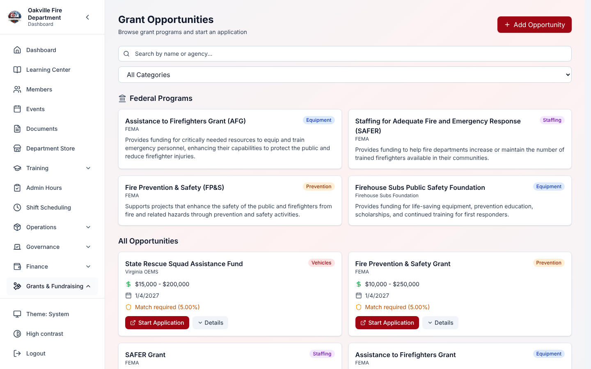

---

## Grant Applications

### Creating an Application

**Required Permission:** Manage fundraising

1. Select **Grants & Fundraising → Applications**, then **New Application**. As
   the form says: _"Only the program name and agency are required. You can add
   the rest later."_
2. Fill in:
   - **Grant Program Name** — or choose a program under **Grant Opportunity**
   - **Grant Agency** — the funding organization
   - **Amount Requested** — what you are asking for
   - **Amount Awarded** — what the funder granted, once you know it
   - **Match Amount** / **Match Source** — the local match
   - **Application Deadline** — when it must be submitted
   - **Project Description** — what the grant will pay for
   - **Priority** — Low, Medium, High or Critical
   - **Assigned To** — the member managing the application, chosen from the
     member list (the list needs permission to view members; without it the
     field keeps whoever is already assigned)
   - once decided, **Amount Awarded**, **Submitted** and **Award Date**, and
     under **Reporting** the **Next Report Due** and **Final Report Due**
3. Select **Create Application**. The application starts in **Researching**.
   When you edit it later, save with **Save Changes**.

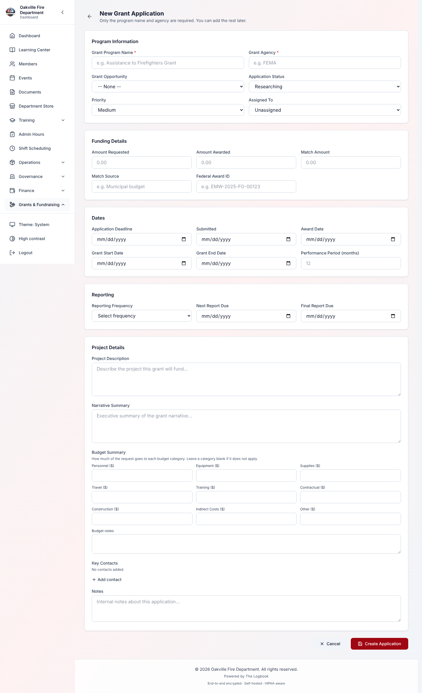

---

## Grant Application Pipeline

Applications move through 10 stages:

| Status              | Meaning                                      | Next step                    |
| ------------------- | -------------------------------------------- | ---------------------------- |
| **Researching**     | Checking the fit and the requirements        | Move to Preparing when ready |
| **Preparing**       | Writing the application, gathering documents | Send for internal review     |
| **Internal Review** | Department leadership reviews it             | Submit to the grantor        |
| **Submitted**       | Filed with the funding agency                | Wait for a response          |
| **Under Review**    | The grantor is evaluating it                 | Wait for a decision          |
| **Awarded**         | The grant was approved                       | Begin spending and reporting |
| **Denied**          | The application was not selected             | Note lessons learned         |
| **Active**          | The grant period is running; money is spent  | Track expenditures           |
| **Reporting**       | Performance reports are due                  | File the required reports    |
| **Closed**          | The grant period is over                     | Final closeout               |

### Moving an Application Between Stages

An application can only move to the stages that make sense next. The
**Application Status** list on the edit form offers only those, plus the stage
it is in now:

| From                                      | Can move to                                    |
| ----------------------------------------- | ---------------------------------------------- |
| Researching, Preparing or Internal Review | either of the other two, or Submitted          |
| Submitted                                 | Under Review, Awarded or Denied                |
| Under Review                              | Submitted (a resubmission), Awarded or Denied  |
| Awarded                                   | Active, or Closed (an award declined/returned) |
| Active                                    | Reporting or Closed                            |
| Reporting                                 | Active or Closed                               |
| Denied                                    | Researching (try again next cycle)             |
| Closed                                    | Reporting (a report asked for after closeout)  |

So a submitted application cannot slip back into drafting, and a closed grant
cannot return to Researching. Any other move is refused with a message naming
the stages that are allowed. A **new** application can start at any stage —
useful when entering a grant the department already has.

### Pipeline View vs Table View

You can view applications two ways:

- **Pipeline** — one column per stage. Each column's header shows how many
  applications are in that stage. A column shows 25 cards at a time; **Show
  more** at the bottom shows the next batch. Change an application's stage from
  its own page.
- **Table** — a sortable, filterable list with status badges, one page at a
  time. The pager under the table moves between pages and sets how many rows a
  page shows (25 by default). Sorting by a column sorts every application, not
  only the page you are on.

Every application matching your filters can be reached in either view, however
many the department has.

**Filtering.** Search matches the program name or the agency. The **Status**
filter offers single statuses and three groups:

- **Active grants** — Active and Reporting
- **Pending** — Researching through Under Review
- **Funded** — Awarded, Active, Reporting and Closed

**Clear filters** resets them.

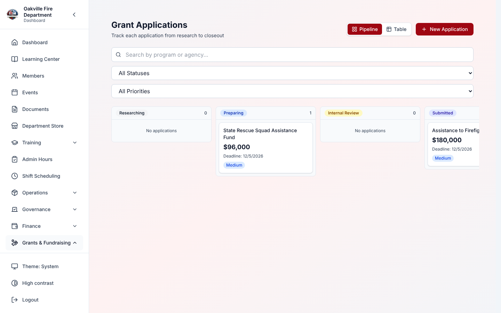

---

## Budget Items & Expenditure Tracking

Each application has a **budget** made of line items, and the spending recorded
against it. Open the application to see its tabs: **Overview**, **Budget**,
**Expenditures**, **Compliance & Follow-Up** and **Activity Log**.

### Budget Items

On the **Budget** tab, select **Add Budget Item** and enter:

| Field           | What it is                                                                                         |
| --------------- | -------------------------------------------------------------------------------------------------- |
| **Category**    | Personnel, Equipment, Supplies, Travel, Training, Contractual, Construction, Indirect Costs, Other |
| **Description** | What the money is for                                                                              |
| **Amount**      | Planned spending on this line                                                                      |

The tab shows **Total Budgeted**, **Total Spent** and **Remaining**, overall and
for each line. Spending on a line is added up from the expenditures linked to
it.

### Expenditures

On the **Expenditures** tab, record spending against the budget:

1. Select **Record Expenditure**.
2. Enter the **Description**, **Amount** and **Date**. All three are required.
   **Vendor (optional)** and **Invoice / PO Number (optional)** can be added
   too.
3. Optionally choose a line under **Budget Item (optional)**. **None** leaves it
   unlinked.
4. Save with **Record Expenditure**.

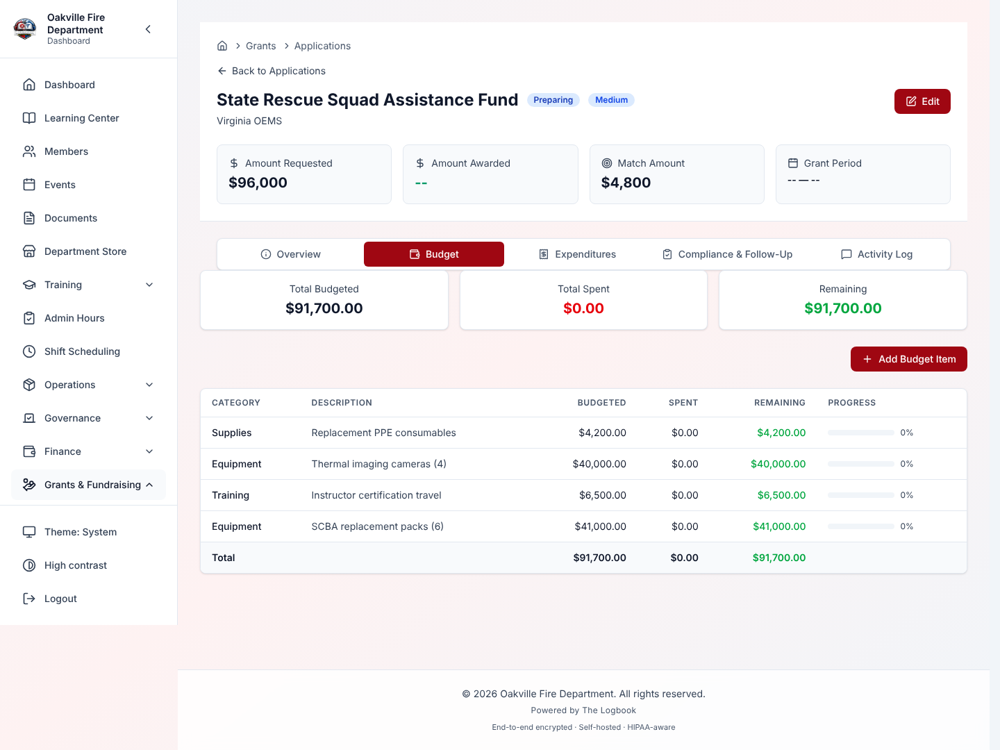

**Spending over the award or a budget line is recorded, with a warning.** An
expenditure is never refused for being over. By the time it is entered the money
has been spent, and refusing it would only make the books disagree with the
bank. Instead:

- after you record an expenditure that puts the grant over its **Amount
  Awarded**, or a budget line over its amount, a warning says by how much;
- the application page shows a standing warning while total spending is over
  the amount awarded;
- each overspend is written to the audit log.

> **Enter the award on the application form.** Edit the application and fill
> in **Amount Awarded** under **Funding Details**. Until an awarded amount is on
> record, the application shows none, the over-award warning cannot appear, and
> the dashboard's **Total Grant Funding** and the report's **Total Awarded**
> leave that grant out. Both totals count only grants in Awarded, Active,
> Reporting or Closed. The budget-line warning works either way.

### Edge Cases

| Situation                              | What happens                                                               |
| -------------------------------------- | -------------------------------------------------------------------------- |
| An expenditure goes over its line      | Recorded, with a warning                                                   |
| An expenditure is not linked to a line | It still counts toward the grant's total spending, but not toward any line |

---

## Compliance Tasks

An awarded grant comes with reporting and other obligations. The Logbook tracks
these as tasks on the **Compliance & Follow-Up** tab.

### Task Types

| Type                | What it is                                       |
| ------------------- | ------------------------------------------------ |
| Performance Report  | A regular progress report to the grantor         |
| Financial Report    | A spending report with receipts or documentation |
| Progress Update     | An informal status update                        |
| Site Visit          | An on-site inspection by the grantor             |
| Audit               | A financial or program audit                     |
| Equipment Inventory | A count of items bought with the grant           |
| NFIRS Submission    | A National Fire Incident Reporting System filing |
| Closeout Report     | The final report at the end of the grant period  |
| Other               | Anything else                                    |

### Task Statuses

| Status      | Meaning                      |
| ----------- | ---------------------------- |
| Pending     | Not started yet              |
| In Progress | Work under way               |
| Completed   | Finished and documented      |
| Overdue     | Past its due date, not done  |
| Waived      | Excused (with documentation) |

You set a task's status yourself from the list on each task. **Mark Complete**
records the completion date (the department's date) and adds an entry to the
**Activity Log**. A task does not become **Overdue** by itself.

### Tasks created when a grant is awarded

The first time an application moves to **Awarded**, The Logbook creates its
compliance tasks for you:

- **Performance Report #1, #2…** — one per reporting period, if the application
  has a **Reporting Frequency** (monthly, quarterly, semi-annual or annual), a
  grant start date and a grant end date. The first is due one period after the
  start date; the last falls on or before the end date.
- **Grant Closeout Report** — due 90 days after the grant end date, if one is
  set.
- **Grant-Funded Equipment Inventory** — if the application is linked to an
  opportunity in the Equipment or Vehicles category. It is due on the grant end
  date. If no end date is set, it is still created, due on the day of the award
  (the department's date).

The Activity Log notes how many tasks were created. This happens only once per
application, even if it moves to Awarded again. Set the reporting frequency and
the grant dates **before** you move the application to Awarded.

### Managing Tasks

1. Open the **Compliance & Follow-Up** tab on the application.
2. To add a task, select **Add Task** and enter the **Task Type**, **Title**,
   **Description (optional)**, **Due Date**, **Priority** and **Report Template
   (optional)**.
3. Change a task's status as the work moves along, and select **Mark Complete**
   when it is done.

### Task Reminders

The Logbook emails a reminder about each task that is not Completed or
Waived:

- **Before it is due** — 14 days before the due date. The **Grant Closeout
  Report** and **Grant-Funded Equipment Inventory** tasks created at the award
  start 30 days before. The **Add Task** form does not change this.
- **On the due date.** If that day's reminder could not go out, it is sent on
  a later day, up to a week after the due date.

Each reminder is sent once. If you change a task's due date, its reminders
start again for the new date.

The reminder goes to the member the task is assigned to, if they are active
and can open Grants & Fundraising. The **Add Task** form does not assign a
task, so most reminders go to every active member with **Manage
fundraising**. Reminders are email only. Each member can turn them off under
their email preferences (_Grants and fundraising reminders_), unless your
department has made them required.

Use **Compliance Tasks Due** on the dashboard (the next 30 days) and
**Upcoming Deadlines** to see everything coming up.

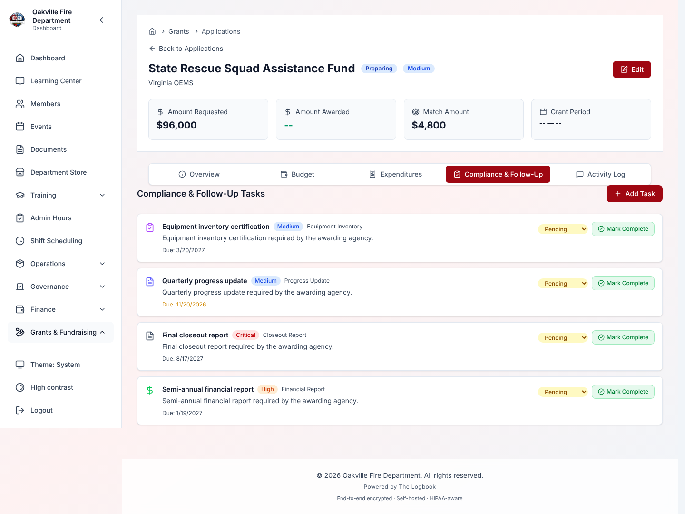

---

## Application Notes & Activity

The **Activity Log** tab on each application is a timeline. It shows:

- every status change
- the compliance tasks created at the award
- each compliance task marked complete
- the notes members add with **Add Note** ("Add an update or a call summary...")

Each entry shows who made it and the date.

### Note Types

Each entry is labelled with its type:

| Type           | What it records                       |
| -------------- | ------------------------------------- |
| General        | A note a member added                 |
| Status Change  | A move from one stage to another      |
| Document Added | A document added                      |
| Contact Made   | A conversation with the grantor       |
| Milestone      | A key project milestone               |
| Financial      | A financial event or update           |
| Compliance     | Compliance tasks created or completed |

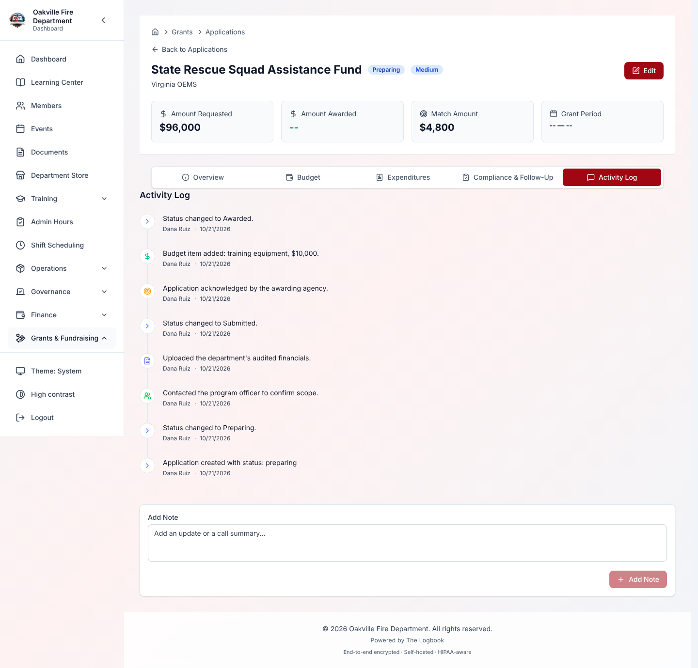

---

## Fundraising Campaigns

A campaign groups fundraising around one goal. **Campaigns** — "Track each
campaign's progress toward its goal" — lists them with a progress bar toward
each goal. Filter by status or type.

### Creating a Campaign

**Required Permission:** Manage fundraising

1. Select **Grants & Fundraising → Campaigns**, then **New Campaign**.
2. Fill in:
   - **Name** (required) — for example, "2026 Annual Fund Drive"
   - **Description** — the campaign's purpose and story
   - **Campaign Type** — General, Equipment, Training, Community, Memorial,
     Event or Other
   - **Goal Amount** (required, more than zero)
   - **Start Date** (required)
   - **Status** — Draft, Active, Paused, Completed or Cancelled
   - **Restricted fund — donors are giving for a stated purpose** — tick it when
     donors are giving for something specific, then say what under **What the
     donors are giving for** (required when ticked)
3. Select **Create Campaign**.

**Restricted funds.** A restricted campaign appears in the Finance module's
**Restricted funds** report, and payments can be charged to it. See
[Finance → Restricted Funds](./11-finance.md#restricted-funds). On an existing
campaign, **Mark as restricted fund** and **Make unrestricted** change it.
Making a campaign unrestricted asks first: "Payments will no longer be charged
to it, and it will leave the Restricted funds report. Only do this if its donors
did not give for a stated purpose."

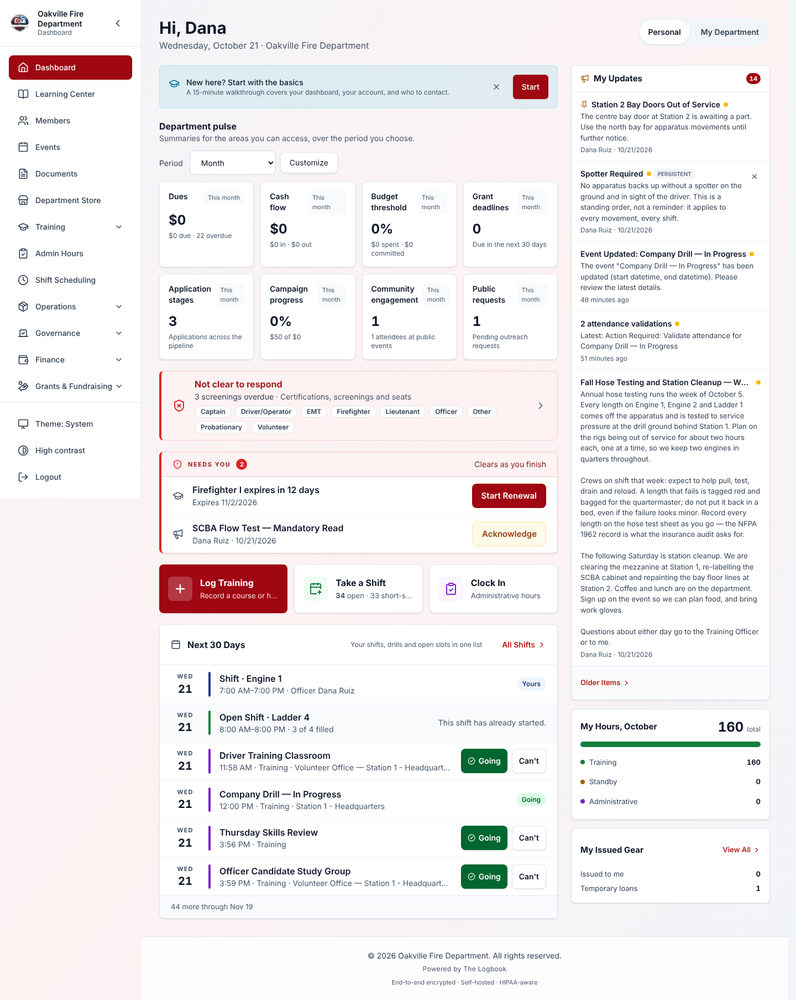

### Edge Cases

| Situation                                  | What happens                                                                               |
| ------------------------------------------ | ------------------------------------------------------------------------------------------ |
| A campaign passes its goal or its end date | Nothing changes by itself. The campaign keeps its status                                   |
| A campaign's status needs to change        | Use the **Status** list on the campaign's card (managers only). Nothing moves it by itself |
| A donation is not linked to a campaign     | It does not count toward any campaign's total                                              |

---

## Donor Management

**Donors** — "Look up donors and what each has given" — lists every person,
business and organization that supports the department.

### Creating a Donor Record

1. Select **Grants & Fundraising → Donors**, then **Add Donor**.
2. Fill in the name, email, phone and address, and the **Donor Type**:
   Individual, Business, Foundation, Government or Other.
3. Names depend on the type. An **Individual** needs a first and last name.
   Any other type (Business, Foundation, Government, Other) needs only the
   **Organization Name**; a contact is optional. The list sorts an
   organization by its name among the surnames and leads with that name when
   there is no contact.
4. Save.

### What the donor list shows

For each donor: their contact details, **total donated**, how many donations,
and the date of their last donation. Search by name or a complete email address
(part of an address no longer matches, since addresses are stored encrypted),
or filter by type.
A donor's first and last donation dates use the department's date, so an evening
gift is dated the day it was given.

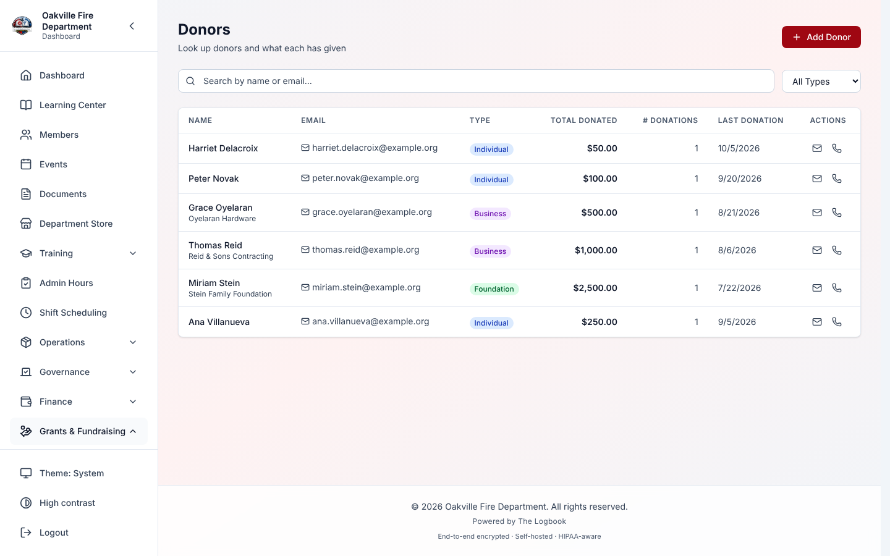

### Edge Cases

| Situation          | What happens                                                                                                                                                                                 |
| ------------------ | -------------------------------------------------------------------------------------------------------------------------------------------------------------------------------------------- |
| An anonymous donor | Members with view access only see **Anonymous donor** with no contact details, and searching by the donor's name does not find them. Officers who can manage fundraising see the full record |
| Duplicate donors   | The Logbook does not spot duplicates, and they cannot be merged. Search before adding                                                                                                        |

---

## Recording Donations

### Creating a Donation Record

1. Select **Grants & Fundraising → Donations**, then **Record Donation** (shown
   only to officers who can manage fundraising).
2. Fill in:
   - **Amount** and **Date received** (both required; the date defaults to
     today)
   - **Payment Method** — Cash, Check, Credit Card, Bank Transfer, PayPal, Venmo
     or Other
   - **Payment status** — defaults to Completed. Only a completed gift counts
     toward the campaign's raised total and the donor's giving history
   - **Campaign** — optional
   - **Donor** — choose from the donor directory, or leave it as "Not in the
     donor directory" and enter a name and email for a one-time gift
   - **Anonymous** — hides who gave from members with view access only. The
     Donations list and the dashboard's recent donations show **Anonymous**.
     Officers who can manage fundraising still see the donor, so receipts and
     thank-you letters can go out
   - **Dedication** — In honor of or In memory of, with the name
   - **Tax deductible** — on by default
   - **Notes**
3. Select **Record donation**. You return to the Donations list.

The form has no place for a recurring-gift schedule, a check number or a
transaction ID. Put a check number in **Notes**.

### Payment Statuses

| Status    | Meaning                                     |
| --------- | ------------------------------------------- |
| Pending   | Payment started, not yet confirmed          |
| Completed | Payment received and confirmed              |
| Failed    | The payment attempt failed                  |
| Refunded  | The payment was returned to the donor       |
| Cancelled | The payment was cancelled before processing |

### Donation Acknowledgments

The Donations list has a **Receipt** column, which reads **Sent** when a tax
receipt is on record as sent. There is no button for marking receipts or
thank-you letters as sent, so keep track of those in your own records.

### Edge Cases

| Situation                               | What happens                                                                                                                            |
| --------------------------------------- | --------------------------------------------------------------------------------------------------------------------------------------- |
| An anonymous donation with a dedication | The dedication is shown. The donor's name and email are hidden from members with view access only; amount, date and campaign still show |
| A donation to a campaign that has ended | Allowed, and counted toward the campaign's total                                                                                        |
| A check donation                        | Put the check number in **Notes**                                                                                                       |

---

## Pledges

A pledge is a promise to give that has not been fully paid yet.

Open **Grants & Fundraising → Pledges**, or select the **Outstanding Pledges**
figure on the dashboard. The list shows each pledge's donor, campaign, amount
pledged, amount received, what remains, due date and status. Filter it by
status.

### Recording a Pledge

**Required Permission:** Manage fundraising

1. Select **Record Pledge**.
2. Choose the **Donor** and **Campaign** (both optional). Enter the **Amount
   pledged** and **Pledge date** (required) and a **Due date** (optional).
3. Leave **Send reminders** ticked to have the pledge's due date reminded (see
   below).
4. Select **Record pledge**. A new pledge starts as Pending.

### Recording What Came In

Select the pencil on a pledge to edit it. Enter the **Amount received so far**
and set the **Status** yourself. Recording a donation does not update a pledge,
so you keep the two in step by hand. Clearing the due date or notes and saving
removes them.

### Pledge Reminders

When a pledge has a due date, **Send reminders** ticked and money still to
come in, The Logbook emails every active member with **Manage fundraising**
14 days and 1 day before the due date. A Fulfilled or Cancelled pledge gets no
reminder, and nothing is sent after the due date. Each reminder is sent once;
changing the due date starts them again.

**The donor is never emailed.** The reminder tells your fundraising officers
to follow up; how to contact the donor is up to them. Each member can turn the
emails off under their email preferences (_Grants and fundraising reminders_),
unless your department has made them required. To stop reminders for one
pledge, edit it and untick **Send reminders**.

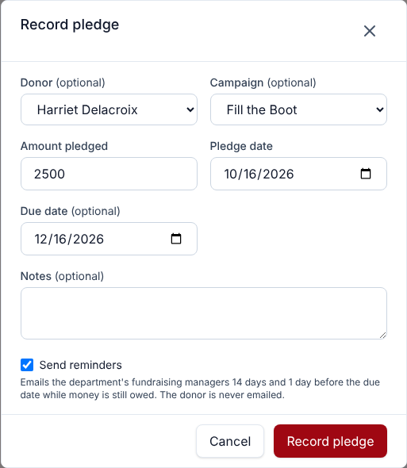

### Pledge Statuses

| Status          | Meaning                           |
| --------------- | --------------------------------- |
| Pending         | Pledged, nothing received yet     |
| Partly received | Some of it received               |
| Fulfilled       | The full amount received          |
| Cancelled       | The pledge was withdrawn          |
| Overdue         | Past its due date, not fully paid |

You set every status yourself, including **Overdue**. The dashboard's
**Outstanding Pledges** figure is what remains on Pending and Partly received
pledges. Overdue pledges are not in it.

---

## Fundraising Events

Fundraising events — dinners, galas, auctions, raffles and the like — can be
tied to a campaign.

Open **Grants & Fundraising → Events**. Each event shows its type, date and
time, location, campaign, revenue goal, money raised, expenses, net (raised less
expenses) and attendance, newest first. Filter the list by status.

### Adding a Fundraising Event

**Required Permission:** Manage fundraising

1. Select **Add Event**.
2. Enter the **Name**, **Type** and **Date and time** (required). Optionally add
   the location, campaign, ticket price, capacity, revenue goal, registration
   link (starting http or https), description and notes.
3. Select **Add event**. A new event starts in Planning.

### Event Types

Dinner, Gala, Auction, Raffle, Golf Outing, Walkathon, Other

### Tracking Results

Select **Edit** on the event. The **Results** section sets:

- **Status** — Planning, Open, Sold out, Completed or Cancelled
- **Attendance**
- **Money raised**
- **Expenses**

The form has no place for sponsors or a link to a calendar event.

---

## Reports & Analytics

Select **Grants & Fundraising → Reports** — _"Grant results and fundraising
totals for the dates you choose"_. Choose a **Start date** and **End date**. The
range includes the whole end date, and dates are counted in the department's
time zone (UTC if none is set). The page has two tabs.

### Grant Report

The **Grants** tab shows:

- **Total Applications**, **Total Requested** and **Total Awarded**
- **Awarded / Denied** and **Success Rate**
- **Total Spent**
- **Compliance Summary** — tasks by status, including **Overdue**
- **Spending by Category**

### Fundraising Report

The **Fundraising** tab shows:

- **Total Raised**, **Donation Count**, **Unique Donors** and **Average Gift**
- **Donations by Payment Method**, with each method's share
- **Monthly Totals**

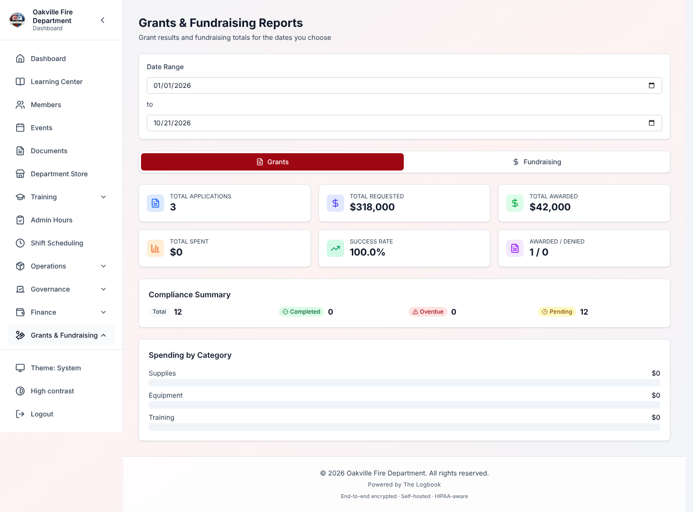

---

## Realistic Example: Applying for an AFG Grant

### Background

**Oakville Fire Department** needs to replace aging SCBA equipment. Chief
**Morrison** asks Lt. Walsh to apply for an Assistance to Firefighters Grant
(AFG).

### Part 1: Research (January)

Lt. Walsh opens **Opportunities**. The department added the AFG program last
year:

- **Agency:** FEMA
- **Category:** Equipment
- **Deadline:** Recurring (applications accepted January to March)
- **Typical award:** $50,000–$500,000
- **Local match:** yes — 15%

He selects **Start Application** and fills in:

- **Grant Program Name:** "SCBA Replacement — AFG 2026"
- **Amount Requested:** $180,000
- **Match Amount:** $31,765 (15% of the total project cost of $211,765)
- **Priority:** Critical

The application starts in **Researching**.

### Part 2: Application Preparation (February)

Lt. Walsh moves the application to **Preparing** and:

1. Adds budget items:
   - Equipment (SCBA units): $165,000
   - Training (SCBA certification): $15,000
   - Indirect Costs: $11,765
2. Writes the project description.
3. Gathers supporting documents (department profile, cost quotes, needs
   assessment).
4. Adds a note: "Contacted regional FEMA office for guidance on narrative
   format".

### Part 3: Submission (March 1)

Chief Morrison reviews it in **Internal Review** and approves. Lt. Walsh
submits it to FEMA and sets the status to **Submitted** — two weeks before the
deadline.

### Part 4: Award (June 15)

FEMA approves the full $180,000. Before changing the status, Lt. Walsh edits
the application and fills in:

- **Grant Start Date:** July 1, 2026
- **Grant End Date:** June 30, 2027
- **Reporting Frequency:** Quarterly

Then he sets the status to **Awarded**. The Logbook creates the compliance
tasks:

- Performance Report #1 (due October 1, 2026)
- Performance Report #2 (due January 1, 2027)
- Performance Report #3 (due April 1, 2027)
- Grant-Funded Equipment Inventory (due June 30, 2027)
- Grant Closeout Report (due September 28, 2027)

He adds the quarterly **Financial Report** tasks FEMA also asks for with **Add
Task**.

### Part 5: Grant Period (July–December)

He moves the application to **Active**. As SCBA units arrive, he records
expenditures:

- July 15: MSA Safety invoice — $82,500 (30 SCBA units, first shipment)
- August 20: training vendor — $7,500 (SCBA certification course)
- October 1: MSA Safety invoice — $82,500 (30 SCBA units, second shipment)

Spent so far: $172,500 of $180,000 (95.8%).

He files the first reports on time and selects **Mark Complete** on each task.

### Part 6: Closeout (July 2027)

Lt. Walsh files the final closeout report:

- Total spent: $175,200
- Equipment inventory checked: all 60 SCBA units accounted for
- The remaining $4,800 returned to FEMA
- Status: **Closed**

---

## Troubleshooting

| Problem                                               | What to do                                                                                                                                                    |
| ----------------------------------------------------- | ------------------------------------------------------------------------------------------------------------------------------------------------------------- |
| An opportunity shows no deadline                      | Check its **Deadline** setting. A Rolling deadline has no date, and a Recurring one shows a date only when the next deadline was entered.                     |
| You cannot create an application                      | You need the **Manage fundraising** permission, and the module must be turned on.                                                                             |
| Budget lines do not match the expenditures            | Link each expenditure to its budget item. Unlinked expenditures count toward the grant's total, but not toward any line.                                      |
| No compliance tasks were created at the award         | They need a **Reporting Frequency** and grant dates, set **before** the move to Awarded. Tasks are created only once; add any missing ones with **Add Task**. |
| A campaign's progress does not change                 | Link the donation to the campaign, and make sure its **Payment status** is Completed. Unlinked or pending donations do not count.                             |
| A donor appears twice                                 | The Logbook does not catch duplicates and cannot merge them. Search before adding a donor.                                                                    |
| A pledge's status is wrong                            | Pledge statuses are set by hand. Edit the pledge, enter the amount received, and set the status.                                                              |
| A report shows $0 for a period                        | Check the start and end dates include the donations or applications you expect.                                                                               |
| **Total Awarded** or **Total Grant Funding** reads $0 | Edit each awarded grant and fill in **Amount Awarded**. Only grants in Awarded, Active, Reporting or Closed count. See [Expenditures](#expenditures).         |
| Nobody was reminded about a deadline                  | Only tasks and pledges are reminded. See [Task Reminders](#task-reminders) and [Pledge Reminders](#pledge-reminders) for who gets them.                       |

---

## If You Learned an Older Version

If you are following older notes, an older recording or an SOP, these things
work differently from what they may say.

- **Buttons were renamed.** **Start Application** (was Apply), **Add Budget
  Item** (was Add Item), **Save Changes** (was Update Application), **Clear
  filters** (was Clear). The application summary reads **Match Amount** (was
  Match Required). The report tabs read **Grants** and **Fundraising** (were
  Grant Reports and Fundraising Reports), and the first figure is **Total
  Raised** (was Total Donations).
- **Re-run older reports that ended on the day they were run.** At one time a
  report whose range ended today left out everything recorded later that day,
  and the payment-method breakdown showed 0.0% for every method. If you still
  rely on such a report, run it again.
- **Only compliance tasks and pledges are reminded.** Older material may
  promise reminders about opportunity or application deadlines. The Logbook
  does not send them. See [Task Reminders](#task-reminders) and
  [Pledge Reminders](#pledge-reminders) for what is sent.

---

**Previous:** [Finance](./11-finance.md) | **Next:** [Medical Screening](./13-medical-screening.md)
