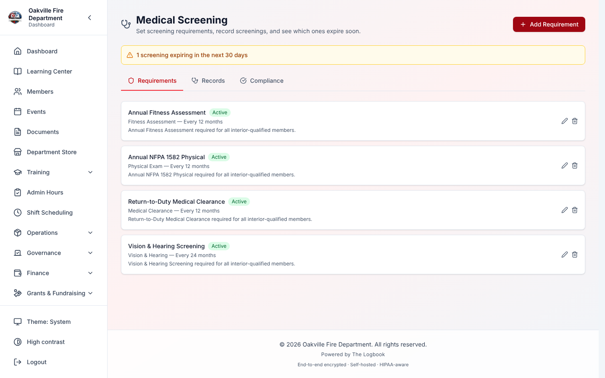
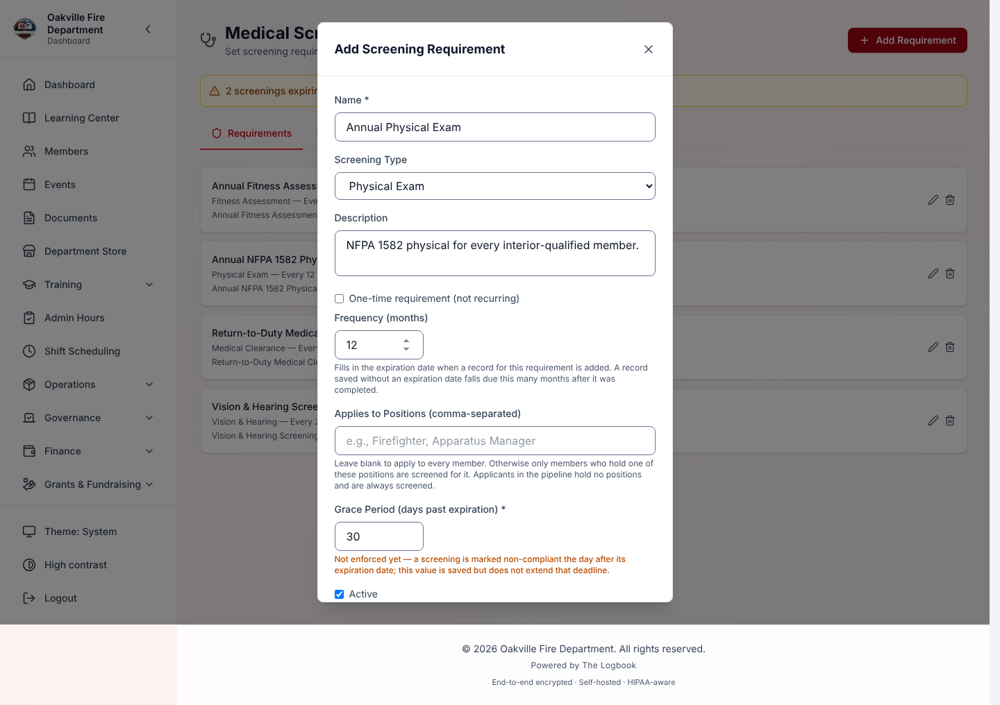
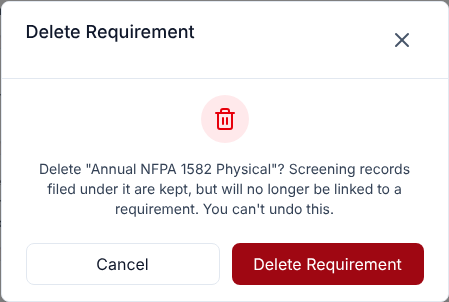
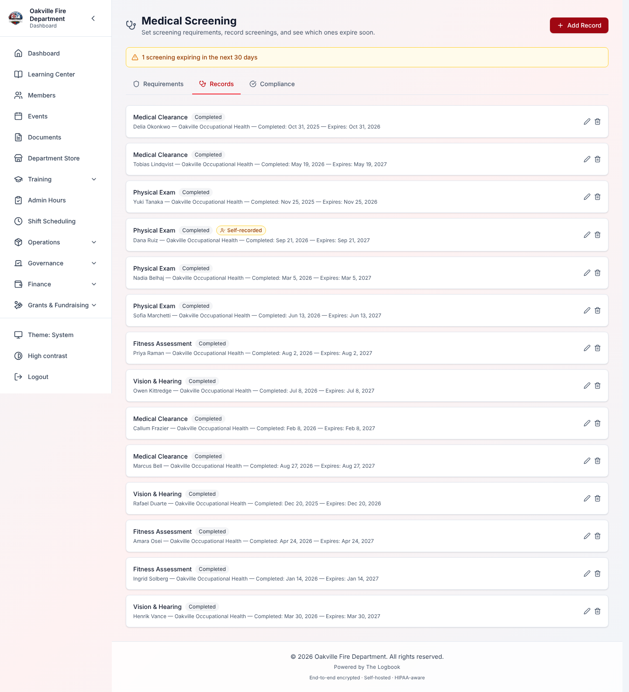
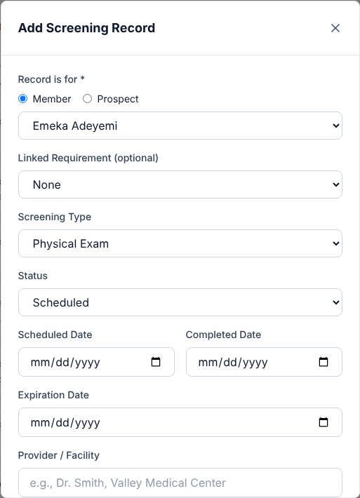
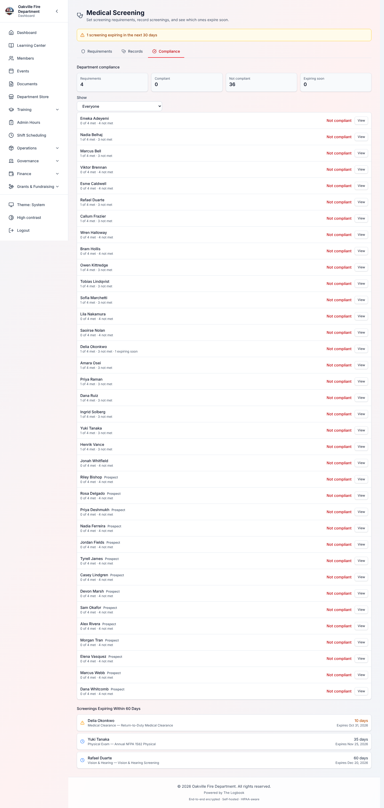
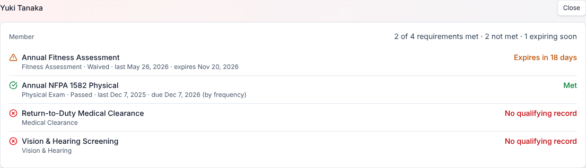
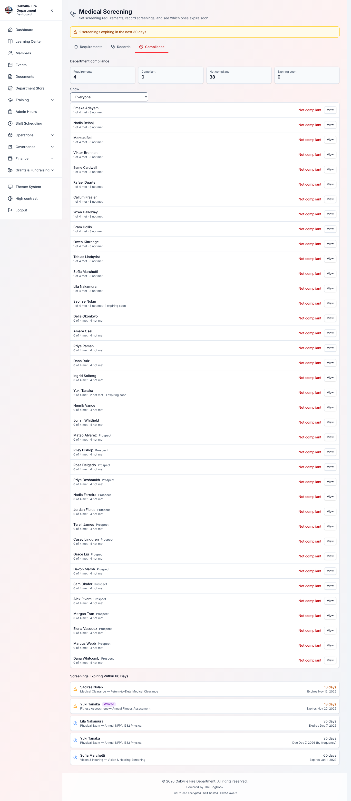

# Medical Screening

Medical Screening is where your department tracks the health checks members
and prospective members must pass. That covers physicals, drug screenings,
fitness tests, psychological evaluations and other medical clearances. The
Logbook records each result, tracks when it expires, and shows who is behind.

## Lesson at a Glance

|                     |                                                                                                         |
| ------------------- | ------------------------------------------------------------------------------------------------------- |
| **Who this is for** | Health and safety officers and anyone else who handles screening results. Members only need one section |
| **What you need**   | The Medical Screening module turned on, and a role that can view (or manage) member medical screenings  |
| **Essential path**  | Members: 5 minutes. Officers: about 40 minutes                                                          |
| **Full guide**      | About 1 hour                                                                                            |
| **Last verified**   | 2026-10-14                                                                                              |
| **Owner**           | Your department's health and safety officer                                                             |

**Members:** read only
[What Members See on Their Own Dashboard](#what-members-see-on-their-own-dashboard).

**Officers:** read the whole guide. Pay special attention to
[Grace Period](#grace-period) and to linking each record to its requirement
(see [How Compliance Is Calculated](#how-compliance-is-calculated)): both
changed on 2026-11-04 and can change who reads as compliant.

---

## Table of Contents

1. [Medical Screening Overview](#medical-screening-overview)
2. [Screening Requirements](#screening-requirements)
3. [Creating Requirements](#creating-requirements)
4. [Screening Records](#screening-records)
5. [Recording a Screening](#recording-a-screening)
6. [Compliance Dashboard](#compliance-dashboard)
   - [What Members See on Their Own Dashboard](#what-members-see-on-their-own-dashboard)
7. [Expiring Screenings](#expiring-screenings)
8. [Prospect Screening](#prospect-screening)
9. [Realistic Example: Annual Physical Compliance](#realistic-example-annual-physical-compliance)
10. [Troubleshooting](#troubleshooting)
11. [If You Learned an Older Version](#if-you-learned-an-older-version)

---

## Medical Screening Overview

**Where to find it:** **Administration → Members → Medical Screening**.

**Turning it on:** Medical Screening is an opt-in module. An administrator
turns it on under **Organization Settings → Modules → Additional Modules**.
While it is off, the menu item is hidden.

The page has three tabs:

| Tab              | What it is for                                                       |
| ---------------- | -------------------------------------------------------------------- |
| **Requirements** | Set which screenings your department requires and how often          |
| **Records**      | Log each screening result for a member or prospect                   |
| **Compliance**   | See who meets every requirement, who does not, and what expires soon |

When any screening expires in the next 30 days, an amber line above the tabs
says how many, for example "2 screenings expiring in the next 30 days".


### Permissions

Three permissions control this module. Role Management lists them under
Compliance as **View member medical screenings**, **View the clinical detail
of medical screenings (provider, results, notes)** and **Manage member medical
screenings**.

| What you want to do                                                       | Who can do it                                                                 |
| ------------------------------------------------------------------------- | ----------------------------------------------------------------------------- |
| See requirements, records and compliance                                  | Roles that can **view** member medical screenings                             |
| Read a record's **Provider / Facility**, **Result Summary** and **Notes** | Roles that can view the **clinical detail**, or **manage** medical screenings |
| Add, edit or delete requirements                                          | Roles that can **manage** member medical screenings                           |
| Add, edit or delete screening records                                     | Roles that can **manage** member medical screenings                           |
| See **your own** screening counts on the dashboard                        | Every signed-in member                                                        |

The last row is the only part of this module a member sees without any of
these permissions. It shows counts only. See
[What Members See on Their Own Dashboard](#what-members-see-on-their-own-dashboard).

**Status or detail** _(2026-11-04)_. The view permission on its own shows
compliance status: who is due, the dates, the requirement, and the outcome
(passed, failed or waived). The provider, result summary and notes on a record
are clinical detail, shown only to roles that also hold the clinical-detail
permission (or the manage permission, whose edit form writes them). Without
it, the Records tab leaves the provider out of each row and the record form
does not show those three fields. When this arrived, every role that could
view screenings was given the clinical-detail permission too, so nobody lost
access. To make a role status-only, such as a scheduler's, remove the
clinical-detail permission from it in Role Management. Roles holding the
clinical-detail permission must use MFA, as for the other two.

> **Important — this is protected health information.** Screening records are
> private health information under HIPAA. Give these permissions only to roles
> that truly need them, such as chief officers, the health and safety officer
> or HR administrators. A role that only needs to know who is due needs the
> view permission without the clinical-detail one.

> **What is recorded in the audit log?** Adding, editing and deleting
> requirements and records is logged. So is every screen that shows someone's
> screening data: the Records list, a single record, a member's or prospect's
> compliance detail, the department compliance list and the expiring list.
> Each page load writes **one** entry that names the people it showed. The log
> can therefore answer "who looked at this member's results, and when?". A
> member's own dashboard counts are not logged, because they show nothing
> about anyone else.

### Screening Types

There are six screening types:

| Screening type               | Typical use                                                    |
| ---------------------------- | -------------------------------------------------------------- |
| **Physical Exam**            | Annual NFPA 1582 physicals, DOT physicals                      |
| **Medical Clearance**        | Return-to-duty clearance, SCBA clearance                       |
| **Drug Screening**           | Pre-employment, random and post-incident drug or alcohol tests |
| **Vision & Hearing**         | Hearing tests, vision tests                                    |
| **Fitness Assessment**       | Candidate Physical Ability Test (CPAT), fitness evaluations    |
| **Psychological Evaluation** | Pre-employment and fitness-for-duty evaluations                |

---

## Screening Requirements

A requirement says **what** your department requires and **how often**. Open
the **Requirements** tab to see them. Each row shows the name, **Active** or
**Inactive**, the screening type, how often it repeats ("Every 12 months" or
"One-time"), any roles you listed, and the description.



### Requirement Fields

| Field                                      | What it means                                                                                                                 |
| ------------------------------------------ | ----------------------------------------------------------------------------------------------------------------------------- |
| **Name** (required)                        | A clear name, such as "Annual NFPA 1582 Physical"                                                                             |
| **Screening Type**                         | One of the six types above                                                                                                    |
| **Description**                            | Instructions or notes                                                                                                         |
| **One-time requirement (not recurring)**   | Tick for a screening needed only once. Leave unticked for a repeating one                                                     |
| **Frequency (months)**                     | How often it repeats. Shown only for repeating requirements; must be at least 1                                               |
| **Applies to Positions (comma-separated)** | Members are graded on this only if they hold one of these positions — see [Role-Based Requirements](#role-based-requirements) |
| **Grace Period (days past expiration)**    | How many days a member stays compliant after a screening falls due — see [Grace Period](#grace-period)                        |
| **Active**                                 | Only active requirements count toward compliance                                                                              |

### One-Time vs Recurring Requirements

- **Repeating:** with a frequency such as 12 months, members need a new
  screening regularly. The **Expiration Date** on each record decides when it
  runs out. When you link a record to a repeating requirement and enter the
  completed date, the form fills in the expiration date from the frequency;
  change it if the provider gave a different date. A record saved with no expiration date of its own now falls
  due the requirement's **Frequency** after its completed date (shown **by
  frequency**) _(2026-10-25)_. A requirement with no frequency still counts as
  met for good. Records saved without an expiration before this change can
  change standing the first time they are read after the upgrade. A record a
  newer one replaced no longer appears on the expiring list, and a waiver that
  lapses within 30 days is listed and marked **Waiver**.
- **One-time:** a single qualifying record with no expiration date satisfies
  it for good.

---

## Creating Requirements

**Who can do this:** roles that can manage member medical screenings.

1. Open the **Requirements** tab.
2. Select **Add Requirement**.
3. Fill in the fields. For example:

| Field                    | Example                                                                                              |
| ------------------------ | ---------------------------------------------------------------------------------------------------- |
| **Name**                 | Annual NFPA 1582 Physical                                                                            |
| **Screening Type**       | Physical Exam                                                                                        |
| **Description**          | Annual medical examination per NFPA 1582 standard. Includes cardiac stress test for members over 40. |
| **Frequency (months)**   | 12                                                                                                   |
| **Applies to Positions** | _(blank)_                                                                                            |
| **Active**               | Ticked                                                                                               |

4. Select **Add Requirement**. When you edit an existing one, the button reads
   **Save Changes**.



### Editing and Deleting Requirements

- Select the pencil button on a requirement to edit it. Changes apply the next
  time anyone opens a compliance view.
- Select the bin button to delete it. The confirmation reads _"Delete
  “(name)”? Screening records filed under it are kept, but will no longer be
  linked to a requirement. You can't undo this."_ Its button is **Delete
  Requirement**.
- The records stay in each member's screening history. To stop a requirement
  counting without losing it, untick **Active** instead.



### Role-Based Requirements

**Applies to Positions** limits a requirement to the members who hold one of
the positions you list.

- **Leave it blank** and the requirement applies to every member, as it always
  has.
- **List positions**, such as `Firefighter, Apparatus Manager`, and only members
  who hold at least one of them are graded on it. Type a position's name or its
  slug; capital letters, spaces, hyphens and underscores do not matter, so
  `Safety Officer` and `safety_officer` are the same position.
- A member the list leaves with **no** requirement that applies reads **Not
  applicable** on the roster, not **Compliant**: nothing is being graded.
- **Prospects** hold no positions, so they are always graded on every active
  requirement.
- If a list contains something unusable, the requirement is treated as not
  limited and applies to everyone, so a mistyped list can never quietly drop a
  screening.

Example: a respirator fit test listed for `Firefighter` is graded for members
who hold the Firefighter position. An administrative member who holds only the
default Member position is not graded on it, and still is on a requirement with
a blank list, such as a CPR card.

### Grace Period

_(2026-11-04)_ **Grace Period (days past expiration)** is applied. A member
stays compliant for that many days after a screening falls due, whether the
due date is the record's own expiration date or one worked out from the
frequency. The field says so: _"Members stay compliant this many days after a
screening falls due, shown as past due. Enter 0 to mark them non-compliant the
day after."_

- A new requirement starts at 30 days, and every requirement that existed
  before 2026-11-04 holds 30 days too. Members who had lapsed within that window
  read compliant again after the upgrade.
- **During the grace period** the screening still counts, but it is not hidden.
  The member's compliance panel reads **Past due — grace period until _date_**,
  the expiring list reads **Past due _n_ days** with **Grace period until
  _date_**, and it is counted as expiring soon.
- The day after the grace period ends, the member reads **Not compliant**.
- **Enter 0** for a requirement that must be renewed before the due date. The
  field is required, so leave it at 0 rather than blank.

Plan renewals before the due date anyway: the
[Expiring Screenings](#expiring-screenings) list gives you 60 days' notice.

---

## Screening Records

A record holds the **result** of one screening: who, when, what type, the
outcome, and who reviewed it. Open the **Records** tab to see them.

Each row shows the screening type, the status, the person's name, the linked
requirement, the provider (only to roles that can read the clinical detail),
the scheduled date and the expiration date. A record linked to no requirement
carries an amber **Not linked to a requirement** badge _(2026-11-04)_: it
counts toward nothing until you link it.



### Record Statuses

| Status             | Colour | Meaning                                        |
| ------------------ | ------ | ---------------------------------------------- |
| **Scheduled**      | Blue   | Booked but not done yet                        |
| **Completed**      | Grey   | Done; the result has not been reviewed         |
| **Passed**         | Green  | Done, with a passing result                    |
| **Failed**         | Red    | Done, with a failing result                    |
| **Pending Review** | Yellow | Done; waiting for an officer to review results |
| **Waived**         | Purple | Not required for this person (note the reason) |
| **Expired**        | Orange | Set by hand to mark a result as out of date    |

> **Important — the status on a record does not change by itself.** A Passed
> record stays **Passed** on the Records tab after its expiration date. The
> Compliance tab is where expiry shows: it grades the person **Expired** or
> **Not compliant**.

### Record Fields

| Field                             | What it means                                                                                         |
| --------------------------------- | ----------------------------------------------------------------------------------------------------- |
| **Record is for** (required)      | **Member** or **Prospect**, and the person. See [Prospect Screening](#prospect-screening)             |
| **Linked Requirement (optional)** | The requirement this result counts toward, and the only one. Choosing one fills in the screening type |
| **Screening Type**                | The type of screening done                                                                            |
| **Status**                        | See the table above                                                                                   |
| **Scheduled Date**                | When it was booked                                                                                    |
| **Completed Date**                | When it was actually done                                                                             |
| **Expiration Date**               | When this result runs out                                                                             |
| **Provider / Facility**           | The doctor, clinic or lab. Clinical detail                                                            |
| **Result Summary**                | A short result, such as "Cleared for full duty". Clinical detail                                      |
| **Notes**                         | Anything else. Clinical detail                                                                        |

The three fields marked clinical detail appear on the form only for roles that
can read the clinical detail (see [Permissions](#permissions)). A manager
without it edits the rest of the record and leaves those three as they were.

The Logbook also records who reviewed the result and when, and whether the
record is **Self-recorded** (see below).

> **Tip — record outcomes, not medical detail.** Result Summary and Notes can
> hold health information. Where you can, record the outcome (passed, failed,
> waived) rather than detailed findings.

---

## Recording a Screening

**Who can do this:** roles that can manage member medical screenings.

1. Open the **Records** tab.
2. Select **Add Record**.
3. Under **Record is for**, choose **Member** or **Prospect**, then pick the
   person.
4. Fill in the other fields. For example:

| Field                   | Example                                                    |
| ----------------------- | ---------------------------------------------------------- |
| **Record is for**       | Member — FF Jake Thompson                                  |
| **Linked Requirement**  | Annual NFPA 1582 Physical                                  |
| **Screening Type**      | Physical Exam                                              |
| **Status**              | Passed                                                     |
| **Scheduled Date**      | 2026-05-15                                                 |
| **Completed Date**      | 2026-05-15                                                 |
| **Expiration Date**     | 2027-05-15                                                 |
| **Provider / Facility** | Dr. Sarah Chen, Occupational Health Associates             |
| **Result Summary**      | Cleared for full duty, no restrictions                     |
| **Notes**               | Stress test normal. Follow-up recommended for elevated BP. |

5. Select **Add Record**. When you edit a record, the button reads **Save
   Changes**.

Things to know about the form:

- Every record belongs to exactly one member or one prospect. **Add Record**
  stays greyed out until you choose someone.
- The member list holds current members, including those on leave or
  suspended. Former members are not listed.
- The prospect list holds only prospects still open in the pipeline (Active or
  On Hold).
- **Link the record to its requirement.** Under **Linked Requirement** the
  form says: _"A record counts only toward the requirement it is linked to.
  With none, it counts toward no requirement."_ _(2026-11-04)_ You can set or
  change the link when you edit a record too. Editing never changes who the
  record belongs to.



### Self-Recorded Screenings

A screening manager may record their own screening. In a small department, the
person who logs everyone's results often needs their own entered too. The
result counts toward compliance like any other.

It is flagged, though. A record whose status was last saved by the member it
is about carries an amber **Self-recorded** badge. The badge shows on the
Records tab, in the expiring list and in the person's compliance detail.

The badge follows whoever last saved the record's status:

- Adding a record for yourself, or saving the status on your own record, adds
  the badge.
- Another manager saving the record removes it. The Edit dialog always saves
  the status. That manager also becomes the reviewer when the status is
  Passed, Failed or Waived.

If your department wants every result confirmed by a second person, have
another manager open and save each self-recorded record.

### Status Workflow

A record usually moves like this:

```
Scheduled → Completed → Pending Review → Passed / Failed
                                       → Waived (note the reason)
```

- **Scheduled to Completed:** after the screening, add the completed date and
  the provider.
- **Completed to Pending Review:** when results need an officer's review
  before a pass or fail.
- **Pending Review to Passed or Failed:** after review. The Logbook records
  who saved it and when.
- **Waived:** set directly. Put the reason in **Notes**.

### Editing and Deleting Records

- Select the pencil button on a record to edit it, for example to change
  Scheduled to Passed.
- Select the bin button to delete it. The confirmation reads _"Delete this
  (type) record? You can't undo this."_ with a **Delete Record** button. The
  deletion is logged.

**What if …?**

| What happened                                      | What it means                                                                                                       |
| -------------------------------------------------- | ------------------------------------------------------------------------------------------------------------------- |
| A record has no linked requirement                 | It counts toward nothing and carries **Not linked to a requirement**. Edit it and choose its **Linked Requirement** |
| The expiration date is already past when you save  | The record saves. It does not count toward compliance                                                               |
| The completed date is after the expiration date    | The record saves. Nothing checks this, so look for a typing mistake                                                 |
| A row reads **Not linked to a member or prospect** | It belongs to nobody and counts for nobody. Re-enter it for the right person, then delete it                        |

---

## Compliance Dashboard

The **Compliance** tab shows who meets every requirement, who does not, and
whose screenings expire soon.



### Compliance Summary

Under **Department compliance**, four counts cover every current member and
open prospect:

| Count             | What it counts                                                                                              |
| ----------------- | ----------------------------------------------------------------------------------------------------------- |
| **Requirements**  | Active screening requirements                                                                               |
| **Compliant**     | People who meet every requirement, with none expiring within 30 days                                        |
| **Not compliant** | People with any requirement not met — lapsed or never recorded                                              |
| **Expiring soon** | People who meet every requirement but have one expiring within 30 days, or past due inside its grace period |

Below the counts is one row per person. Each row shows "_n_ of _m_ met", how
many are not met or expiring soon, and their standing. Prospects are marked
**Prospect**.

- The **Show** filter narrows the rows to **Everyone**, **Not compliant
  (overdue or missing)**, **Expiring within 30 days** or **Compliant**. The
  four counts always describe everyone.
- **View** on a row opens that person's detail. See
  [Per-Member Compliance](#per-member-compliance).
- With no active requirements, the tab says _"No screening requirements are
  active, so nobody is graded."_ It does not report the department compliant.

### What Members See on Their Own Dashboard

A member does not need any medical screening permission to know whether they
are behind. The readiness line on their dashboard includes their own
screenings.

It shows **counts only**: how many screenings are overdue and how soon the next
one runs out. It never shows a screening's name, type, date or result. The
dashboard may be on a station tablet, where anyone walking past can read it.
Administrative members do not see this verdict (_2026-10-18_): it is a statement
about riding, and they hold no riding role. Their certification expiries still
appear under **Needs you** on the dashboard. An operational member with no
qualifying seat yet still reads **Not clear**. A member might see:

> **Not clear to respond** — 1 screening overdue

or, when one runs out within 60 days:

> **Clear, with conditions** — a screening expiring in 12 days

- To find out _which_ screening, ask your health and safety officer or
  whoever can view medical screenings.
- If your department has no screening requirements, the dashboard does not
  mention screenings at all.
- If The Logbook cannot read your screenings, the line leaves them out. It
  never suggests they were checked and passed.

### How Compliance Is Calculated

For each active requirement, The Logbook grades every current member and open
prospect:

1. **Find the latest result.** It looks at the person's records **linked to
   that requirement** with a status of **Passed**, **Completed**, **Waived**
   or **Failed**. It takes the one with the latest **Completed Date**.
   Scheduled, Pending Review and Expired records are ignored. _(2026-11-04)_ A
   record counts only toward the requirement it is linked to, so one physical
   no longer satisfies two physical requirements with different frequencies,
   and a record linked to nothing counts toward nothing.
2. **A Failed result is not met.** The requirement stays not met until a
   newer Passed, Completed or Waived record is added. The member's panel shows
   _"Failed — not cleared"_.
3. **Otherwise, check the due date** against today's date in your department's
   time zone (set under **Organization Settings → Profile**):
   - Expiration date is today or later: **met**.
   - No expiration date: the record falls due by **frequency**, that many
     months after its **Completed Date**, using the frequency of the
     requirement it is linked to. With no frequency (a one-time requirement)
     or no Completed Date, it is **met** for good.
   - Due date has passed, but not by more than the requirement's
     [grace period](#grace-period): **met**, shown as past due.
   - Due date and grace period have both passed: **not met**.
4. **No result at all:** **not met**.

Which requirements apply to a member is set by
[Role-Based Requirements](#role-based-requirements).

**What if …?**

| What happened                                    | What it means                                                              |
| ------------------------------------------------ | -------------------------------------------------------------------------- |
| A person has several records for one requirement | Only the result with the latest Completed Date counts                      |
| A Passed record, then a newer Failed one         | Not met. The older Passed record no longer counts                          |
| A Failed record, then a newer Passed one         | Met: the newer pass clears the failure                                     |
| Two results on the same day                      | The one entered later counts                                               |
| A record has no Completed Date                   | It is treated as the oldest, so any dated record for that requirement wins |
| A requirement is not Active                      | It is left out of compliance completely                                    |
| A record with no expiration date                 | Due by the requirement's frequency; met for good if it has none            |
| A Waived record with no expiration date          | The same: due by frequency, or met for good                                |
| A Waived record with an expiration date          | Met until that date                                                        |
| The screening expires today                      | Still met, and counted as expiring soon                                    |
| Past the due date, inside the grace period       | Still met, shown as past due, and counted as expiring soon                 |
| A record linked to no requirement                | Counts toward nothing                                                      |

### Per-Member Compliance

Select **View** on any row of the department list. A panel opens for that
person. It shows:

- "_n_ of _m_ requirements met", with how many are not met and how many expire
  soon.
- Each requirement, with the screening type, the status and date of the record
  it is graded on, and its expiry. A date worked out from the frequency reads
  "due _date_ (by frequency)" rather than "expires _date_".
- A verdict for each: **Met**, **Expires in _n_ days**, **Expires today**,
  **Past due — grace period until _date_**, **Expired** or **No qualifying
  record**. "Expires in" shows for anything due within 30 days.
- The **Self-recorded** badge on a record the person filed themselves.

With no active requirements, the panel says so rather than reporting the person
compliant. Each opening is recorded in the audit log.



---

## Expiring Screenings

The bottom of the Compliance tab lists **Screenings Expiring Within 60 Days**,
so you can book renewals early.

### Viewing Expiring Screenings

Each entry shows the person, the screening type and linked requirement, the
days left and the expiration date. The soonest is at the top. A waiver about
to run out is listed too, with a **Waived** badge, because renewing it is
different work from booking a screening. A record with no expiration date of
its own is listed when it falls due by frequency, and reads "Due _date_ (by
frequency)" instead of "Expires _date_". A screening past its due date but
inside its grace period is listed too _(2026-11-04)_, at the top, reading
**Past due _n_ days** with **Grace period until _date_**.

| Icon and colour | When            |
| --------------- | --------------- |
| Red             | 7 days or fewer |
| Amber           | 8 to 30 days    |
| Blue            | 31 to 60 days   |



When nothing is due, it reads _"No screenings expire in the next 60 days."_

**What is not listed:**

| Record                                   | Why                                                |
| ---------------------------------------- | -------------------------------------------------- |
| Past its due date and its grace period   | It shows as not met in the compliance list instead |
| No expiration date and no frequency      | One-time screenings never expire                   |
| Status Scheduled, Pending Review, Failed | They do not count toward compliance either         |
| Passed, then a newer Failed record       | The failure is the result that counts              |

---

## Prospect Screening

You can record screenings for **prospective members** before they join. This
is useful for pre-employment physicals, drug screenings and psychological
evaluations.

> **See also:** [Membership Management > Prospective Members Pipeline](./01-membership.md#prospective-members-pipeline)
> for how the pipeline works.

### Recording a Prospect Screening

It works like a member screening:

1. Open the **Records** tab.
2. Select **Add Record**.
3. Under **Record is for**, choose **Prospect**, then pick the person.
4. Fill in the other fields.
5. Select **Add Record**.

Only prospects still open in the pipeline (Active or On Hold) are listed.

If the prospect is waiting at a **Medical Screening** stage that is set to
advance automatically, a **Passed** or **Completed** result can move them on.
The stage still waits until every screening it requires has cleared.

### Prospect Compliance

Prospects appear in the department list on the **Compliance** tab, marked
**Prospect**. Select **View** to see their detail. They are graded against
every active requirement, the same as members.

### Prospect-to-Member Transition

Departments differ in when they screen. Some screen applicants before the
membership vote; others bring them in as members first and screen afterwards.
Both work:

- **Screened as a prospect.** When the prospect becomes a member, their
  screening records go with them. They count toward the new member's
  compliance from the moment of the transfer, and the prospect's history still
  shows them.
- **Screened after joining.** Record the screenings against the member, as for
  anyone else.

**What if …?**

| What happened                                     | What it means                                                                           |
| ------------------------------------------------- | --------------------------------------------------------------------------------------- |
| A prospect has no screening records               | Their detail shows 0 met out of every active requirement                                |
| A prospect is deleted or purged from the pipeline | Their screening records are deleted with them                                           |
| A prospect becomes a member                       | Their records go with them and count for the new member. Nothing needs re-recording     |
| You need pre-employment screenings                | Create one-time requirements for them and check each prospect's detail before they join |

> **Important.** Prospect screening records have the same health-information
> protections as member records, under the same two permissions. Make sure
> anyone in the hiring process who needs to see them has the right permission.

---

## Realistic Example: Annual Physical Compliance

This walkthrough follows one department from creating a requirement to
handling expirations.

### Background

**Falls Church Volunteer Fire Department** has 45 active members across three
stations. The Health and Safety Officer, **Captain Diane Alvarez**, needs to
track annual NFPA 1582 physicals. The department also requires a
pre-employment drug screening for every new member.

---

### Part 1: Setting Up Requirements

Captain Alvarez opens the **Requirements** tab and adds two requirements.

**Requirement 1: Annual Physical**

| Field                    | Value                                                                                                                                                                 |
| ------------------------ | --------------------------------------------------------------------------------------------------------------------------------------------------------------------- |
| **Name**                 | Annual NFPA 1582 Physical Examination                                                                                                                                 |
| **Screening Type**       | Physical Exam                                                                                                                                                         |
| **Description**          | Annual medical examination per NFPA 1582. Includes cardiac stress test for members aged 40+. Must be performed by a department-approved occupational health provider. |
| **Frequency (months)**   | 12                                                                                                                                                                    |
| **Applies to Positions** | _(blank)_                                                                                                                                                             |
| **Active**               | Ticked                                                                                                                                                                |

**Requirement 2: Pre-Employment Drug Screening**

| Field                                    | Value                                                                                  |
| ---------------------------------------- | -------------------------------------------------------------------------------------- |
| **Name**                                 | Pre-Employment Drug Screening                                                          |
| **Screening Type**                       | Drug Screening                                                                         |
| **Description**                          | 10-panel drug screening required before membership is finalized. One-time requirement. |
| **One-time requirement (not recurring)** | Ticked                                                                                 |
| **Applies to Positions**                 | _(blank)_                                                                              |
| **Active**                               | Ticked                                                                                 |

No records exist yet, so the Compliance tab shows all 45 members as **Not
compliant**.

---

### Part 2: Recording Existing Physicals

The department's occupational health provider sent a spreadsheet. It shows 38
of 45 members had their physical in the past year. Captain Alvarez enters a
record for each.

**Example record for FF Maria Torres:**

| Field                   | Value                                           |
| ----------------------- | ----------------------------------------------- |
| **Record is for**       | Member — FF Maria Torres                        |
| **Linked Requirement**  | Annual NFPA 1582 Physical Examination           |
| **Screening Type**      | Physical Exam                                   |
| **Status**              | Passed                                          |
| **Scheduled Date**      | 2026-03-10                                      |
| **Completed Date**      | 2026-03-10                                      |
| **Expiration Date**     | 2027-03-10                                      |
| **Provider / Facility** | Occupational Health Associates — Dr. Sarah Chen |
| **Result Summary**      | Cleared for full duty, no restrictions          |

Everyone still needs the drug screening too, so nobody is fully compliant yet.
The department list now shows "1 of 2 met" for 38 members and "0 of 2 met" for
the other 7. Four of the 38 have a physical expiring within 30 days, so their
rows also say "1 expiring soon".

---

### Part 3: Handling the 7 Members Without a Current Physical

Captain Alvarez sets **Show** to **Not compliant (overdue or missing)** and
selects **View** on each row. Seven members have no current physical:

1. **FF James Kowalski** — physical expired 2026-04-15.
2. **FF/EMT Priya Patel** — physical expired 2026-05-28.
3. **Lt. Mike Chen** — no physical on record.
4. **FF Rosa Martinez** — physical expired 2026-05-20, 38 days ago.
5. **FF David Kim** — no physical on record (joined 2026-06-01).
6. **FF/Paramedic Amy Larson** — on leave; physical expired 2026-02-01.
7. **Probie Chris Washington** — probationary; no physical on record.

What she does:

- **Kowalski and Patel:** books physicals for next week, with **Scheduled**
  records.
- **Lt. Chen:** his physical was done by a different provider. She enters it
  as **Passed**.
- **Martinez:** the requirement's grace period is 30 days, and her physical
  expired 38 days ago, so the grace period has run out and Martinez reads
  **Expired**. (Had it expired 26 days ago, she would still count as compliant,
  reading **Past due — grace period until** the 30th day, and would not be in
  this list.) Captain Alvarez books her physical for the following week.
- **Kim and Washington:** books their first department physicals.
- **Larson:** on leave. The physical will be needed when she returns to duty.

---

### Part 4: Tracking a Prospect

A candidate, **Alex Rivera**, is in the membership pipeline. Captain Alvarez
records his pre-employment drug screening before the committee votes.

1. Opens the **Records** tab.
2. Selects **Add Record**.
3. Under **Record is for**, chooses **Prospect** and selects **Alex Rivera**.
4. Chooses **Pre-Employment Drug Screening** as the linked requirement, which
   sets the type to **Drug Screening**.
5. Sets **Status** to **Pending Review** (lab results expected in 3 days).
6. Enters **Scheduled Date** 2026-06-25 and **Provider / Facility**
   "QuickScreen Labs".
7. Selects **Add Record**.

Three days later the results arrive. She edits the record:

- **Status:** Passed.
- **Completed Date:** 2026-06-25.
- **Result Summary:** "10-panel negative, all clear".
- **Expiration Date:** left blank (one-time screening).

On the Compliance tab, Alex's detail shows "1 of 2 requirements met". The
committee can see the pre-employment screening is done.

When Alex becomes a member, the drug screening goes with the new member
account. Captain Alvarez does not record it again.

---

### Part 5: Monitoring Expirations Over Time

Two months later (August 2026), Captain Alvarez checks the Compliance tab. The
expiring list shows:

| Member          | Screening     | Expires    | Days left | Colour |
| --------------- | ------------- | ---------- | --------- | ------ |
| FF Sarah Odom   | Physical Exam | 2026-08-30 | 3         | Red    |
| EMT Tom Bradley | Physical Exam | 2026-09-05 | 9         | Amber  |
| FF Carlos Reyes | Physical Exam | 2026-09-18 | 22        | Amber  |
| Lt. Lisa Park   | Physical Exam | 2026-10-15 | 49        | Blue   |

She calls FF Odom at once and books her physical. She sends a reminder to
everyone expiring in September.

---

### Key Takeaways from This Example

1. **Requirements drive compliance.** Set them once; The Logbook grades
   everyone.
2. **Renew before the expiration date.** The grace period keeps a member
   compliant for a while after it, but they show as past due meanwhile, and
   are not compliant the day after it ends.
3. **One-time requirements suit pre-employment checks.** One qualifying record
   with no expiration date satisfies them.
4. **Prospects can be screened before they join.** Their records go with them
   when they become members, so nothing needs re-recording.
5. **Use the 60-day list.** Colour-coded warnings give you time to book
   renewals before anyone falls behind.

---

## Troubleshooting

| Problem                                               | What to do                                                                                                                                                                                      |
| ----------------------------------------------------- | ----------------------------------------------------------------------------------------------------------------------------------------------------------------------------------------------- |
| Medical Screening is not in the menu                  | An administrator must turn it on under **Organization Settings → Modules → Additional Modules**. Your role also needs to view member medical screenings                                         |
| You get a permission message when viewing records     | Your role needs **View member medical screenings**. Ask your administrator                                                                                                                      |
| You get a permission message when adding or editing   | Your role needs **Manage member medical screenings**. Ask your administrator                                                                                                                    |
| A member shows not compliant but has a passing record | Check the record's expiration date and the requirement's grace period — both may have passed. Check the status is Passed, Completed or Waived, and that the record is linked to the requirement |
| A record carries **Not linked to a requirement**      | It counts toward nothing. Edit it and choose its **Linked Requirement**                                                                                                                         |
| A member shows past due but compliant                 | Expected inside the grace period. See [Grace Period](#grace-period)                                                                                                                             |
| A member is not graded on a requirement               | Check the requirement's **Applies to Positions**: it applies only to members who hold one of the positions listed. See [Role-Based Requirements](#role-based-requirements)                      |
| The counts do not match your own count                | Check which requirements are **Active**. A member is graded only on the active requirements that apply to their positions; prospects are graded on all of them                                  |
| The expiring list is empty                            | Nothing Passed, Completed or Waived expires or falls due in the next 60 days, and nothing is in its grace period                                                                                |
| A record still says Passed after it expired           | Expected. The status does not change by itself. Add a new record with the new result and expiration date                                                                                        |
| A drug screening counts as compliant for ever         | Expected for a one-time requirement with no expiration date. To require re-testing, give the requirement a frequency                                                                            |
| A new member's prospect screenings do not count       | They move to the member at conversion. Check each one is linked to a requirement: a record with **Not linked to a requirement** counts toward nothing                                           |
| The Add Record button stays grey                      | Choose **Member** or **Prospect** and pick a person first                                                                                                                                       |
| A row reads **Not linked to a member or prospect**    | Re-enter the record for the right person, then delete the unlinked one                                                                                                                          |
| The data looks out of date                            | Compliance is worked out each time you open it. Refresh the page                                                                                                                                |

---

## If You Learned an Older Version

If you are following older notes or an SOP, these things work differently.

- **Deleting a requirement keeps its records.** In older versions, deleting a
  requirement also deleted every screening record filed under it. Records lost
  that way cannot be recovered from The Logbook; restore them from a backup if
  they matter.
- **Every record names a person.** Records entered before the **Record is
  for** choice existed may belong to nobody. They read **Not linked to a member
  or prospect** and count for nobody. Re-enter them for the right person and
  delete the unlinked copy.
- **The grace period is applied** _(2026-11-04)_. Until 2026-11-04 it was
  saved but not used, and a member was not compliant the day after expiry.
  Now a member stays compliant through the grace period; see
  [Grace Period](#grace-period).
- **A record counts only toward its linked requirement** _(2026-11-04)_. It
  used to count toward every requirement of its screening type. The upgrade
  linked each unlinked record to its department's one requirement of that
  type. Where two or more requirements share a type, it could not choose, and
  left the record unlinked, so it stopped counting. Look for **Not linked to a
  requirement** on the Records tab and link each one from its Edit dialog.
- **Provider, result summary and notes need the clinical-detail permission**
  _(2026-11-04)_. Viewing screenings used to show them to every role that
  could view; see [Permissions](#permissions).
- **Applies to Roles was described as working, and now does.** It is renamed
  **Applies to Positions** and limits a requirement to the members who hold one
  of the positions listed; see
  [Role-Based Requirements](#role-based-requirements).
- **Button names:** **Add Requirement**, **Add Record** and **Save Changes**
  (not Create and Update); the delete buttons read **Delete Requirement** and
  **Delete Record**.
- **Expiry follows your department's date.** A screening no longer reads as
  expired a few hours early in the evening.
- **A record with no expiration date now falls due by frequency.** It used to
  count as met for good, whatever the requirement's frequency. It now falls
  due that many months after its Completed Date, so a member whose only such
  record is older than the frequency now reads not compliant. Add a new record
  when they are screened again.
- **Waivers about to run out are listed.** The expiring list used to leave
  waived records out, even though the count above the tabs included them.

---

**Previous:** [Grants & Fundraising](./12-grants-fundraising.md) | **Next:** [Elections & Voting](./14-elections.md)
