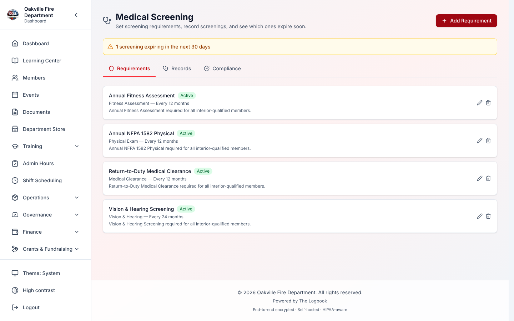
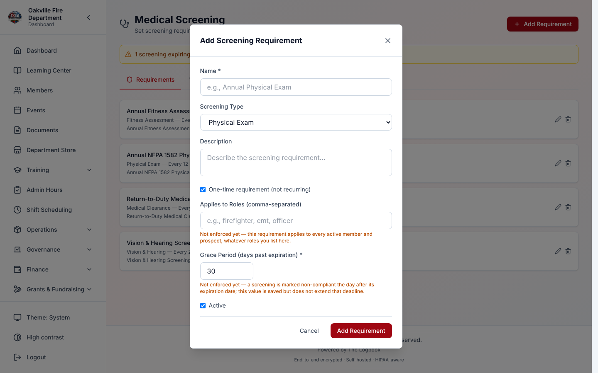
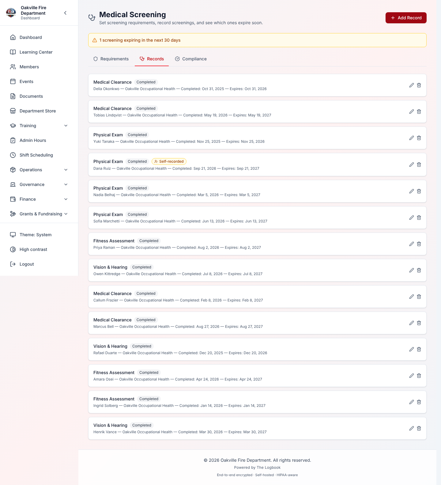
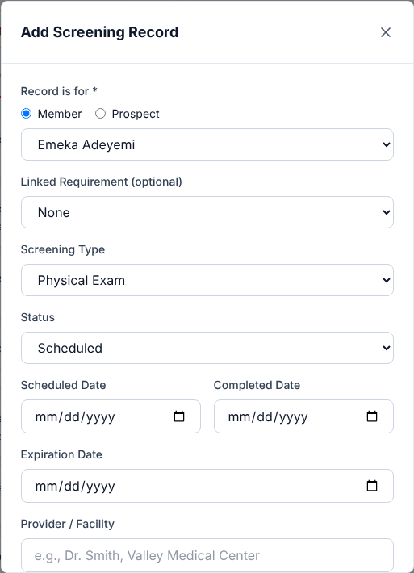
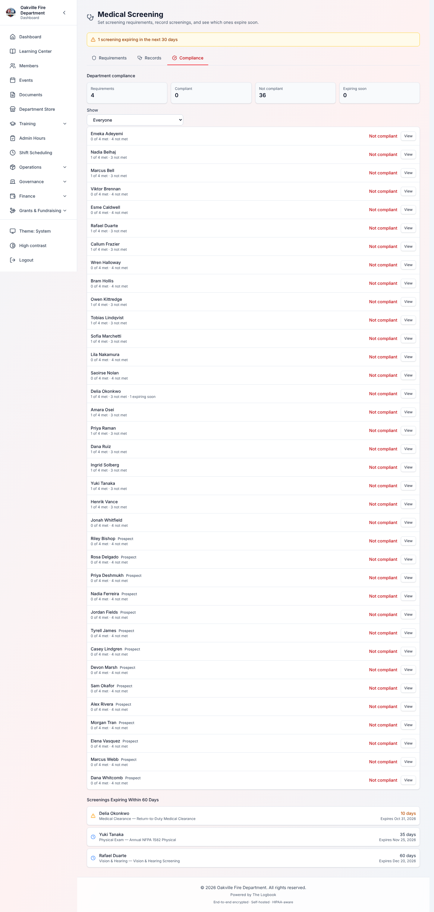

# Medical Screening

Medical Screening is where your department tracks the health checks members
and prospective members must pass. That covers physicals, drug screenings,
fitness tests, psychological evaluations and other medical clearances. The
Logbook records each result, tracks when it expires, and shows who is behind.

## Lesson at a Glance

|                     |                                                                                                         |
| ------------------- | ------------------------------------------------------------------------------------------------------- |
| **Who this is for** | Health and safety officers and anyone else who handles screening results. Members only need one section |
| **What you need**   | The Medical Screening module turned on, and a role that can view (or manage) member medical screenings  |
| **Essential path**  | Members: 5 minutes. Officers: about 40 minutes                                                          |
| **Full guide**      | About 1 hour                                                                                            |
| **Last verified**   | 2026-10-14                                                                                              |
| **Owner**           | Your department's health and safety officer                                                             |

**Members:** read only
[What Members See on Their Own Dashboard](#what-members-see-on-their-own-dashboard).

**Officers:** read the whole guide. Pay special attention to the
[Grace Period](#grace-period) section: the setting is saved but does not yet
change anyone's compliance.

---

## Table of Contents

1. [Medical Screening Overview](#medical-screening-overview)
2. [Screening Requirements](#screening-requirements)
3. [Creating Requirements](#creating-requirements)
4. [Screening Records](#screening-records)
5. [Recording a Screening](#recording-a-screening)
6. [Compliance Dashboard](#compliance-dashboard)
   - [What Members See on Their Own Dashboard](#what-members-see-on-their-own-dashboard)
7. [Expiring Screenings](#expiring-screenings)
8. [Prospect Screening](#prospect-screening)
9. [Realistic Example: Annual Physical Compliance](#realistic-example-annual-physical-compliance)
10. [Troubleshooting](#troubleshooting)
11. [If You Learned an Older Version](#if-you-learned-an-older-version)

---

## Medical Screening Overview

**Where to find it:** **Administration → Members → Medical Screening**.

**Turning it on:** Medical Screening is an opt-in module. An administrator
turns it on under **Organization Settings → Modules → Additional Modules**.
While it is off, the menu item is hidden.

The page has three tabs:

| Tab              | What it is for                                                       |
| ---------------- | -------------------------------------------------------------------- |
| **Requirements** | Set which screenings your department requires and how often          |
| **Records**      | Log each screening result for a member or prospect                   |
| **Compliance**   | See who meets every requirement, who does not, and what expires soon |

When any screening expires in the next 30 days, an amber line above the tabs
says how many, for example "2 screenings expiring in the next 30 days".



### Permissions

Two permissions control this module. Role Management lists them under
Compliance as **View member medical screenings** and **Manage member medical
screenings**.

| What you want to do                                | Who can do it                                       |
| -------------------------------------------------- | --------------------------------------------------- |
| See requirements, records and compliance           | Roles that can **view** member medical screenings   |
| Add, edit or delete requirements                   | Roles that can **manage** member medical screenings |
| Add, edit or delete screening records              | Roles that can **manage** member medical screenings |
| See **your own** screening counts on the dashboard | Every signed-in member                              |

The last row is the only part of this module a member sees without either
permission. It shows counts only. See
[What Members See on Their Own Dashboard](#what-members-see-on-their-own-dashboard).

> **Important — this is protected health information.** Screening records are
> private health information under HIPAA. Give the two permissions only to
> roles that truly need them, such as chief officers, the health and safety
> officer or HR administrators. The view permission shows every member's
> results, notes and providers — there is no narrower level.

> **What is recorded in the audit log?** Adding, editing and deleting
> requirements and records is logged. So is every screen that shows someone's
> screening data: the Records list, a single record, a member's or prospect's
> compliance detail, the department compliance list and the expiring list.
> Each page load writes **one** entry that names the people it showed. The log
> can therefore answer "who looked at this member's results, and when?". A
> member's own dashboard counts are not logged, because they show nothing
> about anyone else.

### Screening Types

There are six screening types:

| Screening type               | Typical use                                                    |
| ---------------------------- | -------------------------------------------------------------- |
| **Physical Exam**            | Annual NFPA 1582 physicals, DOT physicals                      |
| **Medical Clearance**        | Return-to-duty clearance, SCBA clearance                       |
| **Drug Screening**           | Pre-employment, random and post-incident drug or alcohol tests |
| **Vision & Hearing**         | Hearing tests, vision tests                                    |
| **Fitness Assessment**       | Candidate Physical Ability Test (CPAT), fitness evaluations    |
| **Psychological Evaluation** | Pre-employment and fitness-for-duty evaluations                |

---

## Screening Requirements

A requirement says **what** your department requires and **how often**. Open
the **Requirements** tab to see them. Each row shows the name, **Active** or
**Inactive**, the screening type, how often it repeats ("Every 12 months" or
"One-time"), any roles you listed, and the description.


### Requirement Fields

| Field                                    | What it means                                                                                  |
| ---------------------------------------- | ---------------------------------------------------------------------------------------------- |
| **Name** (required)                      | A clear name, such as "Annual NFPA 1582 Physical"                                              |
| **Screening Type**                       | One of the six types above                                                                     |
| **Description**                          | Instructions or notes                                                                          |
| **One-time requirement (not recurring)** | Tick for a screening needed only once. Leave unticked for a repeating one                      |
| **Frequency (months)**                   | How often it repeats. Shown only for repeating requirements; must be at least 1                |
| **Applies to Roles (comma-separated)**   | Saved and shown, but **not applied** — see [Role-Based Requirements](#role-based-requirements) |
| **Grace Period (days past expiration)**  | Saved, but **not applied** — see [Grace Period](#grace-period)                                 |
| **Active**                               | Only active requirements count toward compliance                                               |

### One-Time vs Recurring Requirements

- **Repeating:** with a frequency such as 12 months, members need a new
  screening regularly. The **Expiration Date** on each record decides when it
  runs out. When you link a record to a repeating requirement and enter the
  completed date, the form fills in the expiration date from the frequency;
  change it if the provider gave a different date. A record saved with no
  expiration date counts as met for good, so do not clear it.
- **One-time:** a single qualifying record with no expiration date satisfies
  it for good.

---

## Creating Requirements

**Who can do this:** roles that can manage member medical screenings.

1. Open the **Requirements** tab.
2. Select **Add Requirement**.
3. Fill in the fields. For example:

| Field                  | Example                                                                                              |
| ---------------------- | ---------------------------------------------------------------------------------------------------- |
| **Name**               | Annual NFPA 1582 Physical                                                                            |
| **Screening Type**     | Physical Exam                                                                                        |
| **Description**        | Annual medical examination per NFPA 1582 standard. Includes cardiac stress test for members over 40. |
| **Frequency (months)** | 12                                                                                                   |
| **Applies to Roles**   | _(blank)_                                                                                            |
| **Active**             | Ticked                                                                                               |

4. Select **Add Requirement**. When you edit an existing one, the button reads
   **Save Changes**.



### Editing and Deleting Requirements

- Select the pencil button on a requirement to edit it. Changes apply the next
  time anyone opens a compliance view.
- Select the bin button to delete it. The confirmation reads _"Delete
  “(name)”? Screening records filed under it are kept, but will no longer be
  linked to a requirement. You can't undo this."_ Its button is **Delete
  Requirement**.
- The records stay in each member's screening history. To stop a requirement
  counting without losing it, untick **Active** instead.

<!-- Screenshot needed:
_[Admin with medical_screening.manage, /medical-screening, Requirements tab. Click the delete button on a seeded requirement that has records filed under it and capture the Delete Requirement confirmation, reading "Screening records filed under it are kept, but will no longer be linked to a requirement.", with both buttons visible. Never confirm. No member names or results in frame.]_
-->

### Role-Based Requirements

> **Important — roles are not applied.** **Applies to Roles** is saved and
> shown next to the requirement, but nothing uses it. Every active member and
> prospect is graded against every active requirement, whatever roles you
> list. The dialog says so under the field: _"Not enforced yet — this
> requirement applies to every active member and prospect, whatever roles you
> list here."_

What this means for you:

- A requirement meant only for drivers, such as a DOT physical, counts against
  every member. Members who do not need it show as **Not compliant**.
- If that is a problem, record a **Waived** result for members who do not need
  it, or keep the requirement inactive until roles are applied.
- Members with no role, and prospects, are graded the same as everyone else.

### Grace Period

> **Important — the grace period is not applied.** **Grace Period (days past
> expiration)** is saved with the requirement (30 days unless you change it),
> but nothing reads it. A member becomes **Not compliant** the day after their
> screening's expiration date, whatever grace period you set. The dialog says
> so under the field: _"Not enforced yet — a screening is marked non-compliant
> the day after its expiration date; this value is saved but does not extend
> that deadline."_

What this means for you:

- Plan renewals before the expiration date, not after it. The
  [Expiring Screenings](#expiring-screenings) list gives you 60 days' notice.
- **What if I type 0?** The form saves 30 instead of 0. This makes no
  difference today, because the value is not used.

---

## Screening Records

A record holds the **result** of one screening: who, when, what type, the
outcome, and who reviewed it. Open the **Records** tab to see them.

Each row shows the screening type, the status, the person's name, the
provider, the scheduled date and the expiration date.



### Record Statuses

| Status             | Colour | Meaning                                        |
| ------------------ | ------ | ---------------------------------------------- |
| **Scheduled**      | Blue   | Booked but not done yet                        |
| **Completed**      | Grey   | Done; the result has not been reviewed         |
| **Passed**         | Green  | Done, with a passing result                    |
| **Failed**         | Red    | Done, with a failing result                    |
| **Pending Review** | Yellow | Done; waiting for an officer to review results |
| **Waived**         | Purple | Not required for this person (note the reason) |
| **Expired**        | Orange | Set by hand to mark a result as out of date    |

> **Important — the status on a record does not change by itself.** A Passed
> record stays **Passed** on the Records tab after its expiration date. The
> Compliance tab is where expiry shows: it grades the person **Expired** or
> **Not compliant**.

### Record Fields

| Field                             | What it means                                                                             |
| --------------------------------- | ----------------------------------------------------------------------------------------- |
| **Record is for** (required)      | **Member** or **Prospect**, and the person. See [Prospect Screening](#prospect-screening) |
| **Linked Requirement (optional)** | The requirement this result is for. Choosing one fills in the screening type              |
| **Screening Type**                | The type of screening done                                                                |
| **Status**                        | See the table above                                                                       |
| **Scheduled Date**                | When it was booked                                                                        |
| **Completed Date**                | When it was actually done                                                                 |
| **Expiration Date**               | When this result runs out                                                                 |
| **Provider / Facility**           | The doctor, clinic or lab                                                                 |
| **Result Summary**                | A short result, such as "Cleared for full duty"                                           |
| **Notes**                         | Anything else                                                                             |

The Logbook also records who reviewed the result and when, and whether the
record is **Self-recorded** (see below).

> **Tip — record outcomes, not medical detail.** Result Summary and Notes can
> hold health information. Where you can, record the outcome (passed, failed,
> waived) rather than detailed findings.

---

## Recording a Screening

**Who can do this:** roles that can manage member medical screenings.

1. Open the **Records** tab.
2. Select **Add Record**.
3. Under **Record is for**, choose **Member** or **Prospect**, then pick the
   person.
4. Fill in the other fields. For example:

| Field                   | Example                                                    |
| ----------------------- | ---------------------------------------------------------- |
| **Record is for**       | Member — FF Jake Thompson                                  |
| **Linked Requirement**  | Annual NFPA 1582 Physical                                  |
| **Screening Type**      | Physical Exam                                              |
| **Status**              | Passed                                                     |
| **Scheduled Date**      | 2026-05-15                                                 |
| **Completed Date**      | 2026-05-15                                                 |
| **Expiration Date**     | 2027-05-15                                                 |
| **Provider / Facility** | Dr. Sarah Chen, Occupational Health Associates             |
| **Result Summary**      | Cleared for full duty, no restrictions                     |
| **Notes**               | Stress test normal. Follow-up recommended for elevated BP. |

5. Select **Add Record**. When you edit a record, the button reads **Save
   Changes**.

Things to know about the form:

- Every record belongs to exactly one member or one prospect. **Add Record**
  stays greyed out until you choose someone.
- The member list holds current members, including those on leave or
  suspended. Former members are not listed.
- The prospect list holds only prospects still open in the pipeline (Active or
  On Hold).
- **Linked Requirement** appears only when you add a record. Editing a record
  never changes who it belongs to or which requirement it is linked to.



### Self-Recorded Screenings

A screening manager may record their own screening. In a small department, the
person who logs everyone's results often needs their own entered too. The
result counts toward compliance like any other.

It is flagged, though. A record whose status was last saved by the member it
is about carries an amber **Self-recorded** badge. The badge shows on the
Records tab, in the expiring list and in the person's compliance detail.

The badge follows whoever last saved the record's status:

- Adding a record for yourself, or saving the status on your own record, adds
  the badge.
- Another manager saving the record removes it. The Edit dialog always saves
  the status. That manager also becomes the reviewer when the status is
  Passed, Failed or Waived.

If your department wants every result confirmed by a second person, have
another manager open and save each self-recorded record.

### Status Workflow

A record usually moves like this:

```
Scheduled → Completed → Pending Review → Passed / Failed
                                       → Waived (note the reason)
```

- **Scheduled to Completed:** after the screening, add the completed date and
  the provider.
- **Completed to Pending Review:** when results need an officer's review
  before a pass or fail.
- **Pending Review to Passed or Failed:** after review. The Logbook records
  who saved it and when.
- **Waived:** set directly. Put the reason in **Notes**.

### Editing and Deleting Records

- Select the pencil button on a record to edit it, for example to change
  Scheduled to Passed.
- Select the bin button to delete it. The confirmation reads _"Delete this
  (type) record? You can't undo this."_ with a **Delete Record** button. The
  deletion is logged.

**What if …?**

| What happened                                      | What it means                                                                                      |
| -------------------------------------------------- | -------------------------------------------------------------------------------------------------- |
| A record has no linked requirement                 | It still counts. Compliance matches records to requirements by **screening type**, not by the link |
| The expiration date is already past when you save  | The record saves. It does not count toward compliance                                              |
| The completed date is after the expiration date    | The record saves. Nothing checks this, so look for a typing mistake                                |
| A row reads **Not linked to a member or prospect** | It belongs to nobody and counts for nobody. Re-enter it for the right person, then delete it       |

---

## Compliance Dashboard

The **Compliance** tab shows who meets every requirement, who does not, and
whose screenings expire soon.



### Compliance Summary

Under **Department compliance**, four counts cover every current member and
open prospect:

| Count             | What it counts                                                         |
| ----------------- | ---------------------------------------------------------------------- |
| **Requirements**  | Active screening requirements                                          |
| **Compliant**     | People who meet every requirement, with none expiring within 30 days   |
| **Not compliant** | People with any requirement not met — expired or never recorded        |
| **Expiring soon** | People who meet every requirement but have one expiring within 30 days |

Below the counts is one row per person. Each row shows "_n_ of _m_ met", how
many are not met or expiring soon, and their standing. Prospects are marked
**Prospect**.

- The **Show** filter narrows the rows to **Everyone**, **Not compliant
  (overdue or missing)**, **Expiring within 30 days** or **Compliant**. The
  four counts always describe everyone.
- **View** on a row opens that person's detail. See
  [Per-Member Compliance](#per-member-compliance).
- With no active requirements, the tab says _"No screening requirements are
  active, so nobody is graded."_ It does not report the department compliant.

### What Members See on Their Own Dashboard

A member does not need any medical screening permission to know whether they
are behind. The readiness line on their dashboard includes their own
screenings.

It shows **counts only**: how many screenings are overdue and how soon the next
one runs out. It never shows a screening's name, type, date or result. The
dashboard may be on a station tablet, where anyone walking past can read it.
A member might see:

> **Not clear to respond** — 1 screening overdue

or, when one runs out within 60 days:

> **Clear, with conditions** — a screening expiring in 12 days

- To find out _which_ screening, ask your health and safety officer or
  whoever can view medical screenings.
- If your department has no screening requirements, the dashboard does not
  mention screenings at all.
- If The Logbook cannot read your screenings, the line leaves them out. It
  never suggests they were checked and passed.

### How Compliance Is Calculated

For each active requirement, The Logbook grades every current member and open
prospect:

1. **Find the latest qualifying record.** It looks at the person's records of
   the same **screening type** with a status of **Passed**, **Completed** or
   **Waived**. It takes the one with the latest **Completed Date**. Failed,
   Scheduled, Pending Review and Expired records are ignored.
2. **Check the expiration date** against today's date in your department's
   time zone (set under **Organization Settings → Profile**):
   - Expiration date is today or later: **met**.
   - No expiration date: **met** for good.
   - Expiration date has passed: **not met**.
3. **No qualifying record:** **not met**.

Roles and the grace period play no part. See
[Role-Based Requirements](#role-based-requirements) and
[Grace Period](#grace-period).

**What if …?**

| What happened                                 | What it means                                                          |
| --------------------------------------------- | ---------------------------------------------------------------------- |
| A person has several records of the same type | Only the qualifying one with the latest Completed Date counts          |
| A Passed record, then a newer Failed one      | The Failed one is ignored. The Passed one counts until it expires      |
| A qualifying record has no Completed Date     | It is treated as the oldest, so any dated record of the same type wins |
| A requirement is not Active                   | It is left out of compliance completely                                |
| A Waived record with no expiration date       | Met for good                                                           |
| A Waived record with an expiration date       | Met until that date                                                    |
| The screening expires today                   | Still met, and counted as expiring soon                                |

### Per-Member Compliance

Select **View** on any row of the department list. A panel opens for that
person. It shows:

- "_n_ of _m_ requirements met", with how many are not met and how many expire
  soon.
- Each requirement, with the screening type, the status and date of the record
  it is graded on, and its expiry.
- A verdict for each: **Met**, **Expires in _n_ days**, **Expires today**,
  **Expired** or **No qualifying record**. "Expires in" shows for anything due
  within 30 days.
- The **Self-recorded** badge on a record the person filed themselves.

With no active requirements, the panel says so rather than reporting the person
compliant. Each opening is recorded in the audit log.

---

## Expiring Screenings

The bottom of the Compliance tab lists **Screenings Expiring Within 60 Days**,
so you can book renewals early.

### Viewing Expiring Screenings

Each entry shows the person, the screening type and linked requirement, the
days left and the expiration date. The soonest is at the top.

| Icon and colour | When            |
| --------------- | --------------- |
| Red             | 7 days or fewer |
| Amber           | 8 to 30 days    |
| Blue            | 31 to 60 days   |


When nothing is due, it reads _"No screenings expire in the next 60 days."_

**What is not listed:**

| Record                                   | Why                                                |
| ---------------------------------------- | -------------------------------------------------- |
| Already expired                          | It shows as not met in the compliance list instead |
| No expiration date                       | One-time screenings never expire                   |
| Status Waived                            | Only Passed and Completed records are listed       |
| Status Scheduled, Pending Review, Failed | They do not count toward compliance either         |

---

## Prospect Screening

You can record screenings for **prospective members** before they join. This
is useful for pre-employment physicals, drug screenings and psychological
evaluations.

> **See also:** [Membership Management > Prospective Members Pipeline](./01-membership.md#prospective-members-pipeline)
> for how the pipeline works.

### Recording a Prospect Screening

It works like a member screening:

1. Open the **Records** tab.
2. Select **Add Record**.
3. Under **Record is for**, choose **Prospect**, then pick the person.
4. Fill in the other fields.
5. Select **Add Record**.

Only prospects still open in the pipeline (Active or On Hold) are listed.

If the prospect is waiting at a **Medical Screening** stage that is set to
advance automatically, a **Passed** or **Completed** result can move them on.
The stage still waits until every screening it requires has cleared.

### Prospect Compliance

Prospects appear in the department list on the **Compliance** tab, marked
**Prospect**. Select **View** to see their detail. They are graded against
every active requirement, the same as members.

### Prospect-to-Member Transition

> **Important — screenings stay with the prospect record.** When a prospect
> becomes a member, their screening records are not moved to the new member
> account. They do not count toward the member's compliance. Record the
> screenings the member still needs against the member.

**What if …?**

| What happened                                     | What it means                                                                                |
| ------------------------------------------------- | -------------------------------------------------------------------------------------------- |
| A prospect has no screening records               | Their detail shows 0 met out of every active requirement                                     |
| A prospect is deleted or purged from the pipeline | Their screening records are deleted with them                                                |
| A prospect becomes a member                       | Their records stay on the prospect and do not count for the member. Re-record what is needed |
| You need pre-employment screenings                | Create one-time requirements for them and check each prospect's detail before they join      |

> **Important.** Prospect screening records have the same health-information
> protections as member records, under the same two permissions. Make sure
> anyone in the hiring process who needs to see them has the right permission.

---

## Realistic Example: Annual Physical Compliance

This walkthrough follows one department from creating a requirement to
handling expirations.

### Background

**Falls Church Volunteer Fire Department** has 45 active members across three
stations. The Health and Safety Officer, **Captain Diane Alvarez**, needs to
track annual NFPA 1582 physicals. The department also requires a
pre-employment drug screening for every new member.

---

### Part 1: Setting Up Requirements

Captain Alvarez opens the **Requirements** tab and adds two requirements.

**Requirement 1: Annual Physical**

| Field                  | Value                                                                                                                                                                 |
| ---------------------- | --------------------------------------------------------------------------------------------------------------------------------------------------------------------- |
| **Name**               | Annual NFPA 1582 Physical Examination                                                                                                                                 |
| **Screening Type**     | Physical Exam                                                                                                                                                         |
| **Description**        | Annual medical examination per NFPA 1582. Includes cardiac stress test for members aged 40+. Must be performed by a department-approved occupational health provider. |
| **Frequency (months)** | 12                                                                                                                                                                    |
| **Applies to Roles**   | _(blank)_                                                                                                                                                             |
| **Active**             | Ticked                                                                                                                                                                |

**Requirement 2: Pre-Employment Drug Screening**

| Field                                    | Value                                                                                  |
| ---------------------------------------- | -------------------------------------------------------------------------------------- |
| **Name**                                 | Pre-Employment Drug Screening                                                          |
| **Screening Type**                       | Drug Screening                                                                         |
| **Description**                          | 10-panel drug screening required before membership is finalized. One-time requirement. |
| **One-time requirement (not recurring)** | Ticked                                                                                 |
| **Applies to Roles**                     | _(blank)_                                                                              |
| **Active**                               | Ticked                                                                                 |

No records exist yet, so the Compliance tab shows all 45 members as **Not
compliant**.

---

### Part 2: Recording Existing Physicals

The department's occupational health provider sent a spreadsheet. It shows 38
of 45 members had their physical in the past year. Captain Alvarez enters a
record for each.

**Example record for FF Maria Torres:**

| Field                   | Value                                           |
| ----------------------- | ----------------------------------------------- |
| **Record is for**       | Member — FF Maria Torres                        |
| **Linked Requirement**  | Annual NFPA 1582 Physical Examination           |
| **Screening Type**      | Physical Exam                                   |
| **Status**              | Passed                                          |
| **Scheduled Date**      | 2026-03-10                                      |
| **Completed Date**      | 2026-03-10                                      |
| **Expiration Date**     | 2027-03-10                                      |
| **Provider / Facility** | Occupational Health Associates — Dr. Sarah Chen |
| **Result Summary**      | Cleared for full duty, no restrictions          |

Everyone still needs the drug screening too, so nobody is fully compliant yet.
The department list now shows "1 of 2 met" for 38 members and "0 of 2 met" for
the other 7. Four of the 38 have a physical expiring within 30 days, so their
rows also say "1 expiring soon".

---

### Part 3: Handling the 7 Members Without a Current Physical

Captain Alvarez sets **Show** to **Not compliant (overdue or missing)** and
selects **View** on each row. Seven members have no current physical:

1. **FF James Kowalski** — physical expired 2026-04-15.
2. **FF/EMT Priya Patel** — physical expired 2026-05-28.
3. **Lt. Mike Chen** — no physical on record.
4. **FF Rosa Martinez** — physical expired 2026-06-01, 26 days ago.
5. **FF David Kim** — no physical on record (joined 2026-06-01).
6. **FF/Paramedic Amy Larson** — on leave; physical expired 2026-02-01.
7. **Probie Chris Washington** — probationary; no physical on record.

What she does:

- **Kowalski and Patel:** books physicals for next week, with **Scheduled**
  records.
- **Lt. Chen:** his physical was done by a different provider. She enters it
  as **Passed**.
- **Martinez:** the requirement's grace period is 30 days, but grace periods
  are not applied. Martinez reads **Expired**. Captain Alvarez books her
  physical for the following week.
- **Kim and Washington:** books their first department physicals.
- **Larson:** on leave. The physical will be needed when she returns to duty.

---

### Part 4: Tracking a Prospect

A candidate, **Alex Rivera**, is in the membership pipeline. Captain Alvarez
records his pre-employment drug screening before the committee votes.

1. Opens the **Records** tab.
2. Selects **Add Record**.
3. Under **Record is for**, chooses **Prospect** and selects **Alex Rivera**.
4. Chooses **Pre-Employment Drug Screening** as the linked requirement, which
   sets the type to **Drug Screening**.
5. Sets **Status** to **Pending Review** (lab results expected in 3 days).
6. Enters **Scheduled Date** 2026-06-25 and **Provider / Facility**
   "QuickScreen Labs".
7. Selects **Add Record**.

Three days later the results arrive. She edits the record:

- **Status:** Passed.
- **Completed Date:** 2026-06-25.
- **Result Summary:** "10-panel negative, all clear".
- **Expiration Date:** left blank (one-time screening).

On the Compliance tab, Alex's detail shows "1 of 2 requirements met". The
committee can see the pre-employment screening is done.

When Alex becomes a member, Captain Alvarez re-records the drug screening
against his member account, because prospect records do not carry over.

---

### Part 5: Monitoring Expirations Over Time

Two months later (August 2026), Captain Alvarez checks the Compliance tab. The
expiring list shows:

| Member          | Screening     | Expires    | Days left | Colour |
| --------------- | ------------- | ---------- | --------- | ------ |
| FF Sarah Odom   | Physical Exam | 2026-08-30 | 3         | Red    |
| EMT Tom Bradley | Physical Exam | 2026-09-05 | 9         | Amber  |
| FF Carlos Reyes | Physical Exam | 2026-09-18 | 22        | Amber  |
| Lt. Lisa Park   | Physical Exam | 2026-10-15 | 49        | Blue   |

She calls FF Odom at once and books her physical. She sends a reminder to
everyone expiring in September.

---

### Key Takeaways from This Example

1. **Requirements drive compliance.** Set them once; The Logbook grades
   everyone.
2. **Renew before the expiration date.** There is no grace period in effect,
   so a member is not compliant from the day after expiry.
3. **One-time requirements suit pre-employment checks.** One qualifying record
   with no expiration date satisfies them.
4. **Prospects can be screened before they join** — but re-record what is
   needed once they become members.
5. **Use the 60-day list.** Colour-coded warnings give you time to book
   renewals before anyone falls behind.

---

## Troubleshooting

| Problem                                                  | What to do                                                                                                                                                    |
| -------------------------------------------------------- | ------------------------------------------------------------------------------------------------------------------------------------------------------------- |
| Medical Screening is not in the menu                     | An administrator must turn it on under **Organization Settings → Modules → Additional Modules**. Your role also needs to view member medical screenings       |
| You get a permission message when viewing records        | Your role needs **View member medical screenings**. Ask your administrator                                                                                    |
| You get a permission message when adding or editing      | Your role needs **Manage member medical screenings**. Ask your administrator                                                                                  |
| A member shows not compliant but has a passing record    | Check the record's expiration date — it may have passed. Check the status is Passed, Completed or Waived, and that its screening type matches the requirement |
| A member shows not compliant inside the grace period     | Expected. The grace period is saved but not applied. See [Grace Period](#grace-period)                                                                        |
| A member is graded on a requirement for a role they lack | Expected. **Applies to Roles** is not applied. See [Role-Based Requirements](#role-based-requirements)                                                        |
| The counts do not match your own count                   | Check which requirements are **Active**. Remember every current member and open prospect is graded against every active requirement                           |
| The expiring list is empty                               | Nothing Passed or Completed expires in the next 60 days                                                                                                       |
| A record still says Passed after it expired              | Expected. The status does not change by itself. Add a new record with the new result and expiration date                                                      |
| A drug screening counts as compliant for ever            | Expected for a one-time requirement with no expiration date. To require re-testing, set a frequency and enter expiration dates                                |
| A new member's prospect screenings do not count          | Expected. Prospect records do not move to the member. Record them again against the member                                                                    |
| The Add Record button stays grey                         | Choose **Member** or **Prospect** and pick a person first                                                                                                     |
| A row reads **Not linked to a member or prospect**       | Re-enter the record for the right person, then delete the unlinked one                                                                                        |
| The data looks out of date                               | Compliance is worked out each time you open it. Refresh the page                                                                                              |

---

## If You Learned an Older Version

If you are following older notes or an SOP, these things work differently.

- **Deleting a requirement keeps its records.** In older versions, deleting a
  requirement also deleted every screening record filed under it. Records lost
  that way cannot be recovered from The Logbook; restore them from a backup if
  they matter.
- **Every record names a person.** Records entered before the **Record is
  for** choice existed may belong to nobody. They read **Not linked to a member
  or prospect** and count for nobody. Re-enter them for the right person and
  delete the unlinked copy.
- **The grace period was described as working.** Older versions of this guide
  said a member stays compliant during the grace period. They do not; see
  [Grace Period](#grace-period).
- **Applies to Roles was described as working.** It is not applied; see
  [Role-Based Requirements](#role-based-requirements).
- **Button names:** **Add Requirement**, **Add Record** and **Save Changes**
  (not Create and Update); the delete buttons read **Delete Requirement** and
  **Delete Record**.
- **Expiry follows your department's date.** A screening no longer reads as
  expired a few hours early in the evening.

---

**Previous:** [Grants & Fundraising](./12-grants-fundraising.md) | **Next:** [Elections & Voting](./14-elections.md)
