# Elections & Voting

The Elections part of The Logbook runs department votes from start to finish.
It handles nominations, secret ballots, proxies, emailed ballots, paper
ballots counted in the room, runoffs and a record that proves the result. A
vote can happen at a meeting, by email, or both.

## Lesson at a Glance

|                     |                                                                                                   |
| ------------------- | ------------------------------------------------------------------------------------------------- |
| **Who this is for** | Every member, for voting. The secretary and other officers who run elections, for everything else |
| **What you need**   | The Elections module turned on. Running elections needs a role that can manage elections          |
| **Essential path**  | Members: about 10 minutes. Election officers: about 90 minutes                                    |
| **Full guide**      | About 2 hours                                                                                     |
| **Last verified**   | 2026-10-14                                                                                        |
| **Owner**           | Your department's secretary                                                                       |

**Members:** read [Elections Overview](#elections-overview),
[The Nomination Phase](#the-nomination-phase) and
[Casting Votes](#casting-votes). If you hold someone's proxy, read
[Proxy Voting](#proxy-voting).

**Election officers:** read the whole guide.

---

## Table of Contents

1. [Elections Overview](#elections-overview)
2. [Creating an Election](#creating-an-election)
3. [Configuring Ballot Items](#configuring-ballot-items)
4. [Saved Ballot Templates](#saved-ballot-templates)
5. [The Nomination Phase](#the-nomination-phase)
6. [Nominating Candidates](#nominating-candidates)
7. [Voter Eligibility & Overrides](#voter-eligibility--overrides)
8. [The Pre-Meeting Package](#the-pre-meeting-package)
9. [Opening an Election](#opening-an-election)
10. [Reminders & Lifecycle Automation](#reminders--lifecycle-automation)
11. [Casting Votes](#casting-votes)
12. [Paper Ballots & Attestation](#paper-ballots--attestation)
13. [Proxy Voting](#proxy-voting)
14. [Monitoring & Results](#monitoring--results)
15. [Tie Handling](#tie-handling)
16. [Write-In Consolidation](#write-in-consolidation)
17. [Runoff Elections](#runoff-elections)
18. [Vote Integrity & Forensics](#vote-integrity--forensics)
19. [The Certified Results Package](#the-certified-results-package)
20. [Election Settings](#election-settings)
21. [Cloning an Election](#cloning-an-election)
22. [Meeting Attendance Integration](#meeting-attendance-integration)
23. [Prospective Member Election Packages](#prospective-member-election-packages)
24. [Realistic Example: Annual Officer Election](#realistic-example-annual-officer-election)
25. [Troubleshooting](#troubleshooting)
26. [If You Learned an Older Version](#if-you-learned-an-older-version)

---

## Elections Overview

**Where to find it:** **Governance → Elections**.

**Turning it on:** Elections is an opt-in module. An administrator turns it on
under **Organization Settings → Modules → Additional Modules**.

You can use elections for:

- **Officer elections** — annual or special elections for department leaders.
- **Board elections** — a board of directors or other governing body.
- **General votes** — motions, bylaw amendments, budget approvals.
- **Membership approval** — voting on applicants from the prospective-member
  pipeline.

Two permissions control the module. Role Management lists them under Elections
as **View elections** and **Manage elections**.

| Page                    | What it is for                                 | Who can open it                    |
| ----------------------- | ---------------------------------------------- | ---------------------------------- |
| **Elections** list      | Every election in the department               | Roles that can view elections      |
| An election's page      | Details, ballot, voting and results            | Roles that can view elections      |
| **Election Settings**   | Proxy voting, features, defaults, test ballots | Roles that can manage elections    |
| The emailed ballot page | Voting from the link in a ballot email         | Anyone holding a valid ballot link |

To reach **Election Settings**, select the gear button at the top of the
Elections list.

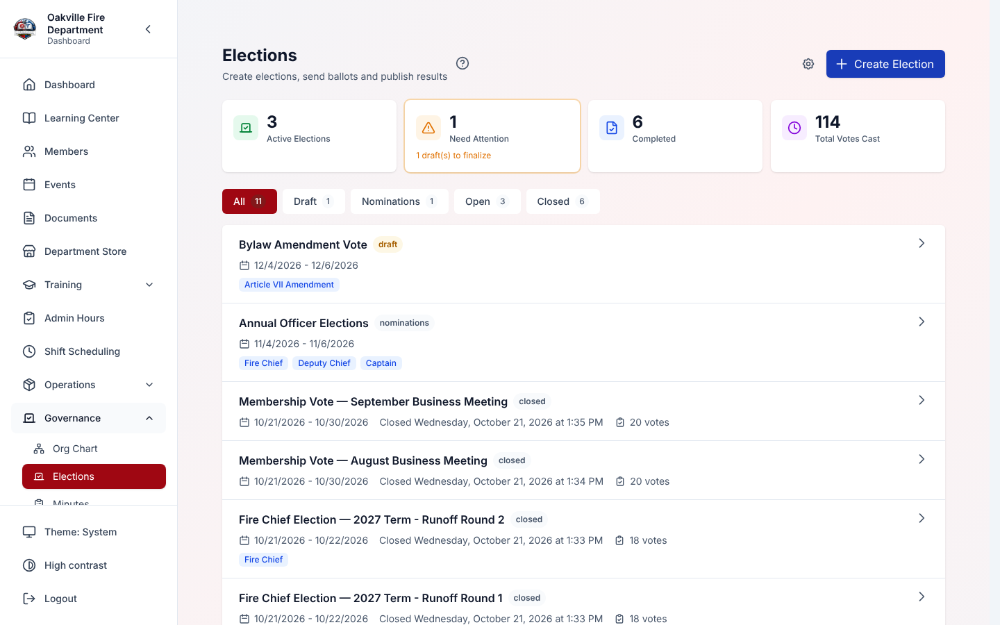

### Tabs on an election's page

Each tab on an election's page has its own web address. You can send a fellow
officer a link straight to a tab, and the browser's Back button steps back
through tab changes.

| Tab              | What it shows                                   | Who sees it                                                                  |
| ---------------- | ----------------------------------------------- | ---------------------------------------------------------------------------- |
| **Ballot**       | The ballot items, in order                      | Officers                                                                     |
| **Nominations**  | The nomination form and nominations so far      | Everyone while nominations are open; officers on a draft                     |
| **Candidates**   | Every candidate, including pending nominations  | Officers                                                                     |
| **Eligibility**  | Who will and will not get a ballot, and why     | Officers                                                                     |
| **Attendance**   | Who is checked in at the linked meeting         | Officers, until the election closes                                          |
| **Overrides**    | Members let in to vote despite the normal rules | Officers                                                                     |
| **Proxy Voting** | Proxy authorizations                            | Officers                                                                     |
| **Cast Vote**    | Your ballot                                     | Everyone, while voting is open                                               |
| **Results**      | The results                                     | Everyone, once the election closes (or during voting if live results are on) |

"Officers" here means roles that can manage elections.

You can move between the tabs with the arrow keys, Home and End.

---

## Creating an Election

**Who can do this:** roles that can manage elections.

1. Open **Elections** and select **Create Election**.
2. Fill in the form:

| Field                                | What to enter                                                                                                                           |
| ------------------------------------ | --------------------------------------------------------------------------------------------------------------------------------------- |
| **Title** (required)                 | For example, "2026 Annual Officer Election"                                                                                             |
| **Description**                      | What the election is for                                                                                                                |
| **Linked Meeting**                   | The meeting or event the vote is held at, or **No linked meeting**. Choosing one sets the voting window to that meeting's start and end |
| **Start Date & Time** (required)     | When voting opens                                                                                                                       |
| **End Date & Time** (required)       | When voting closes. **Quick duration** buttons set it to 1, 2 or 4 hours after the start, or **End of Day**                             |
| **Positions**                        | The offices being filled. Pick from the list or type one, then select **Add**                                                           |
| **How is the Winner Determined?**    | The voting method and winning rule together (see below)                                                                                 |
| **Enable Automatic Runoffs**         | Create a runoff when nobody meets the winning rule. Then choose **Runoff Type** and **Maximum Runoff Rounds** (1 to 10)                 |
| **Anonymous Voting**                 | Votes are saved without the voter's name or address. On unless you untick it                                                            |
| **Allow Write-in Candidates**        | Voters may type in someone not on the ballot. Off unless you tick it. Never offered on an Approve/Deny item                             |
| **Show Results Immediately**         | Members see the running tally while voting is open. Cannot be changed once voting opens                                                 |
| **Open Automatically at Start Time** | Voting opens by itself at the start time, and the ballots are emailed. Shown only when scheduled opening is on                          |
| **Auto-Remind Non-Voters**           | One reminder email 2 hours to 3 days before close, or none. Shown only when reminders are on                                            |
| **If the Top Candidates Tie**        | The tie rule. See [Tie Handling](#tie-handling)                                                                                         |
| **Seats per Race**                   | How many people each race elects, from 1 to 50                                                                                          |

3. Select **Create Election**. The election starts as a **Draft**.

**Things to know about the form:**

- The quick durations and **End of Day** use your department's time zone,
  not your computer's.
- **Seats per Race:** a two-seat board race elects the top two, and each voter
  may choose up to two. The winning rule decides who qualifies, and the seats
  go to the highest who qualify. A tie for the last seat follows the tie rule.
  Ranked choice elects one per race, so choosing it sets this back to 1.
- **Quorum:** an election's page and ballot preview show a quorum if one is
  set, but no screen in The Logbook sets one.

> **What if the hint says ballots are sent separately?** The hint under **Open
> Automatically at Start Time** says ballot emails are still sent separately.
> In fact, a scheduled opening does email the ballots. See
> [Opening an Election](#opening-an-election).

### How is the Winner Determined?

This one menu sets both the **voting method** (how people vote) and the
**winning rule** (what it takes to win).

| Option                                     | How people vote                  | What it takes to win                                                  |
| ------------------------------------------ | -------------------------------- | --------------------------------------------------------------------- |
| **Most Votes Wins (Plurality)**            | One choice each                  | The most votes, even without a majority                               |
| **Majority Required (>50%)**               | One choice each                  | More than half of the votes                                           |
| **Supermajority Required (2/3)**           | One choice each                  | The **Supermajority Percentage** (67 unless you change it, 51 to 100) |
| **Ranked Choice Voting**                   | Rank candidates in order         | A majority, with the lowest dropped round by round                    |
| **Approval Voting (Yes/No per candidate)** | Approve any number of candidates | The most approvals                                                    |
| **Custom Threshold**                       | One choice each                  | A **Numerical Threshold** of votes or a **Percentage Threshold**      |

> **Tip.** For a bylaw amendment that needs two-thirds, choose
> **Supermajority Required (2/3)**.

On approval and ranked-choice ballots, all of a voter's choices for a race are
saved together, or none are.

The election's details card shows what you chose:

- **Voting Method** reads **One choice per voter**, **Ranked choice** or
  **Approval**.
- **Winner** gives the rule: "Most Votes (Plurality)", "Majority (>50% of
  votes)", "Supermajority (67% of votes)" or the threshold.

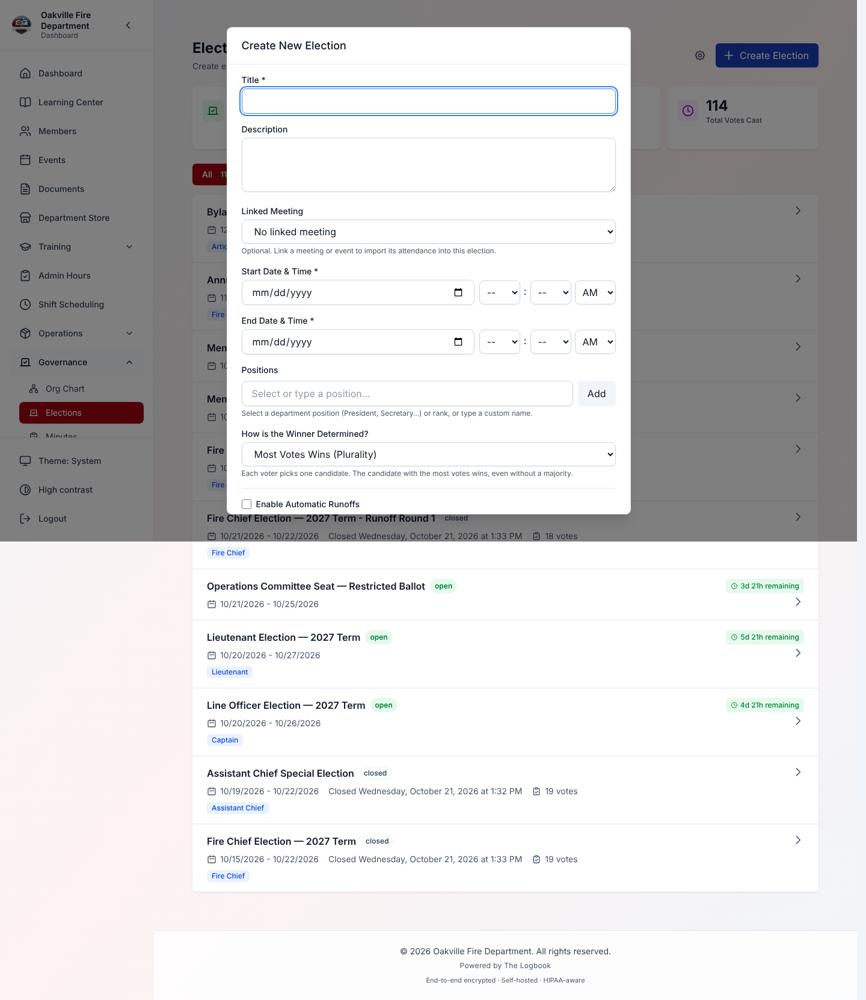

---

## Configuring Ballot Items

A ballot item is one question or race on the ballot. You build them on the
**Ballot** tab of a draft election.

1. Open the election and the **Ballot** tab.
2. Choose how to add an item:
   - **Use Template** — pick a ready-made item, such as a probationary member's
     move to regular membership, or one of your saved ballots.
   - **Custom Item** (or **Add Item** once the ballot has items) — build your
     own.
3. For a custom item, fill in:

| Field                                  | What it means                                                                              |
| -------------------------------------- | ------------------------------------------------------------------------------------------ |
| **Title** (required)                   | The question or race, as voters will see it                                                |
| **Description**                        | More detail for voters                                                                     |
| **Item Type**                          | **General Vote**, **Membership Approval** or **Officer Election**                          |
| **Vote Type**                          | **Approval (Yes/No)** or **Candidate Selection**                                           |
| **Position**                           | For candidate selection: the position whose candidates appear on this item                 |
| **Who Can Vote**                       | All members, or a membership group. See [Voter Eligibility](#voter-eligibility--overrides) |
| **Require meeting attendance to vote** | Only members checked in at the linked meeting may vote on this item                        |

4. Select **Add to Ballot**.

You can drag items to change their order. Select **Preview Ballot** to see the
ballot as a voter will.

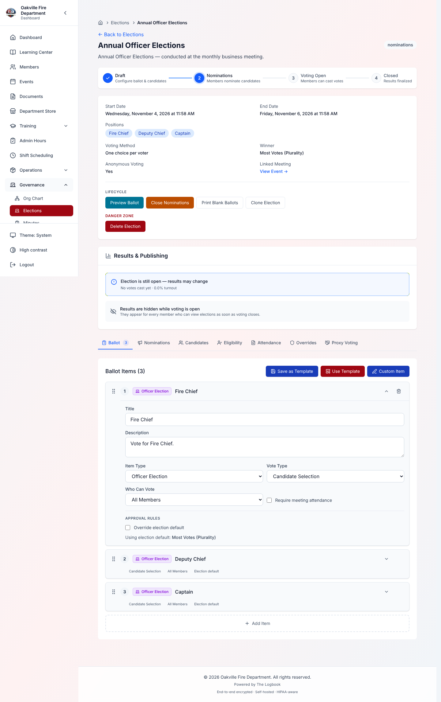

> **Tip.** The ready-made templates cover common meeting items, such as
> membership approvals. Most of them require meeting attendance.

---

## Saved Ballot Templates

**Who can do this:** roles that can manage elections.

If your department runs the same officer slate every year, save this year's
ballot as a template and apply it next year.

### Saving a ballot

1. Build the ballot as usual on a draft election.
2. On the **Ballot** tab, select **Save as Template**. It shows once the ballot
   has at least one item, and not on a closed election.
3. Type a **Template name**, such as "Annual officer election", and select
   **Save Template**.

A department can keep up to **200** saved templates. Saving a 201st is refused
with "This organization has reached the maximum of 200 saved ballot
templates". Delete one you no longer use first.

> **What is saved — and what is not.** A template saves the ballot's
> **structure only**: items, positions, voting method, winning rules,
> write-in setting and who can vote. It never saves candidates, voters, votes,
> ballot links or attendance. The form says so under the name field.
> Applying last year's template gives you last year's _questions_, with
> nobody nominated.

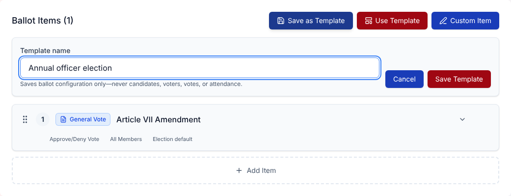

### Applying one

1. On a draft election, select **Use Template**.
2. Your department's templates appear under **Your saved ballots**, above the
   built-in templates. Each shows its item count and the note "replaces
   current ballot".
3. Select one, then confirm with **Replace**. This replaces the whole current
   ballot, which is why it asks twice.
4. Add this year's candidates to the items.

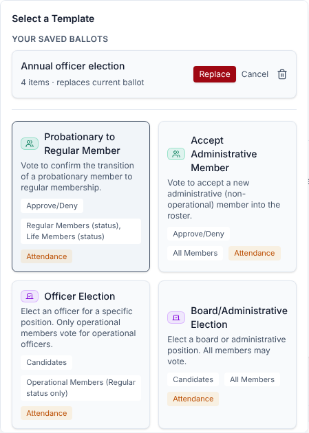

> **Important — a template changes two settings without warning.** A template
> carries the **voting method** and the **write-in setting** of the election it
> was saved from. Applying it writes both over your election. The confirmation
> only mentions the ballot. Afterwards, select **Preview Ballot** and check its
> Election Details strip: it shows the method, the winning rule and
> percentage, Anonymous, Write-ins allowed and the quorum together.

Below is one draft before and after applying "Annual officer election", a
template saved from a ranked-choice officer ballot. One item becomes four,
which the confirmation warned about. The voting method changes from one choice
per voter to ranked choice, which nothing warned about.

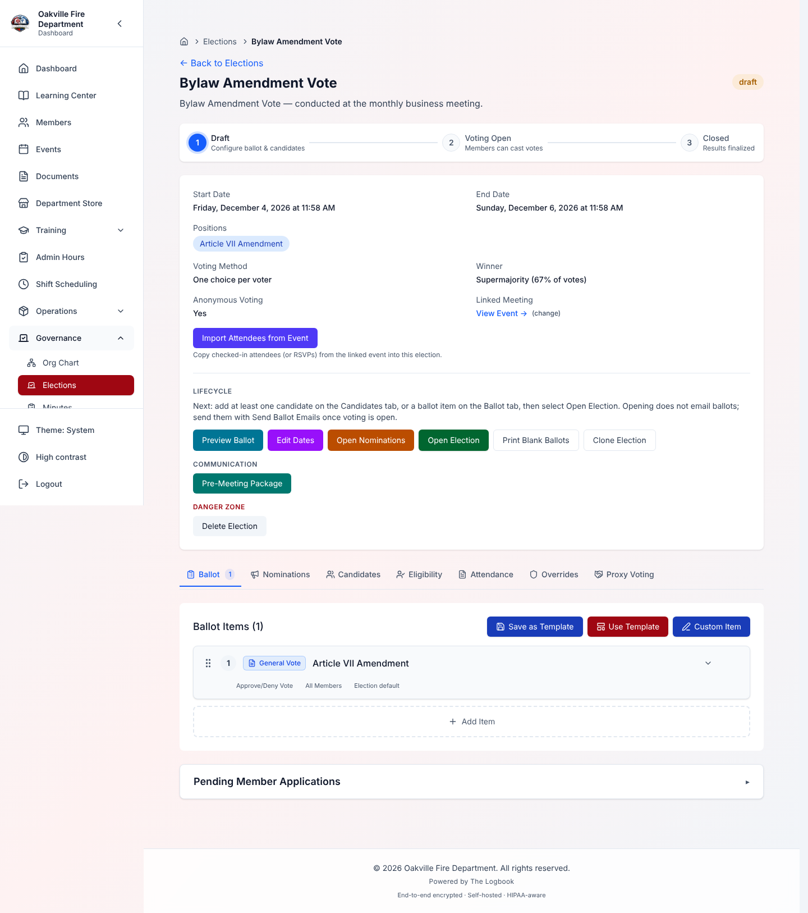

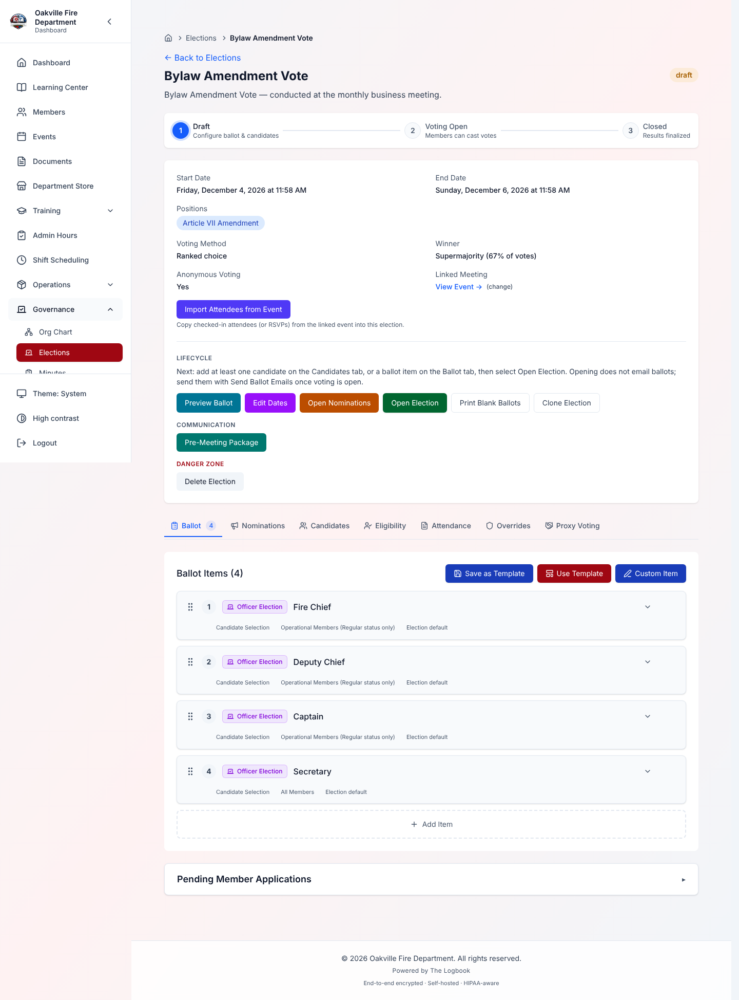

The risk is in what does _not_ change. This draft was created as
**Supermajority Required (2/3)**. Applying the template overwrote the method
but left the winning rule alone. So a bylaw amendment that must carry
two-thirds is now decided by ranked choice, with its 67% rule still recorded
underneath. **Positions** still shows the draft's old value, and write-ins
went off because the officer template had them off.

**Treat a saved ballot as a starting point for a new election**, not a change
to one you have already set up.

### What if …?

| What happened                                                  | What it means                                                                                                                                                                                               |
| -------------------------------------------------------------- | ----------------------------------------------------------------------------------------------------------------------------------------------------------------------------------------------------------- |
| You save "Annual Officers" when "annual officers" exists       | Refused: "A ballot template with this name already exists". Names are unique regardless of capitals                                                                                                         |
| You apply a template over a ballot you were editing            | The ballot is **replaced**, not merged                                                                                                                                                                      |
| The member who saved a template leaves                         | The template stays. It belongs to the department                                                                                                                                                            |
| You delete a template used by past elections                   | Safe. Each election keeps its own copy of its ballot                                                                                                                                                        |
| You apply a template to an election set up for a supermajority | The method is overwritten; the winning rule is not. Applying a template is the only thing that changes an election's method after it is created. To get a different pairing back, create the election again |
| You delete a saved template                                    | The picker asks you to confirm with **Delete** or **Cancel**                                                                                                                                                |
| An item says **All Members** plus another group                | Refused: "'all' cannot be combined with other voter types"                                                                                                                                                  |
| A template from another department                             | You cannot see it                                                                                                                                                                                           |

---

## The Nomination Phase

> **Note.** This needs the **Nomination phase** feature, which is on unless an
> officer turns it off in Election Settings.

Instead of the secretary entering every candidate, members can propose
candidates during a **nomination phase**.

1. On a **draft** election with positions, select **Open Nominations**.
2. Optionally set a **nomination deadline**. When it passes, nominations close
   by themselves.
3. While nominations are open, **any member** can:
   - **Nominate themselves** for a position. This is accepted at once.
   - **Nominate another member**, with an optional supporting statement. The
     nominee is emailed and must **accept** before they reach the ballot. They
     also get a notice in the notification bell that opens the **Nominations**
     tab directly. The bell notice does not depend on their email preferences,
     so a member who muted election email still sees a request only they can
     answer. Declining removes the nomination (the audit log keeps a record).
4. Select **Close Nominations**, or let the deadline do it. The election goes
   back to **Draft**, where you order the ballot and open voting as usual.

**Closing freezes the slate.** A nomination still pending stays off the
ballot. The **Candidates** tab marks it _"Not accepted before nominations
closed"_. After closing, neither the nominee nor an officer can accept or
decline. To change the slate, open nominations again.

**Accepting for a nominee.** While nominations are open, an officer can select
**Accept on their behalf** on the **Candidates** tab. Use it for a member who
agreed in person or by phone. The candidate is labelled **Accepted by
manager**. The nominee is emailed that their nomination was accepted for them,
with how to decline before nominations close. If the nominee later accepts
themselves, the label goes away.

**Safeguards:**

- The nominee must be an active member of your department. Duplicates are
  refused.
- One member may have at most **10** pending nominations of other people in
  one election.
- Opening nominations emails an announcement to every opted-in active member,
  **one message per member** (_2026-10-18_; it used to be one message with every
  address hidden in the copy line, which a provider with a recipient cap could
  refuse whole). It goes out just after nominations open, so a failed email never
  stops nominations opening, and it is skipped if nominations were closed again
  in the meantime. The **Nominations** tab shows election managers how it went:
  _"Emailing members that nominations are open…"_ while it sends, then how many
  members were emailed and how many could not be reached. If anyone was missed,
  the election managers are also emailed, so the missed members can be told
  another way.
- Only candidates who **accepted** reach the ballot.
- **Members see pending nominations only while nominations are open**, so
  nominees can find and answer theirs. After closing, members see accepted
  candidates only. Officers always see the full list.

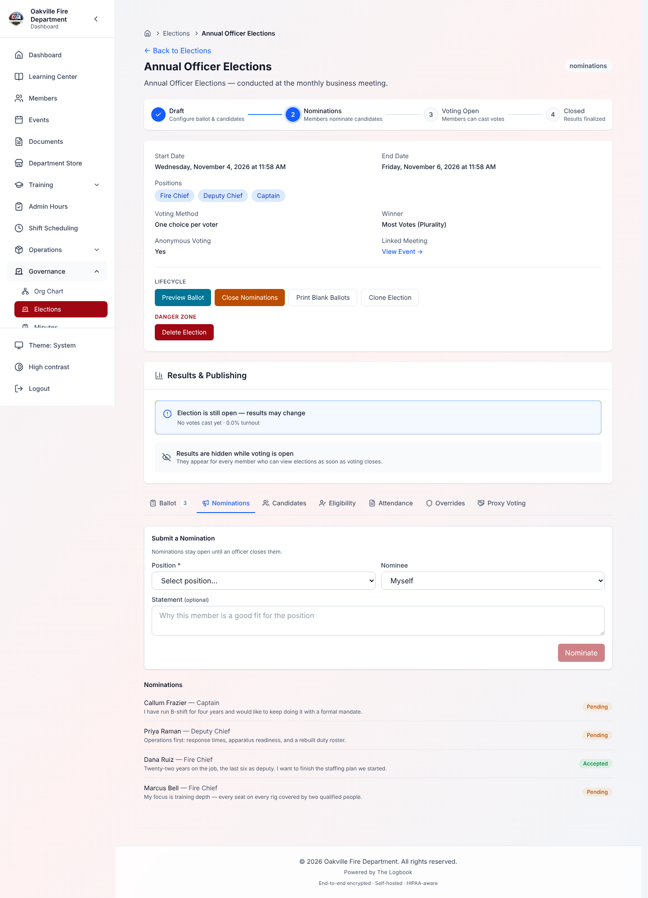

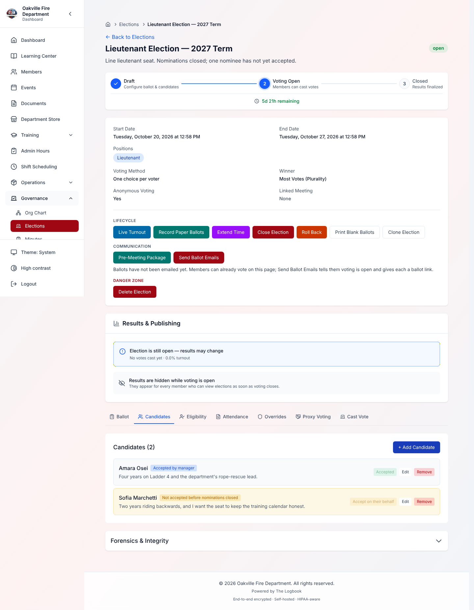

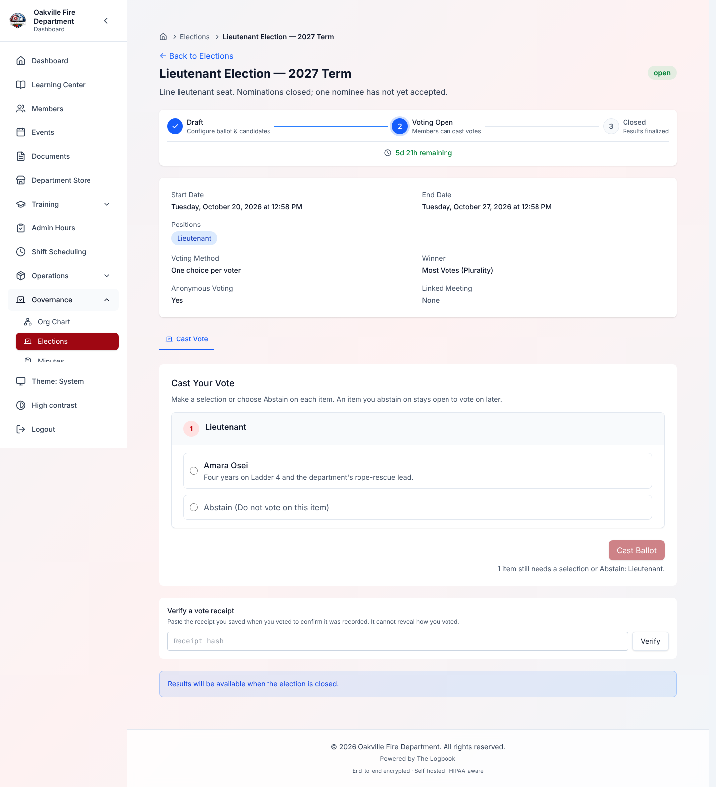

**Above: an officer. Below: an ordinary member, on the same election.** The
officer's **Candidates** tab lists Sofia Marchetti as **Pending**, with an
accept button. The member's ballot offers Amara Osei alone. A member has no
Candidates tab; the ballot _is_ their view of who is standing.

---

## Nominating Candidates

**Who can do this:** roles that can manage elections.

1. Open the election and the **Candidates** tab.
2. Select **+ Add Candidate**.
3. Fill in:

| Field                  | What it means                                                         |
| ---------------------- | --------------------------------------------------------------------- |
| **Position**           | The position they are running for                                     |
| **Select Member**      | Search by name or membership number                                   |
| Name                   | Or type a name, for someone who is not a member                       |
| **Statement**          | Their statement or platform, shown to voters (up to 5,000 characters) |
| **Write-in candidate** | Adds them as a write-in rather than from the official slate           |

4. Select **Add Candidate**.

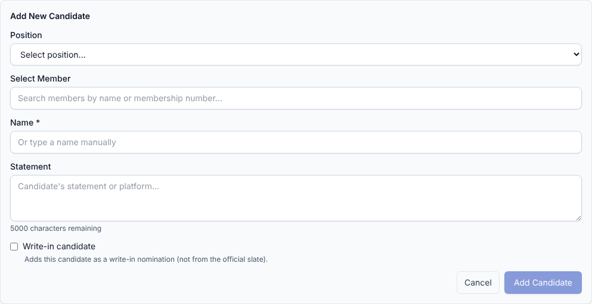

### What if …?

| What happened                                                     | What it means                                                                                                               |
| ----------------------------------------------------------------- | --------------------------------------------------------------------------------------------------------------------------- |
| You try to delete a candidate who has votes                       | Refused, to keep the record                                                                                                 |
| You change a candidate's name, position or acceptance after votes | Refused: "Cannot change a candidate's name, position or acceptance once votes have been cast". A statement edit still saves |
| You clear a candidate's statement                                 | It is cleared                                                                                                               |
| A candidate declines                                              | The nomination is removed. They can be nominated again                                                                      |
| A write-in name gets votes                                        | Saved exactly as typed and counted                                                                                          |

---

## Voter Eligibility & Overrides

By default, every active member may vote. You can narrow that:

- **By membership group**, on each ballot item, with **Who Can Vote**.
- **By meeting attendance**, on each ballot item, with **Require meeting
  attendance to vote**.
- **By a specific list of voters.** An empty list means everyone.
- **By membership tier.** A tier can require a minimum share of meetings
  attended over a number of months. The count starts at whichever is later:
  that cut-off, or the start of the member's current service (their latest
  service period, otherwise their hire date). It runs to today. So a recent
  hire is not charged with meetings held before they joined. Excused meetings
  and meetings during a leave of absence are left out. The secretary's
  attendance figures use the same rule.

### Membership groups

A member's standing has two parts: a **class** (operational, administrative or
social) and a **status** (prospective, probationary, regular, life or retired).
The **Who Can Vote** groups combine them like this:

| Who Can Vote                                  | Who qualifies                                    |
| --------------------------------------------- | ------------------------------------------------ |
| **All Members**                               | Everyone eligible to vote                        |
| **Operational Members (Regular status only)** | Operational class **and** regular status         |
| **Regular Members (status)**                  | Operational class **and** regular or life status |
| **Life Members (status)**                     | Operational class **and** life status            |
| **Regular + Life Members (status)**           | Either of the two rows above                     |
| **Probationary Members (status)**             | Operational class **and** probationary status    |
| **Administrative Members — any status**       | Administrative class                             |
| **Social / Associate Members — any status**   | Social class                                     |

**What if …?**

| Member                                                           | Result                                                                                           |
| ---------------------------------------------------------------- | ------------------------------------------------------------------------------------------------ |
| Life member, on an **Operational** item                          | **Not** eligible — that group needs regular status. They get Regular and Life items              |
| Life member, on a **Regular** item                               | **Eligible**                                                                                     |
| Probationary member, on an **Operational** item                  | **Not** eligible. They get Probationary items                                                    |
| Administrative member with regular status, on a **Regular** item | **Not** eligible — the status groups also need the operational class                             |
| Administrative member holding an operational role                | **Not** eligible for operational items. The class decides, not the role                          |
| Member on a department-made tier (for example "senior")          | Matches no class or status, so eligible for **All Members** items only                           |
| Member with **nothing** recorded                                 | Treated as operational and regular, so they get both those groups. Not the same as the row above |

If your bylaws mean administrative members to vote on regular-member items,
use an override or a specific voter list.

### Voter Overrides

**Who can do this:** roles that can manage elections.

Use an override to let in a member the rules leave out. For example, a member
whose tier was set wrongly, or one who arrived after voting opened.

1. Open the election and the **Overrides** tab.
2. Select **+ Add Override**.
3. Choose the **Member** from the list of active and probationary members.
   Members who already have an override are not listed.
4. Enter a **Reason** of at least 10 characters, and select **Add Override**.

The member may now vote whatever their membership type, attendance or group.
The override is listed by name.

The **Eligibility** tab shows who needs one. Each member who will not get a
ballot is explained row by row, and the panel points you to **Overrides**.

**An override extends a specific voter list.** On an election limited to a
named list, an override for someone not on it lets them in as if they were.
They can vote in the app, they get a ballot email, and they count in the
eligible total and turnout.

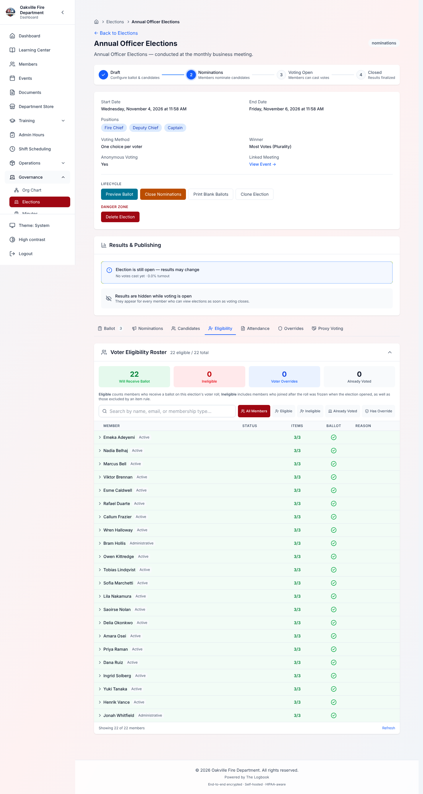

> **What if a member's standing changes after the override?** The override
> still applies.

---

## The Pre-Meeting Package

**Who can do this:** roles that can manage elections.

Before an annual or special meeting, you can send a **pre-meeting package**: a
printable PDF the membership or leadership can review ahead of time. On a
draft or open election, select **Pre-Meeting Package** in the
**Communication** section.

The package contains:

- The linked meeting's details and **agenda**, when the election is linked to
  a meeting.
- The election setup: voting window, voting method, winning rule, quorum,
  whether proxy voting is available, and runoff settings.
- A **ballot preview**: every item in order with who may vote on it, plus the
  candidates and their statements.
- The **voter roster**: for each ballot item, how many may vote and why (for
  example "3 eligible (checked in / override), 17 not checked in"), and the
  list of eligible names.

### Two versions

| Version               | Contents                                                        | For                    |
| --------------------- | --------------------------------------------------------------- | ---------------------- |
| **Member version**    | Eligible voters' names and counts only                          | The general membership |
| **Full (leadership)** | Adds each member's reason for not being eligible, and overrides | Leadership and board   |

> **Important — keep the full version to leadership.** The reasons show
> individual members' tiers and attendance shortfalls. The member version
> exists so those details are not sent to everyone.

### Sending it

1. Select **Pre-Meeting Package**. The **Email Pre-Meeting Package** window
   opens.
2. Fill the recipient list with **Leadership** or **All eligible voters**, then
   change it freely. Remove anyone, or add outside addresses (board counsel, a
   member's personal email). **Clear list** empties it.
3. Tick **Include full roster detail (ineligibility reasons)** for the full
   version. It is ticked for you when you fill the list from Leadership.
4. Add an optional **Message**, and select **Send to _n_ recipients**.
   Each person gets their own email, so recipients cannot see each other's
   addresses. _(2026-10-18)_ The send is queued and shows progress like the
   ballot emails (one package send at a time per election; a second is refused
   until it finishes). If some addresses could not be reached, an error message
   lists them so you can send again to just those people.

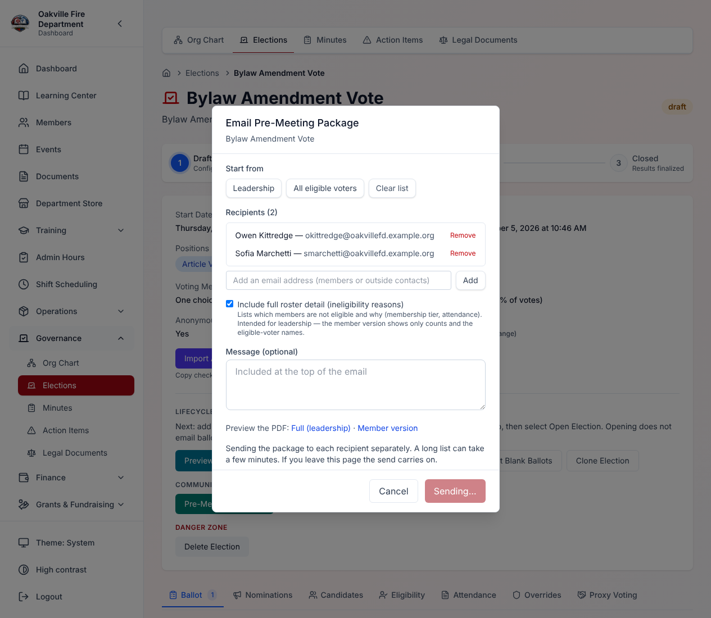

### Or just download it

Under **Preview the PDF**, select **Full (leadership)** or **Member version**
to download it without sending anything. Attach it to your own email, print it
for the meeting, or file it with the minutes. Sends and downloads are both
recorded in the audit log.

---

## Opening an Election

**Who can do this:** roles that can manage elections.

When the election is ready:

1. Check every ballot item and candidate. **Preview Ballot** shows the ballot
   as voters will see it.
2. Select **Open Election**. The status changes from Draft to Open, and the
   voter roll is frozen (see below). Voting starts at once, even if the
   scheduled start has not arrived.
3. **Opening by hand sends no ballots.** Members can vote on the **Cast Vote**
   tab straight away. The page reminds you: "Ballots have not been emailed
   yet." Select **Send Ballot Emails** to tell members voting is open and
   give each a ballot link.
4. **A scheduled opening does send them.** With **Open Automatically at Start
   Time**, the ballots go out as the election's creator, so replies go to
   them. If that send fails or reaches nobody, the election still opens. Every
   officer who can manage elections is then emailed _"Action needed: ballots
   for (election) were not sent"_. Open the election and select **Send Ballot
   Emails**.

> **Tip — send yourself a test ballot first.** In **Election Settings → Test
> Ballot**, choose a draft election and select **Send Test Ballot**. The test
> link opens the draft's ballot. You can vote through it, see the **TEST
> BALLOT** banner and get a receipt saying the vote is not counted. Test votes
> are left out of results, figures and rosters, and never use up your real
> vote.

### Ballot Distribution

When you select **Send Ballot Emails**, The Logbook:

1. Works out who may vote, using the groups, attendance and override rules.
2. Creates a personal ballot link for each voter. The link only shows the
   items and positions that voter may vote on. This is checked again when the
   ballot is submitted.
3. Emails each voter their link.
4. Reports how many ballots were sent and which members were skipped, and why.

The ballot link is private. It does not reach the department's server logs,
and the ballot page removes it from the address bar once loaded.

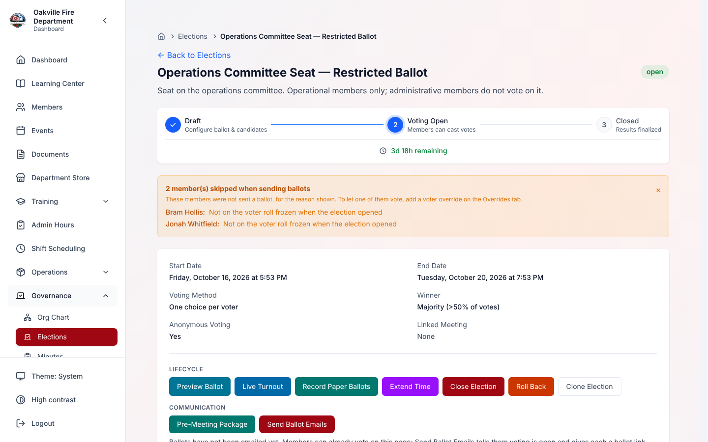

Two things report the result:

- A short message gives the counts — "Ballots sent to N voter(s)", plus "M
  failed" and "M skipped (see banner below)" when either applies. It
  disappears.
- A **banner** stays on the page and names each skipped member with the
  reason. That is the part you act on.

**"Failed" can mean the email account's daily limit** _(2026-10-25)_. Gmail and
Microsoft 365 cap how many messages one account sends a day. When the
department's account reaches it partway through, the send stops there and
counts every remaining voter as failed, rather than trying each one in turn.
Send again once the limit resets; see
[Admin & Reports → Gmail and Microsoft 365](./08-admin-reports.md#gmail-and-microsoft-365).

After a send, the button reads **Resend Ballot Emails** and the page shows
**Ballots sent** with the time.

**Large rosters send in the background.** The send no longer runs inside your
browser request, so a roster of dozens of members no longer ends in a
"timeout of 30000ms exceeded" message. The dialog shows the send's progress and
then the same counts and skipped-member banner as before. It keeps going if you
leave the page; come back to the election to see the result.
**Remind Non-Voters** works the same way. Only one send can run for an election
at a time, because two overlapping sends would email members twice and overwrite
each other's record of who was sent a ballot. A second attempt while one is
running is refused with a message to wait. If the server restarted mid-send, the
job is reported as interrupted after 30 minutes and you can send again. Ballot
links are now saved before any mail goes out, so a restart can no longer leave
members holding a link that answers "Invalid voting token". Sending again does
not cancel the links already in inboxes.

**Things to know:**

- **Ballot emails carry every race.** The emailed ballot shows ballot items
  and plain positions. An election built from positions and candidates alone
  can be emailed. **Send Ballot Emails** is unavailable only when an election
  has neither, and the page says why.
- **A draft cannot be emailed**, except as a test ballot. Neither can a closed
  or cancelled election.
- **The summary emailed to you is reported truthfully.** If it could not be
  sent, the page says "The eligibility summary email could not be sent".
- **A test ballot looks like one.** Its subject starts **[TEST]**, the email
  carries a test stamp, and its receipt says _"This was a test vote. It was
  recorded but is not counted toward the election results."_ Sending a test
  ballot does not mark the election's ballots as sent.

**Changing the ballot after ballots went out.** A ballot link shows the ballot
as it was when the link was sent. So if you change the ballot items, the
positions or who may vote on which, every unused link already sent stops
working. This can happen after rolling an open election back to draft. The
page then shows **"Every ballot link already sent was invalidated because the
ballot changed"** until ballots go out again. A member who opens an old link
reads that the ballot changed and a new email is coming. Saving the ballot
without changing it stops nothing.

> **Important — check the link address before election night.** Ballot links
> use the web address your administrator set up for The Logbook, not the
> address you happen to be using. If it is wrong, members get links to the
> wrong place even though the send reports success. Ask your administrator to
> confirm it is the address members actually use.

### What if …?

| What happened                                               | What it means                                                                                                                                       |
| ----------------------------------------------------------- | --------------------------------------------------------------------------------------------------------------------------------------------------- |
| A member has no email address                               | Skipped, with the reason shown                                                                                                                      |
| A member who already voted uses their link                  | The second vote is refused. Votes are never overwritten                                                                                             |
| A member may vote on no items                               | Skipped, so nobody gets an empty ballot                                                                                                             |
| The election has no ballot items and no accepted candidates | It cannot be opened                                                                                                                                 |
| The election has neither ballot items nor positions         | Ballots cannot be emailed. The **Open election** dialog warns you before you confirm                                                                |
| A member checks in at the meeting after voting opened       | They are recorded as present but **cannot vote**, because the roll froze at opening. The **Attendance** tab says so. Add an override to let them in |

### Voter-Roll Freeze

Opening an election **fixes the list of eligible voters**, like a printed
sign-in sheet. After that, changes to a member's status or tier do not change
who may vote or the turnout figures. **Overrides still let members in** after
opening — that is their purpose. The **Eligibility** tab reads the frozen
list, so a member added after opening is not shown as getting a ballot.

### Printable Ballot PDF

Running a paper vote in the room? Select **Print Blank Ballots**. It makes the
official blank paper ballot from the election setup:

- Positions in ballot order, with accepted candidates.
- Write-in lines where allowed.
- Instructions for the voting method.
- Every approval item as "☐ Approve ☐ Deny" under its title.
- The department logo in the letterhead, and a real mark box beside every choice.

**Each contest is printed under its own voting method.** A ballot item can
override the election's method, and the printed ballot now follows it: a ranked
item shows a rank box per choice instead of "Mark ONE box", and an approval item
says to mark any number. The certified results PDF and the pre-meeting package
use the same letterhead and style.

The button shows on elections that have positions or ballot items (so a ballot
made only of motions can be printed) and are not closed. Print
the ballots, hand them out, then enter the totals under
[Paper Ballots & Attestation](#paper-ballots--attestation).

---

## Reminders & Lifecycle Automation

> **Note.** Reminders need the **Non-voter reminders** feature. Scheduled
> opening needs the **Scheduled opening** feature. Both are on unless an
> officer turns them off.

Every 15 minutes, The Logbook does the routine timing work:

| What happens            | When                                                                                         | Can you turn it off?                                                                                                                          |
| ----------------------- | -------------------------------------------------------------------------------------------- | --------------------------------------------------------------------------------------------------------------------------------------------- |
| **Closing**             | An open election passes its end date                                                         | No. Closing works out the results, starts any runoff and erases private voting data on anonymous elections, so an election is never left open |
| **Opening**             | A draft with **Open Automatically at Start Time** reaches its start; the ballots are emailed | Yes — leave that box unticked on the election                                                                                                 |
| **Closing nominations** | The nomination deadline passes                                                               | Only by not setting a deadline                                                                                                                |
| **Reminder**            | The **Auto-Remind Non-Voters** time before close arrives                                     | Yes — choose **No automatic reminder** on the election                                                                                        |

So it can take up to 15 minutes after the set time for an election to open or
close by itself.

### Reminding Non-Voters Manually

On an open election whose ballots have been emailed, select **Remind
Non-Voters**. It sends a reminder email with a new ballot link to eligible
voters who have **not** voted. The list is worked out at the moment of
sending.

- **Paper voters are included.** Paper ballots are not matched to members, so
  anyone who voted on paper gets a reminder too.
- **One reminder an hour** per election, manual or automatic, so a double
  select cannot flood members' inboxes.
- **A reminder replaces the earlier link.** The email is titled "Reminder:
  vote in (election)". An older link opened afterwards says it was replaced by
  a newer ballot email.
- **Old links stop only once the new email is handed over for delivery.** If
  the new one bounces, the old link keeps working, so nobody is left without a
  ballot.
- **Only one automatic reminder** is ever sent, and a manual reminder cancels
  it.
- However many links a member holds, they can still vote only once.

The page shows **Reminder sent** with the time.

---

## Casting Votes

### In the App

The **Cast Vote** tab is the same ballot as the emailed link: every ballot
item and race, answered the same way (Approve or Deny, one candidate, "Select
up to N", or a ranking).

1. Open **Governance → Elections**, open the election, then **Cast Vote**.
2. Make a selection — or choose **Abstain** — on every open item. Nothing is
   chosen for you. **Cast Ballot** stays greyed out until each item has an
   answer, and a line names the items still waiting.
3. Select **Cast Ballot**, check the summary and confirm. Everything you chose
   is saved together. If any choice is refused (for example, you may not vote
   on that item), nothing is saved and the message names the item.
4. The tab shows a **receipt** for each vote: _"Save this receipt to verify
   your vote was counted. It cannot reveal how you voted."_ The check form
   under the ballot verifies a receipt later. See
   [Vote Receipt Verification](#vote-receipt-verification).

**An item you abstain on stays open** in the app, so you can vote on it later.
An item you have already voted on is shown as done.

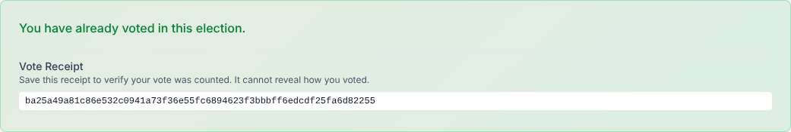

### From the Ballot Email

1. Open the ballot email from your department.
2. Select the voting link.
3. The ballot page shows only the items and candidates you may vote on.
4. Make your choices. The ballot follows the voting method:
   - one choice: round buttons;
   - approval or several seats: tick boxes — tick every candidate you support,
     up to any limit;
   - ranked choice: a rank menu for each candidate (1 = first choice; each rank
     once).
5. Choose an answer or **Abstain** on every item, then select **Submit
   Ballot**. You do not need to sign in; the link identifies you.
6. The confirmation shows your receipts. Save them if you want to check your
   votes later.

**The emailed link works once.** After you submit, it cannot be used again,
even for items you abstained on.

> **Why there is no picture of the emailed ballot.** Reaching it needs a live
> ballot link, and The Logbook keeps those out of everyone's reach — including
> the team that takes screenshots. That is what makes an emailed ballot safe
> to send.

### What if …?

| What happened                                         | What it means                                                                                                   |
| ----------------------------------------------------- | --------------------------------------------------------------------------------------------------------------- |
| You try to vote twice in the same race                | Refused. On approval ballots you can still approve _different_ candidates; on ranked ballots, one vote per rank |
| You try to vote on an item you may not vote on        | Refused when you submit, not just hidden                                                                        |
| Your link has expired                                 | Links expire at the election's end, or after 30 days, whichever is sooner. Ask the secretary to resend          |
| An old link says it was replaced                      | A reminder sent you a newer link. Use the newest email                                                          |
| An old link says voting has closed                    | The election is closed                                                                                          |
| An old link says the election was closed and reopened | Ask the secretary for a new link                                                                                |
| A write-in matches an existing candidate's name       | Saved as a separate write-in. The secretary can merge them                                                      |
| You rank only some candidates                         | Only the ranked candidates count                                                                                |
| One choice in your ballot is refused                  | Nothing is saved — no partial ballots                                                                           |

---

## Paper Ballots & Attestation

> **Note.** This needs the **Paper-ballot entry** feature, which is on unless
> an officer turns it off.

For votes counted by hand in the room, an officer enters the paper totals.
Then a set number of _other_ officers confirm the counts before they count
toward results.

### Recording a Paper Tally

**Who can do this:** roles that can manage elections.

1. Print ballots with **Print Blank Ballots**, run the vote and count the
   papers.
2. On the open election, select **Record Paper Ballots**.
3. Enter the count for each candidate, and for **Approve** and **Deny** on
   each approval item. Optionally add **Physical ballots in this stack** and
   notes, such as "counted by Lt. Reyes and FF Park, 2 spoiled ballots
   discarded".
4. Submit. Each paper ballot is saved as a vote, marked as paper and
   credited to you as the recording officer.

Paper votes go into the ordinary counts, so the results show no separate
"paper" figure. The **Paper-Ballot Batches** panel (below) keeps the itemized
record: who recorded each batch, when, and who confirmed it.

Paper votes carry no voter's name, but they are sealed into the same
tamper-evident chain as electronic votes. The integrity check therefore covers
the whole ballot box, and a paper vote cannot be quietly relabelled as
electronic.

**The "too many votes" check.** A batch that would push a race past _eligible
voters × votes each voter may cast_ is refused before anything is saved. The
message spells out the total, the eligible count and the limit.

- Under approval voting, "votes each voter may cast" is the number of accepted
  candidates for the position. Otherwise it is the election's votes-per-race
  setting.
- **Physical ballots in this stack** is checked against the eligible count
  directly, because one member hands in one sheet.
- If the count really is right (for example, overrides let in extra voters),
  tick **The tally is correct — override the eligible-voter count check**.
  This is recorded in the audit log as a warning, naming who did it.
- The tick box only appears after the check has refused a batch. You cannot
  switch the check off in advance.

**Ranked-choice races are entered ballot by ballot.** Totals per candidate lose
each ballot's order, so a ranked race asks for one ballot at a time: its 1st,
2nd, 3rd choice and so on, with a copy count when several ballots are marked
identically. Submitting totals for a ranked race is refused. Each paper ballot
counts as its own ballot in the runoff (before this fix a stack of thirty was
counted as one).

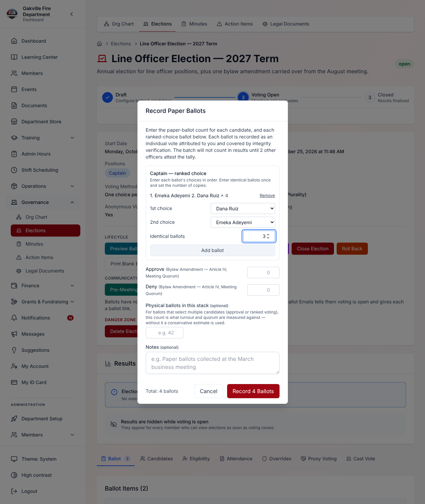

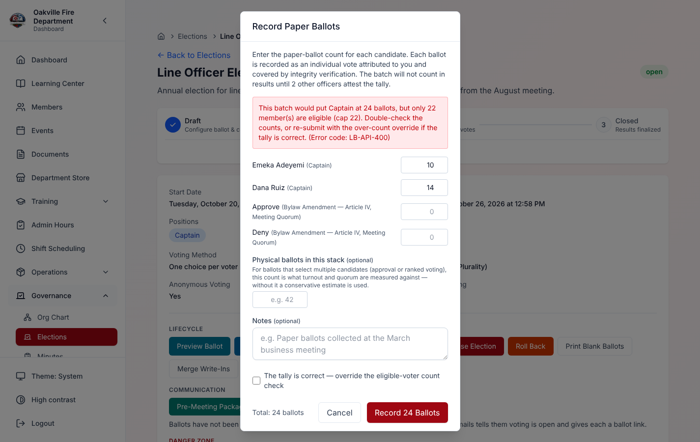

### Officer Attestation

Unless you change it, **2 officers other than the recorder** must confirm each
batch before its votes count. You can set 0 to 3 in **Election Settings →
Features**.

1. A recorded batch starts as **Pending**. Its votes are saved but left out of
   results, figures and the vote count on the Elections list.
2. Officers who can manage elections open the **Paper-Ballot Batches** panel.
   They check the entered counts against the papers, then select **Attest
   Count**.
3. The recorder can never confirm their own batch, and each officer counts
   once.
4. When enough officers have confirmed, the batch becomes **Confirmed** and its
   ballots count.

Things to know:

- Each batch keeps the number required **when it was recorded**. Changing the
  setting later never confirms or un-confirms old batches.
- A disputed batch can be **voided** with a reason. It stays on record, and
  the card shows who voided it, when and why.
- Confirming and voiding work only while voting is open. A batch still pending
  at close stays out of the certified results, and the close records a
  warning in the audit log.
- The panel sits on the election page above the tabs, and appears once one
  batch exists.

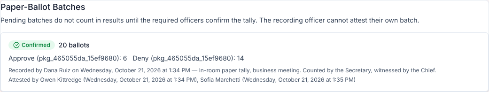

After the close, a batch shows its record but no buttons.

### What if …?

| What happened                                        | What it means                                                                                                                        |
| ---------------------------------------------------- | ------------------------------------------------------------------------------------------------------------------------------------ |
| 40 votes typed for a 4-voter race                    | Refused by the "too many votes" check. The override tick box appears only then                                                       |
| The recorder selects Attest Count on their own batch | Refused. A _different_ officer must confirm                                                                                          |
| The setting changes from 2 to 0 after batches exist  | Pending batches still need the 2 confirmations they started with                                                                     |
| The election closes with a batch still pending       | The batch is left out of the results, of who goes to a **runoff**, and of any **membership-approval** outcome. A warning is recorded |
| A batch is confirmed before close                    | Its votes count everywhere: results, runoffs and membership outcomes                                                                 |
| A pending over-count batch exists                    | It does not count toward the "too many votes" limit for later batches                                                                |
| A confirmed batch was mistyped                       | Void it (reason required) and record it again                                                                                        |
| Confirmations required is set to 0                   | Batches count as soon as they are recorded (not recommended)                                                                         |

---

## Proxy Voting

A proxy lets one member vote for another who cannot attend. An officer turns
it on in **Election Settings → Proxy Voting** first.

### Authorizing a Proxy

**Who can do this:** roles that can manage elections.

1. Open the election and the **Proxy Voting** tab.
2. Select **+ Add Authorization**.
3. Fill in the **New Proxy Authorization** form:

| Field                               | What to enter                                    |
| ----------------------------------- | ------------------------------------------------ |
| **Delegating Member (Absent)**      | The absent member's user ID                      |
| **Proxy Member (Voting on behalf)** | The user ID of the member who will vote for them |
| **Type**                            | **Single Election** or **Regular (Ongoing)**     |
| **Reason**                          | Why, for example medical leave or out of town    |

4. Select **Add Authorization**.

> **What if I do not know a member's user ID?** These two boxes ask for the
> member's user ID rather than offering a list, and no screen shows user IDs.
> Ask your administrator to look them up.

Nothing is sent to the proxy holder at this point. When ballots go out, the
proxy holder is copied on the absent member's ballot email (their own ballot
email is separate). The copied email says _"(holder) holds (member)'s
proxy"_. It explains that the link opens the absent member's ballot and works
once, whichever of the two submits it.

### Casting a Proxy Vote

A member who holds a proxy votes it from the **Cast Vote** tab:

1. Open the election's **Cast Vote** tab.
2. In **Voting for**, choose _"(member) (as their proxy)"_ instead of
   **Myself**. The list shows only proxies you hold.
3. The ballot reloads as that member's. A **"Voting as proxy for: (member)"**
   banner shows, with their eligibility and the items they have already voted
   on.
4. Make the choices and select **Cast (member)'s Ballot**. The votes count as
   theirs (the one-vote rule applies to them, not you), marked as cast by you
   as their proxy.

The holder can also use the absent member's emailed link they were copied on.

### Proxies on anonymous elections

**A proxy ballot is not anonymous.** It records whom it was cast for, and the
proxy holder sees every choice. On a named election that changes nothing. On
an **anonymous** election it is allowed only if the absent member agrees:

- When authorizing on an anonymous election, the form warns: _"This is an
  anonymous election, but a proxy ballot is not anonymous: the proxy holder
  will see how the member votes, and the ballot cast for them is stored linked
  to their name."_ Tick _"The delegating member has been told this and accepts
  it. They will also be emailed this warning."_ **Add Authorization** stays
  greyed out until you do. Tick it only after the member has agreed.
- For every authorization, the **absent member is emailed** _"Proxy
  authorized — (election)"_, naming the holder. On an anonymous election the
  email carries the same warning.
- The **certified results PDF** of an anonymous election with proxy votes says
  the anonymity key was destroyed _"except for N proxy vote(s), which are
  recorded against the member they were cast for"_.

### What if …?

| What happened                                                               | What it means                                                                                                                                  |
| --------------------------------------------------------------------------- | ---------------------------------------------------------------------------------------------------------------------------------------------- |
| A holder would exceed the limit                                             | Refused. The limit is 1 proxy per holder unless changed (1 to 10) in Election Settings                                                         |
| The absent member also votes directly                                       | Whichever vote comes first stands. The second is refused                                                                                       |
| A proxy is revoked after the vote was cast                                  | The vote stands. Revoking stops future proxy votes only                                                                                        |
| A proxy on an anonymous election was authorized without the acknowledgement | Its ballot is refused with _"Ask the secretary to revoke it and authorize the proxy again"_. Revoke it and authorize again with the box ticked |

---

## Monitoring & Results

### While Voting Is Open

- **Officers** who can manage elections see how many votes have been cast and
  who was sent a ballot.
- **Everyone else** sees no vote count until the election closes — unless
  **Show Results Immediately** was set. Then the count and running tally
  show, but the list of who was sent a ballot still does not.
- Ballots — the emailed link and the **Cast Vote** tab — show each candidate's
  name and statement only. They never show which member account a candidate
  is or who nominated them.

### Live Turnout Dashboard

On meeting night, select **Live Turnout** on an open election. It is a display
you can make full screen and project in the room:

- Ballots received against eligible voters, with quorum progress when the
  election has a quorum.
- It refreshes by itself.
- It **never shows candidate totals** before close — participation only, so
  projecting it cannot sway the vote.

### Closing an Election

**Who can do this:** roles that can manage elections.

1. Select **Close Election** and confirm. The buttons read **Close election**
   and **Keep it open**. The dialog warns that voting ends at once, and says
   what undoing it would take:
   - **Anonymous election:** closing is final once any vote is recorded; a
     recount needs a new election.
   - **Named election:** reopening takes a **Roll Back**, which stops every
     ballot link already sent.
2. The results are worked out and shown on the **Results** tab:
   - each race's winner, or "No winner" if nobody met the winning rule;
   - the votes for each candidate;
   - write-in totals;
   - turnout. Turnout counts only members who may vote — tiers marked as not
     voting are left out.

Things to know:

- **Closing early is fine.** Runoffs are still worked out, and membership
  approval results still go back to the pipeline.
- **Closing releases the results.** An election closed early at the meeting
  shows its results straight away, to the officer who closed it and every
  member who can view elections.
- **The close is recorded** with the officer and the exact time. The certified
  PDF reads, for example, "Election closed 2026-09-30 06:53 CDT by Sam Ortiz".
  A close at the scheduled end reads as automatic. The Elections list shows
  the real close time.
- **Extend Time** on an open election moves its end time later instead.

### The Results & Publishing panel

This panel appears once the election is open:

- On an open election it reads _"Results are hidden while voting is open"_ (or
  _"Live results are visible to members"_ if **Show Results Immediately** was
  set).
- On a closed election it reads _"Results are visible to members"_. There is
  no publish or hide switch; closing is what releases the results.
- **Email Results Report** (_"Email the results report to yourself"_), with
  its **Send Report** button, appears only once the election is closed. It
  emails the report to you, and the confirmation names the address it went to.
  The report is also emailed automatically at close to the election's creator
  and to the department's leadership (chief, president, vice president,
  secretary), counting only current members who have not turned off
  election-administration email.

### What the results, the report and the certified PDF show

- **Every ballot item's outcome**, with its own label and percentages,
  including each motion's or membership vote's Approve and Deny totals.
- **One table per item.** On a ballot of several items, the **Results** tab
  reads **Results by Ballot Item**. One motion's votes never compete with
  another's.
- **Ties are named**: "Tie — co-winners per policy" or "Tie — runoff round
  created".
- **Quorum** is reported only where there is one. Otherwise it reads "No
  quorum requirement".
- **Who closed it and when** — see above.
- **Who was sent ballots**, from the last send or reminder, or "Ballots were
  not emailed for this election" when none went.

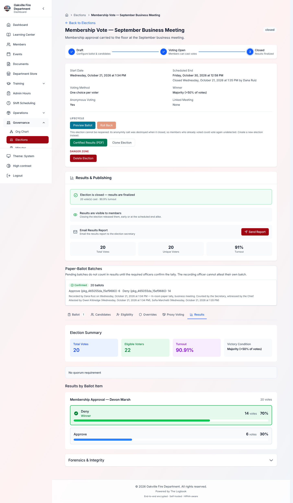

**Corrections after close are marked.** **Merge Write-Ins**, **Void this
vote** and voiding a paper batch still work after close — they are how a
result is corrected. Each leaves a mark. The **Results** tab shows _"These
results were revised after the election closed"_ with a line per correction,
for example _"Revised (when) by (who): a vote was voided (reason)"_. The
certified PDF prints the same lines. Rolling the election back to open clears
the marks, and the next close certifies afresh.

### Who voted

The **Eligibility** tab marks each member who has voted with **Voted**. Its
filters are **All Members**, **Eligible**, **Ineligible**, **Already Voted**
and **Has Override**. **Remind Non-Voters** tells you how many eligible members
have not voted yet. Use them to follow up while the election is open.

On a **named** election, members who voted by emailed link count as voters,
and the record of who voted still names them after close. On an **anonymous**
election, nothing links a vote to a member.

---

## Tie Handling

Each election has a **tie rule**, set under **If the Top Candidates Tie** when
you create it:

| Option                                  | On a tie                                                          |
| --------------------------------------- | ----------------------------------------------------------------- |
| **Declare all tied candidates winners** | All tied candidates are marked as winners. This is the default    |
| **Hold a runoff round**                 | No winner; the tie is flagged for a runoff round                  |
| **Revote at the meeting**               | No winner; the race is flagged for a fresh vote                   |
| **Chair decides per bylaws**            | No winner; the presiding officer breaks the tie under your bylaws |

With any option except co-winners, the results flag the tie clearly, no
winner is declared, and the close records the tie in the audit log.

> **Important.** Set the tie rule to match your bylaws **before** opening.
> Choosing a tie-breaking rule after seeing the totals is exactly the argument
> this setting prevents.

---

## Write-In Consolidation

Write-in votes arrive spelled however the voter typed them. "J. Smith", "John
Smith" and "Jon Smith" count as three people. After voting, and before you
certify, combine them:

1. On the election's page, select **Merge Write-Ins**.
2. In **Merge Write-In Variants**, select the misspelled entries, then the
   candidate under **Count their votes for**.
3. Select **Merge _n_ Variants**. The results now count all of them for that
   candidate.

The merge never edits the votes themselves, so the integrity check still
passes. The merge is recorded in the audit log.

---

## Runoff Elections

When **Enable Automatic Runoffs** is on and nobody meets the winning rule at
close (including an early close):

1. The Logbook picks who goes through, by the **Runoff Type**: **Top Two (top
   2 candidates advance)** or **Eliminate Lowest (remove lowest, others
   continue)**.
2. It creates a **runoff election** linked to the original, as a Draft, with
   write-ins off. The runoff keeps the original's tie rule, quorum, voter
   groups, meeting link, attendees and overrides, and copies its
   candidate-selection items so ballots can be emailed. Its description names
   the tie or shortfall that caused it. It gets its own anonymity key.
3. The election chain shows the order: Original → Runoff 1 → Runoff 2, up to
   **Maximum Runoff Rounds**.
4. Each runoff is run like any election. To vote on the spot, just open it —
   **opening starts voting at once**, even before the scheduled start (an hour
   ahead unless changed). To set a window first, such as a 15-minute floor
   vote, use **Edit Dates** on the draft.

> **Tip.** Every draft has **Edit Dates**, which opens **Edit Voting Window**
> with **Start Now** and **15 Min**, **30 Min** and **1 Hour** quick buttons.
> An election whose end date has passed cannot be opened until you change its
> dates.

### What if …?

| What happened                     | What it means                                                |
| --------------------------------- | ------------------------------------------------------------ |
| The runoff ties too               | Another runoff is created, up to the maximum rounds          |
| Every candidate is below the rule | The runoff includes every candidate                          |
| Runoffs are off                   | The election closes with no winner. The secretary handles it |

---

## Vote Integrity & Forensics

Elections include safeguards that let you prove the result was not tampered
with.

### Vote Receipt Verification

Each vote gets a **receipt**, shown when the voter submits. A receipt:

- proves the vote was recorded;
- does **not** show which candidate was chosen;
- can be checked later by anyone holding it, with the check form under the
  ballot. The check shows only when the vote was cast and for which position.

If an officer voided the vote, the receipt reads "This vote was voided by an
officer".

### Forensics & Integrity

**Who can do this:** roles that can manage elections.

At the bottom of the election's page, open the **Forensics & Integrity**
section:

- **Run Check** checks every vote's tamper-evident seal and reports PASS or a
  problem. It runs only when you select it.
- **Voided votes** — any votes an officer removed, with the reason and who did
  it. On an anonymous election the removed vote's choice is not shown.
- **Rollback history** — if the election was ever rolled back, for example
  reopened after closing.
- **Unusual patterns** — internet addresses with suspiciously many votes, the
  number of different addresses, and a voting timeline that shows rapid-fire
  voting. A full list of every address's votes is deliberately not shown,
  because in a small department it could reveal who voted how.

> **Important — investigate during voting.** On anonymous elections, each
> vote's internet address and browser details are **erased at close**, along
> with the anonymity key. Run any address-based investigation while voting is
> open.

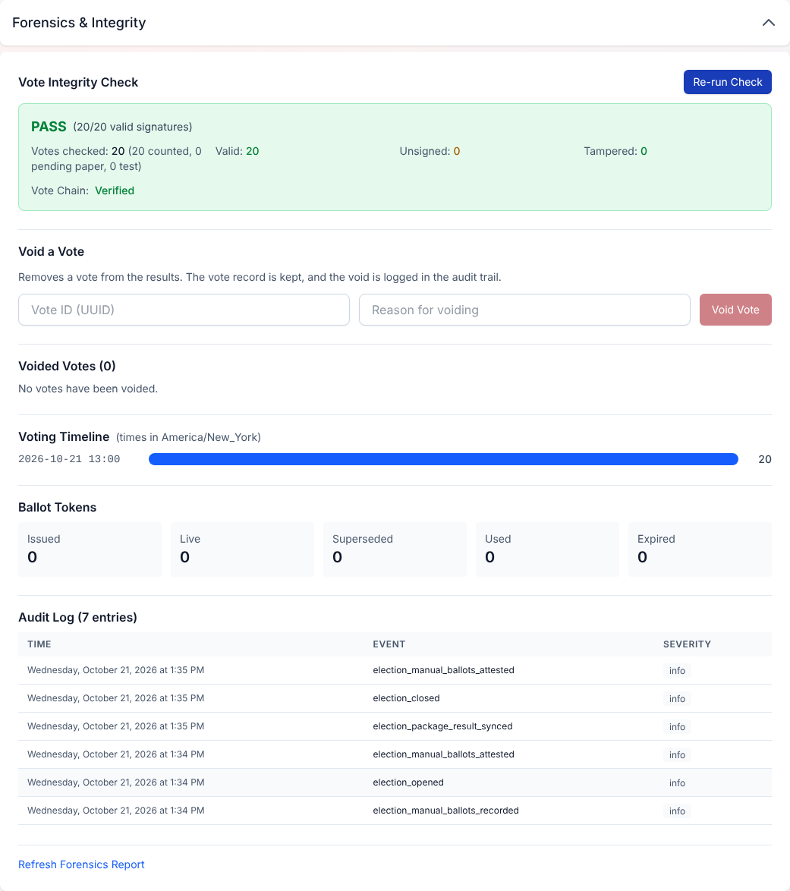

### What if …?

| What happened                       | What it means                                                                                                                                                                                                                                      |
| ----------------------------------- | -------------------------------------------------------------------------------------------------------------------------------------------------------------------------------------------------------------------------------------------------- |
| A vote's seal does not match        | Flagged in the report. The vote is not deleted                                                                                                                                                                                                     |
| An officer voids a vote             | A reason is required and the record is kept. The member may vote again. **Run Check** still reads PASS and lists _"N vote(s) voided by (officer): (reason)"_; the certified PDF prints the same line                                               |
| An election is reopened after close | Recorded in the rollback history, and leadership is notified. **Not allowed** for an anonymous election that already has votes — its anonymity key was destroyed at close, so reopening would let people vote twice. Create a new election instead |

---

## The Certified Results Package

**Who can do this:** roles that can manage elections.

Once an election is **closed**, select **Certified Results (PDF)**. It is a
formal document for the minutes book and for anyone who asks you to prove the
result. It includes:

- final totals for each race and item, with winners or flagged ties;
- turnout and quorum against the frozen voter list;
- the **paper-batch record** — every batch, its recorder, the officers who
  confirmed it, and its status;
- the **integrity check** result, run when the PDF is made;
- any corrections made after close;
- **signature lines** for officers to sign by hand.

File the signed copy with the meeting minutes. Together with the forensics
report, it is your full defence if the result is disputed.

---

## Election Settings

**Who can do this:** roles that can manage elections.

Open **Elections** and select the gear button. Election Settings has five
sections.

### Proxy Voting

| Setting                    | Default | What it does                                                |
| -------------------------- | ------- | ----------------------------------------------------------- |
| **Allow proxy voting**     | Off     | Lets the secretary authorize one member to vote for another |
| **Max Proxies Per Person** | 1       | How many members one person can vote for, from 1 to 10      |

### Features

Each department can turn the optional parts on or off. All are on unless you
turn them off, and turning one off blocks it, not just hides it.

| Setting                                                                                | Default | Controls                                                                  |
| -------------------------------------------------------------------------------------- | ------- | ------------------------------------------------------------------------- |
| **Nomination phase**                                                                   | On      | The nomination phase and member nominations                               |
| **Paper-ballot entry**                                                                 | On      | Officers entering paper totals                                            |
| **Officers who must confirm each paper batch before it counts (besides the recorder)** | 2       | 0 to 3. **None — counts immediately** skips confirmation                  |
| **Non-voter reminders**                                                                | On      | Manual **and** automatic reminders                                        |
| **Scheduled opening**                                                                  | On      | Elections opening themselves at their start time and emailing the ballots |

**Closing at the end date and closing nominations at the deadline cannot be
turned off.** Closing works out results and erases private voting data on
anonymous elections — a privacy promise, not a convenience.

### Defaults

Where the **Create Election** form starts. An officer can still change any of
these for one election, and elections already created are not affected.

| Setting                          | Default         | What it does                                                          |
| -------------------------------- | --------------- | --------------------------------------------------------------------- |
| **How is the winner determined** | Most Votes Wins | The winner rule a new election starts with, and its percentage        |
| **Anonymous voting**             | On              | Whether a new election starts anonymous                               |
| **Allow write-in candidates**    | Off             | Whether a new election starts allowing write-ins                      |
| **Quorum**                       | No quorum       | A percentage of eligible voters, or a number of voters, who must vote |

The create form has no quorum box of its own. When the department sets a
quorum, the form shows it as a line, **Quorum: 51% of eligible voters must
vote**, and the new election takes it.

### Test Ballot

Choose a draft election and select **Send Test Ballot** to preview voting. See
[Opening an Election](#opening-an-election).

### Security

Shows the integrity safeguards in force, such as vote seals and the one-vote
rule.

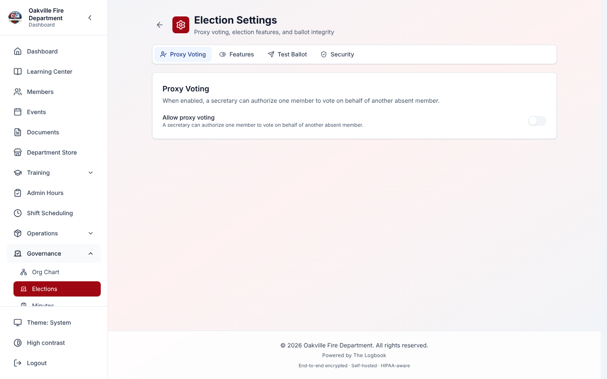

---

## Cloning an Election

**Who can do this:** roles that can manage elections.

Annual elections rarely change shape. **Clone Election** creates a new draft
with the same positions, voting method, quorum, voter rules and reminder
settings.

1. On any election, select **Clone Election**.
2. Set the **Title** and when **Voting opens** and **Voting closes**.
3. Optionally tick the box to copy the accepted candidates. This is useful for
   a re-run; leave it off for next year's election, where nominations start
   again.
4. The clone opens as a **Draft** on its **Ballot** tab. Check it, then run it
   like any election.

**Never copied:** votes, ballot links, attendance, voter overrides and the
anonymity key. A clone gets a new key, so it can never be matched against the
original's voters. A clone starts with results **hidden**.

---

## Meeting Attendance Integration

You can link an election to a meeting or event. When it is linked:

1. Check-ins at the meeting are recorded on the **Attendance** tab.
2. On ballot items with **Require meeting attendance to vote**, only members
   who are checked in may vote, unless they have an override. Other items are
   not affected.
3. **Import Attendees from Meeting** (or **from Event**) copies the check-ins
   from the linked meeting or event.

### How to Link an Election to a Meeting

1. When creating the election, choose it under **Linked Meeting**.
2. Or link one later from the election's page with **Link a meeting**.

> **Tip.** For an annual business meeting: create the meeting first, take
> attendance with the QR check-in, then open the election. Checked-in members
> can vote on items that require attendance. Check in latecomers **before**
> opening, because the voter list freezes at opening.

---

## Prospective Member Election Packages

When an applicant reaches the **Election Vote** stage of the prospective-member
pipeline, an **election package** is created automatically. It contains:

- the applicant's details (name, email, phone, address, documents);
- the coordinator's notes;
- a supporting statement, shown to voters;
- a summary of their stage history.

### Workflow

1. The applicant reaches the Election Vote stage, and the package is created.
2. The coordinator reviews it and marks it **Ready for Ballot**.
3. The secretary adds the applicant to an election as a ballot item.
4. Members vote to approve or deny.
5. The result goes back to the pipeline as elected or not elected.

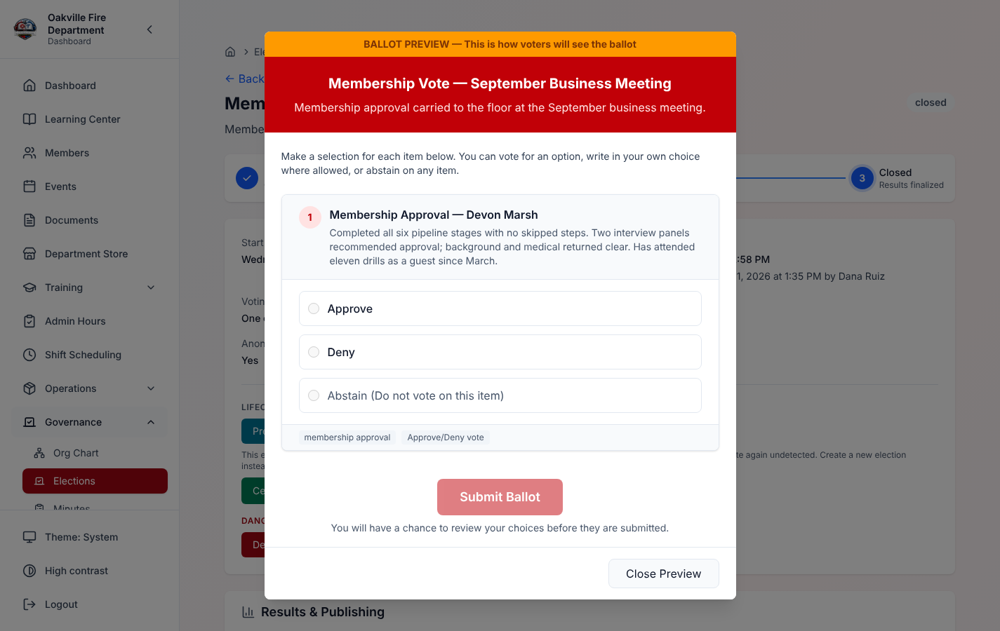

**Preview Ballot** shows the item as a voter will see it: Approve, Deny, and
**Abstain (Do not vote on this item)**, which every approval item has. The
choices in the preview do nothing; it is a picture of the ballot.

See [Membership Management > Prospective Members](./01-membership.md#prospective-members-pipeline)
for the full pipeline.

---

## Realistic Example: Annual Officer Election

### Background

**Oakville Fire Department** holds its annual officer election at the December
business meeting. Secretary **Sarah Kim** runs it.

### Part 1: Setup (December 1)

Sarah creates the election:

- **Title:** "2026 Annual Officer Election"
- **Linked Meeting:** the December 15 business meeting
- **Start and end:** December 15, meeting night (same-day vote)
- **Positions:** Fire Chief, Assistant Chief, Secretary
- **How is the Winner Determined?:** Majority Required (>50%)
- **Anonymous Voting:** on
- **Allow Write-in Candidates:** on
- **Enable Automatic Runoffs:** on, Top Two

She adds the candidates:

- **Fire Chief** — Lt. Morrison, Capt. Davis
- **Assistant Chief** — Lt. Hernandez, FF Brooks, FF Kim
- **Secretary** — FF Nguyen (unopposed)

Each race requires meeting attendance.

### Part 2: Meeting Night (December 15)

1. Members arrive and check in with the QR code. 38 of 42 members are present.
2. Sarah selects **Import Attendees from Meeting**, then **Open Election**,
   then **Send Ballot Emails**:
   - 38 ballots go to members who are present.
   - 4 are skipped, because they are not checked in and hold no proxy.
3. Members vote on their phones from the ballot link in their email.

### Part 3: Results

After 30 minutes, Sarah closes the election:

| Position        | Candidate          | Votes    | Result      |
| --------------- | ------------------ | -------- | ----------- |
| Fire Chief      | Lt. Morrison       | 22 (58%) | **Elected** |
| Fire Chief      | Capt. Davis        | 16 (42%) | Not elected |
| Assistant Chief | Lt. Hernandez      | 14 (37%) | → Runoff    |
| Assistant Chief | FF Brooks          | 13 (34%) | → Runoff    |
| Assistant Chief | FF Kim             | 11 (29%) | Eliminated  |
| Secretary       | FF Nguyen          | 36 (95%) | **Elected** |
| Secretary       | Write-in: FF Walsh | 2 (5%)   | Not elected |

- **Fire Chief:** Lt. Morrison wins with a majority (58%).
- **Assistant Chief:** nobody reached a majority, so a runoff between Lt.
  Hernandez and FF Brooks is created. Sarah opens it at once. After a second
  vote, Lt. Hernandez wins 21 to 17.
- **Secretary:** FF Nguyen wins with 95%.

The results report is emailed to Sarah, as the election's creator, and to the
department's leadership when the election closes. **Send Report** on the
Results & Publishing panel sends it again, to whoever presses it. She forwards it to the department herself.

---

## Troubleshooting

| Problem                                              | What to do                                                                                                                                                                                             |
| ---------------------------------------------------- | ------------------------------------------------------------------------------------------------------------------------------------------------------------------------------------------------------ |
| Elections is not in the menu                         | An administrator must turn it on under **Organization Settings → Modules → Additional Modules**. Look under **Governance**                                                                             |
| A member did not get a ballot email                  | Check the banner for skipped members. Check their email address. Select **Resend Ballot Emails**                                                                                                       |
| The ballot link goes to the wrong site               | Ask your administrator to check the web address The Logbook uses for links, then resend the ballots                                                                                                    |
| A voter's link has expired                           | Links expire at the election's end, or after 30 days. Resend the ballots                                                                                                                               |
| A voter is told they may not vote on an item         | Check the **Eligibility** tab. If they should vote, add an override and resend their ballot; the new link includes the change                                                                          |
| The election was closed by mistake                   | Select **Roll Back** and give a reason (leadership is told). An anonymous election that already has votes cannot be reopened — create a new one                                                        |
| A candidate wants to withdraw                        | Remove them if nobody has voted for them. Once there are votes, they cannot be removed or renamed                                                                                                      |
| A proxy holder cannot vote for the other member      | Check the authorization exists on **Proxy Voting** and the election is open. Then use **Voting for** on **Cast Vote**                                                                                  |
| Results do not show after closing                    | Reload the page. Another officer may have rolled the election back to open                                                                                                                             |
| The vote count does not match attendance             | Check for proxy votes and overrides (members not on the attendance list)                                                                                                                               |
| **Run Check** shows a problem                        | Open the full **Forensics & Integrity** section, and contact your system administrator                                                                                                                 |
| No runoff was created                                | Check **Enable Automatic Runoffs** was on and the winning rule was right                                                                                                                               |
| A paper batch does not change the results            | It is probably **Pending**. It needs the set number of other officers to select **Attest Count**                                                                                                       |
| **Attest Count** is missing or refused               | The recorder cannot confirm their own batch, each officer confirms once, and it works only while voting is open                                                                                        |
| A paper tally is refused as too high                 | Recount. If it is right (for example, overrides let in extra voters), tick **The tally is correct — override the eligible-voter count check**                                                          |
| There is no way to nominate                          | Check the **Nomination phase** feature is on, and that nominations are open                                                                                                                            |
| A nominated member is not on the ballot              | They must **accept** first. Check the **Candidates** tab for pending nominations                                                                                                                       |
| **Remind Non-Voters** is missing or refused          | It shows only after ballots are emailed, needs the **Non-voter reminders** feature, and works once an hour                                                                                             |
| The election did not open at its start time          | **Open Automatically at Start Time** must be ticked and **Scheduled opening** on. It can take up to 15 minutes. A draft with problems (for example, no accepted candidates) is skipped and tried again |
| A member became active during voting but cannot vote | The voter list froze at opening. Add an override                                                                                                                                                       |
| A tie shows with no winner                           | Expected for any tie rule except co-winners. Follow your bylaws                                                                                                                                        |
| Write-in spellings split the vote                    | Use **Merge Write-Ins** before certifying                                                                                                                                                              |
| You need a quorum                                    | No screen sets one. Track it yourself, for example with **Live Turnout**'s ballot count                                                                                                                |

---

## If You Learned an Older Version

If you are following older notes or an SOP, these things have moved or work
differently.

- **Elections is under Governance.** It is **Governance → Elections**, not
  under Events & Meetings.
- **There is no Election Type field** on the create form.
- **Election Settings has a Defaults section again** (2026-10-29). It sets
  where the create form starts; it was removed for a while because nothing
  read it.
- **There is no Publish Results or Hide Results switch.** Closing releases the
  results.
- **The details card reads One choice per voter** where it once read Simple
  Majority, and has a **Winner** row.
- **Nothing is pre-selected on a ballot.** Older emailed ballots chose Abstain
  for you; now every item needs an answer or an explicit Abstain.
- **Scheduled opening emails the ballots.** It once opened voting without
  sending them.
- **Closing nominations freezes the slate**, and officers can accept a
  nomination on a nominee's behalf.
- **Overrides pick a member from a list.** They once asked for a user ID.
- **Life members get Regular ballots, and administrative members do not.**
  When standing became a class plus a status, a life member started
  qualifying for Regular items, and an administrative member with regular
  status stopped qualifying for Regular, Life and Operational items.
- **Proxies on anonymous elections need the member's agreement.** A proxy
  authorized on an anonymous election before that rule is refused at the
  ballot. Revoke it and authorize it again with the box ticked.
- **The proxy limit is enforced.** **Max Proxies Per Person** was once shown
  but not checked.
- **Elections saved with an empty specific-voter list** before that list
  meant "everyone" may still refuse in-app votes until someone saves the
  election again.
- **On older anonymous elections**, the audit log may still name in-app voters
  beside their vote.

---

**Previous:** [Medical Screening](./13-medical-screening.md) | **Next:** [Prospective Members Pipeline](./15-prospective-members.md)
