# Prospective Members Pipeline

The Prospective Members module follows an applicant from first interest to
full membership. Along the way come interviews, documents, a membership vote
and conversion to a member. Your department builds a **pipeline** of stages
that matches its own onboarding process.

---

## Table of Contents

1. [Pipeline Overview](#pipeline-overview)
2. [Pipeline Configuration](#pipeline-configuration)
3. [Stage Types](#stage-types)
4. [Creating an Applicant](#creating-an-applicant)
5. [Moving Applicants Through Stages](#moving-applicants-through-stages)
6. [The Kanban Board](#the-kanban-board)
7. [Applicant Detail View](#applicant-detail-view)
8. [Document Management](#document-management)
9. [Interviews](#interviews)
10. [Election Vote Stage](#election-vote-stage)
11. [Sign-offs: Multi-Signer Approval](#sign-offs-multi-signer-approval)
12. [Converting to a Full Member](#converting-to-a-full-member)
13. [Inactivity Timeout](#inactivity-timeout)
14. [Bulk Actions](#bulk-actions)
15. [Pipeline Statistics & Reports](#pipeline-statistics--reports)
16. [Public Application Status Page](#public-application-status-page)
17. [Follow-up Forms](#follow-up-forms-2026-10-29)
18. [Emails to Applicants](#emails-to-applicants)
19. [Printing Labels](#printing-labels)
20. [Realistic Example: New Firefighter Application](#realistic-example-new-firefighter-application)
21. [Troubleshooting](#troubleshooting)
22. [If You Learned an Older Version](#if-you-learned-an-older-version)

---

## Pipeline Overview

Select **Prospective Members** in the menu. The main page shows every applicant
in the pipeline, grouped by their current stage.

| Page                                 | How to get there                                 | Who can open it                                     |
| ------------------------------------ | ------------------------------------------------ | --------------------------------------------------- |
| Pipeline dashboard (Kanban or Table) | **Prospective Members** in the menu              | Officers who can manage prospective members         |
| Pipeline settings and builder        | **Pipeline Settings** on the dashboard           | Officers who can manage prospective members         |
| Interview form                       | **Interview** in an applicant's drawer           | Officers who can manage prospective members         |
| Print labels                         | **Print Badges** in the selection bar            | Officers who can view or manage prospective members |
| Sign-offs                            | **Review** on your dashboard's **Needs you** row | Any signed-in member, while the module is on        |
| Public application status page       | The link emailed to the applicant                | The applicant — no sign-in needed                   |

Two permissions control the module. The Role Management screen lists them as:

| Permission                                  | What it allows                                                         |
| ------------------------------------------- | ---------------------------------------------------------------------- |
| **View prospective member pipeline**        | See the pipeline, applicants and documents                             |
| **Manage prospective members and pipeline** | Add and edit applicants, move them, convert them, and set up pipelines |

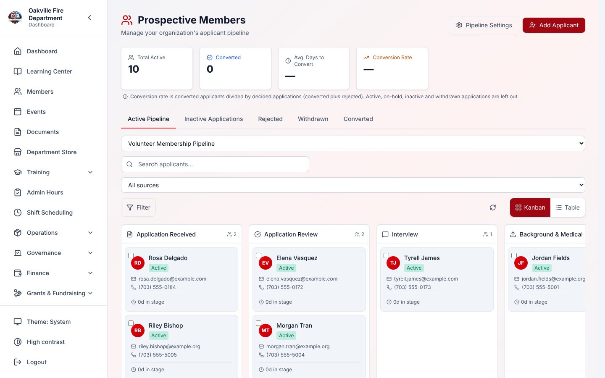

---

## Pipeline Configuration

**Required Permission:** Manage prospective members and pipeline

Select **Pipeline Settings** on the Prospective Members page.

### Creating a Pipeline

1. Select **Create Pipeline**, or edit the default pipeline.
2. Enter a **name** and **description**.
3. Add stages with **Add Stage**. Each stage has a type that decides what it
   does. Every type can be added here, **Manual Approval** and **Election /
   Vote** included. Choosing Election / Vote shows its voting settings below
   the type grid.
4. **Drag and drop** stages to reorder them. The column order on the board and
   the stage **Advance** moves an applicant to always match.
5. Set each stage's options (auto-advance, timeout and so on).
6. Save.

**Where applicants with no chosen pipeline go.** A guest signing in at an
event, or anything else that adds an applicant without naming a pipeline, lands
on your **default** pipeline. If none is marked default, they land on the
oldest active pipeline that is not a template. So a department with one
pipeline never has to mark it.

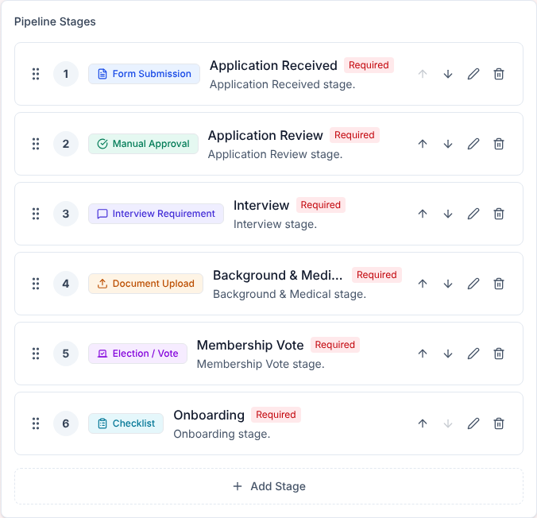

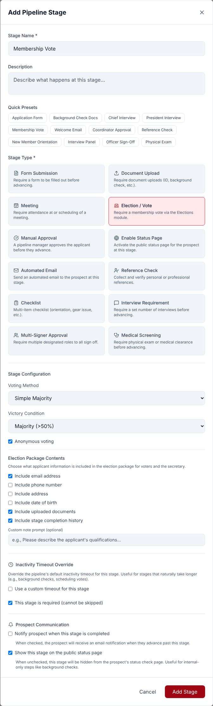

### Pipeline Settings

| Setting                                | What it does                                                                                                                                                                                                                                                                                                            |
| -------------------------------------- | ----------------------------------------------------------------------------------------------------------------------------------------------------------------------------------------------------------------------------------------------------------------------------------------------------------------------- |
| **Is Default**                         | New applicants with no chosen pipeline join this one                                                                                                                                                                                                                                                                    |
| **Automatic Transfer to Membership**   | Its own card. Tick "Make applicants members automatically when they complete the final stage" and finishing the final stage creates the member with nobody selecting **Convert**. Off by default. A recorded vote or sign-off on the final stage triggers it; a skip never does. Required stages must be complete first |
| **Inactivity Timeout**                 | When a quiet application is flagged and marked inactive. See [Inactivity Timeout](#inactivity-timeout)                                                                                                                                                                                                                  |
| **When an Applicant Becomes a Member** | The member class and starting status for operational and for administrative applicants. See [What Happens on Conversion](#what-happens-on-conversion)                                                                                                                                                                   |
| **Public Application Status Page**     | "Let applicants check their application status through a public link". See [Public Application Status Page](#public-application-status-page)                                                                                                                                                                            |
| **Show upcoming stages**               | Under the status-page switch. Untick it and applicants see only the visible stages they have completed — not the stage they are on, and not how many remain. On by default                                                                                                                                              |

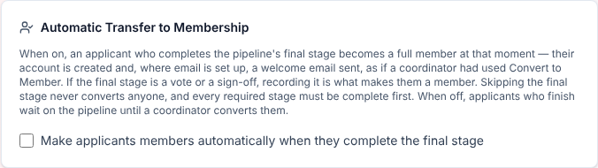

---

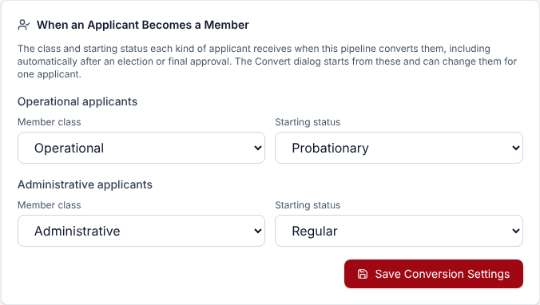

## Stage Types

Each stage has a type that decides how it behaves:

| Type                              | What happens                                                                                                                  | Moves on by itself?                                        |
| --------------------------------- | ----------------------------------------------------------------------------------------------------------------------------- | ---------------------------------------------------------- |
| **Form Submission**               | The applicant fills out a form from the Forms module                                                                          | Optional — when the form is submitted                      |
| **Document Upload**               | The applicant provides required documents                                                                                     | Optional — when every required document is on file         |
| **Manual Approval**               | A coordinator reviews and advances by hand                                                                                    | No                                                         |
| **Multi-Signer Approval**         | Named officers (the Chief, the President…) must each sign. See [Sign-offs](#sign-offs-multi-signer-approval)                  | Yes — when the last named officer signs                    |
| **Election Vote**                 | Members vote on the applicant. An election package is created the moment the applicant arrives, however they got there        | No — it depends on the vote. No package, no advance        |
| **Automated Email**               | The Logbook emails the applicant when they arrive                                                                             | Yes — once the email is sent, unless it is the final stage |
| **Meeting**                       | An interview, orientation or ride-along                                                                                       | Optional — when the event's attendance is finalized        |
| **Follow-up Form** _(2026-10-29)_ | The applicant is emailed a link to a form, filled in with what is on file. See [Follow-up Forms](#follow-up-forms-2026-10-29) | Yes — when they submit the form, unless you untick it      |

The builder offers thirteen types in all. The other five — Enable Status Page,
Reference Check, Checklist, Interview Requirement and Medical Screening — are
described in [Membership → Pipeline Stage Types](./01-membership.md#pipeline-stage-types).

> **What a form submission does to a Form Submission stage.** Submitting the
> stage's linked form completes the stage and advances the applicant. Untick
> **Auto-advance when form is submitted** to hold them there instead. The
> answers are still recorded against the stage for you to read, and you advance
> them by hand.
>
> A submission only ever affects the stage the applicant is **on right now**. A
> second submission of the same form — a duplicate application, or an applicant
> re-sending the interest form months later — records the new answers and moves
> nobody.

> **What counts as attendance on a Meeting stage.** A meeting stage that **names
> its event** — it has an **Auto-Link Event Type**, or was pinned to one
> specific event — is an attendance requirement. Two things must both be true
> before the applicant can leave it:
>
> 1. They are **checked in** at an event matching the stage's Auto-Link Event
>    Type (and category, if one is set), and
> 2. that event's **attendance has been finalized** — the organizer selected
>    **End Event**, recorded an **actual end time**, or selected **Finalize
>    Attendance**.
>
> A sign-in at the door is not the department's final word on who attended. A
> guest can be signed in and struck off ten minutes later. So an applicant who
> signs in tonight does not jump to the next stage during the meeting. They
> advance when the organizer closes the event out, together with everyone else
> who was there.
>
> **An event nobody finalizes still settles on its own.** Seven days after the
> event ends, the check-in counts as settled. A nightly job then advances anyone
> it clears. Your administrator can change the seven days. So the longest an
> applicant waits on an organizer who never closed the event out is about a
> week.
>
> **Attendance from before the application was opened does not count.** When
> the sign-in at a business meeting is what _creates_ the applicant, that
> meeting counts for them. But a later "attend a business meeting" stage needs
> a **second** meeting.
>
> **This applies to your own Advance button too.** On a stage that names its
> event, **Advance**, a drag across the board, **Advance Selected** and every
> automatic advance are all refused until the attendance is there. The
> applicant drawer says so before you select anything:
>
> _"The applicant must be checked in at this stage's event, and that event's
> attendance must be finalized, before they can advance. A check-in recorded
> before their application was opened does not count."_
>
> If you are refused, the message names the ways out. Try them in this order:
>
> 1. **Record the attendance that happened.** Add the applicant to that event's
>    attendees and check them in. You can do this after the fact from the event
>    itself. If the event is already finalized, an officer who can reopen
>    attendance must reopen it first. Finalizing it again then advances them,
>    and skips anyone already moved.
> 2. **Untick Required on the stage and Skip it**, if the department has decided
>    this applicant does not need it.
> 3. **Clear the stage's Auto-Link Event Type**, if the stage never should have
>    named an event.
>
> If the applicant is checked in but the event is not finalized yet, the refusal
> says that instead and names the event. The applicant did everything asked of
> them; the fix is for the organizer to close the event out.
>
> **A stage that names no event takes your word for it.** "Meet with the Chief"
> is an arrangement nothing records. A stage with Auto-Link Event Type set to
> _None_ is never checked: **Advance** moves the applicant on every path, bulk
> included. The trade-off is that such a stage **cannot auto-advance** — it has
> no event to watch. The stage builder will not save an auto-advancing meeting
> stage until you pick a type. **Meeting Type** does not stand in for it; that
> field only describes the stage's purpose. Stages that self-schedule through
> **Cal.com** are the exception. They advance when Cal.com reports the meeting
> ended, so they need no linked event.

### Stage Configuration Options

Each stage can be set up with:

| Setting                                                                    | What it does                                                                                                                                                                                                                                                                                                  |
| -------------------------------------------------------------------------- | ------------------------------------------------------------------------------------------------------------------------------------------------------------------------------------------------------------------------------------------------------------------------------------------------------------- |
| **Auto-Advance**                                                           | Move to the next stage automatically when this stage's condition is met                                                                                                                                                                                                                                       |
| **Required**                                                               | The stage must be completed — it cannot be skipped                                                                                                                                                                                                                                                            |
| **Inactivity Timeout Override**                                            | A custom timeout for this stage, instead of the pipeline's                                                                                                                                                                                                                                                    |
| **Email Settings** (automated email stage)                                 | Subject, sections, welcome text, FAQ link, next meeting info, status tracker link                                                                                                                                                                                                                             |
| **Email Template** (automated email stage)                                 | A switched-on custom template to send instead of the section-built email; its subject and body are used, with first name, last name, prospect name, stage name and status link filled in. System templates cannot be chosen. A template that is later switched off or deleted falls back to the section email |
| **Notify prospect when this stage is completed**                           | Under **Prospect Communication**. Emails the applicant the **Application Step Completed** template when they advance past the stage. Off by default. See [Emails to Applicants](#emails-to-applicants)                                                                                                        |
| **Form** (form stages)                                                     | Which form to link                                                                                                                                                                                                                                                                                            |
| **Form** (Follow-up Form stage) _(2026-10-29)_                             | Which form to email the applicant. Only published forms are listed. The form does not need to be public                                                                                                                                                                                                       |
| **Message in the link email (optional)** (Follow-up Form stage)            | A line of your own, added to the email that carries the link                                                                                                                                                                                                                                                  |
| **Advance the applicant when they submit the form** (Follow-up Form stage) | Ticked on a new stage. Untick it to keep the stage open after the form comes back, for a coordinator to complete                                                                                                                                                                                              |
| **Event Type** (meeting stage)                                             | Interview, orientation, or ride-along                                                                                                                                                                                                                                                                         |
| **Auto-Link Event Type** (meeting stage)                                   | Which event type the stage waits on. Naming one makes attendance required                                                                                                                                                                                                                                     |
| **Scheduling** (meeting stage)                                             | _Manual_ or _Cal.com self-scheduling_ — shown only when Cal.com is connected                                                                                                                                                                                                                                  |
| **Collection Method** (document stage)                                     | _Upload_ or _Documenso e-signature_ — shown only when Documenso is connected                                                                                                                                                                                                                                  |

**Required stages cannot be skipped.** **Skip** is refused on a stage marked
Required, and the button is disabled with an explanation. To bypass one, untick
**Required** on the stage first. That is a deliberate change to the pipeline
that everyone can see, not a quiet exception for one applicant. Stages are
Required by default.

**The email's Next Meeting stays current.** On an Automated Email stage, **Next
Meeting Details** with **Pull from upcoming event** saves the event that is next
when you set the stage up. The email uses that event while it is still
upcoming. Once it has passed or been cancelled, the email names the next event
of the same type instead. The preview under the dropdown shows the event the
email will use. When the saved one has passed, it says so: "The saved event has
passed or was cancelled. The email will include the next one instead". Drafts
are never named. If no event of the type is coming up, the email goes out with
only your **Additional details**, and the applicant's activity log records that
the meeting was missing.

### Using Cal.com and Documenso in Stages

If your department has connected the **Cal.com** or **Documenso**
integrations, two stage types gain extra options. See
[Integrations → Cal.com](./16-integrations.md#calcom--interview-scheduling) and
[Integrations → Documenso](./16-integrations.md#documenso--document-e-signatures).
When an integration is **not** connected, the stage editor shows a "Connect
Cal.com" or "Connect Documenso" link instead.

**Meeting stage → Cal.com self-scheduling**

1. Edit a **Meeting** stage and set **Scheduling** to _Cal.com_.
2. Paste your Cal.com booking link (for example,
   `https://cal.com/your-department/interview`).
3. Applicants on this stage see a **Schedule** button on their status page and
   pick their own time.
4. The applicant advances by themselves once the booked meeting has finished —
   but only if your IT administrator has set up Cal.com to tell The Logbook
   when a meeting ends. Otherwise the coordinator advances them by hand after
   the interview.

> **The booking is not the meeting.** Picking a time slot does not move anyone.
> Only the end of the meeting itself can.

**Document Upload stage → Documenso e-signature**

1. Edit a **Document Upload** stage and set **Collection Method** to _Documenso
   e-signature_.
2. Optionally enter a Documenso **Template ID**. It is stored for automatic
   sending in a later release.
3. Applicants on this stage see a "Documents sent for signature" note on their
   status page.
4. If your IT administrator has set up Documenso to report back, a completed
   signature advances the applicant. Otherwise the coordinator advances them by
   hand once it is signed.

> **Note:** Both match the applicant by **email**. The applicant must book or
> sign with the same email they applied with. Only the applicant's _current_
> stage is advanced, and only if that stage uses the integration.

---

## Creating an Applicant

**Required Permission:** Manage prospective members and pipeline

1. Choose the pipeline in the dashboard's pipeline picker. The applicant joins
   the pipeline the page is showing.
2. Select **Add Applicant** at the top of the page. Until the department has a
   pipeline, it is disabled and reads "Set up a pipeline first".
3. Fill in the details:
   - **First Name** and **Last Name** (required)
   - **Email** (required — used for notifications and ballots)
   - **Phone** (optional)
   - **Membership Type** — **Regular Member** or **Administrative**
   - **Target Role** (optional) — the position the applicant is joining for,
     "Applied to the member record when this applicant is converted." Leave it
     on **No specific role** if there is none.
4. Select **Add to Pipeline**.

**Choosing a Target Role is granting it.** The role is copied onto the new
member at conversion. So you can only choose a role whose permissions you hold
yourself. Otherwise it is refused with "This applicant's target position grants
permissions beyond your own." The same check runs again at conversion.

### Duplicate Detection

The Logbook checks for existing members or applicants with the same email
address:

- An **active member** has that email → a warning with the member's details
- An **archived member** has it → a suggestion to reactivate them instead
- Another **applicant** has it → a warning with the applicant's details

<!-- Screenshot needed: The Add Applicant dialog warning that the email belongs to an active applicant, naming their pipeline and stage -->

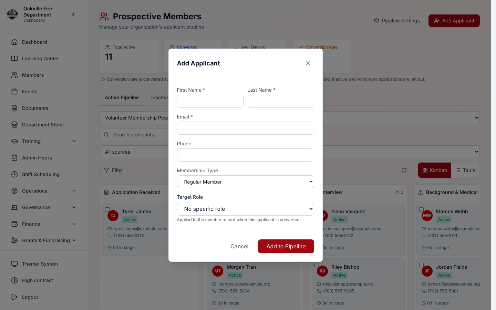

### Edge Cases

| Situation                                          | What happens                                                                                                                                                                                      |
| -------------------------------------------------- | ------------------------------------------------------------------------------------------------------------------------------------------------------------------------------------------------- |
| The email belongs to an active member              | Refused. Use a different email, or reactivate the existing member                                                                                                                                 |
| The email belongs to an archived member            | A warning, with the option to reactivate                                                                                                                                                          |
| The email belongs to an active applicant           | A warning naming the applicant, their pipeline and stage, with the choice to go back or open them. Nothing is created and no email is sent. (It used to say "Applicant added" and create nothing) |
| No email                                           | Required — you cannot add an applicant without one                                                                                                                                                |
| **The referring member is not in your department** | Refused with a clear message. It is deliberately vague: it will not say whether the person exists in another department, because that would let someone probe another department's roster         |
| An invalid pipeline is selected                    | Refused with a clear message                                                                                                                                                                      |

> **Why "Referred by" is checked at all.** The referring member is copied onto
> the new member's own record when the applicant is elected and converted. An
> unchecked value would not just sit on the application; it would land in the
> member directory. If an older application's referrer turns out not to be one
> of your members, conversion drops the referral rather than blocking the
> election.

---

## Moving Applicants Through Stages

### Advancing to Next Stage

1. Open the applicant's drawer.
2. Select **Advance**. The applicant moves to the next stage.
3. What happens next depends on the new stage's type:
   - **Automated Email:** the email goes out, the stage completes itself and the
     applicant moves on again. If the email fails, they stay on the stage.
   - **Form Submission:** the form link goes to the applicant (if auto-advance
     is on).
   - **Election Vote:** an election package is created — however the applicant
     arrived: Advance, a drag, a bulk advance, Skip, Back, placing, or
     auto-advance.
   - **Meeting (Cal.com):** the applicant books their own time; the meeting
     ending can advance them.
   - **Document Upload (Documenso):** the applicant signs electronically; a
     completed signature can advance them.
   - Other types: the applicant waits for someone to act.

**A checklist stage** lists its items in the applicant's drawer as checkboxes
under **Checklist**, with a line such as _"1 of 2 items done — tick every item
to advance"_. Tick each item as it is done, then select **Advance**. The ticks
are saved with the advance, for that applicant and stage, so refreshing the
page does not lose them. Dragging the card on the board does not send the
ticks, so advance a checklist stage from the drawer. **Skip** works as usual.

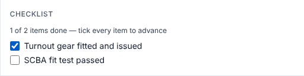

### Moving Back (Regression)

1. Select **Back** in the applicant's drawer.
2. The applicant returns to the previous stage.
3. Progress on the stage they left is reset.
4. You can add notes explaining why.

The drawer shows only the stages the applicant has reached. A stage ahead of
them never appears as in progress.

### Completing a Step

Stages with their own completion condition — a form submitted, documents on
file, a checklist ticked, a vote recorded, the last signature — complete when
that condition is met. If the stage auto-advances, the applicant then moves to
the next stage by themselves. Otherwise select **Advance**.

### Placing an applicant who is on no stage

An applicant can end up on no stage at all. Deleting a stage moves everyone on
it to the next stage, or to the previous one if you deleted the last. But if
you delete a pipeline's _only remaining_ stage, there is nowhere to move them.

The board shows these applicants in an **Unassigned** column rather than hiding
them. The column holds only this pipeline's applicants with no stage. Open one
and you see **Not on a stage**, with a list of the stages in their pipeline.
Choose the stage they should be working on and select **Place**. The stage is
marked in progress, and the placement appears in their activity log.

This is for recovery only:

- It is refused for an applicant who is already on a stage. Use **Advance**,
  **Back** or **Skip** for them. So it cannot move someone past a stage's
  requirements.
- Placing an applicant mid-pipeline does not mark the earlier stages complete,
  because nobody completed them. Their progress count reads low until those
  stages are worked or skipped.

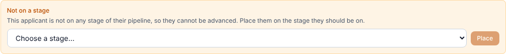

### Holding, Rejecting, or Withdrawing

| Action         | What it does                                                                                                                                                            |
| -------------- | ----------------------------------------------------------------------------------------------------------------------------------------------------------------------- |
| **Hold**       | Pauses the applicant. They stay on their stage, marked **On Hold**                                                                                                      |
| **Resume**     | Returns a held applicant to **Active**                                                                                                                                  |
| **Reject**     | Takes the applicant out of the pipeline, onto the **Rejected** tab                                                                                                      |
| **Withdraw**   | Moves the applicant to the **Withdrawn** tab. A coordinator can do it, and so can the applicant — see [Public Application Status Page](#public-application-status-page) |
| **Reactivate** | Returns a withdrawn, rejected or inactive applicant to **Active**                                                                                                       |

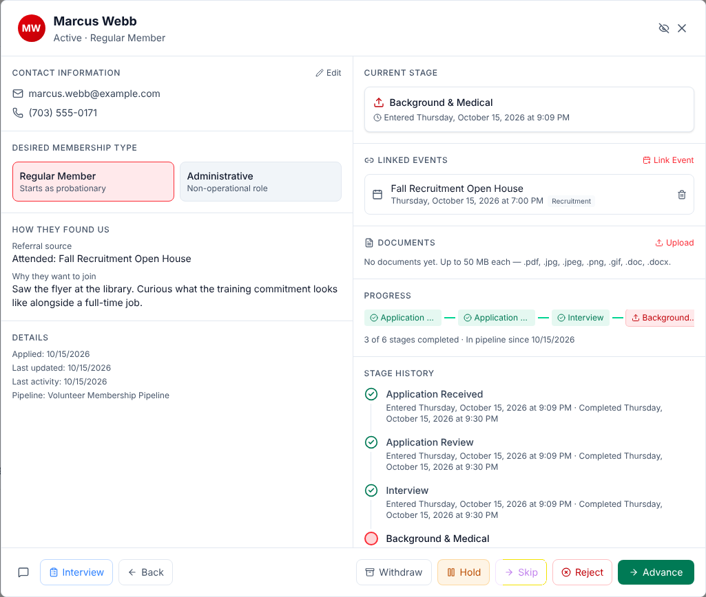

---

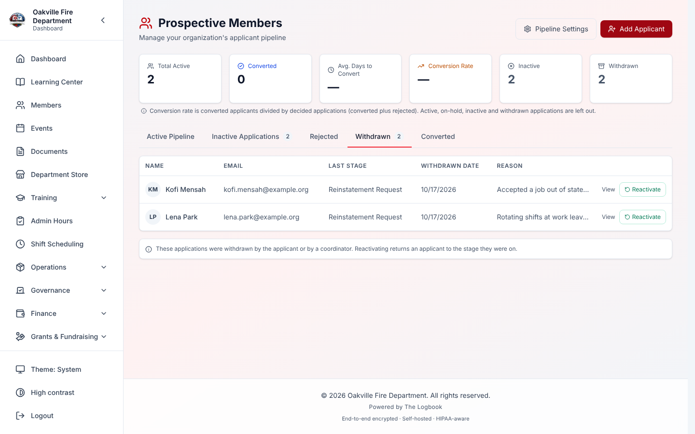

## The Kanban Board

The page opens on the **Active Pipeline** tab, with applicants shown as **cards
on a kanban board**: one column per stage. The other tabs are **Inactive
Applications**, **Rejected**, **Withdrawn** and **Converted**.

- **Drag and drop** cards between columns to advance an applicant or move them
  back.
- Cards show the applicant's name, email, time on their current stage, and a
  status badge (**Active**, **On Hold**).
- Switch to **Table** for a sortable list, one page at a time.
- **Filter** by status: **Active** or **On Hold**.
- **Search accepts a full name.** Every word you type must match the first
  name or last name, or be the applicant's complete email address. So "John
  Smith" and "smith john" find the same person. Part of an address no longer
  matches, because addresses are stored encrypted _(2026-10-26)_.

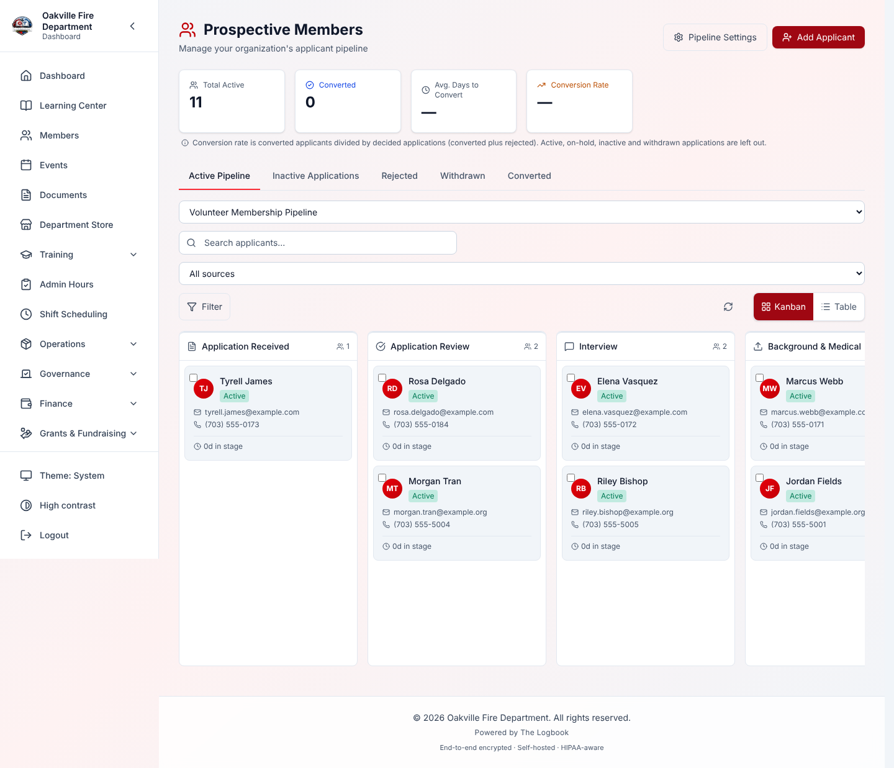

### How many applicants the board shows

The board loads the whole pipeline, up to **200** applicants. Switching
between **Kanban** and **Table** reloads, so neither view starts on the
other's page.

**Past 200 applicants, the board tells you.** It states how many it is not
showing instead of quietly dropping them.

> **Past that limit, the column counts only count what loaded.** The notice
> gives you the real total for the pipeline, but each column header counts only
> the cards on screen. So a stage can show fewer than it holds. Work from the
> table view at that size: its filters and paging see everyone.

> **If your pipeline has more than 200 active applicants**, use the table view
> with its filters and search for day-to-day work. The board is a visual
> overview, and at that size it tells you so.

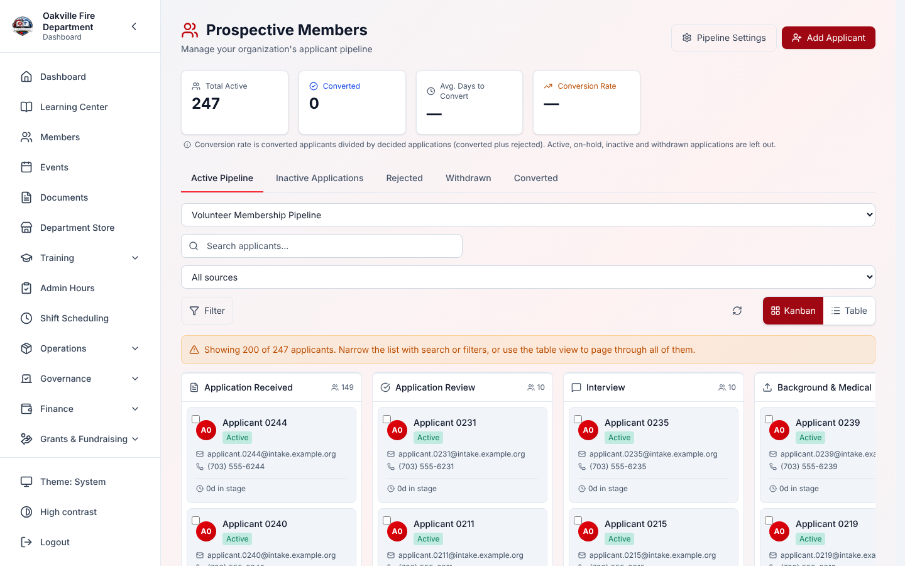

### What a card carries

A card carries the same information as a table row, and nothing more. The one
addition is the **Contact details changed** flag, which a follow-up form can
raise (see [Follow-up Forms](#follow-up-forms-2026-10-29)) _(2026-10-29)_.
In particular it never carries the applicant's private status-page link, their
date of birth, home address or coordinator notes. Officers with view-only
access to the pipeline see only what is on the card.

---

## Applicant Detail View

Select an applicant card to open the **detail drawer**. It is one scrolling
column of sections, not a set of tabs. Sections that do not apply to this
applicant are left out:

- **Contact Information:** email, phone, date of birth and address, editable in
  place. The editor also carries the application's **Target Role**. Clearing a
  field and saving clears it. An address with only some parts filled in — a city
  and state with no street — is still shown.
- **Desired Membership Type:** regular or administrative.
- **How They Found Us:** the referral source (a guest sign-in records
  "Attended: _event name_"), the member who referred them, and why they want to
  join. Each line appears only when it is on file. A referrer from another
  department is never named.
- **Application Data:** what they submitted, when there is a linked
  application.
- **Current Stage:** the stage and when they entered it.
- **Linked Events:** orientations, ride-alongs and open houses, with **Link
  Event**.
- **Progress:** the stage rail, "_n_ of _m_ stages completed", and time in the
  pipeline.
- **Checklist Progress**, **Approval Status**, **Reference Checks**, **Medical
  Screenings**, **Interview Requirement:** shown when the current stage needs
  that.
- **Documents:** see [Document Management](#document-management).
- **Follow-up Forms** _(2026-10-29)_: the forms Follow-up Form stages have
  sent, with **Send now** or **Resend**. Shown once the applicant has reached
  such a stage. See [Follow-up Forms](#follow-up-forms-2026-10-29).
- **Election Package:** at the election-vote stage only.
- **Stage History:** every stage entered, with its date.
- **Notes** and **Activity Log:** the log is collapsed until you open it. The
  conversion entry includes any notes typed into the Convert dialog. A skipped
  stage is recorded as skipped, not completed.

The action bar stays at the bottom. Left to right: **Interview**, **Back**,
**Withdraw**, **Hold**, **Skip**, **Reject** and **Advance**. On the final stage
**Skip** is not offered and the last button reads **Convert**. The final stage
is the one marked final in the pipeline, wherever it sits. A pipeline with no
stage marked final treats its last stage as final.

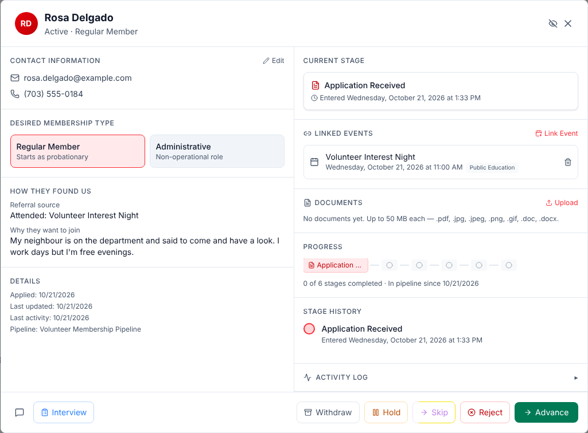

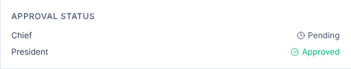

---

## Document Management

Coordinators can add documents for an applicant at any stage — background check
forms, driver's license copies, certifications.

### Uploading a Document

1. Open the applicant's drawer.
2. Go to the **Documents** section.
3. Select **Upload** and choose the file (up to 50 MB).

The document is attached to the stage the applicant is on.

**On a Document Upload stage**, the section lists the documents the stage
needs, with one upload button for each — for example "Background Check" or
"Photo ID". Use those buttons: the stage advances only when a document of each
named type is on file, and the button files it under exactly that name. A
filed type shows a tick, and its button replaces the document.

To remove a document, select its delete button and confirm with **Remove
document**.

### Downloading Documents

Coordinators can download any uploaded document from the **Documents**
section. Files are stored securely.

### Edge Cases

| Situation                    | What happens                                |
| ---------------------------- | ------------------------------------------- |
| The file is over 50 MB       | Refused with a size-limit message           |
| Two files with the same name | Both are kept; each shows its original name |

---

## Interviews

**Required Permission:** Manage prospective members and pipeline

Select **Interview** in the applicant's drawer to open their interview page.

### Recording an Interview

1. Select **New Interview** to open the form.
2. Fill it in:
   - **Your Role / Title** — how you sat on the panel (Membership Coordinator,
     Chief, President). Your name is recorded automatically; this is the role
     you served in.
   - **Interview Notes & Comments** — what you observed, the questions asked,
     and the applicant's answers.
   - **Recommendation** — Recommend, Recommend with Reservations, Do Not
     Recommend, or Undecided. Choosing one shows a **Recommendation Details**
     box for your reasons.
3. Select **Submit Interview**.

The interview is stamped with the time you submit it, so there is no date field.

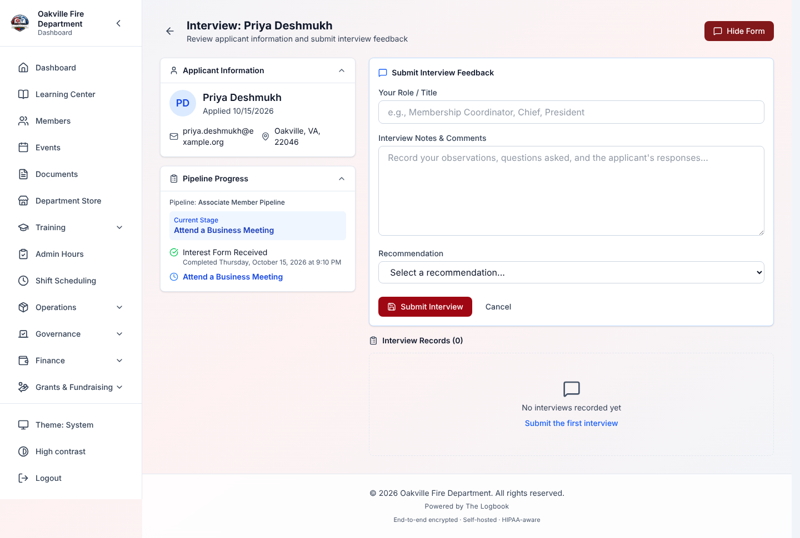

### Edge Cases

| Situation                         | What happens                                                                                                                                         |
| --------------------------------- | ---------------------------------------------------------------------------------------------------------------------------------------------------- |
| Editing an interview              | Only the person who filed it can edit it                                                                                                             |
| Several interviews                | Supported. Each interviewer files their own                                                                                                          |
| The interviewer's account is gone | The interview stays on the applicant's record under the interviewer's name. Only a permanently deleted account makes it read **Unknown Interviewer** |

---

## Election Vote Stage

An applicant reaches an **Election Vote** stage in many ways: **Advance**, a
drag on the board, a bulk advance, **Skip**, **Back**, being placed on it, a
deleted stage moving them onto it, auto-advance, or a pipeline that starts with
its vote. Every one of them creates one **election package** for the applicant,
containing:

- **Applicant snapshot** — name, email, phone, address and date of birth,
  frozen when the package is made
- **Documents** — every document uploaded at earlier stages
- **Stage history** — a summary of the completed stages
- **Supporting statement** — written by the coordinator, shown to voters
- **Coordinator notes** — internal notes, not shown to voters

Coming back onto the vote stage reuses the package that exists. It never adds a
second one.

**No package, no advance.** An applicant on a vote stage with no election
package cannot be advanced or converted past it: "This applicant has no
election package for this vote. Create one from the applicant's Election Package
section, then advance once the vote is recorded." This happens only if the
package was deleted, or the applicant reached the stage in an older version.
The drawer's Election Package section says so — "This applicant has no election
package, so they cannot be put on a ballot or advanced past this stage yet." —
and offers **Create Package**. A pipeline with no vote stage is not affected.

**Making the package again replaces it.** Selecting **Create Package** for an
applicant whose package is still **Draft** or **Ready** builds a fresh snapshot
and removes the old one. The applicant never has more than one package being
prepared. Your coordinator notes and supporting statement carry over. A package
already **Added to Ballot**, **Elected** or **Not Elected** is the record of
that vote and is kept.

**Pipelines with more than one vote stage.** A package's privacy settings come
from its vote stage. So if the pipeline has two or more vote stages and the
applicant is on neither, **Create Package** is refused: "This pipeline has more
than one election vote stage and the applicant is not on any of them. Choose
which election vote stage this package is for." Create the package while the
applicant is on the vote stage.

### Package Workflow

| Status              | Meaning                                          |
| ------------------- | ------------------------------------------------ |
| **Draft**           | Package created; the coordinator is reviewing it |
| **Ready**           | The coordinator marked it ready for a ballot     |
| **Added to Ballot** | The secretary added it to an election            |
| **Elected**         | The membership vote passed                       |
| **Not Elected**     | The membership vote failed                       |

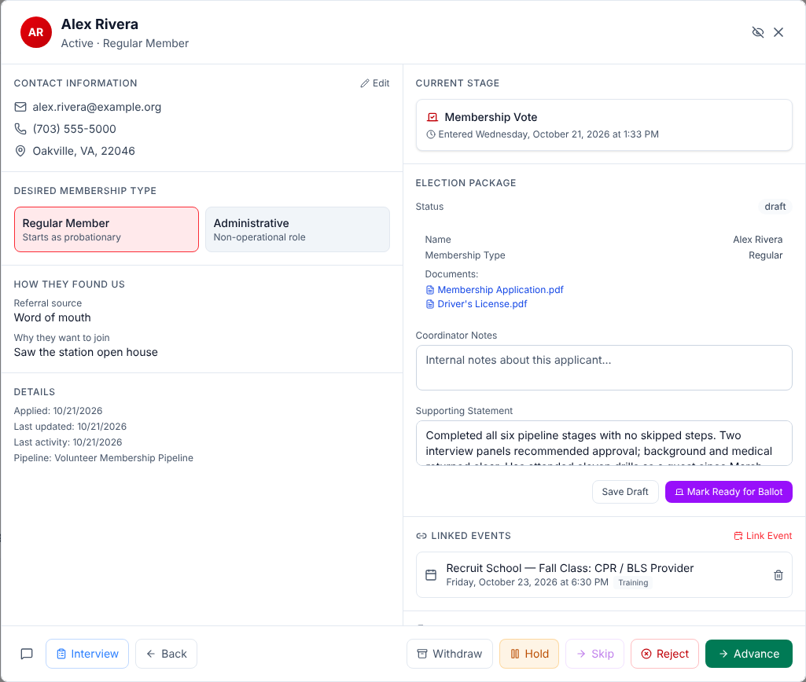

> **The ballot holds the stage.** Once a package reaches **Added to Ballot**,
> both **Advance** and **Convert** are refused until the election closes and the
> result is recorded. A package that comes back **Not Elected** is refused
> outright: reject or withdraw the application, or hold a new vote. This is what
> stops an applicant the department voted down from becoming a member. It
> applies whether the conversion is automatic or a coordinator selects
> **Convert** by hand.
>
> A department that votes at a meeting and records the result by hand is not
> affected as long as the package exists. A package still **Draft** or **Ready**
> advances normally. Nothing about the _result_ is checked until a package is
> actually put on a ballot. (A stage with **no** package is refused — see
> above.)

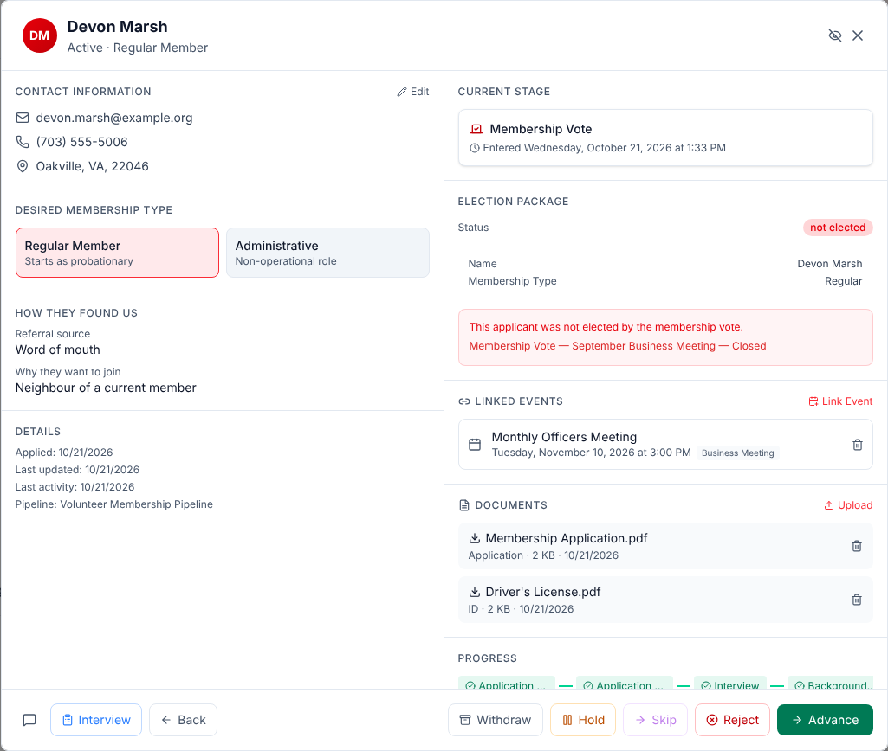

See [Elections & Voting > Prospective Member Election Packages](./14-elections.md#prospective-member-election-packages)
for the voting workflow.

---

## Sign-offs: Multi-Signer Approval

A **Multi-Signer Approval** stage names the officers who must each approve an
applicant — "Require Chief and President to both approve". Those officers
rarely hold any prospective-members permission, so they sign from a page of
their own.

1. When an applicant reaches such a stage, each officer holding one of the named
   roles sees a **Needs you** row on their dashboard — "Alex Rivera is waiting on
   your sign-off", or "3 applicants are waiting on your sign-off" — with
   **Review**.
2. **Review** opens **Sign-offs**: "Applicants waiting on your approval before
   they can become members." Each card shows the applicant's name, the stage and
   pipeline, the stage's description, and a pill for each required role reading
   **signed** or **waiting**.
3. Select **Sign as Chief** (or whichever role you hold). The dialog says "Your
   name and role are recorded with the approval." Add an optional **Note** and
   select **Sign**. **Not now** backs out.
4. When the last named role signs, the stage completes and the applicant
   advances.

The page needs no pipeline permission — only the module switched on. It shows a
signer the applicant's **name and stage only**, never their record: holding the
Chief's position is not a reason to read an applicant's address or the
coordinator's notes. It lists only stages that ask for a role you hold. With
nothing waiting, it reads **Nothing is waiting on you**.

In the applicant's drawer, **Approval Status** lists the stage's named signers
and who has signed. A stage that needs several approvers names each by office
(for example **Chief**, **EMS Supply Officer**), not by the raw role key.

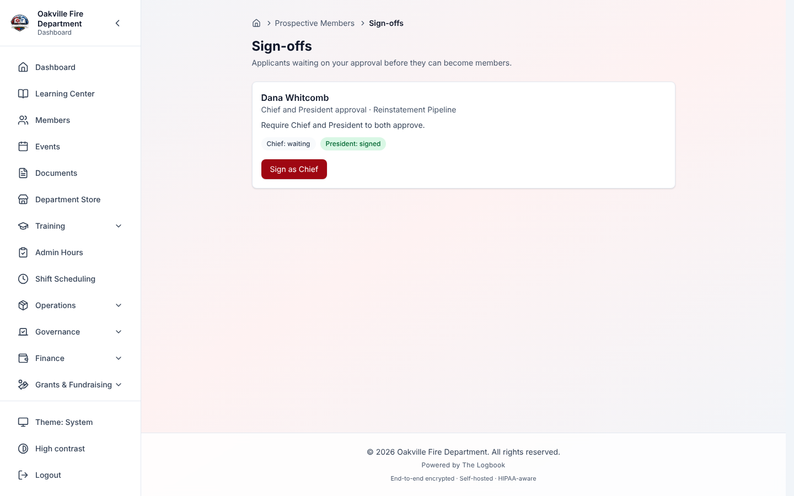

---

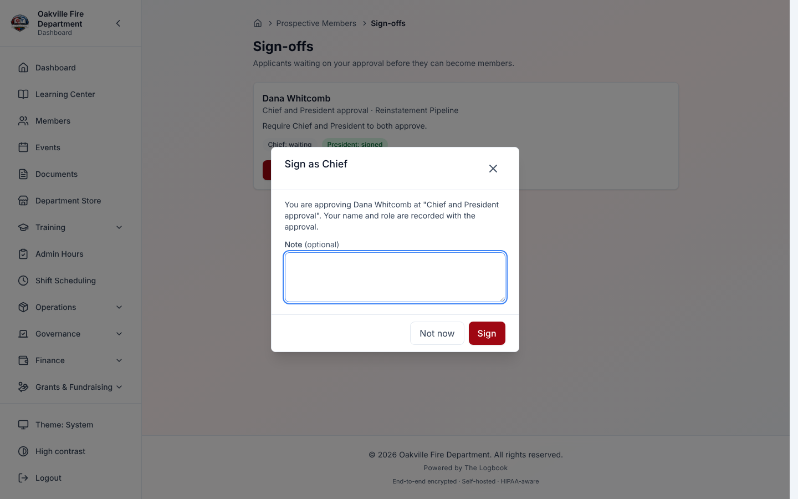

## Converting to a Full Member

When an applicant has completed the pipeline, convert them to a member.

> **If your pipeline ends in a membership vote, check the election package
> first.** Convert is refused while the package reads **Added to Ballot**, and
> refused outright when it reads **Not Elected**. See
> [The ballot holds the stage](#election-vote-stage). A package still **Draft**
> or **Ready** converts normally.
>
> **Every Required stage must be complete.** Convert — and automatic conversion
> after a final stage — is refused while any stage marked **Required** is not
> completed, and the refusal names it. A **skipped** stage does not count as
> complete. Optional stages never hold up conversion. Convert also checks the
> stage the applicant is on as if completing it. So an unsigned Multi-Signer
> Approval stage answers "Approval still needed from: …", naming who has not
> signed. See [Sign-offs](#sign-offs-multi-signer-approval). If a stage is
> marked Required but your department does not really require it, clear its
> **Required** setting in Pipeline Settings.

1. Select **Convert** in the applicant's drawer.
2. **Step 1 — Review Applicant** sums up what is on file (name, email, phone,
   target membership type and role) so you can check it before an account is
   created. Select **Continue**.
3. **Step 2 — Set Up Account** collects the details of the new member record:
   - **Member class** (Operational, Administrative or Social) and **Starting
     status** (Probationary or Regular). Both are filled in from the pipeline's
     **When an Applicant Becomes a Member** setting for the applicant's desired
     type: "Pre-filled from this pipeline's conversion settings. Changing it here
     affects this applicant only." **Convert to Member** stays disabled until
     both are set. Choosing Administrative clears and disables **Rank**.
   - **Rank** — starting rank, typed in (for example, Firefighter).
   - **Station** — assigned station, typed in.
   - **Target Role** — filled in from the application and changeable here:
     "Granted to the new member in addition to the default member position." You
     can only grant a role whose permissions you hold yourself.
   - **Middle Name** — optional. The first and last name come from the
     application.
   - **Hire Date** — today by default, in the department's time zone.
   - **Emergency Contact** — optional name, relationship and phone.
   - **How will they get their password?** — one of:
     - **Email them a temporary password** (the default). When email cannot
       send, it is greyed out with "Unavailable: email isn't set up for this
       department."
     - **Set an initial password now** — type it twice (at least 12 characters)
       and give it to them yourself. They must change it when they first sign
       in.
     - **Set it later** — "They can't sign in until you set one with Reset
       Password in Member Management."
   - **Notes (optional)** — up to 2,000 characters, recorded on the applicant's
     activity log with the conversion.
4. Select **Convert to Member** to confirm. This creates the member account and
   marks the applicant converted. It cannot be undone.
5. The result screen shows the new **Membership #** and what is left to do:
   - the welcome email went out, or
   - hand over the password you set, or
   - when you chose **Set it later**, or the email failed: the member "has no
     password they know yet. Set one with Reset Password in Member Management
     before they can sign in."

**One applicant, one account.** Two coordinators converting the same applicant
at the same moment — or one person double-clicking — create exactly one member.
The second attempt waits for the first and is then refused with _Prospect has
already been transferred_.

### What Happens on Conversion

- A new member record is created from the applicant's details.
- The member's **class** and **starting status** come from the pipeline's **When
  an Applicant Becomes a Member** setting, chosen separately for operational and
  for administrative applicants. For example, a department can make
  administrative applicants **regular administrative** members while
  operational applicants start as **probationary operational** members.
  Automatic conversion after a vote or final approval uses the same setting.
- A pipeline that has not changed the setting uses: operational applicants →
  probationary operational; administrative applicants → regular administrative.
- The member gets the default **Member** position, plus the application's
  **Target Role** if one was set.
- A membership number is assigned if the department numbers members
  automatically. It is never a number held, or once held, by another member.
- The password is delivered the way the dialog chose (email, set now, or
  later).
- The applicant's status changes to **Converted**, and the application is
  linked to the new member.
- The activity log records the conversion with the date and time.

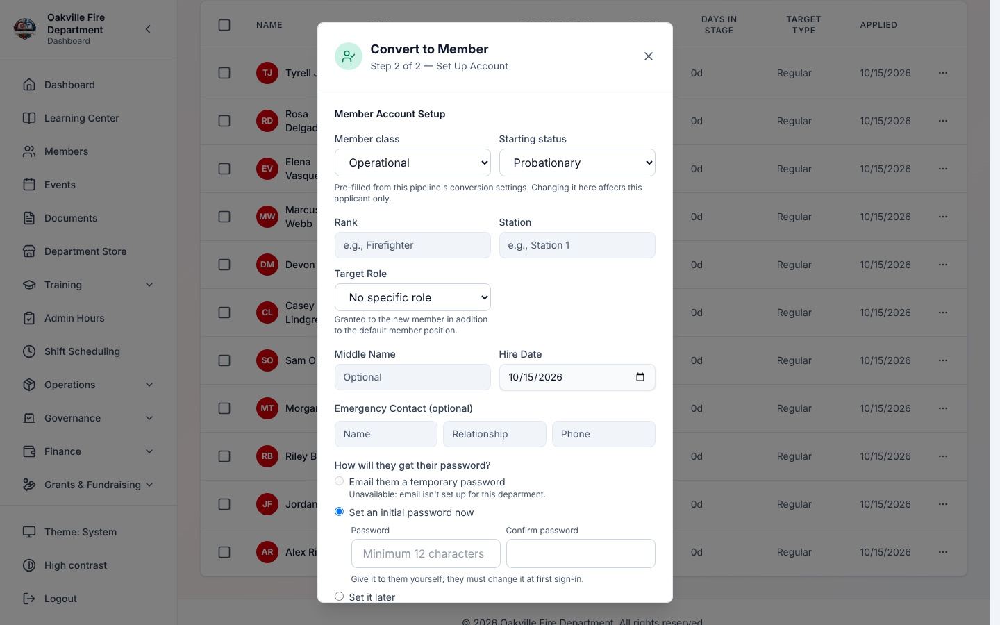

### Edge Cases

| Situation                                             | What happens                                                                                                                                                                                                                                                                                                                                                                                                                                                         |
| ----------------------------------------------------- | -------------------------------------------------------------------------------------------------------------------------------------------------------------------------------------------------------------------------------------------------------------------------------------------------------------------------------------------------------------------------------------------------------------------------------------------------------------------- |
| The email already belongs to a member                 | Conversion is blocked and shows that member's details. An email or username held by a **deactivated** member gets a plain explanation                                                                                                                                                                                                                                                                                                                                |
| A **Required** stage is unfinished or skipped         | Conversion refused, naming the stage                                                                                                                                                                                                                                                                                                                                                                                                                                 |
| The Target Role grants more than you hold             | Refused: "This applicant's target position grants permissions beyond your own. Choose positions you can grant, or ask someone who holds them to convert this applicant."                                                                                                                                                                                                                                                                                             |
| A typed membership number belonged to a former member | Refused — it is kept for them. See [Membership → Numbers Are Never Reissued](./01-membership.md#numbers-are-never-reissued)                                                                                                                                                                                                                                                                                                                                          |
| Automatic Transfer to Membership is on                | The applicant converts automatically at the final stage — **unless the ballot or a Required stage holds it**. The welcome email goes out when email can send. When none goes out, the activity log says so and the approver gets an in-app notice. The Target Role is applied only if whoever chose it is still active and holds every permission it grants. Otherwise the member gets the default position, and the activity log says a leader must assign the role |
| The pipeline has no election stage                    | Conversion is allowed without a vote                                                                                                                                                                                                                                                                                                                                                                                                                                 |
| The election package reads **Added to Ballot**        | Conversion refused until the election closes and the result is recorded                                                                                                                                                                                                                                                                                                                                                                                              |
| The election package reads **Not Elected**            | Conversion refused outright — reject or withdraw, or hold a new vote                                                                                                                                                                                                                                                                                                                                                                                                 |
| The ballot closed but the result was never recorded   | The applicant stays put. Record the result, or untick **Required** on the stage and **Skip** it, which is recorded                                                                                                                                                                                                                                                                                                                                                   |

### After Conversion, the File Stays Confidential

A prospective-member record is **not the applicant's copy of their
application**. It holds interview notes, recommendations, reference checks,
election-package comments and coordinator notes written in confidence by other
members. It stays sensitive after the applicant is elected.

That matters most when a new member is later given access to the pipeline
themselves — as a membership coordinator or an officer. **A member can never
see their own prospect record:**

- Opening it, or any action on it, answers **"not found"**.
- It is left out of the applicant list (and its total), the kanban board, the
  pipeline statistics, the election-package list, label printing, and the
  dashboard's **Prospective-member pipeline** widget — its counts, aging groups
  and names.

> **Why "not found" rather than "you may not view this"?** A permission message
> would confirm the record exists and holds something about them. That is
> exactly what is being protected.

**How The Logbook matches you to your own record:** by the link made at
conversion; by an email address you own, department or personal; or by full
name **together with a matching date of birth**.

> **Matching is deliberately careful.** A name alone is not enough — two J.
> Smiths in one department is normal, and a false match would hide a **real
> applicant** from the coordinator working their file. If a member reports that
> an applicant has vanished from the board, check whether the two records share
> a name _and_ a date of birth.

---

## Inactivity Timeout

A pipeline can flag quiet applications and mark them inactive.

### Configuration

In **Pipeline Settings**, the **Inactivity Timeout** card holds:

| Setting                       | Options                                                                                                                             | What it does                                                                                                    |
| ----------------------------- | ----------------------------------------------------------------------------------------------------------------------------------- | --------------------------------------------------------------------------------------------------------------- |
| **Default Inactivity Period** | 3 months, 6 months, 1 year, Never, Custom                                                                                           | How long before an applicant counts as inactive. 3 months by default                                            |
| **Warning Threshold**         | A percentage (80% by default)                                                                                                       | Show a warning when this share of the period has passed                                                         |
| **Notifications**             | "Notify membership coordinator when applications approach timeout"; "Notify the applicant that their application is going inactive" | Who is emailed, at most once a week per applicant. The coordinator is notified by default; the applicant is not |
| **Auto-Purge**                | On or off, plus a grace period (30–1,095 days)                                                                                      | Permanently delete inactive applications after the grace period (see below). Off by default                     |

### How It Works

Once a night, The Logbook checks when each active applicant last had any
activity:

1. Past the warning threshold, the applicant is flagged with a warning.
2. Past the full period, the applicant is marked **Inactive** and moves to the
   **Inactive Applications** tab.
3. If **Auto-Purge** is on and an application has been **Inactive** for the
   grace period, the application and its uploaded documents are permanently
   deleted. This is checked once a day.

> **How the Auto-Purge grace period is counted.** It counts from when the
> application last became **Inactive**. Reactivating it stops the clock. If it
> goes inactive again, the period starts over.
>
> - Only inactive applications are purged — never withdrawn, rejected or on-hold
>   ones.
> - Seven days before an application is deleted, the membership coordinators get
>   one email listing it with its deletion date. Reactivate it before then to
>   keep it.
> - Each purge is recorded in the audit log.
> - You can still purge by hand from the **Inactive Applications** tab. See
>   [Purging inactive applications](#purging-inactive-applications).

### Per-Stage Override

A stage can override the pipeline's period. For example, a background check
stage might allow 180 days rather than the default 90, because background
checks take time.

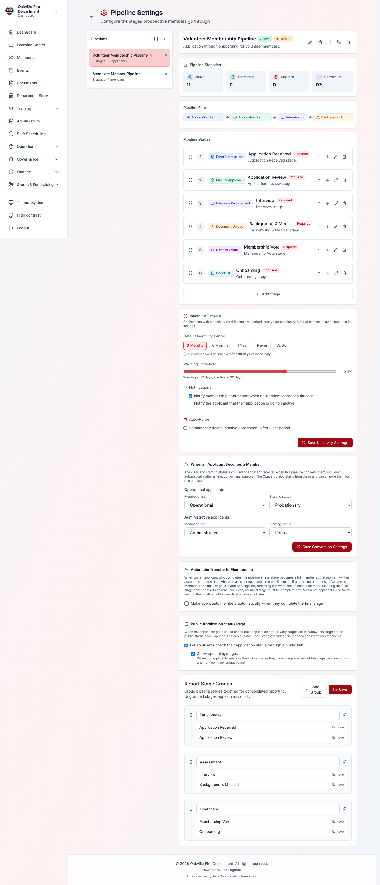

---

## Bulk Actions

Select several applicants on the pipeline dashboard to act on all of them at
once:

1. Tick the boxes next to applicant names. In **Table** view, the checkbox in
   the header row selects everything on the current page. It shows a **minus**
   when only some rows are selected.
2. **One action bar appears** above the board or table, reading "N selected":
   - **Print Badges** opens the label sheet for the selected applicants.
   - **Advance Selected** moves each one to their next stage.
   - **Hold Selected** puts them all on hold.
   - **Reject Selected** asks for an optional reason first, then **Confirm
     Rejection**.
   - The **×** clears the selection without doing anything.
   - On the **Inactive Applications** tab, the bar offers **Reactivate** and
     **Purge Selected** instead.
3. Confirm the action.

> **There is no bulk delete of active applicants.** They are withdrawn or
> rejected, not deleted.

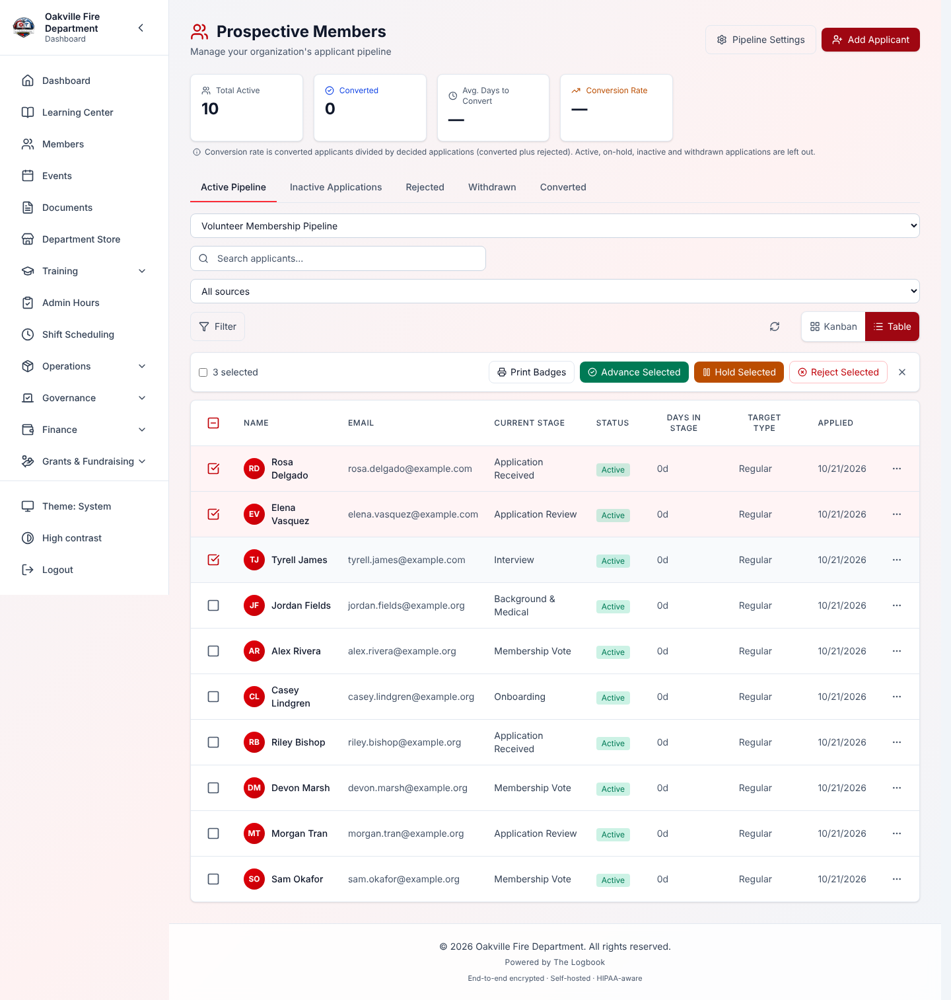

### Purging inactive applications

On the **Inactive Applications** tab, select applications and select **Purge
Selected**. **Purge Applications** asks first — "This permanently deletes N
inactive application(s) and all of the personal data in them." — and
**Permanently Delete** does it.

- Only applications that are still **Inactive** are deleted — exactly what the
  tab lists. Withdrawn, rejected and on-hold applications are never purged.
- Their uploaded **documents are deleted** first. If a file cannot be removed,
  nothing is deleted, and you can try the purge again.
- The message counts what was actually deleted, not what you selected. If some
  were no longer inactive: "Purged 2 of 3 application(s). The rest are no longer
  inactive and were kept."
- The purge is recorded in the audit log: how many, and which records — no
  applicant details.

### What a bulk action reports

A bulk action reports, item by item, what it did: how many succeeded, how many
did not, and for each one that did not, the applicant's name and the reason.

**One failure never stops the rest.** If one applicant is already at the final
stage, the other twenty-nine still advance.

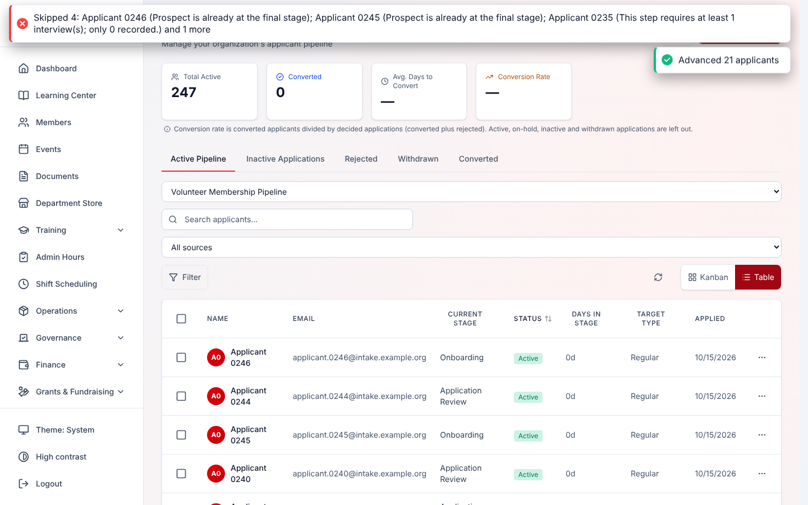

**A rejection or hold reason does not overwrite your notes.** The reason you
type is recorded in each applicant's activity log. It never goes into the
coordinator notes field.

#### Edge cases

| Situation                                         | What happens                                                                                                              |
| ------------------------------------------------- | ------------------------------------------------------------------------------------------------------------------------- |
| An applicant is **already at the final stage**    | Reported as skipped, with that reason. The rest still advance                                                             |
| An applicant has **no current stage**             | The same — skipped and named, not counted as moved                                                                        |
| **Your own applicant record** is in the selection | Reported as "not found". A coordinator who is themselves in a pipeline cannot act on their own file, in bulk or otherwise |
| You select more than **200** applicants           | Refused. Work in batches of 200 or fewer                                                                                  |
| A stage sends an **automated email**              | It still sends, once for each applicant who actually advanced                                                             |

**Advance refuses when there is nowhere to go.** Advancing an applicant who is
already at the final stage, or has no current stage, shows a clear message
saying they have nowhere to advance to. Nothing changes, and nothing is written
to the audit log. The audit log records an advance only when one really
happened.

---

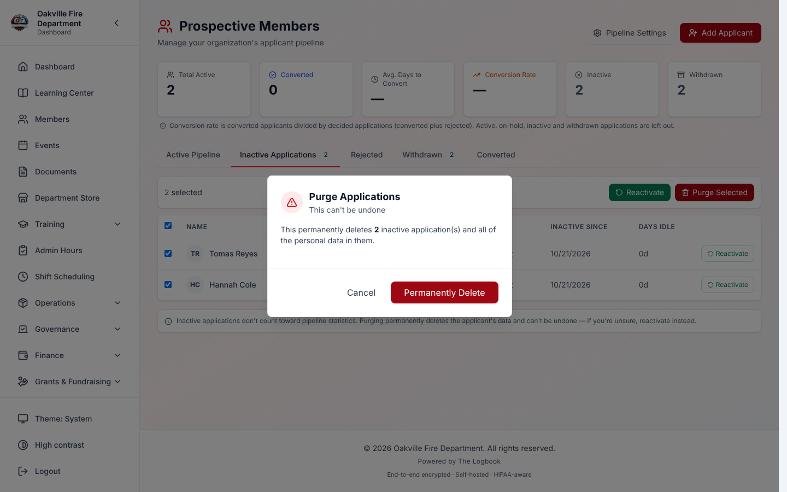

## Pipeline Statistics & Reports

The pipeline dashboard shows summary cards:

| Card                     | What it shows                                                   |
| ------------------------ | --------------------------------------------------------------- |
| **Total Active**         | Applicants currently active                                     |
| **Converted**            | Applicants who became members                                   |
| **Avg. Days to Convert** | Average days from application to conversion                     |
| **Conversion Rate**      | Percentage of applicants who become members                     |
| **Approaching Timeout**  | Applicants near the inactivity period (shown only when any are) |
| **Inactive**             | Inactive applicants (shown only when there are any)             |

The count of applicants on each stage is in each column header on the board.

**The cards count the same applicants the list shows.**

- Every action — converting, skipping, placing, advancing, moving back, holding,
  resuming, reactivating — refreshes both the cards and the list. So does
  **Refresh**.
- A search or a source-event filter narrows the cards the same way it narrows
  the list. The **status** filter deliberately does not apply to the cards:
  counting through it would zero the Converted and other figures.
- Switching pipelines quickly never leaves the previous pipeline's numbers on
  screen.

---

## Public Application Status Page

Applicants get a private link to check their application without signing in.

- It shows their current stage, completed stages and next steps. When the
  pipeline's **Show upcoming stages** is off, it shows only the visible stages
  they have completed, with progress read as "N completed" rather than "N / M".
- The link is created when the applicant is added, and it goes out in the
  pipeline's emails.
- The link stays the same each time they open it.
- If the page cannot reach the department — an outage, a dropped connection —
  it reads **Status Unavailable** with **Try again**. Only a link that really
  matches no application reads **Application Not Found**.

### The next meeting to attend

When the pipeline has a Meeting stage with an **Auto-Link Event Type**, the page
shows a **Your next step** card naming the meeting the applicant should attend.
It gives the title, the date and time in the department's time zone (labelled,
such as "7:00 PM EST") and the location with its street address. **Add to
calendar** downloads the meeting as a calendar file. **Get directions**, shown when
the meeting has a location, opens it in Google Maps.

- The card shows from the day they apply, and goes once the meeting stage is
  behind them.
- If the applicant is already linked to an upcoming event, that is the one
  shown. Otherwise it is the next event of the stage's type. Cancelled and draft
  events are never shown.
- If the meeting stage is hidden from applicants, there is no card. If the
  pipeline hides upcoming stages, the card waits until the applicant reaches the
  meeting stage.
- **A missed meeting is replaced.** As soon as it ends, the card names the next
  one. Once the missed meeting's attendance is settled with no check-in, a
  nightly job records the miss in the applicant's activity log and links them to
  the next event. A check-in at the linked event stops this.

### Turning the page on for one applicant

The pipeline switch decides for everyone by default. An **Enable Status Page**
stage decides for each applicant who reaches it, overriding the switch either
way:

- An enabling stage turns their page on and emails them the link, with the
  stage's optional message.
- A disabling stage turns it off and sends nothing.
- Either kind then completes itself.

The latest such stage an applicant has reached wins. Moving them back before it
undoes it. The status page, the applicant's own withdrawal (below) and the
email stages' tracker link all follow that per-applicant answer. Full detail in
[Membership → Enable Status Page Stages](./01-membership.md#enable-status-page-stages).

### The applicant can withdraw

While the application is **active** or **on hold**, the page shows a "No longer
interested?" card with **Withdraw Application**. The dialog — "Withdraw your
application?" — takes an optional **Reason** ("Shared with the department's
membership coordinator.") and offers **Withdraw Application** or **Keep My
Application**.

- The application moves to the **Withdrawn** tab, and its activity log records
  that the applicant did it. A coordinator can reactivate it like any other.
- Members holding the **Membership Coordinator** and **Assistant Membership
  Coordinator** positions are emailed the applicant, pipeline, stage and reason.
  If nobody holds either, every officer who can manage prospective members is.
- The applicant gets a confirmation email, dated in the department's time zone.
  It uses the **Application Withdrawn** template (**Email Templates**, under
  Prospective Members), which the department can reword.
- If either email fails, the withdrawal still stands. These are emails only — no
  text messages.
- In any other state (approved, converted, rejected) there is no button. The
  applicant contacts the department instead.

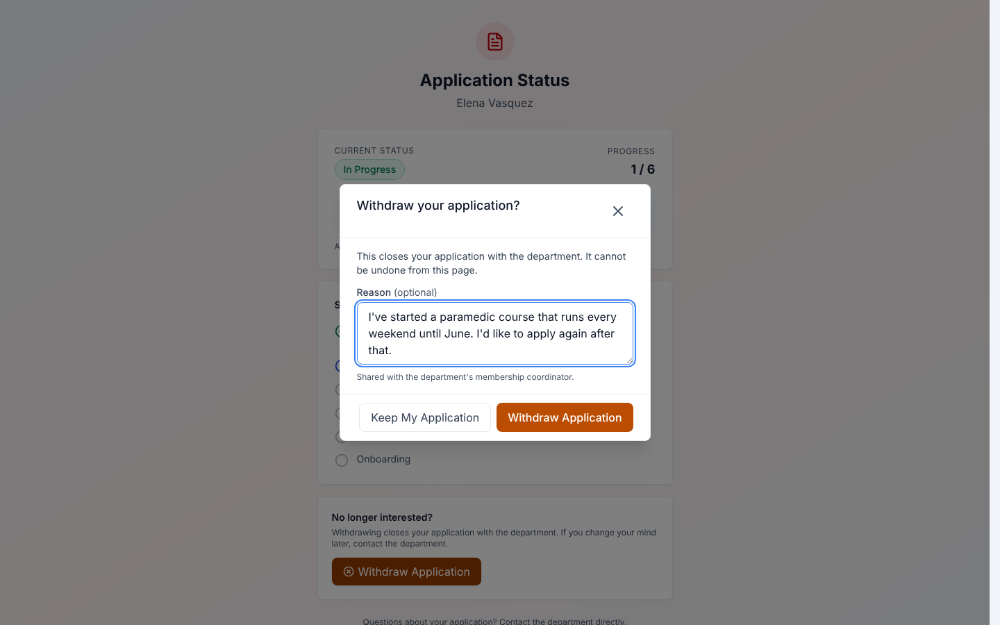

> **You cannot look up an applicant's link inside The Logbook.** The link works
> like a password: anyone holding it can read that applicant's progress, and
> withdraw the application, without signing in. So it is never shown anywhere
> in The Logbook — not in the applicant's drawer, not on the board. The only
> copy goes to the applicant by email. If someone loses their link, re-send it
> from their record.
>
> **If old printed badges may be in the wrong hands**, ask your IT administrator
> to issue new status links for your department. Every applicant in the
> department gets a new link, so every old badge **and every status link already
> emailed** stops working. No new link goes out automatically. An applicant gets
> theirs with the next pipeline email that carries the status tracker, or when
> you re-send it from their record.

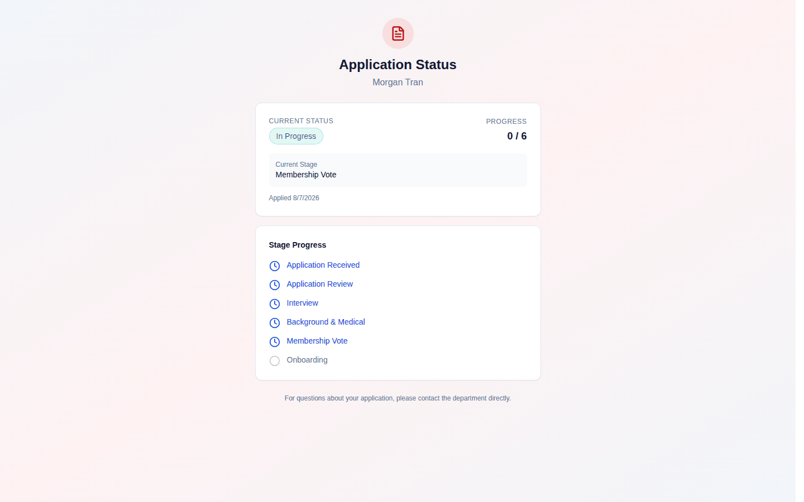

---

## Follow-up Forms _(2026-10-29)_

A **Follow-up Form** stage emails the applicant a form you built in the Forms
module. Use it to confirm what the interest form said and to ask more
questions. The form opens already filled in with what is on file, so the
applicant only corrects what has changed.

### Setting it up

1. Build the form in the Forms module and publish it. For each question that
   should show what is on file, set **Pre-fill from applicant (follow-up
   forms)** (see
   [Documents & Forms → Adding Fields](./07-documents-forms.md#adding-fields)).
2. Add a stage, choose **Follow-up Form**, and pick the **Form**. Only
   published forms are listed. The form does not have to be public.
3. Optionally write a **Message in the link email (optional)**.
4. Leave **Advance the applicant when they submit the form** ticked, or untick
   it to complete the stage yourself.

### What the applicant receives

- **When.** The moment the applicant first reaches the stage, however they get
  there: advanced, placed, moved back, or added straight onto it. They are
  emailed the **Application Follow-up Form** template with a personal link. It
  needs no sign-in.
- **Only once.** Moving them back onto the stage later does not email them
  again. To send it again, use **Resend** (below).
- **One link.** Every send carries the same link. A second link is never made.
- **How long it works.** Until they submit the form, and only while the
  application is in progress or on hold. Rejecting, withdrawing or
  transferring the application, or letting it go inactive, stops the link.
  Reactivating the application brings the link back, with any draft intact. A
  stopped link reads "This form is not available".
- **The status page is separate.** The follow-up link is not the status-page
  link, and turning the status page off does not affect it.

### Filling it in

- The page greets the applicant by first name and says what is already filled
  in.
- Answers save by themselves a few seconds after they stop typing. **Save and
  finish later** saves at once. They can come back to the same link to finish.
- Required questions and email addresses are checked on **Submit**. A problem
  is shown next to the question.
- Once submitted, the link shows a thank-you page. It cannot be submitted
  twice.

### What a submission changes

- **The applicant record.** A pre-filled answer the applicant changed is
  written back to their record. A blank answer never clears their first name,
  last name or email.
- **A record of what changed.** The drawer's **Follow-up Forms** section lists
  **Changes to the applicant record** as old → new, for example "Phone: (blank)
  → 555-0100". The activity log names only which fields changed.
- **Sensitive questions** never pre-fill and are never copied to the record.

### When contact details change

A changed email, phone or mobile number raises a **Contact details changed**
flag on the applicant's card. In the drawer the form reads "Contact details
changed. Check the new details before relying on them." Check the new details,
then select **Mark reviewed**. The drawer then records who reviewed it, and
when.

**A changed email takes effect straight away.** Later pipeline emails go to
the new address. The **old** address is sent the **Application Contact Details
Changed** template. It says the email address changed, but never gives the new
one. If the applicant did not make the change, this is how they find out.

**An email another open application already uses is not applied.** The record
keeps the old address. The change list marks it "Not applied: another open
application uses this address." The applicant is not told, because that would
reveal that the address belongs to another applicant.

> **The link is the key.** Anyone the applicant forwards the email to can open
> the form and see what it pre-fills. That is why the old address is told about
> an email change, and why the flag stays until someone reviews it.

### Send now and Resend

The drawer's **Follow-up Forms** section shows each form sent, its stage, and
its status: **Not sent**, **Sent**, **Draft saved** or **Submitted**. It also
shows when it was last sent, when a draft was saved, and when it was
submitted.

- **Send now** appears when the applicant is on a Follow-up Form stage but the
  email has not gone out — for example, the department's email was down.
- **Resend** sends the same link again, for an applicant who lost the email.
- Both need **prospective_members.manage**, and work only while the application
  is in progress or on hold. Neither is offered once the form is submitted.
- If the stage's form was deleted or unpublished, nothing is sent and you are
  told why. Publish the form, or pick another on the stage.

### How the stage completes

Submitting the form completes the stage and advances the applicant, as long as
they are still on that stage. With **Advance the applicant when they submit
the form** unticked, the stage stays open and you advance them by hand. Either
way the answers are kept as a submission of the form in the Forms module.

---

## Emails to Applicants

_(2026-10-26)_ The emails the pipeline sends an applicant are templates the
department can reword. Open **Administration > Forms & Comms > Email
Templates** (needs **settings.manage**) and expand the **Prospective Members**
group. Editing, previewing, **Send Test to Me** and **Reset** work as for any
template; see
[Administration → Email Templates](./08-admin-reports.md#email-templates). Each
of these closes with the **Public** footer by default.

| Template                                               | Sent when                                                                                                                                                 | Variables                                                                                                               |
| ------------------------------------------------------ | --------------------------------------------------------------------------------------------------------------------------------------------------------- | ----------------------------------------------------------------------------------------------------------------------- |
| **Application Step Completed**                         | The applicant advances past a stage with **Notify prospect when this stage is completed** ticked                                                          | `first_name`, `applicant_name`, `step_name`                                                                             |
| **Application Status Link**                            | The applicant reaches an enabling **Enable Status Page** stage                                                                                            | `first_name`, `applicant_name`, `status_url`, `custom_message`, `custom_message_html`, `custom_message_text`            |
| **Application Going Inactive**                         | The application nears the inactivity timeout and the pipeline is set to notify the applicant (see [Inactivity Timeout](#inactivity-timeout))              | `first_name`, `applicant_name`, `days_inactive`, `inactive_date`                                                        |
| **Application Withdrawn**                              | The applicant withdraws from their status page                                                                                                            | `applicant_name`, `withdrawal_date`                                                                                     |
| **Duplicate Application Notice**                       | Someone applies again with an email address that already has an active application. The department's own email address is BCC'd                           | `applicant_name`, `original_date`                                                                                       |
| **Application Follow-up Form** _(2026-10-29)_          | The applicant reaches a **Follow-up Form** stage, or a coordinator selects **Send now** or **Resend**. See [Follow-up Forms](#follow-up-forms-2026-10-29) | `first_name`, `applicant_name`, `form_name`, `form_url`, `custom_message`, `custom_message_html`, `custom_message_text` |
| **Application Contact Details Changed** _(2026-10-29)_ | A follow-up form changes the applicant's email. Sent to the **old** address                                                                               | `first_name`, `applicant_name`, `changed_details`                                                                       |

- **`status_url` is the applicant's private link.** Keep it in the Application
  Status Link template: delivering it is the reason the email exists.
- **`form_url` is the applicant's link to their follow-up form.** Keep it in
  the Application Follow-up Form template _(2026-10-29)_.
- **`changed_details` names what changed**, such as "email address". It never
  carries the new value _(2026-10-29)_.
- **The stage's message.** The Enable Status Page stage's **Message in the link
  email (optional)** reaches the template three ways. The Follow-up Form
  stage's message does the same in the Application Follow-up Form template
  _(2026-10-29)_. `custom_message_html` is
  that message as its own paragraph and `custom_message_text` is it followed by
  a blank line, for the plain-text version; both are empty when the stage has
  no message, so no gap is left. `custom_message` is the message exactly as
  written.
- **Untouched templates read as before.** The built-in wording of the first two
  is what those emails said before they became templates.
- **Switching a template off stops that email.** Nothing goes out in its place.
  **Application Status Link**, **Application Follow-up Form** and
  **Application Contact Details Changed** cannot be switched off, because the
  applicant has no other way to receive what they carry _(2026-10-29)_.

The **Automated Email** stage's own email is still built from the stage's
**Email Settings**, or from the custom template chosen in its **Email
Template** setting (see [Stage Configuration Options](#stage-configuration-options)).
A converted applicant's welcome email uses the department's **Welcome Email**
template.

---

## Printing Labels

**Print Badges** prints name labels for applicants — for a recruitment night or
an open house. Officers who can view or manage prospective members can use it.

1. Select applicants on the pipeline dashboard with the checkboxes.
2. Select **Print Badges** in the selection bar.
3. Choose a label format and print.

Each badge carries a short code for the applicant, never their status-page
link.

See [Inventory > Labels in other parts of The Logbook](./05-inventory.md#labels-in-other-parts-of-the-logbook)
for label format options.

---

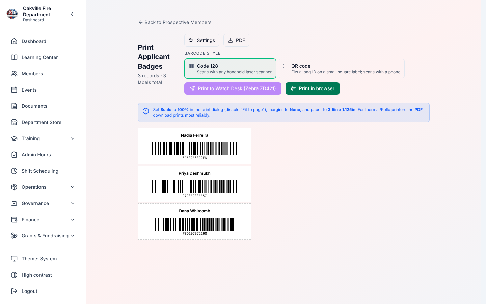

## Realistic Example: New Firefighter Application

### Background

**Oakville Fire Department** receives an application from **Alex Rivera**, who
wants to join as a regular (volunteer) firefighter.

### Part 1: Application Received

Membership Coordinator **Lt. Morrison** adds the applicant:

- Name: Alex Rivera
- Email: alex.rivera@email.com
- Membership Type: Regular Member
- Pipeline: Default Firefighter Pipeline

The pipeline has 6 stages:

1. Interest Form (auto-advance on form submission)
2. Application Review (manual)
3. Background Check (document upload, 180-day timeout override)
4. Interview (meeting stage)
5. Membership Vote (election vote)
6. Welcome & Onboarding (automated email)

### Part 2: First Three Stages

**Stage 1 (Interest Form):** Alex gets an email with a link to the interest
form. He fills it out, and moves on to Stage 2 by himself.

**Stage 2 (Application Review):** Lt. Morrison reviews the application, checks
references, and selects **Advance**.

**Stage 3 (Background Check):** Lt. Morrison starts the background check. Three
weeks later the results come back clean. He uploads the results document with
the stage's **Background Check** button, and Alex moves on to Stage 4.

### Part 3: Interview

**Stage 4 (Interview):** Alex is interviewed at the next meeting. Three officers
interview him and each files a record:

- Capt. Davis: **Recommend**
- Lt. Hernandez: **Recommend**
- FF Brooks: **Recommend with Reservations** (details: "Limited availability on
  weekday shifts")

Lt. Morrison reviews the interviews and advances Alex to Stage 5.

### Part 4: Membership Vote

**Stage 5 (Membership Vote):** An election package is created automatically,
with Alex's snapshot, his uploaded documents, and a supporting statement written
by Lt. Morrison.

Lt. Morrison marks the package **Ready**. Secretary Sarah Kim adds it to the
December business meeting election as an approval vote.

At the meeting, members vote:

- 35 Approve, 3 Deny → Alex is **Elected** (92% approval)

The package status changes to **Elected**, and Lt. Morrison is notified.

### Part 5: Conversion

Lt. Morrison selects **Convert**, then fills in step 2:

- Member class and starting status: Operational, Probationary (the pipeline's
  default for a Regular applicant, already filled in)
- Membership number: assigned automatically (OFD-2026-047 — the department's
  pattern is a prefix, the year and a three-digit number)
- Rank: Probationary Firefighter
- Station: Station 1
- Password: **Email them a temporary password** — the result screen confirms
  the welcome email went out

Alex Rivera is now a full member of the Oakville Fire Department.

---

## Troubleshooting

| Problem                                           | What to do                                                                                                                                                                                                                                         |
| ------------------------------------------------- | -------------------------------------------------------------------------------------------------------------------------------------------------------------------------------------------------------------------------------------------------- |
| An applicant is stuck at a form stage             | Check the form is linked to the stage correctly. Check the applicant received the form email.                                                                                                                                                      |
| No election package                               | Every way onto a vote stage creates one. If one is missing (it was deleted, or the applicant arrived in an older version), use **Create Package** in the drawer's Election Package section.                                                        |
| You cannot convert an applicant                   | The refusal names the reason: an unfinished or skipped **Required** stage, a missing signature ("Approval still needed from: …"), the ballot, an existing or deactivated member with the same email, or a Target Role granting more than you hold. |
| A signer cannot find where to sign                | **Sign-offs**, linked from **Review** on their dashboard. It lists only stages asking for a role they hold — check the stage names their position.                                                                                                 |
| A converted member cannot sign in                 | If **Set it later** was chosen, or the welcome email failed, they have no password yet. Set one with **Reset Password** in Member Management.                                                                                                      |
| An inactive application was not auto-purged       | **Auto-Purge** must be on for its pipeline, and the grace period counts from when it last became inactive. Purge it by hand from the **Inactive Applications** tab if it should go now.                                                            |
| An applicant never got their follow-up form       | Open the drawer's **Follow-up Forms** section. **Not sent** means the email failed: check the department's email settings and the applicant's address, then select **Send now**. Otherwise select **Resend** — it is the same link.                |
| An applicant is stuck on an automated email stage | The email did not send. Check the department's email settings and the applicant's address, then advance the stage by hand.                                                                                                                         |
| Duplicate detection warns about an old member     | If the existing member is archived or dropped, you can add the new applicant and note the connection.                                                                                                                                              |
| The status page shows the wrong stage             | The applicant may be using another applicant's link. Re-send the link from the right applicant's record.                                                                                                                                           |
| The inactivity warning never appears              | Check the pipeline's Inactivity Timeout settings. If they are right, ask your IT administrator to check that The Logbook's nightly jobs are running.                                                                                               |
| Documents do not download                         | Check the document finished uploading. If it did, ask your IT administrator to check file storage.                                                                                                                                                 |
| A bulk advance fails for some applicants          | Applicants at the final stage cannot advance further. Read the reason given for each.                                                                                                                                                              |

---

## If You Learned an Older Version

If you are following older notes, an older recording or an SOP, these things
work differently from what they may say.

- **Buttons were renamed.** **Add Applicant** and **Add to Pipeline** (not
  "Create Applicant" and "Create"). The bulk buttons read **Advance
  Selected**, **Hold Selected** and **Reject Selected** (not "Advance All",
  "Hold All", "Reject All"); they act only on your selection. Table view has
  one selection bar, not two.
- **There is no Form Dropdown stage type**, and no **Delete** bulk action.
- **Purging inactive applications deletes them.** At one time **Purge Selected**
  reported success without deleting anything. If your department purged
  applications back then, check the **Inactive Applications** tab again.
- **Auto-Purge works.** If you switched it on in an older version, it now
  deletes applications after the grace period. Applications that were already
  inactive when it started working count their grace period from that point.
- **Older applications may be missing their Target Role.** At one time the
  **Add Applicant** form did not save it. Check the **Target Role** in the
  drawer on older applicants before you convert them.
- **Multi-Signer Approval stages are enforced.** At one time no screen let an
  officer sign and Convert ignored the stage. Applicants already sitting on
  such a stage stay there until the named officers sign on **Sign-offs**.
- **Older converted members** may have the wrong class or status (every
  automatic conversion once made a probationary operational member), may lack
  the Target Role position, or may have had no usable password. Check and fix
  them in Member Management.
- **Meeting stages wait for the event to be finalized**, not for the door
  sign-in, and the stage decides for every button — single, drag and bulk
  alike.
- **A refused Advance on a meeting stage says why.** At one time a single
  **Advance** showed only "An unexpected error occurred" there. It now names
  the stage, the event if there is one, and what to do.
- **A stage email's Next Meeting no longer drops out.** At one time, once the
  event saved on the stage had passed, every later email left the section out.
  It now names the next event of the same type.
- **Older audit entries may show advances that did not happen.** At one time an
  advance with nowhere to go was still logged. When reviewing old membership
  decisions, check the applicant's stage history, not the audit entry alone.
- **An old bulk rejection may have overwritten coordinator notes.** If notes on
  an older applicant look wrong, check the activity log for the original.
- **Destroy old printed applicant badges.** Badges once carried the applicant's
  private status-page link. Today's badges carry only a short code.
- **The step-completed and status-link emails can be reworded.** They used to
  have fixed wording. They are now the **Application Step Completed** and
  **Application Status Link** templates; see
  [Emails to Applicants](#emails-to-applicants). A converted applicant's welcome
  email once ignored the department's edited **Welcome Email** template; it now
  uses it.
- **Cal.com bookings do not advance anyone.** Only the end of the meeting does;
  your IT administrator may need to update the Cal.com setup.

---

**Previous:** [Elections & Voting](./14-elections.md) | **Next:** [Integrations](./16-integrations.md)
