# Integrations

Integrations connect The Logbook to services outside it: chat apps, Salesforce,
PayPal, e-signature and booking tools, training providers and Claude. Each one
is switched on and managed from one page.

## Lesson at a Glance

|                     |                                                                                                   |
| ------------------- | ------------------------------------------------------------------------------------------------- |
| **Who this is for** | Administrators and IT officers who set up integrations. Training officers, for training providers |
| **What you need**   | A position that can manage organization settings and third-party integrations                     |
| **Essential path**  | About 30 minutes: the overview, connecting, and the integrations your department uses             |
| **Full guide**      | About 2 hours                                                                                     |
| **Last verified**   | 2026-10-14                                                                                        |
| **Owner**           | Your department's IT officer                                                                      |

Most members never open this page. The parts a member may meet are the
[calendar feeds](#icalendar-ics-feed),
[ID cards](#nfc-id-cards--tap-in-attendance) and
[connecting Claude to their own account](#walkthrough-connecting-the-claudeai-connector).

---

## Table of Contents

1. [Integrations Overview](#integrations-overview)
2. [Integration Catalog](#integration-catalog)
3. [Connecting an Integration](#connecting-an-integration)
4. [Salesforce CRM](#salesforce-crm)
5. [Documenso — Document E-Signatures](#documenso--document-e-signatures)
6. [Cal.com — Interview Scheduling](#calcom--interview-scheduling)
7. [PayPal — Store Payment Reconciliation](#paypal--store-payment-reconciliation)
8. [Google Workspace — Member Accounts](#google-workspace--member-accounts)
   - [Microsoft 365 — Member Accounts](#microsoft-365--member-accounts)
9. [Calendar Integrations](#calendar-integrations)
10. [Messaging Integrations](#messaging-integrations)
11. [Weather Alerts](#weather-alerts)
12. [EMS & Fire Reporting](#ems--fire-reporting)
13. [Generic Webhooks](#generic-webhooks)
14. [NFC ID Cards](#nfc-id-cards--tap-in-attendance)
15. [Training Provider Integrations](#training-provider-integrations)
16. [Claude (MCP)](#claude-mcp--asking-questions-of-your-logbook)
17. [Monitoring Integration Health](#monitoring-integration-health)
18. [Troubleshooting](#troubleshooting)
19. [Realistic Example](#realistic-example-connecting-slack-and-the-shift-feed)
20. [If You Learned an Older Version](#if-you-learned-an-older-version)

---

## Integrations Overview

Open **Administration → Forms & Comms → Integrations**. The menu entry appears
only when the Integrations module is turned on for your department.

Who can do what:

| To                                    | You need a position with                     |
| ------------------------------------- | -------------------------------------------- |
| Open the Integrations page            | **Full settings and admin management**       |
| Connect, change, test or disconnect   | **Manage third-party integrations** as well  |
| Issue Claude service keys and clients | **Issue and revoke Claude MCP service keys** |

These are the names the Role Management screen shows.

The page shows:

- **Available Integrations** — how many entries the catalog has
- **Active** — how many are connected or turned on
- **Ready to Set Up** — how many you could connect today
- A card for each integration. A connected one carries a green **Connected**
  badge (**Active** for a feature such as NFC ID Cards). A planned one carries
  **Coming Soon**. One that can carry patient information carries **PHI**.

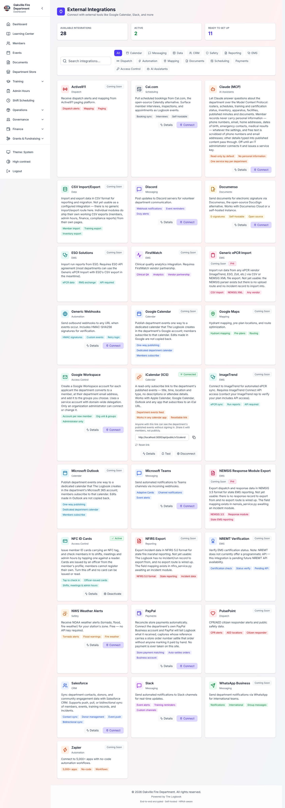

---

## Integration Catalog

### Currently Available

| Category           | Integration        | What it does today                                                                               |
| ------------------ | ------------------ | ------------------------------------------------------------------------------------------------ |
| **Calendar**       | iCalendar (ICS)    | A subscribe link to the department's published events — see [below](#icalendar-ics-feed)         |
| **Messaging**      | Slack              | Posts new events, shifts and training records to a channel                                       |
| **Messaging**      | Discord            | The same, to a Discord channel                                                                   |
| **Messaging**      | Microsoft Teams    | The same, to a Teams channel                                                                     |
| **CRM**            | Salesforce         | Sends members, training and events to Salesforce; can update contact details                     |
| **Documents**      | Documenso          | Sends documents for e-signature (an open-source DocuSign alternative)                            |
| **Scheduling**     | Cal.com            | Shows bookings and moves applicants on after a meeting                                           |
| **Payments**       | PayPal             | Matches incoming store payments to Department Store orders                                       |
| **Automation**     | Generic Webhooks   | Sends a signed message to a web address when an event, shift or training record is created       |
| **Safety**         | NWS Weather Alerts | Shows severe weather alerts for your zone on the dashboard, in the bell or by email              |
| **Access Control** | NFC ID Cards       | ID cards with a tap-in chip, and a check-in station that reads them                              |
| **Access Control** | Google Workspace   | Creates a Google account for each applicant converted to a member; suspends it when they leave   |
| **Access Control** | Microsoft 365      | Creates and licenses a Microsoft 365 account for each new member; blocks sign-in when they leave |
| **AI Assistants**  | Claude (MCP)       | Lets Claude answer questions about your department                                               |

### Coming Soon

These cards carry a **Coming Soon** badge and have no **Connect** button.
Nothing can be set up for them yet.

| Integration                   | Planned for                                                            |
| ----------------------------- | ---------------------------------------------------------------------- |
| Active911                     | Dispatch alerts and mapping                                            |
| CSV Import/Export             | Member import, training export                                         |
| ESO Solutions                 | ePCR data exchange                                                     |
| FirstWatch                    | Dispatch analytics                                                     |
| Generic ePCR Import           | CSV or NEMSIS XML from any vendor                                      |
| Google Calendar               | One-way event publishing (see [Google Calendar](#google-calendar))     |
| Google Maps                   | Hydrant mapping and pre-plans                                          |
| ImageTrend                    | ePCR sync and run reports                                              |
| Microsoft Outlook             | One-way event publishing (see [Microsoft Outlook](#microsoft-outlook)) |
| NEMSIS Response Module Export | NEMSIS 3.5 for state EMS                                               |
| NFIRS Export                  | NFIRS 5.0 for state fire marshal                                       |
| NREMT Verification            | Certification status verification                                      |
| PulsePoint                    | CPR alerts and AED locations                                           |
| WhatsApp Business             | Notifications and group messages                                       |
| Zapier                        | Connect to 5,000+ apps                                                 |

Several modules already have their own CSV exports on their own pages, such as
members, admin hours, finance and compliance reports.

---

## Connecting an Integration

1. Find the integration's card.
2. Select **Connect**.
3. Fill in the fields, if the integration has any. Integrations without fields
   show a list of what they include instead.
4. Select **Connect** at the bottom of the window.
5. On the card, select **Test** to check it works. The result appears as a
   message at the top of the screen.

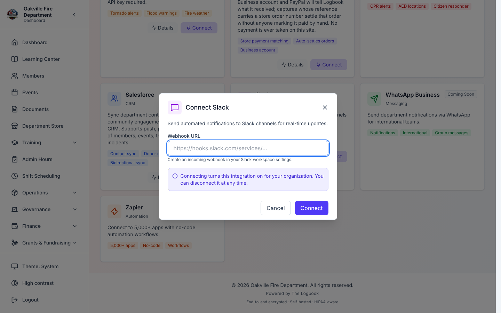

A connected card has these buttons, depending on the integration: **Details**,
**Settings**, **Sync**, **Bookings**, **Service key**, **Test** and
**Disconnect**.

**Saved passwords and keys stay hidden.** When you edit an integration, a blank
password, secret or key box means "keep what is stored". You never see a stored
secret again.

**Addresses must be public.** The Logbook refuses to connect to a web address
that leads to a private network, such as a station computer or a home router.
This applies to every address you give an integration: Slack, Discord, Teams,
webhooks, Cal.com and Documenso. Use the service's public web address.

**Keys are needed before it connects** _(2026-10-28)_. PayPal, Documenso,
Cal.com and Salesforce refuse to connect until their keys are filled in, with a
message naming what is missing, such as "PayPal needs: client_id,
client_secret". Before, they connected with blank keys and showed as connected
until a test failed.

> **What if a test fails with a general message?** When something unexpected
> goes wrong, the message reads "An unexpected error occurred. Please try
> again." The details are written to the system log for your IT
> administrator. Messages
> that name the problem, such as "Salesforce rejected these credentials", are
> shown as they are.

---

## Salesforce CRM

Salesforce can receive your members, training records and events. It can also
send contact details back to members you already have.

### Configuration

| Field                       | What to enter                                                                           |
| --------------------------- | --------------------------------------------------------------------------------------- |
| **Salesforce Instance URL** | Your Salesforce address, such as `https://yourorg.my.salesforce.com`                    |
| **Environment**             | **Production**, or **Sandbox** for a Salesforce test org                                |
| **Contact Matching**        | How to recognise members who are already Salesforce contacts (see below)                |
| **Connected App Client ID** | From the Connected App you create in Salesforce Setup                                   |
| **Client Secret**           | From the same Connected App                                                             |
| **Refresh Token**           | Only for a manual connection. Leave it empty otherwise                                  |
| **Sync Direction**          | **Push** (Logbook to Salesforce), **Pull** (Salesforce to Logbook) or **Bidirectional** |

**Contact Matching** has three choices:

- **Match by email (recommended)**
- **Match by email + last name (stricter)**
- **Never match — always create new**

Matching stops The Logbook creating a second contact for someone Salesforce
already has.

Two tick boxes finish the form:

- **Skip custom fields my Salesforce org hasn't created yet** — recommended
  while you are still building your Salesforce setup.
- **Sync automatically every 30 minutes** in the direction you chose. The
  manual sync buttons still work.

### Choose an Authentication Method

**Interactive (best when an administrator manages Salesforce):** select
**Connect with Salesforce**. You are sent to Salesforce to allow access, then
back. There is nothing to copy, and The Logbook keeps the connection renewed.

**Service account (best for unattended automatic syncs):**

1. In Salesforce, create a Connected App with **OAuth 2.0 Client Credentials
   Flow** turned on.
2. Pick a dedicated **Run As** user with as few rights as possible. It needs
   **API Enabled** and access to the records you sync, and nothing more.
3. In The Logbook, enter the Salesforce address, the client ID and the client
   secret. Leave **Refresh Token** empty.

Never enter or store the Run As user's password.

**Moving an existing connection to the service account:** emptying the
**Refresh Token** box does not do it, because a blank secret box always means
"keep what is stored". Instead:

1. Set up the Connected App and the Run As user in Salesforce first. Otherwise
   syncs fail until you do.
2. On the connected Salesforce card, open **Sync**.
3. Under **Sign-in method**, select **Switch to Client Credentials**, then
   confirm with **Switch to client credentials**.

The saved interactive sign-in is thrown away and nothing else changes. The next
sync signs in with the Connected App's own client ID and secret.

**Before the first push**, run the readiness check and preview (below). Also
create the recommended Logbook ID fields in Salesforce. Contacts can be matched
by email without them, but tasks and events may be duplicated.

### Sync Types

| Button                         | What it does                                                                                                                                                                               |
| ------------------------------ | ------------------------------------------------------------------------------------------------------------------------------------------------------------------------------------------ |
| **Members → Contacts**         | Sends active members to Salesforce as contacts                                                                                                                                             |
| **Training Records → Tasks**   | Sends training records and certifications                                                                                                                                                  |
| **Events → Salesforce Events** | Sends department events                                                                                                                                                                    |
| **Contacts → Members**         | Updates members you already have from their Salesforce contact: names, phones, station and address only. Never creates or removes a member, and never changes rank, email, status or dates |

### How to Sync

1. On the connected Salesforce card, select **Sync**. The **Salesforce Sync**
   panel opens below the catalog, in two columns:
   - **Push to Salesforce** — **Members → Contacts**, **Training Records →
     Tasks** and **Events → Salesforce Events**
   - **Pull from Salesforce** — **Contacts → Members**. This needs the sync
     direction set to **Pull** or **Bidirectional**
2. Select the button you want. A message reports how many records succeeded
   and how many failed. That message is the only place a run's counts appear;
   the integration's **Details** page shows whether each run succeeded.
3. Below the columns, **Check readiness** and **Preview member sync** show
   what a push would do before you run one.

#### Readiness and preview

The **Salesforce Sync** panel, with both buttons, appears only while
Salesforce is connected.

**Check readiness** tells you:

- whether The Logbook can reach Salesforce
- for each kind of Salesforce record, whether it can be read, and the names of
  any custom fields that are missing
- whether the Logbook ID fields are ready
- whether everything is ready

If the connection itself fails, it shows Salesforce's own short message, such
as "Salesforce authentication failed — the access token may be expired or
revoked".

**Preview member sync** shows counts only: how many members would be created,
updated or matched to an existing contact, and how many skipped.

Neither result ever shows a password, key or secret.

### Field Mappings

The Logbook decides which of its fields go into which Salesforce field. There
is no screen to view or change this.

### Updates sent from Salesforce

Salesforce can also send contact changes to The Logbook as they happen. Your
Salesforce administrator sets this up with a shared secret. Without a secret,
every message is refused. Each message received is recorded in the audit log,
without the contact's details.

### Edge Cases

| What happens                                       | What The Logbook does                                                                                                                                           |
| -------------------------------------------------- | --------------------------------------------------------------------------------------------------------------------------------------------------------------- |
| A contact's **Title** (rank) changes in Salesforce | Ignored. Rank decides what a member can do in The Logbook, so it never comes from Salesforce. The Logbook still sends rank out. Fix a wrong rank in The Logbook |
| Salesforce says "too many requests"                | Tries again, up to three times, waiting a little longer each time                                                                                               |
| Salesforce fails briefly while being read          | Tries again, up to three times. A failed write is not tried again, so a record cannot be created twice                                                          |
| The Connected App details are wrong                | Fails at once with "Failed to refresh Salesforce access token — verify your Connected App credentials"                                                          |
| Salesforce fails partway through sending a pull    | The whole pull fails. Half a list of contacts is never applied                                                                                                  |
| One contact in a pull cannot be applied            | That contact is skipped and counted as failed. The other contacts are still applied                                                                             |
| A field does not match                             | Skipped, with a note in the log                                                                                                                                 |
| Sandbox and production are mixed up                | A warning is shown; sandbox data does not go to production                                                                                                      |
| The sign-in expires                                | Renewed automatically                                                                                                                                           |
| Both sides changed the same record                 | There is no setting for this. The direction you chose decides which change lands last                                                                           |

---

## Documenso — Document E-Signatures

**Documenso** is an open-source DocuSign alternative for electronic
signatures. Use it to collect signed waivers, membership agreements or policy
acknowledgments. It works with Documenso Cloud or your own Documenso server.

### Configuration

| Field                           | What to enter                                                                          |
| ------------------------------- | -------------------------------------------------------------------------------------- |
| **API Token**                   | Create one under **Settings > API** in Documenso. Stored securely                      |
| **API Base URL**                | Leave blank for Documenso Cloud. For your own server, `https://your-host/api/v1`       |
| **Webhook Secret** _(optional)_ | A shared secret. It lets a signed document move the applicant on by itself (see below) |

After saving, select **Test** on the card to check the token.

### Auto-Advancing a Signing Stage (Webhooks)

When you set a **Webhook Secret**, the connect window shows a **callback URL**
like this:

```
https://your-logbook-host/api/public/v1/webhooks/documenso/{integration_id}
```

In Documenso, add that address as a webhook and give it the same secret.

When everyone has signed a document, The Logbook looks for a prospective member
with the signer's email. If that applicant's current stage is a **Document
Upload** stage set to use Documenso, they move on to the next stage
automatically. No coordinator needs to act.

> **Important.** Messages that fail the secret check are refused. With no
> secret set, every message is refused. The address also accepts only a limited
> number of messages a minute.

### Using Documenso in the Membership Pipeline

Once Documenso is connected, a **Document Upload** stage gains a **Collection
Method** choice. Switch it from _Upload_ to _Documenso e-signature_. Applicants
then see "Documents sent for signature" on their status page. See
[Prospective Members Pipeline → Using Cal.com and Documenso in Stages](./15-prospective-members.md#using-calcom-and-documenso-in-stages).

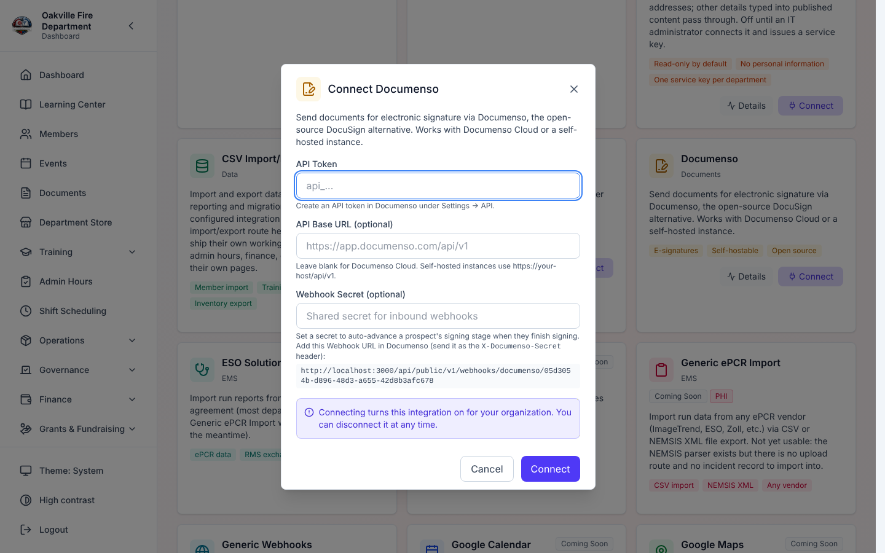

---

## Cal.com — Interview Scheduling

**Cal.com** is an open-source Calendly alternative. Applicants use it to book
their own interviews, ride-alongs or station tours. It works with Cal.com Cloud
or your own Cal.com server.

### Configuration

| Field                           | What to enter                                                                    |
| ------------------------------- | -------------------------------------------------------------------------------- |
| **API Key**                     | Create one under **Settings > Developer > API keys** in Cal.com. Stored securely |
| **API Base URL**                | Leave blank for Cal.com Cloud. For your own server, `https://your-host/api/v1`   |
| **Webhook Secret** _(optional)_ | A shared secret. It lets a finished meeting move the applicant on by itself      |

After saving, select **Test** on the card to check the key.

### Viewing Bookings

On the connected Cal.com card, select **Bookings**. It lists upcoming bookings
from your Cal.com account: title, attendee, time and status. The list comes
straight from Cal.com each time you open it.

### Auto-Advancing a Meeting Stage (Webhooks)

When you set a **Webhook Secret**, the connect window shows a **callback URL**
like this:

```
https://your-logbook-host/api/public/v1/webhooks/calcom/{integration_id}
```

In Cal.com, add that address as a webhook for the **MEETING_ENDED** event, with
the same secret.

When a booked meeting ends, The Logbook looks for a prospective member with the
attendee's email. If that applicant's current stage is a **Meeting** stage set
to use Cal.com, they move on automatically. This includes Meeting stages from
older pipelines.

> **Subscribe to MEETING_ENDED, not BOOKING_CREATED.** A booking only shows
> someone meant to come. An attendee Cal.com marked as a **no-show** is
> ignored, so a meeting nobody joined moves nobody on. Cal.com cannot prove
> someone was there, though. If your department needs attendance recorded by a
> person, leave the stage on manual advancement.

### Using Cal.com in the Membership Pipeline

Once Cal.com is connected, a **Meeting** stage gains a **Scheduling** choice.
Switch it from _Manual_ to _Cal.com_ and paste your booking link. Applicants
then see a **Schedule** button on their status page. See
[Prospective Members Pipeline → Using Cal.com and Documenso in Stages](./15-prospective-members.md#using-calcom-and-documenso-in-stages).

---

## PayPal — Store Payment Reconciliation

**PayPal** links your department's own PayPal **Business** account. Incoming
payments are then matched to [Department Store](./18-storefront.md) orders
automatically, so nobody has to mark each one paid.

**The Logbook never takes a payment.** PayPal tells The Logbook what the
account _received_. There is no checkout, and no money passes through The
Logbook. Marking orders paid by hand still works. It is the only way for
Venmo, Cash App, Zelle, cash and checks.

> **Why only PayPal?** Venmo offers no way to report personal transfers, and
> Zelle runs inside each bank's own app. PayPal is the only common payment app
> that can report back.

### Configuration

| Field                             | What to enter                                                                                                                           |
| --------------------------------- | --------------------------------------------------------------------------------------------------------------------------------------- |
| **Environment**                   | **Sandbox (testing)** or **Live**. Starts on sandbox. Sandbox and live credentials do not mix                                           |
| **Client ID** / **Client Secret** | From a REST app at [developer.paypal.com](https://developer.paypal.com) → **Apps & Credentials**. Stored securely and never shown again |
| **Webhook ID**                    | **Required.** PayPal gives you this when you add the webhook (below). Without it, payments cannot be checked and are refused            |
| **Settle orders automatically**   | On at first. See the matching rules below                                                                                               |

**Test** checks the credentials. It gives a _warning_, not a plain success, if
the Webhook ID is missing, because credentials alone match nothing.

### Adding the Webhook

The connect window shows the address to paste into PayPal:

```
https://your-logbook-host/api/public/v1/webhooks/paypal/{integration_id}
```

1. In your PayPal REST app, add a webhook at that address.
2. Subscribe it to **Payment capture completed** only. Other kinds of message
   are thrown away, so adding more only adds noise.
3. Copy the Webhook ID PayPal gives you into the connect window.

> **Important.** Every message is checked with PayPal before it counts. The
> same PayPal payment can never pay an order twice. A payment to one
> department's PayPal account can never settle another department's order.

### How Payments Are Matched

A payment settles an order by itself only when **both** are true:

1. The payment's reference holds exactly one order number, such as
   `ORD-2026-0042`. The Logbook reads the invoice number, the custom field and
   the note.
2. The amount is **exactly** what the order still owes.

Everything else is recorded and waits for a person under **Department Store >
Payments**:

| Outcome               | Meaning                                                              |
| --------------------- | -------------------------------------------------------------------- |
| Applied               | Matched and settled                                                  |
| Matched — not applied | Would have settled, but automatic settlement is off                  |
| No order found        | The reference had no order number                                    |
| Needs a decision      | The amount does not match, or the order is cancelled or already paid |
| Dismissed             | An administrator decided it was not a store payment                  |

There is no guessing by payer name or amount. Two members can easily owe the
same amount in the same window. Crediting the wrong member is worse than a
short wait in the queue.

Every payment is recorded, matched or not. The unmatched ones most need a
person: the money has already left the member's account.

### Payments the Webhook Missed

Sometimes a payment message never arrives, for example while The Logbook is
unreachable. Once a day, The Logbook asks PayPal for the last seven days of
payments. It records any it does not already have, using the same rules. A
payment is never recorded twice.

This needs one more setting in PayPal: turn on **Transaction Search** for your
REST app. Without it the daily check cannot see your payments, and your error
monitoring reports it. PayPal's search runs a few hours behind, so a missed
payment appears the next day.

### Getting the Order Number onto the Payment

The matcher reads whatever reference the payer or the department added:

- **PayPal invoices** — put the order number in the invoice reference. This is
  the most reliable.
- **Payment links or checkout** — set the custom field to the order number.
- **Plain "send money"** — ask the member to put the order number in the note.
  This depends on them typing it, so expect some in the review queue.

### Working the Review Queue

Open the store console's **Payments** tab. It lists everything unresolved. For
each entry:

- **Apply to order** — settles the order. For an unmatched payment, enter the
  order first. The order's history, the member's receipt email and the window
  totals all update as if it had been marked paid by hand.
- **Dismiss** — for money that is not a store order, such as a donation, dues
  or a refund. An applied payment cannot be dismissed.

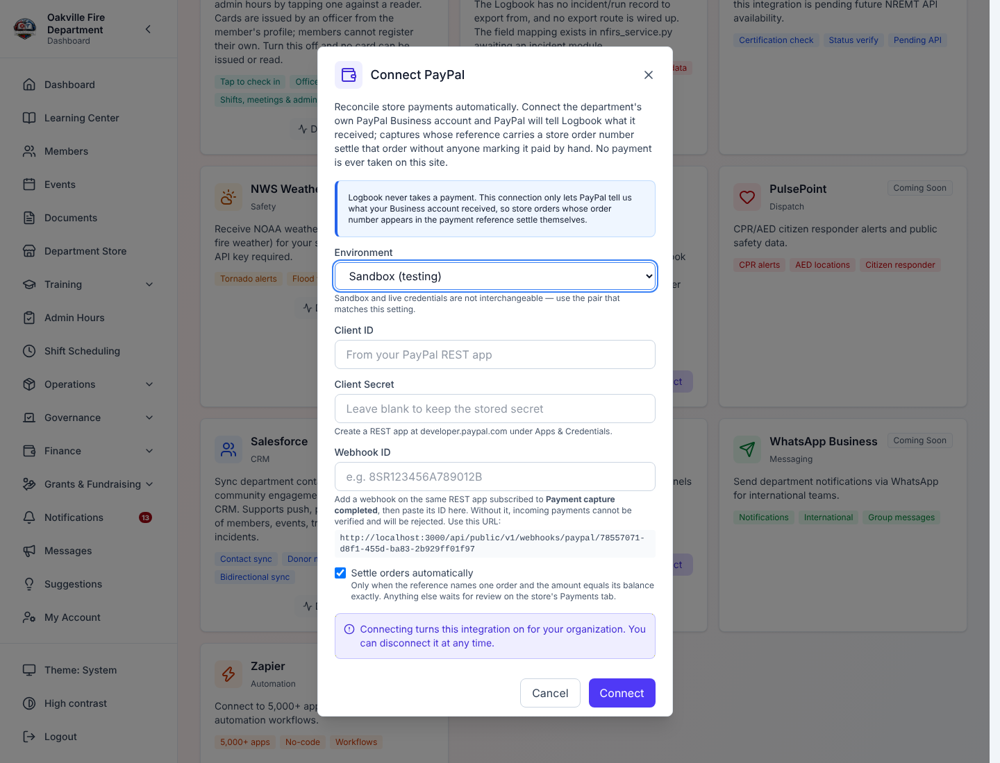

For the whole store walkthrough, see [Department Store](./18-storefront.md).

---

## Google Workspace — Member Accounts

**Google Workspace** gives each applicant the department converts to a member a Google account at their department email address. Only an organization administrator (`admin.access`) can connect, change or disconnect it.

### Configuration

| Field                   | Description                                                                                                         |
| ----------------------- | ------------------------------------------------------------------------------------------------------------------- |
| **Service account key** | The JSON key of a Google Cloud service account with domain-wide delegation. Stored encrypted, never shown.          |
| **Admin to act as**     | A Workspace admin allowed to create users and manage groups.                                                        |
| **Domain**              | Must match **Organization Settings → Department Email**, which must be on. Accounts are created at those addresses. |
| **Organizational unit** | Where new accounts go, for example `/Members`.                                                                      |
| **Groups** _(optional)_ | Up to 20 group addresses each new member is added to.                                                               |

Authorize the service account's client ID in the Google Admin console (**Security → API controls → Domain-wide delegation**) for `admin.directory.user` and `admin.directory.group.member`, plus the read-only `admin.directory.orgunit.readonly` that lets **Test** confirm the organizational unit exists. Each account uses a Workspace license.

### What Happens at Conversion

The account is created **after** the conversion is saved, so a Google failure never undoes it. The temporary Google password goes to the member's **personal** email — in the welcome email when one is sent, otherwise on its own — and Google asks for a new one at first sign-in. The conversion result says what happened, and the member's profile shows the account with a **Retry** for anything unfinished. If the address already belongs to a Google account, The Logbook links to it and changes nothing.

### Members Added Another Way

**Add Member** has a **Create a Google Workspace account** box (unticked by default). Ticked, the member's department address is generated from their name and becomes their sign-in email, the email you typed is kept as their personal address, and the temporary passwords go there. Every member added without it — including each row of a roster import — is linked automatically when their email is already a Google account's primary address. An import never creates accounts.

### When a Member Leaves

Dropping a member (voluntary or involuntary) or deleting them **suspends** their Google account; undoing the drop, a rejoin or reactivating an archived member lifts it again. On-leave and inactive members keep their account, and so do retired members unless the retirement setting below is on. The Logbook only lifts a suspension it applied itself — an account someone had already suspended in Google stays suspended. If Google cannot be reached, the departure still goes through and the member's profile offers a **Retry**.

**Retirement and name changes.** Retiring a member does not suspend their account
unless the integration's **Suspend the account when a member retires** setting is
on (off by default). It affects members who retire after it is turned on; it does
not suspend those already retired or restore anyone when turned off. A retired
member who returns gets the account back. When a member's first or last name
changes, an account The Logbook created is renamed to match; the address is never
changed, and linked accounts are never renamed.

**Groups.** Suspending a departed member's account also takes it out of the groups
set under **Add new members to these groups**, so it stops receiving department
mail; a return puts it back. A group that would not let go is retried and, after a
day, listed under **N need attention** as "Left, but still in a group".

### Accounts Needing Attention

When an account is waiting on something The Logbook could not finish — a departed member's suspension, an account never created, a password that never arrived — the Google Workspace card shows **N need attention**. It lists each member with the reason and a link to their profile. Anything waiting over a day is also emailed each morning to administrators (`admin.access`).

### Members Who Joined Earlier

Only accounts The Logbook created or linked are suspended. To cover members who were on the roster before the integration, an administrator clicks **Link existing members** on the Google Workspace card. It shows how many members have an account at exactly their Logbook email and why the others are skipped, then links them once confirmed. Members who have already left are not linked. Nothing changes in Google.

See [Google Workspace Integration](../../wiki/Integration-Google-Workspace.md) for setup steps and account states.

### Microsoft 365 — Member Accounts

**Microsoft 365** does the same for departments on Microsoft: an account at the department email address for each new member, licensed and added to your groups, with sign-in blocked when they leave. A department connects **either** Google Workspace **or** Microsoft 365, not both. Only an organization administrator (`admin.access`) can connect, change or disconnect it.

| Field                       | Description                                                                                                                                                         |
| --------------------------- | ------------------------------------------------------------------------------------------------------------------------------------------------------------------- |
| **Directory (tenant) ID**   | From the Entra ID app registration's Overview page.                                                                                                                 |
| **Application (client) ID** | From the same page.                                                                                                                                                 |
| **Client secret value**     | The secret's value, not its ID. Stored encrypted, never shown. Replace it before it expires.                                                                        |
| **Domain**                  | Must match **Organization Settings → Department Email** and be verified in Microsoft 365.                                                                           |
| **Usage location**          | The two-letter country every new account gets (`US` by default). Microsoft will not license an account without one.                                                 |
| **License SKU ID**          | _(optional)_ The license each new account is given. Leave empty when a group below licenses its members.                                                            |
| **Groups**                  | _(optional)_ Up to 20 security groups (by object ID) or Microsoft 365 groups. **Test** rejects distribution lists, mail-enabled security groups and dynamic groups. |

The app registration needs the Microsoft Graph application permissions `User.ReadWrite.All`, `User-PasswordProfile.ReadWrite.All`, `User.RevokeSessions.All`, `GroupMember.ReadWrite.All` and, with a license, `LicenseAssignment.ReadWrite.All`, with admin consent, and the **User Administrator** role.

Enter the secret's **Expires** date as **Client secret expires on**. From 30 days before it, the card shows the days left and administrators get a morning email at 30 days, 7 days and on the day. A new secret needs its new date entered with it. The Microsoft setting is **Block sign-in when a member retires**, and a group that assigns licenses is never edited, because removing the member would remove the license. Accounts still in the directory 90 days after suspension are listed under **N need attention** for information only; The Logbook never deletes an account.

Conversion, the member's profile, **N need attention** and **Link existing members** work as for Google Workspace. Two differences: an account whose license could not be assigned is kept and its profile offers **Retry**; and an account synced from on-premises Active Directory is never blocked from here — the profile says to disable it in Active Directory.

See [Microsoft 365 Integration](../../wiki/Integration-Microsoft-365.md) for setup steps and account states.

---

## Calendar Integrations

### Google Calendar

The Logbook creates one calendar for the department, named after it (for
example _Falls Church Fire Events_), in a Google account an administrator
signs in with, and publishes the department's events to it, **one way**.
Members subscribe to that calendar in Google. Nothing is read back from
Google, and no contacts or emails are exchanged.

**Before you start (server operator).** The card reads **Coming Soon** until
the server's `CALENDAR_SYNC_ENABLED` setting is turned on; it is off by
default. The sign-in uses the server's Google OAuth client — the same
`GOOGLE_CLIENT_ID` and `GOOGLE_CLIENT_SECRET` as "Sign in with Google" — and
that client needs the **Google Calendar API** enabled and the callback address
`https://<your site>/api/v1/integrations/google-calendar/oauth/callback` added
as an authorized redirect URI (or set `GOOGLE_CALENDAR_REDIRECT_URI` to the
exact address). A department can use its own OAuth client instead by saving
its client ID and secret on the integration.

**Connecting** (needs the integrations management permission):

1. On the Google Calendar card, select **Connect with Google**.
2. Sign in with the Google account that should own the department calendar,
   and allow access. The Logbook asks only to manage calendars **it creates**;
   it cannot see or change any other calendar in the account.
3. You come back to the Integrations page. The card shows the account, the
   new calendar's name and **Last published**.

The sign-in must be finished within ten minutes, in the same browser, by the
person who started it.

**What is published.** Each published event from 30 days ago to 180 days
ahead: its title, start and end, location, event type and a link back to the
event in The Logbook. Drafts are never sent, and a cancelled or deleted event
is removed from the calendar. Who is going, RSVP answers, custom fields and
attachments are never sent. Publishing runs every five minutes.

**Sync event descriptions** is off by default, because a description can hold
notes meant only for members. Turn it on from the card to publish
descriptions too.

**When something goes wrong.** The card shows the last error and how many runs
in a row have failed. **Reconnect required** means Google no longer accepts
the sign-in — the password changed, access was removed in the Google account,
or the grant expired. Select **Reconnect with Google**; publishing continues
into the same calendar if it still exists.

**Disconnecting** stops publishing and hands the access back to Google. The
calendar stays in the Google account with the events already on it; delete it
there if the department no longer wants it. Connecting again creates a new
calendar, which members must subscribe to again.

### Microsoft Outlook

Outlook works the same way as Google Calendar. The Logbook creates one
calendar for the department, named after it, in a Microsoft 365 (work or
school) account an administrator signs in with, and publishes the
department's events to it, **one way**. Share that calendar with members from
Outlook so they can add it. Nothing is read back from Outlook, and no contacts
or emails are exchanged.

**Before you start (server operator).** The card reads **Coming Soon** until
the server's `CALENDAR_SYNC_ENABLED` setting is turned on; it is off by
default. The sign-in uses the server's Microsoft (Azure AD) app — the same
`AZURE_AD_CLIENT_ID` and `AZURE_AD_CLIENT_SECRET` as "Sign in with
Microsoft", though that sign-in does not have to be turned on. The app needs
the delegated Microsoft Graph permission **Calendars.ReadWrite** and the
callback address
`https://<your site>/api/v1/integrations/outlook/oauth/callback` added as a
**Web** redirect URI (or set `MICROSOFT_CALENDAR_REDIRECT_URI` to the exact
address). The sign-in goes to the server's `AZURE_AD_TENANT_ID` tenant, or to
any work or school account when that is not set; personal Outlook.com
accounts are not offered. A department can use its own app instead by saving
its client ID, client secret and tenant ID on the integration.

**Connecting** (needs the integrations management permission):

1. On the Microsoft Outlook card, select **Connect with Microsoft**.
2. Choose the Microsoft 365 account that should own the department calendar
   (it needs an Exchange Online mailbox), and accept the permissions.
3. You come back to the Integrations page. The card shows the account, the
   new calendar's name and **Last published**.

The sign-in must be finished within ten minutes, in the same browser, by the
person who started it. **What is published**, **Sync event descriptions** and
**Reconnect required** work exactly as for
[Google Calendar](#google-calendar); select **Reconnect with Microsoft** to
sign in again.

**Disconnecting** stops publishing and removes the sign-in from The Logbook.
Microsoft has no way for an app to hand back a single sign-in, so the access
ends when it expires; to end it at once, remove The Logbook under **My Apps**
in the Microsoft account (or in Entra ID). The calendar stays in the account
with the events already on it; delete it in Outlook if the department no
longer wants it. Connecting again creates a new calendar, which must be shared
with members again.

### iCalendar (ICS) Feed

There are two kinds of calendar feed. Both are read-only links that any
calendar app (Google, Apple or Outlook) can subscribe to.

**The department events feed** is set up here, on the **iCalendar (ICS)**
card:

1. Select **Connect** on the card. Connecting creates the feed's link.
2. The card shows the link. Select the copy button, or select the box and copy
   it by hand.
3. Share it with members, for example in a members-only message.
4. **Reset link** makes a new link and stops the old one at once. Use it if
   the link was posted somewhere public. Every calendar subscribed to the old
   link stops updating until it is given the new one.

The feed carries the department's **published** events from 30 days ago to a
year ahead: each event's title, start and end, location, event type and a link
back to the event in The Logbook. It leaves out drafts and cancelled events,
and never carries an event's description, who is going, RSVP answers or custom
fields. **Disconnect** stops the link; connecting again makes a new one.

Only people who can manage integrations see the link or can reset it. Each
reset is recorded in the audit log.

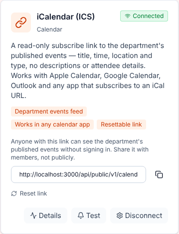

**Choosing what the feed publishes** _(2026-11-01)_. On the connected
iCalendar card, select **Settings**.

- Tick the event types to publish, or leave them all unticked to publish every
  type. Drafts and cancelled events are never published.
- Tick **Include duty shifts** to add each scheduled shift's date, times and
  platoon. Who is assigned and shift notes are never published.

Saved settings apply the next time a subscribed calendar refreshes; the feed
link does not change. The feed covers 30 days back to a year ahead, on the
department's calendar. Members' own shifts are still in their personal feed
whether or not this integration is connected.

**A member's shift feed** is private to each member, and it is not set up on
the Integrations page. Each member opens **Subscribe to my shifts** at the top
of **Scheduling > My Shifts**:

1. Opening the card creates the member's own link the first time.
2. Copy the link, or select the box and copy it by hand.
3. Subscribe to it in any calendar app: Google, Apple or Outlook.
4. The calendar updates as shifts change. Calendar apps check every so often,
   which can take up to an hour.
5. **Reset link** makes a new link and stops the old one at once. Use it if a
   link was shared or leaked.

There is one shift feed per member, and it carries that member's shifts. No
one, including an officer, can see another member's link.

> **Important.** Anyone with either link can see what is in it, without
> signing in. Treat it like a password. **Reset link** is there for when it
> gets out.

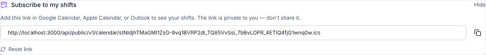

---

## Messaging Integrations

### Slack

1. In your Slack workspace settings, create an incoming webhook for a channel.
2. Paste its address into **Webhook URL** and select **Connect**.
3. Select **Test** on the card. The channel receives "The Logbook — Integration
   test successful!"

### Discord

1. In your Discord channel settings, create a webhook.
2. Paste its address and select **Connect**.
3. Select **Test** on the card.

### Microsoft Teams

1. In your Teams channel, create an incoming webhook.
2. Paste its address and select **Connect**.
3. Select **Test** on the card. Messages arrive as cards in the channel.

### What gets posted

A connected chat integration posts when someone:

- creates an event
- creates a shift (making shifts from a pattern posts one summary)
- adds a training record (adding several at once posts one summary)

**You cannot choose which of these post.** A chat integration has one setting,
the webhook address. Nothing else is posted: not new members, not equipment
checks, not other notifications.

Posting is a best effort. If Slack, Discord or Teams refuses a message, The
Logbook does not try it again. The integration's **Details** page shows each
delivery and whether it worked.

---

## Weather Alerts

The **NWS Weather Alerts** integration talks to the National Weather Service
(NWS), part of the US weather agency. It is free and needs no account or key.

### Configuration

| Field                                 | What to enter                                                                                                           |
| ------------------------------------- | ----------------------------------------------------------------------------------------------------------------------- |
| **NWS Zone ID**                       | Your area's zone code: state, then C or Z, then three digits. Example: `VAZ053`                                         |
| **Tell members about severe weather** | How members hear: a dashboard banner, a bell notice, an email, or any mix. Banner and bell start ticked, email unticked |

> **Tip.** Find your zone at
> [weather.gov/pdd/gis](https://www.weather.gov/pdd/gis). Search by county or
> zone.

### How It Works

The Logbook checks your zone every 15 minutes. Only **Severe** and
**Extreme** alerts count, which is warnings such as Tornado Warning, Severe
Thunderstorm Warning and Flash Flood Warning. Advisories, statements and most
watches are left out, so the banner is not always showing something. Test
messages and exercises are ignored.

What members see depends on what you ticked:

| Channel              | What happens                                                                                                                                                                 |
| -------------------- | ---------------------------------------------------------------------------------------------------------------------------------------------------------------------------- |
| **Dashboard banner** | Every member's dashboard shows the alert while it is in effect: what it is, until when, and **What to do**. It goes when the alert expires or the weather service cancels it |
| **Bell notice**      | Every current member gets one bell notice when the alert is first issued                                                                                                     |
| **Email**            | Every current member gets one email when the alert is first issued. A member can turn these off under **Severe weather alerts** in their own email settings                  |

Each alert is announced once, however often the zone is checked. An alert the
weather service cancels and then reissues under the same name is not announced
twice.

**Test** asks the weather service for your zone's current alerts and tells you
whether the zone is valid and how many alerts are active, for example "Zone
VAZ053 is valid. 2 active alert(s)."

> **Important.** This is a convenience, not an alerting system. If the weather
> service or the connection to it is down, nothing is shown and nobody is told.
> Keep your department's own warning arrangements.

---

## EMS & Fire Reporting

**None of these is built yet.** **Generic ePCR Import**, **NEMSIS Response
Module Export** and **NFIRS Export** are in the catalog marked **Coming Soon**.
They have no **Connect** button and no settings screen.

What each is planned to do:

| Integration                   | Planned use                                                                                      |
| ----------------------------- | ------------------------------------------------------------------------------------------------ |
| Generic ePCR Import           | Upload a CSV or NEMSIS XML export from any ePCR vendor, so run data feeds reports and compliance |
| NEMSIS Response Module Export | Produce a NEMSIS 3.5 file of response data for state EMS reporting                               |
| NFIRS Export                  | Produce an NFIRS 5.0 file of incident data for the state fire marshal                            |

Each needs incident or run records that The Logbook does not keep yet. Keep
using your current reporting system.

---

## Generic Webhooks

A generic webhook sends signed messages to a web address that you choose.

### Configuration

| Field                 | What to enter                                                  |
| --------------------- | -------------------------------------------------------------- |
| **Webhook URL**       | The address of the system that will receive the messages       |
| **Secret**            | Optional. Lets the receiving system check a message is genuine |
| **Send these events** | Which events to send. Leave all unticked to send every one     |

The Logbook sends a message when one of these happens. They are the same
events Slack, Discord and Teams are told about:

| Event                      | Event name          | Sent when                        |
| -------------------------- | ------------------- | -------------------------------- |
| An event is created        | `event.created`     | Someone creates a calendar event |
| A shift is created         | `shift.created`     | Someone creates a shift          |
| A training record is added | `training.recorded` | A training record is added       |

**Test** sends one `test.ping` message, so you can check your system receives
it before anything real happens. A webhook connected before 2026-10-29 has no
events ticked, so it is sent all of them.

### When delivery fails

- **The address must start with `https://` and be on the public internet.** An
  address on a private network, such as `https://192.168.1.20/hook`, is refused
  when you save it. It is checked again before every message.
- **The receiving system must answer that it accepted the message.** Anything
  else counts as a failure.
- **The Logbook tries three times in all**, waiting 1 second, then 2 seconds.
  After that it gives up. The message is not kept or sent later.

Without a **Secret**, messages are sent unsigned. The receiving system then
cannot tell a message from The Logbook apart from one sent by someone else.

### For the person who builds the receiving system

Pass this part to whoever writes the system that receives the messages.

**What your system receives.** An HTTP `POST` with a JSON body and these
headers:

| Header                | Value                                     |
| --------------------- | ----------------------------------------- |
| `Content-Type`        | `application/json`                        |
| `X-Webhook-Event`     | The event name, such as `shift.created`   |
| `User-Agent`          | `TheLogbook-Webhook/1.0`                  |
| `X-Webhook-Signature` | Only when a **Secret** is set — see below |

The body of the test message:

```json
{
  "event_type": "test.ping",
  "timestamp": 1782570600,
  "data": {
    "message": "The Logbook webhook test"
  }
}
```

`timestamp` is the sending time in whole seconds since 1 January 1970 (UTC).

The other events carry the same three keys, with these fields in `data`:

| Event name          | `data` fields                                              |
| ------------------- | ---------------------------------------------------------- |
| `event.created`     | `title`, `event_type`, `start_time` (ISO 8601), `location` |
| `shift.created`     | `type`, `start_time`, `end_time` (ISO 8601), `crew`        |
| `training.recorded` | `member_name`, `course_name`, `hours`                      |

Answer with any 2xx status, such as 200 or 204.

**Checking it is real.** With a secret, every message carries:

```
X-Webhook-Signature: sha256=3f0a…c9
```

The part after `sha256=` is an HMAC-SHA256 of the **exact bytes** of the body,
in lowercase hexadecimal, keyed with the secret. Compute the same value over
the raw body, before parsing it, and compare. For example, in Python:

```python
import hashlib, hmac

def is_genuine(raw_body: bytes, header: str, secret: str) -> bool:
    expected = hmac.new(secret.encode(), raw_body, hashlib.sha256).hexdigest()
    received = header.removeprefix("sha256=")
    return hmac.compare_digest(expected, received)
```

---

## NFC ID Cards — Tap-In Attendance

This turns a member's ID card into the way they record attendance. An officer
links a card to a member. The member then taps it at a check-in station to be
checked into a shift, a meeting or an admin hours category.

### Turning it on

NFC ID Cards is a feature you switch on, not a service you connect. Find
**NFC ID Cards** on the Integrations page and select **Activate**. It starts
**off**.

**While it is off, nothing exists:** no ID Cards section on profiles, no
station page and no menu entry. A department that has never opened the
Integrations page counts as off.

Turning it off later (**Deactivate**) stops every issued card working. The
record of who held which card is kept.

Two permissions go with it. On the Role Management screen they read:

| Permission                                            | For                                               |
| ----------------------------------------------------- | ------------------------------------------------- |
| **Issue and revoke member ID card (NFC) credentials** | Issuing, labelling, suspending and revoking cards |
| **Check members in at an ID card check-in station**   | Running a check-in station                        |

The full walkthrough is in
[Membership → Member ID Cards and the Check-In Station](./01-membership.md#member-id-cards-and-the-check-in-station).

### Issuing a card

Officers who can issue ID cards see **Issue card** in the **ID Cards** section
of a member's profile. There are two ways to link a card. The first is better:

| Option                           | Use it when                              | What is kept                            |
| -------------------------------- | ---------------------------------------- | --------------------------------------- |
| **Write a code to a blank card** | The tag can be written: a sticker, a fob | A new random code, written onto the tag |
| **Read a printed card's serial** | The card is already made and locked      | The chip's own serial number            |

Writing a code is better because:

- the code cannot be guessed and is not printed on the card
- the tag can be wiped and given to someone else later

A card known only by its chip serial belongs to that member for good.

On a computer with no NFC reader built in, hold the card on a **USB reader**
with the cursor in the serial box. Or type the serial printed on the card.
Writing a code needs Chrome on an Android phone.

**Members cannot do any of this themselves.** A card records attendance on
someone's behalf, so it is issued the way a key is: by an officer, by hand.

### Running a station

Open **Administration → Members → Check-In Station**. You need the
check-in station permission above.

1. Pick what members are checking into.
2. Turn on the reader.
3. Leave the device at the door.

Each tap shows the member's name and what was recorded, then clears for the
next person.

- **In, then out** — the default. One card covers arrival and departure.
- **Checks in** / **Checks out** — use one of these when a second station
  covers the other door.

A card tapped again within a minute counts as a double tap. The station shows
the member's current state instead of checking them out.

### Losing a card

- **Suspend** a card to stop it working for a while.
- **Report lost** if it is gone. That is permanent, because whoever picks it up
  could still tap it.

Then issue a replacement. For a card with a written code, that can be the same
tag written again.

### Looking after every card at once _(2026-10-24)_

**Members Admin → Member ID cards** lists every card, who has none, cards still
held by former members, unused cards, and every tap, with a tap-log retention
setting (24 months by default). Cards stop by themselves when a member becomes
Inactive, Suspended, Dropped or Archived. See
[Membership → The Member ID Cards page](./01-membership.md#the-member-id-cards-page).
Where cards were tapped, by room and by event, is on **Card Readers** and the
event page: see
[Events → Seeing who tapped a card](./04-events-meetings.md#seeing-who-tapped-a-card-2026-10-24).

---

## Training Provider Integrations

Training providers are set up in **Training Admin > Settings & Data >
Integrations**, on
the **External Training Integrations** screen. That is separate from the
Integrations page. See
[Training & Certification > External Training Integrations](./02-training.md#external-training-integrations).

Available providers:

- **Vector Solutions** — category list, credit hours, automatic sync
- **Target Solutions** — course and policy completions from its Training
  Records report (see below)
- **Lexipol** — policy training
- **iAmResponding** — response tracking
- **Custom API** — any other provider that can send records

**Only Target Solutions credits completions automatically.** A Target Solutions
completion whose member is matched becomes a training record straight away.
Completions from the other providers wait in the **Import Queue** for an
officer.

Every completion is identified by the provider's record number. A second sync
updates it instead of adding it twice. A completion sent without a number is
identified by member, course and completion date instead.

### Setting up Target Solutions

Target Solutions gives you a **Training Records API** address that looks like
this:

`https://app.targetsolutions.com/tsapp/api/?action=reports.buildReport&reportType=completionsall&key=…&secret=…`

Split it into three boxes rather than pasting it whole:

| Box          | Enter                                        |
| ------------ | -------------------------------------------- |
| API Base URL | `https://app.targetsolutions.com/tsapp/api/` |
| API Key      | the part after `key=`                        |
| API Secret   | the part after `secret=`                     |


The key and secret are stored securely and never shown again. A base address
that still contains a key, secret or other sign-in code is refused, because the
base address is not kept secret. The key and secret are also removed from the
system log and from any error message an officer sees.

**How members are matched.** Each sync downloads the completions report for
its dates. Members are matched in this order:

1. The report's **Email** against the member's Logbook email (capital letters
   and spaces ignored; deleted members skipped).
2. If no email matches, the report's **Employee ID** against the member's
   **Membership Number**. Keep the two numbers the same in both systems.

A person who cannot be matched yet is listed on the **Users** tab under
**Mappings**. They are matched automatically on a later sync once their email
or membership number is on file — unless an officer has set or cleared that
mapping by hand.

**Mapping a member by hand.** Open the provider's **Mappings**, go to the
**Users** tab and pick the member from that person's list. Their waiting
completions move to that member. They are credited the next time a sync or an
uploaded report includes them.

**Hours.** Credit hours come from the report's **Duration (hours)** column, the
hours the course is accredited for. They never come from **Time Spent In
Course**, which counts how long the member had it open. A row with no duration
gives no hours.

**Policy acknowledgments.** The report's **Assignment Type** tells two things
apart:

- **TS Course** — a Target Solutions course.
- **Admin** — a document your department wrote that members must read and
  acknowledge. Often this is yearly, because a law requires it, such as a
  whistleblower policy or a code of conduct.

Admin rows are recorded with the training type **Policy Acknowledgment** and no
hours. They stay apart from courses and appear in each member's training
history under that type.

A requirement set only to the type **Policy Acknowledgment** is met by
acknowledging _any_ policy. To require one particular policy each year, map it
to a library course and link the requirement to that course. See
[Course mappings](#course-mappings) below.

Target Solutions records every click on an acknowledgment. A member who opens
the same policy twice in a day appears twice. The second one that day is kept in
the **Import Queue** marked **duplicate** and never becomes a training record.
An acknowledgment on a later day, such as next year's, is recorded as usual.

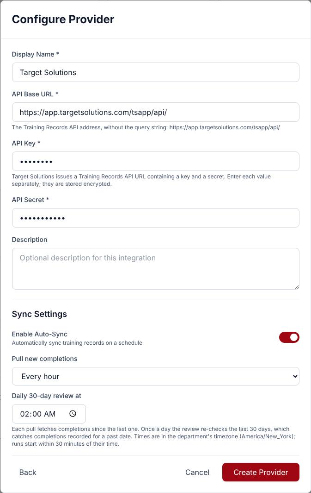

### Syncing on a schedule

Under **Sync Settings**, turn on **Enable Auto-Sync**. A Target Solutions
provider then runs two kinds of sync:

| Run                     | When                                                    | Asks Target Solutions for                                     |
| ----------------------- | ------------------------------------------------------- | ------------------------------------------------------------- |
| **Pull**                | every hour at first (**Pull new completions**)          | completions since the last sync, and at least since yesterday |
| **Daily 30-day review** | once a day, 02:00 at first (**Daily 30-day review at**) | every completion from the last 30 days                        |

The hourly pulls stay small, so a class someone finishes shows up within about
an hour. The daily review exists because Target Solutions lets a completion be
recorded for a past date. A pull that only looks forward would never ask for
it. Records already brought in are updated in place, so the overlap never makes
duplicates.

Details:

- The review time is in your department's time zone and keeps its local time
  when the clocks change.
- The schedule is checked every 30 minutes, so each run starts within 30
  minutes of its time.
- A newly switched-on provider starts with a review, so its first sync brings
  in the last 30 days.
- A review that fails is tried again on the next run until one works.
- Automatic syncs run only for an active provider whose last **Test** passed.
  Run **Test** after saving the provider.
- A completion **deleted** in Target Solutions is not removed here, because
  the report lists only completions that still exist.
- The provider card's **Auto-Sync** line shows both, for example "Every 1h ·
  review daily at 02:00".

Other providers show only "Every _N_h". Their form has a single **Sync
Interval**, counted from the previous sync.

#### Course mappings

> **Warning.** Bringing in completions does not make a requirement check the
> right course. A requirement of type **Hours**, filtered only by training
> type, is met by **any** course of that type. One department's first import
> showed a member's yearly HIPAA refresher as complete because of two medical
> courses, Hematology and Sepsis. The member had done no HIPAA training at all.
>
> Before your first import, make every topic requirement (HIPAA, bloodborne
> pathogens, policy acknowledgments and so on) a **Courses** requirement. Then
> map the provider's courses to it as below. See
> [Never Use an Hours Requirement for a Required Topic](./02-training.md#never-use-an-hours-requirement-for-a-required-topic).

Target Solutions gives each course a **Course ID**. It gives a new one each
time it publishes a new version: a new HIPAA video, a re-accredited course, a
revised policy. Your requirements link to courses in **your library**, not to
Target Solutions' numbers. So a new version never means editing a requirement:

1. Create the course once in your library, for example **HIPAA Awareness**.
   Link your yearly requirement to it, with the requirement type **Courses**.
2. Open the provider's **Mappings**, go to the **Courses** tab, and map each
   Target Solutions course to its library course. Map every version to the
   same library course. Completing any version meets the requirement.

The **Courses** tab lists every course Target Solutions has sent, with how many
members completed it. If an unmapped course looks like one in your library, it
shows a **Map to …** button. "Looks like" means the same title once the number
in brackets and the "CAPCE" prefix are ignored, or an earlier version you
mapped. Nothing is mapped until an officer chooses. Pick a different course
from the list if the suggestion is wrong.

**When a new version arrives**, everyone who can manage training is emailed
_New Course Version to Map_. It names the course and the library course it
looks like. Each course is emailed about once. Officers who turned off
**Training officer duties** emails in their notification preferences are not
emailed. Courses that look like nothing in the library are listed on the tab
without an email.

**Mapping credits past completions.** Members who completed a new version
before it was mapped show as not current until it is. Mapping it updates the
training records already brought in, so they become current at once. Unmapping
takes the course back off those records. A record an officer linked to a
different course by hand is left alone either way.

**Categories come from the course.** Target Solutions sends no category. An
imported completion is filed under its mapped library course's first active
category. The order of choice is:

1. the category an officer picks when importing
2. a category mapping
3. the mapped course's category
4. the bulk-import default
5. the provider's default category

Mapping a course also files its earlier records under the course's category,
if they had none or only the provider's default. A category someone chose is
kept.

#### Uploading a report by hand

A Target Solutions provider card always has **Upload Report**. It works whether
or not the key and secret are set, and whether or not the last test passed. A
deleted provider accepts no uploads. Use it when the connection is not set up
yet, is not answering, or to load history older than 30 days.

1. In Target Solutions, run the Training Records report link, or download the
   completions report. Save it as a **CSV** file. The title lines above the
   column headings can stay.
2. On the provider card, choose **Upload Report** and pick the file. The limit
   is 25 MB.

Completions whose member is matched, by email and then Employee ID, become
training records at once, just as after a sync. Completions nobody matches wait
in the **Import Queue**. The upload appears on the **Sync History** tab as an
**Uploaded report**, and **Show classes** there lists what it brought in.

**Nothing is recorded twice.** Every completion is identified by its
**Transcript ID**. Each of these updates the one existing entry instead of
adding another:

- uploading the same file again
- uploading a report that overlaps a sync
- a sync that later brings in a completion already uploaded

A completion that is already a training record is never credited again. An
upload and a sync for the same provider take turns rather than running at the
same time.

**A voided completion stays voided.** If an officer voids a training record
that came from Target Solutions — a course a member cheated on, say — the
record keeps its Transcript ID. Every later sync or upload of it then links to
the voided record and credits nothing. See _Fixing a Mistaken Approval or
Record_ in the Training guide.

#### When the connection test or a sync fails

The message says what Target Solutions actually sent back. The same words
appear after **Test** and on a failed sync in the sync history.

| Message begins                                         | What to check                                                                                                             |
| ------------------------------------------------------ | ------------------------------------------------------------------------------------------------------------------------- |
| Target Solutions rejected the API key or secret        | Enter the key and secret again from Target Solutions' API settings                                                        |
| Target Solutions redirected the report request to …    | The message names where it pointed. A sign-in page means the key or secret was not accepted; otherwise check the base URL |
| Target Solutions has no report API at this address     | Set **API Base URL** to `https://app.targetsolutions.com/tsapp/api/`                                                      |
| Target Solutions returned a web page titled "…"        | The title is Target Solutions' own. Check the key and secret, and that the base URL is the API address, not the website   |
| Target Solutions returned a file without the … columns | Target Solutions answered, but not with the completions report. The quoted first line often names the problem             |
| Target Solutions had a server error                    | A problem on their side. Try again later; the next scheduled sync tries again by itself                                   |
| did not respond within … seconds / Could not connect   | The Logbook cannot reach Target Solutions. Check the base URL, and ask your IT administrator to check internet access     |

The key and secret never appear in these messages, even when Target Solutions'
own page repeats them.

---

## Claude (MCP) — asking questions of your Logbook

**Claude (MCP)** lets Claude answer questions about your department's Logbook.
It works with Claude Code, Claude Desktop and claude.ai. MCP stands for Model
Context Protocol, the standard Claude uses to reach other systems. The card is
in the **AI Assistants** category.

> **Important. It is off until an administrator connects it, and it answers
> nothing until an IT administrator issues a service key or registers a
> client.** These are separate steps on purpose.

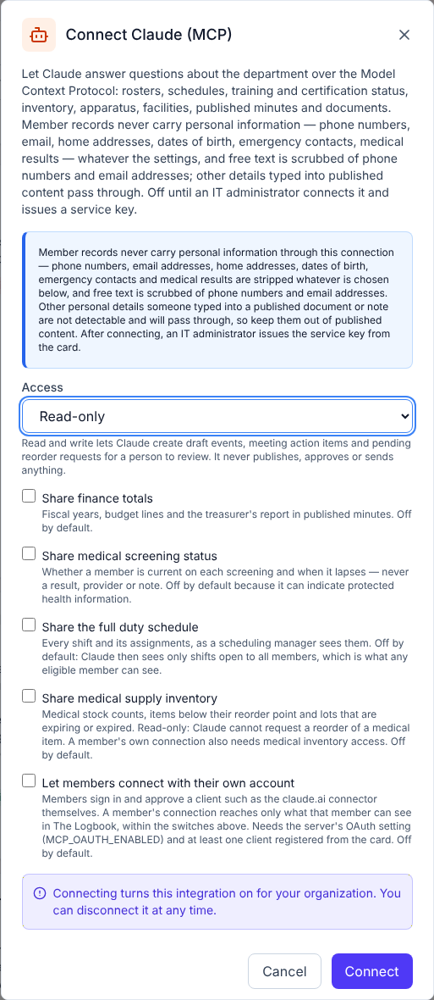

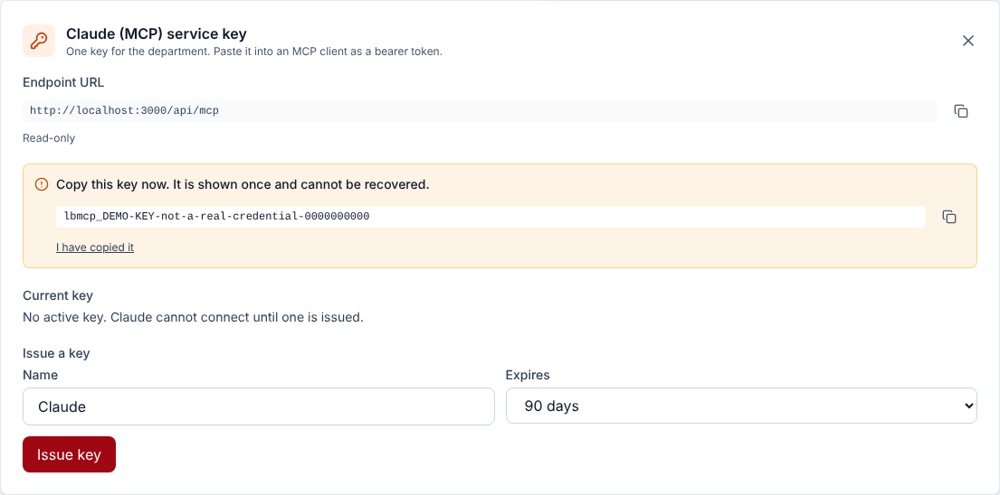

### What it can reach

**Read tools** cover the roster, events, shifts, training and certifications,
inventory, apparatus, facilities, meetings and published minutes, documents in
unrestricted folders, and elections.

**Four areas have their own switches, all off at first:**

| Switch                   | What it adds                                                                                                                                                                                                         |
| ------------------------ | -------------------------------------------------------------------------------------------------------------------------------------------------------------------------------------------------------------------- |
| Finance                  | Finance totals                                                                                                                                                                                                       |
| Medical screening status | Medical screening **status** only                                                                                                                                                                                    |
| Full duty schedule       | The full duty schedule. Without it, Claude sees only shifts open to all members — what any eligible member can already see                                                                                           |
| Medical supply inventory | Medical stock: counts, items below their reorder point, and lots expiring or already expired. Claude still cannot ask for a reorder of a medical item. A member's own connection also needs medical inventory access |

**Three write tools** draft an event, add a meeting action item, or raise a
reorder request. They need the access mode set to read/write, which is also off
at first.

**Tools your department has not switched on are not even listed to Claude.**

### Personal information never leaves

The same protection applies to **every** answer. These are always removed:
phone numbers, email addresses, home addresses, dates of birth, emergency
contacts, photos, membership and certification numbers, login names, medical
results, and passwords or sign-in codes.

On top of that, **email addresses and phone numbers are removed from all free
text**, such as a note or a description. Other details typed into published
content do pass through.

### The service key

- One active key per department.
- The key is shown **once**, when it is issued. It cannot be shown again.
- It can have an expiry date. **Issuing a new key cancels the old one.**
- Issuing and cancelling keys needs **Issue and revoke Claude MCP service
  keys**. Only the **IT Manager** position has it at first.
- Every question Claude asks, and every key issued or cancelled, is recorded in
  the audit log.

### Setting it up

1. **Integrations → Claude (MCP) → Connect.** Choose the access mode. Leave the
   three data switches off unless you want them.
2. **Issue a service key** from the **Service key** panel. Copy it at once; it
   is shown only once.
3. Give the key to whoever sets up the Claude client, with your Logbook's
   address followed by `/api/mcp`.

**Test** on the card says whether a key has been issued and when it expires.
Full setup detail, including client settings, is on the
`Integration-Claude-MCP` wiki page.

### Member sign-in (OAuth)

claude.ai and Claude Desktop sign in with OAuth instead of a pasted key.
**Member sign-in** lets each member connect Claude to their **own account**.
They sign in, see what Claude is asking for, and see how many tools each
request would actually reach for them. Then they choose **Allow** or **Don't
allow**. The connection can do only what that member can do in The Logbook,
within the switches above.

> **OAuth here does not mean Google or Microsoft sign-in.** The Logbook runs its
> own small sign-in service. A member signs in on The Logbook's ordinary login
> page with their **Logbook username and password** (and their second sign-in
> step, if they use one). Claude receives a short-lived pass for that member and
> never sees the password. A department without single sign-on needs nothing
> extra.

It stays **off** until three things are true:

1. The server operator sets `MCP_OAUTH_ENABLED` and `MCP_OAUTH_ISSUER_URL`.
2. An administrator ticks **Let members connect with their own account** on
   the integration.
3. An IT administrator registers the client (name, exact redirect address,
   optional secret) in the **Member sign-in (OAuth)** panel on the card.

- Changing or resetting a password ends every connection the member holds.
- **Fixed on 2026-10-14:** before then, every tool call on a member's
  connection was refused, and Claude showed only "Error executing tool". A
  member who connected before the fix and saw that does not need to reconnect;
  just ask again. A tool the member lacks the permission for, or that a
  department switch has turned off, is still refused, with its own message.
- Members cannot register a client themselves. Every client is registered by
  someone who can issue Claude service keys.

### Walkthrough: connecting the claude.ai connector

The steps below are in the order they have to happen. Steps 1–3 are done once
per department; steps 4–6 are done by each member who wants to connect.

#### Before you start — the server (operator)

Set both variables on the backend and restart it:

```bash
MCP_OAUTH_ENABLED=true
MCP_OAUTH_ISSUER_URL=https://logbook.yourdept.org   # public origin, no path
```

- The issuer must be the `https://` address members and claude.ai use to reach
  The Logbook, with no path and no trailing slash. If it is missing or invalid,
  member sign-in stays off and the backend logs a warning at startup.
- **claude.ai connects from the internet**, not from the member's browser. A
  Logbook reachable only on the station LAN or a home network cannot be added
  as a claude.ai connector, whatever the settings.

The MCP endpoint a client is given is the same address with `/api/mcp` on the
end — for example `https://logbook.yourdept.org/api/mcp`.

#### Step 1 — Turn on member sign-in for the department (administrator)

**Integrations → Claude (MCP) → Connect**, choose the access mode and data
switches as usual, and tick **Let members connect with their own account**.

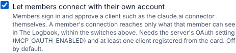

**Already connected?** Select **Settings** on the connected Claude (MCP) card,
tick the switch and select **Save settings**. The form opens with what is
already stored, so nothing else changes. The service key and every member
connection are kept, and the change applies to the next request a client makes.
Until the switch is on, the panel in step 2 shows a blue notice saying so, and a
member who tries to connect is sent straight back to claude.ai with the sign-in
refused.

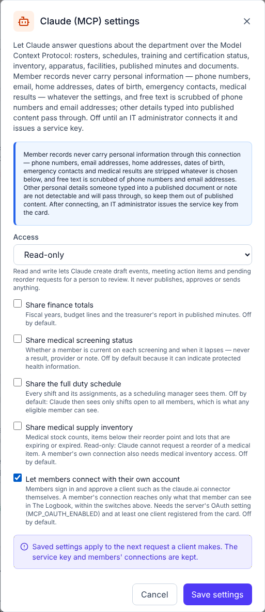

#### Step 2 — Register claude.ai as a client (IT administrator)

On the connected Claude (MCP) card, select **Service key**. The **Member
sign-in (OAuth)** panel opens below the service key panel. It shows the
authorization server address, which is your `MCP_OAUTH_ISSUER_URL` followed by
`/api/oauth` (the picture below was taken on a demo server at
`http://localhost:3000`). If it shows a yellow _Member sign-in is off on this
server_ notice instead, the operator step above is not done.

The **Register a client** form is prefilled for claude.ai: name `claude.ai`,
**Issue a client secret** ticked, and the redirect URI
`https://claude.ai/api/mcp/auth_callback`. Leave those as they are and select
**Register client**. Requires **Issue and revoke Claude MCP service keys**.

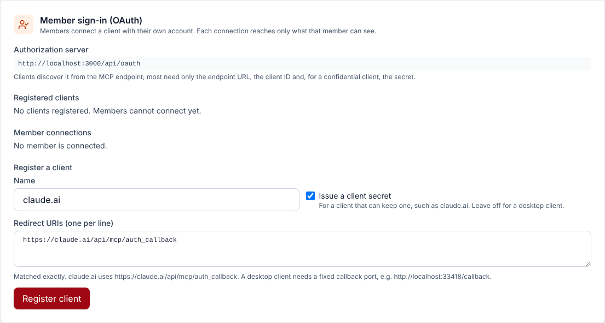

#### Step 3 — Copy the client ID and secret

The panel shows the **client ID** and the **client secret**, each with a copy
button. **The secret is shown once and cannot be recovered** — copy both now,
and select **I have copied it** when done. Hand them to whoever will add the
connector, by a channel you would trust with a password.

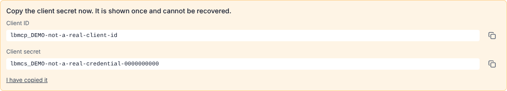

Lost the secret? **Revoke** the client in the same panel and register a new
one. Revoking a client disconnects every member who connected through it.

#### Step 4 — Add the connector in claude.ai (each member)

In claude.ai, open **Settings → Connectors** and add a **custom connector**:

| Field                                   | Value                                 |
| --------------------------------------- | ------------------------------------- |
| Name                                    | anything, e.g. `The Logbook`          |
| Remote MCP server URL                   | `https://<your-logbook-host>/api/mcp` |
| Advanced settings → OAuth Client ID     | the client ID from step 3             |
| Advanced settings → OAuth Client Secret | the client secret from step 3         |

**Fill in Advanced settings before you select Add.** A connector saved without
a client ID tries to register itself automatically, which The Logbook does not
allow, and fails with _Couldn't register with The Logbook's sign-in service_.
Remove that connector and add it again with both values filled in.

claude.ai's own screens are not pictured here: they belong to Anthropic and
change independently of The Logbook.

#### Step 5 — Sign in and approve (each member)

Select **Connect** on the new connector. The browser goes to The Logbook:

1. If not already signed in, the member signs in on the normal login page with
   their Logbook username and password.
2. **Connect Claude to your account** names the client, lists what it is asking
   to do, and says how many tools each would reach **for this member** right
   now. Reading is always included. A row that says _Would not reach anything
   for you_ is honest, not an error: the department does not share it (the
   write row while the integration is read-only, for example) or the member's
   own permissions do not reach it. Optional rows can be unticked.
3. **Allow** returns the member to claude.ai, now connected. **Don't allow**
   returns them without a connection.


#### Step 6 — Review or end a connection

Members review and disconnect their own connections on the **Claude
connections** page (`/claude/connections`), linked from the consent screen. It
has no menu entry, so bookmark it or use the link. Administrators see every
member's connection in the Member sign-in (OAuth) panel and can end any of
them.

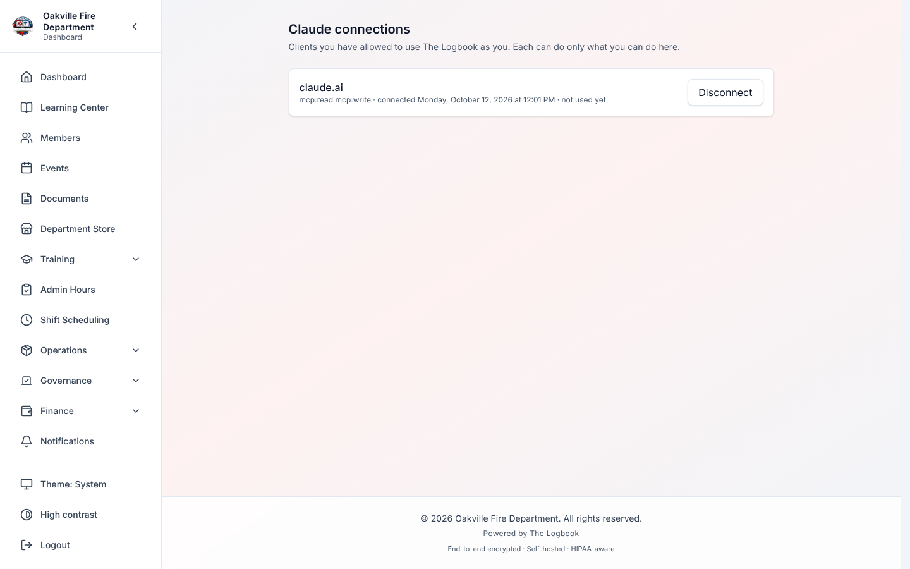

### Troubleshooting member sign-in

| What you see                                                                                                                                                        | Where                        | What it means                                                                                                                   | Fix                                                                                                   |
| ------------------------------------------------------------------------------------------------------------------------------------------------------------------- | ---------------------------- | ------------------------------------------------------------------------------------------------------------------------------- | ----------------------------------------------------------------------------------------------------- |
| _Couldn't register with The Logbook's sign-in service … add an OAuth Client ID in the connector settings_                                                           | claude.ai                    | The connector has no client ID, so claude.ai tried to register itself; The Logbook allows only administrator-registered clients | Remove the connector and add it again with the client ID and secret in **Advanced settings** (step 4) |
| Yellow _Member sign-in is off on this server_                                                                                                                       | Member sign-in (OAuth) panel | `MCP_OAUTH_ENABLED` is not set, or `MCP_OAUTH_ISSUER_URL` is missing or not an `https://` origin                                | Operator: set both and restart; check the backend startup log for the warning                         |
| Blue _Turn on Let members connect with their own account_                                                                                                           | Member sign-in (OAuth) panel | The department switch is off                                                                                                    | Step 1 — **Settings** on the connected card                                                           |
| _Unknown client_                                                                                                                                                    | Logbook error page           | The client ID in claude.ai does not match a registered, unrevoked client                                                        | Re-copy the ID, or register a new client                                                              |
| _The redirect URI is not registered for this client_                                                                                                                | Logbook error page           | The client was registered with a different redirect URI                                                                         | Register a client with exactly `https://claude.ai/api/mcp/auth_callback`                              |
| The connection is refused before any Logbook sign-in page appears (`access_denied`, _Connecting Claude with a member account is not enabled for this organization_) | claude.ai                    | The department switch is off                                                                                                    | Step 1                                                                                                |
| _Client authentication failed_ / `invalid_client`                                                                                                                   | claude.ai, after **Allow**   | The secret in claude.ai is wrong, or belongs to a revoked client                                                                | Revoke and re-register (step 3), then update the connector                                            |
| The connector never reaches The Logbook's sign-in page                                                                                                              | claude.ai                    | claude.ai cannot reach the server from the internet, or the URL is wrong                                                        | Use the public `https://…/api/mcp` address; the server must be reachable from outside your network    |

Full setup detail, including Claude Code and Claude Desktop clients, is on the
`Integration-Claude-MCP` wiki page.

---

## Monitoring Integration Health

On the Integrations page, each card shows only whether it is **Connected**. To
see how an integration is doing, select **Details** on its card. The health
page shows:

- **Last sync** and **Last success**
- **Failures in a row**
- **Status**: **Healthy**, **Recent failure**, **Failing** (three or more
  failures in a row) or **Not run yet**
- **Last error**, and when it happened
- the last 50 runs — syncs, connection checks and chat notifications — with
  what started each one

**Retry sync** (Salesforce) runs the sync again. For other integrations the
same button reads **Retry connection check**. It can be used once a minute for
each integration.

Error text is cleaned before it is saved, so it never shows a webhook address,
key or email address.

---

## Troubleshooting

| Problem                                                    | What to do                                                                                                                                                                 |
| ---------------------------------------------------------- | -------------------------------------------------------------------------------------------------------------------------------------------------------------------------- |
| **Test** reports a failure                                 | Check the details you entered have not expired or changed, then select **Test** again. Open **Details** for the last error                                                 |
| Google Calendar or Outlook reads Coming Soon               | Calendar publishing is turned off on the server (`CALENDAR_SYNC_ENABLED`); Outlook cannot be connected yet either way. See [Calendar Integrations](#calendar-integrations) |
| Google Calendar reads Reconnect required                   | Select **Reconnect with Google** on the card. See [Google Calendar](#google-calendar)                                                                                      |
| Salesforce sync reports missing fields                     | Run **Check readiness**. Create the missing fields in Salesforce, or tick **Skip custom fields my Salesforce org hasn't created yet**                                      |
| Webhook test never arrives                                 | Check the address is public and starts with `https://`. Ask whoever runs the receiving system to check it answers                                                          |
| Weather alerts not showing                                 | Only Severe and Extreme alerts are shown, and only on the channels ticked in the integration's settings. Check the zone with **Test**                                      |
| Shift feed or department feed not updating                 | Calendar apps check every so often, up to about an hour. Check the link is the current one, not one from before a **Reset link**                                           |
| Slack, Discord or Teams posts not appearing                | Check the webhook address is still valid in the chat app. Open **Details** to see whether deliveries failed                                                                |
| Documenso test fails                                       | Check the API token under **Settings > API** in Documenso, and the base URL if you run your own Documenso                                                                  |
| Cal.com test fails                                         | Check the API key under **Settings > Developer > API keys** in Cal.com                                                                                                     |
| A signed document or booking did not move the applicant on | Check the Webhook Secret matches on both sides, the callback URL is right, the email matches the applicant, and the applicant's **current** stage uses that integration    |
| A sign-in keeps expiring                                   | Most integrations renew it by themselves. If it keeps failing, disconnect and connect again                                                                                |

---

## Realistic Example: Connecting Slack and the Shift Feed

### Background

**Oakville Fire Department** IT Manager **Steve Park** wants new events posted
in Slack. He also wants members to see their shifts in their own calendars.

### Part 1: Connecting Slack (Monday Morning)

1. Steve opens **Administration → Forms & Comms → Integrations**.
2. He finds **Slack** in the Messaging category and selects **Connect**.
3. In another browser tab, he opens Oakville FD's Slack workspace settings. He
   creates an incoming webhook for the `#department-alerts` channel and copies
   its address: `https://hooks.slack.com/services/T0ABC.../B0DEF.../xxxxx`
4. Back in The Logbook, he pastes the address into **Webhook URL** and selects
   **Connect**.
5. On the Slack card, he selects **Test**. `#department-alerts` receives "The
   Logbook — Integration test successful!"

There are no event choices to make. From now on, every new event, new shift and
new training record posts to the channel.

That afternoon, Lt. Santos creates a training event, "Q3 Hazmat Refresher". A
message about it appears in `#department-alerts` with its title, date, time and
location.

### Part 2: Telling Members About the Shift Feed

Steve first looks at the Google Calendar card. It reads **Coming Soon**
because calendar publishing is turned off on the department's server, so he
connects the **iCalendar (ICS)** card instead, copies the department events
link it shows, and posts it in the members' channel.

Each member's shift feed is made the first time they open **Subscribe to my
shifts** on **My Shifts**. So Steve sends round an instruction, not a link:

> Open Scheduling → My Shifts, select **Subscribe to my shifts**, copy the
> link, and add it in your calendar app (Google, Apple or Outlook). It is yours
> alone — don't forward it. If you ever do, select **Reset link** and the old
> one stops working.

It is pictured under [iCalendar (ICS) Feed](#icalendar-ics-feed).

### Part 3: Monitoring Health (Ongoing)

The next week, Steve selects **Details** on the Slack card. It reads
**Healthy**, with the last run a few hours ago.

**What went wrong on Wednesday:** while Steve made a batch of events, Slack
refused one message because too many arrived at once. The Logbook does **not**
try that message again, so it never reaches the channel. The Slack
integration reads **Recent failure**, and its history shows "The platform did
not accept the message." The next message goes through and the status returns
to **Healthy**. If three in a row had failed, it would read **Failing**. If an
important announcement was the one lost, post it in Slack by hand.

**A member's calendar shows the wrong times:** a member says their shift
calendar shows UTC times instead of Eastern. The feed carries the time zone
correctly; the member's calendar app was set to UTC. It is fixed on the
member's phone, not in The Logbook.

### Edge Cases

| What happens                                      | What it means / what to do                                                                                                                                                                                     |
| ------------------------------------------------- | -------------------------------------------------------------------------------------------------------------------------------------------------------------------------------------------------------------- |
| The Slack webhook stops working (channel deleted) | Each post fails. The status reads **Recent failure**, then **Failing** after three in a row. The history shows "The platform did not accept the message." Create a new webhook in Slack and update the address |
| A calendar app checks the feed too often          | The Logbook refuses some of the checks for a while. The calendar app tries again by itself                                                                                                                     |
| Slack and email both carry the same news          | Each sends on its own, so a member may see it twice. There is no setting to prevent this                                                                                                                       |
| Generic webhook has no secret                     | The test message is sent unsigned, so the receiving system cannot tell it really came from The Logbook                                                                                                         |

---

## If You Learned an Older Version

If you are following older notes, an older recording or an SOP, these things
work differently from what they describe.

- **Google Calendar publishes one way, to a calendar The Logbook creates.**
  Older notes describe choosing one of your existing calendars and two-way
  sync. Neither exists: connecting creates a new department calendar, and
  nothing is read back from Google. Outlook cannot be connected yet.
- **There are no event choices for Slack, Discord or Teams.** Older notes
  describe ticking New Member, Training Completed, Event Scheduled or Shift
  Change. A chat integration takes only a webhook address, and posts new
  events, shifts and training records.
- **There is one department feed, not three.** Older notes describe copying
  "All Events", "Training Only" and "My Shifts" links from the iCalendar
  integration. The card gives one link, to the department's published events.
  Each member's shift feed comes from **Scheduling > My Shifts**.
- **Generic ePCR Import, NEMSIS Response Module Export, NFIRS Export and CSV
  Import/Export are Coming Soon**, not available. FirstWatch is also in the
  Coming Soon list. The NREMT and ImageTrend cards read **NREMT Verification**
  and **ImageTrend**.
- **The Salesforce panel has no Status tab, last-sync time or sync history.**
  A run's counts appear once, in a message. The buttons are named by what they
  send, such as **Members → Contacts**, not "Push Members". There is no **View
  Field Mappings** button.
- **The health indicators moved.** Cards no longer show green, yellow, grey or
  red health marks. Health is on each integration's **Details** page.
- **Test is on the card.** The connect window has no **Test Connection**
  button; connect first, then select **Test** on the card.
- **Training provider integrations are under Settings & Data.** Older notes
  say **Training Admin > Setup > Integrations**. There is no Setup area in
  Training Admin any more.
- **NFC ID Cards is something you switch on.** A department that has not
  activated it has no ID Cards section and no check-in station.
- **An older Target Solutions setup may need entering again.** Older versions
  sent its details to the Vector Solutions service, so nothing useful came in.
  Edit the provider, enter the key and secret as described above, select
  **Test**, then **Sync Now**.
- **Target Solutions completions are credited automatically.** Older notes say
  every synced completion waits for an officer. Only completions nobody can
  match wait now; other providers still wait for an officer.
- **The Target Solutions waiting list is the Import Queue.** Older notes call
  it "Imports" and describe **Import** and **Bulk Import** buttons, which the
  screen does not have.
- **Cal.com: subscribe to MEETING_ENDED.** Older notes say BOOKING_CREATED,
  which moved applicants on as soon as they picked a time.
- **Duplicate Target Solutions entries from older versions** were kept, with
  all but one marked **duplicate** and the original number noted on them. No
  training record was changed.

---

**Previous:** [Prospective Members Pipeline](./15-prospective-members.md) | **Next:** [Privacy & Your Data](./17-privacy-data-rights.md)
