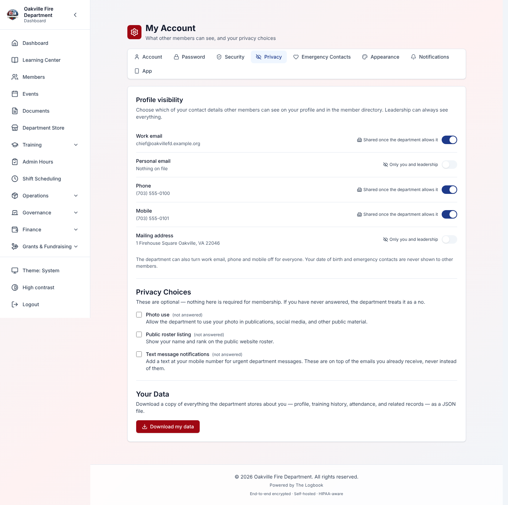
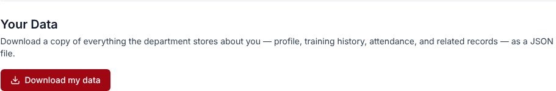
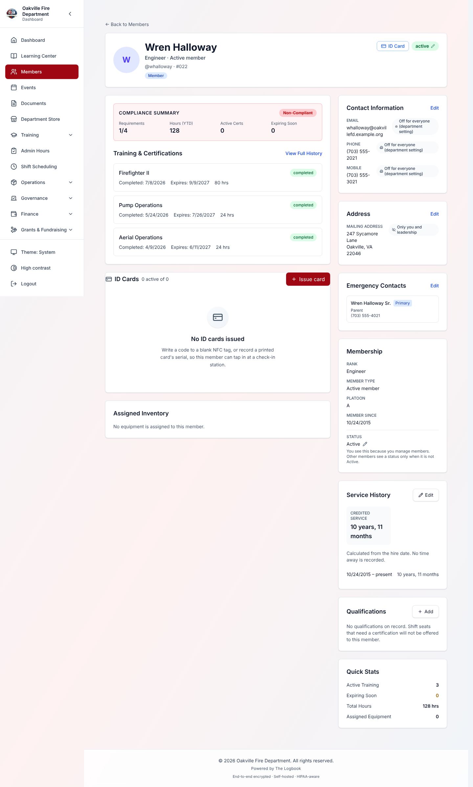
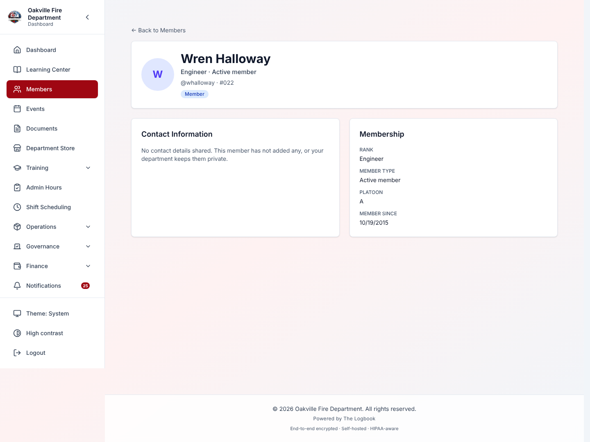
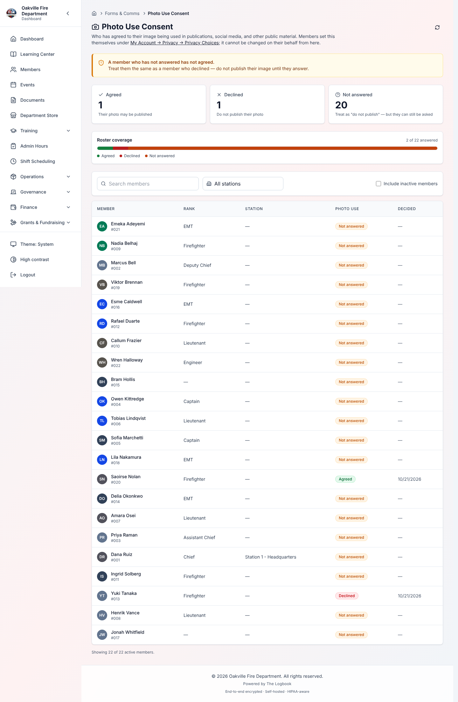
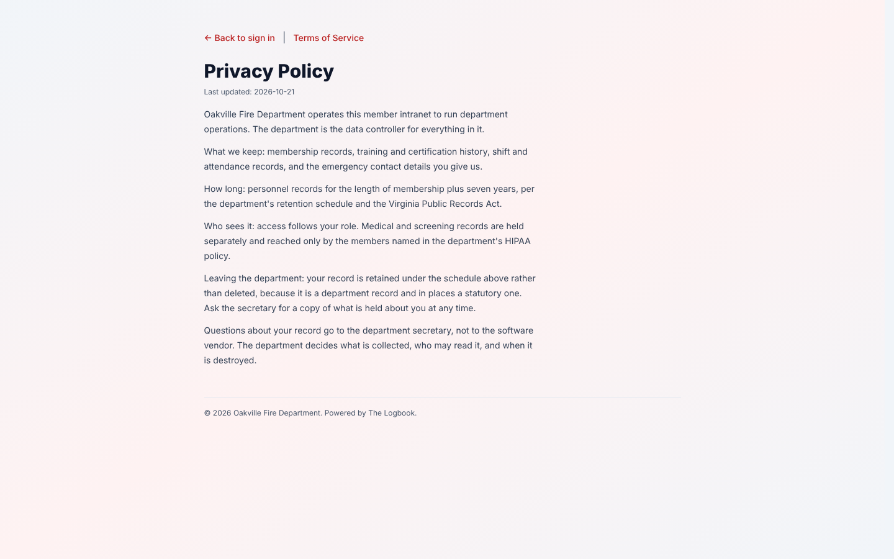
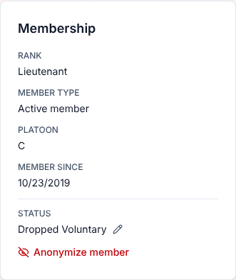

# Privacy & Your Data

The Logbook holds a lot of information about you: your contact details, your
training history, your attendance, and — if your department uses the Medical
Screening module — health screening records. This guide explains what you can
see and control about your own data, and what administrators configure on
behalf of the department.

Two audiences share this lesson. Sections 1–4 are for **every member** (with
one officer-only subsection at the end of section 4, on changing the published
wording). Sections 5–8 are for **administrators** who look after retention,
handle departures, and answer records requests.

---

## Table of Contents

1. [Your Privacy Choices](#your-privacy-choices)
2. [Downloading Your Data](#downloading-your-data)
3. [What Officers Can See](#what-officers-can-see)
4. [The Privacy Notice and Terms](#the-privacy-notice-and-terms)
5. [Records Retention (Admin)](#records-retention-admin)
6. [Anonymizing a Departed Member (Admin)](#anonymizing-a-departed-member-admin)
7. [Audit Records and Retention (Admin)](#audit-records-and-retention-admin)
8. [Answering a Records Request (Admin)](#answering-a-records-request-admin)
9. [Realistic Example: A Member Leaves the Department](#realistic-example-a-member-leaves-the-department)
10. [Troubleshooting](#troubleshooting)
11. [If You Learned an Older Version](#if-you-learned-an-older-version)

---

## Your Privacy Choices

Some things the department may want to do with your information are optional.
They are not needed to run the department, so you decide.

Go to **My Account → Privacy → Privacy Choices**.

| Choice                         | What it means if you turn it on                                                                  |
| ------------------------------ | ------------------------------------------------------------------------------------------------ |
| **Photo use**                  | The department may use your photo in publications, on social media, and in other public material |
| **Public roster listing**      | Your name and rank may appear on the department's public website roster                          |
| **Text message notifications** | The department may send you notifications by text message at your mobile number                  |

**Photo use** and **Public roster listing** are a **Yes / No** pair with
neither chosen until you answer _(2026-10-25)_. Choosing **No** records your
decline; leaving both blank means "not answered", so the department can still
ask you. **Text message notifications** stays a switch, because it is also the
text-message consent record.

> **Screenshot to replace:** 17-01 shows checkboxes for photo use and roster
> listing; re-shoot with the Yes / No pairs.

The same tab holds **Profile visibility**. There you choose which contact
details other members can see: work email, personal email, phone, mobile and
mailing address. Leadership can always see everything. Your date of birth and
emergency contacts are never shown to other members.

Three things worth knowing:

- **Nothing here is required for membership.** Turning everything off does not
  affect your standing, your training records, or your use of The Logbook.
- **"Not answered" counts as no.** If you have never made a choice, the label
  reads _(not answered)_. The department treats that exactly as a no. Your
  silence is never read as permission.
- **You can change your mind at any time.** Every change is recorded with the
  date and time. There is always a clear record of what you agreed to and when.

> **Hint:** If you never receive department text messages, check this page
> first. US telephone consumer protection rules require your explicit consent
> for texts, so they stay off until you turn them on.

> **Turning off texts does not turn off being notified.** The text-message choice
> controls only the text copy of a notification. Important department notices
> always go to your **email** as well. That email is the official record that
> you were told. Consent can silence the text, but never the notice itself. Keep
> your email address current under **My Account** for this reason.

---

## Downloading Your Data

You can download everything The Logbook stores about you at any time.

1. Go to **My Account → Privacy**.
2. Scroll to **Your Data**.
3. Select **Download my data**.
4. A file named `logbook-personal-data-export.json` downloads to your device.

### What is in the export

| Included                                                                    | Not included                                                   |
| --------------------------------------------------------------------------- | -------------------------------------------------------------- |
| Profile, contact details, emergency contacts                                | Your password (only an unreadable scrambled form is ever kept) |
| Training records, certifications, qualifications                            | Your two-factor authentication secret and backup codes         |
| Shift, event, and meeting attendance                                        | Password-reset links and calendar-feed links                   |
| Admin hours, leaves of absence                                              | Other members' records                                         |
| Medical screening records about you                                         | Reviewer-only internal notes on evaluations                    |
| Skill tests, dues, equipment assigned to you                                | Shift-report results your department hides from trainees       |
| Your privacy choices                                                        |                                                                |
| A **summary** of your audit history (how many entries, first and last date) | The full audit entries themselves                              |

**Shift reports follow the same rule as the screen.** Your department can hide
some officer-written parts of a shift report from trainees: the performance
rating, the officer's narrative, areas of strength, areas for improvement and
skills observed. If it does, the export leaves those parts out too. The
download is never a way around what the screen hides.

- The ordinary facts of each shift still appear: the date, hours, calls and
  call types, tasks performed and the review status.
- A change to the setting affects exports made afterwards. A file you already
  downloaded does not change.
- Officers who review shift reports still see them in The Logbook.

> **Hint:** The file is plain text in a structured format, and any text editor
> will open it. If you want it in a spreadsheet, ask an officer to run a
> formatted report instead.

Two safeguards you may notice:

- **You can only ever export your own data.** The button always uses your own
  sign-in. There is no way to point it at someone else.
- **You can export three times per hour.** Building the file reads every
  module's records, so the limit protects The Logbook's performance. If you
  reach it, wait an hour and try again.

Every export is recorded in the audit log. That is not meant to discourage you.
"Who accessed this data and when" is exactly what an audit trail is for.

---

## What Officers Can See

Access follows role, not rank alone. Officers and administrators see what their
duties require.

**Contact details.** Other members see your contact details only if your
department turns on contact-info visibility, and only the fields it turns on
(email, phone and mobile can each be shown or hidden). See
[Administration & Reports > Contact Info Visibility](./08-admin-reports.md#contact-info-visibility).

- The setting applies to every screen that shows a member, including the
  profile page.
- **Home address and personal email are never shown to ordinary members**, at
  any setting. Only members who manage the roster see them.

**Account-security details are not part of your directory entry.** A colleague
who opens your profile from the member directory does not see:

- whether you use two-factor authentication or have verified your email
- when you last signed in, or when your account was created or changed
- your notification preferences
- the permissions behind your roles (they see the role names only)

User administrators, roster managers and you yourself still see these on your
own record.

**Above: an officer. Below: an ordinary member, on the same record.** The
account-security details listed above are not on this screen for anybody. They
live on your own settings page. What the pair does show:

- The officer sees the compliance summary, the training and certification
  history and the emergency contacts. The member sees none of the three.
- The member still sees the **Contact Information** panel, but the values are
  withheld. When nothing is shared, it reads "No contact details shared. This
  member has not added any, or your department keeps them private."

**A colleague's ID card is for the officers who issue them.** Your ID card —
your badge, with its QR code and barcode — is a credential. You can always open
your own. Opening a colleague's needs an officer who can manage member profiles
or issue ID cards. Checking someone in does not need it: the badge scanner and
the check-in station look a member up without showing their card.

**Only membership leadership edits a colleague's profile.** Editing someone
else's profile or contact information needs permission to manage member
profiles. You can always edit your own. A role that can edit user accounts but
not manage member profiles:

- does not get edit forms on a colleague's profile, and is refused if it tries
  to save one
- never gets back, after a save, any detail it could not see when reading

**Date of birth and emergency contacts are restricted to leadership** — the
chiefs, captains, president, vice-president, secretaries and membership
coordinator, plus you on your own record. There is deliberately no setting that
publishes them. Your department cannot choose to show them on the roster.

- Emergency contacts get this treatment because they are not your data alone.
  They name a spouse, a parent, a neighbor. Those people are not members, never
  agreed to appear in the department's systems, and cannot remove themselves.
- Date of birth is restricted because, paired with a name, it is the detail
  most useful to someone pretending to be you.
- When a leader opens your profile, the audit log records whether that
  restricted information was actually shown. So "who saw my family's phone
  number" has an answer, not just "who opened the page".

**Other protected records:**

- **Medical screening records** are open only to members who hold medical
  screening permissions specifically. A general administrator role does not
  include them.
- **Evaluation narratives** an officer writes about you are stored encrypted.
  Reviewer-only notes are never shown to you or exported. That field is for the
  review process, not about you.
- **Access to sensitive records is logged.** If you ever want to know who
  looked at something, that question can be answered.

### Photo Use Consent

You set whether your photograph may be used under **My Account → Privacy →
Privacy Choices**. The people who publish — choosing images for a newsletter, a
social post or a press release — see the whole department's answers on one
roster: **Communications → Photo Use Consent**.

- It shows who has agreed, who has declined and who has not answered.
- It shows only what identifies a member on a photo call sheet: name, rank,
  station and membership number. No contact details.
- Inactive members are left out unless **Include inactive members** is ticked.
- The roster is read-only. Your consent is yours to set.

Who can open it: officers who can view member privacy consent records, send
department messages, manage member profiles, or edit user accounts. The first
of those is a permission that opens only this page. By default the
**Historian**, **Public Outreach** and **Communications Officer / PIO**
positions hold it.

---

## The Privacy Notice and Terms

Your department publishes a privacy notice and terms of service. Both are
public pages: you do not have to be signed in to read them. The **Privacy** and
**Terms** links at the bottom of the login screen open them. Each shows a
**Last updated** date at the top, so you can tell when the wording last
changed.

The notice explains what the department collects, where it comes from, why it
is used, who can see it, how long it is kept, and what you can ask for. If your
department has written its own wording, that is what you see. Otherwise the
built-in wording applies, which is written for a fire department.

### The part members ask about most

Both documents say the same thing near the top. It is worth reading before you
need it:

- **The department holds full control of this application and of the records
  in it.** The Logbook is the software; the department decides how it is used.
- **Your access is based on your status in the department.** The department
  decides it under its own bylaws, SOPs and membership policies, and under
  state and local law.
- **Access changes when your status changes.** A leave of absence, a change of
  rank or assignment, a suspension, or leaving the department changes or ends
  your access. This can happen without prior notice.
- **Records you create here belong to the department.** Reports, minutes,
  attendance and messages are department records, kept on the department's
  retention schedule. They do not leave with you.
- **Your activity is logged.** Sign-ins and record access go into an audit
  trail the department can review. Treat this as a department system, not a
  private one.
- **It is not a dispatch or alerting system.** Never rely on it to report an
  emergency or receive a call for service.

The notice also covers monitoring, public-records requests, breach
notification, and junior and cadet members under 18. It states plainly that
your information is never sold and never used for advertising.

> **Note:** The department, not The Logbook, is responsible for the content of
> these pages and for the data itself. The Logbook is the software the
> department runs.

### Changing the wording (Officers)

> **Required Permission:** "View legal documents and propose revisions" to read
> and propose; "Publish legal document revisions to the public pages" to
> publish.

Go to **Governance → Legal Documents**. For each of the two documents, the
screen shows what members see right now, any proposals open against it, and
what it said before.

**Proposing is not publishing.** By default these positions can reach the
screen and write an alternative version: the secretary, the chiefs, captains
and lieutenants, the president, vice president, treasurer, board,
quartermaster, membership coordinator and assistant secretary. Nothing on the
public page changes until someone with publishing rights publishes it. By
default that is the Fire Chief, President or IT Manager. Regular members never
see the screen.

To propose a revision:

1. Pick the document: **Privacy Policy** or **Terms of Service**.
2. Select **Propose a revision**. The editor opens filled in with the text
   members see today — your department's own version, or the built-in wording
   if it has none. You edit rather than retype.
3. Edit the text. It is plain text, exactly as the public page shows it. Leave
   a blank line between paragraphs. Do not use formatting marks; they would be
   printed as typed.
4. Say **what this changes and why**, naming the bylaw, SOP, law or legal
   advice behind it. This is required. It is what a future officer reads to
   understand the change. You will want it in front of you if the notice is
   ever questioned.
5. Optionally set the effective date members see as "Last updated".
6. Select **Save draft**. The other officers can now see it. It is still not
   public.

You can have at most **ten open proposals of your own for each document**. An
eleventh is refused with a message saying so. Publish or withdraw one first.

An officer with publishing rights reviews the draft and selects **Publish**,
then **Publish it** to confirm. This replaces the live page immediately. The
version that was live is archived, not deleted, so the department can always
answer what a member was shown on a given date. **Revert to the built-in text**
puts the built-in wording back.

> **Admins:** your wording replaces the built-in wording **entirely**. The two
> are not merged. Carry the department-control and status-based-access language
> across into your version. A rewrite most often loses that part, and it is the
> part that matters when a member disputes losing access. Have counsel review
> anything you publish.

---

## Records Retention (Admin)

How long records are kept is a department decision. Required retention for
fire-department records varies by state, so the schedule can be changed rather
than being fixed.

> **There is no retention screen in The Logbook.** The schedule is changed
> through the server's administrative interface, by someone who holds the "Full
> settings and admin management" or "Update organization settings" permission
> — in practice, your IT administrator. As an officer, decide the schedule with
> your leadership and records policy, then ask your IT administrator to apply
> it. Every change is recorded in the audit log.

Retention is set per **record class**. Each class has a default and a
**minimum** that cannot be undercut:

| Record class              | What it covers                                                            | Default      | Minimum |
| ------------------------- | ------------------------------------------------------------------------- | ------------ | ------- |
| Message history           | Delivery records for sent emails and texts (recipients, subjects, status) | 90 days      | 30 days |
| Notification logs         | In-app, email and text notification delivery records                      | Keep forever | 30 days |
| Error reports             | The error reports on the Error Monitoring page                            | 180 days     | 30 days |
| Form submissions          | Public and internal form responses, which may hold applicants' details    | Keep forever | 90 days |
| Guest check-ins           | Names, emails and phone numbers of non-members who signed in at events    | Keep forever | 90 days |
| Practice skills-test runs | Practice attempts only. Official skills-test results are never removed    | 1 year       | 30 days |

A daily job applies the schedule. A class set to _keep forever_ is never
deleted automatically.

> **Note:** **Documents and meeting minutes are never deleted automatically.**
> They are official records. Destroying them belongs in your department's own
> records schedule, carried out by a person who understands the legal
> consequences. The Logbook will not do it for you.

> **Hint:** The minimums exist to prevent an expensive typo. Entering `3` when
> you meant `30` cannot silently erase last month's records — the value is
> refused. Even a value below the minimum stored some other way is raised to
> the minimum when the job runs.

### Applicant records

Applications from people who never joined are not on this schedule. Each
prospective-members pipeline has its own **Auto-Purge** setting instead:

- **Auto-Purge on:** an application that has stayed **Inactive** for the
  pipeline's grace period (30 to 1,095 days) is permanently deleted, with its
  uploaded documents. The check runs once a day. Membership coordinators
  usually get an email seven days before, listing the application and its
  deletion date.
- **Auto-Purge off** (the default): nothing is deleted automatically.

> **Important.** The seven-day email is a courtesy, not a safeguard. The
> deletion goes ahead whether or not the email was sent or read. An application
> that is already past the grace period gets no email at all. This happens when
> you turn Auto-Purge on, or shorten the grace period. For example, cutting the
> period from 180 to 30 days deletes an application inactive for 45 days on the
> next daily run, with no warning. Before you turn Auto-Purge on or shorten its
> period, check **Prospective Members → Inactive Applications** and reactivate
> anyone worth keeping.

A coordinator can also purge applications by hand:

1. Go to **Prospective Members → Inactive Applications**.
2. Select the applications.
3. Select **Purge Selected**.

Either way, only applications that are still inactive are deleted, along with
their uploaded documents. The audit log records each purge — how many, and
which records — but no applicant details. See
[Prospective Members → Inactivity Timeout](./15-prospective-members.md#inactivity-timeout)
and
[Purging inactive applications](./15-prospective-members.md#purging-inactive-applications).

An applicant can also close their own application from their status-page link,
with **Withdraw Application**. Withdrawing stops the process but does not
delete the record. It stays on the **Withdrawn** tab.

---

## Anonymizing a Departed Member (Admin)

> **Required Permission:** "Manage member profiles"

When a member leaves, the department still needs their operational history —
training completions, attendance percentages, property they were issued. It
does not need to keep their home address, date of birth, photo or medical
screening details forever.

Anonymization separates the two. It removes the person's identity and keeps the
record of what happened.

**Before you can anonymize**, the member must already have left — dropped,
archived or deactivated. Active members are refused, and you cannot anonymize
your own account. On a departed member's profile, the **Anonymize member** link
sits under their status on the Membership card.

### What is removed

Name, username, email, phone, address, date of birth, photo, emergency
contacts, sign-in details and two-factor secrets, body measurements, medical
screening content, free-text reasons on leaves and waivers, dietary and
accessibility notes on event RSVPs, and the original application with its
interview notes and uploaded documents.

### What is kept

Training completions and certifications, attendance and service hours,
property custody and departure clearance, dues and financial records, meeting
attendance, and — importantly — screening _status and dates_. You can still
prove the member was compliant at the time.

### What is never touched

- **The audit log.** It cannot be edited, and is sealed so that any change
  shows. Rewriting it would be tampering. The anonymization entry itself does
  not record the member's name, so it does not put the identity back into a
  record that cannot be edited.
- **Election records.** Ballot integrity depends on them.

> **Note:** Anonymization is **irreversible**. There is no undo. Confirm the
> member has really left and that any outstanding property or clearance items
> are resolved first.

---

## Audit Records and Retention (Admin)

Audit records follow their own rule: they are kept **seven years**, longer than
the six-year minimum that HIPAA (the US health-privacy law) requires.

A weekly job moves entries older than that into compressed archive files, then
removes them from The Logbook.

> **Note:** Back up the audit archive. Once that weekly job has run, the archive
> files are the **only** copy of your oldest audit history. The standard
> production backup includes them. If you back up by hand, add them.

Departments that run a security monitoring system (often called a SIEM) can
also send audit entries off the server as they are written. The sealing
detects tampering, but only an off-site copy survives someone deleting the
records outright. Ask your IT administrator about setting this up.

---

## Answering a Records Request (Admin)

When a member (or a former member, or an attorney) asks what the department
holds about someone:

1. **If the member can sign in**, the fastest answer is for them to use
   **My Account → Privacy → Download my data** themselves. It is complete and
   instant, and you do not have to assemble anything.
2. **If they cannot sign in**, reactivate the account for a while, or export on
   their behalf. Then follow your department's identity-check procedure before
   handing anything over.
3. **For a legal or records request**, involve whoever handles that for your
   department before you respond. The audit log can show who accessed a record
   and when, which is often the real question.
4. **Record what you disclosed and to whom.** The Logbook logs the export
   itself. Your department's own file should note the request and the
   response.

---

## Realistic Example: A Member Leaves the Department

**Background.** Firefighter Dana Reyes resigns after six years. She was issued
turnout gear and a portable radio, had a medical clearance on file, and
completed Firefighter I and II. The department needs her training and
attendance history for its annual reporting and for insurance. It has no
reason to keep her home address or medical details indefinitely.

### Step 1: Process the departure normally

The membership coordinator changes Dana's status to **Dropped (Voluntary)**.
They work the departure clearance checklist until the turnout gear and radio
are returned and signed off. Nothing about privacy happens yet. This is the
ordinary offboarding flow from
[Inventory Management > Departure Clearance](./05-inventory.md).

### Step 2: Give Dana her data

Before her account is deactivated, Dana signs in and selects **Download my
data**. She keeps the file with her own records. It is useful when she applies
to another department and needs her training history.

> **Hint:** Suggesting this during the exit conversation saves everyone a phone
> call six months later.

### Step 3: Wait out the department's window

The department's records schedule says to keep a departed member's full record
for one year, in case they return or a question comes up. Dana's record sits
archived, untouched.

### Step 4: Anonymize

A year later, the administrator opens Dana's archived record and selects
**Anonymize member**. Afterwards:

- The roster shows "Former Member-a3f9c210" where her name was.
- Her Firefighter I and II completions still count in the department's
  training statistics and its annual report.
- Her attendance percentage still counts in historical figures.
- The record that she held a valid medical clearance, and when it expired, is
  still there. The clearance's findings, notes and provider are gone.
- Her address, date of birth, photo and emergency contacts are gone.
- Her original application is gone, including the interview notes and the copy
  of her driver's license uploaded during onboarding.

### Step 5: The audit trail still tells the story

The audit log records that an anonymization happened, when, and which
administrator did it. It does not name Dana: that log cannot be edited, and
putting her name back into it would defeat the purpose.

### Key Takeaways from This Example

- Anonymization is an **offboarding step**, not a delete button. Run it after
  clearance is complete and after your retention window.
- Give members their export **before** the account goes away.
- Operational history survives; identity does not. That is the point.
- Statistics and compliance reports stay correct, because the underlying
  records were never deleted.

---

## Troubleshooting

| Symptom                                                                  | Resolution                                                                                                                                                                                     |
| ------------------------------------------------------------------------ | ---------------------------------------------------------------------------------------------------------------------------------------------------------------------------------------------- |
| "Download my data" shows an error about too many requests                | You can export three times per hour, because building the file reads every module's records. Wait an hour.                                                                                     |
| A privacy choice shows "(not answered)" even though I remember answering | The label shows the stored choice. If you answered on a different account (for example a duplicate made during onboarding), the choice is there. Ask an administrator to check for duplicates. |
| Anonymize is refused with "Only departed members can be anonymized"      | The member is still active. Change their status to dropped or archived first, then try again.                                                                                                  |
| Anonymize is refused with "Member is already anonymized"                 | It has already been done for this record. Anonymization is irreversible and happens only once.                                                                                                 |
| Anonymize says "User not found" for a member I can see                   | The member belongs to a different department on the same installation. You can only act on members of your own department.                                                                     |
| I cannot find where to change how long records are kept                  | There is no retention screen. Your IT administrator changes the schedule. See [Records Retention](#records-retention-admin).                                                                   |
| A retention value was refused as below the minimum                       | Each record class has a minimum (30 days for most, 90 days for form submissions and guest check-ins). Choose a value at or above it.                                                           |
| Old message history is not being deleted even though retention is set    | The job runs daily. Check the class is not set to _keep forever_, and that the records really are older than the retention period. The period is counted from the date the message was sent.   |
| Documents older than our retention schedule are still present            | Intentional. Documents and meeting minutes are never deleted automatically. Disposing of official records is a decision for a person.                                                          |
| An export is missing a module we use                                     | The export covers every record holding personal details about the member. If something is really missing, report it as a bug.                                                                  |

---

## If You Learned an Older Version

If you are following older notes, an older recording or an SOP, these things
work differently from what they may say.

- **Retention is not set on a screen.** Older notes described changing the
  retention schedule as if officers could do it in The Logbook. There is no
  such screen; your IT administrator applies it. The schedule also covers more
  record classes than the three older notes listed.
- **Purging inactive applications deletes them, and Auto-Purge works.** At
  one time **Purge Selected** reported success without deleting anything, and
  the **Auto-Purge** setting did nothing. If your department purged
  applications back then, check the **Inactive Applications** tab again. If
  you switched Auto-Purge on, it now deletes applications.
- **Ordinary members cannot open a colleague's ID card.** The **ID Card** button
  is gone from a colleague's profile for anyone who does not issue cards.
- **Download my data is on the Privacy tab**, under **Your Data** — not on the
  Security tab.

---

**Previous:** [Integrations](./16-integrations.md)
