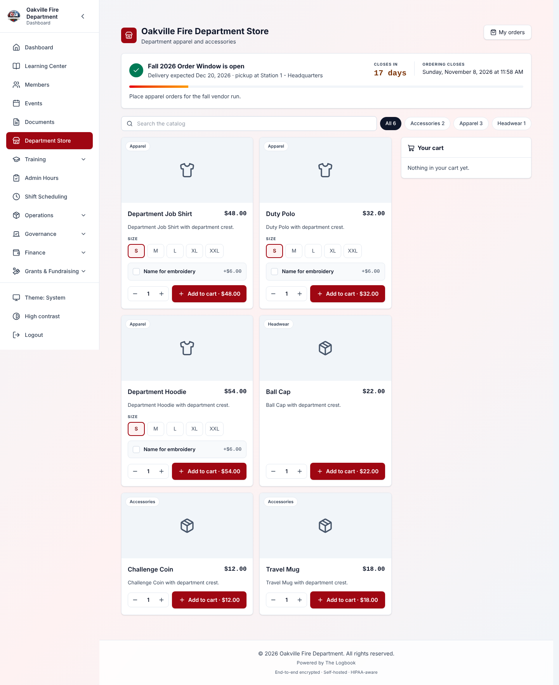
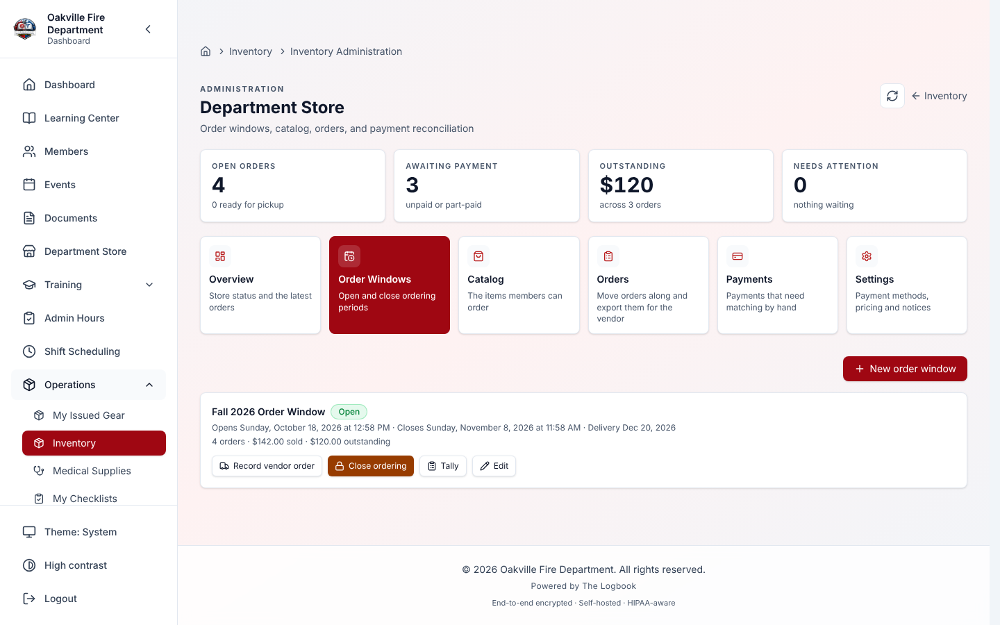
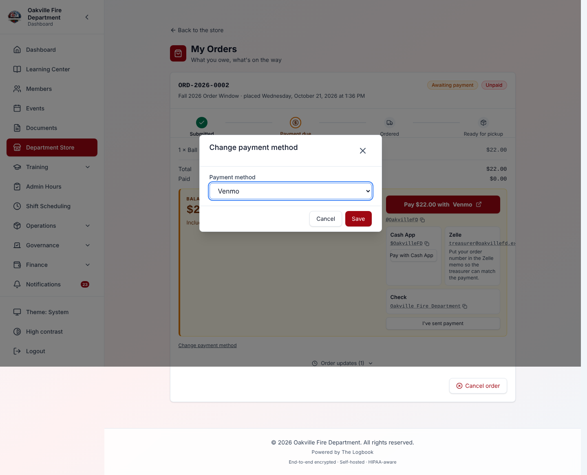
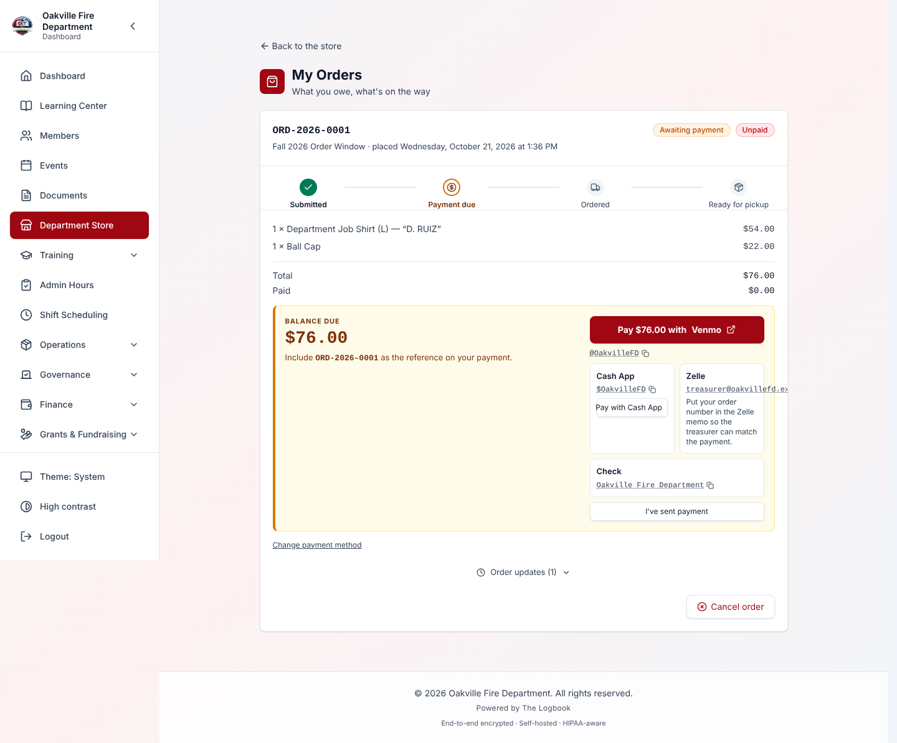
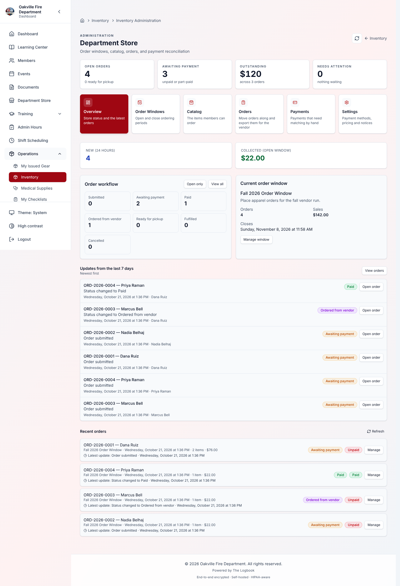
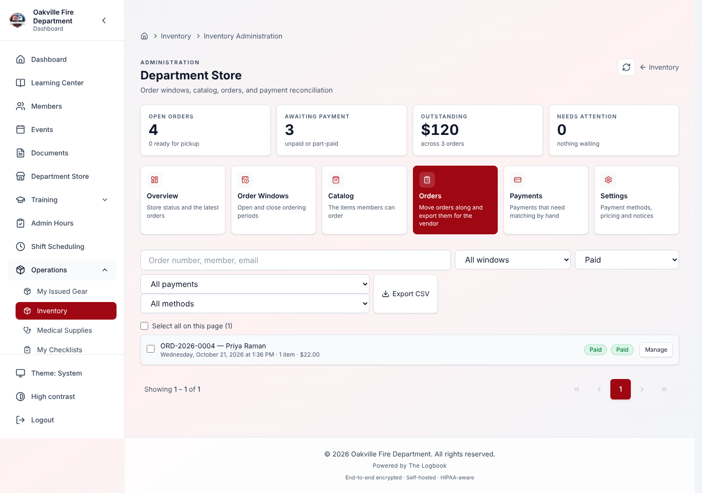

# Department Store

The Department Store lets your department sell merchandise to members: job
shirts, coins, patches and Class B uniforms. It handles ordering windows, size
and colour options, name embroidery or engraving, and payment tracking.

**Read this first:** The Logbook never takes a payment. There is no card form,
and no money passes through it. The store records what members ordered and what
they owe. The money moves the way it always has: Venmo, PayPal, Cash App,
Zelle, cash, a check or payroll deduction. The store makes settling up quick to
record and hard to lose track of.

## Lesson at a Glance

|                     |                                                                                        |
| ------------------- | -------------------------------------------------------------------------------------- |
| **Who this is for** | Members, for ordering and paying. Quartermasters and treasurers, for running the store |
| **What you need**   | A Logbook account. Running the store needs a position that can manage the store        |
| **Essential path**  | Members: about 10 minutes. Quartermasters: about an hour                               |
| **Full guide**      | About 90 minutes                                                                       |
| **Last verified**   | 2026-10-14                                                                             |
| **Owner**           | Your department's quartermaster                                                        |

**Members:** read [Placing an Order](#placing-an-order-member-view) and
[Paying](#paying-member-view).

**Quartermasters and treasurers:** read the whole guide.

---

## Table of Contents

1. [Store Overview](#store-overview)
2. [Turning the Store On](#turning-the-store-on)
3. [Store Settings](#store-settings)
4. [Building the Catalog](#building-the-catalog)
5. [Options — Sizes and Colours](#options--sizes-and-colours)
6. [Personalization](#personalization)
7. [Product Photos](#product-photos)
8. [Order Windows](#order-windows)
9. [Placing an Order (Member View)](#placing-an-order-member-view)
10. [Paying (Member View)](#paying-member-view)
11. [Working the Orders](#working-the-orders)
12. [Recording Payment](#recording-payment)
13. [Automatic PayPal Reconciliation](#automatic-paypal-reconciliation)
14. [Telling the Vendor, and Telling the Members](#telling-the-vendor-and-telling-the-members)
15. [Closing a Window and Ordering from the Vendor](#closing-a-window-and-ordering-from-the-vendor)
16. [Realistic Example: A Fall Job-Shirt Window](#realistic-example-a-fall-job-shirt-window)
17. [Troubleshooting](#troubleshooting)
18. [If You Learned an Older Version](#if-you-learned-an-older-version)

---

## Store Overview

Members select **Department Store** in the sidebar. The entry appears only when
the store module is turned on for your department.

| Where                | What it is                                               | Who can open it                   |
| -------------------- | -------------------------------------------------------- | --------------------------------- |
| **Department Store** | Browse the open window and order                         | Members who can browse the store  |
| **My Orders**        | Your orders: status, balance and payment buttons         | Members who can browse the store  |
| **Store Admin**      | The quartermaster's console, headed **Department Store** | Officers who can manage the store |

The console is also reached from **Inventory Administration**, which has a
**Department Store** section with four cards: **Store Overview**, **Store
Catalog**, **Store Orders** and **Store Payments**. Each opens the console on
that tab.

**How the console is laid out.** Like Training, Events and Members
Administration, the console has four area cards, and under them a strip of the
chosen area's pages with a line naming the open one. Choosing an area card
opens its first page.

| Area                  | Pages                          |
| --------------------- | ------------------------------ |
| **At a Glance**       | **Overview**                   |
| **Selling**           | **Order Windows**, **Catalog** |
| **Orders & Payments** | **Orders**, **Payments**       |
| **Store Settings**    | **Settings**                   |

An area card and the page under it carry a red count when the **Needs
attention** list has items there.

The sidebar entry says **Store Admin** but the page it opens is headed
**Department Store**. Say so when you train people, because the two names
differ.

### Permissions

On the Role Management screen, the store's three permissions read:

| Permission                                                        | Lets someone                                                                |
| ----------------------------------------------------------------- | --------------------------------------------------------------------------- |
| **Browse the department store and track your own orders**         | Browse the store and see their own orders                                   |
| **Place store orders**                                            | Place orders                                                                |
| **Manage the store catalog, order windows, orders, and payments** | Run the console: catalog, windows, everyone's orders, payments and settings |

**Nobody settles their own order.** Someone who can manage the store still
cannot mark their own order paid, waive it or refund it. Another officer has to.

---

## Turning the Store On

There are two separate switches, and it is worth knowing why.

1. **The module** — **Organization Settings → Modules → Department Store**.
   This decides whether the store appears in the menus at all.
2. **The store itself** — the console's **Settings** tab, **Store is live for
   members**.

The second switch lets you take the members' shop offline without hiding the
console. While it is off, the **Open ordering** dialog and the open window's card
on the overview say that members cannot order yet and link to **Settings**, and
the **Store is offline** badge is a button to the same place. Use it mid-season, between windows, or while you rebuild the catalog.
You can still work the orders already placed. When it is off, members see
nothing, and you keep everything.

---

## Store Settings

Open the console and select **Store Settings**.

### Identity

The **Storefront** section holds:

| Field                                  | Notes                      |
| -------------------------------------- | -------------------------- |
| **Store is live for members**          | The switch described above |
| **Show the "Ordering is open" banner** | On at first. See below     |
| **Store name**                         | Shown as the page heading  |
| **Tagline**                            | One line under the name    |
| **Description**                        | Longer introduction        |

Turn the banner off for a store that is always open. The order-window card
then drops its check mark and the words "is open". It keeps the window name,
the countdown and the last day to order.

### Payment methods

A new store starts with **Cash** only. Cash is the one method that works with
nothing filled in, so a new store can take an order on day one. Tick the
others as you set them up.

Tick every method your department accepts, then fill in its details. Members
see a method only when it is **both ticked and filled in**. The exceptions are
cash, payroll deduction and other, which need nothing filled in. See
[Paying](#paying-member-view).

Untick everything and the store goes back to cash. A store has to accept
something.

| Method            | What to enter                                                     |
| ----------------- | ----------------------------------------------------------------- |
| Venmo             | Your handle, with or without the `@`                              |
| PayPal            | Your PayPal.Me link, the PayPal email, or both                    |
| Cash App          | Your `$cashtag`                                                   |
| Zelle             | The email or mobile number Zelle uses, plus optional instructions |
| Check             | Who checks are payable to, and the mailing address                |
| Cash              | Instructions, such as "Pay the quartermaster at drill"            |
| Payroll deduction | Instructions                                                      |
| Other             | Instructions                                                      |

**General payment note (shown with every order)** adds a line of your own to
every order.

Cash App and Zelle details are **checked when you save**. A mistyped
`$cashtag` gives an error, rather than a button that quietly goes missing.

**Unticking a method** removes it from members' screens at once and blocks it
at checkout. One exception: a member who **already** ordered with that method
keeps their button, because they still owe you. If you have closed the account,
clear its details too and the button goes for everyone.

### Pricing

The **Pricing and delivery** section holds:

| Field                                 | Notes                                                        |
| ------------------------------------- | ------------------------------------------------------------ |
| **Sales tax (%)**                     | A percentage                                                 |
| **Flat shipping rate**                | Added to orders that are shipped                             |
| **Allow pickup** / **Allow shipping** | Leave at least one on. With both off, every order is refused |
| **Pickup location**                   | Where members collect, shown at checkout                     |

The **Order text** section holds **Terms shown at checkout** and **Receipt
footer**.

### Unpaid orders — your department's rule

Departments really do differ on this, so pick the rule that matches yours.
Under **Payments**, **What happens to an unpaid order?** offers three:

| Setting                                      | What happens to a member who has not paid                                                                                                                                            |
| -------------------------------------------- | ------------------------------------------------------------------------------------------------------------------------------------------------------------------------------------ |
| **No payment gate**                          | Their shirt is ordered and they can collect it. You chase the money separately. This is the starting setting                                                                         |
| **Payment required before pickup**           | Their shirt _is_ ordered, along with everyone else's. They cannot collect it until they pay                                                                                          |
| **Payment required before the vendor order** | Their shirt is **not ordered at all**. They are left out of the vendor order until they pay. Their order cannot be marked ordered either, because the vendor was never told about it |

Under the third rule, held-back orders are **shown** on the Tally, not quietly
dropped. You need to see who is left out, and chase them, before the order
goes in. Record their payment and they rejoin the totals at once.

The three rules are shown side by side, with what each does to the vendor
order and to pickup. You choose before there is a catalog to test against, so
the screen explains each one. **Change it whenever your practice changes.** It
governs what happens next and never undoes a step already taken. Switching
mid-window will not un-order anything you already sent.

Under either of the last two rules, marking an unpaid order **fulfilled** is
refused, and the message gives the balance. Moving a window's orders to
fulfilled in one go still works: the paid orders go through, and the unpaid
ones come back listed by order number. Recording the payment _or_ waiving the
balance releases an order. So a free replacement clears the rule without money
changing hands.

Under **No payment gate** and **Payment required before pickup**, every step
before the handover still happens. The shirt is ordered, received and marked
ready for pickup either way. Only putting it in the member's hands waits.

Under **Payment required before the vendor order**, an unpaid order stops
sooner. It cannot be marked **ordered** or **ready for pickup** until it is
paid or the balance is waived. The message gives the balance.

### Notifications

The **Notifications** section lists every email the store can send, in two
groups, each with a line saying who receives it. Untick one and the department
stops sending it. All nine start switched on.

**Order notices**

| Switch             | Who gets it, and when                                                                                           |
| ------------------ | --------------------------------------------------------------------------------------------------------------- |
| Order confirmation | The member, the moment they order: their receipt and how to pay                                                 |
| Status changes     | The member, when their order is ordered, ready for pickup, picked up or cancelled                               |
| Payment receipts   | The member, when you record a payment, waive one or record a refund                                             |
| Payment reminders  | Members who still owe, after the number of days in **Payment reminder after (days)**                            |
| New order alert    | You and the addresses in **Extra recipients for new order alerts (comma-separated)**, each time a member orders |

**Order window notices**

| Switch                       | Who gets it, and when                                                                              |
| ---------------------------- | -------------------------------------------------------------------------------------------------- |
| Ordering is open             | Every active member, when a window opens                                                           |
| Last call                    | Every active member, the hours set in **Last call reminder (hours before close)** before it closes |
| Ordering has closed          | Everyone who ordered in that window                                                                |
| Order placed with the vendor | Everyone who ordered, when you record the vendor order                                             |

Two of these catch people out:

- **Status changes** also covers the cancellation email. Untick it and a member
  whose order is cancelled hears nothing.
- **Payment receipts** covers refunds and waivers as well as payments.

**Nobody learns who else got a notice.** The four window notices go as a
separate email to each member, never one email to everyone. Every order notice
goes only to the member whose order it is. The **New order alert** is the one
exception: it is a single staff email, so you and the extra recipients see each
other's addresses.

**A switch is a ceiling.** Actions with an "email" box — opening a window,
closing one, recording the vendor order — can still skip a single send. A
window can also choose not to announce itself. Neither can send a notice you
have switched off here.

Some of what the emails say is set here rather than in the email wording:

- the payment instructions and per-method notes, under the pay buttons
- the receipt footer, at the end of the confirmation
- a window's pickup instructions, in every notice about that window
- the one-off message you can type when you open, close or record the vendor
  order

The rest of the wording can be edited too — see
[Rewriting one properly](#rewriting-one-properly). The layout, logo and colours
come from your department's email branding.

### Seeing one before you send it

Every switch has a **Preview** button. It opens the actual email: subject,
layout, your logo, and the pay buttons as a member's phone shows them. It uses
a sample job-shirt order and a sample window.

The sample order is made up. Everything your department controls is real: the
Venmo handle, the cash instructions, the receipt footer, the store name and
your branding all come from your saved settings. So the preview is the quickest
way to check: _is my cashtag right? does the Zelle handle read properly? did I
leave a method ticked that I never filled in?_ A method you do not accept is
simply not there.

Two things to know:

- The preview uses **saved** settings. Save your changes before you look.
- You can preview a notice that is switched off. The preview says so at the
  top. That way you can see what you are deciding about.

Previewing sends nothing and records nothing. It does not create an order,
touch a window or email anybody, including you.

### Sending it to yourself

Inside the preview, **Send this to me** emails you the same notice with the
same sample order. A preview on screen is not an inbox. Gmail and Outlook
change how emails look, and only a real email shows whether the Venmo button
opens Venmo on a phone.

It goes to **your** address only; there is no box for anyone else's. The
subject starts with `[TEST]` and the email opens with a banner saying it is a
test. The sample mentions order ORD-2026-0042, and an unmarked copy could be
acted on weeks later.

If your department has not finished setting up email, it tells you so rather
than claiming it sent something. Every test is recorded in **Communications →
Message History** like any other email.

### Rewriting one properly

The switches, previews and test sends are in the Notifications section. The
_words_ are in **Communications → Email Templates**, with your welcome message
and password reset. Look for the ten templates whose names begin **Store —**.

There are ten, not nine, because the cancellation notice has its own template
even though it shares the "status changes" switch. "Your order is ready" and
"your order is cancelled" should not read the same.

Edit the subject and body like any other template. Some parts cannot be typed
out, such as the table of items and the pay buttons. The store fills these in
from placeholders:

| Placeholder                                                                | What appears there                                                         |
| -------------------------------------------------------------------------- | -------------------------------------------------------------------------- |
| `{{items_table_html}}`                                                     | The ordered items, with sizes, embroidery text and prices                  |
| `{{payment_block_html}}`                                                   | Balance due, a pay button per method you accept, your payment instructions |
| `{{receipt_footer_html}}`                                                  | Your receipt footer                                                        |
| `{{window_extra_html}}`                                                    | Whatever that notice adds: the closing time, the vendor, the delivery date |
| `{{order_number}}`, `{{first_name}}`, `{{balance_due}}`, `{{window_name}}` | Exactly what they say                                                      |

The editor lists every placeholder for the template you have open, and its
preview fills them with sample data.

Two things worth knowing:

- **Deleting a placeholder really deletes it.** Take `{{payment_block_html}}`
  out of the confirmation and members are no longer told how to pay.
- **Reset to default** puts the original wording back. Making a template
  inactive does the same, but keeps your edit.

Until you change them, members get the store's standard wording. Whichever
version is in force, **Preview** and **Send this to me** show you _that_ one.
So edit here, then go and look.

Times in store emails, such as a window's closing time, use your department's
time zone from **Organization Settings → General → Profile**.

### When it doesn't do what you expect

| What you did                                     | What happens                                                                         | What to do                                                                                                                  |
| ------------------------------------------------ | ------------------------------------------------------------------------------------ | --------------------------------------------------------------------------------------------------------------------------- |
| Edited a template and nobody got it              | The **switch** for that notice is off. Editing the words does not turn it on         | Tick it under **Settings → Notifications**                                                                                  |
| Deleted a template to "start over"               | You get the standard wording back, not your earlier version                          | Use **Reset to default**; it does the same thing more simply                                                                |
| Made a template inactive                         | The store goes back to its standard wording, and your edit is kept                   | This is the safe way to undo — nothing is lost                                                                              |
| Left the subject blank                           | The standard subject is used                                                         | An email with no subject looks like spam, so the store never sends one                                                      |
| Rewrote the formatted version but not plain text | Nearly everyone sees your version; the few with plain-text email see the old wording | Edit the plain-text version too, or leave both alone                                                                        |
| Mistyped a placeholder, like `{{ordr_number}}`   | It shows as nothing. No braces reach the member, but no order number does either     | Copy placeholder names from the list in the editor                                                                          |
| Removed `{{payment_block_html}}`                 | Members are no longer told how to pay                                                | Put it back                                                                                                                 |
| Cannot find a store notice in **Schedule Email** | They are left out on purpose                                                         | Store notices belong to a real order. Sent by hand there is no order, so it would send "Order received" over an empty table |
| Email says "Hi ," with no name                   | The order has no first name on it                                                    | Check the member's profile has a first name                                                                                 |

One more: **Order Status Change covers two emails.** One is the automatic
"your order is now ready for pickup". The other is a note you type on an order
and send. They share a template, so word it to read for both. The standard
wording does.

Everything the store sends is logged in **Communications → Message History**,
with a type beginning **storefront_**. So "did she ever get the reminder?" has
an answer.

---

## Building the Catalog

Open the console's **Catalog** page (under **Selling**) and select **New item**.

The screens call catalog entries _items_ and their size or colour choices
_options_. This guide does too.

| Field                                         | Notes                                                               |
| --------------------------------------------- | ------------------------------------------------------------------- |
| **Name**, **SKU (optional)**, **Description** |                                                                     |
| **Category**                                  | Used for grouping                                                   |
| **Price**                                     | The price before any option adds to it                              |
| **Department cost (optional)**                | What you pay the vendor. Never shown to members                     |
| **Status**                                    | **Draft** (hidden), **Active (for sale)** or **Archived** (retired) |
| **Max per member**                            | How many one member can order                                       |
| **Stock on hand**                             | How many you have                                                   |
| **Limit sales to stock on hand**              | Stops orders once stock runs out                                    |
| **Taxable**                                   | Adds the store's sales tax to this item                             |
| **Requires an option (size/color)**           | The member must pick an option                                      |
| **Internal notes (not shown to members)**     | Notes for staff                                                     |

Use **Draft** while you build. Add the item, add the photo, set up options,
then switch it to **Active (for sale)**.

---

## Options — Sizes and Colours

Add **options** for anything a member has to choose between: S/M/L/XL, navy
or black, men's or women's cut. Use **Add option** on the item form.

Each option has:

- **Label** — what the member picks, such as "XL" or "Navy — Women's"
- **+/- price** — added to the item's price. `+3.00` on 2XL is the usual case;
  a negative amount works too
- **Stock** — counted per option, not just per item

Tick **Requires an option (size/color)** on the item if the member must pick
one.

**Sizes are listed in garment order** (XS, S, M, L, XL, 2XL…), not
alphabetically.

---

## Personalization

For items with a name embroidered or engraved on them. On the item:

| Setting                                                   | Effect                                                                                                                                                           |
| --------------------------------------------------------- | ---------------------------------------------------------------------------------------------------------------------------------------------------------------- |
| **Members can personalize this item (name, callsign, …)** | Adds a text box to the member's order                                                                                                                            |
| **Prompt shown to the member**                            | What the box says, such as "Name to embroider". Left blank, it reads "Add name embroidery" or "Add name engraving"                                               |
| **Upcharge per unit**                                     | Extra charge for each personalized item                                                                                                                          |
| **How is it applied?**                                    | **Embroidered** (stitched into cloth: shirts, polos, caps) or **Engraved** (cut into metal: coins, badges, plaques). This decides what the vendor sheet asks for |
| **Thread color**                                          | Embroidered items only. The colour the vendor stitches in, and the colour members see their name previewed in. Engraved items do not offer it                    |
| **Maximum characters**                                    | The vendor's limit. Starts at 30                                                                                                                                 |
| **Required — the member must enter text**                 | Members cannot order without filling it in                                                                                                                       |

Embroidery and engraving are separate jobs. An engraved item asks only what
engraving needs; it never asks for a thread colour.

Two shirts with different names are always **separate lines**, never one line
with quantity 2. They are different items, and your vendor needs them listed
separately.

---

## Product Photos

Save the item first, then open it again and select **Upload photo**. Photos can
be JPEG, PNG or WebP, up to 5 MB. Each photo is converted on upload, so the
saved file is smaller than the one you sent.

Members shop by picture. A catalog of text sells nothing.

---

## Order Windows

Open the console's **Order Windows** page (under **Selling**) and select **New order window**.

A window is an ordering period. You open it, members order, you close it, and
you place one bulk order with the vendor.

| Status    | Meaning                                              |
| --------- | ---------------------------------------------------- |
| Draft     | Being set up, hidden from members                    |
| Scheduled | Has dates but is not open yet                        |
| Open      | Members can order                                    |
| Closed    | No new orders; existing ones carry on to fulfillment |
| Fulfilled | Everything handed out                                |
| Cancelled | Called off                                           |

**More than one window can be open at once.** Members land on the one that
closes soonest, because that is their nearest deadline. They get a switcher for
the others. So an apparel window and a Class B uniform window can run side by
side.

When you create a window, offer either **all active products** or a chosen
list. The chosen list is how you run a "Class B uniforms only" window without
archiving the rest of the catalog. The closing date goes in **Ordering
closes**.

Each window row has **Open ordering** and **Close ordering**, and the
confirmation button repeats the same words.

- Opening a window can **Email the membership**.
- Closing it can **Email everyone who ordered about what happens next**.
- Either can carry an **Extra message for the email (optional)**.

The last-call email goes out by itself, the number of hours in **Last call
reminder (hours before close)** before closing, if that notice is switched on.

Closing times in these emails use your department's time zone.

---

## Placing an Order (Member View)

Select **Department Store** in the sidebar.

1. Browse the items in the open window.
2. Pick a size or colour if the item has options.
3. Type the name to embroider or engrave, if offered.
4. Set the quantity and tap **Add to cart · $(line total)**.
5. Tap **Review order** and check the cart: subtotal, tax, shipping and total.
6. On the checkout page, choose pickup or shipping. Shipping asks for an
   address.
7. Choose how you will pay.
8. Add **Notes for the quartermaster (optional)** if you need to, then tap
   **Submit order**.

You get an order number like `ORD-2026-0042` and a confirmation email. That
number links your payment to your order, so keep it.

If the store is closed, or no window is open, the page says so instead of
showing an empty catalog.

> **What if several members order the last few at once?** For an item limited
> to stock on hand, only the orders the stock can cover are accepted. The rest
> are refused with a message such as _Only 1 of 'Station T-Shirt' remain
> available_.

> **What if I ordered by mistake?** On **My Orders**, **Cancel order** is
> offered while the order is still **Submitted** or **Awaiting payment**.

---

## Paying (Member View)

**My Orders** shows each order with its balance and a button for every payment
method the department has set up.

| Method                 | What you get                                                                  |
| ---------------------- | ----------------------------------------------------------------------------- |
| Venmo                  | A button that opens Venmo with the amount **and your order number** filled in |
| PayPal                 | A button with the amount filled in. Type your order number in the note        |
| Cash App               | A button with the amount filled in. Type your order number in the note        |
| Zelle                  | The department's Zelle details, tap to copy. Use them in your own bank's app  |
| Check, cash or payroll | Who to pay and the instructions                                               |

Three things worth knowing:

- **You are not stuck with the method you picked at checkout.** Every method
  the department set up stays available. If you chose Venmo and only have Cash
  App, use the Cash App button.
- **Zelle has no button, on purpose.** Zelle lives inside your bank's app and
  has no web link. All anyone can give you is the details to type.
- **Where the button cannot carry your order number, type it.** The screen
  shows "Include **ORD-…** as the reference on your payment." It is how your
  treasurer matches your payment to your order. Without it, your payment waits
  in a queue for someone to chase.

After paying, tap **I've sent payment** and enter the reference: a Venmo
transaction, a check number, and so on. Your payment then reads **Reported —
needs verification**. That tells the quartermaster to look; it does not mark
you paid. Someone confirms the money really arrived.

To record a different plan, select **Change payment method** under the order
and pick from the methods the store accepts. It is offered only on your own
orders, while a balance is due, the order is not cancelled, and no payment
report is waiting to be checked.

**Say this out loud in training: the department is not taking the money in the
app.** The method picker records _how_ a member means to pay. **I've sent
payment** records _that they say they have_. Both are claims the treasurer
checks against the real account. No card is charged and no money moves in The
Logbook.

---

## Working the Orders

The **Overview** tab is where a stint of order work starts.

- **New (24 hours)** counts recent orders.
- **Collected (open window)** totals what the current window has taken in.
- **Order workflow** counts the orders in each status, from Submitted to
  Cancelled. Select a count to open the **Orders** tab filtered to that status.
  A grid reading **Paid 2** opens a list of those same two orders.
- **Updates from the last 7 days** lists recent activity, newest first: orders
  placed, status changes, payments reported and recorded, refunds and messages.

The **Orders** tab has a search box and four filters: window, order status,
payment status and **payment method**. The payment method filter is how you
reconcile. Each app pays out separately, so "show me everyone who paid by
Zelle" is the question you have in front of a bank statement.

Open an order to work on it:

| Action                                | What it does                                                                                                                         |
| ------------------------------------- | ------------------------------------------------------------------------------------------------------------------------------------ |
| **Mark paid in full ($…)**            | Settles the whole remaining balance in one step                                                                                      |
| **Record payment**                    | Records a specific amount (part payments)                                                                                            |
| **Refund**                            | Records money going back                                                                                                             |
| **Waive payment**                     | Settles the balance without collecting money. Needs a **Reason (shown to the member)**. The window's collected total does not change |
| **Change status** → **Update status** | Moves the order on: Awaiting payment, Paid, Ordered from vendor, Ready for pickup, Fulfilled                                         |
| **Send an update** → **Send update**  | Sends the member a note, in the app, by email, or both                                                                               |
| **Internal notes** → **Save notes**   | Notes only staff see                                                                                                                 |

The order also shows its **Timeline**: everything that has happened to it.

To move many orders at once, select them on the **Orders** tab. Then use
**Mark selected paid** or **New status for selected orders**. "Everything's in,
mark them all ready for pickup" is one action, not forty. **Export CSV**
downloads the list.

### Two statuses, not one

Every order has an **order status** and a **payment status**, and they move
separately:

- A member can pay for a shirt you have not ordered from the vendor yet.
- A shirt can be on the shelf, ready for pickup, while the member still owes
  for it.

That is why they are separate. Combining them would make one wait on the other.

Payment statuses are **Unpaid**, **Reported — needs verification**,
**Partially paid**, **Paid**, **Refunded** and **Waived**.

---

## Recording Payment

The common case is **Mark paid in full**. The money arrived for exactly what was
owed, and you just need to say so. It reads the balance from the order, so
there is no amount to mistype.

### Record how they _actually_ paid

**Paid by** starts on the method the member chose at checkout. Change it if
they paid another way. Casey picked Venmo, then handed you cash at drill:
record it as **Cash**.

This matters more than it looks. Leave it as Venmo, and your treasurer checks
the Venmo payout, finds one payment missing, and has no way to find out why.
The **Reference** box beside it takes whatever identifies the payment: a Venmo
transaction, a check number, or just "handed over at drill".

Use **Record payment** when someone pays part of the balance, or when the
amount you record must differ from it.

Use **Waive payment** when the balance goes away without money: a replacement
for a faulty item, or something the department is giving free. It is recorded
as a waiver, not a payment, so your totals stay true.

You can waive a part-paid order's balance, but not a paid one. If someone
records the last payment while you have the order open, your waiver is refused
with "This order is already paid. Refund it instead of waiving it." Use
**Refund** if the money should go back.

Orders where the member tapped **I've sent payment** read **Reported — needs
verification**. That is your queue. Filter the **Orders** tab by that payment
status, confirm the money arrived, then mark it paid.

---

## Automatic PayPal Reconciliation

This is optional. If your department has a PayPal **Business** account, an
administrator can connect it on the **Integrations** page, under **PayPal**.
PayPal then tells The Logbook what it received. Orders whose payment carries
the order number settle themselves, with nobody marking them paid.

Full setup:
[Integrations guide, PayPal section](./16-integrations.md#paypal--store-payment-reconciliation).

A payment settles by itself only when **both** are true:

1. The reference names exactly one order number, such as `ORD-2026-0042`.
2. The amount is exactly the order's balance.

Everything else goes to the console's **Payments** tab for you to decide:

| What you see          | What happened                                                        |
| --------------------- | -------------------------------------------------------------------- |
| Applied               | Matched and settled — nothing for you to do                          |
| Matched — not applied | Would have settled, but automatic settlement is off                  |
| No order found        | No order number in the reference                                     |
| Needs a decision      | The amount does not match, or the order is cancelled or already paid |
| Dismissed             | You decided it was not a store payment                               |

For each one you can **Apply to order** (entering the order if none was found)
or **Dismiss** it. Dismiss is for a donation, dues, or a refund that is not
store business.

Payments that match nothing still appear here. That is the point: the money
has already left the member's account, so a person has to see it.

**Why only PayPal?** Venmo has no way to report personal transfers, and Zelle
runs inside each bank. PayPal is the only one that can report back.

The **Payments** tab only ever shows what PayPal reported. There is no way to
add a row by hand. A department without PayPal connected has an empty
Payments tab.

---

## Telling the Vendor, and Telling the Members

Once you have the Tally, place the order with your vendor. Then come back and
select **Record vendor order** on the window. (It reads **Update vendor order**
once recorded.)

| Field             | Why                                               |
| ----------------- | ------------------------------------------------- |
| Vendor            | Who it went to                                    |
| PO / reference    | Their order number, for when you have to chase it |
| Expected delivery | Goes in the email to members                      |

Recording it does three things at once, so they cannot drift apart:

1. Records who ordered it, the reference and when. "Has this been ordered
   yet?" is then answered by the record, not by memory.
2. Marks every eligible order **Ordered from vendor**.
3. Emails everyone who ordered, with the vendor and expected date (if you leave
   **Email everyone who ordered** ticked).

That email is the one members actually want. There can be six quiet weeks
between "ordering closed" and "come and pick it up". Without it, you answer the
same question a dozen times.

Orders your payment rule holds back are **skipped**, not marked ordered. They
were not on the sheet the vendor got. The result tells you how many moved and
how many were held, so you know who to chase.

---

## Closing a Window and Ordering from the Vendor

1. **Close ordering.** No new orders; existing ones keep moving.
2. Open the window's **Tally**. It shows the money (order count, members,
   gross, collected, outstanding), then two tables.
3. **Order this from the vendor** is your purchase order: the quantity of each
   size, added up across every member. _"10 job shirts — 3 M, 2 L, 3 XL, 1 2XL,
   1 3XL."_ Send this to the vendor. Under the _payment before the vendor
   order_ rule, unpaid members are left out here and listed under **Held back**
   instead.
4. **Line detail** below it lists the same shirts by name. That is what the
   vendor stitches. On a personalized item the two always differ: ten shirts,
   ten names, five sizes.
5. If the vendor wants a file, use **Export CSV** on the **Orders** tab,
   filtered to the window. It keeps **every** order, unpaid ones included,
   because it is also the treasurer's record. So under the _payment before the
   vendor order_ rule, check the **Held From Vendor Order** column and remove
   the `yes` rows before sending it. Otherwise you send the vendor a sheet
   that undoes your own rule.
6. When the goods arrive, set the window's orders to **Ready for pickup** in
   one go.
7. Hand them out and mark them **Fulfilled**. Then select **Mark fulfilled** on
   the window.

The outstanding figure is your chase list. Filter the **Orders** tab by
payment status to see who still owes.

---

## Realistic Example: A Fall Job-Shirt Window

**Setup (September)**

1. **Settings:** tick Venmo, Cash App, Zelle and Check. Enter the Venmo
   handle, the `$cashtag`, the treasurer's Zelle email, and who checks are
   payable to. Under **What happens to an unpaid order?**, the department picks
   **Payment required before the vendor order**. They will not pay for a shirt
   someone might never pay for.
2. **Catalog:** create "Department Job Shirt", $45, taxable, max 2 per member.
   Add options S to 3XL, with `+3.00` on 2XL and 3XL. Save it, then upload a
   photo.
3. **Personalization:** prompt "Name for embroidery", **Embroidered**, maximum
   20 characters, $8.00 upcharge.
4. Leave it as **Draft** while you check its details in the catalog. Members
   cannot see a draft item, and there is no member preview of one. Then switch
   it to **Active (for sale)**.

**Opening (October 1)**

5. Create the window "Fall Apparel 2026", closing October 21, all active
   products. Select **Open ordering** with **Email the membership** ticked.

**During**

6. Orders arrive. 14 members order 19 shirts, 11 of them personalized.
7. Members pay by Venmo and Cash App from **My Orders**. Venmo payments carry
   the order number. Cash App payments need it typed, and the screen tells them
   so.
8. You mark each paid as the money lands. With PayPal connected, PayPal
   payments settle themselves.

**Closing (October 21)**

9. Select **Close ordering**. The Tally reads: 14 orders, 19 shirts, $921.00
   gross, $812.00 collected, $109.00 outstanding. 12 members paid, 2 have not.
10. **Order this from the vendor**: 2 M, 6 L, 7 XL, 1 2XL, 1 3XL — **17
    shirts**, not 19. **Line detail** lists the 9 names to embroider. Send
    both.
11. **Held back — unpaid (2 orders)** is underneath: 1 M and 1 2XL, $109.00
    between them. Their shirts are deliberately _not_ in the 17, not on the
    embroidery list, and their orders cannot be marked ordered. Chase them. The
    moment they pay, they rejoin the totals. Add them to this order if the
    vendor has not started, or to the next one.
12. Filter **Orders** by payment status for the reminder list.

**Fulfillment (November)**

13. 17 shirts arrive. Set the window's orders to **Ready for pickup** in one
    go. The 2 held-back orders are skipped, because there is no shirt on the
    shelf for them.
14. Hand them out at drill and mark them **Fulfilled**. The 12 paid orders
    move. The 2 unpaid ones come back by order number with what they owe, so
    you know who to find before handing anything over.
15. Select **Mark fulfilled** on the window.

---

## Troubleshooting

**A member says the store is empty.**
Check that a window is **Open** (not Draft or Scheduled) and that the items are
**Active (for sale)**. If the window offers a chosen list of items, check the
items are on it. Also check **Store is live for members** is on.

**A member cannot find the store.**
The sidebar entry is **Department Store**. It appears only when the module is
on and the member's position lets them browse the store.

**A payment button is not showing.**
The method must be ticked in Settings _and_ have its details filled in. A
method with no details is hidden on purpose, so members never get a button that
goes nowhere. Check the details saved without an error.

**There is no Zelle button.**
There is never a Zelle button. Zelle runs inside each bank's app and has no web
link, so members get the details to copy instead.

**An unpaid member's shirt is not in the vendor order.**
That is the _payment required before the vendor order_ rule doing its job.
They are listed under **Held back** on the Tally. Record their payment and they
rejoin the totals. If you want them ordered anyway, switch the rule to
_payment required before pickup_.

**I cannot mark an order fulfilled.**
Under either payment rule, an order with a balance due cannot be handed over.
The message gives the amount owed. Record the payment, or waive the balance if
the department is giving it free.

**I cannot mark a held order ready for pickup either.**
Under _payment required before the vendor order_, their item was never bought,
so it cannot be on the shelf. Marking it ready would email them to collect
something that does not exist. Record their payment and it unblocks.

**I cannot mark my own order paid.**
Nobody settles their own order. Ask another officer who manages the store.

**The treasurer's Venmo total does not match the store.**
Check the **Paid by** method on each order. If someone paid cash or by check
and it was recorded as Venmo, the two differ by exactly that amount. Open the
order and correct the method.

**A member paid but their order still says unpaid.**
Paying happens outside The Logbook, so nothing changes until someone records
it. If they tapped **I've sent payment**, the order reads **Reported — needs
verification**: confirm and mark it paid. With PayPal connected, check the
**Payments** tab. It may be there because the amount did not match or the
reference had no order number.

**PayPal payments are not arriving at all.**
The integration needs a **Webhook ID**, not just credentials. Without it,
payments cannot be checked and are refused. **Test** on the PayPal card warns
you when it is missing. Also check the PayPal webhook is subscribed to _Payment
capture completed_.

**The vendor tally does not match what I counted.**
The tally counts every order in the window that is not cancelled. Cancelled
orders drop out. Unpaid ones stay in (except under _payment required before the
vendor order_), because someone who ordered still needs a shirt ordered.

**A member ordered the wrong size.**
While the order is still **Submitted** or **Awaiting payment**, the member can
select **Cancel order** on **My Orders** and order again, if the window is
still open. After that, send them an update on the order so the change is on
record, and correct it with the vendor.

**You cannot find a store email in Message History.**
Search for store emails by type. Cancellation emails sent by older versions
are filed under **storefront_order_update**; newer ones under
**storefront_order_cancelled**. Search both.

---

## Related Guides

- [Integrations](./16-integrations.md) — connecting PayPal
- [Inventory Management](./05-inventory.md) — the Inventory Administration hub
- [Finance](./11-finance.md) — how store income relates to budgets and dues

---

## If You Learned an Older Version

If you are following older notes, an older recording or an SOP, these things
have moved, been renamed or work differently.

### Renamed or moved

- **The store console moved into Inventory Administration.** It is reached
  from the **Store Admin** sidebar entry or the **Department Store** cards in
  Inventory Administration, and its page is headed **Department Store**. Old
  bookmarks to the console's previous address still open it.
- **Members find the store under Department Store** in the sidebar, not
  "Store".
- **Window buttons read Open ordering and Close ordering**, not Open and Close.
- **The cart buttons read Add to cart · $… and Review order**, not "Add $…" and
  "Review". Checkout is its own page, and its button reads **Submit order**.
- **Embroidery and engraving are separate.** Older notes describe one
  "customization" field, and engraved items that asked for a thread colour.
- **Mark paid is Mark paid in full ($…)** on an order.

### Works differently now

- **Store emails show times in your department's time zone**, not UTC. The
  orders CSV does too, with the zone's short name.
- **A store manager cannot settle their own order.** Older notes may say
  otherwise.
- **If turning the store on failed in an older version** — the console showed
  an error, or the setup wizard's Enable button did nothing — check
  **Organization Settings → Modules** and turn **Department Store** on.
- **Check that positions still hold the store permissions.** An older position
  editor removed them on the first save after setup.
