# Member Performance Evaluations

> The full engineering reference is [docs/EVALUATIONS_MODULE.md](https://github.com/thegspiro/the-logbook/blob/main/docs/EVALUATIONS_MODULE.md).

Yearly evaluations, and shorter check-ins, of each member against a form the
department builds for that kind of member. The evaluation pulls the member's
figures for the period from the rest of the Logbook (training, meetings,
shifts, calls, certifications and more), goes through the steps the form sets
out, is signed, and ends as a PDF with the department's logo and name. The
member can read it, download it and attach a written response.

An evaluation is a personnel record. Everything kept about a member is
something the member may read: there is no officers-only note, and when an
evaluation is changed or removed, the member is told and the reason is kept.

---

## Where it lives

When the Reports module is on, every member has one **Evaluations** entry in
the navigation, which opens **My evaluations**. The other sections appear as a
strip across the top of the evaluation pages, and only for a member whose
permissions open them. A member who holds none of `evaluations.conduct`,
`view_all`, `manage` or `configure` sees no strip at all. The strip's links carry counts: on
**My evaluations**, how many of your own evaluations are waiting on you (your
self-evaluation or acknowledgement), and on the conduct list, how many of the
evaluations you can see there are past a due date.

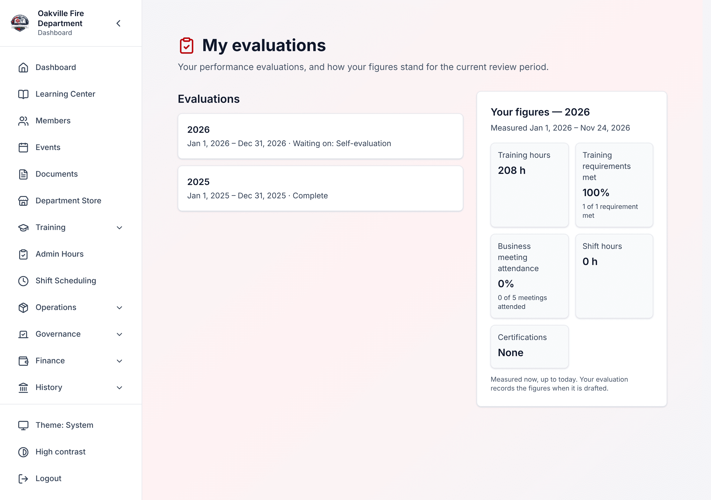

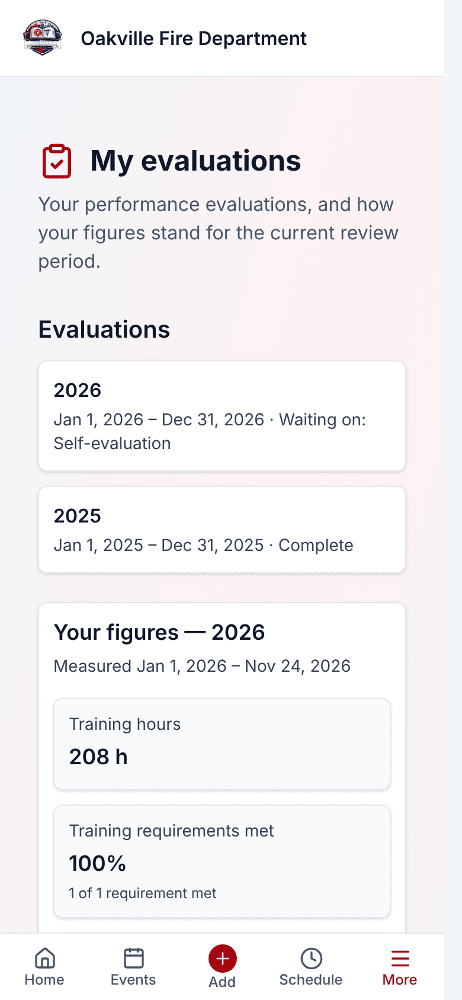

| Section                                         | Path                           | Who sees it                                                                                                                                                                                     |
| ----------------------------------------------- | ------------------------------ | ----------------------------------------------------------------------------------------------------------------------------------------------------------------------------------------------- |
| **My evaluations**                              | `/reports/evaluations/mine`    | every member: their own evaluations, deleted-evaluation records, and their figures for the current period                                                                                       |
| **Evaluations I conduct** / **All evaluations** | `/reports/evaluations/conduct` | `evaluations.conduct`, `view_all` or `manage`: the evaluations to work on (named "All evaluations" for `view_all` and `manage`)                                                                 |
| **Templates & periods**                         | `/reports/evaluations`         | `evaluations.configure` or `evaluations.manage`: forms and review periods                                                                                                                       |
| An evaluation                                   | `/reports/evaluations/<id>`    | the member, the evaluator, approvers at their step, anyone named on a step, the member's current supervisor, and `view_all` holders; `manage` holders see its status and steps, not its content |

## Who can do what

| Permission              | Lets them                                                                                                                                                                                                                                 |
| ----------------------- | ----------------------------------------------------------------------------------------------------------------------------------------------------------------------------------------------------------------------------------------- |
| `evaluations.configure` | build and publish the forms                                                                                                                                                                                                               |
| `evaluations.manage`    | open and close review periods, draft for anyone (one at a time or a whole period), choose the evaluator, amend a finalized evaluation, name who takes an approval or calibration step, hand one person's open work in a period to another |
| `evaluations.conduct`   | be the evaluator; draft an evaluation they will conduct themselves                                                                                                                                                                        |
| `evaluations.view_all`  | read every member's evaluations, complete calibration (never on one they wrote), see each finalized evaluation's grade on the list, and export a period's results                                                                         |
| `evaluations.delete`    | delete an evaluation, with a reason                                                                                                                                                                                                       |

- All five are given to the **Chief** on install and upgrade. Everyone else is
  granted them by position under **Administration → Organization Settings →
  Role Management** — see [Role System](Role-System).
- A member needs **no** permission to see their own evaluations.
- **Nobody** reads, amends or deletes their own evaluation through these
  grants. A Chief being evaluated sees their evaluation as a member.
- `evaluations.manage` runs the process but does not, on its own, let someone
  read what is written in an evaluation. That needs `view_all`, being the
  evaluator, or being an approver at their step.
- **The evaluator never calibrates or approves their own evaluation**, and
  nobody signs two approvals on one evaluation _(2026-11-16)_. Holding the
  approving position or `view_all` does not change that. See
  [Naming who takes a step](#naming-who-takes-a-step).
- **Signing**, **deleting**, **naming who takes a step**, **handing over work**
  and **downloading a period's signed PDFs** ask the person to confirm their identity again
  (password, passkey or authenticator), as other sensitive actions do — see
  [Authentication](Security-Authentication).

---

## Setting up

Until evaluations are under way, **Templates & periods** shows a **Getting
started** checklist: publish a form, open a review period, give someone besides
the Chief the Conduct evaluations permission, and draft. Each step is ticked off
from what the department already has, and the checklist goes away once every
step is done — so it stays, with the rest ticked, while the Chief is still the
only one who may conduct evaluations. Once a form is published and a period is open, it
also lists the members that drafting the period would leave out, and why — no
form fits them, or they served no full month — so they can be fixed before
drafting rather than during it.

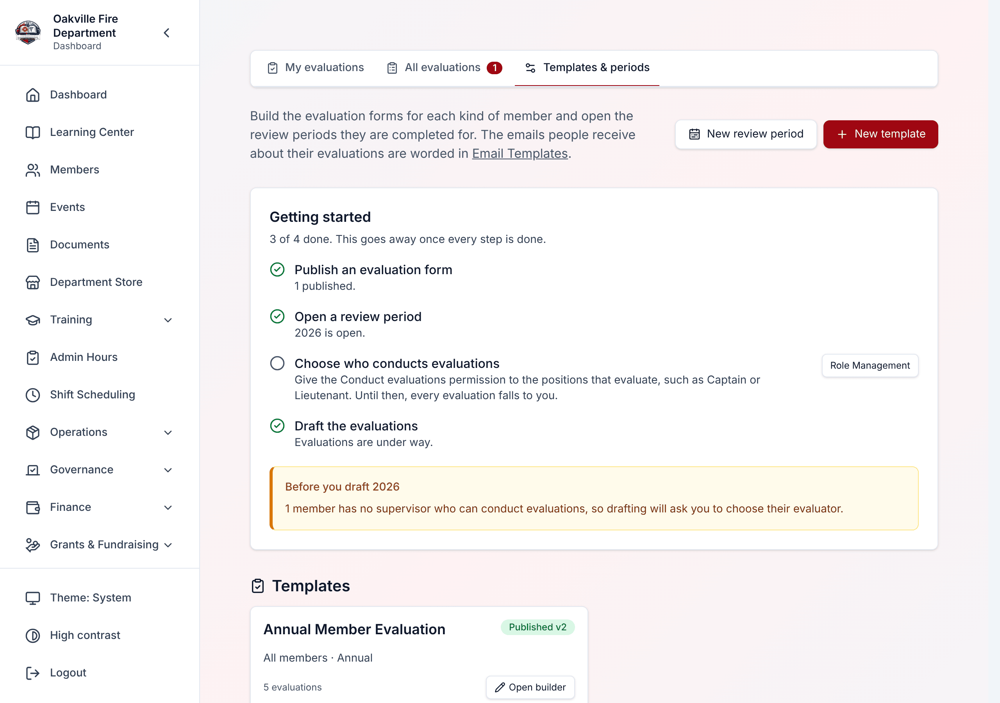

### 1. Build the forms

**Evaluations → Templates & periods → New template.** Choose:

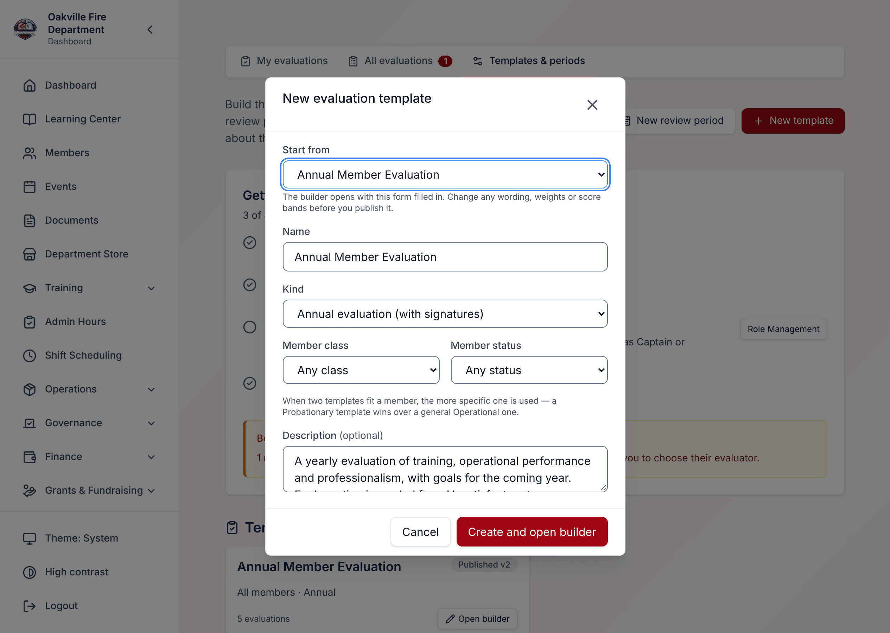

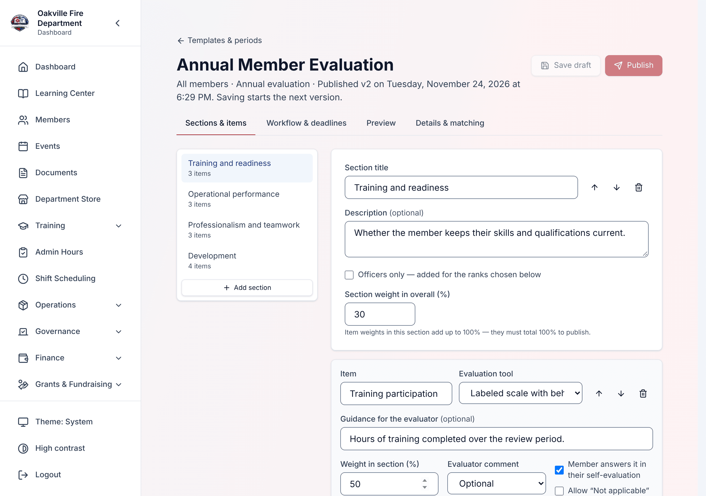

- **Start from** a blank form or a ready-made one. Three are offered: an
  **Annual Member Evaluation** (training, operational performance,
  professionalism and goals, weighted to 100%, with training hours, required
  training and meeting attendance suggesting a rating), an **Annual Evaluation
  with Officer Sections** _(2026-11-20)_, and a **Probationary Check-in**
  (training, skills, participation and attitude on a three-level scale, with
  no signatures). A ready-made form publishes as it stands, but its wording,
  weights and especially its score bands are generic — change them to your
  department's expectations first. Choosing one fills in the name, the kind
  and who it applies to; all of them stay editable. _(2026-11-21)_ The annual
  forms open their Development section with **Last year's goals**, and the
  check-in its Next steps with **Since the last check-in** (see
  [Rating last year's goals](#rating-last-years-goals)); forms made from a
  starter before then are unchanged.

  The **officer** starter adds an officer-only **Leadership and supervision**
  section (crew leadership, developing members, administrative duties). An
  officer-only section needs your department's own ranks, so choosing this
  starter shows an **Officer ranks** list in the dialog, and the template
  cannot be created until at least one rank is ticked. Members of those ranks
  get the section; everyone else is graded on the other sections alone, whose
  weights (25 / 35 / 20, beside the leadership section's 20) keep nearly the
  plain annual form's 30 / 45 / 25 when it is left out.

- **Annual evaluation** or **Check-in.** A check-in has only the
  self-evaluation and the evaluator's part, and no signatures.
- **Who it applies to:** a member class and/or member status, or everyone.
  When an evaluation is drafted, the most specific matching form is used; if
  two forms fit a member equally well, the drafter is asked to choose.

A form has **sections** of **items**. Sections can be marked officer-only and
shown only to members of the ranks you list. Each item is answered one way:

- a **labelled scale** (each level with its own words, and optionally the
  behaviour that earns it) or a **numbered scale**;
- **meets / does not meet**;
- a **checklist**;
- **written** text, or **goals**;
- **last review's goals** _(2026-11-21)_: a result for each goal the member's
  previous review set. One per form, never N/A as a whole, no figure, and not
  graded. See [Rating last year's goals](#rating-last-years-goals).

**Data sources** _(2026-11-14)_. Besides training hours, required training,
meeting and session attendance and call response, an item can show three more
figures: **events attended by type** (`events.attended_by_type`, one line per
event type, adding up to the attended count), **certifications expiring soon**
(`certifications.expiring_soon`, held at the period's end and expiring within
90 days after it, the window the member's training stats use) and **field
shift evaluation scores** (`shifts.field_evaluation_averages`, per form,
never pooled across scales, only evaluations the member can see). All three
are lists: shown, not scored. A source whose module (Training or Scheduling)
or call tracking is off is labelled **(turned off)** in the builder but still
offered, since a published form may already use it. When a scoring rule's
bands leave values uncovered, the editor says "No rating is suggested for
values …".

For each item you can also choose whether it may be N/A, whether a comment is
optional, required or not offered, whether certain levels need a specific
example, whether the member answers it in their self-evaluation, and its
**weight** in the overall score.

**Goals** _(2026-11-22)_. A goals item is a list: the evaluator selects **Add
a goal** for each one (up to 20), writes it in **Goal _N_**, may set **Target
date for goal _N_**, and can **Remove goal _N_**. A part cannot be submitted
without at least one goal ("Set at least one goal in '…'."), and a blank goal
is dropped on save. Readers and the PDF see a numbered list with "(by
_date_)". Next year's **Last review** card and goal review take each goal
separately, with its **Target:** date, labelled "…, goal 2" when the item held
more than one. Goals written before then were one block of text: an
unsubmitted part opens it as **Goal 1**, and a submitted part keeps it as
signed and is read as one goal.

**Figures.** An item can show one of the member's figures beside it, and you
can set score bands so the figure suggests a rating (for example, under 10
training hours suggests level 2). An evaluator who rates differently from the
suggestion must say why. The figures available are training hours, training
requirements met, training session attendance, business meeting attendance,
events attended, shift hours, shifts worked, shift performance rating, calls
responded to, call response rate (reads "not available" when call tracking is off),
administrative hours, skills tests passed, certifications held, and positions
held.

_Updated 2026-11-14._ The list is grouped by area (Training, Business
meetings, Events, Shifts, Calls, Administrative hours, Membership) and also
offers waiver requests for training sessions and business meetings (shown,
never scored; a request's line ends "attachment on file" when at least one
document was on file when the figures were taken, and says nothing else about
it — attachments are deleted a set time after a request closes, a year by
default, so a later draft can read no). Each figure now shows the counts
behind it ("6 of 8 meetings attended"), on screen and in the PDF, and the
call response rate leaves out calls during a leave or a gap in membership.

_Updated 2026-11-21._ Two more groups, **Apparatus & equipment** and
**Inventory**, and four more figures, each counted by its own module's rule:
**Hours for other agencies** (`shifts.external_hours`; hours the department
counted, with how many shifts — **Shift hours** never include them),
**Knowledge tests passed** (`training.knowledge_tests_passed`; each test once,
with its best passing score), **Equipment checks completed**
(`apparatus.equipment_checks`; checks the member signed off, on a shift or on
their own, with how many found a failed item) and **Property overdue at period
end** (`inventory.overdue_at_period_end`; items checked out past their due
date and not returned on the period's last day — loans with no due date and
temporary assignments are not counted). **Hours for other agencies** and
**Knowledge tests passed** are labelled "(turned off)" when Scheduling or
Training is off; the equipment and inventory figures never are.

_Updated 2026-11-10._ **Training session attendance** follows the
session-attendance requirement that applies to the member: only the sessions
linked to it, attendance as finalized, every waiver and leave excusing a
session. It reads "unavailable" when no single requirement applies (including
departments with no session-attendance requirement). Evaluations already open
keep the old figure until **Update figures**. See `docs/UPGRADING.md`.

**Overall rating** — one of:

- **Graded by section** (the Annual starter uses this). Each section gets a
  **weight** in the overall, and its items' weights are shares of that
  section; both must add up to 100%. Every rating is placed on a 1–5 scale (a
  3 of 5 is 3.0, the middle of a three-level scale is 3.0, meets / does not
  meet is 5 / 1), so a section's score is the weighted average of its ratings
  and the overall is the weighted average of the sections'. Each score is shown
  to one decimal with its grade — for example "3.6 of 5 — Exceeds
  expectations" — read from the **grade ranges** you set on the form (by
  default: Outstanding from 4.5, Exceeds from 3.5, Meets from 2.5, Needs
  improvement from 1.5, Unsatisfactory below). A section weighted 0, such as
  written goals, is not graded. The evaluator sees the grades update as they
  rate and may give a section, or the overall, a different grade with a
  written reason; the evaluation, its PDF and the member then show both the
  calculated grade and the evaluator's, with the reason. A section the
  evaluator regraded counts in the overall at the grade they gave it.
- **Calculated from item weights** — the older single percentage, where the
  lowest level of each item is 0% and the highest 100%, so "Meets
  expectations" on a five-level scale counts as 50%. Forms built with it keep
  scoring this way.
- **Chosen by the evaluator** from the fixed five-level scale (Unsatisfactory,
  Needs improvement, Meets expectations, Exceeds expectations, Outstanding).
- **None.**

### 2. Set the steps

Each form has its steps, always in this order:

1. **Self-evaluation** — the member rates themselves.
2. **Evaluator** — the assigned evaluator completes the evaluation.
3. **Calibration** (optional) — a `view_all` holder other than the evaluator
   reviews it before it goes further.
4. **Approvals** (optional, any number) — signed by whoever holds the
   position you name, such as the Deputy Chief or the Board.
5. **Member acknowledgement** — required on an annual evaluation.

Each step is due a number of days after the review period ends. You also set
how many days before a due date reminders go out (3 by default), whether the
evaluator may go on when the member misses the self-evaluation deadline (yes
by default), and how many days the member has to attach a written response
after the evaluation is final (30 by default).

**Preview** shows the form as it stands, unsaved changes included, as the
evaluator fills it in or as the member's self-evaluation, with figures in it
and the rating each figure suggests. Choose the review period to measure over
(the latest one, or this year so far before any exists). A builder who also
holds `evaluations.view_all` can choose a member and see that member's real
figures; everyone else sees sample figures. Previewing with a member's figures
is recorded in the audit log. Nothing typed into a preview is kept.

**Save draft** keeps your changes without affecting anything in use.
**Publish** freezes that version: an
evaluation already under way keeps the version it started on, so editing a
form never rewrites an evaluation in progress.

### 3. Open a review period

**Evaluations → Templates & periods → New review period**, with a name and dates
(for example, "2026 Annual Review", January 1 to December 31). Closing a
period stops new evaluations being drafted for it.

---

## Drafting evaluations

**Evaluations → Evaluations I conduct** (**All evaluations** for `view_all`
and `manage` holders) **→ New evaluation** drafts one: choose the member, the period
and the kind. A manager may choose the evaluator; left blank, it goes to the
member's supervisor if they may conduct evaluations, otherwise to the manager.
Someone who only holds `conduct` drafts evaluations they will conduct
themselves. The **Form** is matched to the member's class and status unless
you choose one _(2026-11-24)_ — choose it when no form fits the member, or
when more than one fits equally well. Only current members can be drafted
for, or named as evaluator.

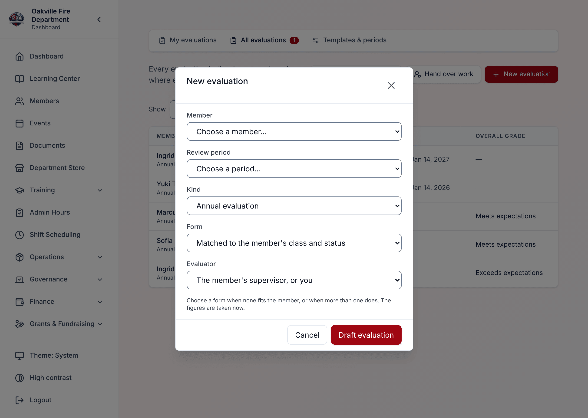

**Draft a review period** (managers, on the same list) drafts many at once:

1. Choose the period and the kind, then **Preview members**.
2. Every current member is listed with the form and evaluator they would get,
   or why they are left out (already drafted, no form fits, two forms fit
   equally well, or no full month served in the period). Anyone left out for
   want of a form can be drafted one at a time from **New evaluation**,
   choosing the form there.

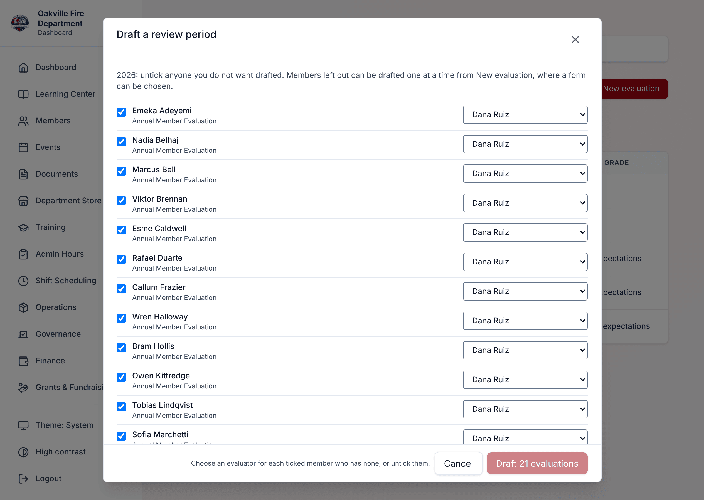 3. Untick anyone you do not want drafted, and choose an evaluator wherever
none is filled in. 4. **Draft**. Anyone who could not be drafted is listed with the reason.

**Which time counts.** The figures cover the member's time in the period, not
the whole period: they start from the first full month after the member joined
or rejoined, and leaves of absence and gaps in membership are left out. The
evaluation shows what was left out. A member who served no full month of the
period cannot be evaluated for it.

The figures are taken when the evaluation is drafted. The evaluator or a
manager can update them with **Update figures** until the evaluator locks
their part.

---

## Completing an evaluation

- **The member** fills in the self-evaluation and submits it. The evaluator
  never sees it before it is submitted. If the member misses the deadline and
  the form allows it, the evaluator may go on without it; the record shows it
  was not submitted.
- **The evaluator** fills in their part beside the member's figures, saves as
  they go, and submits it.
- **Calibration**, if the form has it: a `view_all` holder other than the
  evaluator (or the person a manager named on the step) opens the
  evaluation, chooses **Mark calibration complete**, and may tick items for
  the evaluator to revisit. Only the ticks are kept; talk through the changes
  in person. The evaluator sees the ticked items marked **Flagged at
  calibration**, and submits again.
- **Approvals:** each approver opens the evaluation and chooses the button
  named for their step (for example **Board approval**), types their name as
  it appears on their account, confirms they intend it as their signature, and
  confirms their identity. The evaluator cannot sign an approval, nor can
  someone who already signed another approval on the evaluation.
- **The member** can read the evaluation once everything before their step is
  done. They **acknowledge receipt**, or **refuse to sign** and give a reason.
  Either one finalizes the evaluation. Acknowledging is not agreeing, and the
  PDF says so.

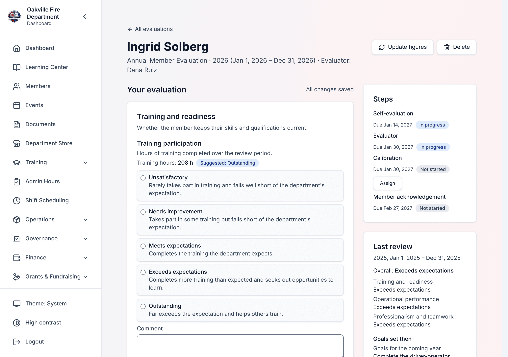

## Self-evaluation beside the evaluation

_(2026-11-22)_ Once the member has submitted their self-evaluation, the
evaluation page shows a **Self-evaluation beside the evaluation** card: each
rated item the member answered, with **Self:** and **Evaluator:** ratings side
by side, and **Far apart** on items two or more levels apart on a scale or
opposite on meets / does not meet — the points to raise when the review is
discussed. **Show only those** hides the rest. Unrated and not-applicable
items are never marked. For the evaluator it follows their ratings as they
change them, before saving. It is drawn from the two parts the page already
shows, so it reveals nothing new: the evaluator sees it once the
self-evaluation is submitted, the member once the evaluator's ratings are
released to them. It is not on the PDF, which carries both parts in full.

## Naming who takes a step

_(2026-11-16)_ Refusing the evaluator at calibration and approval would stall
an evaluation where the evaluator is the only holder of the step's position —
a department whose only Captain wrote it, say. So an `evaluations.manage`
holder can name who takes an approval or calibration step on one evaluation:

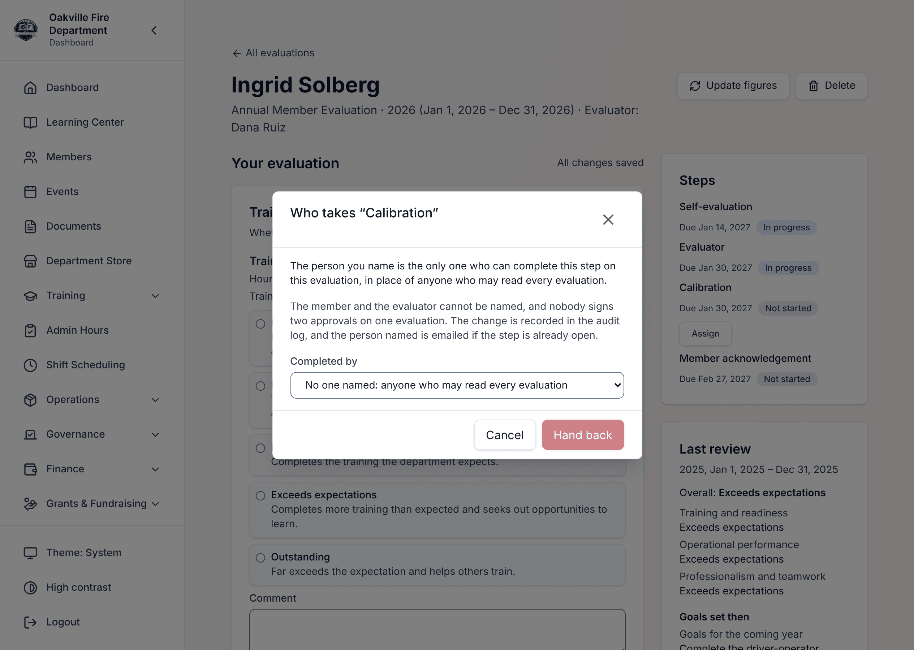

- On the evaluation's step list, a step not yet done shows **Assign** (or
  **Change**). The **Who takes "…"** dialog lists the members who may be
  named: any current member except the member, the evaluator and, on an
  approval, anyone who signed another approval on this evaluation.
- **Assign** asks the manager to confirm their identity, as signing does, and
  is recorded in the audit log (`evaluation_step_assigned`).
- The step then reads **Assigned to** _name_. Only that person can complete
  it, in place of the position's holders (or the `view_all` holders, for
  calibration). They read the evaluation as an approver does and are emailed
  if the step is already open.
- **No one named** → **Hand back** returns the step to the position. An
  amendment starts its new revision with nobody named. A position holder
  replaced by a name stops seeing the evaluation unless they have another
  part in it.

On upgrade, an evaluation already waiting on an approval whose only position
holder is its evaluator stays open until a manager names someone.

## Handing over open work

_(2026-11-21)_ When an evaluator or approver leaves or changes role, an
`evaluations.manage` holder moves everything they still have open in one
review period to someone else, instead of one evaluation at a time:

1. On the conduct list, **Hand over work** opens **Hand over open work**.
2. Choose the **Review period**, whose work (**Hand over the work of** lists
   only people with open work there, with a count each, a former member
   included) and who takes it (**To**).
3. **Preview** lists each evaluation with what would move, or **Skipped:** and
   why. Nothing changes yet.
4. **Hand over N evaluations**, then confirm your identity. The server decides
   each evaluation again by the same rule, so it does what the preview said.

What moves, on evaluations in progress: the evaluator's part while it is not
yet submitted (a draft stays, for the new evaluator to finish as theirs), and
approval and calibration steps not yet done that name the person. A step that
goes to a position's holders follows the position and is not moved. An
evaluation moves whole or not at all: it is skipped when the new person is its
member, cannot conduct evaluations, is already named on its approval or
calibration (when the evaluator's part moves), or is its evaluator or signed
another approval (when an approval moves). The new person gets **Evaluation
Waiting on You** for a step already open; the member is not emailed and sees
the new name. Each evaluation moved is audited as `evaluation_work_reassigned`.

## The last review

_(2026-11-20)_ An evaluation page shows a **Last review** card when the member
has an earlier finalized evaluation on the same form (any version) for a
period that ended before this one began. It gives that review's period, the
overall grade and each section's grade that stood (the evaluator's where they
changed the calculated one), and its goals under **Goals set then**, with
**Open the last review**. You see it only if you could open that review
yourself, so a new evaluator without `view_all` does not see a predecessor's
review. It is not printed on the PDF.

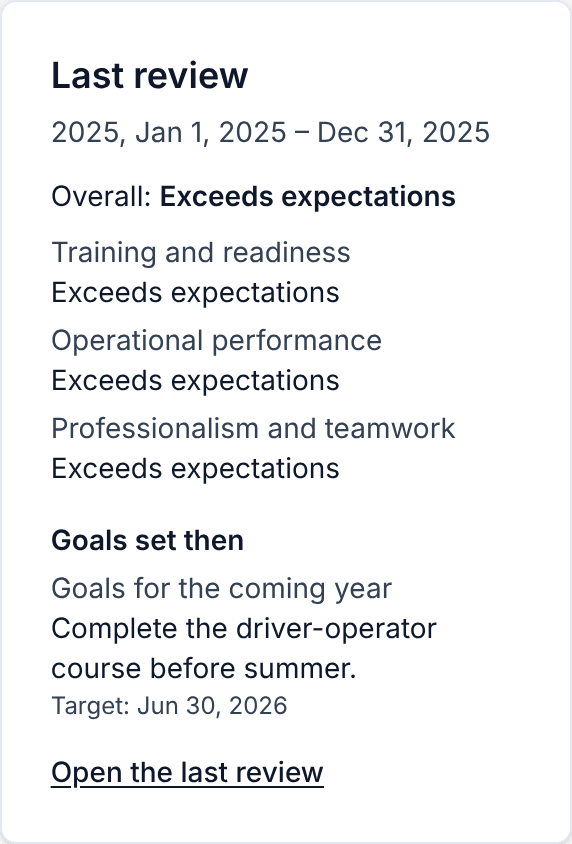

## Rating last year's goals

_(2026-11-21)_ A **Last review's goals** item turns the card's goals into a
rated part of the record. When the evaluation is drafted, the goals set in the
previous review (the one the card shows) are copied into it, and copied again
by **Update figures** until the evaluator locks their part. Each goal gets
**Met**, **Partly met**, **Not met** or **No longer applies**, and an optional
comment; the part cannot be submitted until every goal has a result. If the
item is in the self-evaluation, the member rates them too.

Because the copy is part of this evaluation, everyone who reads its content
sees the goals it rates — even an evaluator who cannot open last year's review
(the department's choice, 2026-11-21, so the record carries what it rates). The
goals and results are printed on the PDF and covered by the signatures, but do
not count toward any grade. With no previous review, or one that set no goals,
the item has nothing to rate and asks for nothing.

## Period results

_(2026-11-20)_ On the conduct list, a **Period** dropdown filters to one review
period. For a `view_all` holder the list adds an **Overall grade** column
(finalized evaluations only), and choosing a period shows a **Period results**
card — how many are complete and how many stand at each grade — with **Export
CSV** (`evaluation-results.csv`, one row per evaluation; each export audited
as `evaluation_period_exported`). `evaluations.manage` alone shows no grades.
Your own evaluation is left out of the list and the export.

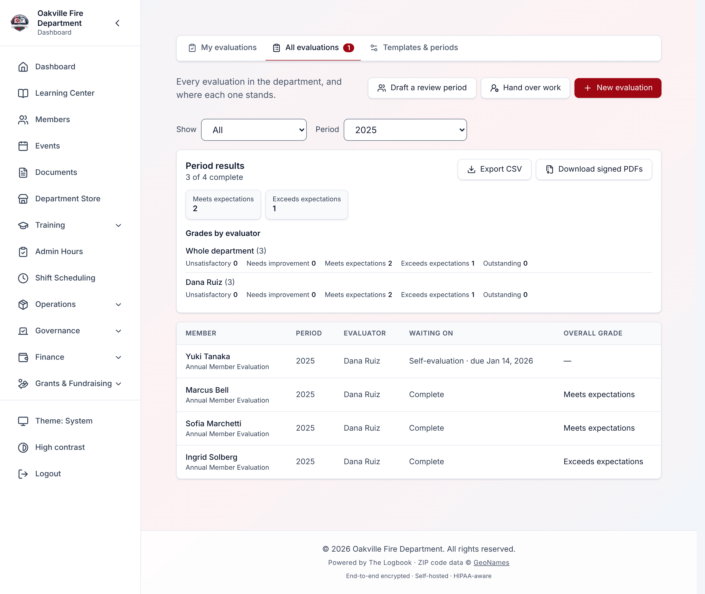

### Grades by evaluator

_(2026-11-23)_ At the foot of the **Period results** card, **Grades by
evaluator** counts the period's finalized reviews at each of the five grades
(Unsatisfactory to Outstanding): one line for the **Whole department**, then
one per evaluator with their number of reviews in brackets, so a chief can see
an evaluator who rates everyone the same before the results go further. It is
counted from the same reviews and grades as the list and the CSV, your own
left out; a review counts under the evaluator it stands under today; and a
weighted-percentage form or one with no overall is counted as **Not on the
five grades**. Nothing flags an evaluator: the department reads the spread
itself (owner decision 2026-11-22). Needs `evaluations.view_all`
(`GET /evaluations/grade-spread`).

### Signed PDFs for a period

_(2026-11-22)_ Beside **Export CSV**, **Download signed PDFs** downloads
`evaluation-pdfs.zip` with the signed PDF of every finalized evaluation in the
period — the copy as signed, without any later member response. It needs
`evaluations.view_all` and asks the person to confirm their identity, because
it hands over a period's personnel records at once; each download is audited
(`evaluation_period_pdfs_exported`, with the count) and watched as a bulk
export. Files are named _Member - Form - period end.pdf_; your own evaluation
is left out, as on the list. A PDF that cannot be read from storage is named
in **NOT INCLUDED.txt** inside the zip instead of failing the download.
If the button is greyed out, set **Show** to **All**: it counts the finalized
evaluations the list is showing, though the zip itself ignores that filter.

## Review history

_(2026-11-23)_ For an `evaluations.view_all` holder, the evaluation page shows
a **Review history** card below **Last review**: every other finalized review
of the member, newest first and on any form, each with its period (a link to
it), the form's name and **Overall:** the grade that stood (**No overall
result** where the form has none). Grades on different forms sit side by side
with the form named, since a member may have moved from one form to another.
A review you could not open yourself is left out. It is not printed on the
PDF.

## The PDF

When the evaluation is final, a PDF is made once, with the department's logo
and name, the figures, every answer, the signatures, any amendments and a
fingerprint of the record, and it is kept exactly as signed. Anyone who may
read the evaluation can **Download PDF**; every download is recorded. Pages
are footed "Page X of Y" _(2026-11-20)_; a PDF frozen before then keeps its
"Page N" footer.

## After it is final

- **The member's written response.** For the number of days the form allows
  (30 by default), the member can write a response on the evaluation page.
  A saved draft is theirs alone. **Submit response** makes it final: it is
  added to the record, a second PDF with the response is made, and the signed
  PDF is kept as it was (**Signed PDF, without response**).
- **Amending** (managers). **Amend** reopens a finalized evaluation with a
  reason. The evaluator's part comes back for changes with their earlier
  answers filled in, and calibration, approvals and the member's
  acknowledgement run again, with new due dates counted from the amendment.
  The self-evaluation is kept. The earlier text and PDF are not kept; the
  reason, who amended it and when are shown on the evaluation and printed on
  the next PDF.
- **Deleting** (`evaluations.delete`). **Delete** removes an evaluation, its
  signatures and its PDF for good, with a reason. A record that it was
  deleted, by whom and why stays on the member's history, where the member
  reads it under **Evaluations → My evaluations → Deleted evaluations**.

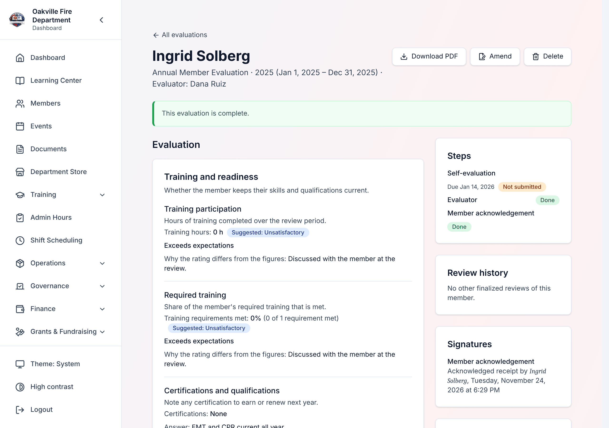

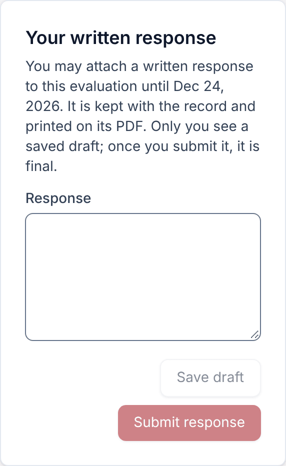

---

## Emails

Every evaluation email can be reworded under **Communications → Email
Templates → Performance Evaluations**, or switched off there. None of them
contains a rating, a comment, a response or a reason: they name the member,
the period and the step, and link to the evaluation.

| Email                     | Goes to                                                                     |
| ------------------------- | --------------------------------------------------------------------------- |
| Evaluation Waiting on You | whoever acts on a step when it opens; the evaluator again after calibration |
| Evaluation Step Due Soon  | whoever acts on a step, a few days before it is due (once per step)         |
| Evaluation Step Overdue   | whoever acts on a step, and evaluation managers, the day after it is due    |
| Evaluation Finalized      | the member and the evaluator                                                |
| Evaluation Amended        | the member and everyone who signed                                          |
| Evaluation Response       | the evaluator and evaluation managers                                       |
| Evaluation Deleted        | the member                                                                  |

Members always receive email about their own evaluation. Officers can turn off
the emails they receive because of a role ("Evaluation duties") in their
notification settings. Reminders and overdue notices are sent by a daily task
and never go out twice for the same step.

---

## Questions

**Can an evaluator see the member's self-evaluation before the member
submits it?** No.

**Can a supervisor see their crew's evaluations?** Yes, read-only. The
member's supervisor today, by the dated **Reports To** assignments, finds their
crew's evaluations under **My Crew** and sees the status and steps at once,
and the parts, figures and signatures once the evaluation is released to the
member: what the member can read. An assignment that has ended grants nothing,
and being a supervisor never lets someone draft, write, sign, calibrate, amend
or delete. To do any of that they must be the evaluator, an approver, named on
a step, or hold the matching permission.

**Why is a figure "not available"?** The Logbook could not measure it
honestly for that member and period (for example, call tracking is off, or no
meetings were held). It is never shown as zero or 100% instead.

**Can a finalized evaluation be edited?** Only by amending it, which reopens
it from the evaluator onward and records why.

**Can I keep a copy of a whole period's evaluations?** Yes, with
`evaluations.view_all`: choose the period on **All evaluations** and select
**Download signed PDFs** on the **Period results** card. See
[Signed PDFs for a period](#signed-pdfs-for-a-period).

**What does the member see of calibration?** The items that were flagged, once
the evaluation reaches them, and nothing else.

**What does "Positions held" count?** Every office and committee seat the
member held at any time during the period, including one given up partway
through. The dated history began when the 2026-11-08 upgrade ran, so a
position given up before then is not known. See `docs/KNOWN_LIMITATIONS.md`.
